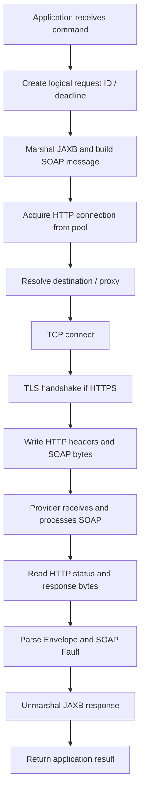
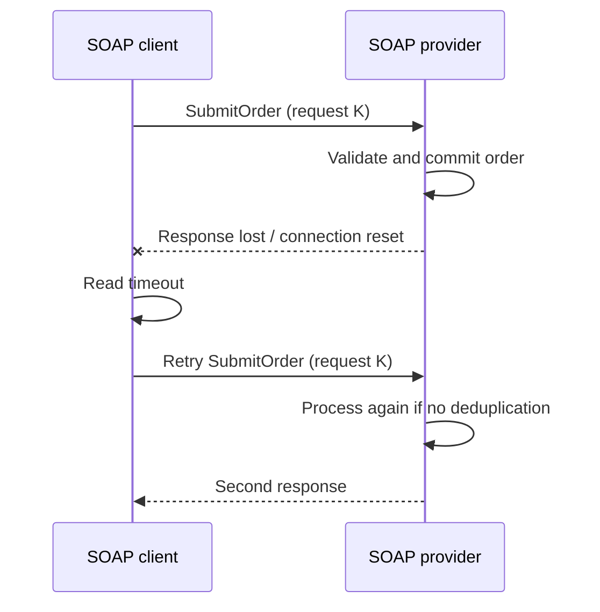
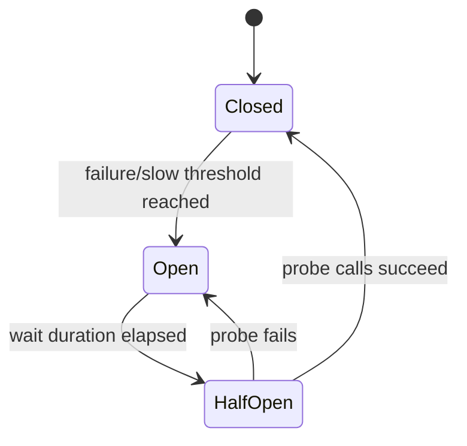

# Timeout theo giai đoạn và chính sách thử lại có kiểm soát

## 1. Bối cảnh: một SOAP call có thể chậm ở nhiều nơi

Một ứng dụng Spring Web Services gọi hệ thống đối tác qua `WebServiceTemplate`. Người dùng thấy thao tác tạo đơn mất 12 giây rồi báo lỗi. Log chỉ ghi “SOAP request timeout”, trong khi nguyên nhân có thể nằm ở DNS, chờ connection pool, TCP connect, TLS handshake, ghi request, đọc response hoặc một lần retry đã tiêu hết thời gian.

Timeout không chỉ là một con số gắn vào HTTP client. Mỗi giai đoạn có đặc điểm, bằng chứng và cách xử lý khác nhau:

- DNS chậm có thể xảy ra trước cả khi mở socket.
- Pool bão hòa khiến request phải chờ dù đối tác vẫn khỏe.
- TCP connect timeout thường liên quan route, firewall hoặc endpoint.
- TLS handshake có thể thất bại do certificate hoặc thương lượng protocol.
- Read timeout có thể xảy ra sau khi provider đã commit nghiệp vụ.
- Retry thiếu kiểm soát có thể khuếch đại sự cố và tạo đơn hàng trùng.

Đây là đề mục **“Timeout theo giai đoạn và chính sách thử lại có kiểm soát”**, thuộc chương **Hiệu năng và vận hành** của module **SPRING_WEB_SERVICES**. Module học cách phát triển dịch vụ SOAP contract-first bằng Spring Web Services, thiết kế XSD/WSDL, JAXB, endpoint/client, SOAP Fault, interceptor, XML security, WS-Security, chứng chỉ và kiểm thử tương thích.

Sau bài học, bạn có thể:

- Mô tả vòng đời của một SOAP client call và phân biệt timeout theo từng phase.
- Thiết kế deadline tổng, timeout cho pool/connect/read và ngân sách cho retry.
- Cấu hình timeout tại WebServiceMessageSender/HTTP client phù hợp.
- Phân biệt transport exception, HTTP error, SOAP Fault và lỗi XML.
- Quyết định lỗi nào an toàn để thử lại, lỗi nào cần dừng.
- Thiết kế exponential backoff, jitter, Retry-After, retry budget và circuit breaker.
- Bảo đảm operation có side effect an toàn khi client không biết provider đã commit hay chưa.
- Theo dõi timeout/retry bằng metrics, tracing và log có cấu trúc.
- Kiểm thử delayed response, pool saturation và retry sau commit bằng fixture có kiểm soát.

## 2. Vòng đời của một SOAP call

### 2.1. Các giai đoạn chính



Thứ tự thực tế phụ thuộc transport. DNS có thể được resolve trước hoặc trong lúc connect; proxy tunnel có thêm phase; connection reuse có thể bỏ qua DNS/TCP/TLS handshake ở request tiếp theo. Với HTTPS qua proxy, client thường kết nối TCP tới proxy, gửi CONNECT, rồi thực hiện TLS handshake qua tunnel tới origin.

### 2.2. Timeout nào đo điều gì?

| Timeout/deadline | Phạm vi | Ví dụ lỗi |
|---|---|---|
| DNS/resolution timeout | Tìm địa chỉ đích | Resolver chậm/không trả lời |
| Connection-request timeout | Chờ lấy connection từ pool | Pool hết slot |
| Connect timeout | Thiết lập TCP connection | Route không hoàn thành |
| TLS handshake timeout | Hoàn tất TLS negotiation | Peer không trả lời handshake |
| Write timeout | Ghi request vào socket | Peer không đọc dữ liệu |
| Read/socket timeout | Chờ dữ liệu response | Provider xử lý lâu hoặc network drop |
| Overall deadline | Toàn bộ logical operation | Tổng các phase/retry vượt SLA |

Không phải HTTP client nào cũng có một property độc lập cho tất cả các dòng trên. Có transport dùng socket timeout chung cho nhiều phase, có transport có connection-request timeout riêng, có API không expose write timeout riêng. Phải xác định sender và phiên bản thư viện thực tế trước khi chọn property.

### 2.3. Kết quả của mỗi phase có ý nghĩa khác nhau

- Lỗi trước khi request được gửi thường cho biết provider chưa nhận SOAP payload, nhưng cần hiểu proxy/TLS và write boundary để kết luận.
- Lỗi trong lúc write có thể không biết provider đã nhận bao nhiêu bytes.
- Read timeout thường xảy ra sau khi request đã được gửi; provider có thể vẫn đang xử lý.
- Lỗi parse/unmarshal xảy ra sau khi có response bytes; retry vì lỗi parse thường không giúp dữ liệu hợp lệ hơn.
- SOAP Fault là một phản hồi protocol/application có cấu trúc; không nên coi mọi Fault như lỗi mạng tạm thời.

**Timeout không tự chứng minh operation thất bại ở provider.** Đây là điểm quan trọng nhất khi kết hợp timeout với retry.

## 3. Phân biệt timeout, deadline và SLA

### 3.1. Timeout là giới hạn của một lần chờ

Ví dụ connect timeout 1 giây giới hạn thời gian thiết lập TCP connection. Read timeout 3 giây giới hạn thời gian chờ dữ liệu response theo behavior của transport. Hai giới hạn này không tự tạo thành deadline 4 giây cho toàn call.

Nếu một call trải qua:

```text
Pool acquisition      0.8 s
DNS + TCP connect     0.7 s
TLS handshake         0.4 s
Write request         0.1 s
Read response         3.0 s
---------------------------
Elapsed               5.0 s
```

thì application đã mất khoảng 5 giây, mặc dù read timeout chỉ là 3 giây.

### 3.2. Deadline là thời điểm cuối cùng operation còn được phép chạy

Deadline được tạo một lần cho logical operation. Mỗi phase và mỗi retry chỉ được dùng phần thời gian còn lại:

```text
deadline = operationStart + 8 seconds
remaining = deadline - now
```

Khi `remaining <= 0`, không bắt đầu attempt mới. Nếu còn 500 ms, không nên bắt đầu một request có connect/read budget tối thiểu dài hơn 500 ms.

### 3.3. SLA ở nhiều tầng

| Tầng | Ví dụ mục tiêu | Phạm vi |
|---|---|---|
| User/API | p99 dưới 5 giây | Từ lúc nhận đến lúc trả response |
| Application operation | Deadline 4 giây | Một logical business command |
| SOAP attempt | Kết nối/đọc theo budget còn lại | Một lần gửi |
| Provider | Xử lý 2 giây ở p95 | Phần xử lý phía đối tác |
| Retry policy | Tối đa 2 lần thử | Tổng cả operation |

Các giá trị chỉ là ví dụ. Chúng phải được thống nhất với SLA, latency thực tế, network path và thời gian xử lý của partner.

### 3.4. Dùng monotonic clock để đo elapsed time

Khi tính deadline trong một process, nên dùng monotonic time source như `System.nanoTime()` thay vì đồng hồ lịch `Instant.now()` để tính thời gian trôi qua. Wall clock có thể bị điều chỉnh bởi NTP hoặc thay đổi hệ thống; monotonic clock phù hợp để đo duration.

`Instant` vẫn hữu ích cho timestamp/log và deadline được truyền qua process, nhưng khi nhận deadline từ xa cần chuyển sang budget duration và dùng monotonic clock nội bộ để đếm ngược.

### 3.5. Ví dụ truyền deadline trong application

Một application service có thể tạo deadline rồi truyền vào client facade:

```java
long startedAt = System.nanoTime();
long budgetNanos = Duration.ofSeconds(6).toNanos();
long deadlineNanos = startedAt + budgetNanos;

OrderResult result = ordersSoapGateway.submit(
        command,
        deadlineNanos);
```

Ví dụ này minh họa truyền deadline trong cùng process. Cần xử lý overflow khi cộng duration rất lớn trong code production; deadline nên có upper bound hợp lý.

Helper tính thời gian còn:

```java
static Duration remaining(long deadlineNanos) {
    long nanos = deadlineNanos - System.nanoTime();
    if (nanos <= 0) {
        return Duration.ZERO;
    }
    return Duration.ofNanos(nanos);
}
```

Không truyền `remaining` như một giá trị cố định rồi giữ lâu. Tính lại ngay trước mỗi phase/attempt.

### 3.6. Không đặt timeout bằng zero theo suy đoán

API khác nhau có thể diễn giải zero là infinite/no timeout, timeout tức thời hoặc dùng default. Hãy đọc contract của đúng phiên bản sender/client. Một config value zero không nên được coi là “an toàn” nếu chưa xác minh semantics.

### 3.7. Deadline phải xuyên qua retry layer

Nếu retry library không biết deadline ngoài cùng, nó có thể bắt đầu attempt mới sau khi caller đã hết thời gian chờ. Kết quả là:

- Caller đã trả timeout nhưng background request vẫn chạy.
- Một request không còn người chờ vẫn tiêu connection/pool.
- Retry phát sinh side effect sau khi business workflow đã chuyển sang trạng thái khác.

Deadline cần được kiểm tra trước backoff, trước attempt mới và trong quá trình chờ có thể cancel được.

## 4. Cấu hình timeout với Spring Web Services

`WebServiceTemplate` xử lý SOAP message và gọi `WebServiceMessageSender` cho phần transport. Timeout thường thuộc sender hoặc HTTP client underlying, không thuộc JAXB marshaller.

### 4.1. Chọn sender theo khả năng cần thiết

Các lựa chọn thường gặp:

- `HttpUrlConnectionMessageSender`: dùng JDK `HttpURLConnection`, phù hợp nhu cầu đơn giản và khả năng cấu hình của JDK transport.
- `HttpComponentsMessageSender`: tích hợp Apache HttpComponents; phù hợp khi cần kiểm soát connection manager/pool và cấu hình HTTP client.
- Custom sender: khi cần route, TLS, proxy, observability hoặc deadline behavior đặc thù.

API thay đổi theo phiên bản Spring-WS và Apache HttpComponents. Phải khóa dependency và xác minh chính xác timeout setter/underlying request config đang được dùng. Không trộn ví dụ HttpClient 4 với HttpClient 5.

### 4.2. Ví dụ cấu hình minh họa với HttpComponents sender

Với Spring-WS/Apache HttpComponents release có API tương ứng:

```java
@Bean
HttpComponentsMessageSender ordersMessageSender() {
    HttpComponentsMessageSender sender =
            new HttpComponentsMessageSender();
    sender.setConnectionTimeout(800);
    sender.setReadTimeout(2_000);
    return sender;
}

@Bean
WebServiceTemplate ordersTemplate(
        Jaxb2Marshaller ordersMarshaller,
        HttpComponentsMessageSender ordersMessageSender) {
    WebServiceTemplate template = new WebServiceTemplate();
    template.setMarshaller(ordersMarshaller);
    template.setUnmarshaller(ordersMarshaller);
    template.setMessageSender(ordersMessageSender);
    template.setDefaultUri(
            "https://partner.example.test/soap/orders");
    return template;
}
```

Đây là mô hình minh họa cho sender với hai timeout setter. Nếu client dùng connection pool, cần cấu hình pool acquisition timeout tại connection manager/request config phù hợp. Hai setter trong ví dụ không tự cấu hình mọi timeout trong bảng phase.

### 4.3. Không giả định setter có tác dụng như tên gọi

Một số sender có thể dùng một socket timeout cho TLS/read; một số version có default timeout riêng. Test integration cần kiểm tra:

1. Endpoint server có nhận request hay không.
2. Elapsed time có nằm trong khoảng dự kiến không.
3. Exception/cause cho thấy phase nào thất bại.
4. Connection có được release sau timeout không.
5. Attempt tiếp theo có dùng đúng budget còn lại không.

### 4.4. Connection pool và keep-alive

Pool giúp tái sử dụng connection, giảm DNS/TCP/TLS overhead. Nhưng cần quản lý:

- Max total connections.
- Max connections per route/partner.
- Acquisition timeout.
- Idle connection eviction.
- Stale connection validation/behavior.
- Connection TTL và keep-alive policy.
- Release sau response success hoặc exception.

Pool quá nhỏ gây queue latency; pool quá lớn có thể vượt connection limit của partner và làm tăng áp lực tài nguyên. Cần đo pending/leased/available connections.

### 4.5. Timeout và cancellation

Khi application deadline hết, cancellation nên dừng chờ và giải phóng resource. Tuy nhiên, cancel client future không bảo đảm provider đã dừng xử lý SOAP request. Provider có thể tiếp tục xử lý sau khi connection bị đóng.

Vì vậy cancellation là hành vi tiết kiệm tài nguyên ở client, không phải rollback nghiệp vụ ở server. Để bảo đảm business correctness vẫn cần idempotency/status query/compensation.

## 5. Xác định lỗi có được retry hay không

Retry không nên dựa trên việc “call ném exception”. Phải xác định loại lỗi, phase, khả năng request đã tới provider, semantics operation và deadline còn lại.

### 5.1. Retryability matrix

| Failure | Mặc định | Lý do/điều kiện |
|---|---|---|
| DNS temporary failure | Có thể retry giới hạn | Resolver/transient network; phân biệt hostname sai |
| Unknown host cố định | Không | Retry không sửa hostname/DNS record |
| Connection refused | Có thể retry giới hạn | Service có thể đang restart; backoff cần thiết |
| Connect timeout | Có thể retry giới hạn | Chỉ nếu route/destination có thể hồi phục |
| Pool acquisition timeout | Cẩn trọng | Có thể là saturation nội bộ; retry tăng tải pool |
| TLS trust/hostname failure | Không | Cấu hình/certificate sai, retry không giải quyết |
| TLS handshake timeout | Có thể retry giới hạn | Nếu peer/network transient và policy cho phép |
| HTTP write timeout | Kết quả không chắc chắn | Provider có thể nhận một phần hoặc toàn bộ request |
| Read timeout | Kết quả không chắc chắn | Provider có thể đã commit |
| HTTP 429 | Có điều kiện | Tôn trọng Retry-After, retry budget |
| HTTP 502/503/504 | Có điều kiện | Gateway/provider tạm lỗi; operation phải an toàn |
| HTTP 400/401/403/404 | Thường không | Input/credential/permission/resource cần xử lý |
| SOAP validation/business Fault | Không | Retry cùng request không thay đổi business condition |
| SOAP transient Fault theo contract | Có điều kiện | Chỉ nếu fault code được công bố retryable |
| XML malformed/unmarshal failure | Không | Contract/serializer response lỗi |

Đây là policy khởi đầu, không phải luật phổ quát. Provider contract có thể chỉ rõ một số Fault code hoặc status được retry; cấu hình của partner và semantics thực tế phải được ưu tiên.

### 5.2. Phân biệt known failure và unknown outcome

Có ba mức hiểu biết:

1. **Known not sent:** request chưa rời client hoặc chưa được gửi tới origin; khả năng side effect thường thấp.
2. **Possibly sent:** write thất bại giữa chừng, proxy đóng tunnel hoặc connection reset; provider có thể đã nhận một phần/toàn bộ payload.
3. **Possibly committed:** provider đã xử lý request nhưng response bị mất/timeout; nghiệp vụ có thể đã hoàn thành.

Transport exception không phải lúc nào cũng cho phép phân loại chính xác. Khi không chứng minh được request chưa được gửi, hãy coi side-effect operation có outcome chưa xác định.

### 5.3. Không retry SOAP Fault theo message text

Không viết policy kiểu:

```java
if (faultString.contains("temporary")) {
    retry();
}
```

Reason/fault text có thể được dịch, thay wording hoặc chứa thông tin không ổn định. Nếu cần retry Fault, contract phải định nghĩa machine-readable fault code/detail, ví dụ `TEMPORARY_PROVIDER_UNAVAILABLE`; client parse QName/code và chỉ retry các code được cho phép.

### 5.4. HTTP status không đủ để quyết định một mình

HTTP 503 thường gợi ý service unavailable, nhưng nếu operation đã tạo side effect và gateway chỉ mất response, retry vẫn có thể trùng nghiệp vụ. Ngược lại, một HTTP response có thể đi kèm SOAP Fault cho biết business request không hợp lệ. Quyết định retry phải kết hợp:

- HTTP status và response headers.
- SOAP Fault code/detail nếu có.
- Transport phase và request-send certainty.
- Operation idempotency guarantee.
- Deadline/retry budget còn lại.

## 6. Exponential backoff, jitter và Retry-After

### 6.1. Vì sao retry ngay lập tức có hại?

Khi partner đang quá tải, nhiều client đồng loạt retry ngay sẽ tăng request rate đúng lúc provider thiếu capacity. Retry tức thời có thể tạo vòng lặp:

```text
Provider overload
   -> request latency tăng
   -> client timeout
   -> client retry ngay
   -> provider nhận nhiều request hơn
   -> latency và timeout tăng thêm
```

Backoff làm giãn requests; jitter phân tán thời điểm retry giữa các client.

### 6.2. Exponential backoff

Một công thức cơ bản:

\[
delay_n = \min(cap,\ base \times 2^{n-1})
\]

Trong đó:

- `base`: khoảng chờ ban đầu.
- `n`: số thứ tự lần retry (bắt đầu từ 1).
- `cap`: giới hạn delay tối đa.

Ví dụ base 200 ms, cap 2 giây:

| Lần retry | Delay trước jitter |
|---:|---:|
| 1 | 200 ms |
| 2 | 400 ms |
| 3 | 800 ms |
| 4 | 1.600 ms |
| 5 | 2.000 ms |

### 6.3. Full jitter

Full jitter chọn delay ngẫu nhiên trong khoảng:

\[
delay = random(0,\ exponentialBackoff)
\]

Điều này giúp giảm việc nhiều client cùng retry tại một mốc. Các chiến lược khác như equal jitter/decorrelated jitter cũng được dùng; chọn một chiến lược có chủ đích và test được.

### 6.4. Retry-After

HTTP có thể trả `Retry-After` dưới dạng:

- Số giây delay.
- HTTP-date chỉ thời điểm có thể thử lại.

Client cần:

1. Parse header theo format HTTP được định nghĩa.
2. Giới hạn delay theo policy tối đa.
3. So với remaining overall deadline.
4. Không retry nếu thời gian chờ vượt deadline.
5. Không bỏ qua header chỉ vì local backoff ngắn hơn, trừ khi policy contract định nghĩa rõ hành vi khác.

Nếu header sai format, fallback về local backoff theo policy; không coi giá trị không hợp lệ là zero delay.

### 6.5. Kết hợp server hint với local jitter

Một policy có thể lấy:

```text
localDelay = fullJitter(exponentialBackoff)
localDelay = min(localDelay, configuredMaxDelay)
serverDelay = parseRetryAfterOrZero()
if serverDelay > acceptedServerDelayLimit:
    stop or defer operation; do not retry earlier than server asked
chosenDelay = max(localDelay, serverDelay)
```

Sau đó kiểm tra chosenDelay + minimumAttemptBudget <= remainingDeadline. Cap áp dụng cho local backoff; không cắt một Retry-After hợp lệ xuống thời gian ngắn hơn server yêu cầu. Nếu server hint vượt giới hạn chấp nhận hoặc không còn đủ overall deadline, dừng và trả trạng thái retry/deferred phù hợp.

### 6.6. Retry phải có max attempts

Giới hạn attempts giúp bound load. Cần phân biệt:

- `maxAttempts`: tổng số lần gọi, thường bao gồm lần đầu.
- `maxRetries`: số lần gọi thêm sau lần đầu.

Tên property của framework/library có thể dùng một trong hai khái niệm. Ví dụ “maxAttempts = 3” thường nghĩa tối đa 3 calls, tương đương 2 retries.

Ghi rõ semantics trong config để tránh vô tình chạy nhiều request hơn dự tính.

### 6.7. Không sleep trong thread request quá lâu

Backoff blocking có thể giữ servlet/request thread và chiếm concurrency. Với synchronous `WebServiceTemplate`, việc chờ backoff trong cùng thread là hành vi thường thấy nếu tự triển khai đơn giản. Cần cân nhắc:

- Deadline ngắn và tối đa một vài attempts.
- Executor/bulkhead giới hạn concurrency nếu cần chạy async.
- Scheduler/non-blocking retry nếu stack hỗ trợ.
- Không giữ transaction/database connection mở trong lúc chờ.

Không chuyển sang async chỉ để né timeout; phải quản lý cancellation, context propagation và transaction boundary.

## 7. Thiết kế retry loop có deadline

Retry policy nên là một thành phần rõ ràng nằm quanh SOAP gateway, không rải try/catch và Thread.sleep trong nhiều service.

### 7.1. Những đầu vào cần có

Một policy thực tế cần biết:

- Operation name và partner/destination.
- Logical request ID/idempotency key.
- Deadline/remaining budget.
- Attempt count/max attempts.
- Phân loại exception/HTTP status/SOAP Fault.
- Backoff strategy và Retry-After.
- Retry budget/circuit breaker state.
- Operation có idempotent hay không.

### 7.2. Pseudocode

```text
deadline = monotonicNow() + totalBudget
attempt = 0

while attempt < maxAttempts:
    remaining = deadline - monotonicNow()
    if remaining <= minimumAttemptBudget:
        stop with deadline exceeded

    attempt += 1
    try:
        return invokeSoap(request, timeoutBudget = remaining)
    catch error:
        decision = classify(error, operation, sendState)
        if decision is not retryable:
            fail immediately
        if attempt == maxAttempts:
            fail with attempts exhausted

        delay = chooseBackoff(attempt, error.retryAfter)
        remaining = deadline - monotonicNow()
        if delay + minimumAttemptBudget > remaining:
            fail with deadline exceeded

        wait(delay) with cancellation support

fail
```

Mỗi attempt dùng cùng logical request identity và chỉ dùng phần budget còn lại. Không bắt đầu retry nếu caller đã cancel hoặc circuit breaker đang open.

### 7.3. Java retry policy minh họa

Đoạn code sau minh họa phần quyết định retry/backoff cho một gateway synchronous. `invokeOnce` phải cấu hình transport timeout theo budget được truyền vào; nó không được bỏ qua budget và dùng timeout cố định.

```java
public final class RetryPolicy {
    private final int maxAttempts;
    private final Duration minimumAttemptBudget;
    private final Duration baseDelay;
    private final Duration maxDelay;
    private final RandomGenerator random;

    public RetryPolicy(
            int maxAttempts,
            Duration minimumAttemptBudget,
            Duration baseDelay,
            Duration maxDelay,
            RandomGenerator random) {
        if (maxAttempts < 1) {
            throw new IllegalArgumentException("maxAttempts must be >= 1");
        }
        Objects.requireNonNull(minimumAttemptBudget);
        Objects.requireNonNull(baseDelay);
        Objects.requireNonNull(maxDelay);
        Objects.requireNonNull(random);
        if (minimumAttemptBudget.isNegative()
                || baseDelay.isNegative()
                || maxDelay.isNegative()) {
            throw new IllegalArgumentException("Durations must be non-negative");
        }
        // Validate that all configured durations fit into nanoseconds.
        minimumAttemptBudget.toNanos();
        baseDelay.toNanos();
        maxDelay.toNanos();
        this.maxAttempts = maxAttempts;
        this.minimumAttemptBudget = minimumAttemptBudget;
        this.baseDelay = baseDelay;
        this.maxDelay = maxDelay;
        this.random = random;
    }

    public Duration fullJitter(int retryNumber) {
        if (retryNumber < 1) {
            throw new IllegalArgumentException("retryNumber must be >= 1");
        }
        long multiplier = 1L << Math.min(retryNumber - 1, 30);
        long exponential;
        try {
            exponential = Math.multiplyExact(
                    baseDelay.toNanos(), multiplier);
        } catch (ArithmeticException overflow) {
            exponential = Long.MAX_VALUE;
        }
        long cap = Math.min(exponential, maxDelay.toNanos());
        if (cap <= 0) {
            return Duration.ZERO;
        }
        if (cap == Long.MAX_VALUE) {
            return Duration.ofNanos(random.nextLong(Long.MAX_VALUE));
        }
        return Duration.ofNanos(random.nextLong(cap + 1));
    }

    public int maxAttempts() {
        return maxAttempts;
    }

    public Duration minimumAttemptBudget() {
        return minimumAttemptBudget;
    }
}
```

Đây chỉ là utility minh họa; `RandomGenerator` thuộc JDK 17 trở lên (JDK cũ có thể inject `Random` hoặc abstraction riêng). Production code cần validate duration dương, giới hạn giá trị có thể chuyển sang nanoseconds, xử lý conversion overflow và dùng random source có thể inject để test deterministic. Policy nên giới hạn số retry thấp.

### 7.4. Orchestrator cần phân loại lỗi trước khi gọi lại

```java
for (int attempt = 1; attempt <= policy.maxAttempts(); attempt++) {
    Duration remaining = deadline.remaining();
    if (remaining.compareTo(policy.minimumAttemptBudget()) <= 0) {
        throw new OperationDeadlineExceededException();
    }

    try {
        return gateway.invokeOnce(request, remaining);
    } catch (Exception error) {
        RetryDecision decision = classifier.classify(
                error, operationDescriptor, attempt);
        if (!decision.retryable() || attempt == policy.maxAttempts()) {
            throw translate(error);
        }

        int retryNumber = attempt;
        Duration delay = decision.retryAfter()
                .orElseGet(() -> policy.fullJitter(retryNumber));
        if (delay.plus(policy.minimumAttemptBudget())
                .compareTo(deadline.remaining()) > 0) {
            throw new OperationDeadlineExceededException(error);
        }
        sleeper.sleepInterruptibly(delay);
    }
}
throw new OperationAttemptsExhaustedException();
```

Đoạn này là cấu trúc minh họa, không phải lớp production hoàn chỉnh: deadline, gateway, classifier, exception và sleeper là abstraction của ứng dụng. OperationAttemptsExhaustedException là exception cuối khi hết vòng lặp. Khi thread bị interrupt, phải giữ interrupt flag hoặc propagate cancellation đúng quy ước.

### 7.5. Không bắt mọi Exception rồi retry

Policy nên bắt các exception transport có thể phân loại, hoặc dùng classifier ở ranh giới gateway. Không retry:

- NullPointerException/bug lập trình.
- JAXBException/unmarshal data error trừ khi contract nêu rõ response transient.
- Security/certificate configuration errors.
- Business fault.
- Validation errors.

Bắt Exception rộng có thể phù hợp để chuyển đổi lỗi ra application boundary, nhưng quyết định retry vẫn phải qua classifier allowlist; không coi mọi exception là retryable.

## 8. Idempotency và unknown outcome

Đây là phần quan trọng nhất của retry khi SOAP operation tạo side effect.

### 8.1. Vì sao timeout có thể tạo duplicate?



Client không biết provider đã commit hay chưa. Nếu request retry có semantics “tạo một đơn mới”, provider có thể tạo duplicate.

### 8.2. Idempotent operation

Một operation là idempotent khi thực hiện lặp lại cùng logical request không làm thay đổi kết quả nghiệp vụ sau lần đầu. Tính chất này phải được định nghĩa trong contract/domain behavior, không phải do HTTP POST tự cung cấp.

Ví dụ:

- `GetOrder`: thường read-only, có thể retry nếu consistency policy cho phép.
- `SetOrderStatus(ORDER-1, ACCEPTED)`: có thể idempotent nếu đặt cùng trạng thái không tạo side effect bổ sung.
- `SubmitOrder`: không mặc định idempotent vì mỗi call có thể tạo một order.
- `ChargePayment`: không được retry mù nếu không có deduplication/transaction semantics.

### 8.3. Idempotency key

Với operation có side effect, contract có thể có field hoặc SOAP Header chứa logical request ID:

```xml
<o:SubmitOrderRequest xmlns:o="urn:example:orders:v1">
  <o:clientRequestId>partner-a:REQ-2026-000123</o:clientRequestId>
  <o:order>
    <o:customerId>C-01</o:customerId>
    <o:amount currency="USD">125.50</o:amount>
  </o:order>
</o:SubmitOrderRequest>
```

Provider phải lưu key theo scope đã thống nhất, ví dụ partner + operation + clientRequestId. Cần xác định:

- Key uniqueness và format/length.
- Thời gian giữ record deduplication.
- Cách so payload fingerprint khi cùng key được gửi lại.
- Hành vi nếu cùng key nhưng payload khác.
- Kết quả được trả lại cho retry.
- Cơ chế reconciliation nếu trạng thái operation đang pending/unknown.

### 8.4. Cùng key, cùng payload và cùng key, khác payload

| Request lặp | Hành vi nên được contract hóa |
|---|---|
| Cùng key, cùng payload, lần đầu đã commit | Trả kết quả đã lưu, không tạo side effect mới |
| Cùng key, cùng payload, lần đầu đang xử lý | Trả trạng thái đang xử lý hoặc chờ theo policy |
| Cùng key, payload khác | Từ chối conflict/validation theo fault contract |
| Key mới, payload giống | Operation mới nếu contract xác định như vậy |
| Key cũ sau thời gian retention | Semantics phải được công bố; tránh âm thầm tạo duplicate ngoài mong đợi |

Không được tạo key mới cho mỗi retry. Key phải được sinh một lần cho logical operation, lưu cùng command và giữ nguyên qua mọi attempts.

### 8.5. Provider deduplication phải atomic

Một cách triển khai thường dùng là unique constraint trên `(partner_id, operation_name, idempotency_key)`. Trong transaction:

1. Ghi nhận key/fingerprint hoặc claim xử lý.
2. Nếu key đã có kết quả, đọc kết quả cũ.
3. Nếu key đang xử lý, áp dụng chính sách pending.
4. Nếu key mới, thực thi business command và lưu kết quả.
5. Commit side effect và deduplication result nhất quán.

Nếu deduplication record và side effect được ghi ở hai transaction độc lập, server có thể vẫn tạo duplicate khi crash giữa chúng. Cần transaction boundary, locking/state machine hoặc durable workflow phù hợp.

### 8.6. SOAP Fault cho idempotency conflict

Nếu cùng key nhưng payload fingerprint khác, trả fault detail ổn định, ví dụ:

```xml
<o:IdempotencyFault xmlns:o="urn:example:orders:faults:v1">
  <o:code>IDEMPOTENCY_KEY_REUSED</o:code>
  <o:requestId>partner-a:REQ-2026-000123</o:requestId>
</o:IdempotencyFault>
```

Client không retry fault này với cùng payload. Nó cần điều tra caller/key collision.

### 8.7. Nếu provider không hỗ trợ idempotency

Không tự giả định retry an toàn. Tùy operation:

- Không retry read timeout; trả trạng thái unknown cho caller và cung cấp reconciliation.
- Gọi operation tra cứu trạng thái bằng business reference nếu provider hỗ trợ.
- Yêu cầu operator/consumer xác minh trước khi gửi lại.
- Dùng outbox/workflow để quản lý trạng thái pending và tránh sinh request mới tùy tiện.

Đôi khi trả “kết quả chưa xác định, cần tra soát” chính xác hơn việc tự retry và tạo duplicate.

## 9. Retry budget, circuit breaker và bulkhead

Backoff và max attempts giới hạn một logical call; khi có hàng nghìn calls đồng thời, cần bảo vệ cả hệ thống.

### 9.1. Retry budget

Retry budget giới hạn tỷ lệ request retry so với traffic bình thường, theo partner hoặc service. Ví dụ một policy minh họa:

```text
For each 100 original requests:
    allow at most 20 retry requests
If retry budget exhausted:
    fail fast / return retryable outcome to caller
```

Không phải tỷ lệ 20% là chuẩn chung. Chọn budget dựa vào capacity, retry behavior và SLA. Retry budget giúp tránh việc client tạo lượng traffic mới lớn hơn traffic ban đầu khi upstream gặp sự cố.

### 9.2. Circuit breaker

Circuit breaker tạm ngăn calls tới partner khi failure/slow-call rate vượt ngưỡng:



- **Closed:** cho phép requests bình thường.
- **Open:** fail fast, không tiếp tục tạo socket/request tới partner.
- **Half-open:** chỉ cho một số probe calls thử khả năng phục hồi.

Không đưa lỗi validation/business SOAP Fault vào failure rate như lỗi connectivity nếu điều đó không phản ánh partner health. Phân loại exception là phần cấu hình quan trọng.

### 9.3. Đặt thứ tự retry và circuit breaker

Thứ tự decorator ảnh hưởng behavior:

- Retry bên trong circuit breaker: một logical call có thể tạo nhiều attempts trước khi breaker ghi nhận failure cuối cùng.
- Circuit breaker bên trong retry: từng attempt có thể được ghi nhận riêng, dễ mở breaker nhanh hơn.

Không có thứ tự duy nhất đúng cho mọi hệ thống. Chọn theo đơn vị cần đo (logical operation hay attempt), ghi rõ và test. Metrics phải phân biệt logical call với individual attempt.

### 9.4. Bulkhead và concurrency limit

Bulkhead giới hạn số calls đồng thời tới mỗi partner. Khi partner chậm, calls không được phép chiếm toàn bộ thread/connection pool của ứng dụng.

Có thể giới hạn:

- Concurrent SOAP operations trên mỗi partner.
- Threads/executor queue.
- HTTP pool per route.
- Request rate/tenant.

Khi giới hạn chạm ngưỡng, fail fast hoặc queue có giới hạn và deadline. Queue vô hạn chỉ dời timeout từ socket sang memory/thread exhaustion.

### 9.5. Retry và circuit breaker không thay thế deadline

Circuit breaker bảo vệ dependency; retry xử lý transient failure; bulkhead giới hạn concurrency; deadline bảo đảm logical call có giới hạn thời gian. Cần phối hợp tất cả:

```text
Caller deadline
  -> bulkhead admission
  -> circuit breaker permission
  -> bounded retry policy
  -> per-attempt transport timeouts
  -> SOAP provider
```

Nếu deadline hết ở bất kỳ bước nào, dừng operation và không khởi động thêm attempts.

## 10. Metrics, tracing và log cho timeout/retry

Nếu mọi lỗi đều được ghi thành “SOAP timeout”, nhóm vận hành không thể biết partner chậm, pool bão hòa hay retry đang khuếch đại traffic.

### 10.1. Đo logical operation và attempt riêng

Một logical operation có thể tạo nhiều attempts. Metrics cần phân biệt:

- Logical call count: số business operations được yêu cầu.
- Attempt count: số HTTP/SOAP sends thực tế.
- Retry count: attempts sau lần đầu.
- Retry success: call thành công sau ít nhất một retry.
- Exhausted count: hết attempts/deadline.

Nếu chỉ đo attempt latency, một logical call 8 giây gồm 3 attempts có thể bị hiểu nhầm thành ba calls độc lập.

### 10.2. Metrics gợi ý

| Metric | Type gợi ý | Dimension an toàn |
|---|---|---|
| `soap_client_calls_total` | Counter | partner, operation, outcome |
| `soap_client_attempts_total` | Counter | partner, operation, attempt result |
| `soap_client_retries_total` | Counter | partner, retry reason |
| `soap_client_duration_seconds` | Histogram | partner, operation, outcome |
| `soap_client_attempt_duration_seconds` | Histogram | partner, operation, phase |
| `soap_client_timeout_total` | Counter | partner, timeout phase |
| `soap_client_pool_pending` | Gauge | partner/route |
| `soap_client_pool_leased` | Gauge | partner/route |
| `soap_client_circuit_state` | Gauge/state | partner |
| `soap_client_retry_budget_remaining` | Gauge | partner |
| `soap_client_unknown_outcome_total` | Counter | partner, operation |

Không đưa request ID, customer ID, certificate subject hoặc URL tùy biến thành metric label có cardinality cao. Những giá trị này phù hợp với trace/log có kiểm soát hơn.

### 10.3. Phase timing

Nên quan sát riêng các khoảng thời gian có thể đo được:

- Pool acquire wait.
- DNS resolution (nếu transport expose).
- Connect/TLS handshake (nếu instrumentation expose).
- Request write/response wait.
- SOAP fault parsing/unmarshal.
- Backoff wait.
- End-to-end logical call.

Không phải mọi thư viện expose tất cả phase timings. Khi không có metric riêng, dùng transport instrumentation hoặc server/proxy logs để suy ra; không tự gắn nhãn read timeout nếu chỉ biết tổng elapsed time.

### 10.4. Distributed tracing

Một trace có thể có span cha cho logical operation và span con cho từng attempt:

```text
orders.submit (logical operation, 5.8 s)
  ├─ soap.attempt 1 (read timeout, 2.1 s)
  ├─ retry.backoff (0.2 s)
  └─ soap.attempt 2 (success, 3.4 s)
```

Attributes có thể gồm partner alias, operation name, attempt number, timeout phase, retry decision và HTTP status. Không ghi SOAP body, WS-Security token, certificate private data hoặc credentials vào trace.

Propagate correlation/trace headers theo policy. SOAP Header có thể mang correlation ID nếu contract/interoperability design yêu cầu; không tự ý thêm header mà partner strict validation không chấp nhận.

### 10.5. Log có cấu trúc

Một event log hữu ích:

```json
{
  "event": "soap_client_attempt_failed",
  "partner": "orders-partner-a",
  "operation": "SubmitOrder",
  "attempt": 2,
  "maxAttempts": 3,
  "phase": "read",
  "exception": "SocketTimeoutException",
  "elapsedMs": 2000,
  "remainingDeadlineMs": 1200,
  "retryable": true,
  "correlationId": "masked-or-safe-reference"
}
```

Đây là ví dụ cấu trúc; giá trị correlation phải theo data classification của tổ chức. Không log endpoint URL nếu URL chứa query credentials; không log HTTP Authorization/Proxy-Authorization hoặc toàn bộ SOAP Envelope.

### 10.6. Alert theo user impact và dependency health

Alert nên tập trung vào:

- Logical call error rate.
- p95/p99 duration và deadline exhaustion.
- Retry amplification ratio (attempts/logical calls).
- Unknown outcome tăng đột biến.
- Pool pending/lease saturation.
- Circuit breaker open duration.
- Partner-specific HTTP 429/5xx/TLS failures.

Một alert chỉ dựa trên số `SocketTimeoutException` có thể bỏ qua sự cố 503 hoặc pool timeout; dùng outcome/phase taxonomy thống nhất.

## 11. Runbook xử lý sự cố timeout tăng cao

Khi SOAP latency/error rate tăng, xử lý theo thứ tự để tránh retry làm tình hình nặng thêm.

### 11.1. Xác định scope

1. Một partner hay mọi partner?
2. Một operation hay mọi operation?
3. Một AZ/region/instance hay toàn hệ thống?
4. Bắt đầu ở thời điểm deploy/config/certificate/proxy change nào?
5. Logical call latency tăng hay chỉ attempt count tăng?

### 11.2. Phân loại phase

| Dấu hiệu | Hướng điều tra |
|---|---|
| DNS failures tăng | Resolver, DNS record, split-horizon, cache |
| Pool pending tăng, connect latency bình thường | Pool sizing, leak, concurrency |
| Connect timeout/refused | Network route, firewall, endpoint availability |
| TLS failure | Certificate expiry/rotation, truststore, SNI, protocol |
| Proxy 407/CONNECT fail | Credentials, policy, proxy health |
| Read timeout và provider latency tăng | Provider queue/processing/downstream |
| HTTP 429/503 tăng | Rate limit/capacity, Retry-After |
| SOAP Fault business tăng | Contract/input/business data, không mặc định là outage |

### 11.3. Hành động giảm tác động

- Tạm giảm concurrency theo partner bằng bulkhead.
- Giữ retry budget thấp hơn khi provider quá tải.
- Tôn trọng `Retry-After` và backoff; tránh retry ngay.
- Mở circuit breaker nếu threshold đã được thiết kế và kiểm chứng.
- Tăng pool chỉ khi có bằng chứng pool là bottleneck và partner chịu được nhiều connections hơn.
- Không tăng timeout vô hạn để che provider chậm.
- Với unknown outcome của side-effect operations, dùng idempotency/status lookup trước khi resubmit.

### 11.4. Khôi phục và xác minh

1. Xác nhận dependency phục hồi qua canary/probe calls.
2. Chuyển circuit breaker half-open/closed theo policy.
3. Khôi phục concurrency từng bước.
4. Theo dõi attempts/logical call ratio và p99.
5. Reconcile unknown outcomes trước khi chạy batch retry.
6. Ghi lại root cause và cập nhật timeout/retry policy nếu cần.

Không mở breaker cùng lúc cho toàn bộ client population nếu có thể tạo thundering herd. Dùng gradual recovery và jitter.

## 12. Kiểm thử timeout và retry có kiểm soát

Test policy và test network phải bổ sung cho nhau. Fake clock phù hợp kiểm tra thuật toán deadline/backoff; local transport fixture chứng minh sender thực sự tuân theo timeout.

### 12.1. Unit test cho deadline

Inject clock abstraction để test không phải chờ thời gian thật:

```java
interface MonotonicClock {
    long nanoTime();
}

final class FakeClock implements MonotonicClock {
    private long now;

    @Override
    public long nanoTime() {
        return now;
    }

    void advance(Duration duration) {
        now += duration.toNanos();
    }
}
```

Các ca cần kiểm tra:

- Deadline còn đủ budget cho một attempt.
- Deadline vừa hết thì không gọi provider.
- Backoff được cộng vào elapsed budget.
- Server hint Retry-After lớn hơn remaining deadline thì không retry.
- Cancellation trong lúc backoff dừng operation.
- Max attempts được tính đúng gồm hay không gồm lần đầu.

### 12.2. Unit test cho retry classifier

Tạo bảng input → expected decision:

| Failure giả lập | Kết quả classifier |
|---|---|
| UnknownHostException | Non-retryable hoặc policy theo resolver |
| ConnectException | Retryable có giới hạn |
| Read timeout + non-idempotent operation | Non-retryable/unknown outcome |
| Read timeout + idempotency enforced | Retryable theo budget |
| CertificateException | Non-retryable |
| SOAP business Fault | Non-retryable |
| SOAP transient Fault code được contract cho phép | Retryable |
| HTTP 429 + Retry-After | Retryable nếu deadline còn |
| HTTP 503 | Retryable nếu operation an toàn |
| JAXB unmarshal failure | Non-retryable |

Classifier không nên dựa vào exception message text. Dùng type/cause, structured HTTP metadata, SOAP Fault QName/detail và operation descriptor.

### 12.3. Transport integration test cho read timeout

Local server nhận request rồi delay response:

```java
AtomicInteger requests = new AtomicInteger();
CountDownLatch received = new CountDownLatch(1);

HttpServer server = HttpServer.create(
        new InetSocketAddress("127.0.0.1", 0), 0);
server.createContext("/soap", exchange -> {
    requests.incrementAndGet();
    received.countDown();
    try {
        Thread.sleep(1_500);
        byte[] bytes = soapResponse.getBytes(StandardCharsets.UTF_8);
        exchange.getResponseHeaders().set(
                "Content-Type", "text/xml; charset=utf-8");
        exchange.sendResponseHeaders(200, bytes.length);
        exchange.getResponseBody().write(bytes);
    } catch (InterruptedException ex) {
        Thread.currentThread().interrupt();
    } finally {
        exchange.close();
    }
});
server.start();
```

Gọi sender đã cấu hình read timeout ngắn hơn delay và assert:

1. Client ném transport timeout.
2. Latch `received` được kích hoạt.
3. Request counter là 1 nếu retry bị tắt.
4. Elapsed time nằm trong một khoảng có tolerance.
5. Server được stop trong finally/afterEach.

Nếu latch không được kích hoạt, test có thể thất bại ở DNS/connect/HTTP setup chứ chưa chứng minh read timeout.

### 12.4. Test retry sau response thất lạc

Fixture provider nên:

- Lần đầu ghi side effect vào test store.
- Cố tình đóng connection hoặc delay response cho tới khi client timeout.
- Nhận attempt thứ hai với cùng idempotency key.
- Trả lại kết quả đã lưu.

Assertions:

- Client kết thúc thành công hoặc nhận trạng thái đã reconcile.
- Provider chỉ có một logical order/payment.
- Số attempts lớn hơn một nhưng side-effect count bằng một.
- Hai attempts dùng cùng key và cùng request fingerprint.

Test này kiểm tra business safety, quan trọng hơn chỉ đếm client retries.

### 12.5. Test pool saturation

Với pool nhỏ:

1. Giữ một connection bằng endpoint chậm.
2. Gửi thêm calls để pool hết slot.
3. Assert call kế tiếp fail ở acquisition budget hoặc queue policy.
4. Assert partner chưa nhận request thứ hai nếu nó chưa lấy được pool slot.
5. Release connection và xác minh pool trở lại bình thường.

Không để test dùng chung static pool không cleanup vì nó gây flaky behavior ở suite song song.

### 12.6. Test circuit breaker transitions

Dùng fake clock và stub transport:

- Closed: call đi qua.
- Đủ failures/slow calls: Open.
- Open: fail fast, không invoke sender.
- Sau wait duration: Half-open cho số probe có giới hạn.
- Probe thành công: Closed.
- Probe thất bại: Open lại.

Ngoài state, assert sender invocation count và metrics để xác nhận breaker thật sự giảm traffic.

### 12.7. Test Retry-After

Các input cần có:

- Header là số giây hợp lệ.
- Header là HTTP-date tương lai.
- Header đã quá hạn.
- Header sai định dạng.
- Delay lớn hơn remaining deadline.
- Delay vượt configured cap.

Dùng clock giả cho HTTP-date để test deterministic. Không sleep thật chờ đến ngày/giờ được chỉ định trong header.

### 12.8. Test không retry TLS/configuration failures

Dựng local TLS endpoint với CA không trust hoặc hostname mismatch. Assert:

- TLS handshake fail.
- Retry count bằng zero theo default policy.
- Không có SOAP request vào application handler.
- Không có trust-all fallback hoặc downgrade sang HTTP.

### 12.9. Ma trận test theo loại

| Test layer | Nội dung | Chạy khi nào |
|---|---|---|
| Unit | Deadline arithmetic, classifier, backoff, Retry-After parser | Mỗi PR |
| Component | Retry orchestration, circuit breaker, metrics | Mỗi PR |
| Transport integration | Connect/read timeout, TLS, proxy, pool | Mỗi PR với fixture local |
| Resilience integration | Timeout sau commit, idempotency, concurrent retries | PR quan trọng/nightly |
| Staging | Partner sandbox, corporate proxy, real CA/network path | Release/canary |

## 13. Load testing và capacity planning

Timeout/retry policy không chỉ được kiểm tra ở một request đơn lẻ. Khi concurrency tăng, pool wait, queueing và retry amplification có thể chiếm phần lớn latency.

### 13.1. Đo latency distribution, không chỉ average

Average có thể che các request rất chậm. Hãy theo dõi:

- p50: typical latency.
- p90/p95: tail latency ảnh hưởng phần lớn người dùng.
- p99/p99.9: slow tail và timeout budget.
- Max chỉ nên dùng như dấu hiệu; một outlier đơn lẻ không mô tả distribution.

Một partner có p50 300 ms nhưng p99 8 giây có thể khiến deadline 3 giây thất bại thường xuyên dù average thấp.

### 13.2. Queueing và Little's Law

Trong hệ thống ổn định, Little's Law:

\[
L = \lambda W
\]

Trong đó:

- \(L\): số requests trung bình đang ở trong hệ thống.
- \(\lambda\): throughput (requests/second).
- \(W\): thời gian trung bình trong hệ thống (seconds).

Ví dụ 40 calls/second với thời gian trung bình 0,5 giây có khoảng 20 calls đang in-flight. Nếu provider latency tăng lên 2 giây và throughput vẫn 40 calls/second, in-flight có thể tăng lên khoảng 80. Connection pool/bulkhead phải được thiết kế theo mức concurrency và partner capacity.

Little's Law mô tả hệ thống ổn định; khi queue tăng không kiểm soát hoặc arrival rate vượt service capacity, nó không tự dự báo được giới hạn an toàn.

### 13.3. Tác động của retry lên offered load

Giả sử mỗi logical call trung bình tạo 1,2 attempts:

```text
Original traffic: 100 calls/s
Average attempts per logical call: 1.2
Transport attempt rate: 120 attempts/s
```

Khi provider lỗi, attempts/call có thể tăng mạnh. Đây là retry amplification. Load test cần đo logical rate và attempt rate riêng.

### 13.4. Load profiles cần có

- **Baseline:** steady traffic trong vùng capacity dự kiến.
- **Ramp-up:** tăng concurrency từng bước để phát hiện pool/queue bottleneck.
- **Spike:** tăng đột ngột để đánh giá burst handling.
- **Soak:** chạy đủ lâu để phát hiện leak, stale connection và certificate/credential refresh issue.
- **Degradation:** tăng latency/5xx của provider một cách có kiểm soát để quan sát timeout/retry.
- **Recovery:** trả provider về trạng thái bình thường và theo dõi breaker/concurrency recovery.

Không chạy load test không giới hạn vào partner sandbox/production. Có rate cap, test window và sự đồng ý của bên sở hữu dependency.

### 13.5. Pool sizing và partner limits

Pool size không nên suy ra chỉ từ số CPU của client. Cần cân bằng:

- Concurrent operations thực tế theo partner.
- Latency distribution và keep-alive.
- Partner max connections/rate limit.
- Số ứng dụng instances và tổng pool trên tất cả instances.
- Queueing và deadline budget.

Ví dụ 10 instances, mỗi instance có max 50 connections per route, có thể tạo ra tối đa 500 connections tới partner khi tất cả pool hoạt động đồng thời. Hãy đánh giá tổng toàn hệ thống, không chỉ một JVM.

### 13.6. Retry trong load test

Tạo tình huống provider trả 503/429 hoặc response chậm để quan sát:

- Retry attempts/call có bị tăng vọt không?
- Backoff/jitter có phân tán requests không?
- Retry budget có chặn amplification không?
- Circuit breaker có mở đúng ngưỡng không?
- Deadline có dừng call đúng lúc không?
- Partner recovery có tạo spike mới không?

Một hệ thống chỉ pass steady-state load test nhưng không chịu được degradation/recovery chưa được kiểm tra resilience đầy đủ.

## 14. Anti-patterns trong timeout và retry

| Anti-pattern | Hậu quả | Cách sửa |
|---|---|---|
| Timeout vô hạn | Thread/connection bị giữ lâu | Deadline và phase timeouts |
| Mọi timeout dùng chung một số lớn | Không biết phase hỏng, latency quá dài | Timeout theo capability của transport |
| Mỗi retry reset full deadline | Tổng latency vượt SLA | Propagate overall deadline |
| Retry mọi exception | Lặp bug/TLS/validation lỗi | Allowlist qua classifier |
| Retry ngay lập tức | Thundering herd | Exponential backoff + jitter |
| Max attempts quá cao | Amplification và queue growth | Retry budget, cap thấp |
| Retry POST tạo side effect không key | Duplicate order/payment | Idempotency hoặc reconcile |
| Sinh key mới mỗi attempt | Provider coi mỗi retry là request mới | Giữ key theo logical operation |
| Retry SOAP Fault theo reason text | Bị ảnh hưởng wording/locale | Machine-readable fault code |
| Dùng read timeout như overall deadline | Tổng call vượt SLA | Deadline ngoài cùng |
| Tăng pool để chữa mọi timeout | Áp lực partner lớn hơn | Quan sát pool wait và partner capacity |
| Circuit breaker tính mọi Fault là outage | Mở breaker vì business validation | Phân loại failure health |
| Queue không giới hạn | Memory/thread exhaustion | Bounded queue + deadline |
| Sleep trong transaction | Giữ DB locks/connections | End transaction trước backoff |
| Log toàn SOAP/headers | Lộ token/PII/credentials | Structured metadata và masking |
| Chỉ quan sát exception count | Không có phase/attempt context | Metrics, tracing, correlation |

### 14.1. Đừng dùng timeout để che latency bất thường

Tăng read timeout từ 2 lên 30 giây có thể làm tỷ lệ lỗi giảm trong ngắn hạn nhưng:

- Giữ nhiều threads/connections lâu hơn.
- Tăng in-flight requests và queue.
- Làm caller chờ lâu hơn SLA.
- Trì hoãn phát hiện provider degradation.

Trước khi đổi timeout, xem latency histogram, provider SLA, queue depth, timeout phase và user deadline. Timeout phải phản ánh thời gian chờ tối đa mà operation được phép tiêu, không phải thời gian provider có thể cần vô hạn.

### 14.2. Đừng xếp nhiều retry layer mà không tính tổng attempts

Nếu tầng gateway retry 3 attempts và tầng HTTP client cũng retry 3 attempts, một logical call có thể tạo nhiều hơn 3 network sends. Cần chỉ định rõ retry owner hoặc tính tích số attempts qua mọi layer.

Tương tự, reverse proxy/service mesh có thể retry POST độc lập với ứng dụng. Hãy kiểm tra cả retry policy ở infrastructure để không vô tình nhân số lần gửi.

## 15. Checklist production cho SOAP timeout/retry

### Deadline và timeout

- [ ] Mỗi logical operation có overall deadline theo SLA.
- [ ] Pool acquisition/connect/read timeout được cấu hình theo transport đang dùng.
- [ ] Timeout setter được xác minh bằng transport integration test.
- [ ] Attempt chỉ dùng remaining budget, không reset deadline.
- [ ] Cancellation không khởi động thêm retry và giải phóng resource.
- [ ] Có minimum attempt budget để tránh gửi request khi gần hết deadline.

### Retry policy

- [ ] Retry classifier dùng structured exception/status/Fault code.
- [ ] TLS/configuration/validation/business failures không bị retry mặc định.
- [ ] `maxAttempts` và `maxRetries` được phân biệt rõ.
- [ ] Backoff có cap và jitter.
- [ ] `Retry-After` được parse, giới hạn và so với deadline.
- [ ] Retry budget theo partner/service ngăn amplification.
- [ ] Circuit breaker đo đúng failure/slow-call types.
- [ ] Bulkhead/queue/pool có giới hạn.
- [ ] Các retry layer ở application, HTTP client, proxy/mesh đã được tính tổng.

### Business correctness

- [ ] Side-effect operation có idempotency contract/key hoặc không được auto-retry khi outcome unknown.
- [ ] Idempotency key giữ nguyên qua mọi attempts.
- [ ] Provider deduplication atomic với business side effect.
- [ ] Cùng key/cùng payload và cùng key/khác payload có behavior được công bố.
- [ ] Unknown outcome có status lookup/reconciliation path.
- [ ] SOAP Fault machine-readable code được dùng khi cần phân loại retry.

### Observability và vận hành

- [ ] Logical call và attempt count được đo riêng.
- [ ] Latency histograms và phase timings có dashboard.
- [ ] Timeout reason, retry decision, remaining deadline có structured logs.
- [ ] Retry amplification, retry budget, pool saturation và breaker state có alerts.
- [ ] Correlation/trace ID được propagate theo policy.
- [ ] Không log SOAP body, Authorization, proxy credentials hoặc key material.
- [ ] Runbook có cách phân loại DNS/pool/connect/TLS/proxy/provider/HTTP/Fault.

### Testing và rollout

- [ ] Unit test deadline/backoff/classifier/Retry-After dùng fake clock.
- [ ] Transport integration test cho connect/read/pool/TLS/proxy.
- [ ] Retry-after-commit test xác minh side effect chỉ xảy ra một lần.
- [ ] Circuit breaker/bulkhead behavior được test.
- [ ] Load/degradation/recovery test có rate cap và approval.
- [ ] Config changes được canary theo partner, có rollback.
- [ ] Timeout/retry policy và dependency versions được ghi nhận.

## 16. Bài tập thực hành

### Bài tập 1 — Vẽ timing budget

Một operation có deadline 5 giây; pool wait tối đa 300 ms, connect/TLS/write 700 ms, read 2 giây. Vẽ timeline và tính phần thời gian còn lại cho một lần retry cùng backoff 200 ms. Xác định trường hợp không nên bắt đầu attempt tiếp theo.

### Bài tập 2 — Timeout phase diagnosis

Tạo bốn fixture: pool bão hòa, TCP refused, server accept nhưng delayed response, TLS hostname mismatch. Ghi exception/cause, elapsed time và request count. Giải thích phase của từng failure.

### Bài tập 3 — Retry classifier

Viết classifier theo allowlist cho ConnectException, SocketTimeoutException, TLS errors, HTTP 429/503 và SOAP Fault codes. Chạy data-driven tests cho idempotent và non-idempotent operation.

### Bài tập 4 — Exponential backoff và jitter

Với base 100 ms, cap 1,6 giây và tối đa 4 retries, tính khoảng delay trước jitter cho từng lần. Dùng seeded random để test full jitter deterministic. Chứng minh không delay nào vượt cap.

### Bài tập 5 — Retry-After và deadline

Mock HTTP 429 có Retry-After 3 giây trong khi remaining deadline chỉ còn 2 giây. Client phải dừng thay vì thử lại. Thêm HTTP-date, expired date và malformed header.

### Bài tập 6 — Idempotency sau response loss

Dựng provider fixture commit order rồi đóng connection. Client timeout và retry cùng idempotency key. Assert một order, hai attempts và response retry là kết quả đã lưu.

### Bài tập 7 — Key collision

Gửi cùng key với payload khác. Provider phải trả typed Fault conflict, không ghi side effect thứ hai. Client classifier không retry fault đó.

### Bài tập 8 — Retry budget

Mô phỏng 100 logical calls khi provider lỗi. So sánh unlimited retry với budget 20%. Đo attempts/logical-call ratio và queue depth.

### Bài tập 9 — Circuit breaker

Thiết lập failure threshold, open duration và half-open probes. Chứng minh sender không bị gọi khi breaker open và recovery không tạo spike.

### Bài tập 10 — Bulkhead và pool

Giới hạn 10 concurrent calls cho một partner. Tạo load 50 calls đồng thời, đo queue wait, rejection, pool pending và latency. Điều chỉnh giới hạn theo partner capacity.

### Bài tập 11 — Tracing và metrics

Tạo một logical call gồm hai attempts, attempt đầu timeout và attempt sau thành công. Kiểm tra trace có parent span, attempt spans, backoff span; metrics ghi hai attempts nhưng chỉ một logical call.

### Bài tập 12 — Failure drill

Trong môi trường staging có giới hạn traffic, lần lượt làm DNS fail, proxy trả 407, server trả 503, read timeout và SOAP business Fault. Vận hành theo runbook, xác định lỗi nào retry, lỗi nào fail fast và bằng chứng thu thập được.

## 17. Tổng kết

**Timeout phải được thiết kế theo phase và nằm trong một overall deadline; retry phải là một chính sách có phân loại, giới hạn và nhận thức về semantics nghiệp vụ.** Pool wait, DNS, connect, TLS, write, read và xử lý SOAP tiêu những phần thời gian khác nhau. Một read timeout không chứng minh provider chưa commit, nên retry operation tạo side effect cần idempotency key hoặc cơ chế reconciliation.

Trong Spring Web Services, `WebServiceTemplate` giao phần mạng cho `WebServiceMessageSender`/HTTP client. Cấu hình connect/read/pool timeouts phụ thuộc sender và phiên bản thư viện. Test phải chạy transport thật để xác nhận behavior, không chỉ assert một bean có setter.

Một retry policy bền vững dùng classifier allowlist, max attempts, exponential backoff với jitter, `Retry-After`, overall deadline và retry budget. Circuit breaker bảo vệ dependency, bulkhead giới hạn concurrency, còn idempotency giữ business state an toàn khi response bị mất. Metrics phải phân biệt logical calls với attempts, phase timings và unknown outcomes để vận hành có bằng chứng.

Cuối cùng, load test cần mô phỏng degradation và recovery; runbook phải phân biệt DNS, pool, connect, TLS, proxy, HTTP và SOAP Fault. **Đừng tăng timeout vô hạn hoặc retry mọi exception để làm giảm lỗi nhìn thấy.** Hãy giữ request trong ngân sách SLA, giới hạn tải bổ sung và bảo đảm mỗi logical operation chỉ tạo side effect theo đúng contract.
