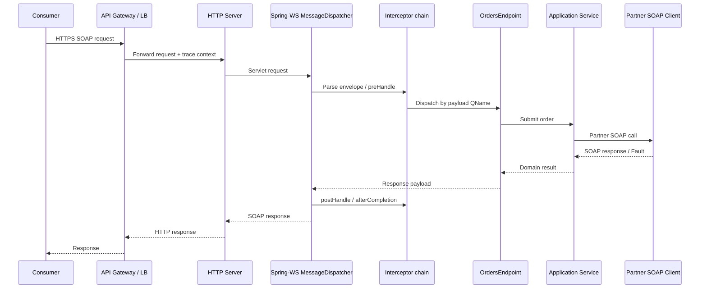

# Log, metric, trace và thông tin cần để theo dõi một lời gọi SOAP

## 1. Vì sao SOAP service cần khả năng quan sát?

**Spring Web Services (Spring-WS)** giúp xây dựng SOAP service theo contract-first với XSD/WSDL, JAXB marshalling, endpoint, SOAP client, SOAP Fault, interceptor và WS-Security. Khi đưa service vào production, endpoint trả response đúng contract mới chỉ là một phần của độ tin cậy. Đội vận hành còn cần biết request đi qua hệ thống nào, mất bao lâu, thất bại ở tầng nào, có retry hay không và liệu response có đến được caller.

Một SOAP call thường đi qua nhiều boundary: load balancer/API gateway, HTTP server, Spring-WS MessageDispatcher, endpoint interceptor, endpoint method, application service, database hoặc downstream SOAP/REST service, sau đó quay về thành SOAP response/Fault. Nếu chỉ xem log «SOAP request failed», rất khó phân biệt lỗi XML parsing, endpoint mapping, business validation, downstream timeout, TLS handshake hay lỗi serialize response.

Khả năng quan sát (observability) kết hợp ba tín hiệu chính:

- **Log:** bản ghi sự kiện có ngữ cảnh, cho biết điều gì đã xảy ra.
- **Metric:** số liệu tổng hợp theo thời gian, cho biết hệ thống đang hoạt động thế nào.
- **Trace:** chuỗi span thể hiện request đi qua những thành phần nào và tốn thời gian ở đâu.

Ba tín hiệu bổ sung cho nhau. Log trả lời chi tiết của một request; metric phát hiện bất thường trên toàn hệ thống; trace định vị latency/error qua các service. Chỉ có log mà thiếu correlation ID sẽ khó nối sự kiện; chỉ có metric mà thiếu dimensions phù hợp sẽ không giải thích được nguyên nhân; chỉ có trace mà không có logs/metrics sẽ khó điều tra business context và xu hướng dài hạn.

### Mục tiêu học tập

Sau bài, bạn có thể:

1. Thiết kế structured logs cho một SOAP request/response theo correlation ID.
2. Phân biệt request ID, business correlation ID, trace ID và span ID.
3. Chọn metric phù hợp cho SOAP endpoint, SOAP client và downstream calls.
4. Xác định latency, error rate, throughput, saturation và SLO.
5. Tạo distributed traces qua HTTP, Spring-WS interceptors và downstream clients.
6. Bổ sung thông tin transport, SOAP operation, QName, Fault và retry vào telemetry.
7. Bảo vệ PII, credentials, WS-Security tokens, signatures và attachments trong logs.
8. Dùng Micrometer, Spring Boot Actuator và OpenTelemetry theo kiến trúc phù hợp.
9. Chẩn đoán một lời gọi SOAP chậm hoặc lỗi từ metrics, trace và logs.
10. Xây dashboard, alerts và runbook cho SOAP integration.

## 2. Theo dõi một SOAP call từ đầu đến cuối

Giả sử consumer gọi operation SubmitOrder. Một request có thể đi qua:



Ở từng bước, telemetry có thể được tạo:

| Boundary | Log context hữu ích | Metric | Trace span |
|---|---|---|---|
| Gateway/HTTP ingress | route, HTTP method/status, request ID | request count, response time | server span |
| SOAP parsing/dispatch | SOAP version, operation QName, mapping result | request count, dispatch errors | server/internal span |
| Interceptor | security/validation outcome, correlation ID | reject/fault count | internal span hoặc event |
| Endpoint/application | operation, business outcome category | business result count, duration | internal span |
| Downstream SOAP client | partner name, endpoint alias, action, attempt | client duration/errors/retries | client span |
| Response/fault | response category, fault code, status | response/fault count | event/status trên span |
| Persistence | repository operation, outcome | DB latency/error | DB client span |

Không nhất thiết mỗi method nhỏ đều cần span riêng. Tạo span ở boundary có ý nghĩa, nơi có latency, dependency hoặc lỗi có thể quan sát. Tránh trace quá chi tiết khiến overhead và cardinality tăng.

## 3. Những ID cần phân biệt

| ID | Ý nghĩa | Nguồn/cách tạo | Không nên dùng để |
|---|---|---|---|
| Request ID | Nhận diện một lần nhận request ở service | Gateway hoặc service sinh | Thay business idempotency key |
| Correlation ID | Nối các message/request thuộc cùng business flow | Caller hoặc application contract | Làm trusted identity nếu caller tự đặt |
| Trace ID | Nhận diện distributed trace | Tracing SDK/W3C Trace Context | Đưa vào metric label |
| Span ID | Nhận diện một operation trong trace | Tracing SDK | Dùng chung cho toàn workflow |
| Business ID | Order/customer/payment identifier | Domain | Ghi thẳng vào metric label hoặc log nếu nhạy cảm |
| JMSMessageID | Nhận diện JMS message instance | Broker/provider | Idempotency key khi retry tạo message mới |

### 3.1. Request ID và correlation ID

Một HTTP request có thể được gateway gán request ID mới khi đến từng hop, trong khi correlation ID được giữ xuyên suốt business workflow. Cần quy định rõ:

- Nếu caller gửi correlation ID, validate charset, độ dài và format.
- Nếu thiếu, service có thể tạo ID mới và trả lại qua response header nếu contract cho phép.
- Không chấp nhận chuỗi bất kỳ quá dài làm log field hoặc MDC value.
- Không dùng correlation ID để authorize user/tenant.
- Tránh để caller chèn CR/LF hoặc delimiter tạo log injection.

Correlation ID nên được thêm vào structured log field và response metadata phù hợp. Không nhét ID vào SOAP Body nếu WSDL không định nghĩa trường đó.

### 3.2. Trace ID và Span ID

W3C Trace Context quy định HTTP headers traceparent và tracestate. Instrumentation có thể tiếp nhận context từ caller hoặc tạo trace mới. Mỗi downstream call tạo child span; service-to-service propagation giữ cùng trace ID nhưng span ID thay đổi.

Không tạo trace ID thủ công theo business ID. Tracing SDK quản lý sampling, parent/child relationships, flags và context propagation.

### 3.3. Propagate context qua SOAP và JMS

Với HTTP SOAP, W3C trace context thường được truyền bằng HTTP headers nếu client/gateway và instrumentation hỗ trợ. Một số partner chỉ chấp nhận tập HTTP headers đã định nghĩa; xác minh policy gateway và hợp đồng transport trước khi thêm headers.

Với SOAP message-level hoặc transport không phải HTTP, trace context có thể được truyền qua SOAP Header hoặc JMS properties theo convention được hai bên thống nhất. Đừng giả định traceparent tự xuất hiện bên trong SOAP Envelope. Cần định nghĩa rõ HTTP traceparent/tracestate trên mỗi hop; SOAP Header nếu cần ở message layer; JMS properties nếu dùng SOAP over JMS; mapping giữa inbound context và downstream spans; và trust policy. Trace metadata không phải security identity.

## 4. Structured logging cho SOAP service

Structured logging ghi event thành các field có kiểu thay vì nối chuỗi không cấu trúc. JSON logs dễ truy vấn theo operation, endpoint alias, outcome, duration, trace ID và environment.

Ví dụ log event khi request hoàn tất:

```json
{
  "timestamp": "2026-11-27T09:30:01.238Z",
  "level": "INFO",
  "service.name": "orders-soap-service",
  "service.version": "2.4.1",
  "environment": "production",
  "event.name": "soap.server.request.completed",
  "soap.operation": "{https://example.org/orders/v1}SubmitOrder",
  "soap.version": "1.1",
  "request.id": "req-7f9d",
  "correlation.id": "corr-1001",
  "trace.id": "4bf92f3577b34da6a3ce929d0e0e4736",
  "span.id": "00f067aa0ba902b7",
  "http.method": "POST",
  "http.route": "/soap/orders",
  "http.status_code": 200,
  "duration_ms": 84,
  "outcome": "success"
}
```

Đây là schema minh họa, không phải định dạng bắt buộc. Chọn field names theo logging platform/OTel semantic conventions mà hệ thống đang dùng và nhất quán giữa services.

### 4.1. Những field nên có

| Nhóm | Field gợi ý | Mục đích |
|---|---|---|
| Service | service.name, service.version, deployment.environment | Xác định instance/version |
| Operation | soap.operation, soap.version, wsdl.port | Phân loại operation/binding |
| Transport | http.method, http.route, http.status_code | Điều tra HTTP boundary |
| Correlation | request.id, correlation.id, trace.id, span.id | Nối logs/traces |
| Timing | duration_ms, start/end time | Phân tích latency |
| Outcome | outcome, error.type, fault.code, retry.count | Phân loại lỗi |
| Dependency | peer.service, endpoint.alias, destination | Xác định downstream |
| Security | authn.result, validation.result | Audit outcome không tiết lộ secret |

soap.operation nên là QName hoặc operation name đã chuẩn hóa; endpoint.alias là tên logical như partner-orders, không nhất thiết là URL chứa host/query parameters. Không ghi toàn URL nếu có token hoặc query secret.

### 4.2. Ví dụ Java logging với MDC

SLF4J MDC giúp đưa context vào mọi log trong thread hiện tại. Với request processing đồng bộ, có thể đặt correlation metadata ở interceptor và xóa trong finally/afterCompletion.

```java
import org.slf4j.MDC;
import org.springframework.ws.context.MessageContext;
import org.springframework.ws.server.EndpointInterceptor;

public class SoapCorrelationLoggingInterceptor
        implements EndpointInterceptor {

    private static final String CORRELATION_KEY = "correlationId";

    @Override
    public boolean handleRequest(MessageContext messageContext, Object endpoint) {
        String correlationId = resolveValidatedCorrelationId(messageContext);
        MDC.put(CORRELATION_KEY, correlationId);
        MDC.put("soapOperation", resolvePayloadQName(messageContext));
        return true;
    }

    @Override
    public boolean handleResponse(MessageContext messageContext, Object endpoint) {
        return true;
    }

    @Override
    public boolean handleFault(MessageContext messageContext, Object endpoint) {
        return true;
    }

    @Override
    public void afterCompletion(
            MessageContext messageContext, Object endpoint, Exception ex) {
        MDC.remove(CORRELATION_KEY);
        MDC.remove("soapOperation");
    }

    private String resolveValidatedCorrelationId(MessageContext context) {
        // Read a validated ID; enforce length and allowed characters.
        // Generate one when absent.
        return "corr-generated-or-validated";
    }

    private String resolvePayloadQName(MessageContext context) {
        // Resolve payload root QName; never log the entire SOAP Body.
        return "SubmitOrder";
    }
}
```

Đây là skeleton minh họa lifecycle; các helper phải đọc SOAP header/payload an toàn theo message implementation. Không log trực tiếp toàn request trong interceptor này.

### 4.3. MDC và thread reuse

MDC thường gắn với thread. Servlet/container thread pool tái sử dụng threads, vì vậy context phải được xóa sau request ở mọi nhánh thành công/lỗi. Nếu không, log request sau có thể mang correlation ID của request trước.

Với async execution, executor riêng hoặc reactive flows, MDC không tự propagate an toàn trong mọi trường hợp. Dùng context propagation mechanism tương ứng (Micrometer Context Propagation/OpenTelemetry context wrappers) thay vì giả định ThreadLocal tự đi qua thread boundary.

### 4.4. Log một lần ở mỗi boundary, tránh duplicates

Một lỗi có thể được log ở interceptor, endpoint, service, client wrapper và global exception handler. Nếu mỗi lớp log full stack trace, một request lỗi sinh nhiều bản ghi trùng và alert/log volume tăng mạnh.

Thiết kế ownership: interceptor log request completion/validation outcome; domain service log business event; SOAP client adapter phân loại downstream Fault/transport exception; global exception handler hoặc boundary owner log stack trace một lần. Các lớp trung gian có thể enrich/rethrow exception mà không log lặp.

## 5. Những gì không được ghi vào SOAP logs

SOAP payload có thể chứa PII, payment details, customer identifiers, credentials hoặc tài liệu nhị phân. WS-Security Header có thể chứa UsernameToken, BinarySecurityToken, signature references hoặc dữ liệu nhạy cảm. Logging full SOAP Envelope mặc định tạo nguy cơ lộ dữ liệu và tăng dung lượng.

Không log password, UsernameToken password digest, bearer/access tokens, API keys, private key hoặc raw credentials; WS-Security BinarySecurityToken/signature key material; PII/payment data khi không có căn cứ; full SOAP Body nhạy cảm; binary attachment bytes/base64 payload; HTTP Authorization/Cookie/query secrets; raw exception message nếu có SQL, file path, partner payload hoặc credentials.

### 5.1. Logging policy

| Dữ liệu | Chính sách gợi ý |
|---|---|
| SOAP QName/operation | Cho phép sau normalization |
| Correlation/trace ID | Cho phép nếu không chứa business secret |
| Fault code | Cho phép |
| Fault reason | Allowlist/length limit; tránh raw partner detail |
| Customer/order ID | Hash/tokenize hoặc chỉ log khi policy cho phép |
| Request/response XML | Tắt mặc định; redacted sampling trong môi trường kiểm soát |
| WS-Security Header | Không log nguyên bản |
| Attachment | Log content type/size/checksum nếu an toàn; không log bytes |
| Certificate metadata | Log thumbprint/subject theo policy, không log private key |
| Endpoint URI | Logical alias; redact credentials/query parameters |

### 5.2. Nếu cần SOAP message logging

Spring-WS có message tracing/logging categories và interceptors, nhưng bật trace XML có thể ghi toàn message. Chỉ bật ngắn hạn trong môi trường test/staging hoặc incident có kiểm soát, có redaction phù hợp và access/retention giới hạn. Đừng mặc định DEBUG/TRACE là an toàn trong production.

Nếu phải log payload: xác định field allowlist; mask bằng XML-aware transformation; giới hạn size; không log WS-Security/credentials/attachment bytes; restrict access và retention; test redaction bằng fixture; bảo đảm lỗi redactor không fallback sang raw payload.

### 5.3. Log injection và cardinality

Validate correlation IDs và client metadata để ngăn newline/control characters, JSON injection và log forging. Không đặt user input nguyên bản làm logger category hay field có thể phá parser.

Metric label không phải nơi lưu request ID/order ID. Mỗi ID duy nhất tạo một time series, khiến cardinality tăng vô hạn. Dùng labels có bounded set (operation, outcome, partner alias, fault category); dùng IDs trong logs/traces.

## 6. Metrics cho SOAP endpoint và SOAP client

Metric trả lời các câu hỏi theo xu hướng: service có đang nhận request không, operation nào chậm, fault rate có tăng, downstream nào gây latency và capacity còn bao nhiêu.

### 6.1. Bộ metric cơ bản

| Metric | Loại | Ý nghĩa |
|---|---|---|
| soap.server.requests | Counter | Tổng request theo operation/outcome |
| soap.server.duration | Timer/Histogram | Latency server-side |
| soap.server.faults | Counter | SOAP Fault theo category |
| soap.server.validation.failures | Counter | Request bị reject do schema/security |
| soap.client.requests | Counter | Downstream SOAP call count |
| soap.client.duration | Timer/Histogram | Latency khi gọi partner |
| soap.client.errors | Counter | Transport/protocol/client errors |
| soap.client.retries | Counter | Số lần retry |
| soap.client.timeouts | Counter | Số timeout |
| http.server.requests | Timer | HTTP ingress metrics |
| jvm.*, process.*, system.* | Gauge/counter | JVM/process capacity |
| jms.* | Gauge/counter | Queue depth, consumer count, delivery |

Tên metric thực tế nên tuân theo Micrometer naming convention và exporter. Bảng trên là semantic gợi ý.

### 6.2. Latency, throughput, error rate và saturation

Bốn nhóm chỉ số vận hành quan trọng:

- **Latency:** thời gian xử lý request, thường xem p50/p95/p99.
- **Traffic/throughput:** requests per second theo operation/partner.
- **Errors:** tỷ lệ SOAP Fault, HTTP errors, transport exceptions và validation failures.
- **Saturation:** thread pool, connection pool, heap, CPU, queue depth và executor utilization.

Average latency có thể che tail latency. Ví dụ p50 = 40 ms nhưng p99 = 4 s nghĩa là phần lớn request nhanh nhưng một tỷ lệ nhỏ rất chậm. Với SLA/SLO, xem histogram/percentiles thay vì chỉ average.

### 6.3. Cardinality và labels

Labels cần là tập giá trị hữu hạn. Ví dụ phù hợp: operation name, SOAP version, outcome (success/soap_fault/transport_error/validation_error), partner alias và fault category. Không dùng request ID, trace ID, order ID, customer ID, username hoặc raw URL/query làm metric labels. Mỗi ID duy nhất tạo một time series, khiến cardinality tăng vô hạn.

## 7. Micrometer: đo thời gian và kết quả bằng Timer/Counter

Micrometer cung cấp facade instrumentation và có thể publish tới Prometheus hoặc backend khác qua registry. Spring Boot Actuator có thể cấu hình registry/export endpoint và common tags. Ứng dụng không dùng Spring Boot có thể khai báo MeterRegistry trực tiếp.

### 7.1. Timer cho server operation

Một cách đơn giản là đo duration ở endpoint interceptor hoặc service boundary. Skeleton sau lưu start time trong MessageContext:

```java
import io.micrometer.core.instrument.MeterRegistry;
import io.micrometer.core.instrument.Timer;
import org.springframework.ws.context.MessageContext;
import org.springframework.ws.server.EndpointInterceptor;

import java.util.concurrent.TimeUnit;

public class SoapServerMetricsInterceptor implements EndpointInterceptor {
    private final MeterRegistry registry;

    public SoapServerMetricsInterceptor(MeterRegistry registry) {
        this.registry = registry;
    }

    @Override
    public boolean handleRequest(MessageContext context, Object endpoint) {
        context.setProperty("soap.startNanos", System.nanoTime());
        context.setProperty("soap.outcome", "success");
        return true;
    }

    @Override
    public boolean handleResponse(MessageContext context, Object endpoint) {
        return true;
    }

    @Override
    public boolean handleFault(MessageContext context, Object endpoint) {
        context.setProperty("soap.outcome", "soap_fault");
        return true;
    }

    @Override
    public void afterCompletion(
            MessageContext context, Object endpoint, Exception ex) {
        Object value = context.getProperty("soap.startNanos");
        if (!(value instanceof Long start)) {
            return;
        }

        String outcome = ex != null ? "exception"
            : String.valueOf(context.getProperty("soap.outcome"));
        String operation = "unknown"; // Resolve a bounded operation name.

        Timer.builder("soap.server.duration")
            .tag("operation", operation)
            .tag("outcome", outcome)
            .register(registry)
            .record(System.nanoTime() - start, TimeUnit.NANOSECONDS);

        registry.counter("soap.server.requests",
            "operation", operation, "outcome", outcome).increment();

        context.removeProperty("soap.startNanos");
        context.removeProperty("soap.outcome");
    }
}
```

Đây là skeleton minh họa; operation phải được resolve và normalize sang tập tên đã đăng ký, không lấy input tự do. Không ghi metric ở cả handleResponse và afterCompletion vì sẽ đếm hai lần. Dùng một completion boundary duy nhất để record.

### 7.2. Outcome classification

Định nghĩa precedence khi Fault và exception cùng xuất hiện. Ví dụ:
1. Nếu SOAP Fault đã được tạo, outcome là soap_fault.
2. Nếu lỗi xảy ra trước khi có Fault, outcome là exception.
3. Nếu response thành công, outcome là success.
4. Nếu request bị reject trước dispatch, ghi validation_error hoặc mapping_error ở boundary phù hợp.

Không phân loại mọi exception thành server error. XML parse, endpoint not found, security reject, downstream timeout và programming bug cần categories đủ rõ để điều tra nhưng bounded.

### 7.3. Counter cho các kết quả

```java
registry.counter("soap.server.requests",
    "operation", "SubmitOrder",
    "outcome", "success").increment();

registry.counter("soap.server.faults",
    "operation", "SubmitOrder",
    "fault.category", "sender").increment();
```

Counters chỉ tăng; backend tính rate qua time window. Không ghi ID hoặc message text vào tag. Nếu muốn xem fault code cụ thể, map sang bounded category allowlist; raw detail ở log có masking.

### 7.4. Timer cho outbound SOAP client

Ở lớp adapter bao quanh WebServiceTemplate, đo duration và phân loại SOAP Fault/transport exception:

```java
public CustomerResponse lookup(CustomerRequest request) {
    Timer.Sample sample = Timer.start(registry);
    String outcome = "success";

    try {
        return (CustomerResponse) template.marshalSendAndReceive(
            request,
            new SoapActionCallback("urn:customer:Lookup"));
    }
    catch (SoapFaultClientException ex) {
        outcome = "soap_fault";
        throw ex;
    }
    catch (WebServiceTransportException | WebServiceIOException ex) {
        outcome = "transport_error";
        throw ex;
    }
    finally {
        sample.stop(Timer.builder("soap.client.duration")
            .tag("partner", "customer-registry")
            .tag("operation", "Lookup")
            .tag("outcome", outcome)
            .register(registry));
    }
}
```

Imports và exception class cụ thể tùy Spring-WS version; nếu client wrapper có exception mapping riêng, instrument boundary mà mọi error đều đi qua. Instrumentation không được nuốt lỗi hoặc tự retry.

## 8. Histogram, percentiles và SLO

Timer có thể publish histogram buckets hoặc percentiles tùy registry/configuration. Histogram thường phù hợp khi cần aggregate percentiles giữa nhiều instances, vì percentile phía client không luôn aggregate chính xác.

### 8.1. Chọn buckets theo SLA

Giả sử operation SubmitOrder có objective p95 dưới 500 ms và p99 dưới 1.5 s. Bucket thresholds có thể bao phủ 50, 100, 250, 500, 1000, 1500, 3000 ms. Đây là ví dụ; chọn buckets theo traffic/SLAs thực và tránh tạo quá nhiều series.

### 8.2. Error budget và availability

SLO có thể định nghĩa:
- 99.9% requests hợp lệ nhận response thành công trong rolling 30 ngày.
- p95 server processing dưới 500 ms.
- SOAP Fault do client validation được phân loại riêng, không tính như lỗi hạ tầng server nếu SLO định nghĩa như vậy.
- Partner outages/transport errors có thể có SLO riêng cho outbound dependency.

Cần định nghĩa mẫu số rõ: request hợp lệ, request đã qua authentication, hay mọi HTTP request? Nếu mẫu số trộn malformed requests và server failures, error rate sẽ khó diễn giải.

### 8.3. Dashboard tối thiểu

- Request rate theo SOAP operation/outcome.
- p50/p95/p99 server duration.
- SOAP Fault rate theo category.
- Outbound partner duration/error/timeout/retry.
- HTTP 4xx/5xx, active requests, connection pool.
- JVM heap/GC/threads/CPU.
- Queue depth/consumer lag nếu SOAP over JMS.
- Deploy/version markers để thấy regression sau release.

Metric panel nên link tới trace/log search qua trace ID hoặc exemplars nếu backend hỗ trợ. Tránh drilldown dựa business ID dạng label.

## 9. Distributed tracing cho lời gọi SOAP

Trace mô tả một request qua nhiều service. Một trace gồm các span có quan hệ parent/child; mỗi span đại diện operation với thời gian bắt đầu/kết thúc, attributes, events và status.

Ví dụ:

```text
Trace: SubmitOrder
  HTTP SERVER  POST /soap/orders              420 ms
    Spring-WS dispatch                        410 ms
      Endpoint: SubmitOrder                   405 ms
        DB query                               28 ms
        SOAP CLIENT partner-inventory         310 ms
          HTTP CLIENT POST /soap/stock         298 ms
        Domain mapping                          7 ms
    SOAP response serialization                 6 ms
```

Đây là timeline minh họa; spans có thể lồng nhau hoặc overlap, vì vậy tổng duration không nhất thiết bằng tổng duration của các span con.

### 9.1. Trace context propagation

Với HTTP, chuẩn W3C Trace Context dùng:
- traceparent: version, trace ID, parent span ID, trace flags.
- tracestate: vendor-specific tracing state.

Instrumentation ở ingress extract context rồi tạo server span. Khi application gọi downstream bằng instrumented HTTP client, client instrumentation inject context vào outgoing request. Nếu downstream cũng hỗ trợ propagation, hai service xuất hiện trong cùng trace.

Không tự tạo các header này bằng chuỗi hard-coded nếu đã có tracing SDK. SDK xử lý sampling, validation và context propagation.

### 9.2. SOAP message không tự mang traceparent

Cần phân biệt HTTP header và SOAP Header. SOAP Header là XML nằm trong Envelope; HTTP traceparent nằm ngoài Envelope. Với SOAP qua HTTP, tracing context thường đi theo HTTP headers. Với SOAP over JMS hoặc intermediary chỉ chuyển SOAP envelope, có thể cần SOAP Header/JMS properties theo convention. Mọi mapping phải được thỏa thuận với partner và không thay identity/authorization.

### 9.3. Micrometer Observation tại application boundary

Spring Boot/Micrometer Observation có thể thống nhất tạo observation, metrics và tracing khi tracing bridge/registry được cấu hình. Trong Spring Framework thuần, cung cấp ObservationRegistry tương ứng. Ví dụ:

```java
import io.micrometer.observation.Observation;
import io.micrometer.observation.ObservationRegistry;

public class PartnerOrderGateway {
    private final ObservationRegistry observationRegistry;
    private final WebServiceTemplate template;

    public PartnerOrderGateway(
            ObservationRegistry observationRegistry,
            WebServiceTemplate template) {
        this.observationRegistry = observationRegistry;
        this.template = template;
    }

    public PartnerOrderResponse submit(PartnerOrderRequest request) {
        return Observation.createNotStarted(
                "soap.client", observationRegistry)
            .lowCardinalityKeyValue("soap.operation", "SubmitOrder")
            .lowCardinalityKeyValue("peer.service", "partner-orders")
            .observe(() -> (PartnerOrderResponse)
                template.marshalSendAndReceive(
                    request,
                    new SoapActionCallback("urn:partner:SubmitOrder")));
    }
}
```

Ví dụ tạo observation ở application boundary. Khi tracing bridge được cấu hình, observation có thể tạo span; khi metrics handler được cấu hình, nó có thể tạo metrics. Không ghi customer/order ID vào low-cardinality key-value. Nếu call ném exception, Observation ghi error và exception tiếp tục được ném ra caller.

Đặt Observation quanh WebServiceTemplate không nhất thiết instrument mọi internal phase như DNS, TLS handshake, connect và response read. Để có client spans/HTTP semantic attributes đầy đủ, dùng HTTP client instrumentation phù hợp sender thực tế hoặc OpenTelemetry Java agent/SDK instrumentation đã được xác nhận trong runtime.

### 9.4. Attributes và error status

Attributes hữu ích ở span gồm:
- Operation SOAP đã normalize.
- SOAP version.
- Peer service/endpoint alias.
- Fault category/outcome.
- Retry attempt (giới hạn).
- HTTP method/status khi instrumentation hỗ trợ.

Tránh attributes chứa raw SOAP payload, customer name, order number hoặc tokens. Span attributes được export vào tracing backend và có thể có quyền truy cập rộng hơn logs.

Đánh dấu span error khi operation thất bại theo semantics đã thống nhất. Có thể thêm event cho SOAP Fault, retry, circuit breaker open, validation/authentication reject hoặc downstream timeout. Không đặt mọi business Fault thành lỗi server; Sender/Client Fault có thể là request invalid.

## 10. Tracing và Spring-WS interceptors

Spring-WS có endpoint/client interceptors; đây là nơi enrich SOAP-specific attributes khi instrumentation HTTP không biết operation QName hoặc Fault detail.

### 10.1. Server-side EndpointInterceptor

Interceptor có thể resolve payload root QName, gắn operation vào log/observation context, ghi validation/security outcome, tạo event khi Fault được tạo và đo thời gian từ dispatch đến completion.

Nếu HTTP instrumentation đã có server span, không tạo server span thứ hai cho cùng request. Tạo child/internal span rõ tên như soap.dispatch hoặc enrich span hiện có.

### 10.2. Client-side ClientInterceptor

ClientInterceptor có thể thêm/đọc SOAP headers và ghi message-level metadata. Nó phù hợp để bổ sung operation/partner attributes, không thay thế HTTP client instrumentation.

Callback chính gồm handleRequest trước khi gửi, handleResponse khi nhận response, handleFault khi nhận SOAP Fault và afterCompletion để cleanup.

Không dựa vào interceptor để đo toàn bộ connect/TLS/read timeout nếu nó chỉ bao quanh message processing. Đặt timer ở WebServiceTemplate call boundary và instrument underlying sender cho transport phases.

### 10.3. Tránh context leak

Nếu tự lưu context trong ThreadLocal/MDC, phải xóa ở afterCompletion/finally. Với async dispatch, propagate qua context library tương ứng. Không dùng mutable static fields cho per-request state.

## 11. Chẩn đoán một lời gọi SOAP chậm

Khi caller báo SubmitOrder mất 8 giây, điều tra theo thứ tự:

1. Tìm trace bằng trace ID/correlation ID đã được phép log.
2. Xem server span duration và HTTP ingress latency.
3. Xác định span con chiếm nhiều thời gian nhất: endpoint, DB, downstream SOAP, queue wait hay serialization.
4. So sánh p50/p95/p99 của operation trong cùng thời gian.
5. Kiểm tra timeout/retry count và partner latency.
6. Kiểm tra thread/connection pool saturation, JVM GC và queue depth.
7. Đối chiếu deploy version/time để xác định regression.
8. Tái hiện bằng test/staging với fixture tương ứng; không bật full SOAP logging vô thời hạn trên production.

### 11.1. Các pattern phổ biến

| Pattern trong trace/metrics | Nguyên nhân khả dĩ | Bước tiếp theo |
|---|---|---|
| HTTP server span dài, không có endpoint span | XML parse, filter, auth hoặc dispatcher mapping | Kiểm tra HTTP/filter/dispatch logs |
| Endpoint span dài, DB span dài | Query chậm/lock/pool exhaustion | DB metrics và query trace |
| Downstream SOAP client span dài | Partner latency, connect/read timeout, retry | Partner dashboard, timeout config |
| Nhiều retry spans | Retry policy/circuit breaker | Count attempts, backoff và idempotency |
| Low latency nhưng caller timeout | Gateway/client deadline khác service timeout | So sánh deadline từng hop |
| p99 tăng sau deploy | Regression, connection pool/thread config | Compare version/resources |
| SOAP Fault tăng, latency bình thường | Contract/business/security rejects | Fault category, schema/auth logs |
| HTTP 502/503 không có SOAP Fault | Gateway/proxy/transport problem | Inspect status, Content-Type, upstream |
| CPU thấp, queue age tăng | Consumer/concurrency/downstream bottleneck | Queue, worker, DB pool |
| Heap/GC tăng khi payload lớn | Buffering/XML/attachment memory pressure | Payload size, heap/GC |

### 11.2. Timeout budget theo hop

Một lời gọi qua nhiều hop cần deadline nhất quán. Ví dụ:
- Caller deadline: 5 s.
- Gateway upstream timeout: 4.5 s.
- Spring-WS processing budget: 4 s.
- Partner SOAP client timeout: 2.5 s.
- DB timeout: 1 s.

Các số chỉ minh họa. Mục tiêu là tránh downstream timeout dài hơn remaining deadline của caller. Retry tiêu thụ cùng deadline; không reset toàn bộ timeout mỗi lần retry. Khi client nhận timeout, business outcome có thể unknown nếu server/partner đã commit side effect.

### 11.3. SOAP Fault và transport error

Phân loại riêng:
- Client/Sender Fault: request không hợp lệ theo contract.
- Server/Receiver Fault: remote SOAP service báo lỗi xử lý.
- HTTP/transport error: TLS, DNS, connection refused, timeout hoặc HTTP gateway status.
- XML/JAXB error: response bytes không parse/unmarshal theo contract.
- Application error: business rule hoặc domain dependency.

SOAP Fault là SOAP message có cấu trúc; HTTP 502 HTML page không phải SOAP Fault. Đừng gộp tất cả vào một metric không có breakdown hữu ích.

## 12. Spring-WS message tracing và cấu hình logging an toàn

Spring-WS có logger categories phục vụ debug SOAP messages. Theo Reference Documentation 4.1.4:

- Server-side category: org.springframework.ws.server.MessageTracing.
- Client sent/received: org.springframework.ws.client.MessageTracing.sent và org.springframework.ws.client.MessageTracing.received.
- Server sent/received có category tương ứng theo package/message tracing.
- DEBUG ghi payload root element.
- TRACE ghi toàn bộ SOAP message content.

Spring-WS cũng cung cấp:
- PayloadLoggingInterceptor: log payload message.
- SoapEnvelopeLoggingInterceptor: log toàn bộ SOAP Envelope, gồm SOAP Headers.
- Các logging interceptors có thể điều khiển logRequest/logResponse.

Các tiện ích này hữu ích cho phát triển và chẩn đoán có kiểm soát, nhưng **toàn Envelope có thể chứa PII, UsernameToken, BinarySecurityToken, signature, routing metadata hoặc nội dung nghiệp vụ**. Bật TRACE trong production có thể tạo dữ liệu nhạy cảm trong log store.

### 12.1. Cấu hình mức log

Ví dụ cấu hình Spring Boot:

```yaml
logging:
  level:
    org.springframework.ws.server.MessageTracing: DEBUG
    org.springframework.ws.client.MessageTracing.sent: DEBUG
    org.springframework.ws.client.MessageTracing.received: DEBUG
```

Mức DEBUG chỉ ghi payload root element theo Spring-WS docs, nhưng vẫn cần đánh giá log content và operation metadata. Không bật TRACE cho toàn bộ traffic production như một biện pháp điều tra lâu dài.

### 12.2. Chỉ bật trong incident window

Nếu buộc phải bật TRACE để xem SOAP envelope:
1. Phê duyệt incident scope và thời gian bật.
2. Chỉ bật cho service/operation/test instance có thể giới hạn.
3. Dùng test data hoặc redaction trước khi log nếu có thể.
4. Giới hạn retention/access và không đưa raw logs vào ticket/chat không kiểm soát.
5. Tắt logger ngay khi thu thập đủ bằng chứng.
6. Xác minh không có secret/PII trong log đã phát sinh; xử lý theo incident policy nếu có.

Logger category có thể không hỗ trợ lọc theo request cụ thể nếu không có custom routing. Khi cần sampling theo correlation ID, nên dùng instrumentation có kiểm soát/custom interceptor thay vì bật TRACE toàn cục.

## 13. Alerting và runbook cho SOAP service

Alert phải phản ánh symptom người dùng hoặc dependency, tránh alert theo một log string không ổn định.

### 13.1. Alert gợi ý

| Alert | Điều kiện minh họa | Hành động đầu tiên |
|---|---|---|
| High server latency | p95 vượt SLO liên tục 5–10 phút | Xem trace chậm nhất, DB/downstream spans |
| SOAP Fault spike | Fault rate vượt baseline theo operation | Chia Sender/Receiver/business code |
| Downstream timeout | timeout rate partner vượt threshold | Kiểm tra partner health, timeout, retry |
| HTTP 5xx spike | 5xx tăng trên ingress | Kiểm tra gateway, servlet, exception logs |
| Endpoint mapping failures | QName unmapped tăng | Kiểm tra namespace/WSDL/client deploy |
| Validation/security rejects | reject tăng đột ngột | Xem client release, schema, cert/token |
| JMS backlog | oldest message age/queue depth tăng | Kiểm tra consumers, broker, downstream |
| DLQ growth | DLQ count tăng | Dừng replay tự động, phân loại poison message |
| JVM saturation | heap/GC/threads/CPU vượt ngưỡng | Kiểm tra payload size, pool, memory profile |
| Certificate expiry | certificate còn ít ngày trước hạn | Rotation trước expiration |

Ngưỡng phải được hiệu chỉnh theo traffic baseline, SLO và operation criticality. Dùng alert duration để tránh cảnh báo do spike ngắn không ảnh hưởng người dùng.

### 13.2. Runbook: một SOAP operation tăng latency

- Tìm operation có p95/p99 tăng.
- So sánh các phiên bản deployment và partner alias.
- Mở trace chậm nhất và xác định span chiếm thời gian.
- Nếu outbound span dài, kiểm tra partner latency, DNS/connect/TLS/read timeout và retry.
- Nếu endpoint span dài, kiểm tra DB/query/lock, CPU và business processing.
- Nếu serialization span dài, xem payload size, JAXB marshalling và attachments.
- Kiểm tra connection pool, servlet threads và GC.
- Xác nhận deadline/timeout của caller/gateway/downstream thống nhất.
- Ghi correlation/trace IDs đã redacted vào incident notes.

### 13.3. Runbook: SOAP Fault spike

1. Phân nhóm fault code/category theo operation.
2. Kiểm tra client release/WSDL/XSD change.
3. Kiểm tra QName/namespace/SOAPAction mismatch.
4. Xem validation/authentication/security reject rates.
5. Kiểm tra partner returned Fault hay endpoint tạo Fault nội bộ.
6. Đối chiếu trace và structured logs theo correlation ID.
7. Nếu là Receiver Fault, kiểm tra downstream/database dependency.
8. Nếu là Sender Fault, kiểm tra client payload/contract trước khi retry.
9. Không retry mù các request invalid hoặc operation không idempotent.
10. Xác định có cần rollback client/server version hay phát hành contract fix.

### 13.4. Runbook: TLS/WS-Security failures

- Phân biệt TLS handshake fail trước SOAP parsing với WS-Security validation fail sau khi message đến server.
- Kiểm tra certificate validity period, chain, SAN/hostname, truststore và key alias.
- Kiểm tra clock skew/timestamp TTL và replay cache.
- Kiểm tra signature reference, signed parts, canonicalization và algorithms.
- Kiểm tra certificate rotation/config rollout giữa instances.
- Không log private key, password, token hoặc toàn Security header.
- Không tắt signature/timestamp validation để «khôi phục nhanh» nếu chưa đánh giá security impact.

## 14. Sampling, retention và chi phí telemetry

Không nhất thiết lưu mọi trace/log ở mức chi tiết như nhau. Chọn sampling/retention theo giá trị điều tra và yêu cầu bảo mật.

### 14.1. Trace sampling

- Head sampling quyết định khi trace bắt đầu; đơn giản và giới hạn chi phí.
- Tail sampling quyết định sau khi có nhiều span; có thể giữ trace lỗi/chậm tốt hơn nếu collector/backend hỗ trợ.
- Error/latency-aware sampling giữ lại trace có lỗi hoặc vượt latency threshold.
- Không ghi full SOAP body vào span chỉ vì sampling giữ trace.

Sampling phải nhất quán để trace không bị đứt đoạn giữa services. Nếu service tự start root trace khi context propagation bị mất, trace có thể bị tách; kiểm tra propagator ở ingress/egress.

### 14.2. Log retention

Phân biệt:
- Operational logs: thời gian lưu vừa đủ cho incident/debug.
- Security/audit logs: retention theo policy/pháp luật và không nhất thiết chứa payload.
- Raw SOAP traces: nếu cho phép, retention rất ngắn, access chặt và masking.
- Metrics: giữ lâu hơn để phân tích xu hướng, nhưng không có high-cardinality IDs.

Thiết lập access control theo service/team, audit truy cập log, encryption at rest/in transit và deletion policy. Không gửi logs chứa PII/credentials sang SaaS observability nếu chưa có data processing/security approval.

### 14.3. Payload size và sampling

Payload bytes metric có thể giúp phát hiện response lớn gây latency/heap. Chỉ ghi size, không ghi content. Với file attachment, có thể log content type, content length và checksum nếu checksum không tạo risk correlation/re-identification theo policy.

## 15. Kiểm thử observability

Instrumentation cũng là code và cần được kiểm tra. Test không chỉ assert nghiệp vụ mà còn xác minh telemetry có đủ field và không lộ secret.

### 15.1. Structured log tests

- Gửi request với correlation ID hợp lệ; log event completion phải chứa correlation ID đã validate.
- Gửi ID dài/quá format; service generate hoặc reject theo policy.
- Gửi CR/LF trong header metadata; xác minh log output không bị forging.
- Gửi request chứa fake token/PII; test appender capture không có raw secret.
- Test error path và Fault path đều xóa MDC.
- Test pooled-thread reuse: request thứ hai không được thừa hưởng MDC request đầu.

### 15.2. Metric tests

Dùng SimpleMeterRegistry trong unit test:

```java
SimpleMeterRegistry registry = new SimpleMeterRegistry();

SoapMetrics metrics = new SoapMetrics(registry);
metrics.recordRequest("SubmitOrder", "success");
metrics.recordRequest("SubmitOrder", "soap_fault");

assertThat(registry.counter("soap.server.requests",
    "operation", "SubmitOrder", "outcome", "success").count())
    .isEqualTo(1.0);

assertThat(registry.counter("soap.server.requests",
    "operation", "SubmitOrder", "outcome", "soap_fault").count())
    .isEqualTo(1.0);
```

Ví dụ giả định ứng dụng có helper SoapMetrics riêng để đóng gói metric registration. Đừng lặp lại raw meter creation ở mọi endpoint.

Test thêm:
- Timer tăng một observation cho mỗi invocation.
- Outcome classification đúng giữa success/Fault/transport error.
- Labels không chứa request/order/customer IDs.
- Không tạo tag value từ raw exception message.
- Registry không bị đếm kép giữa interceptor và service wrapper.

### 15.3. Trace tests

Nếu dùng test tracer hoặc in-memory exporter:
- Xác minh inbound server span được tạo.
- Downstream SOAP call là child span của request tương ứng.
- Error exception được ghi lên span và status phù hợp.
- Context được propagate qua executor/thread boundaries nếu có.
- Không có duplicate spans cho cùng HTTP request.
- Span attributes không có PII/credentials.
- Sampling policy vẫn giữ trace errors/chậm theo yêu cầu.

### 15.4. Integration verification

Chạy test qua HTTP server/container thật để xác minh:
- traceparent được extract/inject;
- HTTP status/content type được ghi đúng;
- servlet path và route attributes đúng;
- exception translation/Fault mapping;
- Micrometer registry/exporter được cấu hình;
- logs từ nhiều instances có thể tìm theo trace ID;
- Prometheus/OTLP scraping/export thực hoạt động.

MockWebServiceClient xác minh Spring-WS message pipeline, không tự chứng minh HTTP ingress instrumentation.

## 16. Bảng chẩn đoán theo tín hiệu

| Triệu chứng | Log cần xem | Metric cần xem | Trace cần xem |
|---|---|---|---|
| Request không tìm thấy endpoint | QName, namespace, mapping outcome | mapping failure counter | ingress/dispatch spans |
| SOAP Fault tăng | fault category/code, operation | fault rate by operation | endpoint/downstream error span |
| Partner chậm | partner alias, timeout, retry | client duration/error/retry | outbound client span |
| HTTP 502/503 | status/content type, gateway error | HTTP 5xx rate | gateway/upstream spans |
| Memory tăng | payload size, attachment size category | heap/GC, allocation if enabled | serialization/attachment spans |
| Request duplicate | correlation/business ID đã mask | request/retry counters | retries and message-consumer spans |
| Context trace bị đứt | request/correlation/trace IDs | span counts may drop | missing parent/trace split |
| Queue backlog | destination alias, delivery count | depth, oldest age, consumer count | message consume/processing spans |
| WS-Security reject | fault category, cert metadata approved | security rejection count | validation span/event |
| MDC leakage | request correlation in logs | không phải metric chính | trace ID/log correlation mismatch |

Một tín hiệu đơn lẻ không đủ kết luận. Ghép logs, metrics và traces theo time window, operation, endpoint alias và correlation ID đã validate.

## 17. Đề xuất dashboard SOAP integration

Một dashboard production nên chia thành các vùng:

### Request health
- Incoming SOAP requests/s theo operation.
- Success, business Fault, protocol Fault, transport error.
- HTTP response status.
- Endpoint mapping/validation/security rejection counts.

### Latency
- Server p50/p95/p99.
- Outbound partner p50/p95/p99 theo alias.
- JAXB marshal/unmarshal hoặc SOAP serialization timing nếu được instrument.
- Queue wait/consumer processing nếu có JMS transport.

### Dependencies
- Partner availability/error/timeout/retry.
- DB latency/pool wait.
- HTTP connection pool/TLS handshake failures.
- JMS broker connectivity, queue depth, DLQ.

### Runtime
- JVM heap/non-heap, GC pause, thread count.
- CPU/process metrics.
- Servlet thread pool/connection utilization.
- Container restarts/deploy version.

### Security and contract
- Authentication/WS-Security validation rejects.
- Certificate expiry.
- Schema validation failures.
- Unknown operation/QName mismatch.
- Fault detail categories đã normalize.

Dashboard cần có deployment annotation/version markers. Khi lỗi tăng sau release, so sánh phiên bản mới/cũ bằng cùng traffic và operation distribution.

## 18. Bài thực hành: quan sát SubmitOrder SOAP call

Tạo một Spring-WS service có operation SubmitOrder gọi downstream partner.

### Giai đoạn A — Logging

1. Tạo structured log schema có service/version/operation/outcome/duration.
2. Resolve payload QName thành operation name.
3. Đọc hoặc tạo correlation ID có validation.
4. Đưa correlation và trace IDs vào MDC/log fields.
5. Xóa context ở mọi completion path.
6. Tạo test ngăn log injection.
7. Tạo fake payload chứa password/token/customer data và xác minh redaction.

### Giai đoạn B — Metrics

8. Tạo MeterRegistry/SimpleMeterRegistry.
9. Tạo counter request theo operation/outcome.
10. Tạo timer cho server processing.
11. Tạo timer/counter cho partner SOAP client.
12. Tạo taxonomy cho SOAP Fault/transport/security/validation failures.
13. Xác minh labels có bounded cardinality.
14. Cấu hình histogram buckets theo latency SLO.
15. Dashboard p95/p99, error rate, traffic và saturation.

### Giai đoạn C — Tracing

16. Cấu hình Micrometer Observation/Tracing hoặc OpenTelemetry.
17. Xác minh HTTP inbound trace context được extract.
18. Instrument application service hoặc partner SOAP gateway.
19. Xác minh downstream call là child span.
20. Gắn SOAP operation/partner/outcome attributes có kiểm soát.
21. Xác minh trace context không dùng như auth identity.
22. Kiểm tra MDC/context cleanup và async propagation.

### Giai đoạn D — Diagnostics

23. Mô phỏng SOAP Sender/Client Fault.
24. Mô phỏng partner Receiver/Server Fault.
25. Mô phỏng DNS/TLS/connection/read timeout.
26. Mô phỏng HTTP 502 HTML không phải SOAP Fault.
27. Mô phỏng request chậm do DB và do partner.
28. So sánh log/metric/trace trong từng kịch bản.
29. Xác minh timeout budgets và retry count.
30. Viết runbook cho latency, Fault spike, TLS/WS-Security failures.

### Giai đoạn E — Operations

31. Cấu hình Actuator/metrics endpoint và exporter theo platform.
32. Cấu hình trace exporter và sampling.
33. Tạo alert theo latency/error/dependency/Saturation.
34. Chọn retention/access policy cho logs/traces.
35. Chạy load test với payload sizes khác nhau.
36. Kiểm tra dashboard và incident drill từ correlation ID.
37. Ghi lại metric names, labels, SLO và runbook.

### Câu hỏi tự kiểm tra

1. Log, metric và trace bổ sung nhau như thế nào?
2. Request ID khác correlation ID và trace ID thế nào?
3. Vì sao không dùng trace ID làm metric label?
4. W3C traceparent được truyền ở HTTP header hay SOAP Header?
5. Làm thế nào propagate context qua SOAP over JMS?
6. Structured log cần những field nào cho một SOAP call?
7. Vì sao phải xóa MDC trong afterCompletion?
8. DEBUG và TRACE của Spring-WS MessageTracing khác nhau ra sao?
9. Tại sao không nên log toàn SOAP Envelope mặc định?
10. SOAP Fault khác HTTP transport error như thế nào?
11. Metric nào giúp phát hiện partner chậm?
12. p95/p99 quan trọng hơn average trong tình huống nào?
13. High cardinality làm monitoring backend gặp vấn đề gì?
14. Micrometer Observation liên kết metrics và traces thế nào?
15. Khi nào cần instrument underlying HTTP sender?
16. Làm sao phát hiện retry storm?
17. Timeout budget qua nhiều hop nên được thiết kế thế nào?
18. Vì sao SOAP Server Fault không phải lúc nào cũng retryable?
19. Những dữ liệu nào tuyệt đối không nên ghi vào logs?
20. MockWebServiceClient có chứng minh ingress tracing HTTP thực hoạt động không?

## 19. Definition of Done — SOAP observability

Một Spring-WS SOAP service có thể vận hành/chẩn đoán được khi:

### Logs
- [ ] Logs structured có service, operation, outcome, duration và correlation context.
- [ ] Request/correlation IDs được validate, không thể log injection.
- [ ] MDC/context được cleanup trong mọi completion/error path.
- [ ] Không log password/token/private key/raw WS-Security Header.
- [ ] SOAP payload logging tắt mặc định hoặc có redaction/access/retention policy.
- [ ] Error stack trace được log tại một boundary có ownership rõ.

### Metrics
- [ ] Có request count, duration, Fault/error counts và downstream client timing.
- [ ] Có p50/p95/p99/histogram phù hợp SLO.
- [ ] Có HTTP/JVM/thread/connection/queue saturation metrics.
- [ ] Metric labels bounded; không có request/trace/business IDs.
- [ ] Success, SOAP Fault, validation/security reject và transport errors được phân loại.

### Traces
- [ ] Inbound trace context được extract, outbound được inject.
- [ ] Downstream SOAP call có span/observation tương ứng.
- [ ] Trace/log correlation hoạt động.
- [ ] Không tạo duplicate spans.
- [ ] Sampling, exporter và retention được cấu hình.
- [ ] Span attributes không chứa PII/credentials/raw payload.

### Operations
- [ ] Dashboard có traffic, latency, errors, saturation, dependencies và deploy markers.
- [ ] Alerts có ngưỡng/baseline và runbook.
- [ ] Có runbook cho slow call, Fault spike, TLS/WS-Security failure và queue backlog.
- [ ] Actuator/metrics/tracing endpoints được expose có kiểm soát.
- [ ] Observability tests kiểm tra log redaction, metric labels, trace propagation và cleanup.
- [ ] Có integration test qua HTTP server thực để xác minh transport instrumentation.

**Ghi nhớ:** Một lời gọi SOAP chỉ dễ chẩn đoán khi logs, metrics và traces dùng chung context nhưng mỗi tín hiệu giữ đúng vai trò. Log lưu ngữ cảnh sự kiện đã được redaction; metric thể hiện xu hướng với labels có cardinality thấp; trace chỉ ra latency/dependency theo từng hop. SOAP message tracing có thể rất hữu ích nhưng TRACE có thể ghi toàn bộ Envelope, vì vậy cần policy bảo vệ dữ liệu và incident controls rõ ràng.

## 20. Tài liệu tham khảo

- [Spring Web Services 4.1.4 — Message Logging and Tracing](https://docs.spring.io/spring-ws/docs/4.1.4/reference/html/#message-logging-and-tracing): logging categories, DEBUG/TRACE behavior, PayloadLoggingInterceptor và SoapEnvelopeLoggingInterceptor.
- [Spring-WS 4.1.4 — MessageDispatcher API](https://docs.spring.io/spring-ws/docs/4.1.4/api/org/springframework/ws/server/MessageDispatcher.html): message tracing logger categories và dispatch lifecycle.
- [Spring Boot — Observability](https://docs.spring.io/spring-boot/reference/actuator/observability.html): Micrometer Observation, low/high cardinality keys, metrics và tracing.
- [Spring Boot — Metrics](https://docs.spring.io/spring-boot/reference/actuator/metrics.html): MeterRegistry, Actuator metrics endpoint và export registries.
- [Spring Boot — Tracing](https://docs.spring.io/spring-boot/reference/actuator/tracing.html): Micrometer Tracing, context propagation và log correlation.
- [Micrometer Observation — Introduction](https://docs.micrometer.io/micrometer/reference/observation/introduction.html): ObservationRegistry và lifecycle handlers.
- [Micrometer — Histograms and Percentiles](https://docs.micrometer.io/micrometer/reference/concepts/histogram-quantiles.html): histogram buckets, percentiles và SLO boundaries.
- [OpenTelemetry — Java instrumentation](https://opentelemetry.io/docs/languages/java/instrumentation/): context propagation, semantic conventions và telemetry correlation.
- [OpenTelemetry — Context Propagation](https://opentelemetry.io/docs/concepts/context-propagation/): extract/inject trace context qua process boundaries.
- [W3C — Trace Context](https://www.w3.org/TR/trace-context/): traceparent và tracestate propagation.

