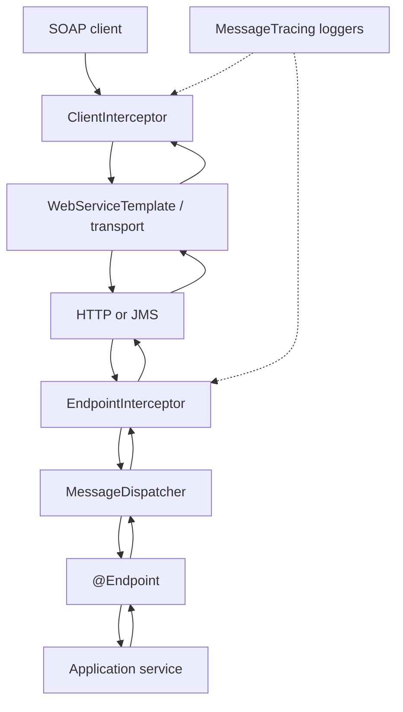

# Message tracing của Spring-WS ở phía máy chủ và máy khách

## Mục tiêu học tập

Trong module **SPRING_WEB_SERVICES**, SOAP request đi qua transport, message factory, interceptor, endpoint mapping, JAXB và application service. Khi đối tác báo request timeout hoặc server trả Fault, đội vận hành cần biết message đã tới đâu, endpoint nào xử lý, response nào được tạo và mất bao lâu. Spring Web Services (Spring-WS) cung cấp message tracing qua logging categories và interceptor extension points ở hai phía. Bài học này hướng dẫn kết hợp chúng với correlation ID, structured logging, metrics và distributed tracing mà vẫn bảo vệ dữ liệu SOAP.

Sau bài học, bạn có thể:
1. Bật message tracing ở server và client.
2. Phân biệt payload logging với full SOAP message tracing.
3. Hiểu lifecycle của EndpointInterceptor và ClientInterceptor.
4. Truyền correlation ID qua HTTP, SOAP Header và JMS metadata.
5. Dùng MDC và structured logging liên kết events.
6. Đo latency và Fault rate mà không đưa dữ liệu nhạy cảm vào metric labels.
7. Kết hợp logs, traces và metrics.
8. Xử lý context propagation qua async/JMS boundaries.
9. Redact payload, tokens, certificates và attachments.
10. Kiểm thử tracing/interceptor trên success, Fault và exception paths.

## 1. Vì sao cần message tracing?

Một SOAP call có thể thất bại vì QName/namespace sai, WS-Security validation, endpoint mapping, database/downstream latency, proxy 502, SOAP version mismatch hoặc client timeout trong khi server đã commit. Log chung kiểu “SOAP failed” không cho biết lỗi nằm ở transport, dispatcher, security, endpoint hay response parsing.

Message tracing cho biết message được gửi/nhận tại boundary của Spring-WS. Correlation ID liên kết sự kiện của cùng invocation. Interceptor bổ sung operation, partner, lifecycle và timing. Distributed trace cho thấy đường đi qua nhiều service; metrics cho biết tần suất/lượng lỗi.

## 2. Logs, traces và metrics

| Tín hiệu | Câu hỏi | Dữ liệu phù hợp |
| --- | --- | --- |
| Logs | Điều gì đã xảy ra cụ thể? | Event, operation, endpoint, partner alias, correlation, Fault category. |
| Traces | Request đi qua service/span nào và chậm ở đâu? | Trace/span ID, parent-child spans, duration, status. |
| Metrics | Hiện tượng xảy ra thường xuyên đến mức nào? | Request count, latency histogram, Fault/error count, in-flight. |

Message tracing của Spring-WS chủ yếu là logging message; nó không tự tạo distributed trace hay metric. Cần instrumentation hoặc OpenTelemetry/Micrometer integration cho hai tín hiệu còn lại. Không dùng SOAP Body, orderId, user ID, correlation ID hoặc trace ID làm metric labels vì cardinality và privacy.

## 3. Vị trí tracing trong luồng Spring-WS



Client và server log ở process riêng. Cùng dùng logger categories không tự liên kết được cặp request/response; phải truyền correlation context qua transport/header contract.

## 4. MessageTracing ở phía máy chủ

Các logger category Spring-WS server-side thường dùng:

| Logger | Ý nghĩa |
| --- | --- |
| org.springframework.ws.server.MessageTracing | Category tổng quát. |
| org.springframework.ws.server.MessageTracing.received | Message server nhận. |
| org.springframework.ws.server.MessageTracing.sent | Message server gửi. |

Spring-WS documentation phân biệt payload-level logging ở DEBUG và full-message tracing ở TRACE. Kiểm tra đúng behavior theo version và logging backend của ứng dụng.

Cấu hình Spring Boot:

```yaml
logging:
  level:
    org.springframework.ws.server.MessageTracing.received: DEBUG
    org.springframework.ws.server.MessageTracing.sent: DEBUG
```

TRACE có thể chứa toàn Envelope/Header/security metadata/payload. Chỉ bật trong môi trường hoặc cửa sổ điều tra được kiểm soát; không bật mặc định cho toàn production traffic.

## 5. MessageTracing ở phía máy khách

Các category client-side tương ứng:

| Logger | Ý nghĩa |
| --- | --- |
| org.springframework.ws.client.MessageTracing | Category tổng quát. |
| org.springframework.ws.client.MessageTracing.sent | Request client gửi. |
| org.springframework.ws.client.MessageTracing.received | Response client nhận. |

```yaml
logging:
  level:
    org.springframework.ws.client.MessageTracing.sent: DEBUG
    org.springframework.ws.client.MessageTracing.received: DEBUG
```

Client sent và server received có thể được so sánh để xác định request đã tới server chưa; server sent và client received giúp xác định response có bị mất/thay đổi trên đường về không. Không correlation ID thì concurrency làm việc ghép cặp dễ sai.

## 6. Payload-only và full SOAP message

| Chế độ | Công dụng | Rủi ro |
| --- | --- | --- |
| Metadata-only | Operation, QName, status, size, duration. | Không thấy XML chi tiết. |
| Payload DEBUG | Kiểm tra Body, namespace, field. | Có business data/PII. |
| Full TRACE | Kiểm tra Envelope, Header, Fault, protocol details. | Có token, UsernameToken, BinarySecurityToken, signature, attachment metadata. |

Production nên mặc định metadata-only. Nếu cần payload trace, chỉ bật theo endpoint/partner/time window cụ thể, dùng synthetic/masked data, giới hạn bytes, sampling và retention. Không log SOAP attachment content.

## 7. EndpointInterceptor ở server

EndpointInterceptor bao quanh endpoint invocation:

| Callback | Thời điểm | Công dụng |
| --- | --- | --- |
| handleRequest | Trước endpoint | Validate/resolve correlation, ghi start event. |
| handleResponse | Sau endpoint, khi response bình thường | Ghi response outcome/metadata. |
| handleFault | Khi response là SOAP Fault | Ghi category/code đã chuẩn hóa. |
| afterCompletion | Kết thúc toàn bộ invocation | Đóng timer/span, cleanup context. |

Ví dụ skeleton:

```java
public final class SoapServerObservabilityInterceptor
        implements EndpointInterceptor {

    @Override
    public boolean handleRequest(
            MessageContext context, Object endpoint) {
        String id = resolveOrCreateCorrelationId(context);
        RequestObservation.start(id, endpoint);
        MDC.put("correlationId", id);
        return true;
    }

    @Override
    public boolean handleResponse(
            MessageContext context, Object endpoint) {
        RequestObservation.response(endpoint);
        return true;
    }

    @Override
    public boolean handleFault(
            MessageContext context, Object endpoint) {
        RequestObservation.fault(endpoint);
        return true;
    }

    @Override
    public void afterCompletion(
            MessageContext context, Object endpoint, Exception ex) {
        RequestObservation.finish(ex);
        MDC.remove("correlationId");
    }
}
```

RequestObservation là helper ứng dụng. Production code phải giữ context theo invocation, cleanup cả normal/Fault/exception paths và không dựa riêng MDC làm request storage. Đối chiếu callback signatures với Spring-WS BOM.

### 7.1. Đăng ký interceptor

Có thể đăng ký EndpointInterceptor qua WsConfigurer phù hợp version:

```java
@Override
public void addInterceptors(List<EndpointInterceptor> interceptors) {
    interceptors.add(soapServerObservabilityInterceptor);
}
```

Chỉ đăng ký trong phạm vi cần thiết. Interceptor quan sát không được mutate payload, swallow exception hoặc thay đổi business semantics.

## 8. ClientInterceptor ở client

ClientInterceptor bao quanh request-response của WebServiceTemplate:

| Callback | Vai trò |
| --- | --- |
| handleRequest | Gắn correlation/trace metadata và ghi start. |
| handleResponse | Ghi normal response. |
| handleFault | Ghi SOAP Fault. |
| afterCompletion | Kết thúc observation và cleanup. |

```java
public final class SoapClientObservabilityInterceptor
        implements ClientInterceptor {

    @Override
    public boolean handleRequest(MessageContext context) {
        String id = currentOrCreateCorrelationId();
        addSoapCorrelationHeader(context, id);
        MDC.put("correlationId", id);
        return true;
    }

    @Override
    public boolean handleResponse(MessageContext context) {
        recordClientResponse(currentCorrelationId());
        return true;
    }

    @Override
    public boolean handleFault(MessageContext context) {
        recordClientFault(currentCorrelationId());
        return true;
    }

    @Override
    public void afterCompletion(
            MessageContext context, Exception ex) {
        recordClientCompletion(ex);
        MDC.remove("correlationId");
    }
}
```

Các helper là application-specific. Nếu caller đã có correlation ID hợp lệ, giữ nguyên thay vì tạo ID mới mỗi lần đi qua interceptor. Truyền ID qua SOAP Header/transport metadata theo quy ước rõ ràng.

## 9. Correlation ID, Trace ID và Span ID

| ID | Phạm vi | Vai trò |
| --- | --- | --- |
| Correlation/request ID | Một invocation hoặc business interaction | Ghép log và support case. |
| Trace ID | Distributed trace | Liên kết nhiều spans/services. |
| Span ID | Một đoạn xử lý | Xác định client/server/internal operation. |
| Business ID | Order/payment/case | Nghiệp vụ; thường nhạy cảm. |

Correlation ID có thể đi kèm trace nhưng không thay W3C Trace Context. Không tự tạo chuỗi trace ID tùy ý rồi coi là chuẩn W3C.

## 10. Propagation qua HTTP, SOAP Header và JMS

HTTP headers, SOAP Header và JMS properties là các lớp riêng:

| Kênh | Metadata mẫu | Lưu ý |
| --- | --- | --- |
| HTTP | traceparent, request ID | Gateway có thể strip/rewrite; trust boundary cần rõ. |
| SOAP Header | CorrelationId, WS-Addressing MessageID | Phải được contract/policy cho phép. |
| JMS | JMSCorrelationID, application properties | Không tự biến thành SOAP Header/traceparent. |

Thiết kế mapping rõ giữa inbound HTTP context, SOAP Header và JMS properties. Không copy mọi header sang SOAP; tránh chuyển Authorization/cookie hoặc caller-controlled values không được xác thực.

Correlation ID từ caller là dữ liệu untrusted. Giới hạn độ dài/charset, loại control characters và ngăn newline/log injection. Nếu policy không tin caller ID, tạo ID server-side mới và lưu inbound value riêng đã sanitize.

## 11. Context propagation qua async/JMS

MDC gắn với thread hiện tại. JMS listener, task executor, @Async và Reactor có thể chạy thread khác; MDC không tự theo request. Distributed tracing instrumentation có cơ chế context propagation riêng, còn MDC chỉ là projection phục vụ logging.

Khi enqueue JMS message, propagate correlation/trace context qua properties theo convention. Consumer extract context, tạo consumer/server span mới với quan hệ phù hợp và cleanup sau xử lý. Dùng TaskDecorator hoặc tracing instrumentation khi qua executor. Luôn xóa context để ID request trước không rò sang message tiếp theo trên cùng thread.

## 12. Structured logging và MDC

Log theo event với field ổn định:

```json
{
  "event": "soap.server.response",
  "service": "orders-soap",
  "endpoint": "GetOrder",
  "contract_version": "v1",
  "partner": "partner-a",
  "correlation_id": "c-7e12",
  "trace_id": "4bf92f3577b34da6a3ce929d0e0e4736",
  "duration_ms": 42,
  "outcome": "success"
}
```

Đây là JSON log example, không phải SOAP payload. Partner phải là alias đã xác thực; operation/version nên đến từ allowlist. Không log raw customer identifiers, token hoặc complete SOAP Body.

MDC tiện cho correlation field trên cùng thread; cần cleanup trong finally/afterCompletion. Không dùng MDC thay request-scoped business context.

## 13. Đo thời gian và latency

Đo riêng:
- Client total duration từ trước send tới response/Fault/error.
- Server processing duration từ dispatcher receive tới completion.
- Endpoint/application duration.
- Downstream dependency duration.
- JMS queue wait và consumer processing duration.
- Serialization/marshalling nếu instrumentation hỗ trợ.

Client duration thường lớn hơn server duration do network, broker, queue wait, proxy và serialization. Dùng monotonic clock như System.nanoTime() cho duration trong process; wall-clock time dùng cho timestamp/event ordering, không dùng để đo elapsed time qua clock adjustments.

## 14. Metrics cho SOAP

Metric hữu ích gồm:
- soap_server_requests_total theo operation/version/outcome.
- soap_client_requests_total theo target alias/operation/outcome.
- soap_request_duration_seconds histogram.
- soap_faults_total theo category/code đã chuẩn hóa.
- soap_in_flight_requests.
- soap_message_size_bytes histogram.
- soap_security_failures_total theo category.
- JMS queue wait, redelivery và expired-message counters.

Giữ label cardinality hữu hạn. Không dùng correlation ID, trace ID, orderId, raw URL hoặc raw fault detail làm labels. Chuẩn hóa Fault code qua allowlist trước khi dùng làm dimension.

## 15. Trace spans quanh SOAP

Tạo client span quanh WebServiceTemplate invocation và server span ở transport/dispatcher boundary. Span attributes có thể gồm service/operation, destination alias, SOAP version, contract version, outcome và HTTP status nếu có.

Dùng OpenTelemetry/Micrometer instrumentation phù hợp version stack. Không thêm full SOAP Body, credential, PII hoặc attachment vào span attributes/events. Propagate W3C trace context theo standard thay vì tự chế ID.

## 16. Fault và exception diagnostics

Ghi metadata đã chuẩn hóa:
- Fault category: Client/Sender, Server/Receiver, Security, Validation, Business.
- Fault code/subcode và public error code.
- Detail QName nếu an toàn.
- SOAP/contract version.
- Correlation/trace ID.
- Endpoint và authenticated partner alias.
- Processing stage và duration.

Phân biệt SOAP Fault parse thành công với HTTP non-SOAP error, malformed XML, timeout, connection reset và TLS failure. Không gửi stacktrace hoặc nội bộ server path trong Fault detail cho đối tác. Stack trace nội bộ chỉ log theo policy đã redact/access-controlled.

## 17. Bảo vệ payload và security headers

SOAP message có thể chứa PII, payment data, UsernameToken, bearer token, BinarySecurityToken, signature, certificate metadata và MTOM parts. Production mặc định metadata-only.

Nếu cần sample payload:
1. Phạm vi theo endpoint/partner/incident window.
2. Dùng dữ liệu synthetic hoặc đã mask.
3. Redact theo schema/parser-aware allowlist.
4. Giới hạn bytes/size và sampling.
5. Hạn chế quyền truy cập và retention.
6. Tắt verbose tracing sau điều tra.

Regex trên XML serialized không phải redaction đáng tin cậy vì prefix, namespace, encoding và cấu trúc có thể đổi. Không log attachment bytes.

## 18. Interceptor ordering và cleanup

Khi có security, validation, correlation, metrics và audit interceptors, thứ tự có ý nghĩa:
- Correlation resolve sớm để các event dùng chung ID.
- Identity/partner chỉ được tin sau authentication.
- Payload logging chỉ sau redaction/sanitization.
- Completion cleanup chạy ở success, Fault và exception.
- Interceptor không mutate SOAP body chỉ để ghi log.
- Exception không bị swallow trừ khi behavior được thiết kế và test rõ.

Ghi rõ order trong cấu hình và test. Một callback có thể dừng chain hoặc endpoint invocation tùy contract; kiểm tra return values và failure behavior.

## 19. Kiểm thử tracing và correlation

Test nên xác minh:
- Inbound không correlation thì ID được tạo theo policy.
- Inbound ID hợp lệ được giữ nếu policy cho phép.
- ID được map sang SOAP Header/HTTP/JMS properties đúng.
- Client/server events liên kết cùng invocation.
- Fault và exception paths vẫn ghi outcome và cleanup.
- Concurrent calls không rò ID giữa threads.
- Async/JMS consumer extract context và cleanup.
- Sentinel secret không xuất hiện trong logs.
- Metrics labels không chứa IDs hoặc payload values.

Có thể dùng Logback ListAppender, fake tracer/observation registry và mock JMS properties. Assert event fields/schema thay vì toàn bộ formatted log string nếu structured schema mới là contract.

## 20. Quy trình điều tra một request chậm hoặc lỗi

1. Lấy correlation ID/trace ID từ client.
2. Tìm client sent event cùng endpoint alias/contract version.
3. Tìm server received event với cùng ID.
4. Kiểm tra interceptor start/completion, security/validation và endpoint.
5. So server duration với client duration; chênh lệch có thể ở transport/queue/proxy/serialization.
6. Tìm server sent hoặc Fault event.
7. Tìm client received hoặc exception category.
8. Nếu không có server receive, kiểm tra DNS/TLS/gateway/auth/routing.
9. Nếu server sent có nhưng client received không, kiểm tra proxy/connection/timeout/content-type.
10. Nếu server xử lý thành công nhưng client timeout, tra trạng thái nghiệp vụ/idempotency trước retry.

Không gửi raw SOAP payload vào ticket/chat hỗ trợ nếu chưa mask và được phép chia sẻ.

## 21. Anti-pattern cần tránh

- Bật TRACE full SOAP cho mọi production traffic.
- Dùng correlation ID/trace ID làm metric label.
- Copy Authorization/cookie vào SOAP Header hoặc JMS properties.
- Tin correlation ID từ caller mà không validate.
- Dùng MDC làm request storage qua thread.
- Không cleanup MDC sau Fault/exception.
- Ghi toàn bộ Fault detail/stack trace vào response.
- Log attachment/MTOM bytes.
- Chỉ có client tracing mà không có server correlation.
- Tạo trace ID không theo standard.
- Dùng wall clock để đo duration.
- Gắn partner alias trước authentication.
- Interceptor logging mutate payload hoặc che exception.

## 22. Ma trận observability tests

| ID | Tình huống | Kỳ vọng |
| --- | --- | --- |
| O01 | Client gửi request | Client sent event đúng operation. |
| O02 | Server nhận request | Server received cùng correlation. |
| O03 | Server trả response | Server sent outcome success. |
| O04 | Client nhận response | Client event cùng invocation. |
| O05 | Inbound không ID | ID tạo theo policy. |
| O06 | Inbound ID hợp lệ | Giữ nếu policy cho phép. |
| O07 | ID newline/quá dài | Reject/sanitize/tạo ID mới. |
| O08 | SOAP Fault | Fault category/code, không lộ detail. |
| O09 | HTTP non-SOAP error | Stage/status/type riêng. |
| O10 | Endpoint exception | Completion/cleanup xảy ra. |
| O11 | Concurrent requests | Không lẫn correlation. |
| O12 | Async executor | Context propagate/cleanup. |
| O13 | JMS request/reply | Mapping correlation rõ. |
| O14 | WS-Security failure | Security category, không log token. |
| O15 | Sensitive sentinel | Không có trong log công khai. |
| O16 | Large attachment | Không log binary; size metric. |
| O17 | Metric labels | Không IDs/payload/raw URL. |
| O18 | Trace spans | Context/parent-child hợp lệ. |
| O19 | Timer | Dùng monotonic clock. |
| O20 | Interceptor order | Correlation/security/cleanup đúng. |

## 23. Bài tập và đáp án

1. **Logger server received/sent?** org.springframework.ws.server.MessageTracing.received và .sent.
2. **Logger client sent/received?** org.springframework.ws.client.MessageTracing.sent và .received.
3. **DEBUG/TRACE?** Thường DEBUG cho payload, TRACE cho full message; kiểm tra đúng Spring-WS version.
4. **MessageTracing tạo distributed trace?** Không; nó là logging.
5. **EndpointInterceptor chạy đâu?** Quanh endpoint invocation phía server.
6. **ClientInterceptor chạy đâu?** Quanh WebServiceTemplate invocation ở client.
7. **Fault callback?** handleFault và completion cleanup.
8. **Order ID làm correlation?** Không; business ID khác invocation ID.
9. **Trace ID làm metric label?** Không; cardinality cao.
10. **MDC tự qua JMS listener?** Không; cần context propagation.
11. **JMSCorrelationID giống WS-Addressing ID?** Không, cần mapping rõ.
12. **Log toàn WS-Security header?** Tránh; có thể chứa token/signature/cert data.
13. **Đo duration bằng currentTimeMillis?** Dùng monotonic clock.
14. **Correlation chứa newline?** Reject/sanitize để chống log injection.
15. **Không có server receive event?** Kiểm tra trước server boundary: DNS/TLS/proxy/auth/route.
16. **Server sent có, client received không?** Kiểm tra network/proxy/timeout/parse.
17. **Interceptor swallow exception?** Không, trừ behavior được thiết kế rõ.
18. **Payload production cần debug?** Mask, scope, sampling, size/retention limit và approval.

## 24. Checklist triển khai

- [ ] Xác định logger categories client/server theo Spring-WS version.
- [ ] Production mặc định metadata-only.
- [ ] Payload DEBUG chỉ bật theo scope/time window.
- [ ] Full TRACE chỉ dùng trong điều tra được kiểm soát.
- [ ] Correlation ID tạo/validate tại boundary.
- [ ] Mapping HTTP/SOAP/JMS được tài liệu hóa.
- [ ] W3C Trace Context propagate theo standard/instrumentation.
- [ ] ClientInterceptor và EndpointInterceptor xử lý success/Fault/exception.
- [ ] MDC cleanup trên mọi path.
- [ ] Async/JMS context được extract/propagate.
- [ ] Partner alias chỉ lấy sau authentication.
- [ ] Không log token/cookie/private key/PII/attachment.
- [ ] Metric labels bounded, không request/trace/business IDs.
- [ ] Timer dùng monotonic clock.
- [ ] Fault/error categories được chuẩn hóa.
- [ ] Correlation validate charset/length, chống log injection.
- [ ] Interceptor order được test.
- [ ] Có concurrent, async và Fault tests.
- [ ] Có sampling, retention và access control cho verbose log.
- [ ] Incident runbook nối client/server events theo correlation.

## 25. Tài liệu tham khảo chính thức

1. [Spring Web Services 4.1.4 Reference](https://docs.spring.io/spring-ws/docs/4.1.4/reference/html/) — Message tracing, client/server interceptors, transport.
2. [EndpointInterceptor API](https://docs.spring.io/spring-ws/docs/4.1.4/api/org/springframework/ws/server/EndpointInterceptor.html) — server interceptor lifecycle.
3. [ClientInterceptor API](https://docs.spring.io/spring-ws/docs/4.1.4/api/org/springframework/ws/client/support/interceptor/ClientInterceptor.html) — client lifecycle.
4. [MessageContext API](https://docs.spring.io/spring-ws/docs/4.1.4/api/org/springframework/ws/context/MessageContext.html) — request/response context.
5. [WebServiceTemplate API](https://docs.spring.io/spring-ws/docs/4.1.4/api/org/springframework/ws/client/core/WebServiceTemplate.html) — client execution boundary.
6. [W3C Trace Context](https://www.w3.org/TR/trace-context/) — traceparent/tracestate propagation.
7. [OpenTelemetry Specification](https://opentelemetry.io/docs/specs/otel/) — traces, metrics, context propagation.
8. [Micrometer Observation](https://docs.micrometer.io/micrometer/reference/observation.html) — metrics/tracing observations.
9. [SLF4J MDC](https://www.slf4j.org/manual.html#mdc) — mapped diagnostic context.
10. [OWASP Logging Cheat Sheet](https://cheatsheetseries.owasp.org/cheatsheets/Logging_Cheat_Sheet.html) — safe logging/sensitive data.
11. [OWASP Web Service Security Cheat Sheet](https://cheatsheetseries.owasp.org/cheatsheets/Web_Service_Security_Cheat_Sheet.html) — service interaction security.
12. [W3C SOAP 1.1](https://www.w3.org/TR/SOAP/) và [SOAP 1.2](https://www.w3.org/TR/soap12-part1/) — Envelope/Header semantics.

**Phạm vi ví dụ:** Bài hướng tới Spring-WS 4.1.4, Java 17+ và logging/tracing stack có MDC/OpenTelemetry/Micrometer. Code interceptor là skeleton, helper/context store cần cài trong project. Logger levels, callback signatures và API overload cần đối chiếu BOM thực tế. STEP 4 không chạy Maven/Gradle/JUnit và không xác nhận runtime instrumentation.

## Tổng kết

**Message tracing của Spring-WS cho biết SOAP message được nhận/gửi ở client và server; interceptor bổ sung correlation, lifecycle events và timing; distributed tracing/metrics cung cấp góc nhìn xuyên service và theo xu hướng.** Các công cụ bổ trợ nhau. Correlation phải được propagate có chủ đích qua HTTP, SOAP Header và JMS metadata; async boundaries cần context propagation riêng.

Production nên mặc định log metadata, giới hạn payload tracing và redact dữ liệu nhạy cảm. Dùng EndpointInterceptor/ClientInterceptor để ghi outcome và cleanup cho success, Fault lẫn exception; dùng trace spans và bounded metrics để tìm latency/error theo operation/version. Correlation ID giúp nối client sent, server received, endpoint completion, server sent và client received thành một chuỗi chẩn đoán rõ ràng mà không phải phơi bày toàn bộ SOAP payload.

