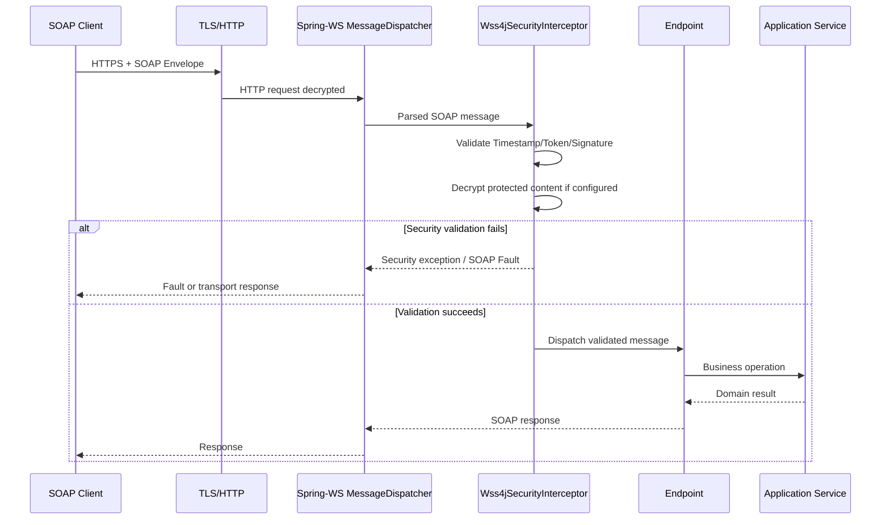

# Lỗi WS-Security: đồng hồ, khóa, chứng chỉ và phần dữ liệu được bảo vệ

## 1. Vì sao WS-Security lỗi dù SOAP endpoint vẫn hoạt động?

**Spring Web Services (Spring-WS)** xây dựng SOAP service theo contract-first với XSD/WSDL, JAXB, endpoint, SOAP client và các interceptor bảo mật. Khi tích hợp production, request có thể đến đúng URL và được HTTP server nhận nhưng vẫn bị từ chối trước khi endpoint chạy vì Timestamp hết hạn, UsernameToken không hợp lệ, chữ ký không verify được, certificate không được tin cậy hoặc nội dung bị thay đổi sau khi ký.

Những lỗi này thường bị gộp thành «security validation failed», trong khi nguyên nhân nằm ở các lớp khác nhau:

- **Thời gian:** đồng hồ lệch, Created ở tương lai, Expires đã qua, TTL không thống nhất.
- **Khóa:** alias sai, private key không load được, password callback sai, key/certificate không khớp.
- **Chứng chỉ:** chain không tin cậy, certificate hết hạn/bị thu hồi, issuer/serial/thumbprint trỏ sai certificate.
- **Chữ ký:** sai algorithm/canonicalization, reference URI không resolve, phần tử bị sửa hoặc verifier đọc nhầm phần tử.
- **Mã hóa:** recipient certificate sai, key transport không tương thích, private key giải mã không đúng.
- **Replay và token:** nonce/Timestamp bị phát lại, replay cache không hoạt động, UsernameToken profile khác nhau.
- **Contract/policy:** hai phía không thống nhất phần nào phải ký/mã hóa hoặc thứ tự security actions.

Bài này tập trung vào cách nhận diện, chẩn đoán và xử lý những lỗi trên khi tích hợp SOAP với Spring-WS, XSD/WSDL và client đối tác.

### Mục tiêu học tập

Sau bài, bạn có thể:
1. Phân biệt WS-Security message security với TLS/mTLS transport security.
2. Xác định vai trò Timestamp, Created, Expires, TTL và clock skew.
3. Phân biệt signing key, verification certificate, encryption certificate và decryption private key.
4. Chẩn đoán keystore/truststore, alias, chain, expiry và certificate rotation.
5. Đọc signature references và xác định SOAP parts được bảo vệ.
6. Phân biệt signature validation với message decryption.
7. Kiểm tra UsernameToken, nonce, replay cache và clock skew.
8. Cấu hình Wss4jSecurityInterceptor theo đúng chiều inbound/outbound.
9. Thu thập diagnostics mà không log secrets hoặc toàn bộ Security Header.
10. Xây dựng test matrix/runbook cho lỗi WS-Security.

## 2. WS-Security nằm ở đâu trong SOAP request flow?

TLS bảo vệ kết nối giữa hai network peers; WS-Security bảo vệ SOAP message bằng token, signature, encryption và Timestamp. Một request có thể qua TLS thành công nhưng vẫn bị WS-Security reject ở server.



| Boundary | Cơ chế | Lỗi thường gặp |
|---|---|---|
| TCP/HTTP | DNS, routing, connection | Connection refused, timeout |
| TLS | Server/client certificate, cipher, hostname | Handshake/trust failure |
| SOAP parsing | Envelope/version/XML | Invalid SOAP, malformed XML |
| WS-Security | Timestamp, token, signature, encryption | Security validation failure |
| Endpoint mapping | QName/action | No endpoint found |
| Business logic | Domain validation | Business Fault |
| Response security | Sign/encrypt response | Securement/key/callback failure |

Xác định request thất bại ở boundary nào trước khi đổi TTL hoặc tắt signature validation.

## 3. Timestamp, Created, Expires và clock skew

WS-Security Timestamp thường nằm trong SOAP Header để receiver kiểm tra freshness. Timestamp có thể gồm Created và Expires. Receiver so sánh các giá trị đó với thời gian hiện tại và policy TTL/future window.

### 3.1. Các trường thời gian

| Trường | Ý nghĩa | Vấn đề khi sai |
|---|---|---|
| Created | Thời điểm message được tạo | Nằm quá xa trong tương lai hoặc quá cũ |
| Expires | Thời điểm message hết hạn | Đã qua trước khi receiver validate |
| timeToLive | Cửa sổ hiệu lực tối đa theo policy receiver | TTL phía server strict hơn client |
| futureTimeToLive | Cửa sổ chấp nhận Created hơi nằm trong tương lai | Đồng hồ client nhanh hơn server |
| clock skew | Độ lệch đồng hồ giữa hosts | Sender hợp lệ nhưng receiver reject |

Ví dụ SOAP Header:

```xml
<wsse:Security
    xmlns:wsse="http://docs.oasis-open.org/wss/2004/01/oasis-200401-wss-wssecurity-secext-1.0.xsd"
    xmlns:wsu="http://docs.oasis-open.org/wss/2004/01/oasis-200401-wss-wssecurity-utility-1.0.xsd">
  <wsu:Timestamp wsu:Id="TS-1">
    <wsu:Created>2026-11-27T09:30:00Z</wsu:Created>
    <wsu:Expires>2026-11-27T09:35:00Z</wsu:Expires>
  </wsu:Timestamp>
</wsse:Security>
```

Đây là message minh họa; giá trị thực phải được tạo lúc runtime. Không copy Timestamp cố định vào production.

### 3.2. Clock skew tạo lỗi như thế nào?

Giả sử client clock nhanh hơn server 90 giây. Client ký message với Created=10:01:30Z; server hiện tại là 10:00:00Z. Nếu server chỉ cho phép Created trong tương lai tối đa 60 giây, request bị từ chối dù TLS và signature đúng.

Ngược lại, client clock chậm hoặc request nằm trong queue lâu có thể làm Created quá cũ hoặc Expires đã qua. Tình huống hay gặp:

- VM/container mất đồng bộ time service.
- NTP/chrony bị chặn sau khi host đổi subnet.
- Laptop sleep/wake gây clock drift.
- Container dùng host clock nhưng chrony trên host lỗi.
- JMS queue backlog hoặc redelivery làm message đến muộn.
- Partner tạo Timestamp theo local timezone thay vì UTC.
- Hai phía serialize fractional seconds khác precision rồi round/truncate không thống nhất.

### 3.3. NTP và UTC

Đồng bộ time ở host/VM/container runtime theo NTP hoặc chrony. Kiểm tra client lẫn server, không chỉ container ứng dụng. Log thời gian UTC và offset; không diễn giải Created theo local timezone.

Checklist: hosts đồng bộ; container runtime nhận system clock đúng; NTP source ổn định; không tự chỉnh clock trong process; Timestamp dùng UTC/offset theo profile; queue delay và retry không vượt freshness window.

Không khắc phục bằng cách tăng TTL thật lớn nếu nguyên nhân là clock sync hoặc queue backlog. TTL lớn mở rộng cửa sổ replay cho message bị đánh cắp.

### 3.4. Cấu hình Timestamp validation trong Spring-WS

Spring-WS 4.1.x sử dụng lớp org.springframework.ws.soap.security.wss4j2.Wss4jSecurityInterceptor. Validation actions có thể gồm Timestamp; timestampStrict và timeToLive kiểm soát cách receiver đánh giá thời gian. WSS4J có futureTimeToLive để chịu clock skew nhỏ.

```java
@Bean
Wss4jSecurityInterceptor timestampSecurityInterceptor(Crypto validationCrypto) {
    Wss4jSecurityInterceptor interceptor =
        new Wss4jSecurityInterceptor();

    interceptor.setValidationActions("Timestamp Signature");
    interceptor.setValidationSignatureCrypto(validationCrypto);
    interceptor.setTimestampStrict(true);
    interceptor.setTimeToLive(300);

    // Configure future timestamp tolerance using the WSS4J
    // configuration supported by the exact dependency version.
    return interceptor;
}
```

Tên API và cách truyền futureTimeToLive phụ thuộc Spring-WS/WSS4J version. Kiểm tra Javadoc đúng dependency line; không giả định property của WSS4J 1.x còn giữ nguyên ở 2.x/3.x. timeToLive là policy freshness của receiver. Message đã expired phải bị reject. Chỉ nới futureTimeToLive để chịu clock skew nhỏ có kiểm soát, không thay NTP.

### 3.5. Timestamp precision và Expires policy

timestampPrecisionInMilliseconds điều khiển precision Timestamp outbound trong Wss4jSecurityInterceptor. Một peer có parser/profile cũ có thể xử lý fractional seconds khác nhau.

Khi mismatch: thu Header đã redacted; so sánh Created/Expires và precision; xác minh partner yêu cầu Expires hay không; kiểm tra TTL ở hai phía; cấu hình precision tương thích; không bỏ Timestamp validation chỉ vì fractional seconds.

## 4. Keystore, truststore, certificate và private key

Trong WS-Security, «đã có certificate» chưa đủ. Cần biết certificate thuộc ai, được dùng cho mục đích nào, private key có ở đúng phía không và receiver trust certificate theo cơ chế nào.

### 4.1. Phân biệt bốn vai trò chính

| Hoạt động | Ai dùng key nào? | Mục đích |
|---|---|---|
| Ký request | Sender dùng private key của mình | Chứng minh message được ký bởi holder của private key |
| Verify request signature | Receiver dùng public certificate của sender | Xác minh chữ ký và trust |
| Encrypt request cho receiver | Sender dùng public certificate của receiver | Chỉ receiver có private key tương ứng mới mở được |
| Decrypt request | Receiver dùng private key của mình | Lấy lại symmetric content key và giải mã message |

Với response, chiều sử dụng thường đảo lại. Server ký response bằng private key server; client verify bằng public certificate server. Client muốn server gửi response mã hóa thì client cung cấp public certificate cho server; server encrypt bằng public key đó; client decrypt bằng private key client.

**Không dùng private key của sender để verify chữ ký của sender.** Verification dùng public key/certificate tương ứng. Không dùng certificate public của receiver để decrypt; decrypt cần private key tương ứng.

### 4.2. Keystore và truststore

- **Keystore:** thường chứa private key entries cùng certificate chain của identity mà process sở hữu, hoặc tập key/certificate phục vụ signing/decryption.
- **Truststore:** chứa trusted certificates/CA certificates để xác minh peer identity/trust path.
- **Crypto (WSS4J):** abstraction truy cập key/certificate cho signature, verification, encryption và decryption.
- **Alias:** tên entry trong store; không nhất thiết là subject/CN của certificate.

Tùy triển khai, một file store có thể chứa nhiều vai trò, nhưng phân tách file/secret theo purpose giúp giảm rủi ro và đơn giản hóa rotation. Không coi certificate được partner gửi trong SOAP message tự động là trusted.

### 4.3. Sơ đồ key ownership

```flowchart LR
    A["Client A"] -->|"Sign request: A private key"| M["SOAP message"]
    M -->|"Verify: A public cert trusted by B"| B["Server B"]
    A -->|"Encrypt for B: B public cert"| M
    B -->|"Decrypt: B private key"| M
    B -->|"Sign response: B private key"| R["SOAP response"]
    R -->|"Verify: B public cert trusted by A"| A
```

Đây là mô hình phổ biến; policy cụ thể có thể yêu cầu signature/encryption theo chiều khác. Lập ma trận ownership và xác nhận với partner trước khi cấu hình.

### 4.4. Kiểm tra private key và certificate chain

Khi signature/decryption fail, kiểm tra:

1. Keystore file/type có đọc được trong runtime không?
2. Password keystore và private-key entry có đúng không?
3. Alias có tồn tại và entry type có phải PrivateKeyEntry không?
4. Private key có khớp public key trong certificate chain không?
5. Certificate có trong thời hạn NotBefore/NotAfter không?
6. Chain có đủ intermediate CA và root trust anchor không?
7. Key Usage/Extended Key Usage phù hợp profile và policy không?
8. Certificate có bị revoke theo CRL/OCSP policy không?
9. Runtime có dùng đúng mounted secret/version sau rotation không?
10. Pod/instance nào còn giữ key cũ?

Có thể dùng keytool để kiểm tra metadata store; không xuất private key hoặc password ra shell history/log:

```bash
keytool -list -v -keystore partner-keys.p12 -storetype PKCS12
```

Dùng secret manager hoặc interactive protected prompt cho password. Tránh truyền password plaintext trên command line trong CI vì process listing/build logs có thể lộ.

### 4.5. Certificate chain và trust

Certificate sender có thể được đưa vào SOAP Security Header (ví dụ BinarySecurityToken) hoặc tham chiếu qua issuer/serial/thumbprint. Receiver phải xác định certificate đó có đúng identity/trust policy không.

Một chain có thể bị reject vì intermediate CA thiếu; root CA không được trust; certificate hết hạn/chưa có hiệu lực; Key Usage không phù hợp; partner rotate certificate nhưng receiver chưa cập nhật; CRL/OCSP không truy cập được; hoặc certificate trong message bị nhầm là trust anchor.

**Certificate được gửi trong message không đồng nghĩa certificate đó đáng tin.** Trust phải đến từ truststore/PKI/pinning policy được quản trị riêng.

## 5. Crypto configuration trong Spring-WS/WSS4J

Spring-WS cung cấp CryptoFactoryBean và WSS4J Crypto integration cho các hoạt động cần keystore/certificate. Với Spring-WS 4.1.x, interceptor ở package wss4j2 và dùng org.apache.wss4j.common.crypto.Crypto.

### 5.1. Xác minh chữ ký inbound

Để validate signature của request, validationActions cần chứa Signature và validationSignatureCrypto trỏ tới Crypto có public certificate của sender/CA trust policy.

```java
@Bean
CryptoFactoryBean partnerValidationCrypto(
        Resource partnerTrustStore,
        String trustStorePassword) {

    CryptoFactoryBean factory = new CryptoFactoryBean();
    factory.setKeyStoreLocation(partnerTrustStore);
    factory.setKeyStorePassword(trustStorePassword);
    return factory;
}

@Bean
Wss4jSecurityInterceptor inboundSignatureInterceptor(
        Crypto partnerValidationCrypto) {

    Wss4jSecurityInterceptor interceptor =
        new Wss4jSecurityInterceptor();

    interceptor.setValidationActions("Timestamp Signature");
    interceptor.setValidationSignatureCrypto(partnerValidationCrypto);
    return interceptor;
}
```

Đây là skeleton; kiểu Resource/secret injection phải khớp ứng dụng. Có môi trường cần trust CA chain, revocation hoặc custom certificate validation policy chứ không chỉ load leaf certificate. Không biến mọi certificate trong message thành trusted.

### 5.2. Ký outbound message

Để ký request outbound, cấu hình securement action Signature, securement Crypto, private-key alias và key password callback:

```java
Wss4jSecurityInterceptor outboundSigner =
    new Wss4jSecurityInterceptor();

outboundSigner.setSecurementActions("Timestamp Signature");
outboundSigner.setSecurementUsername("orders-signing-key");
outboundSigner.setSecurementPassword("key-password-from-secret-provider");
outboundSigner.setSecurementSignatureCrypto(signingCrypto);
```

Alias/credential ví dụ chỉ minh họa. Không hard-code password trong source, YAML committed hoặc Docker image. Dùng secret injection; kiểm tra callback/key access logs không in secret.

### 5.3. Mã hóa outbound và giải mã inbound

Để encrypt request cho partner, client cần public certificate của partner trong encryption Crypto và cấu hình recipient certificate/key identifier theo WSS4J. Partner decrypt bằng private key riêng. Khi server nhận encrypted request, validation/decryption Crypto phải truy cập private key server.

Tên property và overload cụ thể có thể khác theo chiều/version; xác minh API Spring-WS 4.1.x đã pin. Không dùng signing private key như shortcut thay recipient public certificate nếu policy phân tách key purposes.

### 5.4. Thứ tự security actions

Wss4jSecurityInterceptor nhận validationActions và securementActions dạng danh sách action. Thứ tự có ý nghĩa và được interceptor kiểm tra; validation sequence phải khớp cách peer tạo message. Timestamp Signature Encrypt không tùy tiện tương đương Encrypt Signature Timestamp.

Nếu partner thay thứ tự: thu message fixture đã redact; đối chiếu profile/policy và action order; xác minh validationActions; test bằng fixture ký/mã hóa thực với test certificates. Không giảm strict action checking chỉ để message qua mà chưa hiểu semantics.

## 6. Chữ ký số và các phần SOAP cần được bảo vệ

XML Signature không có nghĩa «toàn bộ SOAP message tự động được bảo vệ». Signature chứa một hoặc nhiều Reference tới XML nodes; mỗi reference được digest, rồi SignedInfo được ký. Receiver phải xác minh signature, reference digest và trust của signing certificate.

### 6.1. Signature Reference

Một Signature có thể tham chiếu:
- SOAP Body.
- WS-Security Timestamp.
- SOAP Header blocks như WS-Addressing Action/To/MessageID.
- Custom business header như CorrelationId hoặc Tenant.
- Attachment references theo profile hỗ trợ.

Nếu application định tuyến theo Header nhưng Header không được ký, attacker có thể thay đổi routing metadata mà chữ ký trên Body vẫn hợp lệ. Nếu business decision dựa trên một header, policy cần cân nhắc ký header đó và receiver phải dùng đúng giá trị đã xác minh.

### 6.2. Signature valid nhưng sai phần tử được sử dụng

XML Signature Wrapping (XSW) là nhóm tấn công lợi dụng việc chữ ký verify một node, trong khi application xử lý một node khác có cùng tên/ID hoặc nằm ở vị trí khác trong DOM.

Vì thế, «signature verification passed» chưa đủ nếu downstream code truy vấn XML độc lập, không gắn với phần tử đã được WSS4J xác minh. Dùng security processing đã kiểm chứng, chống duplicate IDs, kiểm tra signed element references và đảm bảo application consume đúng signed Body node.

Checklist:
- Không tự viết XML Signature verifier bằng XPath tùy tiện.
- Không chọn Body node bằng first descendant có local name giống operation.
- Không bỏ qua Reference URI/ID resolution.
- Không chấp nhận duplicate wsu:Id hoặc ID ambiguity.
- Không deserialize từ một DOM node khác với node đã được security layer bảo vệ.
- Giữ WSS4J/Santuario và XML parser ở phiên bản được hỗ trợ, cập nhật security fixes.

### 6.3. Cấu hình phần được ký

Spring-WS/WSS4J cung cấp cấu hình signature parts. SOAP Body thường là phần mặc định được ký trong các cấu hình phổ biến, nhưng business headers quan trọng cần được thêm theo đúng QName/namespace và syntax API của version đang dùng.

Ví dụ mục tiêu policy:

| Part | Có cần ký? | Lý do |
|---|---|---|
| SOAP Body | Có | Bảo vệ operation payload |
| Timestamp | Có | Ngăn attacker thay Created/Expires |
| WS-Addressing Action | Có khi routing phụ thuộc Action | Ngăn đổi operation/action |
| To | Có khi routing/recipient phụ thuộc To | Ngăn đổi đích |
| Correlation/business header | Theo threat model | Bảo vệ metadata có ảnh hưởng nghiệp vụ |
| UsernameToken | Theo profile | Chứng minh token không bị sửa; cách bảo vệ tùy profile |

Không chỉ dựa vào prefix trong XML; part reference cần QName/namespace chính xác. Nếu thay đổi signatureParts, kiểm tra interoperability với từng partner bằng raw signed message và WSS4J validation.

### 6.4. Canonicalization và algorithm mismatch

XML Signature ký canonicalized XML, không ký byte-for-byte text file gốc. Những khác biệt namespace declarations, whitespace, attribute serialization và canonicalization transform có thể làm digest khác nếu sender/receiver không xử lý cùng node/transform.

Khi signature fail:
1. Xác minh message bytes có bị proxy/mediator thay đổi sau signing không.
2. So sánh Reference URI và transforms.
3. Kiểm tra canonicalization algorithm.
4. Kiểm tra signature algorithm và digest algorithm được cả hai phía hỗ trợ.
5. Kiểm tra certificate/public key có đúng signer.
6. Xác minh các SOAP intermediary không rewrite signed Body/Header.
7. Dùng test message đã ký bởi partner, không tự tạo lại bằng XML editor làm thay đổi signature.

Không hạ thuật toán xuống SHA-1/RSA v1.5 hoặc tắt signature verification chỉ vì partner stack cũ; đánh giá migration/security exception qua policy được phê duyệt.

## 7. Mã hóa XML và lỗi giải mã

XML Encryption bảo vệ confidentiality của một hoặc nhiều SOAP parts. Mô hình thường dùng hybrid encryption: nội dung được encrypt bằng symmetric session key; session key được encrypt cho recipient bằng public key certificate.

### 7.1. Key ownership và luồng encrypt/decrypt

1. Sender lấy public certificate của receiver từ trust/configuration đã xác minh.
2. Sender tạo symmetric content key.
3. Sender encrypt SOAP part bằng symmetric algorithm.
4. Sender encrypt content key bằng recipient public key theo key transport algorithm.
5. Receiver dùng private key để giải mã content key.
6. Receiver dùng content key để decrypt SOAP part.

Nếu sender dùng nhầm certificate, receiver không có private key phù hợp và decryption fail. Nếu receiver thay private key trước khi messages cũ/queued được xử lý, encrypted messages đó có thể không mở được.

### 7.2. Những nguyên nhân thường gặp

| Triệu chứng | Nguyên nhân |
|---|---|
| Cannot load private key | Alias/password/key provider sai |
| No matching private key | Request encrypt cho certificate/alias khác |
| Failed to decrypt data | Symmetric algorithm/key transport/reference mismatch |
| EncryptedKey not found | Key identifier/reference không khớp |
| Unsupported algorithm | Partner dùng algorithm/policy runtime không chấp nhận |
| Decrypted XML invalid | Reference/content transform hoặc message bị thay đổi |
| Response decrypt fail | Client không có private key được recipient dùng |
| Works locally, fails in container | Secret mount, keystore type/provider hoặc file permission khác |

### 7.3. Key transport algorithm

Spring-WS 4.1.4/WSS4J không cho phép RSA 1.5 key transport inbound mặc định; cấu hình API cho phép bật lại chỉ khi bắt buộc tương thích peer cũ. Với outbound, tài liệu Spring-WS khuyến nghị RSA-OAEP khi recipient hỗ trợ. Không bật RSA 1.5 như cách khắc phục mặc định.

Kiểm tra algorithm URI trong EncryptedKey, policy của cả hai phía và supported algorithms của provider. Chọn AES cho content encryption và key transport hiện đại theo policy. Không tự viết XML Encryption transforms.

### 7.4. Encryption parts và visibility

Mã hóa Body có thể làm routing/interceptor không đọc được payload trước decrypt. Một số metadata phải còn nhìn thấy (ví dụ routing headers), một số cần mã hóa/sign. Hai phía phải thống nhất:
- Encrypt toàn Body hay chỉ element/content cụ thể?
- Ký trước rồi encrypt hay encrypt trước rồi ký?
- Header nào cần cleartext cho routing?
- Header nào cần ký để chống sửa?
- Fault response có ký/mã hóa không?
- Intermediate gateway có cần đọc một phần metadata không?

Thứ tự sign/encrypt và reference selection ảnh hưởng cách receiver xử lý. Kiểm tra WSDL/WS-Policy hoặc security profile đối tác; không đoán chỉ từ code client.

## 8. UsernameToken, nonce và replay detection

UsernameToken có thể mang username, password text/digest, nonce và Created. Các peer phải thống nhất password type và cách tạo/kiểm tra nonce/Created. UsernameToken password digest không phải bearer token chung và không thay thế TLS.

### 8.1. Những lỗi phổ biến

- Password callback trả sai password.
- Hai bên không thống nhất PasswordText/PasswordDigest.
- Nonce không được tạo hoặc không đúng encoding.
- Created quá cũ/quá tương lai.
- Client/server clock lệch.
- Server không dùng shared replay cache khi chạy nhiều instances.
- Nonce cache hết hạn quá sớm hoặc cache node-local làm request replay qua instance khác.
- Username không được map tới đúng credential store.

### 8.2. Replay cache

Replay protection thường cần cache Nonce/Created hoặc Timestamp identifiers trong thời gian validity window. WSS4J có các cache extension points như nonce replay cache và timestamp replay cache; hành vi mặc định/phần tích hợp có thể khác theo WSS4J version và framework integration.

Với deployment nhiều replicas, cache node-local có thể không ngăn cùng token replay vào replica khác. Dùng shared/distributed replay cache nếu threat model yêu cầu cluster-wide detection. Đảm bảo TTL của cache ít nhất đáp ứng cửa sổ token validity và clock-skew policy; tránh giữ vô hạn tạo memory growth.

Test:
- Gửi cùng UsernameToken/nonce lần đầu: accepted.
- Gửi lại đúng token: rejected theo policy.
- Gửi lại vào replica khác: cũng rejected nếu yêu cầu cluster-wide.
- Gửi token mới với cùng username: behavior đúng.
- Kiểm tra cache outage: fail closed/open theo policy đã quyết định, không vô tình tắt replay detection.

### 8.3. Không log token

Không log UsernameToken, password digest, nonce, Created hoặc callback secrets nguyên bản. Diagnostics chỉ nên ghi category: username unknown, password validation failed, expired token, duplicate nonce; tránh ghi credential material.


## 9. Certificate rotation và key rollover

Certificate có thời hạn và private key có thể cần rotate do hết hạn, thay đổi thuật toán, nghi ngờ lộ lọt hoặc policy tổ chức. Rotation không chỉ là thay một file keystore trên server; hai phía cần có giai đoạn chuyển tiếp để không làm hỏng message đang in-flight.

### 9.1. Các bước rollover an toàn

1. Tạo key pair mới trong hệ thống quản lý khóa/keystore được kiểm soát.
2. Xin/issue certificate mới theo CA/identity policy.
3. Phân phối public certificate mới tới peer cần verify signature hoặc encrypt cho identity mới.
4. Thêm trust/allowlist mới trước khi sender bắt đầu ký bằng key mới.
5. Cấu hình sender chọn đúng alias mới và chạy interoperability test.
6. Roll out receiver có thể verify cả key cũ và mới trong khoảng thời gian chuyển tiếp.
7. Chuyển sender sang ký bằng key mới.
8. Theo dõi signature validation failures theo certificate thumbprint/category đã normalize.
9. Đảm bảo messages/queues còn tồn tại được xử lý với key tương ứng trong policy.
10. Sau khi hết overlap window và xác nhận không còn traffic key cũ, thu hồi/bỏ trust key cũ theo quy trình.

### 9.2. Overlap window

Nếu client đổi private key ngay lập tức trong khi server chưa trust certificate mới, tất cả request ký bằng key mới bị reject. Nếu server bỏ certificate cũ trước khi queue/partner ngừng gửi message cũ, message hợp lệ đang trễ cũng fail.

Với encryption, cần giữ private key cũ đủ lâu để decrypt messages đã encrypt bằng public certificate cũ, theo retention/queue lifetime và key custody policy. Không giữ key cũ vô hạn; đặt ngày kết thúc, access control và audit.

### 9.3. Rotation theo từng vai trò

| Vai trò | Điều cần đổi | Phía cần phối hợp |
|---|---|---|
| Signing certificate | Sender private key/alias; receiver trust public cert mới | Receiver trust rollover trước |
| Encryption certificate | Sender lấy public cert mới của recipient | Recipient private key active |
| Decryption private key | Recipient giữ private key cũ và mới trong overlap | Sender chuyển sang public cert mới |
| CA/root trust | Trust anchors và chain policy | Tất cả peers sử dụng CA |
| TLS server cert | HTTPS endpoint identity | Client truststore/gateway |
| mTLS client cert | Client identity | Server trust policy |

Signing key và encryption key có thể được tách riêng tùy policy. Không tái sử dụng certificate/key cho mọi mục đích nếu PKI policy yêu cầu key usage separation.

### 9.4. Certificate monitoring

Theo dõi:
- Days until NotAfter theo certificate alias/role.
- Certificate serial/thumbprint đã normalize.
- Chain/trust validation failures.
- Certificate rotation rollout/version.
- CRL/OCSP availability nếu revocation checking được bật.
- Keystore load failures và alias resolution errors.
- Instance nào đang dùng secret version nào.

Không đặt toàn subject DN, serial hoặc thumbprint tùy ý thành metric labels nếu số lượng lớn hoặc có thông tin nhạy cảm; có thể log có kiểm soát và metric theo bounded category.

## 10. TLS/mTLS và WS-Security là hai lớp khác nhau

HTTPS TLS bảo vệ transport hop giữa client và endpoint/gateway. mTLS xác thực client certificate trong TLS handshake. WS-Security bảo vệ message content và tokens bên trong SOAP Envelope.

| Cơ chế | Phạm vi | Điều nó không tự bảo đảm |
|---|---|---|
| TLS | Một network hop | Message integrity qua intermediary sau khi TLS terminate |
| mTLS | Peer identity ở TLS connection | Business identity/authorization chi tiết hoặc signature từng SOAP part |
| WS-Security Signature | SOAP parts được ký | Confidentiality nếu không encrypt |
| WS-Security Encryption | SOAP parts được encrypt | Sender identity nếu không kết hợp token/signature phù hợp |
| Timestamp/Nonce | Freshness/replay controls | Idempotent business operation |
| SOAP authorization | Quyền thực hiện operation | TLS trust chain |

Một gateway có thể terminate TLS rồi forward request tới Spring-WS; nếu cần end-to-end integrity giữa consumer và SOAP service qua gateway, message-level signature có thể cần thiết. Ngược lại, WS-Security không thay TLS certificate validation hoặc channel protection.

### 10.1. Chẩn đoán TLS fail trước WS-Security

Nếu TLS handshake fail, WSS4J chưa nhận SOAP message để validate. Dấu hiệu:
- Không có SOAP Envelope trong server logs.
- Lỗi handshake/certificate/path/hostname ở HTTP client/server.
- Không có WS-Security action events.
- HTTP client có thể nhận TLS exception thay SOAP Fault.

Kiểm tra server certificate SAN/hostname, chain, truststore của client, client certificate khi mTLS, protocol/cipher policy, clock validity của certificate và gateway TLS termination.

### 10.2. WS-Security validation fail sau TLS

Nếu HTTPS kết nối thành công và server ghi nhận SOAP request, nhưng interceptor reject:
- Kiểm tra Timestamp/UsernameToken.
- Kiểm tra signature/action sequence.
- Kiểm tra trust/public certificate và key alias.
- Kiểm tra encryption/reference/algorithm.
- Kiểm tra replay cache/duplicate token.
- Kiểm tra signed/encrypted parts theo policy.

Không điều tra mọi trường hợp bằng cách thay TLS keystore; TLS và WSS4J Crypto có thể dùng các store và identities khác nhau.

## 11. Quan sát và logging an toàn khi chẩn đoán

WS-Security diagnostics cần đủ ngữ cảnh nhưng không được làm lộ secret. Log các category đã normalize:

| Field/event | Ghi được khi policy cho phép | Không ghi |
|---|---|---|
| Security action | Timestamp, Signature, Encrypt, UsernameToken | Full Security Header |
| Validation result | accepted/rejected | Password/token value |
| Fault category | failed timestamp, bad signature, untrusted cert | Raw confidential Fault detail |
| Certificate | alias logical, thumbprint đã policy duyệt | Private key/keystore password |
| Time | Created/Expires đã normalize hoặc offset | Full message nếu chứa dữ liệu khác |
| Algorithm | URI/code đã allowlist | Key material |
| Replay | duplicate nonce/timestamp category | Nonce nguyên bản |
| Operation | QName đã normalize | SOAP Body raw |

### 11.1. Những thông tin nên thu thập

- Request/correlation/trace ID đã validate.
- SOAP operation QName, version và partner alias.
- WSS4J action đang chạy và validation stage thất bại.
- Clock offset ước lượng của host/peer nếu đã xác minh.
- Certificate alias/role, serial/thumbprint theo policy.
- Algorithm URI được dùng.
- Fault category/error code đã normalize.
- Keystore/truststore version hoặc mounted secret version.
- Instance/pod ID và deployment version.
- Thời điểm UTC khi lỗi xảy ra.

Không log UsernameToken, BinarySecurityToken, signature value, encrypted key, private key, passwords, toàn XML Envelope hoặc attachment bytes.

### 11.2. DEBUG/TRACE và redaction

Trong incident, bật debug hẹp cho một service/instance và thời gian ngắn. Nếu framework trace output chứa raw SOAP message, chỉ sử dụng trong test/staging hoặc incident window có redaction, access control và retention rõ.

Không giả định logging interceptor tự mask WS-Security headers. Test redaction với SOAP fixture chứa dummy credentials/token và assert log sink không nhận được giá trị bí mật. Nếu redactor thất bại, không fallback sang raw message.

## 12. Bảng lỗi thường gặp và chẩn đoán

| Triệu chứng | Nguyên nhân khả dĩ | Hướng kiểm tra |
|---|---|---|
| Timestamp expired | Queue delay, TTL quá ngắn, clock drift | Created/Expires, host NTP, queue age |
| Created is in future | Client clock nhanh hơn receiver | NTP/chrony và futureTimeToLive |
| Timestamp rejected dù thời gian đúng | timezone/format/precision/strictness | UTC lexical value, Expires và policy |
| Signature validation failed | Sai certificate, key, digest hoặc reference | Signer cert, truststore, algorithm, signed parts |
| Certificate not trusted | CA/intermediate thiếu hoặc truststore stale | Chain, trust anchor, revocation |
| No private key found | Alias/keystore/key entry không khớp | Alias, entry type, secret mount |
| Cannot recover key | Password callback/keystore password sai | Secret version, callback alias |
| Decryption failed | Encrypt cho certificate khác hoặc key transport mismatch | Recipient cert, EncryptedKey, algorithm |
| Response cannot be decrypted | Client private key không khớp recipient certificate | Client key rollover/alias |
| Wrong SOAP part signature | QName/reference URI sai hoặc body/header thay đổi | Signature references và policy |
| Signature valid nhưng endpoint đọc sai data | XML Signature Wrapping/duplicate IDs | Node binding, signed element, parser |
| UsernameToken rejected | Password type/nonce/Created mismatch | Callback, digest policy, clock |
| Replay detected unexpectedly | Reused token/cache collision | Client nonce generation/cache scope |
| Replay không bị phát hiện | Replay cache chưa cấu hình/shared | WSS4J cache settings và replicas |
| Works on one pod only | Secret/config drift giữa instances | Mounted store checksum/version, alias |
| Partner broke after cert rotation | Trust rollover chưa đồng bộ | Overlap window, old/new chains |
| TLS handshake fails | TLS store/hostname/protocol | TLS logs; WSS4J chưa chạy |
| Security Fault after TLS succeeds | WS-Security action/token/crypto | Interceptor validation logs |
| Legacy peer cannot decrypt | Algorithm/key identifier unsupported | Partner profile, algorithm URI |
| Intermittent failures after failover | Cache/secret/time not shared consistently | Replay cache, NTP, instance config |

### 12.1. Quy trình điều tra theo thứ tự

1. Xác định TLS có handshake thành công và request có tới SOAP stack hay không.
2. Xác định lỗi tại Timestamp, UsernameToken, Signature, Encrypt hay endpoint mapping.
3. Capture SOAP message trong test/staging đã redact; không lấy private data production.
4. Kiểm tra UTC time, Created/Expires, server TTL và future tolerance.
5. Kiểm tra keystore/truststore version, alias, entry type, key/certificate pair và chain.
6. Đọc signature reference URI, algorithms và danh sách protected SOAP parts.
7. Kiểm tra recipient certificate, EncryptedKey và decryption private key.
8. Kiểm tra nonce/timestamp replay caches và consistency giữa replicas.
9. So sánh cấu hình với partner contract/profile và message thành công gần nhất.
10. Reproduce bằng test certificates/fixture; thay đổi một policy setting tại một thời điểm.
11. Sau fix, chạy negative tests: expired timestamp, wrong signer, modified body, wrong recipient key và replay.
12. Ghi runbook/change record; rotate/rollback secrets theo quy trình, không tắt validation như workaround lâu dài.

## 13. Test matrix cho WS-Security

Test cả positive và negative cases với keys/certificates dành riêng cho test.

| Nhóm | Test case | Kết quả mong đợi |
|---|---|---|
| Timestamp | Created/Expires hợp lệ | Accept |
| Timestamp | Expires đã qua | Reject |
| Clock skew | Created nằm trong future tolerance | Theo policy |
| Clock skew | Created vượt future window | Reject |
| Signature | Trusted signer và Body đúng | Accept |
| Signature | Body thay đổi sau signing | Reject |
| Signature | Certificate untrusted/expired | Reject |
| Signature parts | Header quan trọng không được ký | Test policy/threat case |
| Key | Alias/password sai | Securement fail, không gửi message không bảo vệ |
| Encryption | Recipient public cert đúng | Recipient decrypt |
| Encryption | Wrong recipient certificate | Decryption fail |
| UsernameToken | Credential đúng | Accept |
| UsernameToken | Password/nonce sai | Reject |
| Replay | Same nonce/Timestamp lặp lại | Reject theo policy |
| Cluster | Replay vào replica khác | Reject nếu cluster-wide replay protection yêu cầu |
| TLS | CA/hostname sai | Handshake fail trước WS-Security |
| Rotation | Old/new cert overlap | Cả hai hoạt động trong window |
| Rotation | Old cert sau retirement | Reject |

Negative tests cần xác nhận endpoint/domain service không được gọi khi security validation fail. Kiểm tra cả response fault classification và logs không lộ secret.

## 14. Bài thực hành: điều tra WS-Security failure

### Giai đoạn A — Timestamp

1. Tạo client và server dùng Wss4jSecurityInterceptor với Timestamp validation.
2. Đồng bộ hai hosts bằng NTP/chrony.
3. Gửi message có Created/Expires hợp lệ.
4. Tạo fixture Created trong tương lai vượt tolerance.
5. Tạo fixture đã expired.
6. Tăng delay ở test queue để vượt TTL.
7. So sánh outcome khi thay timeToLive/futureTimeToLive.
8. Xác minh không tắt Timestamp validation trong production path.

### Giai đoạn B — Signature và certificates

9. Tạo test signing key/certificate cho client.
10. Import public certificate/CA cần trust vào server truststore.
11. Ký SOAP Body và Timestamp.
12. Xác minh signature hợp lệ được accept.
13. Thay một element sau khi ký và xác minh reject.
14. Thử signer certificate không trust.
15. Thử alias/password sai ở outbound signing.
16. Thử missing intermediate CA.
17. Kiểm tra certificate expiry/NotBefore.

### Giai đoạn C — Encryption và replay

18. Encrypt request cho public certificate của server.
19. Xác minh server decrypt bằng private key tương ứng.
20. Thử encrypt cho certificate khác.
21. Thử wrong key transport algorithm.
22. Gửi cùng UsernameToken/nonce hai lần.
23. Test replay cache qua hai application instances.
24. Mô phỏng cache unavailable theo fail policy.

### Giai đoạn D — Rotation và diagnostics

25. Thêm certificate mới vào trust trước khi sender chuyển signer.
26. Roll signer sang key mới và xác minh old/new overlap.
27. Xác minh message encrypted bằng cert cũ còn decrypt được trong thời hạn chuyển tiếp.
28. Retire old certificate theo policy.
29. Capture diagnostics đã redacted cho mỗi lỗi.
30. Assert logs không chứa password, token, signature value hoặc private key.
31. Test TLS handshake fail riêng với WS-Security reject.
32. Viết runbook và record algorithm/certificate profiles đã thống nhất với partner.

### Câu hỏi tự kiểm tra

1. TLS thành công có chứng minh WS-Security hợp lệ không?
2. Created và Expires có ý nghĩa gì?
3. timeToLive khác futureTimeToLive thế nào?
4. Vì sao tăng TTL quá lớn làm tăng replay window?
5. NTP/chrony cần kiểm tra ở host hay container?
6. Sender dùng key nào để ký request?
7. Receiver dùng key/certificate nào để verify?
8. Sender dùng certificate nào để encrypt cho receiver?
9. Receiver cần gì để decrypt?
10. Truststore khác keystore thế nào?
11. Certificate trong SOAP header có tự động đáng tin không?
12. Signature reference bảo vệ SOAP parts nào?
13. Vì sao header routing cần được ký nếu nó ảnh hưởng nghiệp vụ?
14. XML Signature Wrapping là gì?
15. Canonicalization mismatch có thể gây lỗi gì?
16. Vì sao ký thành công không có nghĩa response sẽ decrypt thành công?
17. UsernameToken nonce và replay cache bảo vệ điều gì?
18. Vì sao replay cache node-local có thể không đủ trong cluster?
19. Certificate rotation cần overlap window ra sao?
20. Làm sao phân biệt TLS handshake failure với WSS4J validation failure?


## 15. Definition of Done — WS-Security reliability

Một tích hợp WS-Security được xem là sẵn sàng vận hành khi:

### Time và freshness

- [ ] Client/server hosts đồng bộ UTC bằng time service được quản lý.
- [ ] Có monitoring clock drift và alert khi vượt tolerance.
- [ ] Created/Expires semantics và Timestamp precision được hai phía thống nhất.
- [ ] Receiver có TTL/future-skew policy hữu hạn.
- [ ] Queue delay/retry budget không vượt freshness window.
- [ ] Timestamp validation luôn được thực hiện theo policy production.

### Keys và certificates

- [ ] Signing/decryption private keys nằm trong keystore/secret store được bảo vệ.
- [ ] Public certificates/CA trust được quản trị ở truststore/PKI policy.
- [ ] Alias, entry type, key/certificate pair và chain đã được kiểm thử.
- [ ] Certificate expiry/revocation/Key Usage policy được giám sát.
- [ ] Signing, verification, encryption và decryption roles được phân định rõ.
- [ ] Certificate rotation có overlap/rollback plan và theo dõi theo instance.
- [ ] Không có private key/password trong source, image, logs hoặc CI output.

### Signature, encryption và tokens

- [ ] Signature algorithms, digest, canonicalization và key transport được hai bên thống nhất.
- [ ] SOAP Body và các headers ảnh hưởng nghiệp vụ được ký theo threat model.
- [ ] Receiver consume đúng node đã được security layer xác minh; duplicate IDs/XSW được phòng chống.
- [ ] Encryption parts, recipient certificate và decryption private key đã được test.
- [ ] UsernameToken password type, nonce và Created semantics tương thích.
- [ ] Replay cache có TTL/capacity phù hợp và scope phù hợp deployment replicas.
- [ ] Security actions/processing order của client và server tương thích.
- [ ] BSP/strict action enforcement chỉ được nới qua policy exception có đánh giá bảo mật.

### Diagnostics và operations

- [ ] Logs cho biết stage/action/category nhưng không chứa token, password, key hoặc raw security headers.
- [ ] TLS handshake errors được phân biệt với WS-Security validation errors.
- [ ] Có metric cho timestamp, signature, trust, decryption và replay failures theo bounded labels.
- [ ] Có dashboard/runbook cho clock drift, certificate rotation, key mismatch và partner incompatibility.
- [ ] Positive và negative tests bao phủ expired/future Timestamp, wrong signer, modified Body, wrong recipient, replay và rotation.
- [ ] Test dùng keys/certificates giả lập dành riêng cho môi trường test.
- [ ] Có test xác nhận endpoint không chạy khi WS-Security validation thất bại.
- [ ] Security policy, WSDL/WS-Policy profile và partner test evidence được version hóa.

**Ghi nhớ:** WS-Security failure không phải một loại lỗi duy nhất. Chẩn đoán theo thứ tự: transport/TLS, SOAP parsing, Timestamp/token freshness, signature/trust, encryption/decryption và endpoint/business logic. Đồng bộ thời gian, phân định key ownership, bảo vệ đúng SOAP parts, replay detection và certificate rollover là các điều kiện cần cho tích hợp ổn định. Không giải quyết lỗi bằng cách tắt validation hoặc nới TTL không giới hạn.

## 16. Tài liệu tham khảo

- [Spring Web Services 4.1.4 — WS-Security](https://docs.spring.io/spring-ws/docs/4.1.4/reference/html/#security): cấu hình Wss4jSecurityInterceptor, validation/securement actions, Timestamp, signatures, certificates và encryption.
- [Wss4jSecurityInterceptor API 4.1.4](https://docs.spring.io/spring-ws/docs/4.1.4/api/org/springframework/ws/soap/security/wss4j2/Wss4jSecurityInterceptor.html): timestampStrict, timeToLive, Crypto, validation actions, replay cache và securement properties.
- [Apache WSS4J — User Guide](https://ws.apache.org/wss4j/user_guide.html): WS-Security actions, UsernameToken, Timestamp, replay caches, trust and cryptographic configuration.
- [Apache WSS4J — Configuration](https://ws.apache.org/wss4j/config.html): Crypto providers, signature/encryption parts, algorithm properties, TTL and cache settings.
- [Apache Santuario — XML Security for Java](https://santuario.apache.org/): XML Signature, XML Encryption, DOM/StAX implementations and security updates.
- [OASIS — WS-Security SOAP Message Security 1.1.1](https://docs.oasis-open.org/wss-m/wss/v1.1.1/os/wss-SOAPMessageSecurity-v1.1.1-os.html): SOAP security tokens, signatures, encryption and message processing.
- [OASIS — WS-Security UsernameToken Profile 1.1.1](https://docs.oasis-open.org/wss-m/wss/v1.1.1/os/wss-UsernameTokenProfile-v1.1.1-os.html): UsernameToken, PasswordText/PasswordDigest, nonce and Created.
- [OASIS — WS-Security X.509 Token Profile 1.1.1](https://docs.oasis-open.org/wss-m/wss/v1.1.1/os/wss-x509TokenProfile-v1.1.1-os.html): X.509 token references and certificate-based message security.
- [W3C — XML Signature Syntax and Processing](https://www.w3.org/TR/xmldsig-core1/): SignedInfo, Reference, transforms, digest and signature validation.
- [W3C — XML Encryption Syntax and Processing](https://www.w3.org/TR/xmlenc-core1/): EncryptedData, EncryptedKey and key transport.
- [IETF — RFC 5905 Network Time Protocol Version 4](https://www.rfc-editor.org/rfc/rfc5905): NTP clock synchronization protocol.

