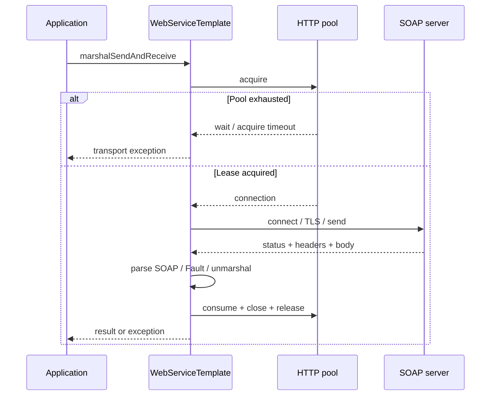

# Lỗi cạn kết nối, timeout và yêu cầu chờ không được giải phóng

## Mục tiêu học tập

Trong module **SPRING_WEB_SERVICES**, SOAP client có thể ngừng phục vụ dù endpoint còn hoạt động. HTTP connection pool có thể hết connection; request phải chờ acquire; response body/stream không được đóng khiến connection không quay lại pool. Với JMS, consumer/session/temporary reply destination và request-reply wait cũng có thể bị giữ lâu. Bài này trình bày cách nhận diện pool exhaustion, phân biệt các loại timeout, quản lý lifecycle tài nguyên và chẩn đoán request bị treo.

Sau bài học, bạn có thể phân biệt connection-pool exhaustion, connection leak, slow upstream và thread starvation; hiểu acquire/connect/read/end-to-end timeout; xử lý response body, attachment và JMS resources; cấu hình pool/concurrency/backpressure; dùng metrics/thread dump/heap diagnostics; và thiết kế cancellation, retry, idempotency cùng tests cho cleanup.

## 1. Triệu chứng và giả thuyết

| Triệu chứng | Nguyên nhân có thể | Dấu hiệu |
| --- | --- | --- |
| SOAP call chậm dần | Connection không release hoặc upstream chậm | Leased/available/pending, latency trend |
| Chờ trước khi gửi request | Pool hết connection | Acquire wait/timeout |
| Connect timeout | DNS/TCP/TLS/network | Connect/TLS timing |
| Read timeout | Server xử lý chậm hoặc response stalled | Server duration/socket read |
| Thread pool đầy | Threads block ở pool/socket/JMS | Thread dump, active/queue |
| Reply đến nhưng request pending | Stream chưa đóng, correlation mismatch | Release state, JMSCorrelationID |
| Memory tăng | Response/attachment buffers giữ lại | Heap, temp files |
| Timeout hàng loạt khi tải tăng | Pool/capacity mismatch hoặc retry storm | Arrival rate, retries, pending |

Cạn connection là triệu chứng. Tăng pool size có thể che leak hoặc slow upstream và đồng thời làm tăng tải lên partner.

## 2. Phân biệt các loại timeout

| Timeout | Đo thời gian | Hết hạn nghĩa là |
| --- | --- | --- |
| Pool acquire / connection-request | Chờ lấy lease từ pool | Không có connection sẵn |
| DNS | Resolve hostname | Không tìm được address kịp |
| Connect | Thiết lập TCP (và setup liên quan tùy client) | Không kết nối được peer |
| TLS handshake | Hoàn tất negotiation | Không thiết lập secure channel |
| Response/read | Chờ response hoặc bytes tiếp theo | Upstream không phản hồi đủ nhanh |
| JMS receive/reply | Chờ response message tương ứng | Không nhận matching reply |
| End-to-end deadline | Toàn bộ operation | Operation đã hết ngân sách thời gian |

Acquire timeout khác connect timeout: request có thể chờ pool lâu trước khi bắt đầu connect. Read timeout cũng không phải deadline tổng; peer có thể gửi từng phần dữ liệu trong khoảng timeout và kéo dài operation. Propagate remaining deadline qua các hop thay vì reset full timeout ở từng service.

## 3. HTTP connection lifecycle của SOAP client



Connection phải được release trên success và exception paths. Với pooled sender, response body thường cần consume hoặc close để connection reuse an toàn. Không giữ response stream ngoài invocation nếu không có lifecycle riêng. Keep-alive connection vẫn có thể bị peer đóng, stale hoặc hết idle lifetime; đó không tự động là leak.

## 4. Phân biệt exhaustion, leak, slow upstream và starvation

- **Pool exhaustion:** leased connection đạt limit; request mới phải chờ.
- **Connection leak:** response/connection không release sau invocation; leased count không trở về baseline.
- **Slow upstream:** connection được giữ lâu vì server/proxy response chậm dù cleanup đúng.
- **Thread starvation:** worker threads bị block chờ connection/socket/JMS; request mới không được xử lý kịp.

Các tình huống có thể xảy ra đồng thời. Đối chiếu leased/available/pending, acquire wait, request latency, thread count và server duration mới phân biệt được.

## 5. Cấu hình HTTP pool và timeout

Spring-WS hỗ trợ nhiều HTTP sender implementations; properties phụ thuộc sender/version. Ví dụ khái niệm dùng Apache HttpComponents 5:

```java
RequestConfig requestConfig = RequestConfig.custom()
    .setConnectionRequestTimeout(Timeout.ofSeconds(2))
    .setConnectTimeout(Timeout.ofSeconds(3))
    .setResponseTimeout(Timeout.ofSeconds(8))
    .build();

PoolingHttpClientConnectionManager pool =
    PoolingHttpClientConnectionManagerBuilder.create()
        .setMaxConnTotal(100)
        .setMaxConnPerRoute(30)
        .build();

CloseableHttpClient httpClient = HttpClients.custom()
    .setConnectionManager(pool)
    .setDefaultRequestConfig(requestConfig)
    .evictExpiredConnections()
    .build();
```

Đây là API HttpComponents 5, không phải cấu hình chung cho mọi Spring-WS sender. HttpComponents 4/JDK sender có class và timeout API khác. Kiểm tra BOM và sender production. Tạo HTTP client/pool theo application lifecycle; không tạo client/pool mỗi SOAP call. Shutdown pool khi application context dừng.

## 6. Pool sizing và Little's Law

Một ước lượng ban đầu theo Little's Law:

\[
L = \lambda W
\]

Trong đó L là số request in-flight trung bình, λ là arrival rate (request/second), W là service time trung bình (second). Ví dụ 40 calls/second với average service time 0,25 second tạo khoảng 10 calls in-flight trung bình. Pool thực tế cần tính burst, p95/p99 latency, route limits và headroom, nhưng không vượt capacity partner.

Cần tính cluster-wide concurrency. 8 replicas × 50 connections/replica có thể tạo đến 400 outbound connections. Đối chiếu quota, server capacity và số route; pool lớn hơn không đồng nghĩa throughput tốt hơn.

## 7. Backpressure và bounded concurrency

Khi arrival rate lớn hơn service capacity, queue không giới hạn làm latency và memory tăng. Dùng:
- Semaphore/bulkhead theo partner hoặc downstream.
- Bounded executor queue.
- Rate limiter và admission control.
- Circuit breaker khi upstream liên tục fail.
- Deadline hữu hạn và fail-fast khi chạm saturation.

Không block servlet threads vô hạn để chờ pool. Ghi metric khi acquire wait/pending vượt ngưỡng, trả lỗi quá tải rõ ràng và tránh retry ngay khi local pool đã cạn.

## 8. Response body, stream và attachment lifecycle

Nguồn leak phổ biến:
- Response body stream không consume/close.
- Custom callback giữ WebServiceMessage/Source sau invocation.
- MTOM attachment/temp file chưa cleanup.
- Exception xảy ra trước cleanup.
- Custom sender không release connection trong finally.
- Logging interceptor đọc stream không rewind được hoặc buffer không giới hạn.

Đóng stream do ứng dụng trực tiếp sở hữu; để sender/framework quản lý connection khi framework sở hữu. Không tự consume/close stream trong interceptor nếu framework còn cần parse. Không lưu InputStream trong singleton/service field.

```java
try (InputStream input = resource.getInputStream()) {
    return parseOrCopyWithinLimit(input);
}
```

Với MTOM, kiểm tra per-part/total byte limits, streaming/buffering threshold, temp storage và cleanup trên exception/cancellation.

## 9. Cancellation và deadline

Khi caller hủy hoặc deadline hết:
- Không bắt đầu downstream call mới.
- Cancel task/future nếu transport hỗ trợ.
- Đóng stream/connection theo ownership.
- Không để thread chờ socket vô hạn.
- Propagate remaining deadline qua downstream.
- Ghi outcome cancelled/timeout riêng.

Client cancellation không chứng minh server đã ngừng xử lý. Với write operation, server có thể đã commit trước khi response bị hủy; cần status lookup/idempotency trước retry.

## 10. JMS request-reply và tài nguyên chờ

JMS không dùng HTTP connection pool nhưng vẫn có lifecycle:
- Connection/Session/Producer/Consumer bị giữ hoặc tạo sai vòng đời.
- Temporary reply queue không được cleanup.
- Listener/consumer threads không đủ capacity.
- ReplyTo hoặc JMSCorrelationID mismatch.
- Request hết TTL trước xử lý.
- Client đã timeout nhưng late reply vẫn đến.
- Transaction rollback làm redelivery loop.
- Broker flow control/queue backlog.

Tách broker send timeout, receive/reply timeout, TTL và end-to-end deadline. TTL là tuổi message ở broker, không phải client response timeout. Dùng connection/session caching theo container/provider guidance; không tạo và đóng connection mỗi message nếu deployment yêu cầu pooled/cached resources.

## 11. Correlation và late reply cleanup

Request-reply cần correlation duy nhất, response matching theo convention, selector/dispatch đúng trên shared reply queue và cleanup pending map ở mọi path. Xử lý late response sau timeout bằng discard hoặc reconciliation; không gán reply cũ cho request mới.

Correlation ID ghép transport request-response; idempotency key bảo vệ business side effect. Hai giá trị có thể liên kết nhưng không thay nhau. Khi shutdown, cancel pending waiters và cleanup temporary destinations/consumers theo ownership.

## 12. Metrics chẩn đoán pool exhaustion

Theo dõi bounded labels theo sender/route/partner alias:
- Pool max, leased, available, pending.
- Acquire wait histogram và acquire timeout count.
- Connect/TLS duration/failure.
- Response/read duration/timeout.
- In-flight SOAP calls và p50/p95/p99 latency.
- Connection create/reuse/close counts.
- Response/attachment byte histograms.
- Executor active threads, queue depth, rejected tasks.
- JMS consumer count, queue depth, oldest age, expired/redelivered/DLQ.
- Pending reply count, reply timeout và late reply count.

Không dùng URL có customer ID, correlation ID, trace ID, order ID hoặc raw payload làm metric labels. Dùng route/operation allowlist.

## 13. Logs, thread dump và heap diagnostics

Khi sự cố:
1. Ghi pool snapshot leased/available/pending/max và acquire wait.
2. So request rate, p95/p99 latency, upstream health và retry count.
3. Lấy nhiều thread dumps cách nhau một khoảng để xem threads có tiến triển.
4. Tìm wait-for-pool-lease, socket read, TLS handshake, JMS receive và lock contention.
5. Nếu nghi leak, xem leased count có giảm sau completion hay không.
6. Dùng heap histogram/dump tìm byte arrays, response buffers, attachment temp objects và pending futures.
7. So correlation giữa client/server để biết request đã tới endpoint chưa.
8. Kiểm tra release/close ở success, Fault, parser error và cancellation.

Thread dump/heap dump có thể chứa hostname, credentials và business data. Lưu ở vùng hạn chế quyền, mã hóa và retention ngắn; không đính kèm raw payload vào ticket.

## 14. Đọc thread states

| Thread state/stack | Gợi ý | Đối chiếu |
| --- | --- | --- |
| Waiting for pool lease | Pool cạn/acquire queue | Leased/pending, holder stack |
| Socket read | Server/proxy chậm | Read timeout, upstream latency |
| Socket connect/TLS | DNS/network/certificate | Connect/TLS timing |
| JMS receive | Chờ reply hoặc listener idle | Reply timeout, correlation, queue depth |
| Blocked on lock | Contention/deadlock | Lock owner/cycle |
| Executor queue saturation | Thread starvation | Active/max/queue/rejections |

Một thread dump là snapshot. Lấy nhiều snapshot và đối chiếu metrics; nhiều threads WAITING không tự chứng minh connection leak.

## 15. Retry storm và overload cascade

Timeout có thể kích hoạt retry; retry làm arrival rate tăng và tiếp tục chiếm pool. 100 requests retry 3 lần có thể tạo gần 4 lần số attempt ban đầu. Chỉ retry lỗi transient đã phân loại, dùng exponential backoff, jitter, retry budget, deadline, circuit breaker và bulkhead. Không retry pool-acquire timeout ngay lập tức vì đó thường là local saturation.

Read timeout sau SOAP SubmitOrder có thể xảy ra sau commit. Phân biệt connect failure trước khi gửi với read timeout sau khi gửi; dùng idempotency/status reconciliation trước retry write operation.

## 16. Exception classification

| Category | Ý nghĩa | Hướng xử lý |
| --- | --- | --- |
| Pool acquire timeout | Không lấy được lease | Backpressure, kiểm tra leak/capacity |
| Connect timeout | Không thiết lập được peer connection | DNS/network/TLS; retry kiểm soát |
| Read/response timeout | Peer không gửi dữ liệu kịp | Kiểm tra upstream; outcome có thể chưa rõ |
| WebServiceIOException | I/O qua Spring-WS | Giữ cause/sender context |
| WebServiceTransportException | HTTP/transport failure tùy sender | Phân loại status/body |
| SoapFaultClientException | SOAP Fault đã parse | Dùng code/detail, thường không retry nguyên trạng |
| Message parse exception | Response không thành SOAP message | Kiểm tra bytes/content type/provider |
| Cancellation/interruption | Caller/task dừng | Cleanup; giữ interrupt semantics |

Exception wrapping phụ thuộc sender/library. Quyết định retry theo cause, request-sent state và operation semantics, không chỉ theo một class.

## 17. Connection leak tests

Dùng HTTP sender/pool thật trong test; mock WebServiceTemplate không kiểm tra connection manager lifecycle. Xác minh:
- Sau success, leased count về baseline.
- Sau SOAP Fault, connection được release.
- Sau malformed response, body/connection đóng.
- Sau read timeout/cancellation, lease được release.
- Khi pool max bị chiếm, waiter pending rồi timeout theo cấu hình.
- Shutdown đóng pool/client và idle connections.

Nếu sender không expose metrics, wrap manager hoặc dùng instrumentation test. Không assert bằng sleep dài cố định; dùng bounded await/poll hoặc latch.

## 18. Test pool exhaustion và timeout

Kịch bản deterministic với embedded HTTP server:
1. Cấu hình pool max 1 cho route.
2. Request thứ nhất đến handler rồi giữ response chưa gửi.
3. Request thứ hai bắt đầu acquire.
4. Xác minh pending/acquire wait và connection-request timeout.
5. Giải phóng request đầu.
6. Xác minh request kế tiếp acquire được lease.
7. Đảm bảo server/client/pool được cleanup.

Connect timeout cần controlled network fixture; read timeout dùng server nhận request nhưng trì hoãn response. Tránh sleep không deterministic nếu có latch/barrier/controllable handler.

## 19. Kiểm thử cleanup trên success và failure

```java
@Test
void releasesConnectionAfterResponse() {
    // Use a real pooled sender and controllable HTTP server.
    // Send SOAP request and assert the valid response.
    // Wait for completion and assert leased count is at baseline.
}

@Test
void releasesConnectionAfterReadFailure() {
    // Server accepts the request and stalls/closes its response.
    // Assert failure within the configured deadline.
    // Assert connection lease is released.
}
```

Đây là pseudocode; pool metric accessor phụ thuộc implementation. Bổ sung tests cho Fault, parser failure và cancellation. Dùng bounded await thay arbitrary sleeps.

## 20. Load test và capacity planning

Đo arrival rate, in-flight, p50/p95/p99, acquire wait, leased/pending, upstream 429/5xx/Fault, CPU/heap/GC/thread count, retries/circuit breaker và JMS queue age. Tìm knee point nơi latency/error tăng nhanh trước khi throughput plateau.

Thử steady load, burst, slow dependency, pool saturation và recovery after outage. Pool/bulkhead quá nhỏ làm giảm throughput; pool quá lớn có thể overload partner. Tính tổng concurrency của mọi replicas, không chỉ một process.

## 21. Resource cleanup checklist

- Response body được consume/close.
- Stream do đúng owner đóng.
- HTTP connection release sau success/Fault/parser error.
- Attachment temp files cleanup.
- JMS connection/session/producer/consumer theo lifecycle container.
- Temporary reply queue cleanup.
- Pending correlation/future entries được xóa.
- Interrupted/cancelled tasks không giữ resource.
- Retry task cancel khi deadline hết.
- Pool/HTTP client shutdown lúc application dừng.
- Metrics/threads không tăng đơn điệu sau test.

## 22. Security khi chẩn đoán

Không log Authorization, cookies, UsernameToken, private key, full certificate contents, SOAP Body hoặc attachment. Redact query params có secret. Thread/heap dumps có thể chứa business data; giới hạn access, encrypt và đặt retention. Dùng correlation đã sanitize và partner alias đã xác thực; không dùng ID/payload làm metric labels.

## 23. Ma trận kiểm thử connection/timeout

| ID | Tình huống | Kỳ vọng |
| --- | --- | --- |
| C01 | Pool acquire hết deadline | Phân loại acquire timeout |
| C02 | Slow upstream | Read timeout hoặc latency đo được |
| C03 | Connect unreachable | Connect timeout |
| C04 | Response body leak | Leased metric không về baseline, test phát hiện |
| C05 | Success response close | Connection release |
| C06 | SOAP Fault | Release và Fault mapping đúng |
| C07 | Malformed XML | Cleanup và parse error |
| C08 | Caller cancellation | Task/connection cleanup |
| C09 | Retry storm | Budget/backoff/circuit breaker giới hạn |
| C10 | Pool max 1, concurrent calls | Pending/acquire timeout đúng |
| C11 | JMS late reply | Không ghép nhầm request |
| C12 | JMS TTL expiry | Expiry/DLQ metric |
| C13 | Correlation mismatch | Request timeout có diagnostic |
| C14 | Temporary queue | Consumer/destination cleanup |
| C15 | Executor saturation | Backpressure/rejection |
| C16 | Large MTOM | Size/memory/temp cleanup |
| C17 | Application shutdown | Client/pool/session đóng |
| C18 | Multiple replicas | Tổng concurrency trong partner capacity |

## 24. Bài tập và đáp án

1. **Acquire khác connect timeout?** Acquire chờ lease trong pool; connect thiết lập TCP peer connection.
2. **Read timeout khác deadline?** Read timeout đo chờ bytes/response; deadline bao trùm cả operation.
3. **Leased count tăng liên tục?** Kiểm tra body/stream/attachment cleanup và exception paths.
4. **Tăng pool là đủ?** Không; có thể che leak/slow upstream và làm quá tải partner.
5. **10 replicas, pool 40?** Potential outbound connections có thể lên 400; tính cluster-wide.
6. **Thread dump nhiều socket read?** Kiểm tra upstream latency/read timeout.
7. **SOAP Fault có cần release?** Có; connection phải release trên Fault path.
8. **JMS TTL bằng response timeout?** Không; TTL là expiry của broker message.
9. **Correlation chống duplicate order?** Không; cần idempotency key.
10. **Read timeout sau SubmitOrder?** Outcome chưa rõ; lookup/idempotency trước retry.
11. **MDC tự qua async?** Không; cần context propagation.
12. **Retry acquire timeout ngay?** Không nên; thường báo local saturation.
13. **Temporary reply queue tồn tại lâu?** Kiểm tra owner/close lifecycle.
14. **Một thread dump đủ kết luận leak?** Không; cần nhiều snapshot và pool metrics.
15. **Correlation ID làm metric label?** Không; để trong log/trace.
16. **MTOM temp file tăng?** Kiểm tra attachment cleanup/response lifecycle.
17. **Tạo HTTP client mỗi request?** Tránh; dùng application-scoped client/pool.
18. **Task hết deadline nhưng vẫn chạy?** Cancel nếu có thể, cleanup; không giả định server đã dừng.

## 25. Troubleshooting runbook

| Triệu chứng | Kiểm tra đầu tiên | Hành động |
| --- | --- | --- |
| Pool acquire timeout | leased/max/pending/wait | Bulkhead, backpressure, tìm holder/leak |
| Connection không release | Response body/stream lifecycle | Sửa consume/close ở mọi path |
| Connect timeout | DNS/TCP/TLS timing | Kiểm tra network/route/certificate |
| Read timeout | Server p95/p99 và socket state | Điều tra upstream, deadline, idempotency |
| Threads WAITING tăng | Thread dump và pool metrics | Phân biệt pool wait/socket read/lock |
| JMS reply timeout | Correlation/replyTo/queue depth | Sửa selector/listener/late reply |
| JMS redelivery loop | Transaction/ack/DLQ | Idempotency và poison message |
| Memory tăng | Heap histogram/attachment temp | Giới hạn body và cleanup |
| Recovery chậm sau outage | Retry backlog/circuit breaker | Rate-limited recovery, drain backlog |

## 26. Checklist production

- [ ] Pool max total/per route theo capacity upstream.
- [ ] Acquire, connect, TLS/read và end-to-end timeout tách biệt.
- [ ] Timeout hữu hạn ở mọi boundary.
- [ ] HTTP client/pool application-managed, không tạo mỗi request.
- [ ] Response body/stream/attachment cleanup được xác minh.
- [ ] Leased/available/pending/acquire wait metrics có alert.
- [ ] Bounded concurrency/bulkhead/rate limit.
- [ ] Executor queue/thread pool bounded.
- [ ] JMS replyTo/correlation/TTL/receive timeout rõ.
- [ ] Temporary queue/consumer/session cleanup đúng.
- [ ] Redelivery/DLQ/idempotency được thiết kế.
- [ ] Cancellation/deadline propagation được test.
- [ ] Retry budget/backoff/jitter/circuit breaker.
- [ ] Load test steady/burst/slow dependency/recovery.
- [ ] Thread/heap diagnostics access-controlled.
- [ ] Logs không có SOAP payload/token/private key.
- [ ] Metric labels không có request/trace/business IDs.
- [ ] Test release trên success/Fault/parser error/timeout.
- [ ] Tổng concurrency cluster nằm trong partner quota.
- [ ] Shutdown đóng sender/pool/broker resources.

## 27. Tài liệu tham khảo chính thức

1. [Spring Web Services 4.1.4 Reference](https://docs.spring.io/spring-ws/docs/4.1.4/reference/html/) — WebServiceTemplate và HTTP/JMS transport.
2. [Spring-WS WebServiceTemplate API](https://docs.spring.io/spring-ws/docs/4.1.4/api/org/springframework/ws/client/core/WebServiceTemplate.html) — sender integration/lifecycle.
3. [Spring-WS HttpComponents5MessageSender API](https://docs.spring.io/spring-ws/docs/4.1.4/api/org/springframework/ws/transport/http/HttpComponents5MessageSender.html) — HttpComponents 5 integration.
4. [Apache HttpComponents 5 Connection Management](https://hc.apache.org/httpcomponents-client-5.3.x/current/tutorial/html/connmgmt.html) — pools/leases.
5. [Apache HttpComponents 5 Advanced Configuration](https://hc.apache.org/httpcomponents-client-5.3.x/current/tutorial/html/advanced.html) — timeout/request config.
6. [JDK 17 HttpClient API](https://docs.oracle.com/en/java/javase/17/docs/api/java.net.http/java/net/http/HttpClient.html) — HTTP client.
7. [Jakarta Messaging Specification](https://jakarta.ee/specifications/messaging/) — Connection/Session/request-reply/transactions.
8. [Micrometer Reference](https://docs.micrometer.io/micrometer/reference/) — gauges/timers/histograms.
9. [OpenTelemetry Specification](https://opentelemetry.io/docs/specs/otel/) — tracing/context propagation.
10. [Google SRE — Handling Overload](https://sre.google/sre-book/handling-overload/) — load shedding/overload.
11. [Google SRE — Addressing Cascading Failures](https://sre.google/sre-book/addressing-cascading-failures/) — retries/resource exhaustion.
12. [OWASP Logging Cheat Sheet](https://cheatsheetseries.owasp.org/cheatsheets/Logging_Cheat_Sheet.html) — safe diagnostics.

**Phạm vi ví dụ:** Hướng tới Spring-WS 4.1.4, Java 17+ và Apache HttpComponents 5 trong ví dụ pool. API timeout khác giữa HttpComponents 4/5 và JDK sender; kiểm tra BOM/sender đang dùng. Test cleanup là pseudocode cần pool metrics/accessor và controllable HTTP server. STEP 4 không chạy Maven/Gradle/JUnit, JMS broker hoặc load tests.

## Tổng kết

**Cạn connection, timeout và request không được giải phóng có liên quan nhưng khác nguyên nhân.** Pool acquire timeout là không lấy được lease; connect timeout xảy ra khi thiết lập kết nối; read timeout xảy ra khi chờ response/bytes; end-to-end deadline bao trùm toàn operation. Connection leak thường xuất hiện khi body, stream hoặc attachment không được consume/close; slow upstream giữ lease lâu dù cleanup đúng.

Đo leased/available/pending, acquire wait, connect/read latency, in-flight calls, thread states và JMS reply metrics. Đặt timeout hữu hạn, bounded concurrency, backpressure và retry budget; cleanup mọi resource trên success, Fault, exception và cancellation. Với write operation, timeout không chứng minh server chưa commit: cần idempotency hoặc reconciliation trước retry. Những nguyên tắc này giúp SOAP client ổn định khi downstream chậm, broker backlog hoặc mạng không đáng tin cậy.

