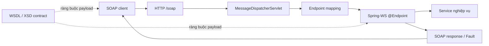

# Tên starter, cấu hình tự động và hỗ trợ kiểm thử khác nhau giữa các dòng Spring Boot

> **Phạm vi:** `SPRING_WEB_SERVICES` — phát triển dịch vụ SOAP theo hướng **contract-first** với Spring Web Services (Spring-WS): thiết kế XSD/WSDL, ánh xạ JAXB, triển khai `@Endpoint`, gọi dịch vụ bằng SOAP client, xử lý SOAP Fault, interceptor, XML security và WS-Security. Bài này tập trung vào tác động của **Spring Boot 2.7, 3.x và 4.x** đến cách khai báo dependency, auto-configuration và kiểm thử hệ thống tích hợp doanh nghiệp.

Một dịch vụ SOAP có thể giữ nguyên WSDL, namespace, operation và XML payload khi nâng cấp Spring Boot, nhưng không vì thế mà bản build hoặc bài test cũ sẽ tiếp tục chạy. Phần dễ nhầm nhất là **tên Maven artifact**, **package của test annotation** và **phạm vi các thành phần Boot tự cấu hình**. Cần tách rõ ba thứ: Spring-WS thực hiện xử lý thông điệp SOAP; Spring Boot cấu hình hạ tầng dựa trên classpath và các bean; hợp đồng XSD/WSDL quyết định khả năng tương thích với đối tác.

## 1. Đọc nhanh ma trận phiên bản

| Nội dung | Spring Boot 2.7.x | Spring Boot 3.x (ví dụ 3.5.x) | Spring Boot 4.x |
|---|---|---|---|
| Starter SOAP server/client | `org.springframework.boot:spring-boot-starter-web-services` | `org.springframework.boot:spring-boot-starter-web-services` | **`org.springframework.boot:spring-boot-starter-webservices`** |
| Starter cũ khi lên Boot 4 | Tên chuẩn của dòng này | Tên chuẩn của dòng này | `spring-boot-starter-web-services` còn là **tên tương thích đã deprecated**; nên thay bằng `spring-boot-starter-webservices` |
| Dependency test | `spring-boot-starter-test`; thêm `org.springframework.ws:spring-ws-test` khi cần Spring-WS mock | Tương tự Boot 2.7 | **`spring-boot-starter-webservices-test`** (đã kéo hạ tầng kiểm thử phù hợp qua dependency bắc cầu) |
| `@WebServiceClientTest` / `@WebServiceServerTest` | `org.springframework.boot.test.autoconfigure.webservices.client/server` | `org.springframework.boot.test.autoconfigure.webservices.client/server` | **`org.springframework.boot.webservices.test.autoconfigure.client/server`** |
| Jakarta/XML binding | Nhiều API JAXB/JAX-WS theo `javax.*` | Chuyển sang `jakarta.*` tương ứng với Spring Framework 6 | Tiếp tục hệ `jakarta.*`; đồng thời điều chỉnh import Boot khi tách module |
| Auto-configuration Spring-WS | Hỗ trợ endpoint, servlet, WSDL/XSD và `WebServiceTemplateBuilder` | Cùng nguyên tắc, nhưng thế hệ Spring/Jakarta mới | Cùng mô hình hoạt động; các lớp auto-configuration/test được tổ chức thành module/package theo công nghệ |

**Điểm phân biệt:** `spring-boot-starter-web-services` (**web-services**) và `spring-boot-starter-webservices` (**webservices**) là hai chuỗi artifact khác nhau. Tài liệu mô tả tính năng đôi khi dùng cách viết liền `webservices`; khi khai báo dependency của **Boot 2.x/3.x**, hãy đối chiếu artifact của chính dòng Boot đó. Với **Boot 4.x**, chọn artifact mới không có dấu gạch nối giữa `web` và `services`. Không nhầm starter SOAP với `spring-boot-starter-web`/`spring-boot-starter-webmvc`: chúng phục vụ Spring MVC và không thay thế starter Spring-WS.

## 2. Chọn dependency đúng cho dòng Boot

### Dự án Spring Boot 2.7 hoặc 3.x dùng Maven

Giả sử project đã có `spring-boot-starter-parent` hoặc BOM `spring-boot-dependencies` **đúng phiên bản Boot đang chạy**:

```xml
<dependencies>
    <!-- SOAP server, SOAP client và Spring Web Services -->
    <dependency>
        <groupId>org.springframework.boot</groupId>
        <artifactId>spring-boot-starter-web-services</artifactId>
    </dependency>

    <dependency>
        <groupId>org.springframework.boot</groupId>
        <artifactId>spring-boot-starter-test</artifactId>
        <scope>test</scope>
    </dependency>
    <!-- MockWebServiceClient/MockWebServiceServer của Spring-WS -->
    <dependency>
        <groupId>org.springframework.ws</groupId>
        <artifactId>spring-ws-test</artifactId>
        <scope>test</scope>
    </dependency>
</dependencies>
```

Trên Boot 2.7, một số mã JAXB cũ nhập `javax.xml.bind.*`; khi chuyển sang Boot 3, phải chuyển sang API `jakarta.xml.bind.*` và đồng bộ thư viện/runtime sinh mã JAXB theo thế hệ tương ứng. Không tự ép phiên bản Spring-WS, Spring Framework hoặc JAXB khác BOM nếu chưa có lý do đã được kiểm chứng.

### Dự án Spring Boot 4.x dùng Maven

```xml
<dependencies>
    <dependency>
        <groupId>org.springframework.boot</groupId>
        <artifactId>spring-boot-starter-webservices</artifactId>
    </dependency>

    <dependency>
        <groupId>org.springframework.boot</groupId>
        <artifactId>spring-boot-starter-webservices-test</artifactId>
        <scope>test</scope>
    </dependency>
</dependencies>
```

Starter kiểm thử dành riêng cho Spring-WS của Boot 4 chứa phần hỗ trợ test phù hợp với mô-đun này và kéo theo `spring-boot-starter-test`; thông thường không cần khai báo lại starter test chung chỉ để chạy các test SOAP. Nếu một module còn test những công nghệ khác, thêm starter test tương ứng cho từng công nghệ. Việc dùng `spring-boot-starter-test-classic` chỉ là bước chuyển tiếp khi di chuyển ứng dụng cũ, không phải lựa chọn mặc định cho code mới.

Với Gradle, ý tưởng tương đương:

```gradle
// Boot 3.x
implementation 'org.springframework.boot:spring-boot-starter-web-services'
testImplementation 'org.springframework.boot:spring-boot-starter-test'
testImplementation 'org.springframework.ws:spring-ws-test'

// Boot 4.x: thay bộ dependency bên trên bằng
// implementation 'org.springframework.boot:spring-boot-starter-webservices'
// testImplementation 'org.springframework.boot:spring-boot-starter-webservices-test'
```

Đây là **hai bộ cấu hình thay thế nhau theo phiên bản**, không phải các dòng cùng bật trong một build.

## 3. Spring Boot tự cấu hình những gì?

Spring-WS hướng message: thông điệp SOAP đi qua `MessageDispatcherServlet`, được phân giải theo payload/endpoint mapping, chuyển thành lời gọi phương thức `@Endpoint`, sau đó phản hồi dưới dạng XML/SOAP. Spring Boot có thể cấu hình servlet và các thành phần hỗ trợ khi dependency và điều kiện auto-configuration phù hợp.



| Khả năng | Boot hỗ trợ mặc định | Điều ứng dụng vẫn phải xác định |
|---|---|---|
| Tiếp nhận SOAP | Đăng ký hạ tầng xử lý Spring-WS/`MessageDispatcherServlet` khi đủ điều kiện | `@Endpoint`, quy tắc `@PayloadRoot`, xử lý nghiệp vụ, mapping và route mong muốn |
| Trình bày contract | Tạo bean `SimpleWsdl11Definition` và `SimpleXsdSchema` từ WSDL/XSD được tìm thấy tại vị trí cấu hình | Bộ XSD/WSDL hợp lệ, namespace và tính ổn định của contract |
| Sinh WSDL từ XSD | Có lớp `DefaultWsdl11Definition` trong Spring-WS | **Phải khai báo bean và các thông số thích hợp**; không tự có WSDL động chỉ vì thêm XSD vào resources |
| SOAP client | Cung cấp `WebServiceTemplateBuilder` | Tự tạo `WebServiceTemplate`, thiết lập endpoint URL, marshaller, timeouts, TLS, WS-Security, retry nếu cần |
| SOAP Fault / WS-Security | Tích hợp được các cơ chế của Spring-WS | Tự cấu hình exception resolver, interceptor, chứng chỉ, chính sách bảo mật và test tương ứng |

**Không có một bean `WebServiceTemplate` toàn cục được Boot tự tạo sẵn.** Boot cung cấp `WebServiceTemplateBuilder` để mỗi client chủ động tạo template theo hợp đồng và cách xác thực của đối tác. Nhầm lẫn này thường dẫn tới lỗi `NoSuchBeanDefinitionException` khi tiêm trực tiếp `WebServiceTemplate` mà chưa khai báo bean.

Một hạ tầng SOAP được auto-configure không đồng nghĩa có thể bỏ kiểm thử HTTP: cấu hình servlet path, reverse proxy, authentication và tải WSDL thực tế vẫn có thể thay đổi hành vi khi triển khai.

## 4. Các property quan trọng tương đối ổn định qua các dòng

Ví dụ `application.yml` cho ứng dụng lưu WSDL/XSD dưới `src/main/resources/wsdl/`:

```yaml
spring:
  webservices:
    path: /soap
    wsdl-locations: classpath:/wsdl
    servlet:
      load-on-startup: 1
```

| Property | Ý nghĩa | Cần kiểm chứng |
|---|---|---|
| `spring.webservices.path` | Đường dẫn gốc cho SOAP servlet; mặc định thường là `/services` | Đường dẫn client, reverse proxy, firewall và các URL đang công bố |
| `spring.webservices.wsdl-locations` | Nơi quét WSDL/XSD để công bố dưới dạng bean định nghĩa/schema | File phải thật sự nằm trên classpath sau khi đóng gói; file WSDL khác XSD |
| `spring.webservices.servlet.load-on-startup` | Mức ưu tiên khởi tạo SOAP servlet | Chủ yếu khi cần phát hiện lỗi hạ tầng sớm lúc khởi động |
| `spring.webservices.servlet.init.*` | Init parameters của Spring-WS servlet khi có nhu cầu đặc biệt | Không sao chép tùy tiện cấu hình servlet viết tay từ phiên bản cũ |

Khi đã chọn `spring.webservices.path=/soap`, SOAP HTTP endpoint thường được xử lý dưới `/soap`; một bean WSDL tên `orders` sẽ được tra cứu theo đường dẫn dạng `/soap/orders.wsdl` nếu được công bố bởi Spring-WS. Các URL này còn phụ thuộc context path, proxy và cấu hình servlet thực tế. **Không coi việc tải được WSDL là bằng chứng endpoint đã xử lý payload chính xác.**

Trong dự án contract-first, nên ưu tiên **WSDL cố định, được phiên bản hóa** khi tổ chức đã giao contract cho khách hàng. `spring.webservices.wsdl-locations` hữu ích với contract đóng gói sẵn. Nếu thật sự muốn tạo WSDL từ XSD, cấu hình bean rõ ràng:

```java
import org.springframework.context.annotation.Bean;
import org.springframework.context.annotation.Configuration;
import org.springframework.core.io.ClassPathResource;
import org.springframework.ws.wsdl.wsdl11.DefaultWsdl11Definition;
import org.springframework.xml.xsd.SimpleXsdSchema;
import org.springframework.xml.xsd.XsdSchema;

@Configuration(proxyBeanMethods = false)
class OrdersContractConfiguration {

    @Bean
    XsdSchema ordersSchema() {
        return new SimpleXsdSchema(new ClassPathResource("xsd/orders.xsd"));
    }

    @Bean(name = "orders")
    DefaultWsdl11Definition ordersWsdl(XsdSchema ordersSchema) {
        var wsdl = new DefaultWsdl11Definition();
        wsdl.setPortTypeName("OrdersPort");
        wsdl.setLocationUri("/soap");
        wsdl.setTargetNamespace("urn:example:orders:v1");
        wsdl.setSchema(ordersSchema);
        return wsdl;
    }
}
```

Ví dụ này **giả định đã có** `src/main/resources/xsd/orders.xsd` với element request/response phù hợp. Hãy thực tế kiểm tra WSDL được sinh, tên operation và `soap:address` (đặc biệt khi ở sau gateway) trước khi cho đối tác sử dụng. WSDL được sinh động từ XSD có thể thay đổi ngoài ý muốn nếu thay đổi quy tắc đặt tên; khi contract là cam kết tương thích, nên lưu bản WSDL đã phê duyệt và kiểm tra diff trong CI.

## 5. Vấn đề đi cùng khi nâng cấp từ Boot 2 sang Boot 3

Thay đổi thường lớn hơn tên starter: Boot 3 dùng Spring Framework 6 và các API Jakarta. Trong dự án JAXB contract-first, thay đổi tối thiểu thường thấy là:

```java
// Mã Boot 2.x/JAXB đời cũ có thể dùng:
import javax.xml.bind.JAXBElement;
import javax.xml.bind.annotation.XmlRootElement;

// Mã Boot 3.x/4.x với JAXB Jakarta cần đổi sang:
// import jakarta.xml.bind.JAXBElement;
// import jakarta.xml.bind.annotation.XmlRootElement;
```

Đoạn trên minh họa **sự khác nhau của import**; trong file Java thật chỉ giữ một nhóm import phù hợp dòng Boot. Các lớp JAXB được sinh từ XSD cũng phải sinh lại bằng phiên bản công cụ hỗ trợ `jakarta.xml.bind.*` nếu đang chuyển sang Boot 3/4. Không trộn bytecode được sinh theo `javax` với runtime Jakarta rồi cố vá bằng cách thêm nhiều JAXB implementation.

Danh sách kiểm tra liên quan:

1. Kiểm tra plugin/codegen XJC, package JAXB (`javax`/`jakarta`), `ObjectFactory`, `JAXBElement` và namespace của lớp được sinh; giữ nguyên XML namespace dù Java package đổi.
2. Kiểm tra `Jaxb2Marshaller` dùng đúng `contextPath` hoặc `classesToBeBound`, schema validation và cách đặt phần tử gốc (có kiểu JAXB cần `JAXBElement`).
3. Kiểm tra XML payload thực trả về, `xsi:nil`, `minOccurs`, thứ tự element, định dạng ngày giờ; đây mới là những chi tiết đối tác SOAP quan sát được.
4. Kiểm tra các interceptor, SOAP Fault resolver, WS-Security, XML signature, keystore/truststore và implementation liên quan đã tương thích với dòng Spring-WS mới.

Nếu code không compile vì `javax.xml.bind.*` hoặc thiếu package, sửa nguồn sinh và dependency tương ứng; **không thay đổi target namespace để khắc phục lỗi compile**. Thay namespace là thay hợp đồng tích hợp.

## 6. Kiểm thử SOAP endpoint: giữ ý nghĩa test, đổi import theo Boot

Spring Boot cung cấp slice test `@WebServiceServerTest` dành cho phía server. Nó khởi tạo hạ tầng Spring-WS cần cho endpoint và hỗ trợ `MockWebServiceClient` để gửi **SOAP payload qua cơ chế dispatch nội bộ**, không cần chạy cổng HTTP thật. Đây là cách kiểm tra định tuyến theo `@PayloadRoot` và nội dung SOAP response nhanh, ổn định.

Ví dụ một endpoint nhỏ dùng `Source` để bài tập không phụ thuộc generated JAXB model:

```java
import javax.xml.transform.Source;
import org.springframework.ws.server.endpoint.annotation.Endpoint;
import org.springframework.ws.server.endpoint.annotation.PayloadRoot;
import org.springframework.ws.server.endpoint.annotation.RequestPayload;
import org.springframework.ws.server.endpoint.annotation.ResponsePayload;
import org.springframework.xml.transform.StringSource;

@Endpoint
public class PingEndpoint {
    public static final String NS = "urn:example:health:v1";

    @PayloadRoot(namespace = NS, localPart = "PingRequest")
    @ResponsePayload
    public Source ping(@RequestPayload Source request) {
        return new StringSource("""
            <p:PingResponse xmlns:p="urn:example:health:v1">
              <p:message>pong</p:message>
            </p:PingResponse>
            """);
    }
}
```

`javax.xml.transform.Source` ở đây là **Java XML Transformation API** (`javax.xml.transform`), *không phải* JAXB `javax.xml.bind`. Nó vẫn dùng được ở các dòng Boot mới; không thay thành `jakarta.xml.transform` (package đó không tồn tại).

Test tương ứng **dành cho Boot 4.x**:

```java
import org.junit.jupiter.api.Test;
import org.springframework.beans.factory.annotation.Autowired;
import org.springframework.boot.webservices.test.autoconfigure.server.WebServiceServerTest;
import org.springframework.ws.test.server.MockWebServiceClient;
import org.springframework.xml.transform.StringSource;

import static org.springframework.ws.test.server.RequestCreators.withPayload;
import static org.springframework.ws.test.server.ResponseMatchers.payload;

@WebServiceServerTest(PingEndpoint.class)
class PingEndpointTest {
    @Autowired
    MockWebServiceClient client;

    @Test
    void traVeDungPayloadSoap() {
        client.sendRequest(withPayload(new StringSource("""
                <p:PingRequest xmlns:p="urn:example:health:v1"/>
                """)))
            .andExpect(payload(new StringSource("""
                <p:PingResponse xmlns:p="urn:example:health:v1">
                  <p:message>pong</p:message>
                </p:PingResponse>
                """)));
    }
}
```

Với **Boot 2.7 và 3.x**, phần lớn test giữ nguyên; đổi **duy nhất import annotation** ở ví dụ trên thành:

```java
import org.springframework.boot.test.autoconfigure.webservices.server.WebServiceServerTest;
```

Java text block trong ví dụ cần Java 15+; Boot 2.7 có thể chạy Java 17 nên vẫn dùng được. Nếu chạy dự án Boot 2 với Java 11, đổi text block thành chuỗi Java thông thường. `MockWebServiceClient` là lớp của **Spring-WS test** (`org.springframework.ws.test.server`), nên import này **không đổi chỉ vì Boot lên 4**.

Test slice không tự mang theo mọi service hoặc repository nghiệp vụ. Với endpoint phụ thuộc vào bean khác, khai báo collaborator thích hợp bằng `@Import`, mock bean phù hợp dòng Boot hoặc cấu hình test; tránh bật toàn bộ ứng dụng chỉ để giải quyết một dependency của endpoint.

## 7. Kiểm thử SOAP client: mock đối tác, không gọi network

`@WebServiceClientTest` chạy một lát cắt (slice) ở phía client, cấu hình `MockWebServiceServer` và tương tác với `WebServiceTemplateBuilder`. Đó là lý do client sử dụng builder thường dễ test hơn client tự tạo `WebServiceTemplate` bằng `new` và gắn message sender thủ công.

Một client tối giản dùng XML trực tiếp (thay bằng JAXB marshalling ở dự án thực tế):

```java
import org.springframework.boot.webservices.client.WebServiceTemplateBuilder;
import org.springframework.stereotype.Service;
import org.springframework.ws.client.core.WebServiceTemplate;
import org.springframework.xml.transform.StringResult;
import org.springframework.xml.transform.StringSource;

@Service
public class PartnerPingClient {
    private final WebServiceTemplate template;

    public PartnerPingClient(WebServiceTemplateBuilder builder) {
        this.template = builder.build();
    }

    public String ping() {
        var response = new StringResult();
        template.sendSourceAndReceiveToResult(
            "https://partner.example.invalid/soap",
            new StringSource("""
                <p:PingRequest xmlns:p="urn:example:health:v1"/>
                """),
            response);
        return response.toString();
    }
}
```

Ví dụ test **Boot 4.x**; mock chặn lời gọi của `WebServiceTemplate`, không cần DNS hoặc hệ thống đối tác:

```java
import org.junit.jupiter.api.Test;
import org.springframework.beans.factory.annotation.Autowired;
import org.springframework.boot.webservices.test.autoconfigure.client.WebServiceClientTest;
import org.springframework.ws.test.client.MockWebServiceServer;
import org.springframework.xml.transform.StringSource;

import static org.junit.jupiter.api.Assertions.assertTrue;
import static org.springframework.ws.test.client.RequestMatchers.payload;
import static org.springframework.ws.test.client.ResponseCreators.withPayload;

@WebServiceClientTest(PartnerPingClient.class)
class PartnerPingClientTest {
    @Autowired
    MockWebServiceServer server;

    @Autowired
    PartnerPingClient client;

    @Test
    void guiDungRequestVaDocResponse() {
        server.expect(payload(new StringSource("""
                <p:PingRequest xmlns:p="urn:example:health:v1"/>
                """)))
            .andRespond(withPayload(new StringSource("""
                <p:PingResponse xmlns:p="urn:example:health:v1">
                  <p:message>pong</p:message>
                </p:PingResponse>
                """)));

        assertTrue(client.ping().contains("pong"));
        server.verify();
    }
}
```

Với **Boot 2.7/3.x**, đổi import annotation thành:

```java
import org.springframework.boot.test.autoconfigure.webservices.client.WebServiceClientTest;
```

Tên `MockWebServiceServer`, các matcher `payload(...)` và `withPayload(...)` thuộc `spring-ws-test`; chúng **không chuyển sang package của Spring Boot 4**. Bài test thực tế nên xác nhận thêm SOAPAction, QName, namespace, SOAP Fault hoặc XML schema, thay vì chỉ kiểm tra `contains("pong")`. Ở những slice test dùng client tiêm trực tiếp `WebServiceTemplate` thay vì builder, cần cấu hình template một cách rõ ràng; với Boot 2.7/3.x có thể xem tùy chọn `@AutoConfigureWebServiceClient(registerWebServiceTemplate = true)`.

## 8. Chọn đúng cấp độ kiểm thử sau nâng cấp

| Mục tiêu | Công cụ gợi ý | Phát hiện được | Chưa đủ để khẳng định |
|---|---|---|---|
| Logic Java không liên quan XML | Unit test JUnit/Mockito | Xử lý nhánh nghiệp vụ, ngoại lệ | Tính đúng SOAP contract |
| Gửi SOAP từ endpoint | `@WebServiceServerTest` + `MockWebServiceClient` | Định tuyến payload, response, một phần interceptor/exception handling đã nạp | Port HTTP, proxy, TLS, cấu hình production |
| Gọi SOAP từ client | `@WebServiceClientTest` + `MockWebServiceServer` | XML/SOAP request và xử lý response/fault tại client | Tương thích thật với đối tác, certificate và mạng |
| Bean wiring và auto-configuration | `@SpringBootTest` | Tổ hợp bean, cấu hình thực, điều kiện auto-configuration | Đảm bảo WSDL không đổi hay hoạt động qua gateway |
| Contract/compatibility | So sánh WSDL/XSD phiên bản hóa + XML schema validation + SOAP mẫu cũ/mới | QName, namespace, cardinality, cấu trúc và khả năng đọc payload | TLS/WS-Security nếu chưa kiểm thử |
| End-to-end thực tế | `@SpringBootTest(webEnvironment = RANDOM_PORT)` hoặc môi trường tích hợp, gửi SOAP HTTP thực | Servlet mapping, filter, TLS/proxy khi có cấu hình môi trường phù hợp | Ổn định dài hạn nếu không có kiểm thử tải và cảnh báo |

`@SpringBootTest` và `@WebServiceServerTest` không phải cùng một kiểu test. Dùng slice cho vòng phản hồi nhanh; giữ một số bài test qua HTTP thực để kiểm tra các rủi ro tích hợp. Với toàn bộ Spring Boot context, có thể kết hợp annotation cấu hình mock chuyên biệt (`@AutoConfigureMockWebServiceClient` theo package/phiên bản) nếu muốn gửi SOAP bằng mock mà không mở cổng.

### Các ca kiểm thử không nên bỏ qua cho hệ thống doanh nghiệp

- **Contract-first:** so sánh WSDL/XSD với bản chuẩn đã công bố; kiểm tra QName request/response, namespace và element bắt buộc.
- **JAXB:** thử request có `xsi:nil`, phần tử lặp, enum lạ và ký tự Unicode; validate XML theo XSD và đọc bằng phiên bản client cũ.
- **SOAP Fault:** gửi yêu cầu không hợp lệ; xác nhận `faultcode`, `faultstring`/`Reason` và detail theo hợp đồng, tránh lộ stack trace hoặc dữ liệu nhạy cảm.
- **Interceptor:** ghi nhận correlation ID và kiểm tra interceptor có được gọi đúng thứ tự; không ghi log nội dung có thông tin nhạy cảm.
- **XML security:** kiểm tra chặn XXE/DTD và giới hạn payload theo chính sách đang áp dụng; cập nhật thư viện XML parser nếu có bản vá liên quan.
- **WS-Security/TLS:** kiểm tra chữ ký, timestamp, certificate hết hạn, trust chain và trường hợp signature không hợp lệ; đừng giả định mock SOAP client đã kiểm tra mTLS.
- **Khả năng tương thích:** chạy lại SOAP mẫu từ đối tác ở cả bản trước và sau nâng cấp; quan sát HTTP status, SOAPAction và WSDL URL ngoài gateway.

## 9. Quy trình nâng cấp có kiểm soát

### Trường hợp A: Boot 2.7 → 3.x

1. Chốt và lưu bản WSDL/XSD, SOAP request/response và các thông điệp lỗi làm baseline.
2. Nâng Boot cùng BOM, Java và các plugin cần thiết; tiếp tục dùng `spring-boot-starter-web-services`.
3. Chuyển `javax.xml.bind` sang `jakarta.xml.bind`, sinh lại JAXB classes bằng XJC phù hợp, kiểm tra các interceptor và thư viện XML/WS-Security.
4. Giữ import Boot test cũ `org.springframework.boot.test.autoconfigure.webservices.*` và chạy lại server/client slice test.
5. Kiểm thử full context, SOAP HTTP và hợp đồng với đối tác; đối chiếu WSDL sau nâng cấp.

### Trường hợp B: Boot 3.x → 4.x

1. Ưu tiên đưa dự án lên bản vá cuối phù hợp của dòng 3.x trước khi chuyển major, xử lý API đã deprecated.
2. Đổi `spring-boot-starter-web-services` thành **`spring-boot-starter-webservices`**; bổ sung **`spring-boot-starter-webservices-test`** trong test scope.
3. Đổi import annotation test từ `org.springframework.boot.test.autoconfigure.webservices...` sang **`org.springframework.boot.webservices.test.autoconfigure...`**. Rà soát các import auto-configuration khác của Spring Boot vì Boot 4 tách module và tổ chức lại package.
4. Chạy server/client slice test; nếu thiếu bean test, kiểm tra starter chuyên biệt và phạm vi bean được scan; không vội mở toàn bộ auto-configuration để che lỗi.
5. Xác minh `spring.webservices.path`, WSDL/XSD, `WebServiceTemplateBuilder`, TLS/certificate, SOAP Fault và mẫu XML trước/sau.
6. Sau khi bản build mới ổn định, dọn các starter/classic compatibility còn sót và chốt ma trận test cho CI.

Tại giai đoạn chuyển đổi, dự án có thể chạy được với starter SOAP cũ của Boot 4 vì tên đó còn tương thích, nhưng cần thay bằng tên mới để giảm phụ thuộc vào artifact deprecated. **Không đổi XML schema/namespace chỉ vì thay starter**; thay đổi đó phải có quy trình versioning contract riêng.

## 10. Chẩn đoán nhanh khi test hoặc dịch vụ ngừng hoạt động

| Triệu chứng | Nguyên nhân đáng kiểm tra đầu tiên | Hành động cụ thể |
|---|---|---|
| Maven báo không tìm thấy `spring-boot-starter-webservices` trong Boot 3 | Dùng tên artifact dành cho Boot 4 | Với Boot 3 đổi về `spring-boot-starter-web-services` |
| Không tìm thấy `WebServiceServerTest` sau nâng Boot 4 | Import package Boot 3 hoặc thiếu test starter mới | Đổi package `org.springframework.boot.webservices.test.autoconfigure.server` và thêm `spring-boot-starter-webservices-test` |
| Test không tiêm được `MockWebServiceClient` hoặc `MockWebServiceServer` | Sai loại slice, thiếu dependency test hoặc dùng full context mà không bật mock tương ứng | Chọn đúng annotation và kiểm tra dependency tree |
| `NoSuchBeanDefinitionException: WebServiceTemplate` | Tưởng Boot luôn tạo template mặc định | Tiêm `WebServiceTemplateBuilder`, tự tạo template hoặc bean được cấu hình |
| `ClassNotFoundException` với `javax.xml.bind.*` | JAXB codegen/dependency chưa qua Jakarta | Sinh lại class và đồng bộ JAXB API/runtime cho dòng mới |
| HTTP 404 khi gọi SOAP hoặc tải WSDL | Sai path, servlet registration, bean WSDL hoặc context path | Kiểm tra `spring.webservices.path`, mapping `@Endpoint`, URL ngoài proxy và tên bean WSDL |
| Có HTTP 200 nhưng đối tác báo sai hợp đồng | QName, namespace, SOAPAction, thứ tự XML hoặc WSDL khác bản cũ | So sánh XML thực tế, validate XSD và chạy compatibility test |
| Mock pass, production lỗi xác thực | Mock chưa đi qua TLS/WS-Security thật | Thêm integration test với chứng chỉ test, signed message và cấu hình gateway thực tế |
| `NoSuchMethodError`/lỗi auto-config khó hiểu | Trộn JAR Spring Boot/Spring-WS nhiều dòng hoặc tự ghi đè dependency BOM | In dependency tree, đồng bộ BOM/starter và loại bỏ override không cần thiết |

## 11. Bài thực hành và tiêu chí hoàn thành

**Bối cảnh:** doanh nghiệp có dịch vụ SOAP `OrderLookup` công bố WSDL `orders.wsdl` cùng namespace `urn:example:orders:v1`. Hệ thống đang chạy Boot 3.x; nhóm muốn nâng lên Boot 4.x mà các ERP client hiện tại không cần phát hành phiên bản mới.

**Yêu cầu:**

1. Đổi Maven starter runtime và test theo Boot 4, cập nhật import của `@WebServiceServerTest`/`@WebServiceClientTest`.
2. Giữ nguyên `@PayloadRoot`, XML namespace và WSDL/XSD đã giao; xác nhận endpoint vẫn nhận request cũ dưới đường dẫn servlet đang sử dụng.
3. Thêm một server slice test với `MockWebServiceClient` cho request thành công và một request bị từ chối thành SOAP Fault.
4. Thêm một client slice test với `MockWebServiceServer` xác nhận QName/SOAPAction và hành vi khi nhận SOAP Fault.
5. Chạy integration test qua HTTP, kiểm tra WSDL URL và một phiên bản đối tác giả lập dùng chứng chỉ test; ghi nhận diff hợp đồng.

**Đạt yêu cầu khi:** build hợp lệ với BOM Boot 4, hai slice test chạy qua, không còn import test auto-configuration đời Boot 3, request/response/fault và WSDL công bố vẫn tương thích với dữ liệu baseline, và có kết quả kiểm chứng TLS/WS-Security ở cấp tích hợp. Nếu hệ thống chủ động thay đổi contract, đó là một version API khác và cần kế hoạch tương thích riêng.

## 12. Tài liệu đối chiếu theo phiên bản

- [Spring Boot 3.5 — Web Services](https://docs.spring.io/spring-boot/3.5/reference/io/webservices.html): auto-configuration, WSDL/XSD, `WebServiceTemplateBuilder`.
- [Spring Boot 3.5 — Testing Spring Boot Applications](https://docs.spring.io/spring-boot/3.5/reference/testing/spring-boot-applications.html): test slice Spring-WS theo package `org.springframework.boot.test.autoconfigure.webservices`.
- [Spring Boot 4.0 — Build Systems](https://docs.spring.io/spring-boot/4.0/reference/using/build-systems.html): tên `spring-boot-starter-webservices` và `spring-boot-starter-webservices-test`, starter cũ deprecated.
- [Spring Boot 4.x — Web Services](https://docs.spring.io/spring-boot/reference/io/webservices.html): cấu hình hạ tầng và SOAP client thế hệ mới.
- [Spring Boot 4.x — Testing Spring Boot Applications](https://docs.spring.io/spring-boot/reference/testing/spring-boot-applications.html): package annotation test sau modularization.
- [Spring Boot 4.0 Migration Guide](https://github.com/spring-projects/spring-boot/wiki/Spring-Boot-4.0-Migration-Guide): danh sách starter đổi tên, test module và chiến lược di chuyển.
- [Spring Boot 2.7 — Reference](https://docs.spring.io/spring-boot/docs/2.7.x/reference/html/): đối chiếu cho hệ thống còn sử dụng Spring Boot 2.7.

Khi tra cứu tài liệu, hãy **khóa đường dẫn theo dòng phiên bản Boot của dự án**, thay vì sao chép import và starter từ trang `reference` luôn trỏ tới bản mới nhất. Quy tắc này đặc biệt quan trọng với các bài kiểm thử Spring-WS vì tên annotation gần như không đổi, nhưng package và artifact đã thay đổi đáng kể ở Boot 4.
