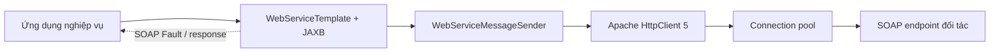

# Chuyển thư viện HTTP, cấu hình timeout và nhóm kết nối

Trong **SPRING_WEB_SERVICES**, SOAP client thường được xây dựng bằng `WebServiceTemplate`, JAXB marshaller và một `WebServiceMessageSender`. Khi nâng cấp Spring Web Services hoặc thư viện HTTP, thay đổi quan trọng không chỉ là tên lớp: cách quản lý kết nối, timeout, TLS, authentication và vòng đời tài nguyên đều có thể thay đổi. Bài này tập trung vào **chuyển tầng HTTP của SOAP client** trong quá trình **nâng cấp và di chuyển**; hợp đồng XSD/WSDL, payload JAXB, endpoint và cách xử lý SOAP Fault vẫn cần được kiểm thử tương thích sau khi chuyển.

## 1. Vì sao cần chuyển thư viện HTTP?

Giả sử một hệ thống đặt hàng gửi SOAP request đến dịch vụ thanh toán của đối tác. Khi tải thấp, mỗi yêu cầu thường thành công. Khi có hàng trăm đơn hàng đồng thời, hệ thống bắt đầu gặp các biểu hiện:

- Mỗi request tạo TCP/TLS connection mới, gây tốn thời gian handshake và tài nguyên.
- Thread chờ lấy connection từ pool quá lâu, dù dịch vụ đối tác vẫn phản hồi nhanh.
- Lời gọi bị treo vì chưa đặt timeout hoặc hiểu sai phạm vi của từng timeout.
- Sau khi nâng cấp, import từ Apache HttpClient 4 không còn khớp với API HttpClient 5; cấu hình proxy, TLS hoặc interceptor cũ cũng không tự chuyển theo.
- Request thất bại sau khi đã được phía đối tác xử lý; retry tự động có thể tạo giao dịch trùng.

**Mục tiêu:** giữ nguyên hành vi nghiệp vụ và contract SOAP, nhưng làm cho tầng truyền HTTP có giới hạn tài nguyên, giới hạn thời gian và khả năng quan sát rõ ràng.



`WebServiceTemplate` thực hiện gửi và nhận thông điệp SOAP; `WebServiceMessageSender` chịu trách nhiệm transport. Vì vậy, chuyển sender không mặc nhiên yêu cầu sửa WSDL/XSD, nhưng cần kiểm tra lại HTTP headers, proxy, chứng chỉ, SOAPAction, WS-Security và các interceptor liên quan.

## 2. Chọn sender và xác định phạm vi tương thích

| Lựa chọn | Tình huống phù hợp | Lưu ý khi nâng cấp |
|---|---|---|
| `HttpUrlConnectionMessageSender` | Nhu cầu HTTP cơ bản, ít yêu cầu quản lý pool chuyên sâu | Sử dụng `HttpURLConnection` của JDK; không có cùng API pool của Apache HttpClient |
| `HttpComponentsMessageSender` | Hệ thống cũ đang sử dụng Apache HttpClient 4 | Các kiểu `org.apache.http.*`; không truyền thẳng client cũ sang sender HttpClient 5 |
| `HttpComponents5MessageSender` | Dùng Apache HttpClient 5, muốn cấu hình các thuộc tính sender sẵn có | Có các setter kiểu `Duration` cho connect/read timeout; chi tiết API phụ thuộc phiên bản Spring-WS |
| `SimpleHttpComponents5MessageSender` | Muốn tự tạo HttpClient 5 với pool, request config, TLS, proxy hoặc metrics riêng | Có từ Spring-WS 4.1; nhận `org.apache.hc.client5.http.classic.HttpClient` qua constructor |
| `JdkHttpClientMessageSender` | Muốn dùng Java `HttpClient` mà không phụ thuộc Apache | Kiểm tra API và tính năng cần dùng ở phiên bản Spring-WS tương ứng |

Bản đồ chuyển đổi phổ biến:

| Trước (HttpClient 4) | Sau (HttpClient 5, classic/blocking) |
|---|---|
| `org.apache.http.impl.client.CloseableHttpClient` | `org.apache.hc.client5.http.impl.classic.CloseableHttpClient` |
| `org.apache.http.impl.client.HttpClients` | `org.apache.hc.client5.http.impl.classic.HttpClients` |
| `org.apache.http.impl.conn.PoolingHttpClientConnectionManager` | `org.apache.hc.client5.http.impl.io.PoolingHttpClientConnectionManager` |
| `org.apache.http.client.config.RequestConfig` | `org.apache.hc.client5.http.config.RequestConfig` |
| Cấu hình timeout kiểu `int` mili giây ở một số API cũ | `Timeout`, `TimeValue`, `Duration` tùy lớp và phiên bản |

**Ranh giới phiên bản:** ví dụ hoàn chỉnh phía dưới áp dụng cho **Spring-WS 4.1+** (bao gồm nhánh 5.x có `SimpleHttpComponents5MessageSender`) cùng dòng **Apache HttpClient 5.2+**. Với Spring-WS 4.0.x, kiểm tra JavaDoc của đúng bản đang sử dụng: `HttpComponents5MessageSender(HttpClient)` từng có, nhưng đã bị đánh dấu deprecated ở 4.1 và bị loại khỏi API 5.0. Không thay đổi import rồi giả định toàn bộ API là tương đương.

Nếu dự án dùng Spring Boot, nên để BOM quản lý phiên bản tương thích của `spring-ws-core` và `httpclient5`. Cần kiểm tra dependency tree để tránh mang nhầm hai thế hệ client vào cùng điểm tích hợp; hai thư viện có thể cùng tồn tại trên classpath nhưng đối tượng và phương thức không hoán đổi cho nhau.

## 3. Hiểu đúng ba timeout của HTTP client

Một lời gọi SOAP qua pooled HTTP client thường đi qua ba giai đoạn. Timeout là chính sách bảo vệ **từng giai đoạn**, không tự tạo một deadline cho toàn bộ giao dịch.

| Tham số | Chờ ở đâu? | Khi quá hạn, điều gì xảy ra? |
|---|---|---|
| `connectionRequestTimeout` | Chờ **mượn connection** từ pool khi tất cả connection khả dụng đang được sử dụng | Lời gọi thất bại trước khi có connection để gửi request |
| `connectTimeout` | Thiết lập kết nối mới tới đích (phạm vi chính xác phụ thuộc transport/phiên bản; DNS, proxy và TLS cần kiểm tra riêng) | Kết nối không thiết lập được trong giới hạn đã chọn |
| `responseTimeout` / socket read timeout | Chờ phản hồi hoặc dữ liệu trong một hoạt động I/O | Lời gọi thất bại nếu khoảng chờ I/O vượt giới hạn; không nhất thiết giới hạn tổng thời gian tải toàn bộ response |

Ví dụ với hệ thống thanh toán:

- Mượn connection: tối đa **750 ms**.
- Mở kết nối mới: tối đa **2 giây**.
- Chờ phản hồi: **8 giây**.
- Pool: tối đa **80 connection** toàn hệ thống, tối đa **20 connection/route**.

Nếu 50 lời gọi đồng thời cùng đến một route, tối đa 20 connection của route đó có thể được sử dụng tại một thời điểm; các lời gọi còn lại chờ pool và có thể hết hạn sau 750 ms. Tăng `maxConnTotal` mà không tăng giới hạn per-route sẽ không giải quyết được nút thắt ở route này.

**Cảnh báo:** `responseTimeout` không phải “toàn bộ SOAP call phải xong trong 8 giây”. Thời gian DNS, chờ pool, kết nối, TLS, serialization và retry có thể khiến tổng thời gian dài hơn. Với yêu cầu SLA end-to-end, đặt deadline ở tầng nghiệp vụ, kiểm soát retry và đo tổng thời gian thực tế. Tránh cấu hình giá trị `0` khi không chủ ý chờ vô hạn.

## 4. Cấu hình mẫu: Spring-WS + Apache HttpClient 5

Ví dụ dùng Java và Spring configuration thuần. Giả định đã có JAXB class sinh từ XSD/WSDL trong package `com.example.partner.soap.generated`. Các số timeout và giới hạn pool chỉ là điểm khởi đầu để kiểm thử tải, không phải cấu hình tối ưu cho mọi hệ thống.

Trong Gradle, có thể khai báo các dependency tương ứng như sau (phiên bản do BOM của dự án quản lý):

```groovy
dependencies {
    implementation("org.springframework.ws:spring-ws-core")
    implementation("org.apache.httpcomponents.client5:httpclient5")
    implementation("org.springframework:spring-oxm")
}
```

Cấu hình transport:

```java
import org.apache.hc.client5.http.config.ConnectionConfig;
import org.apache.hc.client5.http.config.RequestConfig;
import org.apache.hc.client5.http.impl.classic.CloseableHttpClient;
import org.apache.hc.client5.http.impl.classic.HttpClients;
import org.apache.hc.client5.http.impl.io.PoolingHttpClientConnectionManager;
import org.apache.hc.client5.http.impl.io.PoolingHttpClientConnectionManagerBuilder;
import org.apache.hc.core5.util.TimeValue;
import org.apache.hc.core5.util.Timeout;
import org.springframework.context.annotation.Bean;
import org.springframework.context.annotation.Configuration;
import org.springframework.oxm.jaxb.Jaxb2Marshaller;
import org.springframework.ws.client.core.WebServiceTemplate;
import org.springframework.ws.transport.http.SimpleHttpComponents5MessageSender;

@Configuration
public class PartnerSoapClientConfig {

    @Bean(destroyMethod = "close")
    public CloseableHttpClient partnerSoapHttpClient() {
        ConnectionConfig connectionConfig = ConnectionConfig.custom()
                .setConnectTimeout(Timeout.ofSeconds(2))
                .setSocketTimeout(Timeout.ofSeconds(8))
                .setTimeToLive(TimeValue.ofMinutes(5))
                .build();

        PoolingHttpClientConnectionManager pool =
                PoolingHttpClientConnectionManagerBuilder.create()
                        .setDefaultConnectionConfig(connectionConfig)
                        .setMaxConnTotal(80)
                        .setMaxConnPerRoute(20)
                        .build();

        RequestConfig requestConfig = RequestConfig.custom()
                .setConnectionRequestTimeout(Timeout.ofMilliseconds(750))
                .setResponseTimeout(Timeout.ofSeconds(8))
                .setRedirectsEnabled(false)
                .build();

        return HttpClients.custom()
                .setConnectionManager(pool)
                .setDefaultRequestConfig(requestConfig)
                .disableAutomaticRetries()
                .evictExpiredConnections()
                .evictIdleConnections(TimeValue.ofSeconds(30))
                .build();
    }

    @Bean
    public Jaxb2Marshaller partnerMarshaller() {
        Jaxb2Marshaller marshaller = new Jaxb2Marshaller();
        marshaller.setContextPath("com.example.partner.soap.generated");
        return marshaller;
    }

    @Bean
    public WebServiceTemplate partnerWebServiceTemplate(
            CloseableHttpClient partnerSoapHttpClient,
            Jaxb2Marshaller partnerMarshaller) {

        WebServiceTemplate template = new WebServiceTemplate();
        template.setMessageSender(
                new SimpleHttpComponents5MessageSender(partnerSoapHttpClient));
        template.setMarshaller(partnerMarshaller);
        template.setUnmarshaller(partnerMarshaller);
        template.setDefaultUri("https://partner.example.org/soap/orders");
        return template;
    }
}
```

Trong ví dụ:

1. `PoolingHttpClientConnectionManager` tái sử dụng HTTP connection và thực thi giới hạn tổng/per-route.
2. `ConnectionConfig` áp dụng connect timeout, socket timeout và TTL của connection. Cấu hình connect timeout bằng `ConnectionConfig` là cách phù hợp với HttpClient 5.2+; `RequestConfig#setConnectTimeout` đã bị deprecated ở các phiên bản 5.x mới hơn.
3. `RequestConfig` áp dụng thời gian chờ connection trong pool và response timeout. Việc tắt redirect tự động giúp phát hiện thay đổi địa chỉ endpoint SOAP thay vì âm thầm gửi lại POST sang một URI khác.
4. `disableAutomaticRetries()` tắt retry tự động ở HTTP client: với giao dịch thay đổi trạng thái, mất response không chứng minh server chưa xử lý request.
5. `SimpleHttpComponents5MessageSender` nhận client đã được cấu hình; `WebServiceTemplate` tiếp tục dùng marshaller JAXB như trước.
6. Spring đóng `CloseableHttpClient` khi context dừng. Không tạo client/pool mới cho từng lời gọi; đối tượng client được chia sẻ giữa các lần gọi. Khi client quản lý pool riêng như trên, đóng client sẽ giải phóng pool.
7. `evictExpiredConnections()` và `evictIdleConnections(...)` giúp loại bỏ kết nối hết hạn hoặc nhàn rỗi; cơ chế eviction dùng tài nguyên nền và cần được dừng bằng cách đóng client.

Ứng dụng gọi template bằng kiểu JAXB tương ứng với contract, ví dụ:

```java
// CreateOrderRequest và CreateOrderResponse là lớp JAXB sinh từ XSD.
CreateOrderRequest request = new CreateOrderRequest();
// Điền dữ liệu yêu cầu theo schema...

CreateOrderResponse response = (CreateOrderResponse)
        partnerWebServiceTemplate.marshalSendAndReceive(request);
```

Nếu WSDL yêu cầu `SOAPAction` hoặc WS-Addressing action, tiếp tục đặt giá trị theo contract (chẳng hạn thông qua `SoapActionCallback`). Nếu dùng WS-Security, thêm lại interceptor phù hợp khi cấu hình `WebServiceTemplate`. Việc chuyển HTTP sender không tự động mang theo các cấu hình đó.

## 5. Thiết kế connection pool theo tải và endpoint

Pool phải phản ánh số lời gọi SOAP đồng thời, số endpoint (route) và khả năng xử lý phía đối tác. Một `route` thường bao gồm scheme, host, port và có thể bị ảnh hưởng bởi proxy; nhiều path trên cùng host không mặc nhiên là nhiều route.

Các thông số cần quyết định:

| Thông số | Ý nghĩa | Dấu hiệu cần điều chỉnh |
|---|---|---|
| `maxConnTotal` | Trần connection toàn pool | Nhiều endpoint chia sẻ pool, tổng leased/pending tăng liên tục |
| `maxConnPerRoute` | Trần connection cho một route | Một endpoint thường xuyên đầy slot dù tổng pool còn dư |
| `connectionRequestTimeout` | Thời gian tối đa chờ slot | Nhiều lỗi khi tải tăng; xem xét capacity và backpressure trước khi tăng giới hạn |
| TTL | Tuổi thọ tối đa connection được tái sử dụng | Load balancer/NAT thay đổi backend, kết nối cũ sống quá lâu |
| Idle eviction | Thu hồi connection nhàn rỗi | Pool giữ nhiều kết nối không dùng trong thời gian dài |

Không nên đồng nhất “pool lớn hơn” với “hệ thống nhanh hơn”. Giả sử đối tác chỉ xử lý ổn định 15 request đồng thời nhưng client đặt `maxConnPerRoute=200`; client có thể gây quá tải và nhận thêm HTTP 503 hoặc timeout. Ngược lại, pool quá nhỏ sẽ khiến thread ứng dụng chờ lease.

Phương pháp sizing ban đầu:

1. Đo **peak requests per second (RPS)** và thời gian một lời gọi thực sự chiếm connection.
2. Ước tính concurrency theo `RPS × thời gian giữ connection (giây)`, sau đó cộng biên độ cho đỉnh tải và tail latency.
3. Giới hạn theo quota/concurrency do đối tác công bố; phân phối công bằng cho các route nếu pool dùng chung.
4. Load test với p95/p99, lượng connection đang thuê (`leased`), đang chờ (`pending`), đang rảnh (`available`), timeout và mức tài nguyên của cả hai bên.
5. Khi tải vượt công suất, áp dụng hàng đợi có giới hạn, bulkhead hoặc giới hạn đồng thời ở tầng nghiệp vụ thay vì chỉ tăng connection.

Ví dụ: peak 40 RPS, mỗi SOAP call giữ connection trung bình 0,3 giây thì nhu cầu trung bình khoảng 12 connection. Con số này chưa bao gồm độ biến thiên và độ trễ p99; cần đo thực tế trước khi chọn cấu hình. Nên tách pool/client cho những đối tác có SLA, TLS credentials hoặc giới hạn concurrency khác nhau nếu việc dùng chung khiến một đối tác chiếm toàn bộ tài nguyên.

## 6. Chuyển từ HttpClient 4 sang 5 có kiểm soát

Một cuộc di chuyển an toàn có thể thực hiện theo các bước sau:

1. **Chốt baseline:** ghi nhận dependency thực tế, endpoint URL, proxy, truststore/keystore, TLS version, authentication, interceptor, timeout, pool size và tỷ lệ lỗi/p95/p99 hiện tại.
2. **Đổi dependency và kiểu dữ liệu:** dùng `httpclient5`, cập nhật imports `org.apache.http.*` sang `org.apache.hc.*`; chọn sender tương thích với phiên bản Spring-WS. Không dùng `org.apache.http.client.HttpClient` để tạo `SimpleHttpComponents5MessageSender`.
3. **Chuyển timeout theo ý nghĩa:** không sao chép một giá trị `readTimeout` cũ vào tất cả tham số. Thêm rõ `connectionRequestTimeout` vì khi pool đầy, chờ lease là một loại nghẽn riêng.
4. **Chuyển pool và lifecycle:** xác định ai tạo/đóng `CloseableHttpClient`, áp dụng giới hạn per-route, TTL, idle eviction; bảo đảm bean dùng chung.
5. **Khôi phục cấu hình bảo mật và transport:** kiểm tra HTTPS, truststore, mTLS, proxy credentials, Basic authentication, HTTP headers, cookie/compression, SOAPAction và WS-Security. Không vô hiệu xác thực chứng chỉ để làm cho bản mới “chạy được”.
6. **Đối chiếu wire behavior:** so sánh request/response SOAP, HTTP status, `Content-Type`, charset, `SOAPAction`, MTOM/attachments nếu có, và SOAP Fault khi lỗi nghiệp vụ.
7. **Canary và rollback:** triển khai một phần lưu lượng, theo dõi metrics trước/sau và giữ sẵn phiên bản cấu hình/dependency cũ để quay lại nếu tăng lỗi.

Đặc biệt, đừng tự đặt header `Content-Length` hay `Transfer-Encoding` khi gửi SOAP; để HTTP transport quyết định framing. Các HTTP request interceptor của HttpClient 4 có kiểu và chữ ký khác HttpClient 5, vì vậy phải chuyển theo API mới và thử lại trên wire.

## 7. Timeout, SOAP Fault và chính sách retry

Cần phân biệt ba tình huống:

| Tình huống | Ví dụ | Hướng xử lý |
|---|---|---|
| Không lấy được connection / lỗi mạng | Pool pending quá lâu, connect timeout, đọc response timeout | Ghi nhận loại lỗi transport; kiểm tra pool, network, SLA; chỉ retry khi có cơ chế an toàn |
| SOAP Fault hợp lệ | Server nhận request và trả SOAP Envelope có Fault (có thể kèm HTTP 500) | Đọc fault code/detail, phân loại lỗi nghiệp vụ hoặc lỗi phía server theo contract |
| HTTP error không có SOAP Fault hợp lệ | Proxy trả HTML 502/503, gateway chặn request | Xem HTTP status và response metadata, không giả định đây là SOAP Fault nghiệp vụ |

**Với SOAP operation tạo đơn hoặc trừ tiền, không retry tự động chỉ vì timeout.** Timeout có thể xảy ra sau khi server đã commit giao dịch nhưng response bị mất. Cần một business idempotency key được đối tác hỗ trợ, transaction reference để đối soát, hoặc quy trình xác minh trạng thái trước khi gửi lại. Việc tắt retry tự động tại HttpClient trong ví dụ không ngăn ứng dụng hoặc thư viện cao hơn retry; mọi lớp retry phải được kiểm kê.

Một chính sách retry có kiểm soát cần giới hạn số lần, backoff có jitter, deadline tổng và phân biệt các operation chỉ đọc với operation thay đổi trạng thái. Nếu đối tác có yêu cầu chống gửi trùng, làm theo contract chính thức của họ.

## 8. Quan sát và kiểm thử sau nâng cấp

Nên kết hợp metrics tầng HTTP với metrics nghiệp vụ mà không log SOAP payload nhạy cảm:

- **Latency:** tổng thời gian SOAP call, p50/p95/p99, phân loại timeout theo giai đoạn nếu có dữ liệu.
- **Pool:** tổng leased, pending, available, giới hạn per-route và tổng; theo dõi tỷ lệ chờ connection.
- **Kết quả:** thành công, SOAP Fault, HTTP error không chứa SOAP, transport exception, số lần retry và trạng thái cuối cùng của giao dịch.
- **Tài nguyên:** số thread đang chờ, socket, CPU, TLS handshake, connection bị đóng bởi gateway và lỗi proxy/certificate.

Với Apache HttpClient 5, `PoolingHttpClientConnectionManager#getTotalStats()` trả về số liệu pool như leased, pending và available. Nếu cần đưa số liệu này ra Micrometer, nên giữ tham chiếu connection manager trong một thành phần quản lý có vòng đời rõ ràng; tránh tạo pool khác chỉ để đọc metrics.

### Bộ kiểm thử tối thiểu

| Kịch bản | Cách kích hoạt | Kết quả mong đợi |
|---|---|---|
| SOAP bình thường | Stub server trả envelope hợp lệ theo XSD | JAXB unmarshalling đúng, SOAPAction và content type phù hợp |
| SOAP Fault | Stub trả Fault theo đúng phiên bản SOAP | Client nhận diện fault theo contract, không bị nhầm với timeout |
| Chậm kết nối | Kết nối đến môi trường thử nghiệm gây connect delay | Lỗi kết nối trong giới hạn thiết kế; metric phân loại đúng |
| Chậm phản hồi | Stub giữ request và chậm trả dữ liệu | Response/read timeout được kích hoạt |
| Cạn pool | Giới hạn per-route thấp, gửi nhiều request đồng thời | Request dư chờ và hết `connectionRequestTimeout`; không mở connection vượt giới hạn |
| Tái sử dụng connection | Nhiều request tuần tự đến cùng host | Pool tái sử dụng connection khi server cho phép keep-alive |
| Connection cũ | Gateway đóng idle socket, sau đó client gửi lại | Client khôi phục hợp lý và không phát sinh chuỗi lỗi kéo dài |
| TLS/mTLS/proxy | Test với CA, client certificate và proxy giống môi trường thật | Handshake, xác thực và route hoạt động đúng |
| Mất response sau commit | Stub ghi nhận request rồi ngắt kết nối | Không tự động tạo yêu cầu thay đổi trạng thái lần thứ hai |

Có thể dùng SOAP mock endpoint, proxy mạng có khả năng tạo độ trễ và test tải đồng thời để kiểm chứng. Cần ưu tiên các tình huống **pool saturation**, **network timeout** và **SOAP Fault** vì chúng thường bị gộp vào một nhóm “lỗi gọi SOAP” trong logging.

## 9. Những lỗi chuyển đổi thường gặp

**“Đã tăng max total mà vẫn timeout khi đông người dùng.”** Kiểm tra `maxConnPerRoute`, `pending` và thời gian giữ connection; route phổ biến có thể đã đầy trong khi tổng pool còn rảnh.

**“Đổi sang HttpClient 5 thì không compile.”** Kiểm tra đúng bộ API `org.apache.hc.client5.*` và `org.apache.hc.core5.*`, phiên bản Spring-WS và constructor sender. Đặc biệt, `SimpleHttpComponents5MessageSender` chỉ có từ Spring-WS 4.1.

**“SOAP response về chậm hơn read timeout.”** Response timeout là giới hạn liên quan đến chờ I/O, không phải deadline end-to-end. Kiểm tra thời gian chờ pool, connect, TLS, đọc dữ liệu và retry.

**“Có lỗi chứng chỉ sau khi nâng cấp.”** Kiểm tra truststore, hostname verification, thuật toán TLS và cấu hình mTLS của HttpClient mới; không chấp nhận mọi chứng chỉ để bỏ qua lỗi.

**“Sau timeout, hệ thống bị trùng giao dịch.”** Kiểm tra retry ở HTTP client, tầng ứng dụng, message broker và job; implement idempotency/reconciliation theo contract đối tác.

**“Chạy ổn lúc khởi động, lỗi sau một thời gian idle.”** Kiểm tra keep-alive, thời gian idle của load balancer, TTL, stale connection và chính sách eviction; kiểm thử sau một khoảng thời gian không gửi request.

## 10. Checklist nghiệm thu trước khi chuyển production

- [ ] Đã chọn đúng sender tương thích với phiên bản Spring-WS và HttpClient; build không còn lỗi kiểu dữ liệu thế hệ cũ.
- [ ] SOAP request/response, JAXB mapping, SOAPAction, headers, SOAP Fault và các attachment cần thiết vẫn tương thích với WSDL/XSD.
- [ ] Đã định nghĩa và kiểm chứng `connectionRequestTimeout`, `connectTimeout`, response/read timeout cùng deadline tổng ở tầng nghiệp vụ khi cần.
- [ ] Đã đo và hiệu chỉnh `maxConnTotal`, `maxConnPerRoute` theo tải thực tế và giới hạn đối tác.
- [ ] HTTP client/pool được chia sẻ, đóng đúng khi ứng dụng dừng; không tạo client mới cho từng request.
- [ ] Proxy, TLS, truststore, mTLS, authentication và WS-Security được kiểm tra trên môi trường tương đương production.
- [ ] Không có retry tự động nguy hiểm cho operation có side effect; đã có cách xử lý giao dịch không rõ kết quả.
- [ ] Đã chạy test Fault, timeout, cạn pool, tái sử dụng kết nối và load test; có metrics/cảnh báo để theo dõi rollout.

### Tài liệu tham khảo

- [Spring Web Services: `WebServiceTemplate` và HTTP transport](https://docs.spring.io/spring-ws/docs/current/reference/html/)
- [Spring-WS: `SimpleHttpComponents5MessageSender` API (4.1+)](https://docs.spring.io/spring-ws/docs/current/api/org/springframework/ws/transport/http/SimpleHttpComponents5MessageSender.html)
- [Spring-WS: `HttpComponents5MessageSender` API](https://docs.spring.io/spring-ws/docs/current/api/org/springframework/ws/transport/http/HttpComponents5MessageSender.html)
- [Apache HttpClient 5: Connection management](https://hc.apache.org/httpcomponents-client-5.6.x/connection-management.html)
- [Apache HttpClient 5: Migration to classic APIs](https://hc.apache.org/httpcomponents-client-5.6.x/migration-guide/migration-to-classic.html)
- [Apache HttpClient 5: `RequestConfig.Builder` API](https://hc.apache.org/httpcomponents-client-5.6.x/current/httpclient5/apidocs/org/apache/hc/client5/http/config/RequestConfig.Builder.html)
