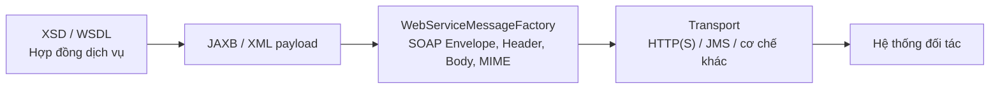

# Kiểm tra khả năng hỗ trợ của message factory và transport đang dùng

Trong một hệ thống tích hợp SOAP, nâng cấp Spring Web Services (Spring-WS), Spring Framework, JDK hoặc thư viện HTTP có thể làm thay đổi cách tạo SOAP message và cách gửi/nhận message, ngay cả khi XSD và WSDL không đổi. Trước khi chuyển phiên bản, cần chứng minh rằng **message factory** và **transport** hiện tại vẫn xử lý đúng giao thức, định dạng thông điệp, bảo mật và đặc tính vận hành mà các hệ thống đối tác đang sử dụng.

Bài học thuộc chương **Nâng cấp và di chuyển** của **SPRING_WEB_SERVICES**. Phạm vi là các ứng dụng phát triển dịch vụ SOAP theo hướng *contract-first* bằng Spring-WS: định nghĩa XSD/WSDL, ánh xạ JAXB, triển khai endpoint và SOAP client, xử lý SOAP Fault, interceptor, XML security, WS-Security, chứng chỉ và kiểm thử tương thích khi tích hợp doanh nghiệp.

## 1. Kết quả cần đạt

Sau bài học, bạn có thể:

1. Phân biệt trách nhiệm của `WebServiceMessageFactory`, `WebServiceMessageSender` và phía server tiếp nhận SOAP.
2. Lập danh mục những tính năng mà ứng dụng thực sự sử dụng, thay vì chỉ kiểm tra thư viện có khởi tạo được hay không.
3. Kiểm chứng khả năng tạo/đọc SOAP 1.1, SOAP 1.2, SOAP Fault, phần đính kèm và XML có kích thước lớn.
4. Kiểm tra HTTP hoặc JMS transport cùng với xác thực, proxy, TLS, timeout và các header cần thiết.
5. Thiết kế bộ thử nghiệm hồi quy và tiêu chí chấp nhận đủ rõ để quyết định nâng cấp hoặc quay lui.

## 2. Hiểu đúng các lớp phải kiểm tra

Một lời gọi SOAP thường đi qua các lớp sau:



- **Hợp đồng XSD/WSDL** mô tả cấu trúc XML, operation, binding, SOAP action và địa chỉ/port công bố. Hợp đồng hợp lệ chưa bảo đảm runtime gửi được message đúng định dạng.
- **JAXB (marshaller/unmarshaller)** chuyển đổi giữa Java object và XML payload. Lỗi ánh xạ namespace, `javax.xml.bind`/`jakarta.xml.bind` hoặc cấu hình MTOM có thể xuất hiện trước khi thông điệp đi qua mạng.
- **`WebServiceMessageFactory`** tạo thông điệp gửi đi và phân tích thông điệp nhận vào. Với SOAP, lớp thường gặp là `SaajSoapMessageFactory`. Factory phải tương thích với SOAP version và định dạng MIME mà ứng dụng dùng.
- **`WebServiceMessageSender`** là phần *client-side* tạo kết nối và gửi thông điệp đến URI đích. HTTP sender và JMS sender có khả năng khác nhau về timeout, xác thực, pooling, transaction và cách xử lý lỗi.
- **Phía server** thường nhận HTTP thông qua servlet container và `MessageDispatcherServlet` hoặc qua cấu hình transport khác. Server cần một message factory tương thích với request đầu vào và các endpoint/interceptor đã đăng ký.
- **Lớp bảo mật** có thể nằm ở transport (HTTPS, mutual TLS, HTTP authentication) hoặc bên trong SOAP header (WS-Security). Một cơ chế hoạt động không chứng minh cơ chế còn lại hoạt động.

**Điểm mấu chốt:** cả ứng dụng client lẫn server có thể dùng message factory, nhưng `WebServiceMessageSender` chỉ là khái niệm phía gửi; không nên nhầm việc đổi HTTP client library với việc đổi servlet tiếp nhận SOAP. Việc hỗ trợ một *protocol* cũng khác với việc tương thích một *đối tác cụ thể*.

## 3. Thu thập đường cơ sở trước khi nâng cấp

Ghi lại cấu hình đang chạy (*baseline*) và cấu hình dự kiến (*candidate*) từ chính ứng dụng, hệ thống triển khai và một bộ request/response đã được phép sử dụng. Tối thiểu cần có:

| Nhóm | Cần ghi nhận | Vì sao quan trọng |
|---|---|---|
| Runtime | JDK, Spring Framework, Spring-WS, phiên bản SAAJ implementation, JAXB runtime và HTTP/JMS library | Phát hiện thay đổi API, classpath, provider và phiên bản tương thích |
| Message factory | Loại factory, SOAP 1.1 hay SOAP 1.2, cấu hình attachment/MTOM, giới hạn kích thước message | Kiểm tra khả năng tạo/đọc MIME, SOAP Envelope và body |
| Hợp đồng | XSD, WSDL, `soap:binding`/`soap12:binding`, operation, SOAP action, endpoint URL | Đối chiếu chính xác điều kiện mà đối tác mong đợi |
| Client transport | URI scheme, sender implementation, connection/read timeout, pool, redirect, proxy | Tránh lỗi chỉ xuất hiện khi gọi qua mạng thật |
| Server transport | Servlet mapping, connector HTTP(S), reverse proxy, giới hạn payload, transfer encoding | Kiểm tra request có đến endpoint và được parse thành SOAP hay không |
| Bảo mật | TLS version, truststore/keystore, mTLS, HTTP authentication, WS-Security policy | Phân biệt lỗi handshake, xác thực và chữ ký SOAP |
| Vận hành | Mức tải, thời gian đáp ứng, retry, idempotency, size XML, attachment, log/trace | Phát hiện các thay đổi làm suy giảm hệ thống dù chức năng vẫn đúng |

Tập trung vào **tính năng đang được sử dụng**. Ví dụ, nếu client gửi file bằng MTOM qua HTTPS và dùng WS-Security UsernameToken, việc kiểm tra thành công một SOAP message XML thuần qua HTTP chưa đủ chứng minh có thể nâng cấp.

Cũng cần xác định dependency nào do ứng dụng tự khai báo, dependency nào do Spring Boot hoặc nền tảng triển khai quản lý. Khi nâng cấp lên thế hệ dùng Jakarta, rà soát các package liên quan như `javax.xml.soap`/`jakarta.xml.soap` và `javax.xml.bind`/`jakarta.xml.bind`. Tên package, module runtime và provider phải đồng bộ theo phiên bản đích; không nên trộn API thế hệ cũ với implementation thế hệ mới.

## 4. Lập ma trận tương thích theo hành vi

Không nên ghi “hỗ trợ” chỉ vì một class tồn tại trên classpath. Mỗi yêu cầu phải có cách kiểm chứng và bằng chứng:

| Khả năng | Câu hỏi kiểm chứng | Bằng chứng đạt |
|---|---|---|
| SOAP 1.1 | Factory tạo và nhận SOAP Envelope 1.1; HTTP dùng `text/xml` và SOAPAction như hợp đồng? | Request/response thực tế đúng namespace, Content-Type, action |
| SOAP 1.2 | Factory và bên nhận hiểu envelope 1.2; HTTP dùng `application/soap+xml`? | Gọi thành công đúng WSDL binding và media type |
| SOAP Fault | Fault code, reason/detail, HTTP status được client xử lý đúng? | Case lỗi có thể dự đoán và được giải mã thành SOAP Fault |
| JAXB / XSD | XML sau marshal/unmarshal còn đúng QName, namespace, thứ tự và kiểu dữ liệu? | So khớp XSD, kiểm thử payload qua endpoint/client |
| Attachment / MTOM | MIME multipart, `xop:Include`, Content-ID và dữ liệu nhị phân còn nguyên? | Gửi/nhận file và kiểm hash, kích thước |
| HTTP(S) | DNS, proxy, TLS, xác thực, timeout, pooling, keep-alive hoạt động? | Test mạng thật qua đường triển khai tương đương production |
| JMS (nếu dùng) | Destination, reply-to, correlation ID, timeout, transaction tương thích? | Exchange qua broker thật, có đo thời gian và kiểm correlation |
| WS-Security | Header, timestamp, chữ ký, mã hóa, certificate/trust được xác minh? | Cả message hợp lệ và message bị từ chối đều cho kết quả đúng |
| Tải và lỗi tạm thời | Khi có timeout, connection reset, 503 hoặc khối lượng lớn hệ thống xử lý ra sao? | Kết quả theo chính sách retry, cảnh báo và giới hạn tài nguyên |

Với mỗi dòng, đánh dấu `PASS`, `FAIL` hoặc `NOT_APPLICABLE` và lưu phiên bản, môi trường, thời điểm, request ID, loại test và bằng chứng. `NOT_APPLICABLE` chỉ phù hợp khi tính năng thực sự không được sử dụng.

## 5. Kiểm tra message factory

### 5.1. SOAP version phải khớp với binding

SOAP 1.1 và SOAP 1.2 có định dạng tương đồng nhưng không thay thế tùy ý cho nhau:

| Thuộc tính | SOAP 1.1 | SOAP 1.2 |
|---|---|---|
| Namespace của Envelope | `http://schemas.xmlsoap.org/soap/envelope/` | `http://www.w3.org/2003/05/soap-envelope` |
| HTTP Content-Type thông dụng | `text/xml; charset=utf-8` | `application/soap+xml; charset=utf-8` |
| Thể hiện action qua HTTP | Header `SOAPAction` theo binding/đối tác | Tham số `action` của `application/soap+xml` khi binding yêu cầu |
| Binding trong WSDL 1.1 | Thường là phần tử `soap:binding` | Thường là phần tử `soap12:binding` |

Một endpoint SOAP 1.1 nhận request SOAP 1.2 có thể trả lỗi version mismatch hoặc unsupported media type. Không sửa Content-Type đơn thuần để “nâng” request SOAP 1.1 lên SOAP 1.2; **envelope, factory, WSDL binding và chính sách của đối tác phải nhất quán**.

### 5.2. Thử tạo message ở phiên bản SOAP cần dùng

Ví dụ sau là một phép thử nhanh với Spring-WS khi triển khai `SaajSoapMessageFactory`. Đặt trong mã kiểm tra của chính ứng dụng và dùng dependency Spring-WS/SAAJ tương thích với phiên bản đang đánh giá:

```java
import org.springframework.ws.WebServiceMessage;
import org.springframework.ws.soap.SoapMessage;
import org.springframework.ws.soap.SoapVersion;
import org.springframework.ws.soap.saaj.SaajSoapMessageFactory;

public final class SoapFactoryProbe {
    private SoapFactoryProbe() {}

    public static void verify(SoapVersion expectedVersion) {
        SaajSoapMessageFactory factory = new SaajSoapMessageFactory();
        factory.setSoapVersion(expectedVersion);
        factory.afterPropertiesSet();

        WebServiceMessage created = factory.createWebServiceMessage();
        if (!(created instanceof SoapMessage)) {
            throw new IllegalStateException("Factory did not produce a SOAP message");
        }

        SoapVersion actualVersion = ((SoapMessage) created).getVersion();
        if (!expectedVersion.equals(actualVersion)) {
            throw new IllegalStateException(
                    "Unexpected SOAP version: " + actualVersion);
        }
    }

    public static void main(String[] args) {
        verify(SoapVersion.SOAP_11);
        verify(SoapVersion.SOAP_12);
    }
}
```

Phép thử này xác nhận rằng factory và SAAJ provider **có thể khởi tạo và tạo thông điệp** cho hai version. Nó chưa chứng minh khả năng đọc response, attachment hoặc tương tác với đối tác. Nếu ứng dụng chỉ triển khai một version, kiểm tra đúng version đã cam kết trong WSDL; không bắt buộc mọi hệ thống đều phải hỗ trợ đồng thời cả hai.

Nếu khởi tạo thất bại, điều tra dependency SAAJ API và implementation, provider được nạp bởi runtime, classpath/module path, thay đổi package Javax/Jakarta và cấu hình `SaajSoapMessageFactory`. Không khắc phục bằng cách âm thầm đổi SOAP version của service.

### 5.3. Kiểm tra chiều đọc và các trường hợp phức tạp

Ngoài việc tạo message rỗng, dùng các mẫu thực tế để kiểm tra:

- **SOAP Header:** WS-Addressing, header nghiệp vụ và `mustUnderstand` được giữ hoặc xử lý đúng; interceptor không loại bỏ header cần thiết.
- **SOAP Fault:** nhận Fault hợp lệ, đọc code/subcode và detail theo version; phân biệt Fault do nghiệp vụ với lỗi parse transport.
- **Namespace:** prefix có thể thay đổi nhưng QName và namespace URI phải giữ nguyên ngữ nghĩa; không dùng so sánh chuỗi XML thô làm điều kiện duy nhất.
- **Encoding:** UTF-8, ký tự tiếng Việt, XML escaping, nội dung rỗng/`xsi:nil` và giá trị ngày/giờ.
- **Kích thước:** XML lớn, header lớn, streaming/DOM và giới hạn bộ nhớ; quan sát cả thời gian parse và heap.
- **MIME attachment:** Content-Type `multipart/related`, boundary, Content-ID, phần SOAP root và dữ liệu nhị phân được đọc/ghi đầy đủ.
- **Bảo mật XML:** parser chặn các cấu hình không an toàn như external entity khi xử lý XML không tin cậy; kiểm tra với cấu hình bảo mật được tổ chức chấp nhận.

Nếu hệ thống cũ dùng factory thay thế dựa trên Axiom hoặc cơ chế streaming khác, phải xác minh **chính phiên bản Spring-WS và module đích** còn cung cấp triển khai tương thích hay không. Không mặc định một implementation từng tồn tại vẫn có sẵn sau nâng cấp; đánh giá thêm tác động RAM và attachment khi chuyển implementation.

## 6. Kiểm tra transport phía client và server

### 6.1. Client: sender phải hỗ trợ URI và đặc tính kết nối

`WebServiceTemplate` dùng `WebServiceMessageFactory` để tạo message và `WebServiceMessageSender` để gửi đến endpoint. Với HTTP, một cấu hình tối thiểu có thể trông như sau:

```java
import org.springframework.ws.client.core.WebServiceTemplate;
import org.springframework.ws.soap.SoapVersion;
import org.springframework.ws.soap.saaj.SaajSoapMessageFactory;
import org.springframework.ws.transport.http.HttpUrlConnectionMessageSender;

SaajSoapMessageFactory messageFactory = new SaajSoapMessageFactory();
messageFactory.setSoapVersion(SoapVersion.SOAP_11);
messageFactory.afterPropertiesSet();

WebServiceTemplate client = new WebServiceTemplate(messageFactory);
client.setMessageSender(new HttpUrlConnectionMessageSender());

// Sau đó cấu hình marshaller/unmarshaller, endpoint URI,
// authentication, timeout và interceptor theo hợp đồng thực tế.
```

Đây là ví dụ minh họa **cách ghép factory với sender**, chưa phải cấu hình production hoàn chỉnh. Khi dùng HTTP client implementation khác để có connection pooling, proxy, xác thực hoặc timeout chuyên biệt, phải chọn sender tương thích với đúng phiên bản thư viện HTTP. Đặc biệt, các thế hệ Apache HttpClient khác nhau có API và phụ thuộc khác nhau; việc thay dependency có thể đòi hỏi thay class sender và cấu hình kết nối.

Cần kiểm chứng đồng thời:

1. `WebServiceMessageSender` được chọn có hỗ trợ URI endpoint (`http`, `https` hoặc transport khác).
2. Connection timeout và read/response timeout hoạt động theo kỳ vọng, kể cả khi DNS, proxy hoặc đối tác chậm.
3. TLS handshake, hostname verification, truststore, client certificate (nếu mTLS) và chính sách TLS phù hợp.
4. Các header HTTP cần thiết (SOAPAction, Content-Type, Authorization, correlation/tracing header) được gửi như hợp đồng.
5. HTTP keep-alive, connection pool, kết nối idle và concurrent request không làm cạn tài nguyên hoặc dùng lại connection lỗi.
6. Redirect, proxy authentication, 401/403, 407, 429, 502/503 và connection reset được xử lý rõ ràng.
7. Chính sách retry không tự động gọi lại operation không idempotent rồi gây ghi dữ liệu hai lần.

### 6.2. Server: servlet/container/proxy cũng là một phần transport

Trên phía cung cấp dịch vụ, kiểm tra chuỗi **reverse proxy → HTTP connector/container → `MessageDispatcherServlet` → message factory → endpoint**.

Các tình huống dễ sai sau nâng cấp gồm: servlet mapping đổi đường dẫn; proxy sửa header hoặc chặn `application/soap+xml`; hạn mức body thấp hơn kích thước SOAP/attachment; connector từ chối kiểu HTTP transfer encoding; interceptor chạy sai thứ tự; request đến đúng URL nhưng không khớp endpoint mapping dựa trên namespace/localPart; HTTPS termination làm công bố WSDL URL nội bộ thay vì URL công khai.

Với service contract-first, gửi một request theo **WSDL đã công bố thật qua địa chỉ người dùng thật truy cập**. Kiểm tra rằng thông điệp được parse, định tuyến tới đúng operation và trả response/fault đúng binding. Test gọi trực tiếp Java method của endpoint không đủ để phát hiện các lỗi này.

### 6.3. JMS hoặc transport không phải HTTP

Nếu SOAP được vận chuyển qua JMS, kiểm tra cả hai chiều qua broker được sử dụng thực tế: destination và reply destination, message type, correlation ID, timeout chờ response, persistence, transaction, acknowledgment, redelivery, dead-letter queue và giới hạn kích thước message. Sự tương thích của SOAP payload không bảo đảm tương thích về envelope JMS hay cấu hình broker.

Không áp tiêu chí HTTP status hoặc `SOAPAction` header theo HTTP vào một transport JMS; hãy dựa trên quy tắc transport và hợp đồng tích hợp tương ứng.

## 7. Thử gọi liên thông HTTP theo đúng contract

Chuẩn bị hai payload XML **phù hợp với WSDL và XSD của hệ thống đích**. Có thể dùng mẫu cấu trúc dưới đây để hình dung sự khác biệt giữa hai phiên bản, sau đó thay namespace, tên operation và các field theo hợp đồng thật.

SOAP 1.1 (minh họa):

```xml
<soapenv:Envelope
    xmlns:soapenv="http://schemas.xmlsoap.org/soap/envelope/"
    xmlns:m="urn:example:status">
  <soapenv:Header/>
  <soapenv:Body>
    <m:GetStatusRequest>
      <m:requestId>REQ-001</m:requestId>
    </m:GetStatusRequest>
  </soapenv:Body>
</soapenv:Envelope>
```

SOAP 1.2 (minh họa):

```xml
<soap12:Envelope
    xmlns:soap12="http://www.w3.org/2003/05/soap-envelope"
    xmlns:m="urn:example:status">
  <soap12:Header/>
  <soap12:Body>
    <m:GetStatusRequest>
      <m:requestId>REQ-001</m:requestId>
    </m:GetStatusRequest>
  </soap12:Body>
</soap12:Envelope>
```

Sau khi lưu payload lần lượt thành `soap11.xml` và `soap12.xml`, dùng ví dụ lệnh dưới đây cho môi trường test được phép truy cập:

```bash
# SOAP 1.1: SOAPAction và URI chỉ là giá trị minh họa.
curl -i -v --connect-timeout 5 --max-time 20 \
  -H 'Content-Type: text/xml; charset=utf-8' \
  -H 'SOAPAction: "urn:getStatus"' \
  --data-binary @soap11.xml \
  https://soap-test.example.org/services/status

# SOAP 1.2: action nằm trong tham số Content-Type nếu binding yêu cầu.
curl -i -v --connect-timeout 5 --max-time 20 \
  -H 'Content-Type: application/soap+xml; charset=utf-8; action="urn:getStatus"' \
  --data-binary @soap12.xml \
  https://soap-test.example.org/services/status
```

Địa chỉ, action và QName trong ví dụ đều **không phải endpoint thật**. Phải thay bằng giá trị từ WSDL và cấu hình dịch vụ. Tránh đặt thông tin xác thực hoặc khóa bí mật trực tiếp trong lệnh/sản phẩm log chia sẻ.

Khi đánh giá kết quả, đối chiếu tối thiểu: HTTP status, Content-Type của response, Envelope namespace, SOAP Fault nếu có, request ID, response payload theo XSD và log server tương ứng. HTTP 200 không bảo đảm nội dung SOAP đúng; ngược lại, HTTP 500 có thể mang **SOAP Fault hợp lệ**, cần được client phân tích thay vì quy ngay là lỗi hạ tầng. Một số lỗi xác thực hoặc media type bị từ chối ở tầng HTTP trước khi tạo SOAP Fault.

## 8. Bộ kiểm thử hồi quy cần có

Nên kết hợp nhiều mức kiểm thử vì mỗi mức phát hiện một nhóm lỗi khác nhau:

| Mức | Công cụ/cách thử | Chứng minh được | Không tự chứng minh được |
|---|---|---|---|
| Unit/component | Khởi tạo factory, marshal/unmarshal, XML schema validation | SOAP version, payload mapping và cấu hình cục bộ | Hành vi proxy/TLS/đối tác |
| Spring-WS mock | `MockWebServiceServer` cho SOAP client; `MockWebServiceClient` cho endpoint | Request/response, interceptor, lỗi định tuyến trong ngữ cảnh mock | Thực thi transport mạng thật |
| Integration | Chạy client/server thật với HTTP(S) hoặc broker JMS tương đương | Serialization, transport, TLS, timeout, attachment | Mọi chính sách riêng của đối tác ngoài môi trường test |
| Contract/compatibility | Gửi request đến sandbox của đối tác và kiểm WSDL/XSD/fault | Tương thích theo đường tích hợp cụ thể | Khả năng chịu tải production dài hạn |
| Performance/resilience | Load, timeout, connection reset, server lỗi hoặc chậm | Tài nguyên, retry, pool và hành vi khi suy giảm | Tính đúng của mọi trường hợp nghiệp vụ chưa được đưa vào test |

Một bộ test tối thiểu nên có các tình huống sau:

- **Happy path:** một operation thành công với SOAP version, binding, action và payload thật.
- **Fault path:** một lỗi nghiệp vụ trả SOAP Fault đúng cấu trúc; client phân biệt fault với lỗi mạng.
- **Sai định dạng:** gửi Content-Type hoặc Envelope version không phù hợp, xác nhận thông báo lỗi rõ ràng và không ghi dữ liệu ngoài ý muốn.
- **Bảo mật:** thông điệp hợp lệ vượt qua TLS/WS-Security; chứng chỉ không tin cậy, chữ ký sai hoặc timestamp hết hạn bị từ chối.
- **Dữ liệu biên:** ký tự Unicode, trường tùy chọn, `xsi:nil`, file MTOM (nếu dùng) và XML lớn sát ngưỡng hỗ trợ.
- **Sự cố mạng:** connect timeout, read timeout, proxy lỗi, connection reset, 503 và kiểm tra số lần retry.
- **Tải đồng thời:** nhiều SOAP request qua cùng client/sender; bảo đảm pool không rò rỉ connection/thread.
- **Triển khai:** kiểm endpoint URL, WSDL công bố, servlet mapping và chính sách reverse proxy trên môi trường tương đương production.

Đối với ứng dụng contract-first, hãy đối chiếu XML được serialize với XSD/WSDL và lưu các mẫu request/response đã ẩn dữ liệu nhạy cảm làm **golden samples**. Hãy kiểm soát so sánh theo cấu trúc XML và QName, vì thứ tự attribute hay namespace prefix khác nhau chưa chắc là thay đổi ngữ nghĩa.

## 9. Chẩn đoán những triệu chứng thường gặp

| Triệu chứng | Vùng cần kiểm tra đầu tiên | Hướng xử lý |
|---|---|---|
| Lỗi tạo `SaajSoapMessageFactory` | SAAJ API/implementation, provider, Javax/Jakarta, dependency graph | Căn chỉnh dependency và xác nhận provider có mặt tại runtime |
| HTTP 415 Unsupported Media Type | Content-Type, SOAP 1.1/1.2, proxy filter | So khớp factory, Envelope, HTTP header và WSDL binding |
| SOAP `VersionMismatch` | Envelope namespace và SOAP version cấu hình hai đầu | Cấu hình đúng version cho operation/port đang gọi |
| HTTP 404/405 hoặc không vào endpoint | URL, servlet mapping, HTTP method, gateway route | Kiểm tra route từ bên ngoài đến container và endpoint mapping |
| HTTP 200 nhưng client lỗi parse | Envelope, charset, MIME, XML namespace, response không phải SOAP | Lưu response đã ẩn thông tin nhạy cảm để phân tích factory/parser |
| HTTP 500 kèm SOAP Fault | Fault code/reason/detail và quy tắc nghiệp vụ | Xử lý như SOAP Fault; xác định lớp sinh Fault |
| TLS handshake failure | Trust chain, hostname, TLS protocol/cipher, mTLS client cert | Kiểm tra keystore/truststore và certificate theo từng chiều |
| HTTP 401/403/407 | Xác thực service, gateway hoặc proxy | Kiểm header/chính sách auth và điểm từ chối thực tế |
| WS-Security signature invalid | Canonicalization, namespace, certificate, key, timestamp, clock skew | Kiểm tra cấu hình WS-Security, đồng hồ, khóa và policy |
| MTOM/file đính kèm hỏng | MIME boundary, Content-ID, `xop:Include`, giới hạn proxy | So sánh kích thước/hash đầu cuối, cấu hình multipart và memory |
| Chạy ổn khi đơn lẻ, lỗi dưới tải | Pool, thread, timeout, connection idle, streaming | Đo tài nguyên và áp giới hạn phù hợp theo sender đang dùng |
| JMS request không có response | Reply-to, correlation ID, broker route, TTL, transaction | Đối chiếu message trên broker và mapping reply/correlation |

Phân loại lỗi theo thứ tự từ ngoài vào trong: **kết nối/TLS → HTTP hoặc JMS → MIME/Envelope → SOAP Header/WS-Security → XML/JAXB → nghiệp vụ**. Cách này giúp tránh sửa XSD khi nguyên nhân thật là proxy chặn Content-Type hoặc thiếu SAAJ provider.

## 10. Quy trình kiểm chứng khi thay phiên bản

1. **Chốt baseline:** ghi phiên bản dependency, factory/sender đang dùng, WSDL/XSD, cấu hình TLS/WS-Security và tập request/response đại diện đã thành công ở phiên bản cũ.
2. **Đọc tương thích phiên bản đích:** kiểm release notes/API của Spring-WS, Spring Framework, SAAJ/JAXB implementation, HTTP/JMS library và JDK. Xác định class được đổi tên/loại bỏ và thay đổi package Javax/Jakarta.
3. **Nâng cấp trên nhánh riêng:** điều chỉnh dependency và cấu hình factory/sender theo đúng phiên bản đích; kiểm khởi động và khởi tạo SOAP message trước khi sửa logic nghiệp vụ.
4. **Chạy test theo tầng:** từ factory/JAXB đến mock, HTTP(S)/JMS integration, WS-Security, MTOM và contract test với hệ thống đối tác.
5. **So kết quả baseline/candidate:** kiểm schema, Fault, action, Content-Type, header và thời gian/khối lượng xử lý. Ghi rõ mọi khác biệt có chủ đích hoặc chưa giải quyết.
6. **Triển khai có kiểm soát:** thử nghiệm tại môi trường tương đương production, quan sát tỷ lệ thành công, SOAP Fault, TLS errors, timeout, connection pool và broker backlog.
7. **Chuẩn bị quay lui:** giữ bản dependency/config, chứng chỉ và deployment trước nâng cấp; xác định tín hiệu dừng nếu tỷ lệ lỗi tăng hoặc contract sai.

Khi đổi message factory vì mục đích hiệu năng, phải đo với payload thật. Một factory dựa trên mô hình giữ XML trong bộ nhớ có thể có đặc tính tài nguyên khác với hướng xử lý streaming; kết quả với message nhỏ không đại diện cho XML lớn hoặc attachment.

## 11. Ví dụ biên bản quyết định nâng cấp

Giả sử dịch vụ tra cứu trạng thái đang dùng SOAP 1.1 trên HTTPS với SOAPAction, JAXB và chữ ký WS-Security, đồng thời có một client khác gửi attachment MTOM. Nhóm không thể kết luận tương thích chỉ vì các SOAP request không có chữ ký thành công.

Một biên bản kiểm chứng có thể lập như sau:

| Tiêu chí | Kết quả ví dụ | Quyết định |
|---|---|---|
| Tạo và parse SOAP 1.1 qua SAAJ | PASS | Được phép tiếp tục |
| Gọi HTTP(S) đến URL sau proxy và xác thực mTLS | PASS | Được phép tiếp tục |
| SOAPAction và response khớp WSDL/XSD | PASS | Được phép tiếp tục |
| SOAP Fault nghiệp vụ và lỗi kỹ thuật | PASS | Được phép tiếp tục |
| Verify chữ ký WS-Security của đối tác | PASS | Được phép tiếp tục |
| Upload/download MTOM với file lớn | FAIL: attachment bị cắt qua gateway | **Chặn nâng cấp** đến khi sửa và chạy lại |
| Timeout, retry, connection pool dưới tải | NOT_TESTED | **Chặn nâng cấp** đến khi có bằng chứng |

Đây là tình huống minh họa, không phải trạng thái của một ứng dụng thực tế. Quy tắc chấp nhận nên là: **tất cả khả năng bắt buộc theo hợp đồng và vận hành đều PASS; các trường hợp không áp dụng được giải thích; không còn lỗi nghiêm trọng hoặc thử nghiệm quan trọng chưa thực hiện**.

## 12. Checklist hoàn tất

- [ ] Đã xác nhận Spring-WS/JDK/SAAJ/JAXB và các thư viện transport tương thích với phiên bản đích.
- [ ] Đã xác nhận SOAP 1.1/1.2 đang sử dụng, Envelope, Content-Type và SOAPAction/action đúng với WSDL.
- [ ] Message factory đã qua thử nghiệm tạo **và đọc** SOAP message, Fault, Header và attachment nếu có.
- [ ] JAXB/XML schema validation bảo đảm contract-first không thay đổi ngoài ý muốn.
- [ ] Sender phía client và transport phía server được thử qua đường kết nối thật, gồm proxy, timeout và lỗi mạng.
- [ ] TLS, certificate, HTTP authentication, WS-Security và XML security được kiểm cả nhánh hợp lệ lẫn nhánh bị từ chối.
- [ ] Đã kiểm thử payload lớn, MTOM và tải đồng thời khi ứng dụng có sử dụng.
- [ ] Các test mock, integration và thử với đối tác có kết quả cùng bằng chứng, không còn `FAIL` hoặc `NOT_TESTED` ở tiêu chí bắt buộc.
- [ ] Có baseline, phương án giám sát và cách quay lui có thể thực thi.

**Ghi nhớ:** nâng cấp SOAP thành công được đo bằng **khả năng trao đổi đúng thông điệp qua đường tích hợp thực tế**, không chỉ bằng việc build thành công hoặc khởi tạo được bean. Trong Spring Web Services, message factory, hợp đồng XSD/WSDL và transport phải được kiểm chứng như một chuỗi thống nhất.
