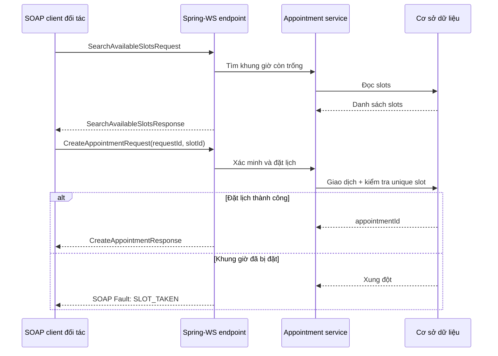

# Thực hành tổng hợp: Thiết kế XSD, WSDL cho dịch vụ tra cứu và tạo lịch hẹn

Trong bài này, bạn thiết kế một **hợp đồng SOAP theo hướng contract-first** cho hệ thống đặt lịch khám: ứng dụng đối tác tra cứu các khung giờ còn trống rồi tạo lịch hẹn. Trọng tâm là định nghĩa dữ liệu bằng **XML Schema (XSD)**, công bố thao tác bằng **WSDL 1.1**, hiện thực bằng **Spring Web Services (Spring-WS)** và kiểm tra khả năng tích hợp giữa các hệ thống.

Đây là bài thực hành tổng hợp trong module `SPRING_WEB_SERVICES`. Ngoài phần thiết kế XSD/WSDL, bài đi qua ánh xạ JAXB, endpoint, SOAP client, SOAP Fault, interceptor, bảo vệ thông điệp XML/WS-Security và kiểm thử tương thích. Mẫu hợp đồng sử dụng SOAP 1.1 với quy ước `document/literal`; các ví dụ Java giả định Spring Boot 3+, Spring-WS 4+ và hệ sinh thái `jakarta.xml.bind`. Khi áp dụng vào phiên bản khác, cần đối chiếu API và thư viện tương ứng.

## 1. Bài toán và tiêu chí hoàn thành

Một hệ thống quản lý phòng khám cung cấp hai thao tác cho các hệ thống đối tác:

1. **`SearchAvailableSlots`**: tìm các khung giờ còn nhận lịch theo dịch vụ, ngày và bác sĩ tùy chọn.
2. **`CreateAppointment`**: đặt lịch cho bệnh nhân tại một khung giờ đã tìm được.

Hệ thống đặt lịch phải xử lý trường hợp hai đối tác cùng chọn một khung giờ, yêu cầu bị gửi lại do mất kết nối và dữ liệu không hợp lệ. Hợp đồng cần đủ rõ để một đội khác có thể tạo SOAP client chỉ dựa trên WSDL/XSD, không cần đọc mã nguồn server.

| Yêu cầu | Quy tắc thiết kế |
|---|---|
| Tìm kiếm | Trả về danh sách `slot`; danh sách rỗng nghĩa là không có khung giờ phù hợp. |
| Đặt lịch | Bắt buộc `requestId`, `patientRef` và `slotId`. |
| Chống đặt trùng | Một khung giờ chỉ có một lịch hẹn đang được xác nhận; hệ thống kiểm soát bằng giao dịch và ràng buộc dữ liệu. |
| Gửi lại yêu cầu | Với cùng `requestId` và cùng nội dung, trả lại kết quả trước đó; cùng `requestId` nhưng khác nội dung là xung đột. |
| Thời gian | Ngày tra cứu dùng `xs:date`; mốc bắt đầu/kết thúc dùng `xs:dateTime` kèm múi giờ (khuyến nghị UTC khi truyền đi). |
| Phiên bản hợp đồng | Namespace `https://example.org/appointments/v1` cố định cho phiên bản v1. |
| Lỗi nghiệp vụ | Dùng SOAP Fault với phần `detail` chứa mã lỗi có cấu trúc. |
| Bảo mật | Bảo vệ đường truyền bằng TLS; xác thực, ký XML hoặc WS-Security khi chính sách tích hợp yêu cầu. |

### Phân biệt tra cứu và giữ chỗ

Kết quả tra cứu là **ảnh chụp trạng thái tại thời điểm tìm kiếm**. Khi gửi `CreateAppointment`, khung giờ có thể vừa bị bên khác đặt. Vì vậy, không thể dùng kết quả tìm kiếm làm bằng chứng đảm bảo còn chỗ. Thao tác tạo lịch luôn kiểm tra lại tình trạng khung giờ trong một giao dịch nguyên tử.



## 2. Thiết kế thông điệp trước khi viết Java

Áp dụng quy tắc **một phần tử XML toàn cục cho mỗi request, response và fault**. Tên phần tử là tên mà `@PayloadRoot` trong Spring-WS sẽ nhận diện.

| Phần tử toàn cục | Các trường chính | Ý nghĩa |
|---|---|---|
| `SearchAvailableSlotsRequest` | `serviceCode`, `date`, `providerId?` | Tìm khung giờ theo dịch vụ, ngày và bác sĩ nếu có. |
| `SearchAvailableSlotsResponse` | `slot*` | Danh sách `slot` có thể rỗng. |
| `CreateAppointmentRequest` | `requestId`, `patientRef`, `slotId`, `note?` | Tạo lịch hẹn có khóa chống gửi trùng. |
| `CreateAppointmentResponse` | `appointmentId`, `status`, `slotId`, `createdAt` | Kết quả đặt lịch đã xác nhận. |
| `ServiceFault` | `code`, `message`, `correlationId?` | Chi tiết lỗi có cấu trúc dùng trong SOAP Fault. |

Dấu `?` nghĩa là phần tử tùy chọn (`minOccurs="0"`), dấu `*` nghĩa là xuất hiện từ 0 đến nhiều lần. Các mã `slotId` và `patientRef` là định danh tham chiếu trong hệ thống, không chứa bệnh án hay tên bệnh nhân.

### 2.1. Tập tin `src/main/resources/xsd/appointments.xsd`

```xml
<?xml version="1.0" encoding="UTF-8"?>
<xs:schema
    xmlns:xs="http://www.w3.org/2001/XMLSchema"
    xmlns:tns="https://example.org/appointments/v1"
    targetNamespace="https://example.org/appointments/v1"
    elementFormDefault="qualified">

    <xs:simpleType name="CodeType">
        <xs:restriction base="xs:string">
            <xs:minLength value="1"/>
            <xs:maxLength value="64"/>
        </xs:restriction>
    </xs:simpleType>

    <xs:simpleType name="AppointmentStatusType">
        <xs:restriction base="xs:string">
            <xs:enumeration value="CONFIRMED"/>
        </xs:restriction>
    </xs:simpleType>

    <xs:simpleType name="FaultCodeType">
        <xs:restriction base="xs:string">
            <xs:enumeration value="INVALID_REQUEST"/>
            <xs:enumeration value="SLOT_NOT_FOUND"/>
            <xs:enumeration value="SLOT_TAKEN"/>
            <xs:enumeration value="REQUEST_ID_CONFLICT"/>
            <xs:enumeration value="UNAUTHORIZED"/>
            <xs:enumeration value="INTERNAL_ERROR"/>
        </xs:restriction>
    </xs:simpleType>

    <xs:complexType name="SlotType">
        <xs:sequence>
            <xs:element name="slotId" type="tns:CodeType"/>
            <xs:element name="providerId" type="tns:CodeType"/>
            <xs:element name="startTime" type="xs:dateTime"/>
            <xs:element name="endTime" type="xs:dateTime"/>
        </xs:sequence>
    </xs:complexType>

    <xs:element name="SearchAvailableSlotsRequest">
        <xs:complexType>
            <xs:sequence>
                <xs:element name="serviceCode" type="tns:CodeType"/>
                <xs:element name="date" type="xs:date"/>
                <xs:element name="providerId" type="tns:CodeType"
                            minOccurs="0"/>
            </xs:sequence>
        </xs:complexType>
    </xs:element>

    <xs:element name="SearchAvailableSlotsResponse">
        <xs:complexType>
            <xs:sequence>
                <xs:element name="slot" type="tns:SlotType"
                            minOccurs="0" maxOccurs="unbounded"/>
            </xs:sequence>
        </xs:complexType>
    </xs:element>

    <xs:element name="CreateAppointmentRequest">
        <xs:complexType>
            <xs:sequence>
                <xs:element name="requestId" type="tns:CodeType"/>
                <xs:element name="patientRef" type="tns:CodeType"/>
                <xs:element name="slotId" type="tns:CodeType"/>
                <xs:element name="note" minOccurs="0">
                    <xs:simpleType>
                        <xs:restriction base="xs:string">
                            <xs:maxLength value="300"/>
                        </xs:restriction>
                    </xs:simpleType>
                </xs:element>
            </xs:sequence>
        </xs:complexType>
    </xs:element>

    <xs:element name="CreateAppointmentResponse">
        <xs:complexType>
            <xs:sequence>
                <xs:element name="appointmentId" type="tns:CodeType"/>
                <xs:element name="status"
                            type="tns:AppointmentStatusType"/>
                <xs:element name="slotId" type="tns:CodeType"/>
                <xs:element name="createdAt" type="xs:dateTime"/>
            </xs:sequence>
        </xs:complexType>
    </xs:element>

    <xs:element name="ServiceFault">
        <xs:complexType>
            <xs:sequence>
                <xs:element name="code" type="tns:FaultCodeType"/>
                <xs:element name="message" type="xs:string"/>
                <xs:element name="correlationId" type="tns:CodeType"
                            minOccurs="0"/>
            </xs:sequence>
        </xs:complexType>
    </xs:element>

</xs:schema>
```

**Tại sao dùng cấu trúc này?**

- `elementFormDefault="qualified"` buộc các phần tử con thuộc cùng namespace, tránh xung đột tên khi tích hợp.
- `xs:sequence` khóa thứ tự các phần tử trong XML. Đổi thứ tự có thể làm payload không hợp lệ dù đầy đủ trường.
- `minOccurs="0"` thể hiện tùy chọn; `maxOccurs="unbounded"` biểu diễn danh sách. Nếu không khai báo `minOccurs`, mặc định là 1.
- `CodeType` giới hạn hình thức mã, nhưng **không** kiểm tra mã bác sĩ/bệnh nhân có tồn tại. Kiểm tra đó thuộc nghiệp vụ.
- XSD 1.0 chưa tự kiểm tra được `startTime < endTime`, khung giờ còn chỗ, quan hệ giữa `slotId` và `serviceCode` hay quyền đặt lịch; những quy tắc này thuộc tầng ứng dụng.
- `xs:dateTime` cho phép giá trị không chỉ rõ múi giờ; vì vậy quy ước giao tiếp phải bổ sung yêu cầu **luôn gửi kèm `Z` hoặc offset**, ví dụ `2027-01-15T02:00:00Z`.

## 3. Thiết kế WSDL 1.1 theo chuẩn document/literal

XSD trả lời câu hỏi **dữ liệu XML hợp lệ trông ra sao**. WSDL trả lời **có thao tác nào, nhận/trả message nào, sử dụng giao thức nào và gọi tới đâu**.

Dưới đây là WSDL hoàn chỉnh cho ví dụ. Các `wsdl:message` tham chiếu **element toàn cục** trong XSD (`element="tns:..."`), phù hợp phong cách document/literal wrapped. Hai thao tác cùng sử dụng kiểu lỗi `ServiceFault`.

### 3.1. Tập tin `src/main/resources/wsdl/appointments.wsdl`

```xml
<?xml version="1.0" encoding="UTF-8"?>
<wsdl:definitions
    xmlns:wsdl="http://schemas.xmlsoap.org/wsdl/"
    xmlns:soap="http://schemas.xmlsoap.org/wsdl/soap/"
    xmlns:xs="http://www.w3.org/2001/XMLSchema"
    xmlns:tns="https://example.org/appointments/v1"
    name="AppointmentsService"
    targetNamespace="https://example.org/appointments/v1">

    <wsdl:types>
        <xs:schema targetNamespace="https://example.org/appointments/v1">
            <xs:include schemaLocation="appointmentsXsd.xsd"/>
        </xs:schema>
    </wsdl:types>

    <wsdl:message name="SearchAvailableSlotsInput">
        <wsdl:part name="parameters"
                   element="tns:SearchAvailableSlotsRequest"/>
    </wsdl:message>
    <wsdl:message name="SearchAvailableSlotsOutput">
        <wsdl:part name="parameters"
                   element="tns:SearchAvailableSlotsResponse"/>
    </wsdl:message>
    <wsdl:message name="CreateAppointmentInput">
        <wsdl:part name="parameters"
                   element="tns:CreateAppointmentRequest"/>
    </wsdl:message>
    <wsdl:message name="CreateAppointmentOutput">
        <wsdl:part name="parameters"
                   element="tns:CreateAppointmentResponse"/>
    </wsdl:message>
    <wsdl:message name="ServiceFaultMessage">
        <wsdl:part name="fault" element="tns:ServiceFault"/>
    </wsdl:message>

    <wsdl:portType name="AppointmentsPortType">
        <wsdl:operation name="SearchAvailableSlots">
            <wsdl:input message="tns:SearchAvailableSlotsInput"/>
            <wsdl:output message="tns:SearchAvailableSlotsOutput"/>
            <wsdl:fault name="ServiceFault"
                        message="tns:ServiceFaultMessage"/>
        </wsdl:operation>
        <wsdl:operation name="CreateAppointment">
            <wsdl:input message="tns:CreateAppointmentInput"/>
            <wsdl:output message="tns:CreateAppointmentOutput"/>
            <wsdl:fault name="ServiceFault"
                        message="tns:ServiceFaultMessage"/>
        </wsdl:operation>
    </wsdl:portType>

    <wsdl:binding name="AppointmentsSoap11Binding"
                  type="tns:AppointmentsPortType">
        <soap:binding
            style="document"
            transport="http://schemas.xmlsoap.org/soap/http"/>
        <wsdl:operation name="SearchAvailableSlots">
            <soap:operation
                soapAction="https://example.org/appointments/v1/SearchAvailableSlots"/>
            <wsdl:input><soap:body use="literal"/></wsdl:input>
            <wsdl:output><soap:body use="literal"/></wsdl:output>
            <wsdl:fault name="ServiceFault">
                <soap:fault name="ServiceFault" use="literal"/>
            </wsdl:fault>
        </wsdl:operation>
        <wsdl:operation name="CreateAppointment">
            <soap:operation
                soapAction="https://example.org/appointments/v1/CreateAppointment"/>
            <wsdl:input><soap:body use="literal"/></wsdl:input>
            <wsdl:output><soap:body use="literal"/></wsdl:output>
            <wsdl:fault name="ServiceFault">
                <soap:fault name="ServiceFault" use="literal"/>
            </wsdl:fault>
        </wsdl:operation>
    </wsdl:binding>

    <wsdl:service name="AppointmentsService">
        <wsdl:port name="AppointmentsSoap11Port"
                   binding="tns:AppointmentsSoap11Binding">
            <soap:address location="http://localhost:8080/ws"/>
        </wsdl:port>
    </wsdl:service>
</wsdl:definitions>
```

| Thành phần WSDL | Vai trò | Điều cần kiểm tra |
|---|---|---|
| `types` | Nạp schema của thông điệp | URL tương đối `appointmentsXsd.xsd` phải truy cập được từ vị trí WSDL. |
| `message` | Bao gói request, response, fault | Mỗi phần `part` tham chiếu một `xs:element` có thật. |
| `portType` | Định nghĩa hai thao tác độc lập giao thức | Tên thao tác và message nhất quán. |
| `binding` | SOAP 1.1, HTTP, document/literal | Có `soap:body use="literal"` và `soap:fault` tương ứng. |
| `service/port` | Điểm cuối mà client gửi yêu cầu | `soap:address` chính xác trong từng môi trường. |

**Lưu ý về SOAP Fault:** Khai báo `wsdl:fault` chỉ xác lập hợp đồng. Khi triển khai, server phải tự chuyển ngoại lệ thành SOAP Fault và ghi phần tử `ServiceFault` vào `detail` đúng XSD. Chỉ trả về `faultstring` là chưa đáp ứng hợp đồng lỗi có cấu trúc.

### 3.2. Quy tắc phiên bản

Trong phiên bản v1, không tùy tiện đổi tên phần tử, namespace, thứ tự trong `xs:sequence`, kiểu dữ liệu hoặc ý nghĩa của trường. Những thay đổi phá vỡ client nên sử dụng namespace mới (`/v2`) và công bố WSDL v2 riêng. Trường tùy chọn thêm cuối `xs:sequence` có thể tương thích với một số client nhưng vẫn phải kiểm thử với client được sinh mã từ WSDL cũ.

## 4. Công bố WSDL/XSD bằng Spring-WS

Cấu trúc dự án minh họa:

```text
src/main/java/com/example/appointments/
    SoapWebServiceConfig.java
    AppointmentsEndpoint.java
    AppointmentUseCase.java
    SoapClientConfig.java
src/main/resources/
    xsd/appointments.xsd
    wsdl/appointments.wsdl
```

Ứng dụng cần `spring-boot-starter-web-services`, thư viện JAXB tương thích Jakarta và phần sinh mã từ XSD. Nếu dùng Maven, có thể cấu hình `org.codehaus.mojo:jaxb2-maven-plugin` (goal `xjc`) để tạo các lớp trong package `com.example.appointments.contract` từ `src/main/resources/xsd/appointments.xsd`. Cần khóa phiên bản plugin phù hợp Java/Jakarta JAXB trong dự án và chạy bước sinh mã trước khi biên dịch endpoint; không sửa thủ công các lớp sinh tự động.

Ví dụ cấu hình Maven cho bước sinh mã (đặt trong `build/plugins`):

```xml
<plugin>
    <groupId>org.codehaus.mojo</groupId>
    <artifactId>jaxb2-maven-plugin</artifactId>
    <version>3.2.0</version>
    <executions>
        <execution>
            <goals><goal>xjc</goal></goals>
        </execution>
    </executions>
    <configuration>
        <sources>
            <source>src/main/resources/xsd/appointments.xsd</source>
        </sources>
        <packageName>com.example.appointments.contract</packageName>
    </configuration>
</plugin>
```

### 4.1. Đăng ký servlet, WSDL và schema

```java
package com.example.appointments;

import java.util.List;

import org.springframework.boot.web.servlet.ServletRegistrationBean;
import org.springframework.context.ApplicationContext;
import org.springframework.context.annotation.Bean;
import org.springframework.context.annotation.Configuration;
import org.springframework.core.io.ClassPathResource;
import org.springframework.ws.config.annotation.EnableWs;
import org.springframework.ws.config.annotation.WsConfigurer;
import org.springframework.ws.server.EndpointInterceptor;
import org.springframework.ws.soap.server.endpoint.interceptor.PayloadValidatingInterceptor;
import org.springframework.ws.transport.http.MessageDispatcherServlet;
import org.springframework.ws.wsdl.wsdl11.SimpleWsdl11Definition;
import org.springframework.xml.xsd.SimpleXsdSchema;
import org.springframework.xml.xsd.XsdSchema;

@EnableWs
@Configuration
public class SoapWebServiceConfig implements WsConfigurer {

    @Bean
    public ServletRegistrationBean<MessageDispatcherServlet> messageDispatcherServlet(
            ApplicationContext context) {
        var servlet = new MessageDispatcherServlet();
        servlet.setApplicationContext(context);
        servlet.setTransformWsdlLocations(true);
        return new ServletRegistrationBean<>(servlet, "/ws/*");
    }

    @Bean(name = "appointments")
    public SimpleWsdl11Definition appointmentsWsdl() {
        return new SimpleWsdl11Definition(
                new ClassPathResource("wsdl/appointments.wsdl"));
    }

    @Bean(name = "appointmentsXsd")
    public XsdSchema appointmentsXsd() {
        return new SimpleXsdSchema(
                new ClassPathResource("xsd/appointments.xsd"));
    }

    @Override
    public void addInterceptors(List<EndpointInterceptor> interceptors) {
        var validator = new PayloadValidatingInterceptor();
        validator.setXsdSchema(appointmentsXsd());
        validator.setValidateRequest(true);
        validator.setValidateResponse(true);
        interceptors.add(validator);
    }
}
```

Với cách đặt tên bean trên, điểm kiểm tra khi ứng dụng chạy là:

- `GET http://localhost:8080/ws/appointments.wsdl` để tải WSDL.
- `GET http://localhost:8080/ws/appointmentsXsd.xsd` để tải XSD qua servlet.
- `POST http://localhost:8080/ws` để gửi thông điệp SOAP.

WSDL tham chiếu `appointmentsXsd.xsd` tương đối so với URL của WSDL nên không cần đường dẫn hệ thống tệp trong client. `setTransformWsdlLocations(true)` giúp cập nhật địa chỉ `soap:address` theo request khi WSDL được phục vụ; vẫn phải kiểm tra cấu hình reverse proxy, HTTPS và forwarded headers trong môi trường triển khai.

Một cách khác là sinh WSDL qua `DefaultWsdl11Definition` từ XSD. Cách đó thuận tiện cho hợp đồng đơn giản; bài này dùng **WSDL tĩnh** để kiểm soát rõ `soapAction`, `binding` và khai báo `wsdl:fault`. Không đăng ký đồng thời WSDL sinh tự động với cùng tên bean `appointments`.

### 4.2. Endpoint được định tuyến bằng phần tử gốc

Sau khi sinh JAXB, mã dưới đây sử dụng các lớp `SearchAvailableSlotsRequest`, `SearchAvailableSlotsResponse`, `CreateAppointmentRequest` và `CreateAppointmentResponse` từ package `contract`.

```java
package com.example.appointments;

import com.example.appointments.contract.CreateAppointmentRequest;
import com.example.appointments.contract.CreateAppointmentResponse;
import com.example.appointments.contract.SearchAvailableSlotsRequest;
import com.example.appointments.contract.SearchAvailableSlotsResponse;
import org.springframework.ws.server.endpoint.annotation.Endpoint;
import org.springframework.ws.server.endpoint.annotation.PayloadRoot;
import org.springframework.ws.server.endpoint.annotation.RequestPayload;
import org.springframework.ws.server.endpoint.annotation.ResponsePayload;

@Endpoint
public class AppointmentsEndpoint {
    private static final String NS = "https://example.org/appointments/v1";
    private final AppointmentUseCase useCase;

    public AppointmentsEndpoint(AppointmentUseCase useCase) {
        this.useCase = useCase;
    }

    @PayloadRoot(namespace = NS, localPart = "SearchAvailableSlotsRequest")
    @ResponsePayload
    public SearchAvailableSlotsResponse search(
            @RequestPayload SearchAvailableSlotsRequest request) {
        return useCase.search(request);
    }

    @PayloadRoot(namespace = NS, localPart = "CreateAppointmentRequest")
    @ResponsePayload
    public CreateAppointmentResponse create(
            @RequestPayload CreateAppointmentRequest request) {
        return useCase.create(request);
    }
}
```

Giao diện dịch vụ ứng dụng minh họa:

```java
package com.example.appointments;

import com.example.appointments.contract.*;

public interface AppointmentUseCase {
    SearchAvailableSlotsResponse search(SearchAvailableSlotsRequest request);
    CreateAppointmentResponse create(CreateAppointmentRequest request);
}
```

`AppointmentUseCase` cần một bean hiện thực (ví dụ `@Service`) để server khởi động. Endpoint chỉ xử lý ánh xạ SOAP; phần hiện thực phải chuyển các kiểu JAXB sang mô hình nghiệp vụ, truy vấn dữ liệu và tạo response. Với XSD này, `xs:date` và `xs:dateTime` thường được XJC ánh xạ sang `XMLGregorianCalendar`: dùng bộ chuyển đổi thống nhất sang `LocalDate`/`Instant`, và viết offset/UTC rõ ràng khi trả response. Tránh cho lớp repository phụ thuộc trực tiếp vào JAXB.

### 4.3. Logic tạo lịch an toàn khi chạy đồng thời

Đây là thuật toán yêu cầu đối với `AppointmentUseCase.create`, cần hiện thực bằng database và transaction thật:

```text
BEGIN TRANSACTION
  1. Kiểm tra requestId đã tồn tại?
     - Có, payload tương đương: trả lại response đã lưu.
     - Có, payload khác: SOAP Fault REQUEST_ID_CONFLICT.
  2. Kiểm tra patientRef hợp lệ và quyền được đặt lịch.
  3. Đọc slotId; thiếu: SOAP Fault SLOT_NOT_FOUND.
  4. Đặt slot với cơ chế khóa hoặc INSERT có ràng buộc UNIQUE
     trên slot_id của lịch hẹn còn hiệu lực.
     - Bị chiếm: SOAP Fault SLOT_TAKEN.
  5. Ghi appointment, requestId, dấu vân tay payload và response.
COMMIT
Trả CreateAppointmentResponse(status=CONFIRMED).
```

Không dựa duy nhất vào kiểm tra `slot.available == true` ở tầng Java vì hai giao dịch có thể cùng đọc `true`. Cần **ràng buộc duy nhất ở cơ sở dữ liệu**, hoặc cập nhật có điều kiện nguyên tử; bắt lỗi vi phạm ràng buộc và ánh xạ thành `SLOT_TAKEN`. Đặt ràng buộc `UNIQUE(request_id)` cho khóa idempotency, kiểm tra cả tình huống hai yêu cầu trùng `requestId` đến đồng thời. Khi hủy lịch, cần quy định rõ thế nào là một slot đang chiếm chỗ để ràng buộc dữ liệu phù hợp.

## 5. Các thông điệp SOAP mẫu

SOAP Envelope thuộc namespace SOAP 1.1; payload nghiệp vụ thuộc namespace `https://example.org/appointments/v1`. Namespace prefix (`a`) có thể đổi tên mà không đổi ý nghĩa.

### 5.1. Tra cứu khung giờ

Request:

```xml
<soapenv:Envelope
    xmlns:soapenv="http://schemas.xmlsoap.org/soap/envelope/"
    xmlns:a="https://example.org/appointments/v1">
    <soapenv:Header/>
    <soapenv:Body>
        <a:SearchAvailableSlotsRequest>
            <a:serviceCode>GENERAL_CHECKUP</a:serviceCode>
            <a:date>2027-01-15</a:date>
            <a:providerId>doctor-12</a:providerId>
        </a:SearchAvailableSlotsRequest>
    </soapenv:Body>
</soapenv:Envelope>
```

Response:

```xml
<soapenv:Envelope
    xmlns:soapenv="http://schemas.xmlsoap.org/soap/envelope/"
    xmlns:a="https://example.org/appointments/v1">
    <soapenv:Body>
        <a:SearchAvailableSlotsResponse>
            <a:slot>
                <a:slotId>slot-20270115-0900-12</a:slotId>
                <a:providerId>doctor-12</a:providerId>
                <a:startTime>2027-01-15T02:00:00Z</a:startTime>
                <a:endTime>2027-01-15T02:30:00Z</a:endTime>
            </a:slot>
        </a:SearchAvailableSlotsResponse>
    </soapenv:Body>
</soapenv:Envelope>
```

Ví dụ trên tương ứng 09:00–09:30 ở múi giờ UTC+07. Khi không có slot, dùng `<a:SearchAvailableSlotsResponse/>`; không cần tự tạo SOAP Fault cho kết quả tìm kiếm rỗng.

### 5.2. Tạo lịch hẹn

Request:

```xml
<soapenv:Envelope
    xmlns:soapenv="http://schemas.xmlsoap.org/soap/envelope/"
    xmlns:a="https://example.org/appointments/v1">
    <soapenv:Header/>
    <soapenv:Body>
        <a:CreateAppointmentRequest>
            <a:requestId>f7f5c504-43b4-46c9-886c-66e79b44a1aa</a:requestId>
            <a:patientRef>patient-208</a:patientRef>
            <a:slotId>slot-20270115-0900-12</a:slotId>
            <a:note>Khám định kỳ</a:note>
        </a:CreateAppointmentRequest>
    </soapenv:Body>
</soapenv:Envelope>
```

Response:

```xml
<soapenv:Envelope
    xmlns:soapenv="http://schemas.xmlsoap.org/soap/envelope/"
    xmlns:a="https://example.org/appointments/v1">
    <soapenv:Body>
        <a:CreateAppointmentResponse>
            <a:appointmentId>appt-90021</a:appointmentId>
            <a:status>CONFIRMED</a:status>
            <a:slotId>slot-20270115-0900-12</a:slotId>
            <a:createdAt>2027-01-14T10:20:00Z</a:createdAt>
        </a:CreateAppointmentResponse>
    </soapenv:Body>
</soapenv:Envelope>
```

Trên máy phát triển, có thể lưu request tra cứu thành `search-request.xml` và gửi:

```bash
curl -i http://localhost:8080/ws \
  -H 'Content-Type: text/xml; charset=utf-8' \
  -H 'SOAPAction: "https://example.org/appointments/v1/SearchAvailableSlots"' \
  --data-binary @search-request.xml
```

Với `CreateAppointment`, thay `SOAPAction` và tệp XML tương ứng. Nếu môi trường yêu cầu xác thực hoặc chữ ký WS-Security, thông điệp HTTP cũng phải đáp ứng chính sách đó.

## 6. SOAP client Java với WebServiceTemplate

`WebServiceTemplate` gửi một phần tử JAXB làm payload SOAP. Trong Spring-WS, `Jaxb2Marshaller` đảm nhiệm việc chuyển đổi Java ⇄ XML.

```java
package com.example.appointments;

import org.springframework.context.annotation.Bean;
import org.springframework.context.annotation.Configuration;
import org.springframework.oxm.jaxb.Jaxb2Marshaller;
import org.springframework.ws.client.core.WebServiceTemplate;

@Configuration
public class SoapClientConfig {

    @Bean
    public Jaxb2Marshaller appointmentMarshaller() {
        var marshaller = new Jaxb2Marshaller();
        marshaller.setContextPath("com.example.appointments.contract");
        return marshaller;
    }

    @Bean
    public WebServiceTemplate appointmentsTemplate(
            Jaxb2Marshaller appointmentMarshaller) {
        var template = new WebServiceTemplate();
        template.setMarshaller(appointmentMarshaller);
        template.setUnmarshaller(appointmentMarshaller);
        template.setDefaultUri("http://localhost:8080/ws");
        return template;
    }
}
```

Lời gọi minh họa:

```java
var request = new CreateAppointmentRequest();
request.setRequestId("f7f5c504-43b4-46c9-886c-66e79b44a1aa");
request.setPatientRef("patient-208");
request.setSlotId("slot-20270115-0900-12");

var response = (CreateAppointmentResponse) appointmentsTemplate
    .marshalSendAndReceive(
        request,
        new SoapActionCallback(
            "https://example.org/appointments/v1/CreateAppointment"));
```

Đoạn gọi giả định `appointmentsTemplate` đã được tiêm vào lớp client và đã import `CreateAppointmentRequest`, `CreateAppointmentResponse`, `SoapActionCallback`. Nếu XJC sinh `JAXBElement` thay vì lớp có `@XmlRootElement`, hãy dùng `ObjectFactory` do XJC sinh ra để bọc phần tử gốc trước khi marshal.

Khi cấu hình retry ở tầng HTTP/client, **giữ nguyên `requestId` của cùng một lần đặt lịch**. Tạo requestId mới cho mỗi retry có thể đặt hai lịch khác nhau, làm mất ý nghĩa idempotency. Nên đặt connect/read timeout, ghi mã tương quan và xử lý `SoapFaultClientException` tách biệt với lỗi kết nối.

## 7. SOAP Fault, kiểm tra dữ liệu và bảo mật

### 7.1. Thống nhất mã lỗi

| Tình huống | Mã nghiệp vụ trong `ServiceFault` | Hành động client |
|---|---|---|
| Thiếu trường, sai định dạng hoặc thứ tự XML | `INVALID_REQUEST` | Sửa payload trước khi gửi lại. |
| Không có `slotId` | `SLOT_NOT_FOUND` | Tra cứu lại. |
| Slot vừa bị đặt | `SLOT_TAKEN` | Tra cứu slot khác. |
| Cùng `requestId` nhưng khác dữ liệu | `REQUEST_ID_CONFLICT` | Kiểm tra cách quản lý idempotency. |
| Không đủ quyền truy cập | `UNAUTHORIZED` | Kiểm tra danh tính/chính sách. |
| Lỗi server ngoài dự kiến | `INTERNAL_ERROR` | Ghi correlation ID; retry có kiểm soát. |

Ví dụ SOAP 1.1 Fault khi hai bên chọn cùng khung giờ:

```xml
<soapenv:Envelope
    xmlns:soapenv="http://schemas.xmlsoap.org/soap/envelope/"
    xmlns:a="https://example.org/appointments/v1">
    <soapenv:Body>
        <soapenv:Fault>
            <faultcode>soapenv:Client</faultcode>
            <faultstring>Slot is no longer available</faultstring>
            <detail>
                <a:ServiceFault>
                    <a:code>SLOT_TAKEN</a:code>
                    <a:message>Vui lòng tra cứu khung giờ khác</a:message>
                    <a:correlationId>corr-7d331b2a</a:correlationId>
                </a:ServiceFault>
            </detail>
        </soapenv:Fault>
    </soapenv:Body>
</soapenv:Envelope>
```

Trong Spring-WS, có thể triển khai `AbstractSoapFaultDefinitionExceptionResolver` hoặc một resolver phù hợp để ánh xạ ngoại lệ nghiệp vụ thành SOAP Fault, rồi thêm phần tử `ServiceFault` vào `SoapFaultDetail` bằng QName đúng namespace. Kiểm thử **cả `faultcode`, `faultstring`, `detail` và mã HTTP thực tế**; chỉ gắn `@SoapFault` trên exception thường chưa đủ để sinh `detail` có cấu trúc như WSDL đã công bố. Với lỗi schema, `PayloadValidatingInterceptor` có thể trả lỗi kiểm tra dữ liệu theo cơ chế riêng; muốn mọi lỗi dùng cùng `ServiceFault` thì cần chuẩn hóa xử lý lỗi xác thực payload và thử trên SOAP stack đang sử dụng.

Không ghi stack trace, truy vấn SQL, khóa bí mật, nội dung bệnh án hoặc dữ liệu cá nhân chi tiết trong `faultstring` và log. Dùng `correlationId` để tra cứu log nội bộ.

### 7.2. Những lớp bảo vệ cần xét trong tích hợp doanh nghiệp

- **TLS/HTTPS**: bảo vệ kênh truyền; nếu đối tác yêu cầu xác thực hai chiều, cấu hình mTLS và chính sách tin cậy chứng chỉ.
- **WS-Security**: sử dụng `Wss4jSecurityInterceptor` hoặc giải pháp tương thích để xác minh UsernameToken/chữ ký, timestamp và mã hóa thông điệp khi hợp đồng yêu cầu; công bố/chốt chính sách với đối tác trước khi kiểm thử liên thông.
- **Chứng chỉ**: quản lý keystore/truststore, chuỗi chứng chỉ, hạn hiệu lực, xoay vòng khóa và thuật toán ký. Không đưa private key vào repository hay ví dụ.
- **Chống phát lại**: kiểm tra timestamp/nonce theo chính sách WS-Security; khóa `requestId` chống tạo lịch trùng ở nghiệp vụ, nhưng không thay thế xác thực/chống phát lại ở tầng bảo mật.
- **An toàn XML**: vô hiệu DTD/external entities (XXE), kiểm soát XInclude, giới hạn kích thước payload, độ sâu XML và thời gian xử lý; kiểm tra các tình huống XML Signature Wrapping khi dùng chữ ký.
- **Validation**: xác thực XSD cho request/response, kiểm soát danh tính `patientRef` theo phân quyền và đảm bảo idempotency, transaction ở service/repository.

Các tùy chọn WS-Security và thuật toán cụ thể phụ thuộc chính sách khách hàng, phiên bản WSS4J và yêu cầu tương thích. Không tự giả định client SOAP cũ chấp nhận cùng một cấu hình chữ ký.

## 8. Kế hoạch kiểm thử hợp đồng và khả năng tương thích

Thiết lập môi trường với dữ liệu tối thiểu: một dịch vụ `GENERAL_CHECKUP`, bác sĩ `doctor-12`, hai slot ngày `2027-01-15`, bệnh nhân `patient-208`. Chạy kiểm thử từ client thực tế hoặc công cụ SOAP độc lập, ngoài unit test ở server.

| Mã kiểm thử | Đầu vào / tình huống | Kỳ vọng |
|---|---|---|
| CT-01 | Tải `/ws/appointments.wsdl` và `/ws/appointmentsXsd.xsd` | HTTP thành công; WSDL tham chiếu schema hợp lệ và có đủ 2 operation. |
| CT-02 | Tra cứu ngày có slot | XML khớp XSD, có slot và `startTime < endTime`. |
| CT-03 | Tra cứu ngày không có slot | `SearchAvailableSlotsResponse` rỗng hợp lệ, không tạo Fault. |
| CT-04 | Request thiếu `serviceCode` hoặc đảo thứ tự phần tử | Bị từ chối bởi schema validation. |
| CT-05 | Tạo lịch hợp lệ | `CONFIRMED`, có `appointmentId` duy nhất và lưu vào DB. |
| CT-06 | Gửi lại đúng request với cùng `requestId` | Cùng kết quả lịch hẹn; không phát sinh bản ghi thứ hai. |
| CT-07 | Cùng `requestId` nhưng thay `slotId` | Fault `REQUEST_ID_CONFLICT`. |
| CT-08 | Hai client đồng thời đặt cùng `slotId` | Đúng một lần thành công; lần còn lại nhận `SLOT_TAKEN`. |
| CT-09 | Slot không tồn tại hoặc không đủ quyền | Fault tương ứng; không để lộ dữ liệu nhạy cảm. |
| CT-10 | Chứng chỉ hết hạn, chữ ký bị sửa, timestamp cũ | Từ chối theo chính sách bảo mật đã công bố. |
| CT-11 | Client tạo mã tự động từ WSDL trên công cụ thứ hai | Gọi được cả hai operation và giải mã được SOAP Fault `detail`. |

### 8.1. Thứ tự kiểm tra thực tế

1. Dùng công cụ kiểm tra XML Schema để xác minh các payload **bên trong SOAP Body**. Không lấy toàn bộ SOAP Envelope xác thực trực tiếp bằng `appointments.xsd` vì Envelope thuộc namespace khác.
2. Tải WSDL và theo URL `appointmentsXsd.xsd` để xác nhận `xs:include` được phân giải; kiểm tra tính hợp lệ của WSDL bằng công cụ SOAP/WSDL.
3. Sinh client từ WSDL (`wsimport` hoặc công cụ tương thích Jakarta/JAX-WS; một số môi trường Java mới cần cài thêm công cụ) và thử gọi server.
4. Chạy tích hợp endpoint bằng `MockWebServiceClient`/`spring-ws-test`, kiểm tra payload, lỗi validation và cấu trúc SOAP Fault.
5. Chạy kiểm thử đồng thời ở database thực và kiểm tra ràng buộc slot/requestId trong transaction.
6. Chạy kiểm thử HTTPS/mTLS/WS-Security với đúng đối tác hoặc bộ công cụ của họ; lưu lại thông điệp đã ẩn dữ liệu nhạy cảm và kết quả tương thích.

Một phản hồi XML đúng schema **chưa đủ** để coi hệ thống đúng: đặc biệt phải kiểm tra giao dịch đồng thời, tính nhất quán của idempotency, mapping lỗi và các chính sách bảo mật.

## 9. Bài tập triển khai và tiêu chí nghiệm thu

Thực hiện lần lượt các phần sau bằng một dự án Spring Boot riêng:

1. **Đóng băng hợp đồng v1**: lưu XSD/WSDL ở `src/main/resources`, kiểm tra tên namespace, phần tử, `wsdl:message` và các `soapAction`.
2. **Sinh JAXB và tạo endpoint**: triển khai 2 phương thức `@PayloadRoot`, bật `PayloadValidatingInterceptor` cho request/response.
3. **Lập dữ liệu giả lập, sau đó thay bằng database**: tạo slot có múi giờ rõ ràng, triển khai `SearchAvailableSlots` và cơ chế giao dịch/unique constraint cho `CreateAppointment`.
4. **Chuẩn hóa lỗi**: thêm resolver trả SOAP Fault với `ServiceFault` đúng namespace và loại lỗi; bảo vệ thông tin trong message/log.
5. **Viết SOAP client đối tác**: marshal/unmarshal qua `WebServiceTemplate`, đặt timeout, xử lý retry bằng `requestId` ổn định.
6. **Kiểm thử hợp đồng và liên thông**: hoàn thành tối thiểu CT-01 đến CT-09; bổ sung CT-10/11 trong môi trường tích hợp có chính sách bảo mật và công cụ client tương ứng.

**Sản phẩm cần nộp:** XSD, WSDL, cấu hình Spring-WS, endpoint/service, SOAP client mẫu, request/response/Fault minh họa và báo cáo kết quả test (đặc biệt trường hợp hai request đặt cùng slot). Một người đánh giá cần có thể đọc WSDL/XSD, sinh client và gọi hệ thống mà không xem mã nguồn server.

### Câu hỏi tự kiểm tra

1. Vì sao tên local part trong `@PayloadRoot` phải trùng phần tử XML request, nhưng không nhất thiết trùng tên thao tác `wsdl:operation`?
2. Vì sao `SearchAvailableSlotsResponse` cho phép 0 `slot`, trong khi `CreateAppointmentResponse` yêu cầu `appointmentId`?
3. Tại sao cần cả `UNIQUE(slot_id)`/giao dịch lẫn `requestId`, và hai cơ chế ngăn hai dạng lỗi khác nhau như thế nào?
4. Khi WSDL tải được nhưng client không sinh được mã, bạn sẽ kiểm tra namespace, `xs:include` và URL XSD theo trình tự nào?
5. Nếu client chỉ đọc `faultstring` và bỏ qua `ServiceFault/code`, việc xử lý `SLOT_TAKEN` và `INVALID_REQUEST` sẽ gặp vấn đề gì?
6. Vì sao đổi `xs:sequence` hoặc namespace có thể phá vỡ client đã phát hành dù dữ liệu nghiệp vụ không đổi?

**Kết quả đạt yêu cầu:** hợp đồng SOAP có dữ liệu xác định rõ, WSDL/XSD phân giải được, hai nghiệp vụ hoạt động, Fault có cấu trúc, chống đặt lịch trùng ở mức dữ liệu và có bằng chứng kiểm thử tương thích. Đây là nền tảng để mở rộng tích hợp SOAP với interceptor, XML security, WS-Security và chứng chỉ trong hệ thống doanh nghiệp.
