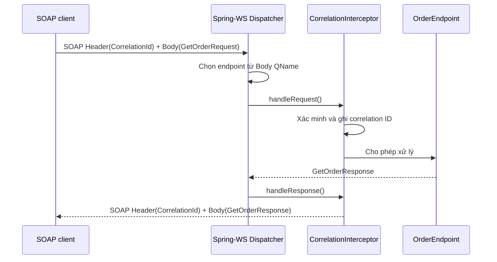

# Bổ sung header tương quan và kiểm chứng định tuyến

## 1. Bối cảnh và mục tiêu

Trong một hệ thống tích hợp doanh nghiệp, một yêu cầu SOAP có thể đi qua API gateway, ESB, bộ cân bằng tải và nhiều dịch vụ nội bộ. Khi truy vết sự cố, chỉ nhìn mã đơn hàng hoặc HTTP status không đủ để xác định nhật ký nào thuộc cùng một lần gọi. Một **correlation ID** (mã tương quan) giúp nối các bản ghi của *cùng một luồng xử lý* ở phía gửi và phía nhận.

Bài thực hành thuộc chương **Thực hành tổng hợp** của học phần **SPRING_WEB_SERVICES**. Học phần tập trung phát triển SOAP theo hướng **contract-first** với XSD/WSDL, JAXB, Spring Web Services endpoint và SOAP client; đồng thời xử lý SOAP Fault, interceptor, bảo mật XML, WS-Security, chứng chỉ và kiểm thử tương thích. Trong phạm vi bài này, ta tập trung vào hai nhiệm vụ đi cùng nhau:

1. Bổ sung header XML `CorrelationId` vào SOAP request, đọc và kiểm tra nó tại server, phản hồi lại cùng giá trị trong SOAP response để truy vết.
2. Kiểm chứng Spring-WS định tuyến request vào **đúng endpoint** thông qua QName của phần tử gốc trong SOAP Body, kể cả khi có nhiều operation hoặc có SOAPAction.

**Kết quả cần đạt:** gọi `GetOrderRequest` phải vào thao tác tra cứu, `CancelOrderRequest` phải vào thao tác hủy; cả hai yêu cầu mang mã tương quan hợp lệ đều nhận phản hồi chứa cùng mã; thiếu hoặc sai mã phải nhận SOAP Fault dự kiến trước khi xử lý nghiệp vụ.

### 1.1. Phân biệt các loại thông tin

| Thành phần | Nằm ở đâu? | Vai trò |
|---|---|---|
| `meta:CorrelationId` | SOAP Header | Ghép request, response, log và trace liên quan |
| `ord:GetOrderRequest` / `ord:CancelOrderRequest` | Phần tử gốc SOAP Body | Cung cấp QName để ánh xạ đến operation/endpoint |
| `SOAPAction` | HTTP header khi dùng SOAP 1.1 | Gợi ý thao tác theo WSDL; có thể được dùng làm tiêu chí mapping nếu server cấu hình |
| `wsa:MessageID` / `wsa:RelatesTo` | SOAP Header của WS-Addressing | Định danh thông điệp và quan hệ giữa các thông điệp theo chuẩn WS-Addressing |
| WS-Security token/signature | SOAP Header | Xác thực, bảo vệ toàn vẹn hoặc bí mật thông điệp theo chính sách bảo mật |

`CorrelationId` **không phải** khóa xác thực hay quy tắc định tuyến mặc định. Một correlation ID có thể được truyền xuyên suốt nhiều lời gọi; mỗi thông điệp WS-Addressing vẫn có `MessageID` riêng.

## 2. Kịch bản tích hợp và hợp đồng XML

Giả sử hệ thống quản lý đơn hàng cung cấp hai thao tác tại cùng địa chỉ `/ws`:

- `GetOrderRequest(orderId)` → `GetOrderResponse(orderId, status)`.
- `CancelOrderRequest(orderId)` → `CancelOrderResponse(orderId, accepted)`.

Quy ước namespace cố định:

| Ý nghĩa | Namespace URI |
|---|---|
| Nghiệp vụ đơn hàng | `urn:demo:order:v1` |
| Header kỹ thuật | `urn:demo:soap:meta:v1` |
| SOAP 1.1 Envelope | `http://schemas.xmlsoap.org/soap/envelope/` |

**Tên mở rộng (QName) = {namespace URI}localName**. Prefix `ord`, `x` hay `ns1` là bí danh tùy chọn, vì vậy `<ord:GetOrderRequest>` và `<x:GetOrderRequest>` với cùng namespace sẽ được định tuyến như nhau.

Luồng xử lý:



**Thứ tự cần nhớ:** `EndpointInterceptor` trong Spring-WS chạy sau khi `EndpointMapping` đã chọn được endpoint. Vì thế interceptor kiểm tra header nhưng không tự đổi nơi định tuyến. Muốn định tuyến bằng header cần xây dựng `EndpointMapping` hoặc quy tắc routing chuyên biệt.

### 2.1. XSD cho SOAP Body

Một giản lược của `order-v1.xsd` như sau; triển khai thực tế có thể bổ sung các field và kiểu nghiệp vụ:

```xml
<?xml version="1.0" encoding="UTF-8"?>
<xs:schema xmlns:xs="http://www.w3.org/2001/XMLSchema"
           xmlns:tns="urn:demo:order:v1"
           targetNamespace="urn:demo:order:v1"
           elementFormDefault="qualified">

  <xs:element name="GetOrderRequest">
    <xs:complexType><xs:sequence>
      <xs:element name="orderId" type="xs:string"/>
    </xs:sequence></xs:complexType>
  </xs:element>

  <xs:element name="GetOrderResponse">
    <xs:complexType><xs:sequence>
      <xs:element name="orderId" type="xs:string"/>
      <xs:element name="status" type="xs:string"/>
    </xs:sequence></xs:complexType>
  </xs:element>

  <xs:element name="CancelOrderRequest">
    <xs:complexType><xs:sequence>
      <xs:element name="orderId" type="xs:string"/>
    </xs:sequence></xs:complexType>
  </xs:element>

  <xs:element name="CancelOrderResponse">
    <xs:complexType><xs:sequence>
      <xs:element name="orderId" type="xs:string"/>
      <xs:element name="accepted" type="xs:boolean"/>
    </xs:sequence></xs:complexType>
  </xs:element>
</xs:schema>
```

Tạo hợp đồng riêng cho header ở `meta-v1.xsd`:

```xml
<?xml version="1.0" encoding="UTF-8"?>
<xs:schema xmlns:xs="http://www.w3.org/2001/XMLSchema"
           targetNamespace="urn:demo:soap:meta:v1"
           elementFormDefault="qualified">
  <xs:element name="CorrelationId">
    <xs:simpleType>
      <xs:restriction base="xs:string">
        <xs:length value="36"/>
      </xs:restriction>
    </xs:simpleType>
  </xs:element>
</xs:schema>
```

Ví dụ này sử dụng chuỗi UUID phiên bản 4, dài 36 ký tự. XSD kiểm tra độ dài, còn server kiểm tra đầy đủ định dạng và số lần xuất hiện. Nếu hệ thống dùng định dạng mã khác, phải thống nhất lại cả contract lẫn quy tắc kiểm tra.

### 2.2. Khai báo header trong WSDL contract-first

Tách header khỏi payload thành `wsdl:part` riêng. Đoạn sau minh họa **phần liên quan** của WSDL 1.1; giả định các prefix `wsdl`, `soap`, `tns`, `ord` và `meta` đã khai báo và các schema đã được import:

```xml
<wsdl:message name="GetOrderInput">
  <wsdl:part name="parameters" element="ord:GetOrderRequest"/>
  <wsdl:part name="correlation" element="meta:CorrelationId"/>
</wsdl:message>
<wsdl:message name="GetOrderOutput">
  <wsdl:part name="parameters" element="ord:GetOrderResponse"/>
  <wsdl:part name="correlation" element="meta:CorrelationId"/>
</wsdl:message>

<!-- Bên trong wsdl:binding/wsdl:operation của GetOrder -->
<wsdl:operation name="GetOrder">
  <soap:operation soapAction="urn:demo:order:v1:GetOrder"/>
  <wsdl:input>
    <soap:body use="literal" parts="parameters"/>
    <soap:header message="tns:GetOrderInput"
                 part="correlation" use="literal"/>
  </wsdl:input>
  <wsdl:output>
    <soap:body use="literal" parts="parameters"/>
    <soap:header message="tns:GetOrderOutput"
                 part="correlation" use="literal"/>
  </wsdl:output>
</wsdl:operation>
```

Khai báo tương tự cho `CancelOrder`. Trong `wsdl:portType`, mỗi operation dùng cặp message tương ứng. WSDL cũng phải quy định binding SOAP 1.1, địa chỉ service và kiểu truyền `document/literal`.

**Lưu ý contract-first:** `DefaultWsdl11Definition` thường tạo WSDL dựa trên schema payload, nhưng không tự suy ra tùy biến `soap:header` như đoạn trên. Nếu header là một phần hợp đồng bắt buộc với các hệ thống tích hợp, hãy xuất bản **WSDL tĩnh đã khai báo header** (hoặc tùy biến bước sinh WSDL) và kiểm tra tài liệu WSDL được client thực sự tải về.

### 2.3. SOAP request và response mẫu

Request SOAP 1.1 qua HTTP có header `Content-Type: text/xml; charset=utf-8` và, theo binding WSDL, `SOAPAction: "urn:demo:order:v1:GetOrder"`:

```xml
<soapenv:Envelope
    xmlns:soapenv="http://schemas.xmlsoap.org/soap/envelope/"
    xmlns:ord="urn:demo:order:v1"
    xmlns:meta="urn:demo:soap:meta:v1">
  <soapenv:Header>
    <meta:CorrelationId>123e4567-e89b-42d3-a456-426614174000</meta:CorrelationId>
  </soapenv:Header>
  <soapenv:Body>
    <ord:GetOrderRequest>
      <ord:orderId>ORD-1001</ord:orderId>
    </ord:GetOrderRequest>
  </soapenv:Body>
</soapenv:Envelope>
```

Response thành công:

```xml
<soapenv:Envelope
    xmlns:soapenv="http://schemas.xmlsoap.org/soap/envelope/"
    xmlns:ord="urn:demo:order:v1"
    xmlns:meta="urn:demo:soap:meta:v1">
  <soapenv:Header>
    <meta:CorrelationId>123e4567-e89b-42d3-a456-426614174000</meta:CorrelationId>
  </soapenv:Header>
  <soapenv:Body>
    <ord:GetOrderResponse>
      <ord:orderId>ORD-1001</ord:orderId>
      <ord:status>FOUND</ord:status>
    </ord:GetOrderResponse>
  </soapenv:Body>
</soapenv:Envelope>
```

Header nằm **ngoài** SOAP Body nên không làm thay đổi QName của payload, cũng không buộc phải thêm field kỹ thuật vào các lớp JAXB nghiệp vụ.

## 3. Cấu hình endpoint và định tuyến Spring-WS

Dùng Spring-WS với `@EnableWs`, `@Endpoint` và `@PayloadRoot`. Giả sử đã sinh JAXB class `GetOrderRequest`, `GetOrderResponse`, `CancelOrderRequest` và `CancelOrderResponse` từ XSD (và đã cấu hình JAXB marshalling cho Spring-WS). Service nghiệp vụ `OrderService` là thành phần do ứng dụng cung cấp.

```java
import org.springframework.ws.server.endpoint.annotation.Endpoint;
import org.springframework.ws.server.endpoint.annotation.PayloadRoot;
import org.springframework.ws.server.endpoint.annotation.RequestPayload;
import org.springframework.ws.server.endpoint.annotation.ResponsePayload;

@Endpoint
public class OrderEndpoint {
    private static final String ORDER_NS = "urn:demo:order:v1";
    private final OrderService orders;

    public OrderEndpoint(OrderService orders) {
        this.orders = orders;
    }

    @PayloadRoot(namespace = ORDER_NS, localPart = "GetOrderRequest")
    @ResponsePayload
    public GetOrderResponse getOrder(@RequestPayload GetOrderRequest request) {
        GetOrderResponse response = new GetOrderResponse();
        response.setOrderId(request.getOrderId());
        response.setStatus(orders.findStatus(request.getOrderId()));
        return response;
    }

    @PayloadRoot(namespace = ORDER_NS, localPart = "CancelOrderRequest")
    @ResponsePayload
    public CancelOrderResponse cancelOrder(
            @RequestPayload CancelOrderRequest request) {
        CancelOrderResponse response = new CancelOrderResponse();
        response.setOrderId(request.getOrderId());
        response.setAccepted(orders.cancel(request.getOrderId()));
        return response;
    }
}
```

Cách Spring-WS chọn method trong cấu hình này:

| QName đầu SOAP Body | Method |
|---|---|
| `{urn:demo:order:v1}GetOrderRequest` | `OrderEndpoint#getOrder` |
| `{urn:demo:order:v1}CancelOrderRequest` | `OrderEndpoint#cancelOrder` |
| `{urn:demo:order:v2}GetOrderRequest` | Không khớp hai mapping trên |
| `{urn:demo:order:v1}UnknownRequest` | Không khớp hai mapping trên |

`@PayloadRoot` khớp cả namespace và local name. Prefix trong XML không có ý nghĩa đối với phép so khớp này. Nếu cấu hình thêm `@SoapAction` hoặc `@Action` (WS-Addressing), Spring-WS có các endpoint mapping tương ứng; thứ tự/ưu tiên mapping trong ứng dụng quyết định trường hợp nhiều mapping cùng có thể khớp. Không nên coi `SOAPAction` là một cơ chế xác thực hoặc tin rằng nó luôn thắng QName.

## 4. Gắn CorrelationId tại SOAP client

`WebServiceTemplate` cho phép truyền callback khi marshal request. Ví dụ sử dụng **Jakarta SAAJ** (tương thích Spring-WS 4.x trên Java 17+) và lớp JAXB sinh từ XSD:

```java
import jakarta.xml.soap.SOAPEnvelope;
import jakarta.xml.soap.SOAPHeader;
import java.util.UUID;
import javax.xml.namespace.QName;
import org.springframework.ws.client.core.WebServiceTemplate;
import org.springframework.ws.soap.saaj.SaajSoapMessage;

public final class OrderSoapClient {
    private static final String META_NS = "urn:demo:soap:meta:v1";
    private final WebServiceTemplate template;
    private final String serviceUri;

    public OrderSoapClient(WebServiceTemplate template, String serviceUri) {
        this.template = template;
        this.serviceUri = serviceUri;
    }

    public GetOrderResponse getOrder(String orderId) {
        GetOrderRequest request = new GetOrderRequest();
        request.setOrderId(orderId);

        // Sinh một ID cho mỗi luồng xử lý đầu vào; có thể tái sử dụng
        // khi chuỗi gọi nội bộ thuộc cùng một transaction nghiệp vụ.
        String correlationId = UUID.randomUUID().toString();

        Object value = template.marshalSendAndReceive(
            serviceUri,
            request,
            message -> {
                SaajSoapMessage soap = (SaajSoapMessage) message;
                SOAPEnvelope envelope =
                    soap.getSaajMessage().getSOAPPart().getEnvelope();
                SOAPHeader header = envelope.getHeader();
                if (header == null) {
                    header = envelope.addHeader();
                }
                header.addHeaderElement(
                    new QName(META_NS, "CorrelationId", "meta"))
                    .addTextNode(correlationId);
                soap.setSoapAction("urn:demo:order:v1:GetOrder");
            }
        );
        return (GetOrderResponse) value;
    }
}
```

Đảm bảo `WebServiceTemplate` được cấu hình với `Jaxb2Marshaller` có `contextPath` hoặc `classesToBeBound` phù hợp và dùng `SaajSoapMessageFactory`. Nếu hệ thống sử dụng message factory khác, dùng API `SoapMessage`/`SoapHeader` và `Result` thay vì ép kiểu SAAJ.

**Kiểm chứng response ở phía client:** `marshalSendAndReceive` trả về đối tượng JAXB của **payload**, không tự trả về SOAP Header. Cần một `ClientInterceptor` đọc `MessageContext.getResponse()` hoặc dùng API nhận response toàn thông điệp để kiểm tra correlation ID trả về. Đừng kết luận server đã echo ID chỉ dựa trên việc unmarshalling payload thành công.

## 5. Kiểm tra header, ghi log và phản hồi tại server

Dùng một `EndpointInterceptor` áp dụng chung cho các endpoint đã định tuyến. Ví dụ này quy ước mỗi request phải có **đúng một** `meta:CorrelationId` ở cấp con trực tiếp của SOAP Header, mang UUID v4 hợp lệ. Request không hợp lệ trả SOAP Client/Sender Fault trước khi gọi `OrderService`; request hợp lệ được ghi vào `MessageContext` và MDC để log.

```java
import jakarta.xml.soap.SOAPEnvelope;
import jakarta.xml.soap.SOAPHeader;
import java.util.Locale;
import java.util.regex.Pattern;
import javax.xml.namespace.QName;
import org.slf4j.MDC;
import org.springframework.stereotype.Component;
import org.springframework.ws.context.MessageContext;
import org.springframework.ws.server.EndpointInterceptor;
import org.springframework.ws.soap.SoapMessage;
import org.springframework.ws.soap.saaj.SaajSoapMessage;
import org.w3c.dom.Element;
import org.w3c.dom.Node;

@Component
public final class CorrelationInterceptor implements EndpointInterceptor {
    private static final String META_NS = "urn:demo:soap:meta:v1";
    private static final QName CID =
        new QName(META_NS, "CorrelationId", "meta");
    private static final String KEY = "soap.correlationId";
    private static final Pattern UUID_V4 = Pattern.compile(
        "[0-9a-fA-F]{8}-[0-9a-fA-F]{4}-4[0-9a-fA-F]{3}"
        + "-[89abAB][0-9a-fA-F]{3}-[0-9a-fA-F]{12}");

    @Override
    public boolean handleRequest(MessageContext context, Object endpoint)
            throws Exception {
        String id = extractId((SaajSoapMessage) context.getRequest());
        if (id == null) {
            ((SoapMessage) context.getResponse()).getSoapBody()
                .addClientOrSenderFault(
                    "Missing, duplicate or invalid CorrelationId",
                    Locale.ENGLISH);
            return false;
        }
        context.setProperty(KEY, id);
        MDC.put("correlationId", id);
        return true;
    }

    @Override
    public boolean handleResponse(MessageContext context, Object endpoint)
            throws Exception {
        echoId(context);
        return true;
    }

    @Override
    public boolean handleFault(MessageContext context, Object endpoint)
            throws Exception {
        echoId(context);
        return true;
    }

    @Override
    public void afterCompletion(
            MessageContext context, Object endpoint, Exception ex) {
        MDC.remove("correlationId");
    }

    private static String extractId(SaajSoapMessage soap) throws Exception {
        SOAPHeader header = soap.getSaajMessage().getSOAPHeader();
        if (header == null) return null;

        int count = 0;
        String value = null;
        // Chỉ xét các phần tử con trực tiếp; không tìm sâu tùy ý.
        for (Node node = header.getFirstChild(); node != null;
             node = node.getNextSibling()) {
            if (node instanceof Element element
                    && META_NS.equals(element.getNamespaceURI())
                    && "CorrelationId".equals(element.getLocalName())) {
                count++;
                value = element.getTextContent();
            }
        }
        if (count != 1 || value == null) return null;
        String normalized = value.trim();
        return UUID_V4.matcher(normalized).matches() ? normalized : null;
    }

    private static void echoId(MessageContext context) throws Exception {
        String id = (String) context.getProperty(KEY);
        if (id == null || !context.hasResponse()) return;

        SaajSoapMessage response = (SaajSoapMessage) context.getResponse();
        SOAPEnvelope envelope =
            response.getSaajMessage().getSOAPPart().getEnvelope();
        SOAPHeader header = envelope.getHeader();
        if (header == null) {
            header = envelope.addHeader();
        }
        header.addHeaderElement(CID).addTextNode(id);
    }
}
```

Đăng ký interceptor cho các endpoint khi sử dụng `@EnableWs`:

```java
import java.util.List;
import org.springframework.context.annotation.Configuration;
import org.springframework.ws.config.annotation.EnableWs;
import org.springframework.ws.config.annotation.WsConfigurer;
import org.springframework.ws.server.EndpointInterceptor;

@Configuration
@EnableWs
public class SoapEndpointConfig implements WsConfigurer {
    private final CorrelationInterceptor correlationInterceptor;

    public SoapEndpointConfig(CorrelationInterceptor interceptor) {
        this.correlationInterceptor = interceptor;
    }

    @Override
    public void addInterceptors(List<EndpointInterceptor> interceptors) {
        interceptors.add(correlationInterceptor);
    }
}
```

Một số điểm quan trọng trong cách xử lý trên:

- **Dừng nghiệp vụ khi header sai:** `handleRequest()` trả `false` sau khi tạo SOAP Fault. Các endpoint không được gọi. Fault được tạo trực tiếp tại interceptor này không bắt buộc có correlation ID vì ID đầu vào chưa được chấp nhận.
- **Echo trên cả response thường và fault từ endpoint:** `handleResponse()` và `handleFault()` thêm header cho response đã tồn tại sau khi request được chấp nhận. Các lỗi xảy ra trước khi chọn được endpoint có thể không qua interceptor này; muốn bao phủ chúng phải xử lý thêm tại tầng dispatcher hoặc gateway.
- **Giới hạn kiểu thông điệp:** ví dụ cố ý dùng `SaajSoapMessage`; khi thay message factory phải thay cách đọc/ghi header cho phù hợp.
- **Quản lý MDC:** chỉ đặt MDC sau khi ID hợp lệ và xóa tại `afterCompletion()`. Không để ID của request trước rò sang request khác khi thread được tái sử dụng.
- **Tên QName chuẩn:** so sánh namespace URI và local name; không so sánh chuỗi XML theo prefix hoặc tìm `CorrelationId` trong bất kỳ node lồng nhau nào.

Trong hệ thống thực, cân nhắc loại bỏ chuỗi có nội dung XML lồng bên trong `CorrelationId`, áp dụng schema validation toàn thông điệp và giới hạn kích thước SOAP trước khi phân tích XML. Ví dụ dùng `getTextContent()` để minh họa, nên bổ sung kiểm tra header chỉ chứa một text node khi cần một quy tắc header nghiêm ngặt.

## 6. Kiểm chứng định tuyến và header bằng MockWebServiceClient

Với Spring-WS, `MockWebServiceClient` mô phỏng một request đi qua cơ chế dispatcher và endpoint mapping của ứng dụng, phù hợp kiểm thử integration mà không cần mở HTTP port. Thêm dependency kiểm thử `spring-ws-test` và Spring Test/JUnit phù hợp với phiên bản đang dùng.

### 6.1. Tạo request có Body và Header

`RequestCreator` nhận `WebServiceMessageFactory`, tạo thông điệp rồi trả về cho dispatcher. Đây là cách thích hợp để đưa header vào request test:

```java
import jakarta.xml.soap.SOAPEnvelope;
import jakarta.xml.soap.SOAPHeader;
import javax.xml.namespace.QName;
import javax.xml.transform.TransformerFactory;
import org.springframework.ws.soap.saaj.SaajSoapMessage;
import org.springframework.ws.test.server.RequestCreator;
import org.springframework.xml.transform.StringSource;

private static RequestCreator request(
        String localName, String correlationId) {
    return factory -> {
        SaajSoapMessage soap =
            (SaajSoapMessage) factory.createWebServiceMessage();

        String xml = "<ord:" + localName
            + " xmlns:ord=\"urn:demo:order:v1\">"
            + "<ord:orderId>ORD-1001</ord:orderId>"
            + "</ord:" + localName + ">";

        TransformerFactory.newInstance().newTransformer()
            .transform(new StringSource(xml), soap.getPayloadResult());

        if (correlationId != null) {
            SOAPEnvelope envelope =
                soap.getSaajMessage().getSOAPPart().getEnvelope();
            SOAPHeader header = envelope.getHeader();
            if (header == null) header = envelope.addHeader();
            header.addHeaderElement(
                new QName("urn:demo:soap:meta:v1", "CorrelationId", "meta"))
                .addTextNode(correlationId);
        }
        return soap;
    };
}
```

`localName` trong helper là dữ liệu kiểm thử cố định, đáng tin cậy. Không nối một giá trị tùy ý do người dùng cung cấp vào XML như cách này trong mã production.

### 6.2. Các ca kiểm thử lõi

Ví dụ với ứng dụng Spring Test đã khởi tạo `ApplicationContext` chứa endpoint, interceptor và các service giả lập:

```java
import static org.springframework.ws.test.server.ResponseMatchers.*;
import org.junit.jupiter.api.BeforeEach;
import org.junit.jupiter.api.Test;
import org.springframework.beans.factory.annotation.Autowired;
import org.springframework.context.ApplicationContext;
import org.springframework.ws.test.server.MockWebServiceClient;
import javax.xml.namespace.QName;

class OrderSoapContractTest {
    private static final String ID =
        "123e4567-e89b-42d3-a456-426614174000";
    @Autowired ApplicationContext applicationContext;
    private MockWebServiceClient client;

    @BeforeEach
    void setUp() {
        client = MockWebServiceClient.createClient(applicationContext);
    }

    @Test
    void getOrderGoesToGetEndpointAndEchoesHeader() {
        client.sendRequest(request("GetOrderRequest", ID))
            .andExpect(noFault())
            .andExpect(xpath(
                "/*[local-name()='GetOrderResponse']").exists())
            .andExpect(soapHeader(
                new QName("urn:demo:soap:meta:v1", "CorrelationId")));
    }

    @Test
    void cancelOrderGoesToCancelEndpoint() {
        client.sendRequest(request("CancelOrderRequest", ID))
            .andExpect(noFault())
            .andExpect(xpath(
                "/*[local-name()='CancelOrderResponse']").exists());
    }

    @Test
    void missingCorrelationIdIsRejectedBeforeBusinessLogic() {
        client.sendRequest(request("GetOrderRequest", null))
            .andExpect(clientOrSenderFault(
                "Missing, duplicate or invalid CorrelationId"));
    }
}
```

Đoạn test là khung mẫu; gắn annotation Spring Test phù hợp (`@SpringBootTest` hoặc `@ContextConfiguration`), cấu hình mock `OrderService` và import helper `request()` cùng lớp test. Để kiểm tra **giá trị** header được echo, bổ sung `ResponseMatcher` tùy biến đọc `SaajSoapMessage` của response và so sánh UUID với request; `soapHeader(QName)` chỉ chứng minh header có tồn tại, chưa kiểm tra chuỗi bên trong.

Ngoài kiểm tra response QName, hãy xác minh tương tác với service giả lập: `GetOrderRequest` chỉ gọi `orders.findStatus(...)`, không gọi `orders.cancel(...)`; request thiếu header không gọi service nào. Như vậy kiểm thử xác nhận **đường đi thực tế**, tránh tình huống hai endpoint vô tình trả cùng một loại payload.

### 6.3. Ma trận kiểm thử bắt buộc

| # | Input | Kết quả kỳ vọng |
|---|---|---|
| 1 | `GetOrderRequest`, UUID v4 hợp lệ | Method tra cứu chạy; `GetOrderResponse`; response echo đúng ID |
| 2 | `CancelOrderRequest`, UUID v4 hợp lệ | Method hủy chạy; `CancelOrderResponse`; response echo đúng ID |
| 3 | Prefix SOAP Body đổi từ `ord` sang `x` nhưng namespace giữ nguyên | Vẫn chọn đúng endpoint |
| 4 | Local name đúng, namespace Body đổi sang `urn:demo:order:v2` | Không chọn nhầm endpoint v1; phản hồi theo cấu hình lỗi không tìm thấy mapping |
| 5 | Header `CorrelationId` vắng mặt, rỗng, sai namespace hoặc không phải UUID v4 | SOAP Client/Sender Fault; không gọi logic nghiệp vụ |
| 6 | Hai phần tử `meta:CorrelationId` trong cùng SOAP Header | SOAP Client/Sender Fault; không gọi logic nghiệp vụ |
| 7 | `SOAPAction` khai báo thao tác A nhưng QName Body là thao tác B | Xác minh hành vi thực tế của cấu hình mapping; không giả định SOAPAction luôn quyết định |
| 8 | Endpoint ném lỗi nghiệp vụ đã ánh xạ thành SOAP Fault | Fault đúng mã; ID hợp lệ được echo nếu luồng interceptor có xử lý fault |
| 9 | Header đúng namespace nhưng prefix khác | Vẫn nhận header hợp lệ |
| 10 | SOAP version, WSDL `soap:header` và chính sách `mustUnderstand` không tương thích | Ghi nhận lỗi tương thích cụ thể, sửa hợp đồng hoặc phía client |

Cần kiểm thử case 4 và case 7 với **toàn bộ cấu hình endpoint mapping thực tế**. Nếu không tìm thấy endpoint, Spring-WS có thể báo lỗi dispatcher hoặc tạo fault tùy bộ xử lý và tầng HTTP đã cấu hình; không mặc định khẳng định mọi ứng dụng đều trả cùng một loại SOAP Fault.

### 6.4. Kiểm thử thủ công qua HTTP

Lưu XML request mẫu ở `get-order.xml` rồi gửi đến endpoint SOAP 1.1 bằng một công cụ HTTP:

```bash
curl --fail-with-body -sS -X POST http://localhost:8080/ws \
  -H 'Content-Type: text/xml; charset=utf-8' \
  -H 'SOAPAction: "urn:demo:order:v1:GetOrder"' \
  --data-binary @get-order.xml
```

Kiểm tra cả ba bằng chứng: (1) QName của response Body, (2) giá trị `CorrelationId` ở SOAP Header, (3) log phía server có cùng mã và đúng operation. Khi test fault, bỏ `--fail-with-body` nếu muốn công cụ không coi HTTP 500 là lỗi lệnh, rồi quan sát SOAP Fault thực tế.

## 7. Quy tắc vận hành và bảo mật

**Truy vết:** ghi log có cấu trúc như `correlationId`, `operationQName`, `result`, `durationMs`. Truyền mã tương quan giữa các dịch vụ qua SOAP Header theo chính sách đã thống nhất. Nếu gateway cấp ID, tránh thay thế ID hợp lệ giữa chặng nếu không có lý do; khi tạo ID mới, ghi nhận liên kết với ID nguồn.

**Tính tin cậy:** mã tương quan do client gửi có thể bị giả mạo. Giới hạn độ dài, định dạng, số lượng và ký tự cho phép trước khi ghi log hoặc đưa vào MDC. Mã tương quan không dùng để cấp quyền, xác minh người gọi hay chống phát lại. Bảo vệ đường truyền bằng TLS; nếu yêu cầu chống sửa đổi ở cấp thông điệp, định nghĩa chính sách WS-Security và ký các header cần thiết (bao gồm correlation header khi phù hợp), đồng thời cấu hình xác minh chữ ký tại server.

**Tính tương thích:** nếu dùng `soapenv:mustUnderstand="1"` cho header tùy biến, mọi SOAP node nhận header trong vai trò tương ứng phải hiểu và xử lý theo quy định, nếu không có thể trả `MustUnderstand` Fault. Chỉ bật khi hai bên đã thỏa thuận và kiểm thử. Kiểm tra riêng SOAP 1.1/1.2: namespace Envelope, content type và cách biểu diễn action/fault khác nhau.

**Hiệu năng và an toàn XML:** cấu hình giới hạn kích thước thông điệp, bảo vệ parser khỏi XML External Entity (XXE)/entity expansion và xác thực schema ở ranh giới tin cậy. Không log toàn bộ SOAP Envelope khi có dữ liệu cá nhân, mật khẩu, token hoặc chứng chỉ; che các trường nhạy cảm theo chính sách của hệ thống.

**Sự cố thường gặp:**

| Triệu chứng | Nguyên nhân có thể | Cách kiểm tra |
|---|---|---|
| `No endpoint mapping` | Sai namespace/local name của Body; endpoint chưa được phát hiện | In QName thực tế và kiểm tra `@Endpoint`, `@PayloadRoot`, component scan |
| Endpoint đúng nhưng thiếu correlation log | Interceptor chưa đăng ký, lỗi do header không được đọc, MDC bị xóa sớm | Kiểm tra `WsConfigurer` và log tại `handleRequest` |
| Payload trả đúng nhưng thiếu header response | Chưa thêm ở `handleResponse`; fault sinh trước mapping; client chỉ đọc payload | Inspect nguyên SOAP Envelope; kiểm tra đường lỗi |
| SOAP Fault khi bật `mustUnderstand` | Bên nhận chưa hiểu header hoặc role/actor không phù hợp | Đối chiếu WSDL, chính sách header và lỗi Fault |
| Client tạo header nhưng phía server không thấy | Sai namespace, gửi HTTP header thay vì SOAP Header, gateway loại bỏ header | So sánh raw XML trước và sau gateway |
| Test header tồn tại nhưng giá trị sai | Chỉ dùng matcher `soapHeader(QName)` | Thêm matcher so sánh giá trị correlation ID |
| SOAPAction và Body cho hai operation khác nhau | Nhiều mapping cùng tồn tại hoặc hợp đồng action không thống nhất | Kiểm tra thứ tự `EndpointMapping` và các test âm cho từng action |

## 8. Bài tập hoàn thành và tiêu chí nghiệm thu

1. Từ XSD, sinh JAXB request/response classes; khai báo XSD của header và thể hiện `soap:header` ở cả request/response trong WSDL contract-first.
2. Tạo hai operation cùng SOAP endpoint; gửi request tra cứu và hủy qua `WebServiceTemplate` có UUID v4 ở SOAP Header.
3. Đăng ký `CorrelationInterceptor` kiểm tra header một lần, trả SOAP Fault cho header sai, ghi MDC và echo ID cho phản hồi hợp lệ.
4. Viết kiểm thử cho bảng ở mục 6.3, trong đó phải kiểm chứng **giá trị** ID phản hồi và **service method được gọi**, không chỉ kiểm tra HTTP status.
5. Ghi một log mẫu có cùng correlation ID qua client, endpoint và một dịch vụ nội bộ; quan sát trường hợp lỗi SOAP Fault và xác nhận MDC được dọn sau request.

Bài đạt yêu cầu khi: hợp đồng WSDL/XSD phản ánh header trên dây; định tuyến độc lập và chính xác theo QName của Body; mỗi request hợp lệ được liên kết với response qua cùng correlation ID; request header sai bị chặn trước nghiệp vụ; kiểm thử chứng minh cả luồng thành công lẫn luồng lỗi.

### Tài liệu đối chiếu

- Spring Web Services Reference (các mục `@Endpoint`, endpoint mapping, `EndpointInterceptor`, `WebServiceTemplate` và testing): https://docs.spring.io/spring-ws/docs/4.1.3/reference/html/
- Javadoc `WsConfigurer`: https://docs.spring.io/spring-ws/docs/4.0.x/api/org/springframework/ws/config/annotation/WsConfigurer.html
- Javadoc `MessageContext` và `EndpointInterceptor`: https://docs.spring.io/spring-ws/docs/4.0.17/api/org/springframework/ws/server/EndpointInterceptor.html
- Javadoc `MockWebServiceClient` và `ResponseMatchers`: https://docs.spring.io/spring-ws/docs/4.0.9/api/org/springframework/ws/test/server/MockWebServiceClient.html
