# Viết kiểm thử mock cho máy chủ, máy khách và kiểm thử transport thực tế

## 1. Mục tiêu và bối cảnh

Trong một hệ thống tích hợp doanh nghiệp dùng **Spring Web Services (Spring-WS)**, một lời gọi SOAP đi qua nhiều lớp: XML theo XSD, SOAP Envelope, ánh xạ JAXB, `MessageDispatcher`/`@Endpoint`, các interceptor, SOAP Fault, HTTP và đôi khi cả TLS, chứng chỉ, WS-Security. Một bài kiểm thử chỉ gọi trực tiếp phương thức Java của endpoint không đủ chứng minh hợp đồng SOAP được xử lý chính xác. Ngược lại, mọi kiểm thử đều mở máy chủ thật sẽ chậm, khó xác định nguyên nhân lỗi và phụ thuộc môi trường.

Bài thực hành sử dụng ba mức kiểm thử bổ sung cho nhau:

| Mức | Công cụ chính | Đường đi được kiểm tra | Không kiểm tra |
| --- | --- | --- | --- |
| **Mock máy chủ SOAP** | `MockWebServiceClient` | XML request → cấu hình Spring-WS → endpoint → XML response/SOAP Fault | HTTP thực, socket, cổng, TLS |
| **Mock máy khách SOAP** | `MockWebServiceServer` | Code của SOAP gateway → `WebServiceTemplate` → payload/request → response hoặc Fault giả lập | Máy chủ từ xa, DNS, HTTP/TLS thật |
| **Transport thực tế** | `@SpringBootTest(RANDOM_PORT)` + `HttpClient`/`WebServiceTemplate` | HTTP → servlet → SOAP → endpoint → HTTP response; kiểm tra status/headers | Đường mạng và chính sách bảo mật của môi trường triển khai bên ngoài |

`MockWebServiceClient` là **máy khách thử nghiệm gửi tới server-side Spring-WS trong bộ nhớ**. `MockWebServiceServer` là **máy chủ giả để chặn lời gọi của client-side `WebServiceTemplate`**. Hai lớp có tên gần giống nhau nhưng phục vụ hai chiều hoàn toàn khác nhau.

```mermaid
flowchart TB
    subgraph S["Kiểm thử phía máy chủ"]
        T1["JUnit"] --> MC["MockWebServiceClient"]
        MC --> MD["MessageDispatcher + Endpoint + Interceptor"]
    end
    subgraph C["Kiểm thử phía máy khách"]
        T2["JUnit"] --> GW["OrderSoapGateway"]
        GW --> WT["WebServiceTemplate"]
        WT --> MS["MockWebServiceServer"]
    end
    subgraph H["Kiểm thử HTTP thực"]
        T3["JUnit + HttpClient"] --> HTTP["localhost:randomPort /ws"]
        HTTP --> SERVLET["MessageDispatcherServlet"]
        SERVLET --> ENDPOINT["Endpoint"]
    end
```



Kết thúc bài, bạn có thể viết kiểm thử cho cả **happy path**, dữ liệu không hợp lệ và SOAP Fault; xác nhận client không gọi mạng ngoài trong kiểm thử mock; dựng bài kiểm thử HTTP thật với cổng ngẫu nhiên; và nhận biết lỗi xuất phát từ hợp đồng XML, cấu hình Spring-WS, mã client hay transport.

## 2. Hợp đồng mẫu và dữ liệu kiểm thử

Giả sử hệ thống đơn hàng công bố dịch vụ `GetOrder` theo cách **contract-first**. Namespace nghiệp vụ là `urn:example:orders:v1`, servlet SOAP được ánh xạ tại `/ws/*`. Mọi ví dụ bên dưới dùng cùng một hợp đồng để kết quả giữa ba lớp kiểm thử có thể đối chiếu được.

XSD tối thiểu (ví dụ `orders.xsd`):

```xml
<?xml version="1.0" encoding="UTF-8"?>
<xs:schema xmlns:xs="http://www.w3.org/2001/XMLSchema"
           xmlns:tns="urn:example:orders:v1"
           targetNamespace="urn:example:orders:v1"
           elementFormDefault="qualified">
    <xs:element name="GetOrderRequest">
        <xs:complexType>
            <xs:sequence>
                <xs:element name="orderId" type="xs:string"/>
            </xs:sequence>
        </xs:complexType>
    </xs:element>
    <xs:element name="GetOrderResponse">
        <xs:complexType>
            <xs:sequence>
                <xs:element name="orderId" type="xs:string"/>
                <xs:element name="status" type="xs:string"/>
            </xs:sequence>
        </xs:complexType>
    </xs:element>
</xs:schema>
```

Payload request và response **không bao gồm** SOAP Envelope. Đây là nội dung body mà hai API mock thường nhận để so khớp:

```xml
<!-- Request payload -->
<ord:GetOrderRequest xmlns:ord="urn:example:orders:v1">
    <ord:orderId>ORD-42</ord:orderId>
</ord:GetOrderRequest>

<!-- Response payload -->
<ord:GetOrderResponse xmlns:ord="urn:example:orders:v1">
    <ord:orderId>ORD-42</ord:orderId>
    <ord:status>CONFIRMED</ord:status>
</ord:GetOrderResponse>
```

Khi gửi qua HTTP bằng SOAP 1.1, payload request nằm trong Envelope:

```xml
<soap:Envelope xmlns:soap="http://schemas.xmlsoap.org/soap/envelope/"
               xmlns:ord="urn:example:orders:v1">
    <soap:Header/>
    <soap:Body>
        <ord:GetOrderRequest>
            <ord:orderId>ORD-42</ord:orderId>
        </ord:GetOrderRequest>
    </soap:Body>
</soap:Envelope>
```

Đặt fixture trong mã kiểm thử để mỗi bài test dùng cùng dữ liệu. Các chuỗi XML đặt trong Java text block, vì vậy ví dụ yêu cầu **Java 17 trở lên**:

```java
// src/test/java/com/example/orders/SoapFixtures.java
package com.example.orders;

public final class SoapFixtures {
    private SoapFixtures() {}

    public static final String REQUEST_PAYLOAD = """
        <ord:GetOrderRequest xmlns:ord="urn:example:orders:v1">
          <ord:orderId>ORD-42</ord:orderId>
        </ord:GetOrderRequest>
        """;

    public static final String RESPONSE_PAYLOAD = """
        <ord:GetOrderResponse xmlns:ord="urn:example:orders:v1">
          <ord:orderId>ORD-42</ord:orderId>
          <ord:status>CONFIRMED</ord:status>
        </ord:GetOrderResponse>
        """;

    public static final String REQUEST_ENVELOPE = """
        <soap:Envelope
            xmlns:soap="http://schemas.xmlsoap.org/soap/envelope/"
            xmlns:ord="urn:example:orders:v1">
          <soap:Header/>
          <soap:Body>
            <ord:GetOrderRequest>
              <ord:orderId>ORD-42</ord:orderId>
            </ord:GetOrderRequest>
          </soap:Body>
        </soap:Envelope>
        """;
}
```

Với dự án contract-first, lớp `GetOrderRequest`/`GetOrderResponse` được **sinh từ XSD qua JAXB/XJC**. Các ví dụ Java sau giả định JAXB đã tạo các lớp này và chúng ánh xạ được trực tiếp thành XML root. Nếu phiên bản XJC của bạn tạo `JAXBElement<T>` thông qua `ObjectFactory`, hãy bọc request và mở response tương ứng khi dùng `marshalSendAndReceive`; không chỉnh tay mã generated.

### Dependencies và điều kiện khởi động

Ví dụ Gradle (để Spring Boot BOM quản lý phiên bản phụ thuộc):

```kotlin
dependencies {
    implementation("org.springframework.boot:spring-boot-starter-web-services")

    testImplementation("org.springframework.boot:spring-boot-starter-test")
    testImplementation("org.springframework.ws:spring-ws-test")
    testImplementation("org.xmlunit:xmlunit-core") // So khớp XML, khi cần
}
```

Dự án cần có `@Endpoint`, bean JAXB marshaller/unmarshaller nếu dùng đối tượng generated, và cấu hình Spring-WS thực tế. Với bài kiểm thử HTTP ở phần sau, servlet phải được đăng ký đúng đường dẫn `/ws/*`. Ví dụ cấu hình tường minh:

```java
@Configuration
@EnableWs
public class SoapServletConfig {
    @Bean
    ServletRegistrationBean<MessageDispatcherServlet> soapServlet(
            ApplicationContext context) {
        var servlet = new MessageDispatcherServlet();
        servlet.setApplicationContext(context);
        servlet.setTransformWsdlLocations(true);
        return new ServletRegistrationBean<>(servlet, "/ws/*");
    }
}
```

Các import tương ứng: `org.springframework.context.ApplicationContext`, `org.springframework.context.annotation.Bean`, `org.springframework.context.annotation.Configuration`, `org.springframework.boot.web.servlet.ServletRegistrationBean`, `org.springframework.ws.transport.http.MessageDispatcherServlet` và `org.springframework.ws.config.annotation.EnableWs`. Nếu ứng dụng đã tự cấu hình servlet của Spring Boot, chỉ cần kiểm tra đường dẫn hiện hành và **không đăng ký trùng servlet**.

Endpoint cần kiểm thử có dạng rút gọn sau:

```java
@Endpoint
public class OrderEndpoint {
    private static final String NS = "urn:example:orders:v1";
    private final OrderQueryService orders;

    public OrderEndpoint(OrderQueryService orders) {
        this.orders = orders;
    }

    @PayloadRoot(namespace = NS, localPart = "GetOrderRequest")
    @ResponsePayload
    public GetOrderResponse getStatus(@RequestPayload GetOrderRequest request) {
        var response = new GetOrderResponse();
        response.setOrderId(request.getOrderId());
        response.setStatus(orders.findStatus(request.getOrderId()));
        return response;
    }
}

public interface OrderQueryService {
    String findStatus(String orderId);
}
```

Ở đây `OrderEndpoint` dùng các annotation từ `org.springframework.ws.server.endpoint.annotation`. `OrderQueryService` là cổng nghiệp vụ để có thể thay bằng mock trong bài test; không cần truy cập cơ sở dữ liệu. Kiểm thử sẽ xác nhận request được dispatch đúng theo `QName` (namespace + local name), dịch vụ nghiệp vụ được gọi với `ORD-42`, và response được marshal đúng XSD.

## 3. Kiểm thử mock phía máy chủ với MockWebServiceClient

Đây là bài test cho **endpoint của chính ứng dụng**. Không cần mở cổng HTTP; `MockWebServiceClient` gửi request trực tiếp qua hệ thống xử lý message của Spring-WS trong `ApplicationContext`.

```java
package com.example.orders;

import org.junit.jupiter.api.BeforeEach;
import org.junit.jupiter.api.Test;
import org.springframework.beans.factory.annotation.Autowired;
import org.springframework.boot.test.context.SpringBootTest;
import org.springframework.context.ApplicationContext;
import org.springframework.test.context.bean.override.mockito.MockitoBean;
import org.springframework.ws.test.server.MockWebServiceClient;
import org.springframework.xml.transform.StringSource;

import static com.example.orders.SoapFixtures.REQUEST_PAYLOAD;
import static com.example.orders.SoapFixtures.RESPONSE_PAYLOAD;
import static org.mockito.Mockito.verify;
import static org.mockito.Mockito.when;
import static org.springframework.ws.test.server.RequestCreators.withPayload;
import static org.springframework.ws.test.server.ResponseMatchers.noFault;
import static org.springframework.ws.test.server.ResponseMatchers.payload;

@SpringBootTest
class OrderEndpointMockTest {
    @Autowired
    private ApplicationContext applicationContext;

    @MockitoBean
    private OrderQueryService orders;

    private MockWebServiceClient mockClient;

    @BeforeEach
    void setUp() {
        mockClient = MockWebServiceClient.createClient(applicationContext);
    }

    @Test
    void routesRequestAndReturnsContractPayload() {
        when(orders.findStatus("ORD-42")).thenReturn("CONFIRMED");

        mockClient.sendRequest(withPayload(new StringSource(REQUEST_PAYLOAD)))
                .andExpect(noFault())
                .andExpect(payload(new StringSource(RESPONSE_PAYLOAD)));

        verify(orders).findStatus("ORD-42");
    }
}
```

**Giải thích những gì test đã chứng minh:**

1. `withPayload(...)` tạo SOAP request với payload XML. Với cấu hình SOAP message factory thông thường, Spring-WS tự tạo Envelope để dispatch.
2. `MockWebServiceClient.createClient(applicationContext)` dùng các endpoint adapter, mapping và interceptor đã đăng ký trong Spring context. `@PayloadRoot` phải khớp cả namespace lẫn tên phần tử.
3. `noFault()` loại trừ trường hợp server trả SOAP Fault dù HTTP không tồn tại trong lớp kiểm thử này.
4. `payload(...)` so sánh payload XML trả về, giúp phát hiện sai tên phần tử, namespace hoặc giá trị. Cách so XML phù hợp hơn so chuỗi chứa các prefix ngẫu nhiên do JAXB tạo.
5. `verify(orders)...` xác nhận endpoint truyền đúng dữ liệu nghiệp vụ cho dependency đã mock.

`@MockitoBean` thuộc Spring Test phiên bản mới (Spring Framework 6.2+). Nếu dự án dùng bản Spring Boot cũ hơn, thay bằng cơ chế mock bean được phiên bản đó hỗ trợ (chẳng hạn `@MockBean`); các API mock SOAP của Spring-WS không thay đổi về mục đích. Đây là kiểm thử **Spring context + SOAP dispatch**, chưa kiểm tra servlet hoặc HTTP.

### Thử lỗi hợp đồng và SOAP Fault

Một hệ thống enterprise cần biết lỗi nào được biến thành SOAP Fault. Ví dụ nếu ứng dụng đã đăng ký `PayloadValidatingInterceptor` để validate request theo `orders.xsd`, gửi request thiếu `orderId` phải dẫn đến Fault thích hợp.

```java
import static org.springframework.ws.test.server.ResponseMatchers.clientOrSenderFault;

// Chỉ đúng khi request validation interceptor đã được bật và
// cấu hình trả SOAP Sender/Client Fault cho lỗi validate XSD.
@Test
void rejectsInvalidPayloadWithSoapFault() {
    String invalid = """
        <ord:GetOrderRequest xmlns:ord="urn:example:orders:v1"/>
        """;

    mockClient.sendRequest(withPayload(new StringSource(invalid)))
            .andExpect(clientOrSenderFault());
}
```

Không suy diễn rằng Spring-WS tự động validate mọi request: **nếu không cấu hình interceptor/schema validation hoặc cơ chế kiểm tra tương đương, test này không có tiền đề đúng**. Tương tự, mã nghiệp vụ ném exception chỉ trả về SOAP Fault theo mapping resolver đã được đăng ký. Nên kiểm tra riêng ba tình huống: dữ liệu vi phạm XSD, nghiệp vụ từ chối yêu cầu, và lỗi không mong muốn.

Khi cần kiểm tra SOAP Header, WS-Addressing hoặc WS-Security, phải tạo request bao gồm Envelope/Header tương ứng và chắc chắn interceptor thực tế đã được nạp vào context. Test payload đơn thuần không chứng minh chữ ký số, timestamp, khóa hoặc certificate đã được xác thực.

## 4. Kiểm thử mock phía máy khách với MockWebServiceServer

Bây giờ đổi góc nhìn: ứng dụng là **SOAP client** gọi một dịch vụ đơn hàng bên ngoài. Chúng ta muốn kiểm tra logic gọi `WebServiceTemplate` mà không phụ thuộc đối tác bên ngoài hay mạng thật.

Một gateway tối giản:

```java
public final class OrderSoapGateway {
    private final WebServiceTemplate template;

    public OrderSoapGateway(WebServiceTemplate template) {
        this.template = template;
    }

    public GetOrderResponse getStatus(String orderId) {
        var request = new GetOrderRequest();
        request.setOrderId(orderId);
        return (GetOrderResponse) template.marshalSendAndReceive(request);
    }
}
```

Gateway sử dụng bean `WebServiceTemplate` đã cấu hình `Jaxb2Marshaller` và `defaultUri`. Trong dự án thực tế hãy thiết kế cách xử lý `SoapFaultClientException`, timeout và dữ liệu không hợp lệ rõ ràng cho caller. Ví dụ trên tập trung vào luồng thông điệp.

Bài test tự cấu hình một template **được dùng thật bởi gateway** và gắn server mock vào template đó:

```java
package com.example.orders;

import java.util.Locale;
import org.junit.jupiter.api.BeforeEach;
import org.junit.jupiter.api.Test;
import org.springframework.oxm.jaxb.Jaxb2Marshaller;
import org.springframework.ws.client.core.WebServiceTemplate;
import org.springframework.ws.soap.client.SoapFaultClientException;
import org.springframework.ws.test.client.MockWebServiceServer;
import org.springframework.xml.transform.StringSource;

import static com.example.orders.SoapFixtures.REQUEST_PAYLOAD;
import static com.example.orders.SoapFixtures.RESPONSE_PAYLOAD;
import static org.junit.jupiter.api.Assertions.assertEquals;
import static org.junit.jupiter.api.Assertions.assertThrows;
import static org.springframework.ws.test.client.RequestMatchers.payload;
import static org.springframework.ws.test.client.ResponseCreators.withPayload;
import static org.springframework.ws.test.client.ResponseCreators.withServerOrReceiverFault;

class OrderSoapGatewayTest {
    private MockWebServiceServer mockServer;
    private OrderSoapGateway gateway;

    @BeforeEach
    void setUp() throws Exception {
        var marshaller = new Jaxb2Marshaller();
        marshaller.setContextPath("com.example.orders.contract");
        marshaller.afterPropertiesSet();

        var template = new WebServiceTemplate();
        template.setDefaultUri("http://example.invalid/ws");
        template.setMarshaller(marshaller);
        template.setUnmarshaller(marshaller);

        gateway = new OrderSoapGateway(template);
        mockServer = MockWebServiceServer.createServer(template);
    }

    @Test
    void marshalsRequestAndReadsSuccessfulResponse() {
        mockServer.expect(payload(new StringSource(REQUEST_PAYLOAD)))
                  .andRespond(withPayload(new StringSource(RESPONSE_PAYLOAD)));

        GetOrderResponse result = gateway.getStatus("ORD-42");

        assertEquals("ORD-42", result.getOrderId());
        assertEquals("CONFIRMED", result.getStatus());
        mockServer.verify();
    }

    @Test
    void surfacesSoapFaultFromPartner() {
        mockServer.expect(payload(new StringSource(REQUEST_PAYLOAD)))
                  .andRespond(withServerOrReceiverFault(
                          "Partner service unavailable", Locale.ENGLISH));

        assertThrows(SoapFaultClientException.class,
                     () -> gateway.getStatus("ORD-42"));

        mockServer.verify();
    }
}
```

Thay `com.example.orders.contract` bằng package JAXB đã được sinh từ XSD của ứng dụng và import `GetOrderRequest`/`GetOrderResponse` từ package đó. Nếu XJC trả về `JAXBElement`, cần điều chỉnh gateway cho đúng kiểu root JAXB; bản test vẫn dùng cùng payload XML.

**Điểm quyết định:** `MockWebServiceServer.createServer(template)` gắn mock transport vào **đúng thể hiện** `WebServiceTemplate` mà gateway đang sử dụng. URI `http://example.invalid/ws` chỉ minh họa cấu hình; bài test không thực hiện HTTP tới địa chỉ đó. Nếu gateway tự `new WebServiceTemplate()` bên trong phương thức hoặc dùng một bean template khác, mock sẽ không chặn được lời gọi.

Chu trình kiểm tra phía client:

1. `expect(payload(...))` đòi hỏi client serialize đúng nội dung request.
2. `andRespond(withPayload(...))` đưa response SOAP giả lập cho template giải mã.
3. Assertion kiểm tra kết quả đã được unmarshal thành đối tượng domain/contract.
4. `mockServer.verify()` xác nhận các request dự kiến thực sự được gửi đủ. Đặt `verify()` cả trong bài test lỗi.

Một hướng mở rộng là giả lập SOAP Fault Sender/Client để kiểm tra phân loại lỗi nghiệp vụ, hoặc dùng matcher cho `SOAPAction`, SOAP Header và callback interceptor để xác nhận metadata. Lỗi HTTP thuần, kết nối bị từ chối, chứng chỉ không hợp lệ và thời gian chờ phải được kiểm tra bằng lớp transport hoặc cơ chế fake sender chuyên biệt; `withServerOrReceiverFault` chỉ giả lập **SOAP Fault**, không giả lập mạng rớt.

## 5. Kiểm thử transport thực với cổng HTTP ngẫu nhiên

Hai lớp mock ở trên không mở socket. Vì vậy chúng có thể đều xanh dù ứng dụng đăng ký sai URL `/ws`, servlet không chạy, SOAP Envelope sai phiên bản, filter HTTP chặn request hoặc phản hồi mang HTTP status bất thường.

Để kiểm tra luồng **HTTP thực trên máy đang chạy test**, khởi động ứng dụng với cổng ngẫu nhiên rồi gửi SOAP Envelope qua `java.net.http.HttpClient`. Dùng `RANDOM_PORT` tránh phụ thuộc một cổng cố định, giúp CI chạy nhiều job cùng lúc.

```java
package com.example.orders;

import java.io.StringReader;
import java.net.URI;
import java.net.http.HttpClient;
import java.net.http.HttpRequest;
import java.net.http.HttpResponse;
import java.nio.charset.StandardCharsets;
import java.time.Duration;
import java.util.Locale;

import javax.xml.xpath.XPathFactory;
import org.xml.sax.InputSource;

import org.junit.jupiter.api.Test;
import org.springframework.beans.factory.annotation.Autowired;
import org.springframework.boot.test.context.SpringBootTest;
import org.springframework.boot.test.web.server.LocalServerPort;
import org.springframework.test.context.bean.override.mockito.MockitoBean;

import static com.example.orders.SoapFixtures.REQUEST_ENVELOPE;
import static org.junit.jupiter.api.Assertions.assertEquals;
import static org.junit.jupiter.api.Assertions.assertTrue;
import static org.mockito.Mockito.when;

@SpringBootTest(webEnvironment = SpringBootTest.WebEnvironment.RANDOM_PORT)
class OrderSoapHttpIT {
    @LocalServerPort
    private int port;

    @MockitoBean
    private OrderQueryService orders;

    @Test
    void acceptsSoap11RequestOverRealHttp() throws Exception {
        when(orders.findStatus("ORD-42")).thenReturn("CONFIRMED");

        var url = URI.create("http://127.0.0.1:" + port + "/ws");
        var request = HttpRequest.newBuilder(url)
                .timeout(Duration.ofSeconds(10))
                .header("Content-Type", "text/xml; charset=UTF-8")
                .header("SOAPAction", "\"\"")
                .POST(HttpRequest.BodyPublishers.ofString(
                        REQUEST_ENVELOPE, StandardCharsets.UTF_8))
                .build();

        var client = HttpClient.newBuilder()
                .connectTimeout(Duration.ofSeconds(5))
                .build();

        HttpResponse<String> response = client.send(
                request, HttpResponse.BodyHandlers.ofString(StandardCharsets.UTF_8));

        assertEquals(200, response.statusCode());
        assertTrue(response.headers()
                .firstValue("Content-Type")
                .orElse("")
                .toLowerCase(Locale.ROOT)
                .contains("xml"));

        // Kiểm tra cả SOAP namespace và business namespace;
        // không phụ thuộc prefix "soap", "ord" mà JAXB sinh.
        String status = XPathFactory.newInstance().newXPath().evaluate(
                "string("
                + "/*[local-name()='Envelope' and "
                + "namespace-uri()='http://schemas.xmlsoap.org/soap/envelope/']"
                + "/*[local-name()='Body' and "
                + "namespace-uri()='http://schemas.xmlsoap.org/soap/envelope/']"
                + "/*[local-name()='GetOrderResponse' and "
                + "namespace-uri()='urn:example:orders:v1']"
                + "/*[local-name()='status' and "
                + "namespace-uri()='urn:example:orders:v1']"
                + ")",
                new InputSource(new StringReader(response.body())));

        assertEquals("CONFIRMED", status);
    }
}
```

Trong bản test trên, `@MockitoBean` chỉ thay **nguồn dữ liệu nghiệp vụ** để test có kết quả xác định; phần HTTP, servlet, SOAP dispatcher, endpoint và JAXB vẫn đi qua các bean thực. Nó chứng minh một round trip thật trên loopback (`127.0.0.1`). Nếu muốn kiểm tra cả database/message broker thì thay mock nghiệp vụ bằng test fixture hoặc Testcontainers phù hợp.

**Đọc kết quả kiểm thử:** Nếu server mock pass nhưng HTTP test trả `404`, hãy kiểm tra đường dẫn servlet và context path. Nếu `415 Unsupported Media Type`, hãy xem SOAP 1.1/1.2 có khớp `Content-Type` không. Nếu HTTP trả `500` chứa SOAP Fault, hãy đọc `faultcode`/`faultstring` trong body, sau đó kiểm tra mapping, JAXB, schema validation và service exceptions. HTTP `401`/`403` có thể đến từ filter/security trước khi request đi tới Spring-WS endpoint.

Ví dụ sử dụng **SOAP 1.1**: `Content-Type: text/xml`, Envelope namespace `http://schemas.xmlsoap.org/soap/envelope/`, và `SOAPAction` tùy theo hợp đồng. Với **SOAP 1.2**, đổi đồng bộ sang `application/soap+xml` và Envelope namespace `http://www.w3.org/2003/05/soap-envelope`; action thường nằm trong tham số `Content-Type`. Không đổi lẻ từng phần rồi coi mọi lỗi là lỗi endpoint.

Khi xử lý XML từ nguồn không tin cậy bằng parser tự tạo, hãy bật chế độ namespace-aware, chặn DTD/external entities và áp dụng giới hạn tài nguyên để tránh XXE. Ở ví dụ trên response đến từ test server nội bộ; trong hệ thống thực, có thể dùng XMLUnit hoặc parser được cấu hình an toàn để kiểm tra cấu trúc đầy đủ.

### Kiểm thử transport thật bằng WebServiceTemplate

Nếu mục tiêu là xác nhận **chính SOAP client production** kết nối được qua HTTP, hãy cấu hình `WebServiceTemplate` với URL local thật rồi gọi gateway mà **không gắn `MockWebServiceServer`**. Ví dụ ngắn dưới đây dùng payload `Source` để không phụ thuộc vào generated JAXB:

```java
@Test
void webServiceTemplateCanCallLocalHttpServer() {
    String uri = "http://127.0.0.1:" + port + "/ws";
    var template = new WebServiceTemplate();
    var result = new StringResult();

    boolean hasResponsePayload = template.sendSourceAndReceiveToResult(
            uri,
            new StringSource(SoapFixtures.REQUEST_PAYLOAD),
            result);

    assertTrue(hasResponsePayload);
    // So khớp result.toString() với RESPONSE_PAYLOAD bằng XMLUnit
    // hoặc XPath có namespace; đừng chỉ dựa vào substring tùy ý.
}
```

Các import liên quan gồm `org.springframework.ws.client.core.WebServiceTemplate`, `org.springframework.xml.transform.StringSource` và `org.springframework.xml.transform.StringResult`. Chỉ cần một kiểm thử như thế này khi muốn chứng minh sender HTTP của `WebServiceTemplate` hoạt động; những case nghiệp vụ chi tiết vẫn nên đặt ở lớp mock để chạy nhanh.

## 6. Tăng độ bao phủ cho lỗi và khả năng tương thích

Nên xây dựng test matrix dựa trên hợp đồng và các rủi ro tích hợp:

| Tình huống | Mock server | Mock client | HTTP/transport |
| --- | --- | --- | --- |
| Payload hợp lệ, namespace và response đúng | Xác nhận dispatch/response | Xác nhận request marshalled/response unmarshalled | Xác nhận HTTP 200 + Envelope/body |
| Thiếu `orderId`, sai thứ tự hoặc sai namespace | Xác nhận validation/Fault nếu interceptor bật | Xác nhận client không tạo payload sai | Xác nhận ứng dụng nhận request lỗi qua HTTP |
| Không có `@PayloadRoot` tương ứng | Phát hiện không dispatch hoặc SOAP Fault | Không thuộc trách nhiệm chính | Kiểm tra hành vi SOAP+HTTP ngoài thực tế |
| Máy chủ đối tác trả Sender/Receiver Fault | Có thể kiểm tra exception resolver phía server | `withClientOrSenderFault` / `withServerOrReceiverFault` | Kiểm tra Fault thật và mã trạng thái |
| SOAP Header, `SOAPAction`, WS-Addressing | Cần request/header phù hợp | Cần expectation/callback phù hợp | Gửi và xác minh headers thực |
| Interceptor validate XSD, ghi log, security | Có thể chạy nếu interceptor nằm trong context | Có thể kiểm tra interceptor của client | Cần trường hợp end-to-end ở cổng thực |
| HTTP 401/403/404/415/500; proxy lỗi | Không chứng minh được | Mock SOAP thông thường không chứng minh được | Kiểm tra status, headers và filter |
| DNS, timeout, TLS handshake, mTLS, chứng chỉ | Không chứng minh được | Cần fake sender để test xử lý lỗi riêng | Cần môi trường tích hợp có transport tương ứng |
| Phiên bản XSD/WSDL thay đổi | So XML response và schema | So XML request và schema | Gửi bộ fixture từ phiên bản đối tác thực |

Để hợp đồng thật sự được bảo vệ, chỉ so khớp `status = CONFIRMED` là chưa đủ. Hãy kiểm tra thêm:

- **Namespace URI, tên và kiểu phần tử, cardinality, thứ tự theo XSD.** XML prefix có thể thay đổi mà vẫn tương đương; namespace URI thì không.
- **SOAP Fault:** phân biệt Sender/Client (request hoặc nghiệp vụ sai) với Receiver/Server (lỗi thực thi), cấu trúc `detail` và khả năng client chuyển Fault thành lỗi phù hợp.
- **Hành vi bảo mật:** kiểm tra request thiếu hoặc có chữ ký sai, timestamp hết hạn, certificate không tin cậy; kiểm tra độc lập nơi chứa khóa và các điều kiện handshake. Không đưa private key/credential thật vào fixture.
- **Khả năng tương thích:** lưu fixture đại diện cho khách hàng cũ và mới, thử các trường optional, giá trị enum, namespace và SOAP version theo hợp đồng. Nếu hệ thống phải hỗ trợ phiên bản cũ, chạy cả hai bộ fixture.
- **Độ bền khi lỗi:** timeout, retry, idempotency và correlation ID. Retry chỉ được bật khi loại thao tác và yêu cầu nghiệp vụ cho phép, tránh vô tình nhân đôi giao dịch.

### So sánh XML theo cấu trúc thay vì so chuỗi

XML có nhiều biểu diễn hợp lệ: khác prefix, xuống dòng, khoảng trắng giữa các node, vị trí khai báo namespace. Khi cần so khớp payload sau khi đã chạy client/HTTP test, có thể dùng XMLUnit:

```java
import org.xmlunit.builder.DiffBuilder;
import org.xmlunit.diff.Diff;

import static org.junit.jupiter.api.Assertions.assertFalse;

Diff diff = DiffBuilder
        .compare(new StringSource(SoapFixtures.RESPONSE_PAYLOAD))
        .withTest(new StringSource(result.toString()))
        .ignoreWhitespace()
        .checkForSimilar()
        .build();

assertFalse(diff.hasDifferences(), diff.toString());
```

`checkForSimilar()` thường phù hợp khi cần so khớp XML theo cấu trúc, không ràng buộc trình bày. Tuy nhiên, đừng tùy tiện bật tùy chọn bỏ qua thứ tự phần tử nếu XSD dùng `xs:sequence`; làm vậy có thể che lỗi contract. Với dữ liệu động như timestamp/correlation ID, hãy dùng XPath assertion có namespace và kiểm tra quy tắc cụ thể thay vì bỏ qua toàn bộ node.

## 7. Những sai lầm thường gặp và cách xác định nguyên nhân

| Triệu chứng | Nguyên nhân hay gặp | Cách xác minh/sửa |
| --- | --- | --- |
| `MockWebServiceClient` không tìm thấy endpoint | Sai `@PayloadRoot`, namespace, component scan, adapter hoặc thiếu bean endpoint | Kiểm tra QName thật trong payload; kiểm tra context đã nạp `@Endpoint` |
| Mock server test pass nhưng HTTP trả `404` | Servlet URL khác `/ws`, thêm context path, route không được đăng ký | Kiểm tra servlet mapping, log HTTP và URL trên test |
| `No endpoint mapping found` hoặc SOAP Fault bất ngờ | Request local part/namespace không khớp contract | So QName từ XSD với payload thực; lưu request XML khi lỗi |
| JAXB marshal/unmarshal thất bại | Thiếu context path, sai generated package, `JAXBElement` root wrapper, namespace khác | Kiểm tra JAXB context và ObjectFactory sinh từ XSD |
| `MockWebServiceServer` không thấy request | Gateway dùng một `WebServiceTemplate` khác hoặc code không gọi template | Đảm bảo cùng instance template; gọi `verify()` trong test |
| So payload thất bại dù text giống | Namespace khác, node thiếu/thừa, thứ tự khác, optional value khác | Dùng XMLUnit diff; xem QName và XSD thay vì so chuỗi |
| Mock Fault pass nhưng môi trường thật trả HTTP 401 | Client chưa gửi credential/chứng chỉ, filter chặn trước Spring-WS | Kiểm tra security chain, TLS/mTLS, header và log server |
| Kiểm thử HTTP đôi lúc thất bại | Cổng cố định, phụ thuộc dữ liệu dùng chung, thời gian chờ quá ngắn | `RANDOM_PORT`, dữ liệu test riêng, timeout có giới hạn hợp lý |
| CI treo do gọi dịch vụ ngoài | Mock chỉ gắn vào template khác; cấu hình default URI trỏ thật | Kiểm tra sender/template instance; chặn outbound network trong bộ test mock nếu có điều kiện |

Không dùng `@SpringBootTest(webEnvironment = RANDOM_PORT)` để che mọi vấn đề bằng cách tăng timeout; hãy giữ **ít kiểm thử HTTP có mục tiêu** và nhiều kiểm thử mock cho các nhánh nghiệp vụ. Nếu service thật có XSD validation, security interceptor hoặc SOAP Fault resolver, phải đưa cấu hình ấy vào những bài test liên quan. Dùng cấu hình test quá tối giản có thể cho kết quả xanh nhưng bỏ qua chính thành phần đang cần chứng minh.

## 8. Bài thực hành có tiêu chí hoàn thành

Thực hiện theo thứ tự để lỗi từng lớp dễ truy vết:

1. **Tạo contract và endpoint:** sử dụng XSD `GetOrderRequest`/`GetOrderResponse`, sinh JAXB, ánh xạ `@PayloadRoot` theo `urn:example:orders:v1` và đăng ký servlet `/ws/*`. Xác nhận ứng dụng khởi động và có endpoint được scan.
2. **Tạo fixture chung:** giữ payload request, payload response và SOAP 1.1 Envelope cho `ORD-42`. Đảm bảo namespace và thứ tự node nhất quán với XSD.
3. **Chạy mock máy chủ:** viết `OrderEndpointMockTest`; giả lập `OrderQueryService` trả `CONFIRMED`. Bài test phải xác nhận `noFault`, XML response và lời gọi service. Thêm trường hợp request không hợp lệ sau khi cấu hình validation interceptor.
4. **Chạy mock máy khách:** viết `OrderSoapGatewayTest`; khai báo `MockWebServiceServer` trước khi gọi gateway. Kiểm tra đúng request, đọc response đã unmarshal, thử Sender/Receiver Fault và luôn `verify()`.
5. **Chạy transport HTTP:** viết `OrderSoapHttpIT` với `RANDOM_PORT`; gửi Envelope bằng `HttpClient` đến `/ws`, khẳng định status/Content-Type và XPath vào body. Thử đổi Content-Type hoặc namespace có chủ ý để xem lỗi khác nhau thế nào.
6. **Bổ sung trường hợp doanh nghiệp:** SOAP Fault có `detail`, request từ WSDL/XSD phiên bản cũ, SOAPAction, header nghiệp vụ, validation, certificate/WS-Security tùy yêu cầu module. Chạy integration environment khi cần kiểm tra TLS và sự tương thích với đối tác thật.

Ví dụ chạy từng lớp qua Gradle trên Windows PowerShell (chỉ chạy khi dự án đã cấu hình Gradle test task):

```powershell
.\gradlew.bat test --tests "*OrderEndpointMockTest"
.\gradlew.bat test --tests "*OrderSoapGatewayTest"
.\gradlew.bat test --tests "*OrderSoapHttpIT"
```

Tên `*IT` có thể được cấu hình để chạy bằng task `integrationTest` riêng. Nếu dự án tách test source set/task, hãy dùng task và bộ lọc `--tests` tương ứng thay vì giả định `test` sẽ tự chạy mọi bài integration.

**Một bộ kết quả đạt yêu cầu** phải chứng minh: server nhận đúng QName/payload và trả đúng SOAP response; client marshal/unmarshal đúng và xử lý SOAP Fault; endpoint hoạt động qua HTTP thật; các lỗi schema, namespace, HTTP status và cấu hình bảo mật được phát hiện tại đúng lớp kiểm thử. Mock giúp phản hồi nhanh và xác định lỗi; transport test bảo đảm luồng tích hợp không bị đứt tại ranh giới mạng/protocol.

## 9. Câu hỏi tự đánh giá

1. Vì sao `MockWebServiceClient` không chứng minh được endpoint đã mở đúng URL HTTP, dù test `@PayloadRoot` pass?
2. Đặt `MockWebServiceServer` vào một instance `WebServiceTemplate` khác instance gateway sử dụng sẽ gây hiện tượng gì?
3. Tại sao assert một XML string bằng `contains("CONFIRMED")` có thể bỏ sót lỗi namespace hoặc sai cấu trúc hợp đồng?
4. Nếu SOAP 1.1 request gửi bằng `application/soap+xml` thay vì `text/xml`, bạn sẽ tìm lỗi ở lớp nào trước?
5. Khi server yêu cầu mTLS và WS-Security, ba lớp test trong bài chứng minh được phần nào; phần nào cần môi trường có chứng chỉ và transport thật?
6. Khi một request thiếu phần tử bắt buộc vẫn được endpoint xử lý thành công, bạn cần kiểm tra cấu hình interceptor hoặc schema validation nào?
7. Bài test nào sẽ phát hiện lỗi SOAP Fault từ đối tác được client xử lý sai, và bài test nào sẽ phát hiện HTTP 401 trước khi có SOAP response?

Trả lời được các câu hỏi này, bạn sẽ biết chọn đúng công cụ và phạm vi để xây dựng bộ kiểm thử SOAP contract-first với Spring Web Services có giá trị trong tích hợp hệ thống doanh nghiệp.

