# Đo tác động của kích thước payload, kết nối và bảo mật lên hiệu năng

Trong hệ thống **Spring Web Services (Spring-WS)** phát triển SOAP theo hướng **contract-first**, hiệu năng không chỉ phụ thuộc thời gian xử lý nghiệp vụ. Với cùng một XSD/WSDL, request nhỏ qua kết nối HTTP được tái sử dụng có thể có đặc điểm độ trễ rất khác request lớn, phải thiết lập TLS mới và cần xác minh chữ ký WS-Security. Việc xử lý XML bằng JAXB, kiểm tra schema, interceptor, SOAP Fault và SOAP client cũng tiêu thụ CPU, bộ nhớ và tài nguyên kết nối.

Bài thực hành trong chương **Thực hành tổng hợp** hướng dẫn thiết kế và thực hiện phép đo để trả lời ba câu hỏi:

1. Khi tăng kích thước **SOAP request/response**, độ trễ, thông lượng và bộ nhớ thay đổi ra sao?
2. **Tái sử dụng kết nối** so với tạo kết nối mới ảnh hưởng thế nào đến thời gian thiết lập TCP/TLS và số request xử lý được?
3. **TLS, mTLS và WS-Security** đóng góp bao nhiêu chi phí, và chi phí đó nằm ở client, đường truyền hay server?

Kết quả cần là số đo có thể lặp lại, có đơn vị và điều kiện thử rõ ràng; không kết luận hiệu năng chỉ từ một lần gọi API hoặc từ thời gian thực thi một phương thức Java.

## 1. Hiểu đường đi của một SOAP request

Một lệnh gọi SOAP điển hình qua `WebServiceTemplate` có nhiều bước:

```mermaid
flowchart LR
    A["Client tạo dữ liệu"] --> B["JAXB marshal XML"]
    B --> C["WS-Security ký/mã hóa (nếu có)"]
    C --> D["HTTP client: pool, TCP, TLS"]
    D --> E["Proxy / mạng"]
    E --> F["Spring-WS message factory"]
    F --> G["Interceptor: bảo mật, validation"]
    G --> H["@Endpoint + nghiệp vụ"]
    H --> I["JAXB marshal response"]
    I --> J["SOAP response qua HTTP"]
    J --> K["Client xác minh / unmarshal"]
```



Hãy phân biệt **ba góc nhìn**:

| Góc nhìn | Điểm bắt đầu và kết thúc | Dùng để kết luận |
| --- | --- | --- |
| Người gọi (end-to-end) | Trước khi client marshal/ký đến sau khi client xác minh/unmarshal | Trải nghiệm ứng dụng tích hợp, kể cả chi phí bảo mật ở client |
| HTTP/wire | Thời gian gửi request, chờ phản hồi, nhận body; đo riêng connect/TLS | Chi phí vận chuyển, connection reuse và kích thước thông điệp |
| Server | Từ lúc Spring-WS nhận xử lý đến lúc hoàn tất response | Chi phí JAXB, security, validation, nghiệp vụ, queue/threads |

Một cách phân rã *gần đúng* là:

\[
T_{\text{end-to-end}} \approx T_{\text{client XML}} + T_{\text{client security}} +
T_{\text{connect/TLS}} + T_{\text{network}} + T_{\text{server}} +
T_{\text{client response}}.
\]

Các khoảng thời gian có thể chồng lấp khi có streaming, buffer hoặc hàng đợi, vì vậy **không lấy tổng các metric thu độc lập rồi coi là phép đo chính xác**. Thu trực tiếp end-to-end làm số đối chứng, dùng các chỉ số còn lại để xác định nguyên nhân.

## 2. Xác định hợp đồng và tập dữ liệu đo

Với Spring-WS, `@PayloadRoot` dispatch theo QName của phần tử gốc; model JAXB và `Jaxb2Marshaller` ánh xạ object sang XML theo XSD. Mọi request dùng để so hiệu năng phải **hợp lệ theo cùng contract**; không chèn dữ liệu tùy ý làm sai `xs:sequence`, `minOccurs`, `maxOccurs`, namespace hoặc kiểu dữ liệu.

Ví dụ một request SOAP 1.1 nhỏ (tên operation và namespace chỉ là minh họa):

```xml
<soapenv:Envelope xmlns:soapenv="http://schemas.xmlsoap.org/soap/envelope/"
                  xmlns:ord="urn:example:orders:v1">
  <soapenv:Header/>
  <soapenv:Body>
    <ord:SubmitBatchRequest>
      <ord:batchId>BATCH-1001</ord:batchId>
      <ord:item>
        <ord:sku>SKU-001</ord:sku>
        <ord:quantity>1</ord:quantity>
      </ord:item>
    </ord:SubmitBatchRequest>
  </soapenv:Body>
</soapenv:Envelope>
```

Ví dụ này chỉ hợp lệ khi XSD định nghĩa các phần tử tương ứng, bao gồm phần tử `item` có thể lặp lại. Nếu contract hiện tại chỉ cho phép một item, **không tự nhân bản phần tử** để tạo payload lớn. Có thể dùng schema thử nghiệm riêng, versioned cùng bộ benchmark, nhưng giữ schema đó không đổi qua mọi cấu hình đo.

Lập các cỡ payload **đo từ byte thực**, thay vì ước lượng bằng số object:

| Mức | Mục tiêu tham khảo | Cách tạo | Điều cần kiểm soát |
| --- | --- | --- | --- |
| Nhỏ | Khoảng 5 KiB XML | Ít phần tử con, trường ngắn | Hợp đồng, cấu trúc cố định |
| Vừa | Khoảng 50 KiB XML | Nhiều `item` đúng `maxOccurs` | Cùng loại dữ liệu, dữ liệu có tính thực tế |
| Lớn | Khoảng 500 KiB XML | Nhiều item hợp lệ hoặc dữ liệu nhị phân nếu schema cho phép | Không vượt giới hạn server/client, memory, SOAP policy |

Đây là **mốc thiết kế thí nghiệm**, không phải kích thước mặc định của Spring-WS. Nên đo cả **request** lẫn **response**; dịch vụ tìm kiếm có request nhỏ nhưng response lớn có thể là điểm nghẽn khác với dịch vụ nhận batch lớn.

Nếu có tài liệu nhị phân:

- `xs:base64Binary` dưới dạng inline có chi phí mã hóa base64 và thường tăng kích thước văn bản so với byte gốc.
- MTOM/XOP chuyển dữ liệu nhị phân đủ điều kiện thành MIME attachment, có thể giảm dữ liệu XML cần xử lý. Tuy vậy cũng phát sinh multipart overhead; phải đo cả kích thước wire thực tế và tương thích với client/WS-Security.
- So sánh "inline base64" và "MTOM" là **một thí nghiệm khác** với so sánh kích thước payload; không trộn hai biến trong cùng một lần đo.

**Lưu ý quan trọng:** tăng số `item` thường cũng tăng công việc nghiệp vụ và validation. Để biết *tổng tác động thực tế*, đo trên endpoint nghiệp vụ. Để ước lượng *riêng chi phí XML/vận chuyển*, đo thêm endpoint thử nghiệm có hành vi xử lý ổn định, không gọi database/remote service và có cấu trúc contract hợp lệ. Ghi rõ endpoint nào được dùng.

## 3. Thiết kế thí nghiệm: đổi một biến mỗi lần và kiểm tra tương tác

Đầu tiên chọn một cấu hình cố định để làm **baseline**:

- Cùng bản build Spring-WS, XSD/WSDL, JAXB provider, `Jaxb2Marshaller`, XML parser/message factory và các interceptor (trừ thành phần bảo mật đang được đo).
- Cùng JDK, JVM heap/GC, số thread, HTTP client, pool, timeout, network path, proxy và chứng chỉ.
- Cùng dữ liệu nghiệp vụ, response body, chiến lược cache, database state và mức tải.
- Dùng **HTTPS/TLS** với phiên bản/gói mật mã được phép trong tổ chức làm nền tảng; đo thêm WS-Security trên nền TLS đó. Không cần chuyển môi trường doanh nghiệp sang HTTP plaintext để có số baseline.

Ba biến độc lập cần đo là:

| Biến | Mức thử | Kết quả dự đoán cần *kiểm chứng*, không mặc định |
| --- | --- | --- |
| Payload `P` | 5, 50, 500 KiB | Tăng XML bytes có thể làm tăng serialize/parse, truyền mạng, allocation và GC |
| Kết nối `C` | Reuse/pool vs. tạo TCP+TLS connection mới | Kết nối mới thường thêm handshake và tốn CPU/socket |
| Bảo mật SOAP `S` | TLS nền, TLS + WS-Security ký/xác minh | Signature, canonicalization, xử lý header có thể tăng CPU và memory |

Phần chính có **3 × 2 × 2 = 12 cấu hình** cho cùng một mức tải. Thử tất cả giúp tìm **tương tác**: chữ ký WS-Security có thể tốn kém hơn tương đối khi XML lớn; hoặc kết nối mới có thể chi phối độ trễ request nhỏ.

Sau đó làm các vòng riêng:

1. **mTLS:** so TLS xác minh chứng chỉ server với mTLS xác minh cả chứng chỉ client, giữ nguyên WS-Security và chính sách xác thực ứng dụng.
2. **TLS handshake:** tách kết nối mới có full handshake, kết nối mới có session resumption (nếu bật và thực sự diễn ra) và HTTP keep-alive trên cùng connection.
3. **Nén HTTP hoặc MTOM:** chỉ so khi client/proxy/server hỗ trợ và đã xác nhận có nén hoặc MTOM trên wire; không cho phép một cấu hình được nén còn cấu hình khác không mà vẫn quy nguyên nhân cho payload.
4. **Schema validation:** cùng request hợp lệ, bật/tắt validation interceptor để xem phần CPU XML thuộc về validation; giữ nguyên độ bảo mật của hệ thống ngoài thí nghiệm.

Tuyệt đối không dùng lại **SOAP security header chứa Timestamp/Nonce/chữ ký được tạo một lần** cho hàng nghìn lượt đo rồi cho đó là tải WS-Security hợp lệ: chính sách replay và thời hạn token có thể từ chối yêu cầu, đồng thời việc tái sử dụng bỏ qua chi phí tạo chữ ký tại client. Khi đo end-to-end có WS-Security, mỗi request phải được tạo/đánh dấu thời gian/ký theo đúng chính sách của hệ thống.

## 4. Chuẩn bị môi trường để so sánh công bằng

### 4.1. Thu thập các điều kiện chạy

Ghi tối thiểu vào nhật ký thử nghiệm:

| Nhóm | Thông tin cần lưu |
| --- | --- |
| Bản phần mềm | Commit/build ID, phiên bản Spring-WS, Spring Framework, JDK, JAXB API/provider, SAAJ |
| Contract | Bản XSD/WSDL, SOAP 1.1/1.2, operation, namespace, schema validation |
| Client | Loại `WebServiceMessageSender`/HTTP client, phiên bản, keep-alive, pool max total/per route, retry, timeout |
| Server | CPU/cores, RAM, JVM heap, GC, thread pool, container limits, số replica |
| Network | Cùng host hay qua mạng, proxy/LB, TLS version/cipher, RTT, bandwidth, MTU nếu liên quan |
| Security | TLS hay mTLS, chain/chứng chỉ, chính sách WS-Security, thuật toán signature, phần XML được ký |
| Workload | Số bytes request/response, concurrency, offered RPS, thời gian warm-up và đo, số lần lặp |

Cần kiểm tra hệ thống load generator **không bị CPU, socket hoặc băng thông bão hòa** trước server. Nếu cả client và server dùng chung máy CPU hạn chế, độ trễ đo được có thể phản ánh tranh chấp tài nguyên của chính công cụ tạo tải.

### 4.2. Kiểm soát tải và warm-up

Phân biệt hai cách phát tải:

- **Closed-loop:** giữ cố định số worker/client đồng thời; mỗi worker gửi request tiếp sau khi request trước kết thúc. Khi server chậm đi, offered RPS có thể tự giảm, dễ che giấu quá tải.
- **Open-loop:** đặt mục tiêu số request mới mỗi giây (arrival rate). Cách này thích hợp khi so khả năng giữ SLO dưới cùng tốc độ yêu cầu; theo dõi các request không được khởi phát do thiếu virtual user.

Một quy trình cơ bản:

1. Khởi động và warm-up cho JVM, JIT, pool, TLS và cache; **không gộp số đo warm-up** vào kết quả chính.
2. Chọn các mức offered load: thấp (server có dư công suất), trung bình, gần giới hạn SLO. Giữ nguyên mỗi mức khi so sánh biến.
3. Mỗi cấu hình chạy một khoảng đo đủ dài để có nhiều quan sát; lặp nhiều lượt và **đảo thứ tự cấu hình** nhằm giảm thiên lệch do máy nóng lên, GC hoặc môi trường biến động.
4. Giữa các lượt, xác nhận connection/pool, heap, CPU và backpressure đã ổn định; chỉ chủ động reset những thành phần thuộc thiết kế lượt thử.
5. Nếu lỗi tăng hoặc load generator báo không theo kịp arrival rate, ghi đó là **giới hạn tải**, không coi latency của các request hoàn thành là đại diện đầy đủ.

Chạy song song thêm công việc nền không xác định, hoặc thay data set giữa hai cấu hình, sẽ khiến phép so sánh mất ý nghĩa.

## 5. Chọn metric và công thức phân tích

### 5.1. Các metric bắt buộc

| Metric | Đơn vị | Cách hiểu |
| --- | --- | --- |
| End-to-end latency | ms/request, p50/p95/p99 | Thời gian người gọi quan sát được; quan trọng với SLO |
| HTTP request duration | ms/request | Thời gian phần HTTP theo định nghĩa công cụ; cần xem có **bao gồm handshake** hay không |
| TCP connect / TLS handshake | ms/connection | Tác động của pooling, session reuse và mTLS |
| Throughput thành công | request/s, MiB/s | Request/response hợp lệ xử lý mỗi giây; phân biệt với offered RPS |
| Error & SOAP Fault rate | % hoặc lỗi/s | Phân biệt HTTP 4xx/5xx, timeout, TLS failure và `soap:Fault` |
| CPU server/client | % core, CPU time/request | Phát hiện chi phí JAXB, XSD validation, signature, TLS |
| Heap, allocation và GC | MiB, MB/s, pause ms | Đặc biệt quan trọng khi DOM xử lý thông điệp lớn |
| Active connections, waiting queue, thread count | số lượng | Phát hiện cạn pool, queueing và socket churn |
| Bytes trên wire | B/request, B/response | Xem overhead của SOAP header, chữ ký, nén, MTOM |

Chỉ số p95 nghĩa là **95% request trong mẫu có độ trễ không vượt quá mốc đó**; p99 nhạy với đuôi phân phối nên cần đủ request thành công và phải báo kèm số lượng mẫu. Không dùng "latency trung bình thấp" để bỏ qua spike ở p99, đặc biệt khi có handshake hoặc GC.

Phân biệt chính xác các khái niệm:

\[
\text{success throughput}=\frac{\text{số SOAP request thành công}}{\text{thời gian đo (giây)}}
\]

\[
\text{overhead tương đối (\%)} =
 \frac{M_{\text{candidate}}-M_{\text{baseline}}}
 {M_{\text{baseline}}}\times 100
\]

Trong công thức thứ hai, `M` phải là **cùng một metric**, cùng workload, ví dụ p95 latency. Đối với throughput, chênh lệch âm có nghĩa là hiệu năng giảm; không gắn nhãn "tốt hơn" một cách tự động.

Một ví dụ **giả định**, không phải số đo thực tế: cùng offered load, p95 tăng từ 120 ms lên 165 ms khi bật chữ ký SOAP thì độ tăng tương đối là `(165 - 120) / 120 × 100 = 37,5%`. Muốn nói phần tăng đó *do WS-Security*, phải đảm bảo các yếu tố như payload, TLS, pooling, trạng thái CPU và lượng request lỗi đều tương đương.

Khi phân tích **chi phí thêm trên từng byte payload**, có thể so độ dốc latency giữa hai mức kích thước dưới cùng chế độ kết nối/bảo mật. Tuy vậy nếu nghiệp vụ cũng tính toán trên từng phần tử thì đây là độ dốc **toàn hệ thống**, chưa tách riêng chi phí parse/serialize.

### 5.2. Phân biệt thời gian TLS với HTTP duration

Không phải công cụ nào cũng tính connection establishment vào `request duration`. Chẳng hạn k6 công bố các metric như `http_req_connecting`, `http_req_tls_handshaking`, `http_req_sending`, `http_req_waiting`, `http_req_receiving` và `http_req_duration`; thời gian connect/TLS nằm ở các metric riêng. Để báo **end-to-end latency** nhất quán, nên đo thêm đồng hồ bao ngoài toàn bộ lệnh gọi và ghi rõ phần serializer/signature có được tính hay không.

Với session resumption, một lần thiết lập kết nối mới vẫn có TCP handshake và có thể có TLS handshake rút gọn; không đồng nghĩa với việc tái sử dụng cùng socket keep-alive. Chỉ đưa ra kết luận về session resumption khi log/trace xác nhận nó được sử dụng.

## 6. Thực hành đo lưu lượng SOAP với k6

Một trình tạo tải HTTP như **k6** thuận tiện để đo phần network/server của SOAP khi đã có XML request hợp lệ. Nó **không tự động làm công việc JAXB marshal hoặc sinh chữ ký WS-Security như ứng dụng Java**, vì vậy kết quả k6 phải được ghi là **HTTP/wire load test**, sau đó đối chiếu bằng bài đo end-to-end dùng SOAP client thật.

Chuẩn bị các file request XML (ví dụ `requests/small.xml`, `requests/medium.xml`, `requests/large.xml`) được tạo từ contract và đã validate trước. Đo lại dung lượng byte đúng thực tế của từng file.

Ví dụ script `soap-load.js`:

```javascript
import http from 'k6/http';
import { check } from 'k6';
import { Trend, Rate } from 'k6/metrics';

const body = open(__ENV.SOAP_FILE || './requests/small.xml');
const e2e = new Trend('soap_http_call_ms', true);
const soapFaults = new Rate('soap_fault_rate');

export const options = {
  scenarios: {
    soap_load: {
      executor: 'constant-arrival-rate',
      rate: Number(__ENV.RATE || 20),
      timeUnit: '1s',
      duration: '3m',
      preAllocatedVUs: 30,
      maxVUs: 100,
    },
  },
  noConnectionReuse: __ENV.NO_CONNECTION_REUSE === '1',
};

export default function () {
  const endpoint = __ENV.SOAP_ENDPOINT;
  const headers = {
    'Content-Type': 'text/xml; charset=utf-8',
    SOAPAction: '"urn:example:orders:v1/SubmitBatch"',
  };

  // Bao gồm chi phí gọi HTTP của k6, không bao gồm JAXB/WS-Security
  // vì body đã được chuẩn bị ở đầu bài thử.
  const started = Date.now();
  const result = http.post(endpoint, body, {
    headers,
    timeout: '30s',
  });
  e2e.add(Date.now() - started);

  const hasFault = /<(?:[A-Za-z_][\w.-]*:)?Fault(?:\s|>)/.test(result.body || '');
  soapFaults.add(hasFault);
  check(result, {
    'HTTP 200': (r) => r.status === 200,
    'no SOAP Fault': () => !hasFault,
    'response element present': (r) =>
      /<(?:[A-Za-z_][\w.-]*:)?SubmitBatchResponse(?:\s|>)/.test(r.body || ''),
  });
}
```

Ví dụ cách chạy hai cấu hình kết nối, **trong cùng điều kiện bảo mật và dữ liệu**:

```bash
# Sử dụng lại connection (mặc định của k6 khi có thể):
k6 run -e SOAP_ENDPOINT=https://localhost:8443/ws \
  -e SOAP_FILE=./requests/small.xml -e RATE=20 \
  -e NO_CONNECTION_REUSE=0 soap-load.js

# Tắt connection reuse:
k6 run -e SOAP_ENDPOINT=https://localhost:8443/ws \
  -e SOAP_FILE=./requests/small.xml -e RATE=20 \
  -e NO_CONNECTION_REUSE=1 soap-load.js
```

Các tham số URL, SOAPAction, namespace, tên phần tử response và HTTP status ở ví dụ trên **phải được điều chỉnh theo WSDL/endpoint thực tế**. Đoạn script dành cho SOAP 1.1; SOAP 1.2 dùng Content-Type `application/soap+xml` và xử lý action theo binding tương ứng.

Lưu ý khi diễn giải kết quả:

- `noConnectionReuse` giúp đánh giá chi phí tạo kết nối mới, nhưng proxy, TLS resumption và chính sách keep-alive ở server có thể làm kết quả khác mong đợi.
- `http_req_duration` trong k6 không bao gồm toàn bộ thời gian thiết lập TCP/TLS; dùng cùng các metric connect/handshake và `soap_http_call_ms` để đọc kết quả.
- `checks` bị lỗi không tự động có nghĩa `http_req_failed` tăng tương ứng; phải xem cả `checks`, SOAP Fault, timeout và status HTTP.
- Regex trong script chỉ là **bộ lọc nhanh cho dữ liệu mẫu**; SOAP response production phải được xác minh bằng parser XML namespace-aware/schema-aware. Không dùng kết quả `includes` hoặc regex thay kiểm thử tính đúng contract.
- k6 script trên **không ký từng request**. Với WS-Security, dùng client/harness thực sự tạo và xác minh security header trên từng request, rồi đo lại end-to-end. Không so k6 với request chưa ký và Java client có ký để kết luận chỉ số WS-Security.
- Khi `dropped_iterations` khác 0 hoặc client bão hòa, thay đổi cấu hình máy/harness và chạy lại, đồng thời ghi nhận giới hạn vừa quan sát.

## 7. Đo end-to-end qua `WebServiceTemplate`

Để đo đúng chi phí tích hợp thực tế, dùng SOAP client Java của chính hệ thống, với `Jaxb2Marshaller`, `WebServiceTemplate`, `WebServiceMessageSender` và security interceptor đã cấu hình. Việc chọn HTTP sender (connection pooling, timeout, TLS) phải được kiểm soát rõ theo từng lượt; không mặc định mọi sender dùng cùng một loại pool.

Mẫu đo thời gian bao ngoài một request:

```java
import java.util.concurrent.TimeUnit;
import org.springframework.ws.client.core.WebServiceTemplate;

public final class SoapCallProbe {
    private final WebServiceTemplate template;

    public SoapCallProbe(WebServiceTemplate template) {
        this.template = template;
    }

    public Object sendAndMeasure(Object generatedRequest) {
        long started = System.nanoTime();
        boolean success = false;
        try {
            Object response = template.marshalSendAndReceive(generatedRequest);
            success = true;
            return response;
        } finally {
            long elapsedNs = System.nanoTime() - started;
            recordObservation(
                TimeUnit.NANOSECONDS.toMicros(elapsedNs),
                success
            );
        }
    }

    private void recordObservation(long elapsedMicros, boolean success) {
        // Đẩy dữ liệu vào histogram/metrics sink có giới hạn bộ nhớ.
        // Không log nguyên SOAP XML hoặc khóa/chứng chỉ nhạy cảm.
    }
}
```

`marshalSendAndReceive` ở đây bao gồm thao tác marshalling, interceptor được cấu hình, truyền SOAP và unmarshalling; nếu SOAP client gặp `SoapFaultClientException` hoặc lỗi TLS, `finally` vẫn ghi thời gian và trạng thái thất bại. Để benchmark thực tế cần thêm concurrency control, warm-up, thống kê latency histogram và phép kiểm tra response. Không dựa trên một lượt `System.nanoTime()` để suy ra throughput.

Muốn tách riêng chi phí JAXB, có thể đo thêm trong microbenchmark riêng:

- Marshal object sang XML trong bộ nhớ, trên cùng JVM/JAXB provider.
- Unmarshal XML thành object và validate với schema nếu đó là thành phần cần đo.
- Tách bước ký/xác minh WS-Security nếu harness hỗ trợ đúng chính sách.

Microbenchmark như vậy giải thích nguyên nhân CPU/allocations, nhưng **không thay thế** việc đo SOAP end-to-end, do không bao gồm network, queue và tất cả interceptor. Nếu dùng JMH, chạy theo cấu hình benchmark của JVM (warm-up/forks), không tự viết vòng lặp đơn giản dễ bị JIT tối ưu lệch kết quả.

## 8. Quan sát server và các điểm nghẽn đặc trưng

Đo đạc client và server đồng thời, đồng bộ thời gian máy và đặt correlation ID để đối chiếu một lượt gọi với log/tracing khi cần. Nên dùng **Micrometer/JFR/metrics của container, HTTP server và pool** ở mức tổng hợp; không ghi raw XML của mọi request vì vừa tốn I/O vừa có nguy cơ lộ thông tin nghiệp vụ.

| Triệu chứng | Cần kiểm tra | Giải thích có thể có |
| --- | --- | --- |
| p95 cao chủ yếu khi tắt keep-alive | TCP connect, TLS handshake, connection rate, socket states | Connection churn và TLS handshake chi phối |
| p99 tăng khi payload lớn | Heap usage, allocation rate, GC pauses, XML parser mode | JAXB/DOM tạo nhiều object hoặc giữ nhiều bản XML |
| CPU tăng mạnh khi bật WS-Security | CPU profile, signature verification, canonicalization, XML transforms | Chữ ký và xử lý security header tốn CPU |
| Tốc độ không đạt target nhưng CPU server thấp | Pool wait, client CPU, proxy, băng thông, TLS, `dropped_iterations` | Nghẽn trước khi request tới endpoint |
| Tăng latency khi concurrency cao | Executor queue, busy threads, connection pool, database pool | Queueing, contention hoặc dependency phía sau |
| HTTP 200 nhưng kết quả nghiệp vụ sai | SOAP body, QName, schema validation, `Fault` | HTTP success không đồng nghĩa SOAP success |
| SOAP Fault chỉ khi ký request lớn | XML Signature references, ID/QName, policy limits, Timestamp, parser | Tương thích WS-Security, không đơn thuần là hiệu năng |

**XML security cũng là một phần của kiểm thử hiệu năng.** Không vì muốn cải thiện kết quả mà tắt kiểm tra chữ ký, schema, giới hạn kích thước XML, giới hạn entity expansion, chống XXE hoặc chính sách xác minh chứng chỉ của môi trường production. Những tối ưu này có thể làm nhanh hơn nhưng thay đổi tính chất an toàn của hệ thống; benchmark phải dùng cấu hình bảo mật được phép triển khai.

Với `Wss4jSecurityInterceptor` hoặc cơ chế WS-Security tương đương, nhớ rằng **bảo mật ở mức thông điệp** khác với **TLS ở mức transport**. Ký toàn bộ SOAP body có thể khiến số node XML, thuật toán và cách canonicalization trở thành yếu tố quyết định; mTLS chủ yếu tác động tới handshake/xác thực ở tầng kết nối, không thay thế message signature khi yêu cầu bảo vệ xuyên trung gian.

## 9. Ghi kết quả và so sánh các cấu hình

Mỗi dòng kết quả cần đại diện cho **một lần chạy độc lập với cấu hình đầy đủ**; không cộng p95 từ nhiều lần rồi gọi là p95 chung. Nếu cần phân phối tổng, dùng histogram hoặc dữ liệu request đã thu phù hợp và công bố phương pháp tổng hợp.

Mẫu bảng kết quả để điền sau khi chạy:

| Payload | Connection | Security | Offered RPS | Success RPS | p50 / p95 / p99 (ms) | Fault/timeout (%) | CPU server (%) | Heap peak (MiB) |
| --- | --- | --- | ---: | ---: | --- | ---: | ---: | ---: |
| 5 KiB | Reuse | TLS | … | … | … / … / … | … | … | … |
| 5 KiB | New | TLS | … | … | … / … / … | … | … | … |
| 5 KiB | Reuse | TLS + WS-Security | … | … | … / … / … | … | … | … |
| 5 KiB | New | TLS + WS-Security | … | … | … / … / … | … | … | … |
| 50 KiB | Reuse | TLS | … | … | … / … / … | … | … | … |
| 50 KiB | New | TLS | … | … | … / … / … | … | … | … |
| 50 KiB | Reuse | TLS + WS-Security | … | … | … / … / … | … | … | … |
| 50 KiB | New | TLS + WS-Security | … | … | … / … / … | … | … | … |
| 500 KiB | Reuse | TLS | … | … | … / … / … | … | … | … |
| 500 KiB | New | TLS | … | … | … / … / … | … | … | … |
| 500 KiB | Reuse | TLS + WS-Security | … | … | … / … / … | … | … | … |
| 500 KiB | New | TLS + WS-Security | … | … | … / … / … | … | … | … |

Các dấu `…` thể hiện **ô chưa có dữ liệu**, không phải kết quả đo. Bảng nên kèm số request thành công, thời gian đo, số lượt lặp, cỡ request/response trên wire, TLS handshake rate và thông tin build để người khác tái lập.

Khi đã có số liệu, phân tích theo thứ tự:

1. **Tính đúng trước:** cùng contract, mọi SOAP response hợp lệ; Fault/timeout được phân loại. Không lấy latency rất thấp của một request bị từ chối bảo mật làm kết quả hiệu năng tốt.
2. **Payload effect:** giữ kết nối/bảo mật/tải cố định, so 5 → 50 → 500 KiB. Xác định p95, CPU, allocation/GC và MiB/s tăng thế nào.
3. **Connection effect:** giữ payload/bảo mật/tải, so reuse với new; đặt bên cạnh connect/TLS handshake metrics để giải thích delta.
4. **Security effect:** giữ payload/kết nối/tải, so TLS với TLS+WS-Security; ghi riêng chi phí client ký, server verify và response nếu được bảo vệ.
5. **Tương tác:** so security delta ở payload nhỏ/lớn và connection delta ở tải thấp/cao để phát hiện hiệu ứng không tuyến tính.
6. **Giới hạn SLO:** tại mỗi cấu hình tìm mức offered load lớn nhất vẫn đạt ngưỡng p95/p99, tỷ lệ lỗi và CPU headroom đã thống nhất.

Ví dụ một kết luận *được hỗ trợ bởi phép đo* có cấu trúc: "Ở cùng 50 KiB request, HTTPS/TLS, 100 RPS và 4 lượt chạy, bật WS-Security làm p95 tăng X ms (Y%), CPU server tăng Z điểm phần trăm; không có thêm SOAP Fault; file raw metrics và build ID đính kèm". Chỉ thay X/Y/Z bằng số thu được từ môi trường thử nghiệm.

## 10. Diễn giải kết quả thành quyết định tối ưu

Không tối ưu ngay khi thấy một metric xấu; xác định chính xác lớp gây nghẽn.

| Kết quả quan sát | Hướng cải thiện có thể kiểm chứng | Điều kiện phải bảo toàn |
| --- | --- | --- |
| Handshake gây trễ đáng kể | Dùng connection pooling/keep-alive, cân chỉnh TTL và pool, xem xét TLS session resumption | TLS verification, timeout và chứng chỉ vẫn đúng |
| XML lớn gây allocation/GC | Giảm trường không cần thiết theo contract, phân trang/batch hợp lý, xem lại JAXB/provider/message factory, MTOM nếu có binary | XSD/WSDL và tương thích client |
| Security signature chiếm CPU | Profiling canonicalization, giới hạn phần tử được xử lý theo **chính sách hợp lệ**, dùng thuật toán/thư viện được hỗ trợ | Không làm yếu policy hoặc bỏ kiểm tra chữ ký |
| Pool hết connection hoặc thread queue dài | Chỉnh concurrency và giới hạn pool, tăng capacity có đo kiểm, phân tích downstream dependencies | Không đẩy quá tải sang dịch vụ bên dưới |
| Tốn băng thông | Đánh giá nén HTTP, MTOM, thiết kế batch, định dạng dữ liệu phù hợp contract | SOAP interoperability, signing/encryption, proxy support |
| Response trễ do nghiệp vụ | Theo dõi DB/remote call, cache và truy vấn; tách latency SOAP khỏi business | Tính đúng và consistency dữ liệu |

Sau mỗi thay đổi, chạy lại **cùng ma trận và cùng baseline**, kèm regression test XSD/WSDL, JAXB mapping, SOAP Fault, interceptor, WS-Security, TLS/chứng chỉ và SOAP client. Chỉ chấp nhận tối ưu khi vẫn đạt yêu cầu bảo mật và tương thích tích hợp.

## 11. Bài thực hành tổng kết

Giả sử một đội đang nâng cấp SOAP endpoint `SubmitBatch` trong Spring-WS. Đối tác báo request batch lớn chậm hơn rõ rệt khi bật WS-Security; đội muốn biết lỗi nằm ở XML payload, TLS handshake hay xác minh signature.

Thực hiện bài theo các bước:

1. **Chốt contract:** dùng một XSD/WSDL của `SubmitBatch`, tạo XML hợp lệ khoảng 5, 50, 500 KiB; chuẩn bị SOAP response và SOAP Fault mẫu.
2. **Kiểm tra tính đúng:** gửi từng request bằng `WebServiceTemplate`/JAXB, validate response đúng namespace/QName, kiểm tra Fault với dữ liệu sai; xác nhận WS-Security client và server thực sự hoạt động.
3. **Thử nghiệm 12 cấu hình:** ba mức payload × hai chế độ kết nối × hai chế độ security trên nền TLS, ở cùng offered RPS. Thêm lượt tải cao để tìm ngưỡng SLO.
4. **Đo hai phía:** k6 hoặc công cụ HTTP tương đương để quan sát wire, client Spring-WS thật để có end-to-end cả JAXB/security; trên server thu CPU, heap/GC, TLS/connection và interceptor/endpoint latency.
5. **Lặp lại, phân tích:** tối thiểu vài lượt chạy độc lập, điền bảng, so p95/p99, success throughput, lỗi, bytes và CPU; tìm bằng chứng xác định lớp tạo overhead.
6. **Đề xuất và xác minh một tối ưu:** ví dụ bật pool connection, cân chỉnh batch hoặc điều chỉnh xử lý XML; chạy lại cùng dữ liệu, chứng minh vẫn đúng XSD/WSDL, SOAP Fault, WS-Security và tương thích client.

**Sản phẩm bàn giao của bài thực hành** gồm: bản mô tả môi trường và contract, ba tập request mẫu có kích thước byte đã đo, cấu hình benchmark, raw metrics, bảng so sánh 12 cấu hình, biểu đồ latency/throughput/CPU (nếu có), phân tích nguyên nhân và kết quả regression test. Nếu thiếu số liệu của một cấu hình, đánh dấu **chưa đo** và nêu lý do; không điền kết quả suy đoán.

Một bài đo hiệu năng SOAP đáng tin cậy phải chứng minh đồng thời **tính đúng hợp đồng XML**, **tính hợp lệ của xác thực/chữ ký/chứng chỉ** và **khả năng xử lý tải**. Nhờ vậy, quyết định tối ưu dựa trên dữ liệu thực tế của dịch vụ Spring-WS, thay vì đánh đổi khả năng tích hợp doanh nghiệp ổn định lấy vài mili giây chưa được kiểm chứng.
