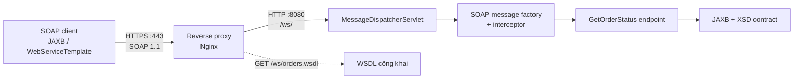
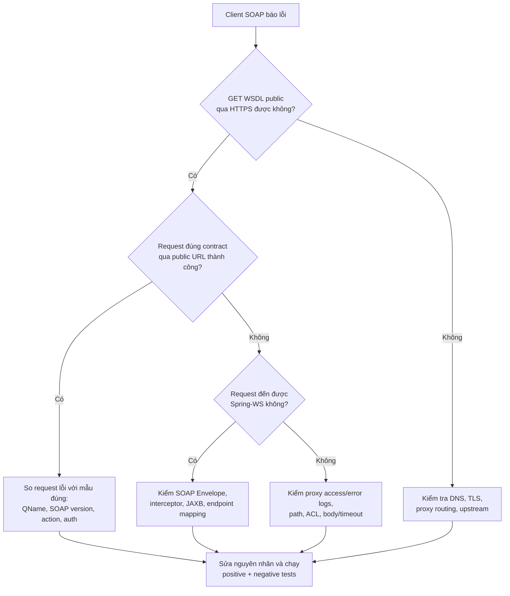

# Triển khai sau reverse proxy và chẩn đoán một lỗi kết nối hoặc hợp đồng

Trong dự án SOAP doanh nghiệp, việc endpoint trả đúng XML khi chạy trực tiếp trên máy lập trình mới là bước đầu. Sau khi đưa ứng dụng Spring Web Services (Spring-WS) ra sau Nginx, API Gateway hoặc load balancer, client phải đi qua DNS, TLS, reverse proxy, servlet, ánh xạ operation, JAXB và các interceptor. Chỉ một thay đổi ở đường dẫn, scheme, header hoặc namespace cũng có thể khiến client không gọi được dịch vụ, dù mã nghiệp vụ không đổi.

Bài thực hành này thuộc chương **Thực hành tổng hợp** của module **SPRING_WEB_SERVICES**: phát triển SOAP theo hướng *contract-first* bằng XSD/WSDL, JAXB, endpoint và SOAP client; đồng thời vận dụng SOAP Fault, interceptor, XML security, WS-Security, chứng chỉ và kiểm thử tương thích. Ta triển khai một dịch vụ tra cứu trạng thái đơn hàng qua reverse proxy, kiểm tra WSDL từ bên ngoài, rồi **tái hiện và chẩn đoán một lỗi hợp đồng do sai namespace của SOAP Body**. Phần cuối cung cấp quy trình phân biệt lỗi kết nối với lỗi hợp đồng trong môi trường thật.

> Các tên miền `soap.example.test`, `orders.xsd`, số hiệu đơn hàng và chứng chỉ trong bài là dữ liệu minh họa. Chỉ áp dụng lệnh, endpoint và chứng chỉ của môi trường đã được phép kiểm thử. Ví dụ ứng dụng dùng thế hệ Spring Boot/Spring-WS dựa trên Jakarta; khi làm trên dự án khác, đối chiếu dependency và API theo phiên bản thực tế.

## 1. Đề bài, kiến trúc và tiêu chí hoàn thành

**Bối cảnh:** Hệ thống nội bộ cung cấp operation `GetOrderStatus`. Client doanh nghiệp gửi SOAP 1.1 đến `https://soap.example.test/ws/`. Nginx nhận HTTPS và chuyển HTTP đến ứng dụng Spring-WS trên `127.0.0.1:8080`. WSDL phải công bố địa chỉ public HTTPS để client sinh mã từ WSDL có thể kết nối lại chính xác.



**Đường đi quan trọng:** client dùng DNS và TLS đến reverse proxy; proxy định tuyến request đến servlet; message factory đọc SOAP Envelope; interceptor kiểm tra những ràng buộc được cấu hình; Spring-WS tìm endpoint theo QName của phần tử gốc trong SOAP Body; JAXB ánh xạ payload sang Java object; endpoint xử lý và trả response. WSDL/XSD quyết định cấu trúc payload đúng.

**Tiêu chí chấp nhận:**

| Mã | Điều kiện đạt | Bằng chứng cần thu thập |
|---|---|---|
| AC-01 | Truy cập WSDL qua tên miền public và chứng chỉ hợp lệ | GET HTTPS trả WSDL; `soap:address` chỉ đến `https://soap.example.test/ws/` |
| AC-02 | SOAP 1.1 request đúng hợp đồng đi qua reverse proxy | HTTP response chứa SOAP Body với `GetOrderStatusResponse`; namespace đúng |
| AC-03 | Không làm thay đổi contract khi đưa vào proxy | XSD, operation, QName, WSDL binding và SOAPAction/action khớp baseline |
| AC-04 | Tái hiện được request sai namespace và xác định nguyên nhân | Request sai thất bại, log xác định QName được gửi, đối chiếu WSDL/XSD |
| AC-05 | Sửa request theo hợp đồng làm lỗi biến mất | Gọi lại thành công qua cùng URL, cùng proxy, cùng cấu hình runtime |
| AC-06 | Có phương án kiểm tra TLS, transport và SOAP Fault an toàn | Nhật ký/trace đã ẩn bí mật, kiểm thử âm và các giới hạn cấu hình |

## 2. Chuẩn bị môi trường và phân tách trách nhiệm

Mẫu triển khai yêu cầu một ứng dụng Java/Spring Boot có Spring-WS và JAXB, một Nginx làm reverse proxy, và một client có thể dùng `curl` hoặc `WebServiceTemplate`. Các thành phần nên được kiểm soát phiên bản đồng bộ:

- Spring Boot/Spring Framework/Spring-WS cùng một hệ phiên bản hỗ trợ; dùng starter Web Services của nền tảng đang chọn.
- JAXB API và runtime tương thích (các mã Java minh họa dùng `jakarta.xml.bind.annotation`).
- Hỗ trợ tạo WSDL 1.1 động bằng `DefaultWsdl11Definition` và dependency WSDL4J nếu bộ dependency của ứng dụng yêu cầu.
- Nginx có chứng chỉ TLS và khóa riêng; nếu đang học trên mạng nội bộ, dùng CA thử nghiệm đáng tin cậy với client.
- Cổng HTTP 8080 chỉ mở trên loopback/private network; chỉ reverse proxy được phép truy cập.
- Tên miền `soap.example.test` trỏ tới IP của proxy trong môi trường lab. Cấu hình host/DNS, đường đi mạng và truststore phù hợp trước khi kiểm thử.

**Phân biệt đúng vai trò:**

| Thành phần | Trách nhiệm | Kiểm tra thực tế |
|---|---|---|
| Nginx | TLS, hostname, proxy path, header, timeout, body size | Access/error log và request HTTP tới upstream |
| Spring servlet | Nhận request `/ws/*` và xuất WSDL | Mapping servlet, `orders.wsdl` |
| Spring-WS | Đọc Envelope, chọn operation, áp dụng interceptor/Fault resolver | QName trong SOAP Body, SOAP Fault, endpoint mapping |
| JAXB/XSD | Ánh xạ Java/XML theo hợp đồng | XML payload hợp lệ với schema |
| Client | URL, SOAP version, SOAPAction, chứng chỉ, timeout | Raw request/response và client exception |

Trong một ứng dụng thực tế, vị trí TLS termination có thể là load balancer phía trước Nginx, không trực tiếp tại Nginx như lab. Khi đó phải điều chỉnh đường đi và thiết lập forwarded headers theo **proxy đáng tin cậy gần ứng dụng nhất**; không sao chép máy móc giá trị header của ví dụ.

## 3. Định nghĩa hợp đồng XSD trước khi viết endpoint

Tạo nội dung minh họa ở `src/main/resources/orders.xsd` trong ứng dụng lab:

```xml
<?xml version="1.0" encoding="UTF-8"?>
<xs:schema xmlns:xs="http://www.w3.org/2001/XMLSchema"
           xmlns:tns="urn:example:orders:v1"
           targetNamespace="urn:example:orders:v1"
           elementFormDefault="qualified">

  <xs:element name="GetOrderStatusRequest">
    <xs:complexType>
      <xs:sequence>
        <xs:element name="orderId" type="xs:string"/>
      </xs:sequence>
    </xs:complexType>
  </xs:element>

  <xs:element name="GetOrderStatusResponse">
    <xs:complexType>
      <xs:sequence>
        <xs:element name="orderId" type="xs:string"/>
        <xs:element name="status" type="xs:string"/>
      </xs:sequence>
    </xs:complexType>
  </xs:element>
</xs:schema>
```

Hợp đồng quy định rõ ba điểm không được tùy tiện đổi: QName của request là `{urn:example:orders:v1}GetOrderStatusRequest`; QName của response là `{urn:example:orders:v1}GetOrderStatusResponse`; các phần tử con `orderId` và `status` thuộc cùng namespace theo `elementFormDefault="qualified"`.

Tên prefix XML như `ord` hay `m` chỉ là bí danh. Khi đối chiếu endpoint mapping và validate schema, cần so **namespace URI + local name (QName)**, không so prefix dưới dạng chuỗi.

Với dự án contract-first thực tế, lớp Java thường được sinh từ XSD bằng công cụ JAXB tương thích với phiên bản Java/Jakarta của dự án. Để người học nhìn rõ mối liên hệ giữa QName và class, phần tiếp theo biểu diễn các lớp tương ứng bằng mã viết tay. Không nên duy trì song song mã sinh tự động và mã thủ công trùng tên trong ứng dụng sản xuất.

## 4. Khai báo servlet, WSDL và endpoint Spring-WS

### 4.1. Cấu hình WSDL động

Ví dụ với Spring Boot và Spring-WS dựa trên Jakarta. Trong thư mục mã nguồn `src/main/java/example/soap/`, tạo lớp cấu hình sau:

```java
package example.soap;

import org.springframework.boot.web.servlet.ServletRegistrationBean;
import org.springframework.context.ApplicationContext;
import org.springframework.context.annotation.Bean;
import org.springframework.context.annotation.Configuration;
import org.springframework.core.io.ClassPathResource;
import org.springframework.ws.config.annotation.EnableWs;
import org.springframework.ws.transport.http.MessageDispatcherServlet;
import org.springframework.ws.wsdl.wsdl11.DefaultWsdl11Definition;
import org.springframework.xml.xsd.SimpleXsdSchema;
import org.springframework.xml.xsd.XsdSchema;

@EnableWs
@Configuration
public class WsConfig {

    @Bean
    public ServletRegistrationBean<MessageDispatcherServlet> messageDispatcherServlet(
            ApplicationContext context) {
        MessageDispatcherServlet servlet = new MessageDispatcherServlet();
        servlet.setApplicationContext(context);
        servlet.setTransformWsdlLocations(true);
        return new ServletRegistrationBean<>(servlet, "/ws/*");
    }

    @Bean
    public XsdSchema ordersSchema() {
        return new SimpleXsdSchema(new ClassPathResource("orders.xsd"));
    }

    @Bean(name = "orders")
    public DefaultWsdl11Definition ordersWsdl(XsdSchema ordersSchema) {
        DefaultWsdl11Definition definition = new DefaultWsdl11Definition();
        definition.setPortTypeName("OrdersPort");
        definition.setLocationUri("/ws/");
        definition.setTargetNamespace("urn:example:orders:v1");
        definition.setSchema(ordersSchema);
        return definition;
    }
}
```

Tên bean `orders` làm WSDL được cung cấp tại `/ws/orders.wsdl` khi servlet mapping và ứng dụng hoạt động như ví dụ. `DefaultWsdl11Definition` suy operation từ các phần tử XSD kết thúc bằng `Request`/`Response`. Trong hệ thống thật, kiểm tra WSDL xuất ra để bảo đảm tên operation, SOAP binding và action đúng theo hợp đồng đã phê duyệt. Nếu doanh nghiệp dùng WSDL cố định, ưu tiên công bố chính WSDL đó và không tự tạo binding khác khi triển khai.

Lời gọi `setTransformWsdlLocations(true)` cho phép Spring-WS điều chỉnh địa chỉ location trong WSDL theo request nhìn thấy từ servlet. Tuy vậy, **để location có scheme/host HTTPS public**, ứng dụng vẫn phải nhận và xử lý đúng forwarded headers từ reverse proxy tin cậy.

### 4.2. Lớp JAXB cho request và response

Đặt mỗi public class vào file Java cùng tên. Với request:

```java
package example.soap.contract;

import jakarta.xml.bind.annotation.XmlAccessType;
import jakarta.xml.bind.annotation.XmlAccessorType;
import jakarta.xml.bind.annotation.XmlElement;
import jakarta.xml.bind.annotation.XmlRootElement;

@XmlRootElement(
    name = "GetOrderStatusRequest",
    namespace = "urn:example:orders:v1")
@XmlAccessorType(XmlAccessType.FIELD)
public class GetOrderStatusRequest {

    @XmlElement(namespace = "urn:example:orders:v1", required = true)
    private String orderId;

    public GetOrderStatusRequest() {}

    public String getOrderId() {
        return orderId;
    }

    public void setOrderId(String orderId) {
        this.orderId = orderId;
    }
}
```

Với response:

```java
package example.soap.contract;

import jakarta.xml.bind.annotation.XmlAccessType;
import jakarta.xml.bind.annotation.XmlAccessorType;
import jakarta.xml.bind.annotation.XmlElement;
import jakarta.xml.bind.annotation.XmlRootElement;

@XmlRootElement(
    name = "GetOrderStatusResponse",
    namespace = "urn:example:orders:v1")
@XmlAccessorType(XmlAccessType.FIELD)
public class GetOrderStatusResponse {

    @XmlElement(namespace = "urn:example:orders:v1", required = true)
    private String orderId;

    @XmlElement(namespace = "urn:example:orders:v1", required = true)
    private String status;

    public GetOrderStatusResponse() {}

    public String getOrderId() { return orderId; }
    public void setOrderId(String orderId) { this.orderId = orderId; }

    public String getStatus() { return status; }
    public void setStatus(String status) { this.status = status; }
}
```

Các annotation xác định QName khớp với XSD. Với production, nên có bước schema validation độc lập để bắt lỗi thiếu trường bắt buộc, kiểu dữ liệu không hợp lệ và thay đổi ngầm của payload. Annotation JAXB không thay thế hoàn toàn việc validate toàn bộ XSD.

### 4.3. Endpoint trả trạng thái mẫu

```java
package example.soap;

import example.soap.contract.GetOrderStatusRequest;
import example.soap.contract.GetOrderStatusResponse;
import org.springframework.ws.server.endpoint.annotation.Endpoint;
import org.springframework.ws.server.endpoint.annotation.PayloadRoot;
import org.springframework.ws.server.endpoint.annotation.RequestPayload;
import org.springframework.ws.server.endpoint.annotation.ResponsePayload;

@Endpoint
public class OrdersEndpoint {
    private static final String NS = "urn:example:orders:v1";

    @PayloadRoot(namespace = NS, localPart = "GetOrderStatusRequest")
    @ResponsePayload
    public GetOrderStatusResponse getOrderStatus(
            @RequestPayload GetOrderStatusRequest request) {
        GetOrderStatusResponse response = new GetOrderStatusResponse();
        response.setOrderId(request.getOrderId());
        response.setStatus("PROCESSING");
        return response;
    }
}
```

Trong ví dụ này, `PROCESSING` là trạng thái cố định để kiểm thử đường vận chuyển. Khi tích hợp thật, endpoint sẽ gọi application service và xử lý lỗi nghiệp vụ; không nên truy cập cơ sở dữ liệu hoặc chèn logic xác thực trực tiếp vào lớp transport chỉ để khắc phục một lỗi reverse proxy.

Lớp khởi động ở cùng base package để Spring quét được cấu hình và endpoint:

```java
package example.soap;

import org.springframework.boot.SpringApplication;
import org.springframework.boot.autoconfigure.SpringBootApplication;

@SpringBootApplication
public class SoapApplication {
    public static void main(String[] args) {
        SpringApplication.run(SoapApplication.class, args);
    }
}
```

### 4.4. Cấu hình Spring Boot khi chạy sau proxy

Nội dung minh họa của `src/main/resources/application.yml`:

```yaml
server:
  port: 8080
  address: 127.0.0.1
  forward-headers-strategy: framework

logging:
  level:
    org.springframework.ws: INFO
```

Cấu hình `server.forward-headers-strategy: framework` là lựa chọn trong các phiên bản Spring Boot hỗ trợ thuộc tính này: nó cho phép framework diễn giải thông tin chuyển tiếp theo cơ chế được cung cấp. Với ứng dụng không dùng Spring Boot hoặc phiên bản khác, cần đối chiếu cách đăng ký `ForwardedHeaderFilter` hay cơ chế native tương ứng. Đừng đăng ký nhiều cơ chế xử lý cùng header một cách vô tình.

Quan trọng hơn thuộc tính cấu hình là **ranh giới tin cậy**: ứng dụng chỉ nên nhận request trực tiếp từ proxy mà tổ chức kiểm soát; proxy phải ghi đè hoặc loại bỏ các forwarded headers do client Internet tự khai. Nếu ứng dụng tin header giả mạo, WSDL URL, redirect hoặc dấu vết audit có thể bị sửa theo hostname do kẻ gọi tự gửi.

## 5. Triển khai Nginx: giữ nguyên đường dẫn và bảo toàn HTTPS công khai

Ví dụ Nginx làm TLS termination ở máy có chứng chỉ cho `soap.example.test`. Đường dẫn public và upstream đều dùng prefix `/ws` để tránh nhập nhằng khi chuyển đổi đường dẫn:

```nginx
server {
    listen 443 ssl;
    server_name soap.example.test;

    ssl_certificate     /etc/nginx/tls/soap.example.test.crt;
    ssl_certificate_key /etc/nginx/tls/soap.example.test.key;

    client_max_body_size 10m;

    location /ws {
        proxy_pass http://127.0.0.1:8080;

        proxy_http_version 1.1;
        proxy_set_header Host $host;
        proxy_set_header X-Forwarded-Host $host;
        proxy_set_header X-Forwarded-Proto $scheme;
        proxy_set_header X-Forwarded-Port $server_port;
        proxy_set_header X-Forwarded-For $remote_addr;
        proxy_set_header X-Request-ID $request_id;

        # Bỏ giá trị Forwarded từ nguồn chưa được tin cậy.
        proxy_set_header Forwarded "";

        proxy_connect_timeout 5s;
        proxy_send_timeout 30s;
        proxy_read_timeout 30s;
    }
}
```

Những điều cần hiểu trước khi áp dụng:

1. **Không có dấu `/` sau địa chỉ trong `proxy_pass http://127.0.0.1:8080`**: với cách cấu hình này, URI request được chuyển tiếp mà không bị Nginx thay thế phần path theo `location`. Vì vậy `GET /ws/orders.wsdl` tới upstream vẫn là `/ws/orders.wsdl`. Nếu thêm slash hoặc thay prefix, phải phân tích lại quy tắc URI của Nginx.
2. `Host`, `X-Forwarded-Host`, `X-Forwarded-Proto` và `X-Forwarded-Port` giúp ứng dụng dựng địa chỉ public chính xác. Ví dụ dùng `$scheme` vì Nginx ở đây trực tiếp nhận HTTPS; cấu hình sẽ khác nếu TLS đã được kết thúc ở load balancer phía trước.
3. Proxy nên đặt giới hạn upload/timeout theo loại payload thật. Với MTOM/attachment lớn, kiểm tra kích thước, buffering và thời gian truyền thay vì tăng giới hạn không có cơ sở.
4. `X-Forwarded-For` trong lab ghi IP của kết nối trực tiếp đến Nginx. Nếu có nhiều lớp proxy đáng tin cậy, cấu hình truy vết IP theo topology thực tế; không chấp nhận chuỗi IP do client tự khai làm nguồn xác thực.
5. `/ws` ở đây là prefix riêng của dịch vụ. Trong gateway nhiều ứng dụng, nên thiết kế location khớp chính xác và quy tắc access control để không vô tình proxy các URL ngoài phạm vi.
6. Nginx phải thực sự truy cập được `127.0.0.1:8080` trên cùng máy hoặc network namespace. Khi chạy Nginx/ứng dụng trong hai container, `127.0.0.1` của container Nginx **không** phải container Java; dùng tên service và mạng nội bộ thích hợp.

Sau khi chỉnh cấu hình, dùng quy trình kiểm tra và reload cấu hình Nginx theo môi trường triển khai, chẳng hạn `nginx -t` trước khi reload. Không cần khởi động lại toàn bộ nền tảng nếu hệ thống có cơ chế cập nhật cấu hình an toàn.

## 6. Kiểm tra bằng chứng từ ngoài vào trong

### 6.1. Kiểm tra WSDL từ public URL

Đầu tiên gọi trực tiếp từ máy client đi qua đúng DNS, TLS và reverse proxy:

```bash
curl -i --connect-timeout 5 --max-time 20 \
  https://soap.example.test/ws/orders.wsdl
```

Nếu certificate được cấp bởi CA lab riêng, thêm `--cacert /path/to/trusted-lab-ca.pem` trên máy client; không cần tắt xác minh TLS. Kết quả cần xem gồm HTTP status, Content-Type, XML WSDL và địa chỉ trong `soap:address location="..."`.

Một đoạn WSDL **được kỳ vọng** (chỉ lược trích) có dạng:

```xml
<wsdl:service name="OrdersPortService">
  <wsdl:port name="OrdersPortSoap11" binding="tns:OrdersPortSoap11">
    <soap:address location="https://soap.example.test/ws/"/>
  </wsdl:port>
</wsdl:service>
```

Tên service/port/binding thực tế do WSDL definition và framework quyết định; không dùng chuỗi minh họa này làm điều kiện kiểm thử cứng. Điều kiện cốt lõi là địa chỉ SOAP public trỏ về **scheme HTTPS, host và path mà client có thể truy cập**. Nếu xuất hiện `http://127.0.0.1:8080/ws/` hoặc hostname nội bộ, hãy kiểm tra forwarded headers, cấu hình xử lý header ở Spring Boot và `setTransformWsdlLocations(true)`.

Cũng cần xác minh WSDL import/XSD được công bố theo URL mà client truy cập được. Một WSDL mở được nhưng import schema trỏ tới địa chỉ riêng của mạng nội bộ vẫn có thể làm quá trình sinh client thất bại.

### 6.2. Gửi request SOAP 1.1 hợp đồng đúng

Lưu nội dung sau vào file cục bộ `request-ok.xml` của môi trường lab:

```xml
<?xml version="1.0" encoding="UTF-8"?>
<soapenv:Envelope
    xmlns:soapenv="http://schemas.xmlsoap.org/soap/envelope/"
    xmlns:ord="urn:example:orders:v1">
  <soapenv:Header/>
  <soapenv:Body>
    <ord:GetOrderStatusRequest>
      <ord:orderId>ORD-1001</ord:orderId>
    </ord:GetOrderStatusRequest>
  </soapenv:Body>
</soapenv:Envelope>
```

Gọi endpoint public qua reverse proxy:

```bash
curl -i --connect-timeout 5 --max-time 20 \
  -H 'Content-Type: text/xml; charset=utf-8' \
  -H 'SOAPAction: ""' \
  -H 'X-Request-ID: lab-orders-001' \
  --data-binary @request-ok.xml \
  https://soap.example.test/ws/
```

`SOAPAction: ""` dùng cho ví dụ tối giản này. Trên hệ thống thật, phải lấy action từ **WSDL binding và thỏa thuận với đối tác**, không mặc định mọi operation đều chấp nhận action rỗng. Với SOAP 1.2, Envelope và Content-Type khác (thường `application/soap+xml`); không chuyển version bằng cách sửa header đơn lẻ.

Response thành công được kỳ vọng chứa SOAP Body tương ứng, ví dụ:

```xml
<soapenv:Envelope
    xmlns:soapenv="http://schemas.xmlsoap.org/soap/envelope/"
    xmlns:ord="urn:example:orders:v1">
  <soapenv:Body>
    <ord:GetOrderStatusResponse>
      <ord:orderId>ORD-1001</ord:orderId>
      <ord:status>PROCESSING</ord:status>
    </ord:GetOrderStatusResponse>
  </soapenv:Body>
</soapenv:Envelope>
```

Đây là mẫu về mặt ngữ nghĩa; prefix, thứ tự namespace declaration và cách format XML có thể khác. Kiểm tra HTTP status, QName và nội dung XML theo XSD. Nếu endpoint có WS-Security bắt buộc, request test phải có header chữ ký/token phù hợp; một request XML thuần sẽ bị từ chối theo thiết kế.

### 6.3. Kiểm tra trực tiếp upstream để định vị proxy

Khi cần cô lập lỗi và có quyền truy cập máy chạy ứng dụng, thử từ chính host/container trong phạm vi nội bộ:

```bash
curl -i --connect-timeout 3 --max-time 10 \
  http://127.0.0.1:8080/ws/orders.wsdl
```

So sánh cùng tài nguyên qua hai đường:

| Kết quả public | Kết quả upstream | Gợi ý điều tra |
|---|---|---|
| Không kết nối/TLS thất bại | Upstream OK | DNS, firewall, certificate, TLS listener của proxy |
| HTTP 502/504 | Upstream OK khi gọi từ đúng máy proxy | Upstream address/port, network namespace, proxy timeout, ACL |
| HTTP 404 | Upstream 200 | Proxy URI rewrite, servlet prefix, route/gateway |
| HTTP 200 nhưng WSDL có URL nội bộ | Upstream có URL nội bộ | Forwarded headers và transform WSDL location |
| Cùng một lỗi SOAP | Cùng lỗi SOAP | Hợp đồng, JAXB, endpoint, interceptor hoặc nghiệp vụ |
| Public thành công nhưng client cụ thể thất bại | Upstream thành công | Request, SOAPAction, auth/cert, SOAP version hoặc policy phía client |

Gọi upstream HTTP từ nội bộ chỉ giúp phân vùng lỗi. **Không** chuyển client doanh nghiệp sang URL HTTP nội bộ để né TLS hoặc chính sách bảo mật.

## 7. Ca lỗi thực hành: WSDL mở được nhưng không tìm thấy operation

Đây là **lỗi hợp đồng** được chọn để chẩn đoán xuyên suốt bài. Triệu chứng giả định sau triển khai:

- `GET https://soap.example.test/ws/orders.wsdl` thành công, WSDL công bố HTTPS public.
- Request `request-ok.xml` ở mục 6 đi qua proxy và trả response bình thường.
- Một SOAP client cũ gửi request khác và bị lỗi. Tùy phiên bản Spring-WS, endpoint mapping và exception resolver, client có thể thấy HTTP lỗi, SOAP Fault hoặc lỗi từ phía thư viện client; **không coi một mã HTTP cố định là đặc trưng duy nhất**.

### 7.1. Tái hiện bằng request sai namespace

Tạo `request-bad.xml`. Toàn bộ body giữ nguyên trừ namespace URI đổi từ `v1` sang `v2`:

```xml
<?xml version="1.0" encoding="UTF-8"?>
<soapenv:Envelope
    xmlns:soapenv="http://schemas.xmlsoap.org/soap/envelope/"
    xmlns:ord="urn:example:orders:v2">
  <soapenv:Body>
    <ord:GetOrderStatusRequest>
      <ord:orderId>ORD-1001</ord:orderId>
    </ord:GetOrderStatusRequest>
  </soapenv:Body>
</soapenv:Envelope>
```

Dùng **cùng endpoint, cùng TLS, cùng proxy**, thay duy nhất payload:

```bash
curl -i --connect-timeout 5 --max-time 20 \
  -H 'Content-Type: text/xml; charset=utf-8' \
  -H 'SOAPAction: ""' \
  -H 'X-Request-ID: lab-orders-002' \
  --data-binary @request-bad.xml \
  https://soap.example.test/ws/
```

Đối chiếu hai QName:

| Nguồn | QName của phần tử đầu tiên trong SOAP Body |
|---|---|
| Hợp đồng XSD và `@PayloadRoot` | `{urn:example:orders:v1}GetOrderStatusRequest` |
| Request lỗi | `{urn:example:orders:v2}GetOrderStatusRequest` |

Hai QName này **khác nhau** dù local name cùng là `GetOrderStatusRequest`. Spring-WS ánh xạ `@PayloadRoot` theo namespace + localPart; endpoint đã khai báo `v1` không khớp request `v2`.

### 7.2. Thu thập bằng chứng và khoanh vùng

1. **Ghi lại tuyến truy cập:** public WSDL trả thành công; request đúng qua public cũng thành công. Điều này cho thấy DNS, TLS, proxy và servlet **có thể** chuyển request hợp lệ qua đường đang kiểm tra. Nó không loại trừ mọi lỗi transport trong mọi điều kiện tải.
2. **So sánh request thực tế:** ghi mã HTTP, Content-Type và SOAP Envelope/Body đã khử dữ liệu nhạy cảm. Đọc QName của phần tử đầu trong Body. Không chỉ nhìn vào tên Java method hoặc SOAPAction.
3. **Đối chiếu XSD/WSDL:** mở hợp đồng đã công bố; xác nhận `targetNamespace` là `urn:example:orders:v1` và WSDL binding đúng với version của request.
4. **Đối chiếu endpoint:** `@PayloadRoot(namespace=..., localPart=...)` có đúng `v1` hay không, lớp endpoint có được Spring quét vào application context không, và có interceptor nào chặn request trước mapping hay không.
5. **Quan sát log có kiểm soát:** nếu cần, tăng logging cho phần định tuyến Spring-WS trong môi trường test. Log có thể cho thấy không có endpoint mapping tương ứng QName; nội dung chính xác tùy phiên bản. Không bật ghi toàn bộ SOAP Body hoặc password/token/chữ ký trên production.
6. **Thử một thay đổi duy nhất:** thay namespace về `v1`, giữ nguyên public URL, SOAP version, header và certificate để xác định quan hệ nguyên nhân-kết quả.

Ví dụ một ghi chú điều tra **mang tính minh họa**, không phải log thật:

```text
Request ID: lab-orders-002
Public WSDL: 200 OK, address uses https://soap.example.test/ws/
TLS + proxy route: request reaches Spring-WS
Expected payload root: {urn:example:orders:v1}GetOrderStatusRequest
Observed payload root: {urn:example:orders:v2}GetOrderStatusRequest
Diagnosis: no matching @PayloadRoot mapping for observed QName
Action: restore client's QName to contract v1, regenerate client if needed
```

### 7.3. Sửa đúng nguyên nhân, không phá hợp đồng

Đổi namespace trong payload/client JAXB về `urn:example:orders:v1`. Nếu request sai bắt nguồn từ mã Java sinh tự động theo WSDL cũ hoặc nhầm môi trường, cập nhật **nguồn WSDL/XSD của client** rồi sinh lại class; rà soát namespace annotation và package binding. Không đổi `@PayloadRoot` sang `v2` chỉ để “hợp thức hóa” một client sai nếu hợp đồng chính thức vẫn là `v1`.

Nếu nghiệp vụ thật sự yêu cầu chuyển sang phiên bản contract `v2`, đó là thay đổi giao diện công khai: cần thiết kế versioning, xác nhận đối tác, WSDL/XSD mới và kiểm thử cả hai nhóm client theo chính sách chuyển đổi. Reverse proxy có thể định tuyến theo URL version nhưng không tự làm hai XML QName tương thích.

### 7.4. Xác minh sửa lỗi

Chạy lại cả hai test qua **public HTTPS URL**:

- Request hợp lệ `v1` trả SOAP response đúng và không có lỗi endpoint mapping.
- Request `v2` vẫn bị từ chối đúng theo hợp đồng trong môi trường test (negative test), chứng minh rằng hệ thống không âm thầm chấp nhận một payload ngoài contract.
- WSDL public tiếp tục trỏ đúng host/path; các endpoint khác và policy WS-Security không bị ảnh hưởng.
- Ghi kết quả cùng request ID, môi trường, phiên bản ứng dụng, phiên bản contract, thời điểm và người phê duyệt nếu quy trình triển khai yêu cầu.

**Kết luận của ca lỗi:** request đã vượt qua proxy nhưng không khớp QName mà Spring-WS dùng để chọn operation. Đây là lỗi **hợp đồng SOAP**, không phải lý do để sửa địa chỉ upstream hoặc bỏ qua TLS.

## 8. Sơ đồ chẩn đoán nhanh: lỗi kết nối hay lỗi hợp đồng?



Các dấu hiệu hay gặp khi kiểm tra:

| Quan sát | Cần kiểm tra trước | Không nên vội kết luận |
|---|---|---|
| `curl: (6) Could not resolve host` | DNS/hosts và tên miền public | Không phải SOAP Fault |
| TLS certificate verify failed | Chain CA, hostname/SNI, thời hạn, truststore | Không sửa bằng tắt kiểm tra TLS |
| HTTP 502 | Upstream IP/port, container network, backend process, proxy log | Chưa đủ chứng cứ lỗi XSD |
| HTTP 504 | Timeout hoặc upstream không phản hồi kịp; queue/network | Không phải mọi 504 đều do backend chết |
| HTTP 404 tại WSDL public | Nginx location, URI rewrite, servlet mapping | Không suy ra XSD sai |
| WSDL 200 nhưng `soap:address` là HTTP/nội bộ | Forwarded headers và `transformWsdlLocations` | Không cần đổi SOAP namespace |
| HTTP 415 | SOAP Content-Type/1.1-vs-1.2, gateway media filter | Có thể bị chặn trước endpoint |
| Không tìm thấy `@PayloadRoot` | QName request, endpoint scanning, namespace contract | Không sửa proxy nếu payload đến ứng dụng |
| HTTP 500 có SOAP Fault | Fault code/reason/detail, exception resolver, nghiệp vụ | Không đồng nhất với lỗi kết nối |
| HTTP 401/403 | Gateway auth, HTTP auth, WS-Security policy | Cần xác định lớp từ chối |
| HTTP 413 | Body size của proxy/servlet | Payload có thể hoàn toàn hợp lệ theo XSD |

Khi cần kiểm tra mạng, tách các lớp theo thứ tự **DNS → TCP → TLS → HTTP reverse proxy → servlet → SOAP Envelope → WS-Security → JAXB/XSD → endpoint**. Cách khoanh vùng này cho phép chọn công cụ phù hợp: DNS/certificate/network probe, Nginx log, ứng dụng trace hay schema validation.

## 9. Kiểm tra SOAP client Spring-WS từ phía tích hợp

Ngoài `curl`, nhiều hệ thống gọi SOAP qua `WebServiceTemplate` với JAXB:

```java
import org.springframework.oxm.jaxb.Jaxb2Marshaller;
import org.springframework.ws.client.core.WebServiceTemplate;
import org.springframework.ws.soap.saaj.SaajSoapMessageFactory;

// Ví dụ phác thảo cho các class JAXB ở mục 4:
Jaxb2Marshaller marshaller = new Jaxb2Marshaller();
marshaller.setClassesToBeBound(
        example.soap.contract.GetOrderStatusRequest.class,
        example.soap.contract.GetOrderStatusResponse.class);
marshaller.afterPropertiesSet();

SaajSoapMessageFactory factory = new SaajSoapMessageFactory();
factory.afterPropertiesSet();

WebServiceTemplate template = new WebServiceTemplate(factory);
template.setMarshaller(marshaller);
template.setUnmarshaller(marshaller);

var request = new example.soap.contract.GetOrderStatusRequest();
request.setOrderId("ORD-1001");

Object result = template.marshalSendAndReceive(
        "https://soap.example.test/ws/", request);
```

Đây là phần minh họa cơ chế kết nối JAXB → SOAP factory → client; muốn chạy thực tế phải cấu hình sender, TLS truststore/mTLS, timeout, SOAPAction và interceptors phù hợp. Thông thường cần cấu hình `SoapActionCallback` khi binding yêu cầu action khác rỗng; không suy diễn rằng ví dụ `curl` đủ cho mọi đối tác.

Để tránh nhầm nguyên nhân, hãy so sánh **raw XML mà `WebServiceTemplate` gửi** với request `curl` đã thành công, đặc biệt namespace trong SOAP Body và SOAP version. Có thể dùng mock của Spring-WS để kiểm cấu trúc request phía client, rồi dùng integration test qua proxy để xác nhận mạng thật; mock không kiểm chứng TLS, timeout hoặc Nginx routing.

## 10. TLS, chứng chỉ, WS-Security và XML security khi triển khai thật

Bài lab tập trung vào request/contract, nhưng một tích hợp doanh nghiệp không hoàn tất chỉ bằng HTTP 200:

- **HTTPS và mTLS:** phân biệt server certificate (client xác minh máy chủ) với client certificate (proxy/server xác minh client khi mTLS). Nếu TLS được kết thúc tại Nginx, quyết định rõ việc chuyển tiếp danh tính xác thực sang ứng dụng; không coi một header client tự gửi là bằng chứng mTLS.
- **Truststore:** client Java có thể dùng truststore khác với `curl` trên hệ điều hành. `curl` thành công chưa chứng minh JVM tin certificate chain của server; kiểm tra riêng Java truststore và SNI/hostname verification.
- **WS-Security:** chữ ký, timestamp, UsernameToken, mã hóa và policy chạy trong SOAP Header. Gateway chỉ chuyển tiếp HTTPS không tự kiểm chữ ký SOAP. Với `Wss4jSecurityInterceptor` hoặc cơ chế tương đương, thử cả request hợp lệ và request bị sửa chữ ký/hết hạn.
- **SOAP Fault:** cấu hình exception resolver để trả SOAP Fault đúng chuẩn cho lỗi nghiệp vụ/chính sách. Không trả stack trace, khóa, dữ liệu nhạy cảm trong `detail` cho bên gọi. Lỗi kết nối 502/504 từ proxy thường không có SOAP Envelope và phải được client phân biệt.
- **An toàn XML:** parser và interceptor phải áp dụng chính sách tránh xử lý external entities/DTD không tin cậy, giới hạn kích thước message, độ sâu XML và tài nguyên giải mã. Đừng mở vô hạn body size để làm MTOM chạy được.
- **Quan sát:** gắn request ID xuyên proxy và application bằng cơ chế tin cậy; chỉ log metadata cần thiết như thời gian, operation, status và fault category. Ẩn token, password, nội dung chứng từ/đơn hàng và dữ liệu cá nhân.

Nếu phải xác định lỗi chỉ xảy ra với mTLS, hãy kiểm tra từng chặng: client↔proxy, proxy↔upstream, và chứng cứ xác thực mà ứng dụng nhận được. Có thể triển khai HTTPS ở cả hai chặng nếu chính sách nội bộ yêu cầu; trường hợp đó cần hai tập chứng chỉ và trust riêng.

## 11. Kiểm thử tương thích và khả năng vận hành trước khi nghiệm thu

Mở rộng bài lab thành bộ thử nghiệm hồi quy có cấu trúc:

| Case | Đầu vào hoặc thao tác | Kết quả mong đợi |
|---|---|---|
| WSDL-public | GET `/ws/orders.wsdl` qua HTTPS | WSDL đọc được, external `soap:address` chính xác |
| SOAP-valid | `GetOrderStatusRequest` namespace v1 | Response đúng `GetOrderStatusResponse` và schema |
| SOAP-invalid-ns | Giữ request nhưng đổi namespace v2 | Request bị từ chối/không ánh xạ; không có side effect |
| SOAP-invalid-version | Gửi SOAP 1.2 vào endpoint chỉ hỗ trợ 1.1 | Bị từ chối phù hợp, có log phân loại rõ |
| SOAP-fault | Gửi operation có lỗi nghiệp vụ được định nghĩa | SOAP Fault hợp lệ, không lộ chi tiết nội bộ |
| TLS-invalid | Certificate không tin cậy hoặc sai hostname | Client từ chối handshake; không bỏ qua verification |
| Auth-invalid | Thiếu token/chữ ký hoặc client cert (nếu dùng) | Bị từ chối đúng policy |
| Proxy-bad-route | Sai external path trong môi trường test | Phân biệt được 404 tại proxy và tại servlet |
| Proxy-backend-down | Dừng upstream trong môi trường test | Proxy báo lỗi theo cấu hình; cảnh báo hoạt động |
| Timeout | Mô phỏng upstream chậm | Timeout có giới hạn; client xử lý rõ ràng |
| MTOM/large XML | File/XML đạt ngưỡng thực tế (nếu dùng) | Không lỗi size/buffering, checksum và tài nguyên đạt |
| Concurrency | Nhiều request hợp lệ đồng thời | Không rò rỉ connection/thread, đạt ngưỡng hiệu năng |

Với SOAP contract-first, chạy XML schema validation của cả request và response, kiểm tra QName bằng parser XML thay vì so khớp byte, và lưu WSDL/XSD phiên bản kiểm thử. Nếu proxy có cơ chế rewrite URL hoặc auth, hãy chạy ít nhất một bài kiểm thử từ ngoài mạng ứng dụng trên đường đi giống production.

Khi vận hành, đo tách biệt lỗi **proxy**, **TLS**, **SOAP Fault nghiệp vụ**, **validation** và **endpoint mapping**. Nếu gộp mọi HTTP 500 thành “backend lỗi”, nhóm vận hành sẽ bỏ lỡ trường hợp hệ thống đã cố ý trả SOAP Fault theo hợp đồng.

## 12. Biên bản chẩn đoán mẫu

Sau khi thực hiện bài, có thể ghi biên bản ngắn dưới dạng sau (dữ liệu minh họa):

| Thuộc tính | Giá trị |
|---|---|
| Dịch vụ | `SPRING_WEB_SERVICES` / `GetOrderStatus` |
| Public URL | `https://soap.example.test/ws/` |
| Contract | `orders.xsd` — namespace `urn:example:orders:v1` |
| Phạm vi lỗi | Một SOAP client gửi namespace `v2` |
| Kết quả WSDL | Truy cập public thành công, location HTTPS |
| Kết quả request đúng | Thành công qua cùng proxy |
| Kết quả request lỗi | Không ánh xạ tới endpoint `@PayloadRoot` v1 |
| Nguyên nhân | QName SOAP Body sai contract, không phải DNS/TLS/proxy |
| Biện pháp | Sửa/sinh lại client từ XSD/WSDL v1 đã phê duyệt |
| Kiểm thử xác nhận | Positive v1 PASS, negative v2 bị từ chối, WSDL-public PASS |
| Bài học | Luôn so sánh raw SOAP XML với QName trong hợp đồng trước khi đổi hạ tầng |

Biên bản thật cần bổ sung version, commit/deployment ID, request ID đã ẩn dữ liệu nhạy cảm, thời điểm và liên kết tới artifact kiểm thử. Không đưa mật khẩu, private key hoặc toàn bộ SOAP payload nhạy cảm vào báo cáo.

## 13. Bài tự luyện

1. **Sai scheme trong WSDL:** Giả lập trường hợp `soap:address` xuất ra `http://127.0.0.1:8080/ws/` dù client truy cập qua HTTPS. Xác định ba vị trí cần kiểm tra trước khi sửa mã endpoint.
2. **Sai đường dẫn khi rewrite:** Đổi cấu hình `proxy_pass` trong môi trường test để upstream nhận nhầm `/` thay vì `/ws/`. Quan sát khác biệt của `GET WSDL` và `POST SOAP`; sửa theo quy tắc URI thật của Nginx.
3. **Sai QName:** Giữ nguyên local name `GetOrderStatusRequest` và đổi namespace URI của request. Xác định tại sao thay prefix `ord` thành `x` không gây cùng loại lỗi nếu URI không đổi.
4. **Sự cố chứng chỉ:** Cho một client Java dùng truststore thiếu CA thử nghiệm. So sánh lỗi handshake với lỗi `@PayloadRoot`; giải thích vì sao request chưa tới Spring endpoint.
5. **Fault và transport:** Tạo một lỗi nghiệp vụ có SOAP Fault rồi dừng upstream để tạo lỗi gateway trong môi trường test. Thiết kế cách client xử lý hai trường hợp khác nhau.

**Gợi ý câu trả lời trọng tâm:** WSDL location liên quan đến proxy headers, cách Spring nhìn request và WSDL transform; lỗi QName phải xác định từ namespace URI và local name; lỗi TLS xảy ra trước khi Spring-WS phân tích SOAP Body.

## 14. Checklist bàn giao

- [ ] WSDL/XSD chính thức được cố định, có version và endpoint URL công khai đúng.
- [ ] Spring-WS servlet, factory, JAXB và endpoint xử lý request theo QName của XSD.
- [ ] Reverse proxy giữ hoặc rewrite URI có chủ đích, xử lý forwarded headers theo ranh giới tin cậy.
- [ ] Client gọi được HTTPS với xác minh chứng chỉ bình thường; mTLS/WS-Security được thử nếu hợp đồng yêu cầu.
- [ ] Có bằng chứng request đúng thành công và request sai namespace bị từ chối qua cùng đường mạng.
- [ ] Đã phân loại được DNS/TLS/HTTP proxy errors và SOAP Fault/endpoint mapping errors.
- [ ] Timeout, body size, logging, request ID và bảo vệ XML phù hợp với đặc điểm tích hợp.
- [ ] Có kết quả regression/contract test, tiêu chí giám sát và phương án quay lui cấu hình proxy/deployment.

Hoàn thành bài thực hành nghĩa là có thể **triển khai SOAP contract-first sau reverse proxy, kiểm chứng bằng request thực từ phía client, nhận diện đúng lớp phát sinh sự cố và sửa nguyên nhân dựa trên bằng chứng**. Đây là nền tảng để duy trì tương thích XSD/WSDL, JAXB, SOAP Fault, WS-Security và chứng chỉ khi tích hợp Spring Web Services trong hệ thống doanh nghiệp.
