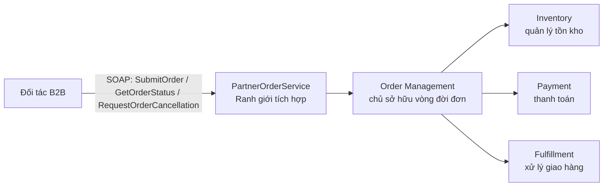
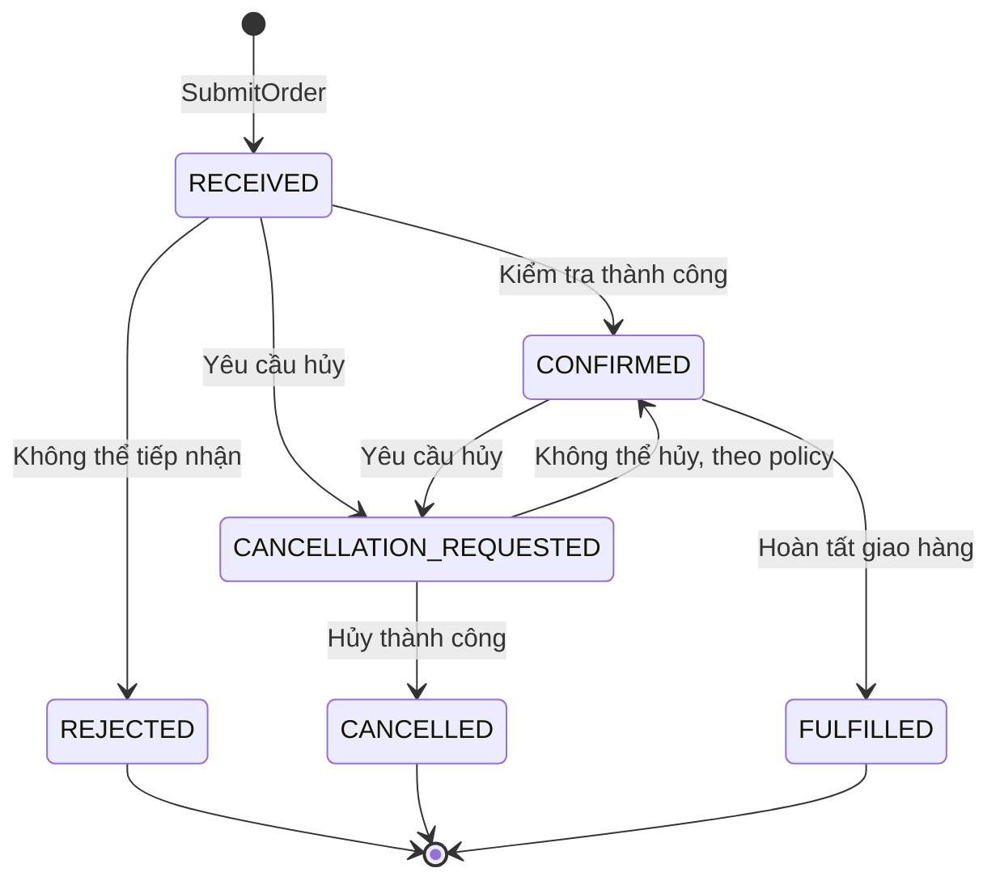

# Xác định các thao tác nghiệp vụ và ranh giới dịch vụ

## 1. Vì sao phải xác định ranh giới trước khi viết XSD/WSDL?

Trong tích hợp doanh nghiệp bằng SOAP, một câu hỏi dễ xuất hiện là: *“Hệ thống cần bao nhiêu operation trong WSDL?”* Nếu trả lời bằng cách liệt kê method Java, bảng dữ liệu hoặc API nội bộ, nhóm phát triển có thể tạo ra hợp đồng khó hiểu và buộc đối tác phụ thuộc vào chi tiết triển khai.

Ví dụ, một đối tác muốn đặt hàng vào hệ thống ERP. Để hoàn thành yêu cầu, hệ thống nội bộ có thể phải xác minh khách hàng, kiểm tra tồn kho, lưu đơn hàng, gửi yêu cầu thanh toán và chuyển thông tin cho kho. Nếu công bố lần lượt `checkCustomer`, `reserveInventory`, `insertOrder`, `updateStatus` và `createShipment` cho đối tác, đối tác phải tự phối hợp các bước và xử lý trường hợp một bước thất bại. Mọi thay đổi quy trình nội bộ đều có nguy cơ phá vỡ tích hợp.

Thiết kế hợp đồng tốt thường bắt đầu từ **ý định và kết quả nghiệp vụ mà bên tiêu thụ cần**, sau đó mới xác định **ranh giới trách nhiệm**, **thao tác công khai**, **dữ liệu XML**, **lỗi** và **cách triển khai**.

Trong module **SPRING_WEB_SERVICES**, cách tiếp cận này là nền tảng của **contract-first**: thiết kế XSD/WSDL từ nhu cầu tương tác giữa các hệ thống, rồi dùng Spring Web Services để xây dựng SOAP endpoint, SOAP client và ánh xạ JAXB. Các yếu tố SOAP Fault, interceptor, WS-Security, chứng chỉ và kiểm thử liên thông phải được tính tới từ khi xác định hợp đồng, vì chúng ảnh hưởng trực tiếp đến lời hứa của dịch vụ với đối tác.

**Sau bài học, người học có thể:**

- Xác định năng lực nghiệp vụ mà một SOAP service cung cấp, cùng dữ liệu và hệ thống mà nó chịu trách nhiệm.
- Chuyển một quy trình nghiệp vụ thành tập operation phù hợp cho WSDL, phân biệt command và query.
- Đặc tả tiền điều kiện, hậu điều kiện, trạng thái kết quả, lỗi, tính idempotent và yêu cầu nhất quán của từng operation.
- Ánh xạ mô hình operation sang XSD/WSDL và Spring-WS mà không lộ mô hình cơ sở dữ liệu hoặc method nội bộ.
- Đánh giá các lựa chọn ranh giới qua ví dụ và bộ tiêu chí kiểm thử hợp đồng.

## 2. Phân biệt năng lực nghiệp vụ, service boundary và SOAP operation

Ba lớp khái niệm sau liên hệ với nhau nhưng không đồng nghĩa:

| Khái niệm | Câu hỏi chính | Ví dụ |
|---|---|---|
| **Năng lực nghiệp vụ (business capability)** | Hệ thống đảm nhiệm kết quả kinh doanh nào? | Tiếp nhận và theo dõi đơn hàng từ đối tác. |
| **Ranh giới dịch vụ (service boundary)** | Phần nào thuộc trách nhiệm, quyền quyết định và dữ liệu của dịch vụ này? | Dịch vụ Đơn hàng quản lý vòng đời đơn; phối hợp nội bộ với kho và thanh toán. |
| **Operation công khai** | Bên ngoài được phép yêu cầu hoặc tra cứu hành vi nào? | `SubmitOrder`, `GetOrderStatus`, `RequestOrderCancellation`. |

**Ranh giới dịch vụ** có thể được hiểu là phạm vi một dịch vụ hứa cung cấp kết quả và chịu trách nhiệm khi kết quả đó thay đổi hoặc thất bại. Ranh giới tốt giúp consumer sử dụng một “ngôn ngữ nghiệp vụ” ổn định ngay cả khi các ứng dụng hoặc bảng dữ liệu phía sau được thay thế.

**SOAP operation** là một thao tác được công bố trong WSDL; nó có tên, thông điệp đầu vào/đầu ra, binding và có thể có thông điệp fault. Một dịch vụ có thể công bố nhiều operation liên quan cùng năng lực; *không cần tạo một service/microservice cho mỗi operation*.

Trong WSDL 1.1, `portType` nhóm các operation ở mức giao diện logic; `binding` mô tả cách truyền/biểu diễn các operation đó bằng SOAP và giao thức vận chuyển; `service/port` công bố địa chỉ cụ thể. XSD mô tả cấu trúc, kiểu và namespace của XML payload. Những thành phần này mô tả **hợp đồng tích hợp**, không tự quyết định kiến trúc triển khai nội bộ.

## 3. Bài toán xuyên suốt: đối tác đặt hàng vào ERP

Giả sử công ty có:

- **Đối tác B2B:** gửi yêu cầu đặt hàng, lấy trạng thái và đề nghị hủy đơn.
- **Order Management:** sở hữu đơn hàng và trạng thái vòng đời.
- **Inventory:** sở hữu thông tin tồn kho và khả năng giữ hàng.
- **Payment:** xử lý xác nhận/thanh toán theo chính sách.
- **Fulfillment:** điều phối đóng gói, giao hàng.

Đối tác chỉ quan tâm: “Tôi đã gửi được yêu cầu chưa?”, “Đơn đang ở trạng thái nào?”, “Tôi có thể yêu cầu hủy không?”. Đối tác không nên phải biết cơ sở dữ liệu nào đang lưu đơn, hệ thống kho có bao nhiêu bảng hay khi nào Order Management chuyển từ xử lý đồng bộ sang hàng đợi.

### 3.1. Ranh giới nên hướng về kết quả nghiệp vụ



Trên hình, `PartnerOrderService` là **hợp đồng công khai**; bên trong có thể là một adapter Spring-WS, một ứng dụng orchestration hoặc lớp façade trước các hệ thống cũ. Sơ đồ không khẳng định mỗi ô phải là một microservice riêng.

Một thiết kế khác để đối tác tự gọi tuần tự `ValidateCustomer` → `ReserveStock` → `AuthorizePayment` → `CreateOrder` sẽ khiến đối tác chịu rủi ro trung gian: giữ hàng thành công nhưng tạo đơn thất bại, hoặc tạo đơn xong nhưng response mất kết nối. Những rủi ro này nên được xử lý tại **ranh giới sở hữu quy trình**, bằng transaction nội bộ khi khả thi hoặc bằng workflow/compensation khi quy trình trải qua nhiều hệ thống.

### 3.2. Ranh giới phải chỉ ra hệ thống có quyền quyết định

Một adapter SOAP không tự nhiên trở thành chủ sở hữu mọi dữ liệu mà nó chuyển tiếp. Ví dụ:

| Dữ liệu/quyết định | Nguồn có thẩm quyền | Lời hứa của hợp đồng đối tác |
|---|---|---|
| Mã đơn và trạng thái đơn | Order Management | Cung cấp `orderId` và trạng thái ổn định theo quy tắc đã công bố. |
| Số lượng tồn kho khả dụng | Inventory | Dịch vụ Đơn hàng xác nhận đơn theo chính sách; không tự công bố tồn kho nội bộ nếu không phải năng lực của nó. |
| Trạng thái thanh toán | Payment | Nếu cần công bố, phải xác định rõ ý nghĩa nghiệp vụ của trạng thái và nguồn xác nhận. |
| Quyền truy cập đơn theo đối tác | Chính sách truy cập của tổ chức và chủ dữ liệu | Không cho đọc/hủy đơn thuộc đối tác khác. |
| Mã yêu cầu gửi lại (`clientRequestId`) | PartnerOrderService hoặc lớp xử lý idempotency được ủy quyền | Một yêu cầu được nhận diện ổn định khi client retry. |

Nếu một operation kết hợp dữ liệu từ nhiều hệ thống, cần ghi rõ **ai chịu trách nhiệm điều phối**, thời điểm dữ liệu được đọc và tính nhất quán được đảm bảo tới đâu. Đừng gọi dữ liệu “thời gian thực” khi kết quả có thể trễ do replication hoặc hàng đợi.

## 4. Cách phát hiện các thao tác nghiệp vụ

Không bắt đầu từ danh sách method trong code. Hãy đi từ yêu cầu của consumer:

1. **Xác định actor và mục tiêu.** Ai gọi dịch vụ? Đối tác muốn đạt kết quả nào?
2. **Liệt kê sự kiện và tình huống nghiệp vụ.** Gửi đơn mới, xem tiến độ, đề nghị hủy, nhận kết quả từ chối, gửi lại khi timeout.
3. **Xác định lệnh thay đổi trạng thái và truy vấn chỉ đọc.** Những yêu cầu nào có side effect? Những yêu cầu nào chỉ trả thông tin?
4. **Chọn ranh giới trách nhiệm.** Hệ thống nào có quyền quyết định kết quả và duy trì bất biến nghiệp vụ?
5. **Gộp các bước kỹ thuật thành hành động nghiệp vụ.** Chẳng hạn `SubmitOrder` có thể bao gồm validate, lưu yêu cầu và khởi phát workflow nội bộ.
6. **Xác định ngữ nghĩa thành công/thất bại trước khi thiết kế field.** Thành công nghĩa là đã nhận yêu cầu, đã xác nhận hàng hay đã giao xong?
7. **Kiểm tra với người sử dụng hợp đồng.** Yêu cầu có diễn đạt đủ rõ để đội công nghệ khác viết client mà không hỏi chi tiết nội bộ không?

### 4.1. Từ user story đến operation

| Nhu cầu của đối tác | Operation phù hợp | Vì sao |
|---|---|---|
| “Tôi muốn gửi đơn và nhận mã theo dõi.” | `SubmitOrder` | Một yêu cầu nghiệp vụ, che bớt các bước nội bộ. |
| “Tôi muốn biết kết quả xử lý đơn đã gửi.” | `GetOrderStatus` | Truy vấn rõ mục đích, có thể gọi lại nhiều lần. |
| “Tôi muốn đề nghị hủy đơn chưa giao.” | `RequestOrderCancellation` | Phản ánh ý định hủy; phản hồi phải phân biệt *đã nhận đề nghị* và *đã hủy thành công*. |
| “Tôi muốn sửa trực tiếp cột `status` của đơn.” | Không nên công bố `UpdateOrderStatus` cho đối tác | Trạng thái thuộc bất biến nghiệp vụ của Order Management, không phải thuộc tính tự do để ghi. |
| “Tôi muốn xóa mọi bản ghi đơn hàng cũ.” | Không tự động công bố `DeleteOrder` | Yêu cầu phải qua chính sách lưu trữ/tuân thủ; xóa DB không phải thao tác tích hợp tương đương hủy đơn. |

Tên operation nên là **động từ nghiệp vụ + đối tượng**: `SubmitOrder`, `ConfirmShipment`, `GetInvoiceStatus`. Một tên như `ExecuteProcess` hoặc `UpdateRecord` không cho client biết điều gì thực sự được cam kết.

### 4.2. Operation theo command và query

**Command** yêu cầu hệ thống thực hiện thay đổi hoặc bắt đầu một quy trình có thể thay đổi trạng thái. `SubmitOrder` và `RequestOrderCancellation` là command.

**Query** đọc dữ liệu mà không cố ý thay đổi nghiệp vụ. `GetOrderStatus` là query. Việc truy vấn vẫn có thể phát sinh log/metric/cache nội bộ, nhưng không nên làm đổi trạng thái đơn hàng.

Phân biệt này giúp xác định chính sách retry, authorization, timeout và idempotency:

- Query thường có thể gọi lại sau lỗi truyền tải, nhưng vẫn phải giới hạn tải và phân quyền.
- Command phải có quy tắc nhận diện yêu cầu lặp lại, vì client có thể không biết server đã thực thi hay chưa sau khi timeout.
- Một command trả về trạng thái `RECEIVED` không đồng nghĩa toàn bộ quy trình hoàn thành đồng bộ.

Không nên hiểu command/query như một yêu cầu phải triển khai CQRS bằng hai hệ thống hoặc hai database khác nhau. Đây trước hết là cách phân loại **ngữ nghĩa hợp đồng**.

## 5. Thiết lập danh mục operation trước khi viết schema

Với `PartnerOrderService`, ta có thể chốt ba operation:

| Operation | Loại | Input nghiệp vụ chính | Output cam kết | Side effect | Idempotency/retry |
|---|---|---|---|---|---|
| `SubmitOrder` | Command | Mã yêu cầu duy nhất của đối tác, tham chiếu đơn, danh sách dòng hàng | Mã đơn và trạng thái tiếp nhận | Tạo hoặc tiếp nhận đơn; bắt đầu xử lý | Bắt buộc định nghĩa idempotency theo đối tác + mã yêu cầu. |
| `GetOrderStatus` | Query | Mã đơn | Trạng thái hiện tại và thời điểm cập nhật | Không có thay đổi nghiệp vụ có chủ đích | Có thể retry có kiểm soát. |
| `RequestOrderCancellation` | Command | Mã đơn, mã yêu cầu hủy, lý do tùy chọn | Trạng thái yêu cầu hủy | Khởi phát/ghi nhận quy trình hủy | Bắt buộc định nghĩa hành vi cho request trùng. |

Đây là **danh mục hợp đồng sơ bộ**. Để chuyển thành XSD/WSDL đủ dùng, nhóm thiết kế cần viết ngữ nghĩa cụ thể cho từng operation, bao gồm tiền điều kiện, hậu điều kiện và lỗi.

### 5.1. Mẫu mô tả một operation

Mỗi operation nên có bản mô tả tối thiểu:

| Trường | Câu hỏi cần trả lời |
|---|---|
| Business intent | Người gọi muốn đạt kết quả gì? |
| Actor và quyền | Ai được phép gọi và trên phạm vi dữ liệu nào? |
| Input và bất biến | Dữ liệu nào là bắt buộc; điều kiện nào phải đúng? |
| Kết quả thành công | Response xác nhận điều gì, tại thời điểm nào? |
| Side effect | Có tạo/sửa trạng thái hoặc gọi hệ thống khác không? |
| Idempotency | Gửi lại cùng yêu cầu thì kết quả ra sao? |
| Business outcome vs Fault | Điều kiện nào được trả như trạng thái và điều kiện nào là lỗi giao thức/nghiệp vụ? |
| Consistency và thời gian xử lý | Trạng thái được đọc từ đâu, có thể trễ không? Có phản hồi ngay hay ghi nhận tác vụ? |
| Version và giới hạn | Quy tắc tương thích, kích thước request, rate/timeout, SOAP version, security policy. |

Các câu hỏi này được giải quyết trước sẽ làm cho schema rõ nghĩa hơn nhiều so với việc tạo ngay `String status`, `String error` và `boolean success` mà chưa có quy tắc.

## 6. Chốt ngữ nghĩa của ba operation

### 6.1. `SubmitOrder` — “nhận đơn” khác “hoàn tất đơn”

**Ý định:** đối tác gửi một đơn mới và nhận mã để tra cứu.

**Input:** `clientRequestId`, `externalOrderRef` và ít nhất một dòng hàng gồm SKU và số lượng dương.

**Tiền điều kiện:** đối tác đã được xác thực/ủy quyền; payload đúng XSD; SKU và số lượng được xử lý theo quy tắc nghiệp vụ. Không sử dụng ID đối tác tự khai trong body làm bằng chứng duy nhất về danh tính.

**Hậu điều kiện khi thành công:** hệ thống đã ghi nhận yêu cầu đủ bền vững theo cam kết tích hợp và trả `orderId` cùng trạng thái `RECEIVED`. Điều này **chưa hứa** tồn kho đã được giữ, thanh toán đã thành công hoặc hàng đã giao. Các bước sau có thể dẫn tới `CONFIRMED` hoặc `REJECTED`.

**Quy tắc gửi lại:** khóa idempotency là cặp **danh tính đối tác đã xác thực + `clientRequestId`**. Khi nhận cùng khóa và cùng nội dung nghiệp vụ, service trả lại biên nhận của yêu cầu ban đầu; khi cùng khóa nhưng nội dung khác, trả lỗi hợp đồng ổn định như `REQUEST_ID_CONFLICT`. Hệ thống phải lưu đủ thông tin và giải quyết tranh chấp đồng thời để quy tắc này có hiệu lực.

**Lưu ý:** nếu lỗi xảy ra trước khi ghi nhận bền vững, có thể không có `orderId`. Nếu server đã ghi nhận nhưng response thất lạc, client retry phải có cách nhận lại cùng `orderId`, tránh tạo đơn kép.

### 6.2. `GetOrderStatus` — truy vấn trạng thái có quyền và độ trễ

**Ý định:** xem trạng thái của đơn đã gửi bằng `orderId`.

**Kết quả:** `orderId`, `state` và `updatedAt` để đối tác phân biệt trạng thái mới/cũ. Một hệ thống dùng read model hoặc cache cần nêu rõ dữ liệu có thể trễ; timestamp không tự chứng minh “mới nhất trên toàn hệ thống”.

**Phân quyền:** chỉ đối tác sở hữu đơn hoặc actor được cấp quyền mới được đọc. Service cần quyết định liệu trường hợp không có quyền nên trả “không tìm thấy” để tránh lộ sự tồn tại của đơn hay trả lỗi truy cập; chính sách phải được áp dụng nhất quán.

**Retry:** có thể gọi lại sau timeout nhưng nên có backoff và giới hạn polling. Nếu nhiều client liên tục hỏi mỗi vài mili-giây, cần cân nhắc công bố cơ chế callback/event ở hợp đồng khác thay vì làm quá tải ERP.

### 6.3. `RequestOrderCancellation` — một yêu cầu có thể xử lý bất đồng bộ

**Ý định:** đề nghị hủy đơn, không trực tiếp sửa cột `status`.

**Input:** `orderId`, `clientRequestId` riêng cho yêu cầu hủy và `reason` tùy chọn.

**Kết quả:** có thể là `CANCELLATION_REQUESTED` nếu yêu cầu đã được ghi nhận để xử lý tiếp; hoặc `CANCELLED` nếu thực sự đã hủy xong trước khi trả lời. Trường hợp đơn đã giao và không được hủy phải tuân theo chính sách rõ ràng, ví dụ Fault nghiệp vụ `ORDER_NOT_CANCELLABLE`.

**Tính lặp lại:** gửi lại cùng mã yêu cầu hủy không nên tạo nhiều tác vụ hủy. Việc hủy khi đơn đã ở `CANCELLED` cũng cần quy tắc ổn định được thống nhất với client.

Ví dụ sơ đồ trạng thái giản lược:



Đây chỉ là mô hình để thảo luận. Khi thiết kế thực tế, cần quyết định có cho hủy đơn ở `RECEIVED`, có trạng thái chờ/hoàn tiền, có retry sau khi hủy thất bại và có cho chuyển từ `CONFIRMED` sang `FULFILLED` khi đang chờ hủy hay không. Nếu việc hủy cuối cùng thất bại, client phải có cách quan sát kết quả đó; một response `CANCELLATION_REQUESTED` không phải xác nhận hủy thành công.

## 7. Chọn mức độ chi tiết của operation: quá nhỏ hay quá lớn đều có vấn đề

### 7.1. Tránh “chatty interface”

Một dịch vụ quá nhiều thao tác kỹ thuật bắt đối tác thực hiện chuỗi gọi dài:

```text
ValidateCustomer → CheckStock → ReserveStock → CreateOrder
→ AuthorizePayment → UpdateOrderStatus → SendConfirmation
```

Những vấn đề phát sinh:

- Mỗi bước tăng số lần đi qua mạng, điểm lỗi và phụ thuộc thứ tự.
- Consumer phải biết cách rollback/compensate nếu một bước thành công, bước sau thất bại.
- Đổi luồng nội bộ buộc cập nhật nhiều client.
- Thao tác như `UpdateOrderStatus` có thể phá vỡ bất biến trạng thái mà Order Management cần giữ.

Nếu những bước đó thuộc một năng lực “tiếp nhận đơn”, nên cân nhắc công bố một command `SubmitOrder` và để bên sở hữu năng lực thực hiện phối hợp nội bộ.

### 7.2. Tránh “God operation”

Ngược lại, operation `ProcessAnything` nhận một XML khổng lồ có `actionCode` và hàng chục field tùy chọn cũng không thể hiện rõ hợp đồng. Nó làm validation, phân quyền, quản lý phiên bản và kiểm thử trở nên khó khăn.

Operation nên được tách khi:

- **Ý định nghiệp vụ khác hẳn:** gửi đơn, tra cứu đơn và đề nghị hủy có semantics và quyền khác nhau.
- **Bất biến và phạm vi dữ liệu khác:** thao tác thanh toán có thể thuộc một domain với policy riêng.
- **Nhịp phát triển/consumer khác nhau:** một hợp đồng “đối tác bán hàng” và một hợp đồng “nhà vận chuyển” có thể có nhu cầu độc lập.
- **Mô hình nhất quán và rủi ro khác:** tra cứu có thể chịu độ trễ, còn cấp quyền chi tiền cần ràng buộc chặt chẽ.

Không nên tách chỉ vì số method vượt một ngưỡng tùy ý. Dùng độ kết dính của nghiệp vụ, chủ sở hữu dữ liệu và trách nhiệm vận hành để đưa ra quyết định.

### 7.3. Khi nào cần một service boundary khác?

Đặt câu hỏi:

1. Operation mới có sử dụng cùng từ vựng nghiệp vụ và cùng chủ sở hữu không?
2. Nó có chịu cùng chính sách phân quyền và mô hình dữ liệu có thẩm quyền không?
3. Các thay đổi nghiệp vụ của operation này có thường kéo theo thay đổi những operation còn lại không?
4. Có cần SLA, độ tin cậy hoặc vòng đời phiên bản khác biệt rõ không?
5. Consumer có lý do chính đáng để sử dụng riêng nhóm operation này?

Ví dụ `SubmitOrder` và `GetOrderStatus` thường có thể thuộc `PartnerOrderService`. `AuthorizePayment` với chứng từ PCI, điều kiện bảo mật và quyền quyết định tài chính có thể là ranh giới khác; tuy nhiên cách chia ở mức code/deployment vẫn tùy kiến trúc, không suy ra từ tên operation.

## 8. Chuyển catalogue nghiệp vụ thành XSD contract-first

Sau khi đã thống nhất ý định, trạng thái và lỗi, mới thiết kế payload XML. Mỗi thao tác cần phần tử request/response toàn cục có **QName** rõ ràng. Ví dụ sử dụng namespace giả định `urn:example:partner-order:v1`.

Ví dụ XSD rút gọn nhưng nhất quán cho ba operation (các quy tắc bổ sung như độ dài ID, mã tiền tệ, giới hạn dòng hàng và business fault sẽ được thiết kế riêng):

```xml
<?xml version="1.0" encoding="UTF-8"?>
<xs:schema xmlns:xs="http://www.w3.org/2001/XMLSchema"
           xmlns:tns="urn:example:partner-order:v1"
           targetNamespace="urn:example:partner-order:v1"
           elementFormDefault="qualified">

  <xs:simpleType name="OrderState">
    <xs:restriction base="xs:string">
      <xs:enumeration value="RECEIVED"/>
      <xs:enumeration value="CONFIRMED"/>
      <xs:enumeration value="REJECTED"/>
      <xs:enumeration value="CANCELLATION_REQUESTED"/>
      <xs:enumeration value="CANCELLED"/>
      <xs:enumeration value="FULFILLED"/>
    </xs:restriction>
  </xs:simpleType>

  <xs:complexType name="OrderLine">
    <xs:sequence>
      <xs:element name="sku" type="xs:string"/>
      <xs:element name="quantity" type="xs:positiveInteger"/>
    </xs:sequence>
  </xs:complexType>

  <xs:element name="SubmitOrderRequest">
    <xs:complexType>
      <xs:sequence>
        <xs:element name="clientRequestId" type="xs:string"/>
        <xs:element name="externalOrderRef" type="xs:string"/>
        <xs:element name="line" type="tns:OrderLine"
                    minOccurs="1" maxOccurs="unbounded"/>
      </xs:sequence>
    </xs:complexType>
  </xs:element>

  <xs:element name="SubmitOrderResponse">
    <xs:complexType>
      <xs:sequence>
        <xs:element name="orderId" type="xs:string"/>
        <xs:element name="state" type="tns:OrderState"/>
      </xs:sequence>
    </xs:complexType>
  </xs:element>

  <xs:element name="GetOrderStatusRequest">
    <xs:complexType>
      <xs:sequence>
        <xs:element name="orderId" type="xs:string"/>
      </xs:sequence>
    </xs:complexType>
  </xs:element>

  <xs:element name="GetOrderStatusResponse">
    <xs:complexType>
      <xs:sequence>
        <xs:element name="orderId" type="xs:string"/>
        <xs:element name="state" type="tns:OrderState"/>
        <xs:element name="updatedAt" type="xs:dateTime"/>
      </xs:sequence>
    </xs:complexType>
  </xs:element>

  <xs:element name="RequestOrderCancellationRequest">
    <xs:complexType>
      <xs:sequence>
        <xs:element name="orderId" type="xs:string"/>
        <xs:element name="clientRequestId" type="xs:string"/>
        <xs:element name="reason" type="xs:string" minOccurs="0"/>
      </xs:sequence>
    </xs:complexType>
  </xs:element>

  <xs:element name="RequestOrderCancellationResponse">
    <xs:complexType>
      <xs:sequence>
        <xs:element name="orderId" type="xs:string"/>
        <xs:element name="state" type="tns:OrderState"/>
      </xs:sequence>
    </xs:complexType>
  </xs:element>
</xs:schema>
```

### 8.1. Các lựa chọn trong XSD biểu đạt nghiệp vụ

- `SubmitOrderRequest` mang **mã yêu cầu do client tạo** để hỗ trợ idempotency và **tham chiếu ngoài** để phục vụ đối soát. Hai trường có mục đích khác nhau, không nên gộp làm một nếu độ duy nhất/vòng đời khác nhau.
- `line` phải xuất hiện ít nhất một lần; `quantity` là `xs:positiveInteger`. Tuy nhiên “SKU có bán được không” vẫn là kiểm tra nghiệp vụ.
- `OrderState` là enumeration, giới hạn tập trạng thái công bố. Bổ sung một giá trị enumeration về sau có thể làm client JAXB hoặc validator cũ thất bại; cần quản lý phiên bản cẩn thận.
- `updatedAt` là `xs:dateTime`, cần quy ước timezone/UTC và ý nghĩa “cập nhật trạng thái” trên tất cả môi trường.
- `reason` tùy chọn, không có nghĩa được truyền giá trị nào cũng hợp lệ; validation nghiệp vụ vẫn có thể áp dụng độ dài/nội dung.
- `elementFormDefault="qualified"` bảo đảm các phần tử con thuộc namespace hợp đồng, nên khi test phải so QName thay vì tiền tố XML.

**Điều quan trọng:** XSD mô tả cấu trúc và một phần ràng buộc kiểu dữ liệu; XSD không mô tả đầy đủ **idempotency**, quyền người gọi, tính nhất quán, timeout hoặc trạng thái “đã tiếp nhận nhưng chưa xử lý xong”. Những phần này phải có trong tài liệu hợp đồng đi kèm và kiểm thử hành vi.

### 8.2. Ví dụ SOAP request/response cho `SubmitOrder`

Một SOAP 1.1 request theo XSD trên:

```xml
<soap:Envelope xmlns:soap="http://schemas.xmlsoap.org/soap/envelope/"
               xmlns:p="urn:example:partner-order:v1">
  <soap:Header/>
  <soap:Body>
    <p:SubmitOrderRequest>
      <p:clientRequestId>PARTNER-REQ-001</p:clientRequestId>
      <p:externalOrderRef>EXT-ORDER-55</p:externalOrderRef>
      <p:line>
        <p:sku>SKU-001</p:sku>
        <p:quantity>2</p:quantity>
      </p:line>
    </p:SubmitOrderRequest>
  </soap:Body>
</soap:Envelope>
```

Một response xác nhận **đã tiếp nhận**, chưa xác nhận hàng sẵn có:

```xml
<soap:Envelope xmlns:soap="http://schemas.xmlsoap.org/soap/envelope/"
               xmlns:p="urn:example:partner-order:v1">
  <soap:Body>
    <p:SubmitOrderResponse>
      <p:orderId>ORD-2026-001</p:orderId>
      <p:state>RECEIVED</p:state>
    </p:SubmitOrderResponse>
  </soap:Body>
</soap:Envelope>
```

Nếu đối tác retry cùng `PARTNER-REQ-001`, đúng cùng business payload, dịch vụ cần trả lại cùng `ORD-2026-001` theo cam kết đã chốt. SOAP và XSD không tự cung cấp cơ chế này; ứng dụng phải triển khai nó.

## 9. WSDL công bố operation và binding như thế nào?

Ở WSDL 1.1, mỗi operation công bố cấu trúc message qua các `wsdl:message` và nhóm vào `wsdl:portType`. Bên cạnh đó, `wsdl:binding` gắn operation với SOAP, quy định style/use, SOAPAction khi có; `wsdl:service` cung cấp địa chỉ gọi thực tế.

Đoạn dưới chỉ **minh họa phần logic của WSDL** tương ứng với XSD ở trên; để tạo WSDL dùng được cần có phần `types`/tham chiếu schema, `binding` và `service` đầy đủ:

```xml
<wsdl:definitions
    xmlns:wsdl="http://schemas.xmlsoap.org/wsdl/"
    xmlns:tns="urn:example:partner-order:v1"
    targetNamespace="urn:example:partner-order:v1">

  <wsdl:message name="SubmitOrderInput">
    <wsdl:part name="parameters" element="tns:SubmitOrderRequest"/>
  </wsdl:message>
  <wsdl:message name="SubmitOrderOutput">
    <wsdl:part name="parameters" element="tns:SubmitOrderResponse"/>
  </wsdl:message>

  <wsdl:message name="GetOrderStatusInput">
    <wsdl:part name="parameters" element="tns:GetOrderStatusRequest"/>
  </wsdl:message>
  <wsdl:message name="GetOrderStatusOutput">
    <wsdl:part name="parameters" element="tns:GetOrderStatusResponse"/>
  </wsdl:message>

  <wsdl:message name="RequestOrderCancellationInput">
    <wsdl:part name="parameters"
               element="tns:RequestOrderCancellationRequest"/>
  </wsdl:message>
  <wsdl:message name="RequestOrderCancellationOutput">
    <wsdl:part name="parameters"
               element="tns:RequestOrderCancellationResponse"/>
  </wsdl:message>

  <wsdl:portType name="PartnerOrdersPort">
    <wsdl:operation name="SubmitOrder">
      <wsdl:input message="tns:SubmitOrderInput"/>
      <wsdl:output message="tns:SubmitOrderOutput"/>
    </wsdl:operation>
    <wsdl:operation name="GetOrderStatus">
      <wsdl:input message="tns:GetOrderStatusInput"/>
      <wsdl:output message="tns:GetOrderStatusOutput"/>
    </wsdl:operation>
    <wsdl:operation name="RequestOrderCancellation">
      <wsdl:input message="tns:RequestOrderCancellationInput"/>
      <wsdl:output message="tns:RequestOrderCancellationOutput"/>
    </wsdl:operation>
  </wsdl:portType>
</wsdl:definitions>
```

Ở mức thiết kế, ta cần chốt:

| Thành phần hợp đồng | Câu hỏi review |
|---|---|
| XSD namespace | Đây là phiên bản hợp đồng nào? Client có dựa vào QName này không? |
| Global request/response elements | Mỗi operation có payload rõ ràng và không trùng ngữ nghĩa không? |
| WSDL operation | Operation có diễn đạt đúng business intent không? |
| Binding | Dùng SOAP 1.1 hay SOAP 1.2? Document/literal? SOAPAction cần giá trị gì? |
| Endpoint location | URL public sau reverse proxy/API gateway có đúng không? |
| Fault và policy | Lỗi, xác thực, chữ ký và yêu cầu chứng chỉ được công bố/thống nhất ở đâu? |

**Spring-WS và WSDL generation:** `DefaultWsdl11Definition` có thể sinh WSDL 1.1 từ XSD dựa vào convention phần tử hậu tố `Request`/`Response`. Với ví dụ, tên `SubmitOrderRequest` và `SubmitOrderResponse` giúp suy ra operation `SubmitOrder`. Nhưng convention không thay thế việc quản lý hợp đồng: nếu hệ thống đối tác yêu cầu binding, SOAPAction, policy hoặc cấu trúc WSDL cụ thể, cần review WSDL cuối cùng hoặc dùng WSDL tĩnh được quản lý rõ ràng.

### 9.1. Không thiết kế hợp đồng theo Java method

Ví dụ implementation có method `submit()` hôm nay và đổi thành `submitPartnerOrder()` ngày mai; contract có thể giữ nguyên operation `SubmitOrder` nếu QName payload, WSDL operation và các ngữ nghĩa đã công bố không đổi.

Ngược lại, đổi global element từ `SubmitOrderRequest` sang `PlaceOrderRequest` hoặc đổi namespace từ `urn:example:partner-order:v1` sang `...:v2` là thay đổi công khai mà client có thể không hiểu. Vì vậy lấy WSDL/XSD làm chuẩn thiết kế, không coi method/class là nguồn chân lý của giao thức.

## 10. Ánh xạ operation vào Spring-WS mà giữ nguyên ranh giới

Khi triển khai contract-first:

1. Viết và review XSD/WSDL.
2. Sinh lớp JAXB từ schema bằng công cụ tương thích JDK/Spring-WS đang dùng.
3. Khai báo Spring-WS endpoint với `@Endpoint` và `@PayloadRoot` theo QName request.
4. Chuyển request JAXB sang **application command/query**, gọi logic nghiệp vụ, chuyển kết quả sang response JAXB.
5. Dùng interceptor, validation, exception resolver và security configuration để thực thi các điều kiện của hợp đồng.

Ví dụ endpoint cho `SubmitOrder`:

```java
import org.springframework.ws.server.endpoint.annotation.Endpoint;
import org.springframework.ws.server.endpoint.annotation.PayloadRoot;
import org.springframework.ws.server.endpoint.annotation.RequestPayload;
import org.springframework.ws.server.endpoint.annotation.ResponsePayload;

// SubmitOrderRequest/Response: lớp JAXB sinh từ XSD.
// OrderApplicationService/OrderContractMapper: thành phần của ứng dụng.
@Endpoint
public class PartnerOrderEndpoint {
    private static final String NS = "urn:example:partner-order:v1";

    private final OrderApplicationService service;
    private final OrderContractMapper mapper;

    public PartnerOrderEndpoint(
            OrderApplicationService service,
            OrderContractMapper mapper) {
        this.service = service;
        this.mapper = mapper;
    }

    @PayloadRoot(namespace = NS, localPart = "SubmitOrderRequest")
    @ResponsePayload
    public SubmitOrderResponse submit(
            @RequestPayload SubmitOrderRequest request) {

        // Mapper chuyển hợp đồng XML sang command nội bộ.
        // Service áp dụng idempotency, phân quyền và nghiệp vụ.
        var command = mapper.toSubmitCommand(request);
        var receipt = service.submitOrder(command);
        return mapper.toSubmitResponse(receipt);
    }
}
```

Đây là **khung tích hợp**, giả định các lớp application/mapper và JAXB đã tồn tại; không phải chương trình độc lập có thể chạy ngay. Thành phần lấy **danh tính đối tác đã xác thực** từ security context cần được thiết kế trong lớp bảo mật hoặc application service, không tin tưởng một trường đối tác do client tự gửi.

Tại sao cần mapper thay vì cho domain dùng trực tiếp `SubmitOrderRequest`?

- Model JAXB phản ánh cấu trúc XML công khai và có thể thay đổi theo version WSDL/XSD.
- Domain model phản ánh bất biến và thuật ngữ nghiệp vụ nội bộ.
- Mapper là chỗ chuyển đổi, validate bổ sung và tương thích qua nhiều phiên bản contract.

Nếu endpoint gọi trực tiếp repository, cho phép client cập nhật cột trạng thái hoặc tự điều phối nhiều domain service không qua application boundary, ta đã làm mờ ranh giới nghiệp vụ vừa thiết kế.

### 10.1. Phía SOAP client cũng tuân theo hợp đồng

Ứng dụng phía đối tác có thể dùng `WebServiceTemplate` với `Jaxb2Marshaller` để gửi `SubmitOrderRequest`. Client cần:

- Sử dụng schema và SOAP version được server công bố.
- Sinh JAXB classes đúng version, dùng `JAXBElement` khi lớp sinh mã yêu cầu.
- Cấu hình endpoint, SOAPAction theo binding, TLS/truststore và WS-Security nếu có.
- Nhận biết Fault riêng với trạng thái nghiệp vụ; retry command theo `clientRequestId` đã gửi trước đó.
- Không giả định HTTP timeout đồng nghĩa server chưa tiếp nhận request.

Việc thiết kế operation nhất quán giúp cả server lẫn client cùng hiểu “lần gọi thành công” có ý nghĩa gì, nhất là trong trường hợp mạng thiếu ổn định.

## 11. Thiết kế lỗi và kết quả: khi nào dùng SOAP Fault?

Không phải mọi kết quả bất lợi đều là lỗi thực thi SOAP.

**Kết quả nghiệp vụ hợp lệ:** `SubmitOrder` trả `RECEIVED`, sau đó `GetOrderStatus` trả `REJECTED` vì hết hàng theo quy tắc xử lý bất đồng bộ. Đây là kết quả theo vòng đời đã công bố; không nhất thiết phát SOAP Fault cho mỗi trạng thái tiêu cực.

**Lỗi invocation:** XML sai schema, thiếu quyền, `clientRequestId` tái sử dụng với nội dung khác, hoặc operation bị từ chối vì tiền điều kiện không thỏa. Những tình huống này có thể được biểu diễn bằng SOAP Fault và fault detail có mã nghiệp vụ ổn định, theo hợp đồng đã thống nhất.

**Lỗi hạ tầng:** database, queue hoặc downstream mất kết nối. Server cần ánh xạ Fault phù hợp, không lộ stack trace và không cam kết chắc chắn yêu cầu chưa được xử lý nếu thông tin đó không xác định.

Ví dụ bảng quy tắc:

| Tình huống | Hành vi gợi ý | Lý do |
|---|---|---|
| XML thiếu `clientRequestId` | Fault yêu cầu không hợp lệ | Không thỏa cấu trúc/hợp đồng request. |
| Lần gửi lại cùng key, cùng payload | Trả cùng `orderId`/biên nhận | Bảo toàn idempotency. |
| Cùng key, payload khác | Fault `REQUEST_ID_CONFLICT` | Không thể diễn giải thành cùng yêu cầu cũ. |
| Đơn đang xử lý, kết quả cuối cùng chưa có | Response `RECEIVED` hoặc trạng thái trung gian | Tránh hứa đã hoàn tất nghiệp vụ. |
| Kết quả xử lý cuối cùng là không đủ hàng | `GetOrderStatus` trả `REJECTED` | Kết quả thuộc vòng đời hợp lệ đã thiết kế. |
| Đơn đã giao, yêu cầu hủy bị cấm | Fault `ORDER_NOT_CANCELLABLE` hoặc outcome tương đương theo policy | Phải thống nhất cách thể hiện trước khi triển khai. |
| Đối tác không có quyền đọc đơn | Fault truy cập hoặc lỗi không tìm thấy theo chính sách | Không lộ dữ liệu qua thông điệp và thời gian phản hồi. |
| Server lỗi sau khi nhận đơn nhưng trước khi trả lời | Fault/timeout; client dùng lại idempotency key để đối soát | Trạng thái xử lý có thể chưa rõ với client. |

Đối với SOAP 1.1, `Client` và `Server` là các mã fault thông dụng; SOAP 1.2 dùng cấu trúc và mã như `Sender` và `Receiver`. `SoapFaultMappingExceptionResolver` của Spring-WS hỗ trợ ánh xạ exception; lỗi có fault detail chuyên biệt cần thiết kế XSD/WSDL và cơ chế resolver phù hợp. **Không mặc định** một exception Java có tên đẹp là tự động trở thành fault detail có hợp đồng ổn định.

Nếu đối tác cần sinh client từ WSDL và xử lý typed fault, phải công bố `wsdl:fault` cùng message/detail có kiểu theo cách binding hỗ trợ; thêm một `<faultstring>` tùy ý khi runtime không đủ thay thế cho typed fault contract.

## 12. Ranh giới giao dịch, tính nhất quán và retry

### 12.1. Không biến một cuộc gọi SOAP thành giao dịch phân tán ngầm

Ví dụ `SubmitOrder` chạm tới Order, Inventory và Payment. Nếu các hệ thống này không nằm chung một giao dịch ACID, service không thể đơn giản bảo đảm “mọi thứ thành công đồng thời” bằng một lần gọi SOAP. Cần xác định rõ:

- Kết quả nào phải được cam kết trước khi trả `SubmitOrderResponse`?
- Nếu Inventory thất bại sau khi Order đã lưu, hệ thống chuyển đơn sang `REJECTED` hay thử lại?
- Ai đảm nhiệm bù trừ khi Payment đã giữ tiền nhưng Inventory từ chối?
- Client cần theo dõi trạng thái bằng query hay được thông báo callback?

Một lựa chọn phổ biến là **nhận yêu cầu bền vững → trả mã theo dõi → xử lý nghiệp vụ bên trong → công bố trạng thái**. Có thể dùng orchestration/saga/outbox tùy kiến trúc. Các kỹ thuật này giúp điều phối nhưng không tự động thay thế thiết kế ngữ nghĩa hợp đồng.

### 12.2. Idempotency là lời hứa nghiệp vụ, không phải thuộc tính mặc định của SOAP

SOAP chạy qua HTTP không tự bảo đảm *exactly-once*. Khi một request timeout, client không phân biệt được server chưa nhận, đã nhận nhưng chưa xử lý, hay đã xử lý xong nhưng response bị mất.

Giải pháp trên boundary:

1. Client tạo `clientRequestId` đủ duy nhất trong phạm vi hợp đồng.
2. Server định danh client bằng cơ chế xác thực thực tế, dùng cặp `partnerIdentity + clientRequestId` để kiểm tra trùng.
3. Server ràng buộc key với payload hoặc dấu vân tay nghiệp vụ đã chuẩn hóa (không dùng cách so sánh XML byte thô nếu XML có thể thay đổi tiền tố/whitespace mà vẫn tương đương).
4. Server xử lý cạnh tranh đồng thời và lưu kết quả/biên nhận đủ bền vững theo retention policy.
5. Client retry bằng **cùng key**; không tạo key mới cho cùng ý định sau mỗi timeout.

Retention của key phải được công bố. Nếu xóa key quá sớm, một retry muộn có thể bị coi như yêu cầu mới. Với command không idempotent, việc tự động retry cần được hạn chế và có phương án đối soát riêng.

### 12.3. Sync hay async là quyết định nghiệp vụ

| Quyết định | Đồng bộ | Tiếp nhận rồi xử lý bất đồng bộ |
|---|---|---|
| Phù hợp khi | Có thể hoàn tất tác vụ trong thời gian đáp ứng đã cam kết; có câu trả lời dứt điểm | Quy trình qua nhiều hệ thống, chờ hàng đợi, SLA dài hoặc kết quả có độ trễ |
| Response | Kết quả cuối cùng hoặc Fault | Biên nhận và trạng thái ban đầu, cùng mã tra cứu |
| Hậu quả timeout | Cần làm rõ liệu side effect đã xảy ra | Cần cơ chế idempotency và tra cứu/callback để đối soát |
| Vấn đề hợp đồng | Không hứa thời gian đáp ứng không thực tế | Phân biệt `ACCEPTED/RECEIVED` với `COMPLETED/CONFIRMED` |

SOAP có dạng message một chiều và các mô hình request-response, nhưng “SOAP one-way” không đồng nghĩa hệ thống tự có hàng đợi bền vững hoặc callback. Nếu thiết kế tác vụ kéo dài, phải quy định rõ **acknowledgement, correlation ID, timeout, trạng thái, retry và retention**.

## 13. Đưa bảo mật và vận hành vào đặc tả boundary

Một operation không thể xem là hoàn chỉnh nếu chưa xác định quyền truy cập và chính sách vận hành tương ứng.

### 13.1. Security là một phần của hợp đồng tích hợp

| Mối quan tâm | Quyết định thiết kế |
|---|---|
| **TLS / mTLS** | Dịch vụ có yêu cầu xác thực bằng chứng chỉ ở lớp vận chuyển không? Ai quản lý CA, certificate rotation và truststore? |
| **WS-Security** | Có cần UsernameToken, timestamp, chữ ký/mã hóa XML, X.509, phần tử phải ký và chống replay không? |
| **Authorization** | Đối tác được tạo/đọc/hủy đơn nào? Quyền tính theo đối tác, tenant, vai trò hay hợp đồng? |
| **XML security** | Parser có cấm external entity/DTD không? Có giới hạn kích thước/depth và nguồn XSD được tin cậy không? |
| **Sensitive data** | Payload/Fault/log có chứa địa chỉ, số tiền, token hoặc dữ liệu cá nhân không? |
| **Audit** | Có lưu được actor, operation, correlation ID, kết quả và dấu thời gian mà không tiết lộ bí mật không? |

Trong Spring-WS, các chính sách này thường được thực thi qua transport configuration, `EndpointInterceptor`, tích hợp `Wss4jSecurityInterceptor` (khi dùng WS-Security), schema validation và lớp application authorization. Việc thêm interceptor không tự động thay thế quyết định “ai có quyền hủy đơn”.

**Phân biệt identity và dữ liệu:** trường `externalOrderRef` hoặc `partnerId` trong payload có thể phục vụ đối soát, nhưng không chứng minh ai đang gọi. Đối tượng quyền phải được suy ra từ kết quả xác thực được kiểm chứng, sau đó liên kết với yêu cầu.

### 13.2. Giới hạn phi chức năng cần viết rõ

Đối với mỗi operation, cần chỉ rõ hoặc thỏa thuận:

- Mức tải, kích thước request tối đa, số dòng hàng tối đa và giới hạn concurrency.
- Timeout phía client, server và downstream; cách phân biệt lỗi tạm thời với lỗi không retry.
- Tần suất polling cho query, backoff và xử lý trường hợp service quá tải.
- Tính nhất quán của `GetOrderStatus` và ý nghĩa `updatedAt`.
- Thời hạn giữ idempotency key, lịch sử trạng thái, log và audit.
- Phiên bản TLS/SOAP, WSDL/XSD namespace, SOAPAction và cấu hình proxy.
- Cơ chế hỗ trợ sự cố, correlation ID và đối soát khi response bị mất.

Đây là những “lời hứa” ảnh hưởng đến client không kém kiểu dữ liệu. Không nên đưa các giá trị tùy ý vào hợp đồng nếu chưa có bằng chứng khả năng vận hành; hãy ghi yêu cầu và đo kiểm để xác định ngưỡng.

## 14. Quản lý phiên bản khi ranh giới hoặc operation thay đổi

Một hợp đồng SOAP được client sinh code từ XSD/WSDL có thể khó thay đổi. Cần đánh giá các loại chỉnh sửa:

| Thay đổi | Tác động có thể có |
|---|---|
| Đổi local name của request/response hoặc namespace | Thay QName; endpoint mapping, JAXB và client cũ có thể không nhận diện. |
| Đổi operation trong `wsdl:portType` | Client generated stub/dispatch logic có thể bị ảnh hưởng. |
| Thêm trường bắt buộc vào request | Client cũ gửi thiếu trường sẽ không còn hợp lệ theo XSD mới. |
| Thêm trường tùy chọn vào response | Vẫn có thể phá tương thích nếu client cũ validate rất chặt hoặc parser không chấp nhận phần tử chưa biết. |
| Thêm một giá trị `OrderState` | Client enum sinh từ schema cũ có thể không deserialize giá trị mới. |
| Đổi `RECEIVED` từ “đã ghi nhận” thành “đã xử lý xong” | Thay đổi ngữ nghĩa nghiêm trọng dù XML vẫn giống. |
| Đổi SOAP version, SOAPAction hoặc security policy | Có thể làm client cũ không gọi được dù XSD không đổi. |

Nguyên tắc:

1. Lưu XSD/WSDL cùng tài liệu semantics và sample messages trong version control.
2. Coi schema và ngữ nghĩa operation đều là thành phần hợp đồng.
3. Với thay đổi breaking, cân nhắc namespace/endpoint/portType phiên bản mới và thời gian duy trì phiên bản cũ.
4. Test bằng generated client và XML mẫu thực tế của đối tác, không chỉ bằng unit test Java.
5. Không suy luận “thêm field là an toàn” nếu chưa kiểm tra mức độ strict của consumer.

Nếu cần chia tách service boundary, có thể duy trì một façade SOAP ổn định trong giai đoạn chuyển đổi. Thay đổi cách triển khai nội bộ không nhất thiết phải làm thay đổi WSDL đối tác đang dùng.

## 15. Kiểm thử ranh giới và operation: test điều được cam kết

Trong Spring-WS, `spring-ws-test` cung cấp `MockWebServiceClient` để kiểm thử phía endpoint và `MockWebServiceServer` để kiểm thử phía SOAP client. Kết hợp với XSD validation và kiểm thử liên thông bằng client công nghệ khác, nhóm có thể xác nhận không chỉ code hoạt động mà **hợp đồng được tôn trọng**.

### 15.1. Bộ test contract cho `PartnerOrderService`

| Ca kiểm thử | Điều cần xác minh |
|---|---|
| Submit hợp lệ | Response có `orderId` và trạng thái `RECEIVED`; request/response đúng QName và XSD. |
| Retry cùng `clientRequestId`, cùng payload | Không tạo thêm đơn; trả cùng biên nhận theo chính sách idempotency. |
| Trùng key, payload khác | Fault business `REQUEST_ID_CONFLICT` có mã ổn định. |
| Submit thiếu `line` hoặc quantity bằng 0 | Không qua XSD validation hoặc trả lỗi validation theo hợp đồng. |
| Query đơn thuộc đối tác khác | Không lộ trạng thái hoặc sự tồn tại ngoài chính sách authorization. |
| Get status sau xử lý bất đồng bộ | Chuyển trạng thái hợp lệ; `updatedAt` và độ trễ có ý nghĩa nhất quán. |
| Cancellation khi chưa giao | Trả `CANCELLATION_REQUESTED` hoặc `CANCELLED` đúng semantics; có thể tra cứu tiến độ. |
| Cancellation sau khi đã giao | Được từ chối nhất quán theo policy, không tự sửa trạng thái. |
| Response bị mất sau khi server đã commit | Client retry với cùng key và lấy lại được kết quả cũ. |
| Lỗi schema/namespace/SOAP version | Endpoint không nhận nhầm operation; Fault/transport behavior đúng hợp đồng. |
| Sai chữ ký hoặc chứng chỉ | Từ chối trước khi business side effect; log/audit không lộ khóa hay token. |
| Đối tác dùng client .NET/Java khác | Đọc WSDL, sinh stub và trao đổi request/response/Fault theo cùng hợp đồng. |

### 15.2. Golden XML và contract review

Nên chuẩn bị bộ XML mẫu:

1. `SubmitOrderRequest` hợp lệ với nhiều dòng hàng.
2. `SubmitOrderResponse` có trạng thái `RECEIVED`.
3. `GetOrderStatusResponse` ở các trạng thái khác nhau.
4. `RequestOrderCancellationResponse` cho cả chờ xử lý và hủy xong.
5. SOAP Fault có mã định danh, fault detail khi hợp đồng yêu cầu.

Với XML, so sánh đúng **namespace URI, local name, thứ tự phần tử theo XSD và giá trị**, không phụ thuộc tiền tố `p` hay `ns2`. Kiểm tra WSDL thực tế sau khi Spring-WS công bố qua reverse proxy, vì endpoint URL và SOAP binding có thể khác cấu hình phát triển nội bộ.

## 16. Những cách thiết kế dễ gây vấn đề

| Dấu hiệu | Hậu quả | Hướng cải thiện |
|---|---|---|
| Operation phản ánh từng bảng DB: `InsertOrderRow`, `UpdateOrderRow` | Lộ mô hình lưu trữ, client có thể phá bất biến | Dùng thao tác nghiệp vụ như `SubmitOrder`, `RequestOrderCancellation`. |
| Operation chung `Execute` + `actionCode` | Schema khó validate, authorization và versioning mơ hồ | Chia thành operation có ý định và request/response tường minh. |
| Response `success=true` cho cả “đã nhận” và “đã hoàn thành” | Consumer không biết đã xử lý tới đâu | Định nghĩa outcome/trạng thái, mã theo dõi và thời điểm có hiệu lực. |
| Thiếu idempotency cho command có side effect | Timeout và retry tạo tác vụ trùng | Client request ID và khóa idempotency theo actor. |
| Client gọi nhiều operation nội bộ để tự làm workflow | Phụ thuộc liên hệ giữa các domain, lỗi từng phần | Đưa trách nhiệm orchestration về boundary sở hữu năng lực. |
| Nhận `partnerId` từ XML rồi coi đó là xác thực | Rủi ro đọc/sửa đơn của đối tác khác | Xác thực từ TLS/WS-Security và enforce authorization server-side. |
| Mỗi exception Java trả một `faultstring` khác nhau | Client khó tự động xử lý và lệ thuộc triển khai | Danh mục fault code và fault detail ổn định. |
| Thay enum trạng thái mà không cập nhật client | JAXB/schema validation thất bại | Quản lý version, thử liên thông với consumer cũ. |
| Không có chủ sở hữu ranh giới | Tranh cãi về dữ liệu đúng, quy tắc hủy, retry, SLA | Chốt ownership, invariants và quy trình xử lý lỗi. |

## 17. Quy trình thiết kế hợp đồng có thể áp dụng ngay

Với một yêu cầu tích hợp SOAP mới, nhóm phân tích nghiệp vụ, kiến trúc, server và client có thể làm theo thứ tự:

1. **Viết mục tiêu của consumer bằng ngôn ngữ nghiệp vụ.** Ví dụ: “Đối tác gửi đơn và theo dõi cho tới khi hoàn tất”.
2. **Vẽ bối cảnh hệ thống và owner của mỗi dữ liệu/quyết định.** Không để nhiều service công khai tự nhận là nguồn sự thật cho cùng trạng thái.
3. **Liệt kê operation theo intent, chia command/query.** Gộp các bước kỹ thuật thuộc cùng một quy trình nghiệp vụ; tách những hành vi có policy thật sự khác.
4. **Viết bảng semantics cho từng operation.** Actor, pre/postcondition, kết quả, trạng thái, lỗi, idempotency, consistency, authorization.
5. **Chọn sync/async và cách đối soát sau timeout.** Mọi command có side effect cần một câu trả lời rõ về retry.
6. **Thiết kế XSD và WSDL contract-first.** Chốt QName, tên request/response, binding, SOAP version, namespace và policy.
7. **Sinh JAXB, triển khai Spring-WS endpoint/client.** Dùng mapper để bảo vệ domain model; áp dụng validation, interceptor, SOAP Fault mapping và security.
8. **Review với consumer và kiểm thử liên thông.** Dùng golden XML, kiểm thử negative cases, idempotency, SOAP Fault, chứng chỉ và versioning.
9. **Công bố tài liệu vận hành.** Timeout, giới hạn kích thước, retry/backoff, trạng thái, thời hạn giữ key, hỗ trợ đối soát.

### Checklist review trước khi khóa WSDL

- [ ] Mỗi operation có **một business intent rõ ràng**, tên phản ánh outcome mong đợi.
- [ ] Đã xác định **owner** của dữ liệu, trạng thái và các bất biến nghiệp vụ.
- [ ] Đã phân biệt **accepted/received** với **completed/confirmed**.
- [ ] Command có quy tắc **idempotency**, retry và xử lý trạng thái không xác định sau timeout.
- [ ] Query có chính sách **authorization**, độ trễ dữ liệu và giới hạn polling.
- [ ] XSD có namespace, phần tử toàn cục, kiểu và cardinality tương ứng với business rules.
- [ ] WSDL mô tả operation, SOAP binding/version và endpoint public đúng yêu cầu.
- [ ] Fault code/detail, bảo mật TLS/WS-Security và chứng chỉ được thống nhất.
- [ ] Có test với generated client, SOAP Fault, XML sai và phiên bản contract cũ.

## 18. Bài tập thực hành

### Bài tập A — Chọn boundary

Một đối tác logistics muốn “tra cứu kiện hàng, xác nhận đã nhận kiện, thay đổi địa chỉ giao, báo thất lạc và gửi phí vận chuyển”. Hãy:

1. Xác định các năng lực nghiệp vụ: tracking, shipment execution, address modification, incident reporting, billing.
2. Đề xuất nhóm operation SOAP và ai sở hữu quyết định của từng operation.
3. Chỉ ra hành vi nào không thể cho đối tác trực tiếp sửa bản ghi DB.
4. Giải thích có nên đưa tất cả operation vào một `portType` hay chia theo boundary/policy.

Không có một sơ đồ microservice đúng cho mọi doanh nghiệp; đánh giá phải dựa trên chủ sở hữu dữ liệu, hành vi nghiệp vụ, phân quyền và nhu cầu consumer.

### Bài tập B — Viết đặc tả cho `SubmitOrder`

Từ XSD ví dụ, viết một trang mô tả:

- Quy tắc duy nhất của `clientRequestId` và thời hạn lưu idempotency.
- Định nghĩa chính xác của trạng thái `RECEIVED`.
- Trường hợp trùng key cùng payload và khác payload.
- Mã lỗi khi XML sai, caller không có quyền và dịch vụ downstream bị lỗi.
- Điều kiện để client retry, tra cứu lại và ngừng retry.

Sau đó viết hai SOAP request có cùng `clientRequestId`: một cặp payload giống nhau, một cặp khác nhau; dự đoán response/Fault kỳ vọng của từng trường hợp.

### Bài tập C — Contract-first với Spring-WS

Sinh lớp JAXB từ XSD đã thiết kế, tạo `@Endpoint` ánh xạ ba request QName, dùng application service giả lập xử lý trạng thái và kiểm thử:

1. `SubmitOrder` lần đầu và gửi lại cùng request ID.
2. `GetOrderStatus` cho đơn của đối tác đang gọi và đơn thuộc đối tác khác.
3. `RequestOrderCancellation` khi đơn chưa giao và sau khi đã hoàn tất giao.
4. Request sai namespace/schema, SOAP Fault có mã ổn định, WSDL có đúng ba operation.

Trong phần kết quả, giải thích khi nào việc giữ một SOAP façade chung giúp client không phụ thuộc vào việc tổ chức thay thế hệ thống ERP hoặc tách service nội bộ.

---

**Ghi nhớ:** Thiết kế contract-first bắt đầu bằng **năng lực nghiệp vụ và ranh giới trách nhiệm**, tiếp theo là **operation có ngữ nghĩa rõ ràng**, rồi mới tới **XSD/WSDL và code Spring-WS**. Một hợp đồng SOAP ổn định không chỉ xác định XML hợp lệ mà còn xác định ai có quyền gọi, lúc nào yêu cầu được coi là thành công, cách xử lý lỗi, retry, trạng thái và thay đổi phiên bản. Những cam kết này giúp endpoint, SOAP client và các hệ thống doanh nghiệp phối hợp bền vững dù triển khai bên trong thay đổi.
