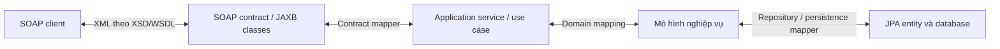
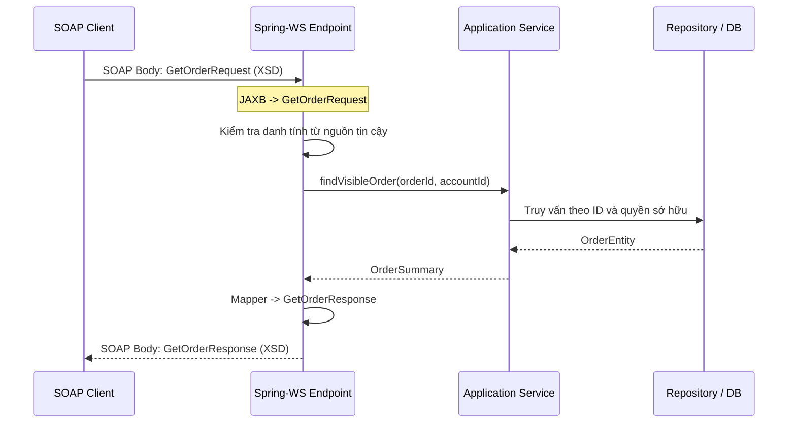
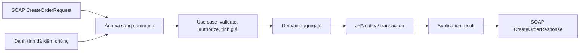

# Tách mô hình trao đổi khỏi thực thể lưu trữ và mô hình nội bộ

## 1. Vì sao đây là quyết định quan trọng khi thiết kế hợp đồng SOAP?

Trong tích hợp doanh nghiệp, một yêu cầu SOAP có thể được tạo bởi ứng dụng Java, .NET hoặc nền tảng khác và tiếp tục được gửi nhiều năm sau khi máy chủ đã thay đổi cấu trúc mã nguồn hoặc cơ sở dữ liệu. Vì vậy, **hợp đồng trao đổi** phải được thiết kế theo nhu cầu của bên gửi/bên nhận, không phải theo hình dạng của bảng dữ liệu hay lớp Java hiện có.

Với **Spring Web Services (Spring-WS)**, cách tiếp cận **contract-first** bắt đầu từ phần tử XML và kiểu dữ liệu được khai báo trong XSD, gắn chúng với thao tác/binding được công bố qua WSDL, rồi dùng JAXB và endpoint để kết nối hợp đồng với ứng dụng. Một ranh giới thiết kế đặc biệt quan trọng là:

> **Không dùng trực tiếp JPA entity hoặc mô hình nghiệp vụ nội bộ làm định dạng XML công khai của SOAP service.** Hãy có một lớp mô hình trao đổi riêng, và chuyển đổi dữ liệu một cách tường minh tại ranh giới ứng dụng.

Điều này không có nghĩa mọi dự án đều phải có rất nhiều lớp. Ý nghĩa là **mỗi mô hình có mục đích và quyền thay đổi riêng**. Với dịch vụ nhỏ, có thể chỉ cần kiểu JAXB từ XSD và một lớp ánh xạ. Với hệ thống có nghiệp vụ phức tạp, lớp domain và mô hình truy vấn riêng giúp tránh phụ thuộc chéo giữa SOAP, nghiệp vụ và lưu trữ.

Sau bài này, bạn có thể:

1. Phân biệt **mô hình trao đổi (contract/wire model)**, **mô hình nghiệp vụ (domain/application model)** và **thực thể lưu trữ (persistence entity)**.
2. Nhận ra tác hại khi trả thẳng JPA entity qua JAXB/SOAP.
3. Thiết kế XSD công khai độc lập với JPA và mã nguồn nội bộ.
4. Xây dựng luồng ánh xạ request/response và đặt trách nhiệm vào đúng lớp trong Spring-WS.
5. Xử lý thay đổi hợp đồng, kiểm tra quyền truy cập, validation và khả năng tương thích của client.

## 2. Ba mô hình cùng nói về một đơn hàng nhưng phục vụ ba mục đích

Giả sử hệ thống bán hàng phải cung cấp SOAP operation `GetOrder` cho đối tác. Đối tác chỉ cần mã đơn, trạng thái có thể hiểu được và tổng tiền. Bên trong hệ thống lại cần mã tài khoản sở hữu, điểm rủi ro, phiên bản bản ghi, trạng thái xử lý chi tiết và quan hệ với các bảng khác.

| Mô hình | Thuộc trách nhiệm của ai? | Chứa những gì? | Có nên công bố cho SOAP client? |
| --- | --- | --- | --- |
| **Mô hình trao đổi** (XML contract / JAXB binding) | Nhóm quản trị hợp đồng và các bên tích hợp | Tên phần tử XML, namespace, kiểu dữ liệu, trường công khai, ràng buộc XSD | **Có**, dưới dạng XML/XSD/WSDL đã thống nhất |
| **Mô hình nghiệp vụ** (domain/application model) | Mã nghiệp vụ và use case | Trạng thái chi tiết, bất biến nghiệp vụ, giá trị đối tượng, thao tác/luồng xử lý | **Không trực tiếp**; chỉ công bố thông tin được phép sau khi ánh xạ |
| **Thực thể lưu trữ** (JPA entity/database model) | Lớp persistence | Khóa, quan hệ, cột, thông tin quản lý lưu trữ, dữ liệu vận hành | **Không**; cấu trúc này có thể thay đổi độc lập |

Đây là hai hướng phụ thuộc nên tránh:

- **SOAP phụ thuộc database:** thêm cột `riskScore` vào bảng vô tình xuất hiện trong phản hồi SOAP, hoặc đổi cột thành tên mới làm client ngừng hoạt động.
- **Database phụ thuộc SOAP:** để thêm một trường cho client, nhóm buộc sửa entity/bảng dù dữ liệu đã có thể được tính từ nhiều nguồn; hoặc dùng tên XML làm tên thuộc tính persistence để tránh viết mapper.

Thay vào đó, áp dụng ranh giới:



Sơ đồ trình bày sự phân chia trách nhiệm, không bắt buộc phải tạo đủ mọi mapper trong một thao tác đọc dữ liệu đơn giản. Tính độc lập của **hợp đồng XML** mới là yêu cầu quan trọng. Mọi chuyển đổi nên được đặt ở nơi có thể kiểm tra, thử nghiệm và thay đổi riêng.

## 3. Điều gì xảy ra nếu trả thẳng JPA entity?

Một cách làm có vẻ nhanh là dùng cùng lớp `OrderEntity` cho ORM và SOAP:

```java
// Ví dụ phản diện: KHÔNG dùng làm thiết kế khuyến nghị.
@Entity
@XmlRootElement(name = "Order")
public class OrderEntity {
    @Id
    private String id;

    private String customerEmail;
    private String internalRiskScore;

    @OneToMany(mappedBy = "order")
    private List<OrderItemEntity> items;
}
```

Nếu công cụ XML binding nhìn thấy các thuộc tính không được chặn, phản hồi có thể lộ email, điểm rủi ro, thông tin kỹ thuật hoặc cấu trúc quan hệ. Thêm chú thích `@XmlTransient` để che từng trường chỉ giảm bớt một số triệu chứng; lớp entity vẫn bị ràng buộc đồng thời vào quyết định lưu trữ và hợp đồng tích hợp.

Những hệ quả thường gặp:

1. **Rò rỉ dữ liệu:** trường thêm để phục vụ vận hành có thể vô tình được tuần tự hóa; nguy cơ lớn hơn khi dùng kiểu ánh xạ tự động không có danh sách trường được phép công bố.
2. **Ràng buộc vòng và quan hệ lazy:** entity tham chiếu hai chiều, collection Hibernate hoặc proxy có thể gây vòng lặp, lỗi lazy loading và truy vấn cơ sở dữ liệu ngoài dự kiến.
3. **Phá vỡ tương thích:** đổi tên field Java, enum nội bộ hoặc quan hệ bảng có thể làm đổi cấu trúc XML mà đối tác đang dùng.
4. **Lệch ngữ nghĩa:** trạng thái như `PAYMENT_REVIEW` hay `FRAUD_HOLD` là chi tiết xử lý nội bộ; đối tác có thể chỉ cần giá trị ổn định `PENDING`.
5. **Khó kiểm thử:** serialization phụ thuộc session ORM và dữ liệu quan hệ thay vì hợp đồng XML độc lập.
6. **Tấn công ghi đè thuộc tính (mass assignment):** nếu nhận XML trực tiếp vào entity rồi lưu, người gửi có thể tìm cách kiểm soát các trường nội bộ như quyền sở hữu, mức giá, trạng thái xác nhận hoặc cờ đã thanh toán.

Giải pháp là thiết kế **danh sách dữ liệu được phép trao đổi** ngay từ XSD, thay vì chọn danh sách trường bị loại trừ từ entity.

## 4. Thiết kế mô hình trao đổi bằng XSD trước

Yêu cầu tích hợp của `GetOrder`:

- Input có `orderId` là mã định danh công khai, từ 1 đến 40 ký tự.
- Output trả `orderId`, `status`, `totalAmount` và `currency`.
- Trạng thái công khai chỉ gồm `PENDING`, `CONFIRMED`, `SHIPPED`, `CANCELLED`.
- `totalAmount` biểu diễn lượng tiền thập phân không âm, tối đa hai chữ số thập phân theo quy ước nghiệp vụ của ví dụ; `currency` là mã ba chữ cái.
- Không công bố `ownerAccountId`, `riskScore`, số phiên bản JPA hoặc khóa kỹ thuật của các bảng liên quan.

Một XSD tối giản, đặt tại `src/main/resources/xsd/orders-v1.xsd`:

```xml
<?xml version="1.0" encoding="UTF-8"?>
<xs:schema xmlns:xs="http://www.w3.org/2001/XMLSchema"
           xmlns:ord="https://example.com/orders/v1"
           targetNamespace="https://example.com/orders/v1"
           elementFormDefault="qualified">

    <xs:simpleType name="OrderId">
        <xs:restriction base="xs:string">
            <xs:minLength value="1"/>
            <xs:maxLength value="40"/>
        </xs:restriction>
    </xs:simpleType>

    <xs:simpleType name="PublicOrderStatus">
        <xs:restriction base="xs:string">
            <xs:enumeration value="PENDING"/>
            <xs:enumeration value="CONFIRMED"/>
            <xs:enumeration value="SHIPPED"/>
            <xs:enumeration value="CANCELLED"/>
        </xs:restriction>
    </xs:simpleType>

    <xs:simpleType name="MoneyAmount">
        <xs:restriction base="xs:decimal">
            <xs:minInclusive value="0"/>
            <xs:fractionDigits value="2"/>
        </xs:restriction>
    </xs:simpleType>

    <xs:simpleType name="CurrencyCode">
        <xs:restriction base="xs:string">
            <xs:pattern value="[A-Z]{3}"/>
        </xs:restriction>
    </xs:simpleType>

    <xs:element name="GetOrderRequest">
        <xs:complexType>
            <xs:sequence>
                <xs:element name="orderId" type="ord:OrderId"/>
            </xs:sequence>
        </xs:complexType>
    </xs:element>

    <xs:element name="GetOrderResponse">
        <xs:complexType>
            <xs:sequence>
                <xs:element name="orderId" type="ord:OrderId"/>
                <xs:element name="status" type="ord:PublicOrderStatus"/>
                <xs:element name="totalAmount" type="ord:MoneyAmount"/>
                <xs:element name="currency" type="ord:CurrencyCode"/>
            </xs:sequence>
        </xs:complexType>
    </xs:element>
</xs:schema>
```

Một phản hồi trên đường truyền có thể có dạng:

```xml
<env:Envelope
    xmlns:env="http://schemas.xmlsoap.org/soap/envelope/"
    xmlns:ord="https://example.com/orders/v1">
    <env:Body>
        <ord:GetOrderResponse>
            <ord:orderId>ORD-2026-001</ord:orderId>
            <ord:status>CONFIRMED</ord:status>
            <ord:totalAmount>129.50</ord:totalAmount>
            <ord:currency>USD</ord:currency>
        </ord:GetOrderResponse>
    </env:Body>
</env:Envelope>
```

**XSD không biết** mã đơn này được lưu ở bảng nào, có cột `owner_account_id` hay `risk_score` không, và bên trong có trạng thái `PAID`/`PACKED` hay không. Nó mô tả giao diện mà client có thể dựa vào.

### 4.1. XSD, WSDL và JAXB có vai trò khác nhau

- **XSD** công bố phần tử và kiểu dữ liệu XML; `GetOrderRequest` và `GetOrderResponse` là phần tử gốc của payload.
- **WSDL** mô tả thao tác `GetOrder`, message input/output, binding SOAP và địa chỉ truy cập. Trong Spring-WS có thể dùng `DefaultWsdl11Definition` để tạo WSDL 1.1 từ XSD với quy ước hậu tố `Request`/`Response`, hoặc công bố WSDL cố định khi cần quản trị hợp đồng nghiêm ngặt.
- **JAXB/XJC** tạo hoặc ánh xạ kiểu Java biểu diễn phần tử XML này. Ví dụ có thể sinh `GetOrderRequest`, `GetOrderResponse` và `PublicOrderStatus`, cùng `ObjectFactory` và metadata JAXB.

Các lớp JAXB là **kiểu biên (boundary types)**. Chúng được dùng khi nhận/gửi SOAP, có thể được sinh lại từ XSD và không nên bị chèn thêm logic nghiệp vụ hay annotation JPA. Khi dùng Spring Boot 3/Spring Framework 6 trở lên, cần chọn phiên bản JAXB/Jakarta XML Binding tương thích với API `jakarta.xml.bind.*`; dự án cũ có thể dùng `javax.xml.bind.*`.

> Lưu ý: `xs:fractionDigits` giới hạn độ chính xác phần thập phân; nó **không tự định nghĩa quy tắc làm tròn tiền, đơn vị tiền hoặc thời điểm chốt giá**. Những quy tắc đó phải được chốt ở tầng nghiệp vụ. Ví dụ hai chữ số thập phân ở đây là quy ước minh họa; một số đồng tiền có độ chia nhỏ khác, vì vậy hệ thống tiền tệ thật cần mô hình hóa theo danh mục tiền tệ và hợp đồng thực tế.

## 5. Mô hình nội bộ và thực thể lưu trữ được phép phát triển riêng

Giả sử nội bộ có nhiều trạng thái hơn đối tác cần:

```java
public enum InternalOrderState {
    NEW,
    PAYMENT_REVIEW,
    PAID,
    PACKED,
    SHIPPED,
    CANCELLED
}
```

Thực thể lưu trữ có thể chứa các trường mà giao diện SOAP không được công bố:

```java
import jakarta.persistence.*;
import java.math.BigDecimal;

@Entity
@Table(name = "orders")
public class OrderEntity {
    @Id
    private String id;

    @Column(nullable = false)
    private String ownerAccountId;

    @Enumerated(EnumType.STRING)
    @Column(nullable = false)
    private InternalOrderState lifecycleState;

    @Column(nullable = false, precision = 18, scale = 2)
    private BigDecimal totalAmount;

    @Column(nullable = false, length = 3)
    private String currency;

    private Integer internalRiskScore;

    @Version
    private long revision;

    protected OrderEntity() {
        // JPA yêu cầu constructor không tham số public/protected.
    }

    public String getId() { return id; }
    public String getOwnerAccountId() { return ownerAccountId; }
    public InternalOrderState getLifecycleState() { return lifecycleState; }
    public BigDecimal getTotalAmount() { return totalAmount; }
    public String getCurrency() { return currency; }
}
```

Các thành phần lưu trữ như `@Entity`, `@Id`, `@Version`, tên bảng và mức chính xác cột phục vụ JPA/database. Chúng **không làm thành một phần của SOAP contract**. Tương tự, một domain aggregate có thể có phương thức `confirmPayment()`, quy tắc chuyển trạng thái và sự kiện nghiệp vụ mà đối tác không bao giờ thấy.

Trong nhiều hệ thống, mô hình domain cũng cần tách khỏi JPA entity. Ví dụ `Order` aggregate kiểm soát quy tắc thanh toán, còn `OrderEntity` là biểu diễn để lưu trữ. Tuy nhiên với một use case truy vấn chỉ đọc, bạn có thể trả về **mô hình kết quả ứng dụng** thay vì tải toàn bộ aggregate và quan hệ.

```java
import java.math.BigDecimal;

public record OrderSummary(
    String orderId,
    InternalOrderState state,
    BigDecimal totalAmount,
    String currency
) {}
```

`OrderSummary` là mô hình **bên trong** mà application service dùng để giao tiếp với lớp SOAP adapter. Nó không mang annotation JAXB hay JPA, và có thể thay đổi khi luật nghiệp vụ hoặc cách đọc dữ liệu thay đổi. Đừng coi một `record` Java là hợp đồng XML chỉ vì nó dễ tuần tự hóa.

## 6. Ánh xạ tường minh: giữ ý nghĩa thay vì chỉ chép thuộc tính

### 6.1. Mapping trạng thái nội bộ sang trạng thái công khai

Không nên dựa vào `Enum.valueOf` với cùng tên ở hai tầng. Ví dụ từ sáu trạng thái nội bộ, đối tác chỉ nhìn thấy bốn trạng thái công khai:

| Trạng thái nội bộ | Trạng thái XML công khai | Diễn giải cho đối tác |
| --- | --- | --- |
| `NEW` | `PENDING` | Đã nhận đơn, chưa xác nhận |
| `PAYMENT_REVIEW` | `PENDING` | Đang kiểm tra thanh toán |
| `PAID` | `CONFIRMED` | Đơn đã được xác nhận |
| `PACKED` | `CONFIRMED` | Đã đóng gói nhưng chưa giao |
| `SHIPPED` | `SHIPPED` | Đã bàn giao vận chuyển |
| `CANCELLED` | `CANCELLED` | Đơn bị hủy |

Ứng dụng cần quyết định rõ trạng thái nào được phép ánh xạ. Ví dụ `PACKED` được công khai là `CONFIRMED` vì hệ thống đối tác chỉ quan tâm đã xác nhận, chưa cần biết bước đóng gói.

Mapper đầu ra có thể viết:

```java
public class OrderContractMapper {

    public GetOrderResponse toResponse(OrderSummary order) {
        var response = new GetOrderResponse(); // JAXB sinh từ XSD
        response.setOrderId(order.orderId());
        response.setStatus(toPublicStatus(order.state()));
        response.setTotalAmount(order.totalAmount());
        response.setCurrency(order.currency());
        return response;
    }

    private PublicOrderStatus toPublicStatus(InternalOrderState state) {
        return switch (state) {
            case NEW, PAYMENT_REVIEW -> PublicOrderStatus.PENDING;
            case PAID, PACKED -> PublicOrderStatus.CONFIRMED;
            case SHIPPED -> PublicOrderStatus.SHIPPED;
            case CANCELLED -> PublicOrderStatus.CANCELLED;
        };
    }
}
```

Ở đây `GetOrderResponse` và `PublicOrderStatus` là **lớp JAXB được sinh**; `OrderSummary` và `InternalOrderState` là **kiểu của ứng dụng**. Các import/package cụ thể do cấu hình XJC và cấu trúc dự án quyết định.

Ánh xạ tường minh giúp giữ sự ổn định khi nội bộ bổ sung `FRAUD_HOLD`. Nhóm có thể quyết định ánh xạ trạng thái mới thành `PENDING` mà không thay XSD ngay. Java `switch` đầy đủ cũng khiến việc thêm trạng thái buộc tác giả xem xét mapper thay vì im lặng trả nhầm giá trị.

### 6.2. Truy vấn lưu trữ và trả về mô hình ứng dụng

Một repository có thể cung cấp truy vấn được lọc theo tài khoản mà người gọi thực sự được phép truy cập:

```java
import java.util.Optional;
import org.springframework.data.jpa.repository.JpaRepository;

public interface OrderJpaRepository
        extends JpaRepository<OrderEntity, String> {

    Optional<OrderEntity> findByIdAndOwnerAccountId(
        String id, String ownerAccountId);
}
```

```java
import org.springframework.stereotype.Service;
import org.springframework.transaction.annotation.Transactional;

@Service
public class OrderQueryService {
    private final OrderJpaRepository repository;

    public OrderQueryService(OrderJpaRepository repository) {
        this.repository = repository;
    }

    @Transactional(readOnly = true)
    public OrderSummary findVisibleOrder(String orderId, String trustedAccountId) {
        OrderEntity entity = repository
            .findByIdAndOwnerAccountId(orderId, trustedAccountId)
            .orElseThrow(OrderNotFoundException::new);

        return new OrderSummary(
            entity.getId(),
            entity.getLifecycleState(),
            entity.getTotalAmount(),
            entity.getCurrency()
        );
    }
}
```

`OrderNotFoundException` là exception nghiệp vụ do dự án tự định nghĩa và cần ánh xạ sang SOAP Fault hoặc kết quả nghiệp vụ theo hợp đồng. Việc dùng cùng thông báo “không tìm thấy/không được truy cập” có thể tránh tiết lộ rằng tài nguyên thuộc về tài khoản khác, tùy chính sách bảo mật.

Đầu vào `trustedAccountId` **phải có nguồn tin cậy**: lấy từ danh tính đã được xác thực và ủy quyền (ví dụ principal sau khi xử lý chính sách bảo mật hoặc interceptor), **không lấy đơn thuần từ một trường tự khai trong SOAP Body/Header**. Nếu yêu cầu truy cập theo tổ chức hoặc vai trò phức tạp hơn, cần dùng chính sách ủy quyền tương ứng thay vì chỉ so sánh một chuỗi tài khoản.

### 6.3. Vì sao không trả `OrderEntity` thẳng từ service?

`OrderQueryService` trả `OrderSummary` có chủ ý:

- Không còn tham chiếu lazy/proxy cần Hibernate session để đọc tiếp.
- Những trường nội bộ như `internalRiskScore` và `revision` không đi ra khỏi lớp ứng dụng.
- SOAP adapter không phụ thuộc `jakarta.persistence` hoặc cách tổ chức bảng.
- Test của mapper chỉ cần tạo `OrderSummary`, không cần khởi tạo database.
- Sau này có thể chuyển từ JPA sang truy vấn SQL/read model mà giữ nguyên XML contract.

Trong ứng dụng nhiều dữ liệu, có thể dùng phép chiếu (projection) hoặc truy vấn chọn đúng các trường cần thiết. Bản chất của việc tách mô hình vẫn giữ nguyên ngay cả khi không tải entity đầy đủ.

## 7. Spring-WS endpoint là bộ chuyển tiếp qua ranh giới hợp đồng

Endpoint nhận **kiểu JAXB của hợp đồng**, lấy danh tính đã xác thực, gọi application service, sau đó dùng mapper để tạo **kiểu JAXB phản hồi**.

```java
import org.springframework.ws.server.endpoint.annotation.Endpoint;
import org.springframework.ws.server.endpoint.annotation.PayloadRoot;
import org.springframework.ws.server.endpoint.annotation.RequestPayload;
import org.springframework.ws.server.endpoint.annotation.ResponsePayload;

@Endpoint
public class OrderEndpoint {
    private static final String NS = "https://example.com/orders/v1";

    private final OrderQueryService queryService;
    private final OrderContractMapper contractMapper;
    private final AuthenticatedCallerResolver callerResolver;

    public OrderEndpoint(OrderQueryService queryService,
                         OrderContractMapper contractMapper,
                         AuthenticatedCallerResolver callerResolver) {
        this.queryService = queryService;
        this.contractMapper = contractMapper;
        this.callerResolver = callerResolver;
    }

    @PayloadRoot(namespace = NS, localPart = "GetOrderRequest")
    @ResponsePayload
    public GetOrderResponse getOrder(@RequestPayload GetOrderRequest request) {
        String trustedAccountId = callerResolver.requireAccountId();
        OrderSummary summary = queryService.findVisibleOrder(
            request.getOrderId(), trustedAccountId);
        return contractMapper.toResponse(summary);
    }
}
```

`AuthenticatedCallerResolver` là **giao diện trừu tượng của ứng dụng** trong ví dụ; cần có lớp triển khai lấy thông tin từ security context đã được kiểm chứng. Không có sẵn một API Spring-WS mặc định với tên lớp này. Tương tự, mã ví dụ chưa trình bày dependency, cấu hình `MessageDispatcherServlet`, JAXB marshaller, Spring bean của mapper, thiết lập WS-Security hay cách tạo SOAP Fault. Đó là các thành phần cần triển khai cho ứng dụng hoạt động hoàn chỉnh.

Điểm đáng chú ý là các trách nhiệm được phân định:



Trong dự án contract-first, `@PayloadRoot` chọn endpoint bằng **QName của phần tử gốc trong SOAP Body**, ở đây là `{https://example.com/orders/v1}GetOrderRequest`. Tên lớp entity, tên bảng và tên phương thức Java không cần trùng với QName đó.

## 8. Ánh xạ chiều nhận: tránh dùng dữ liệu SOAP làm trạng thái persistence

Với một thao tác **ghi** như `CreateOrder` hoặc `UpdateOrder`, tách mô hình còn quan trọng hơn vì client không được phép gán tùy ý mọi thuộc tính nội bộ.

Ví dụ hợp đồng nhập liệu có thể chỉ cho client gửi:

```xml
<ord:CreateOrderRequest xmlns:ord="https://example.com/orders/v1">
    <ord:productCode>SKU-001</ord:productCode>
    <ord:quantity>2</ord:quantity>
</ord:CreateOrderRequest>
```

Một luồng xử lý an toàn:

1. Xác nhận SOAP Envelope, security header và danh tính người gọi bằng cơ chế đã cấu hình.
2. Validate `CreateOrderRequest` với XSD và kiểm tra ràng buộc nghiệp vụ, như sản phẩm tồn tại, số lượng trong hạn mức.
3. Chuyển sang **command nội bộ** như `CreateOrderCommand(productCode, quantity, authenticatedAccountId)`; `authenticatedAccountId` đến từ danh tính được kiểm chứng.
4. Application service kiểm tra quyền, giá bán tại thời điểm xử lý và các bất biến; domain model quyết định trạng thái khởi tạo.
5. Persistence lưu entity và các quan hệ tương ứng trong transaction.
6. Mapper chỉ xuất các trường phản hồi được hợp đồng cho phép.

Không nên đưa cho client các trường như `orderId` nội bộ nếu máy chủ chịu trách nhiệm sinh mã, `ownerAccountId` nếu nó phải ràng buộc với principal, `paid`, `riskScore`, `revision` hoặc `internalState` để ghi trực tiếp. Kể cả khi schema cho phép một trường do client cung cấp, giá trị đó vẫn cần kiểm tra theo quy tắc nghiệp vụ; **XSD validation không phải authorization**.



Nếu có cập nhật cạnh tranh, hãy quản lý optimistic locking (`@Version`), idempotency key và quy tắc retry trong use case hoặc lớp tích hợp tương ứng. Không công bố số `revision` nội bộ chỉ vì JPA có `@Version`; nếu khách cần cơ chế kiểm soát phiên bản, hãy thiết kế rõ trường token/phiên bản công khai và ngữ nghĩa sử dụng nó.

## 9. Những chỗ ánh xạ dữ liệu dễ sai

Một mapper có vẻ là công việc sao chép thuộc tính, nhưng nó phải chuyển đổi **ngữ nghĩa giữa hai biên**.

| Vấn đề | Ở mô hình nội bộ | Quyết định trong hợp đồng XML |
| --- | --- | --- |
| **Định danh** | Có thể dùng UUID, khóa tăng dần, ID kết hợp | Dùng định danh công khai ổn định; không lộ ID chỉ có ý nghĩa nội bộ. |
| **Enum** | Nhiều trạng thái cho vận hành | Công bố tập giá trị phù hợp cho client; mapper có bảng ánh xạ rõ ràng. |
| **Ngày/giờ** | `Instant`, `OffsetDateTime`, thời điểm lưu DB | Chọn `xs:dateTime` và quy ước timezone/UTC; không dựa vào múi giờ mặc định của máy chủ. |
| **Tiền** | `BigDecimal`, đơn vị nhỏ nhất, `Money` value object | Chỉ rõ đơn vị tiền, thang số và quy tắc làm tròn; không dùng `double` cho tiền. |
| **Giá trị thiếu** | `null`, `Optional`, trạng thái “chưa biết” | Phân biệt phần tử vắng mặt (`minOccurs=0`), phần tử `xsi:nil` (`nillable=true`), chuỗi rỗng và giá trị mặc định. |
| **Danh sách / quan hệ** | `List`, entity quan hệ, lazy collection | Trả danh sách cần thiết với giới hạn số lượng/phân trang hoặc thao tác riêng. |
| **Thông tin nhạy cảm** | Email, token, điểm rủi ro, ghi chú vận hành | Chỉ công bố khi có căn cứ nghiệp vụ và chính sách truy cập rõ ràng. |
| **Mã lỗi** | Exception kỹ thuật hoặc domain exception | Ánh xạ sang SOAP Fault có code/reason/detail ổn định theo hợp đồng. |

### 9.1. Phần tử vắng mặt khác với `xsi:nil`

Ví dụ XSD:

```xml
<xs:element name="estimatedDelivery"
            type="xs:dateTime"
            minOccurs="0"
            nillable="true"/>
```

Trường trên cho phép cả **không xuất hiện** và **xuất hiện với `xsi:nil="true"`**. Hai trạng thái đôi khi có ý nghĩa nghiệp vụ khác nhau: “client không cung cấp thông tin”, “thông tin chưa biết”, “xóa thông tin hiện tại”. Nếu hợp đồng không phân biệt, hãy chọn một cách biểu diễn nhất quán và viết rõ trong tài liệu. Với các thao tác cập nhật, không nên tự động hiểu **trường vắng mặt** là lệnh xóa giá trị.

### 9.2. Ngày giờ cần quy ước timezone

`xs:dateTime` cho phép các biểu diễn có hoặc không có offset tùy ràng buộc schema. Nếu hợp đồng yêu cầu thời điểm tuyệt đối theo UTC, hãy công bố quy tắc đó và áp dụng mapper:

```text
Java nội bộ: Instant = 2026-11-27T03:15:30Z
XML công khai: <ord:updatedAt>2026-11-27T03:15:30Z</ord:updatedAt>
```

Không tự ý biến một `LocalDateTime` chưa có timezone thành timestamp UTC; phải biết nó thuộc múi giờ nào. Khi JAXB sinh ra `XMLGregorianCalendar` cho `xs:dateTime`, hãy dùng bộ chuyển đổi rõ ràng, kiểm thử timezone, nanosecond và hành vi với giá trị thiếu.

### 9.3. Kiểu dữ liệu tiền và trạng thái là cam kết lâu dài

`BigDecimal` ↔ `xs:decimal` giúp giữ độ chính xác số học, nhưng không tự đảm bảo thống nhất tỷ giá, thuế, quy tắc hiển thị hay số chữ số thập phân theo từng loại tiền. Tương tự, một trạng thái mới trong enum nội bộ **không nên lập tức tạo enum value mới trong XSD**: client sinh mã từ schema cũ có thể từ chối giá trị mới hoặc xử lý sai.

## 10. Tách mô hình giúp hợp đồng ổn định khi nội bộ thay đổi

Hãy xem ba thay đổi thực tế:

| Thay đổi bên trong | Điều nên làm ở ranh giới hợp đồng | Client bị ảnh hưởng? |
| --- | --- | --- |
| Chia bảng `orders` thành `orders` và `order_payments` | Thay repository/query và mapper nội bộ; giữ `GetOrderResponse` | Không, nếu XML và ý nghĩa dữ liệu giữ nguyên |
| Thêm trạng thái `FRAUD_HOLD` | Xác định có thể ánh xạ sang `PENDING` theo nghiệp vụ hay cần mở rộng hợp đồng | Không nhất thiết; tùy quyết định mapping và cam kết trạng thái |
| Đối tác muốn biết ngày giao dự kiến | Thảo luận ngữ nghĩa, thiết kế trường XSD và chiến lược tương thích | Có thể; cần kiểm thử trên client cũ |

Trong contract-first, **thay đổi mô hình nghiệp vụ và thay đổi hợp đồng là hai quyết định riêng**. Khi cần công bố thông tin mới, không tự động thêm toàn bộ thuộc tính của entity. Hãy hỏi:

1. Thông tin này có ý nghĩa ổn định với client không?
2. Ai được phép xem và dựa vào thông tin này?
3. Giá trị khi chưa biết, khi bị ẩn và khi có lỗi được biểu diễn ra sao?
4. Client cũ xử lý thế nào nếu server gửi thêm trường hoặc giá trị enum mới?
5. Có cần namespace/operation v2 hay có thể thêm phần mở rộng tương thích sau khi kiểm thử?

Thêm một trường `minOccurs="0"` ở cuối `xs:sequence` có thể tránh phá vỡ một số thông điệp cũ, nhưng **không bảo đảm** mọi client sinh mã hoặc client kiểm tra XML nghiêm ngặt đều chấp nhận response mới. Thay đổi namespace, tên phần tử, thứ tự `xs:sequence`, kiểu dữ liệu hoặc thêm giá trị enum đều phải đánh giá tác động và kiểm thử đối tác.

### 10.1. Định phiên bản theo hợp đồng, không theo schema database

Tên URI namespace ví dụ `https://example.com/orders/v1` có thể được giữ ổn định dù database đã trải qua nhiều đợt migration. Khi thay đổi không tương thích thật sự, công bố hợp đồng mới như `.../v2`, ánh xạ endpoint theo QName tương ứng, hỗ trợ song song phiên bản cũ trong giai đoạn chuyển đổi và thông báo thời hạn kết thúc.

Không cần tăng phiên bản XML mỗi khi thêm cột, đổi package, đổi tên table hoặc refactor domain. **Phiên bản công khai phản ánh thay đổi cam kết với bên dùng, không phản ánh mọi lần thay đổi implementation.**

### 10.2. Quản trị nguồn sự thật

Với Spring-WS, nên giữ XSD/WSDL đã công bố trong version control; sinh JAXB từ schema đã duyệt và kiểm tra chênh lệch hợp đồng trong pipeline CI. Mapper được sửa khi domain thay đổi; không sửa trực tiếp file JAXB sinh ra vì lần sinh tiếp theo sẽ ghi đè.

Khi dùng `DefaultWsdl11Definition` để tạo WSDL từ XSD, hãy nhớ rằng **WSDL được sinh từ schema vẫn là contract-first**. Nếu đã cam kết WSDL cụ thể với đối tác, cần kiểm tra kết quả công bố sau mọi thay đổi công cụ/cấu hình; có trường hợp phù hợp hơn là lưu và công bố WSDL cố định.

## 11. Bảo mật, SOAP Fault, interceptor và client tại ranh giới

### 11.1. Bảo mật gắn với quyền xem dữ liệu

Một SOAP request chứa `orderId` hợp lệ về XSD vẫn có thể là hành vi truy cập trái phép. Đặc biệt không tin một `customerId`, `ownerAccountId` hoặc `role` do client tự khai; danh tính người gọi phải được xác minh bởi lớp bảo mật phù hợp:

- **TLS** bảo vệ kết nối; cấu hình chứng chỉ phía máy chủ, và có thể xác thực bằng chứng chỉ phía client tùy mô hình.
- **WS-Security** có thể mang token, timestamp, chữ ký số hoặc cơ chế bảo vệ thông điệp; phải kiểm tra thực sự, tránh coi sự hiện diện của SOAP Header là đã xác thực.
- **Interceptor** có thể thực hiện logging có che dữ liệu, validation, truy vết, kiểm tra chính sách và những xử lý xuyên suốt; cần đặt theo thứ tự bảo mật phù hợp.
- **Application service** luôn phải kiểm tra quyền xem/sửa tài nguyên theo danh tính đã xác thực và ngữ cảnh nghiệp vụ.

Tách mô hình dữ liệu không thay thế các lớp bảo mật trên, nhưng giảm bề mặt rò rỉ: dù repository đọc thêm thông tin nội bộ, mapper ra SOAP chỉ xuất các trường được cho phép.

### 11.2. SOAP Fault nên là mô hình lỗi công khai

Không marshal trực tiếp `Exception` Java hoặc stack trace ra client. Ví dụ:

| Lỗi nội bộ | Biểu diễn bên ngoài hợp lý |
| --- | --- |
| XML sai schema | SOAP Fault dạng lỗi request/Sender theo phiên bản SOAP và chính sách hệ thống |
| `OrderNotFoundException` | Fault hoặc mã lỗi nghiệp vụ đã thống nhất, tránh tiết lộ sự tồn tại của tài nguyên không được phép xem |
| Quyền truy cập bị từ chối | Fault/response phù hợp chính sách bảo mật, không lộ dữ liệu nhạy cảm |
| Lỗi kết nối database | Fault phía server/Receiver và mã theo dõi an toàn, không kèm thông tin JDBC/SQL nội bộ |

Spring-WS hỗ trợ cơ chế exception resolver để biến lỗi thành SOAP Fault. Xây dựng danh mục lỗi công khai tương tự cách quản trị enum dữ liệu: tên lỗi, ngữ nghĩa và phần tử `detail` phải ổn định, có namespace/schema khi cần.

### 11.3. SOAP client cũng cần tách mô hình

Ở phía client sử dụng `WebServiceTemplate`/JAXB, các lớp sinh từ WSDL/XSD là kiểu kết nối tới dịch vụ đối tác; chúng không nên được đưa xuyên suốt mọi tầng domain của ứng dụng. Tạo mapper inbound từ response SOAP sang `PartnerOrderResult` hoặc mô hình tích hợp riêng. Khi đối tác nâng cấp WSDL, chỉ SOAP adapter và mapper cần thay nếu ngữ nghĩa nghiệp vụ không đổi.

Nguyên tắc hai phía giống nhau:

```text
Server:
  Internal model -> Contract mapper -> JAXB/XML -> SOAP client

Client:
  SOAP response/XML -> JAXB -> Contract mapper -> Internal model
```

## 12. Kiểm thử điều gì để biết đã tách mô hình thành công?

Một thiết kế tách lớp chỉ có ích nếu kiểm tra được tính ổn định của hợp đồng và quy tắc chuyển đổi.

| Loại kiểm thử | Mục tiêu | Ca kiểm thử nên có |
| --- | --- | --- |
| **Mapper unit test** | Ánh xạ chính xác nội bộ → dữ liệu công khai | `PAYMENT_REVIEW→PENDING`, `PACKED→CONFIRMED`, `SHIPPED→SHIPPED` |
| **XSD validation** | Payload đúng XML contract | Đúng namespace, thứ tự, trường bắt buộc, kiểu decimal, mã tiền tệ, enum |
| **Endpoint test** | `@PayloadRoot` định tuyến và tạo response đúng | Gửi SOAP `GetOrderRequest`, so khớp XML response, không có SOAP Fault ngoài dự kiến |
| **Authorization test** | Không thể tra cứu đơn của tài khoản khác | Cùng `orderId`, principal hợp lệ nhưng sai chủ sở hữu → không lộ dữ liệu |
| **Fault test** | Exception nội bộ được chuyển thành lỗi công khai an toàn | Đơn không tồn tại, sai schema, lỗi nội bộ, quyền bị từ chối |
| **Persistence test** | Query đúng dữ liệu và đúng giới hạn truy cập | Repository lọc theo `ownerAccountId`, dữ liệu liên quan không gây N+1 ngoài dự kiến |
| **Contract compatibility test** | Client cũ vẫn hoạt động qua thay đổi nội bộ | Client sinh từ WSDL đã phát hành marshal/unmarshal request/response mới |
| **Security test** | Danh tính/header/chứng chỉ được kiểm tra thực sự | Thiếu token, chữ ký sai, timestamp hết hạn, chứng chỉ không được tin cậy theo chính sách |

### 12.1. Unit test mapper phải độc lập với cơ sở dữ liệu

Chẳng hạn, tạo `OrderSummary` ở trạng thái `PACKED` với tổng tiền `129.50 USD`; kết quả `OrderContractMapper.toResponse` phải có `status=CONFIRMED` và đúng số tiền. Kiểm tra ngược lại không có trường XML nào cho `ownerAccountId`, `internalRiskScore` hay `revision` trong XSD/response.

Nếu unit test mapper cần khởi động Hibernate hoặc truy vấn database để duyệt `OrderEntity.items`, đó là tín hiệu ranh giới đang bị rò rỉ.

### 12.2. Kiểm thử trên XML thật

```xml
<env:Envelope
    xmlns:env="http://schemas.xmlsoap.org/soap/envelope/"
    xmlns:ord="https://example.com/orders/v1">
    <env:Body>
        <ord:GetOrderRequest>
            <ord:orderId>ORD-2026-001</ord:orderId>
        </ord:GetOrderRequest>
    </env:Body>
</env:Envelope>
```

Dùng `MockWebServiceClient` của Spring-WS hoặc integration test tương đương để gửi payload trên, kiểm tra SOAP Body và validate phản hồi theo XSD. Đồng thời chạy mẫu sai như `orderId` rỗng, sai namespace, giá trị enum lạ, hoặc principal không có quyền. Khi thay thư viện JAXB hoặc Spring-WS, hãy so sánh wire format chứ không chỉ kiểm tra kiểu Java biên dịch thành công.

### 12.3. Thử thay đổi nội bộ mà không đổi contract

Một bài kiểm thử kiến trúc có giá trị: thêm trường `internalRiskScore`, đổi cơ chế tính trạng thái hoặc tách bảng lưu trữ; sau đó xác nhận các fixture XML/WSDL công khai không đổi và toàn bộ ca tương thích vẫn vượt qua. Nếu XML thay đổi khi bạn chỉ đổi tên cột JPA, các lớp đang bị phụ thuộc không cần thiết.

## 13. Chuyển từ kiến trúc dùng entity trực tiếp sang mô hình tách biệt

Đối với hệ thống đã phát hành SOAP API dùng trực tiếp đối tượng database, không nên đổi XML tùy ý trong một lần refactor. Một lộ trình thực tế:

1. **Đóng băng giao diện hiện tại:** lấy WSDL/XSD đã công bố, các request/response mẫu và các ngoại lệ client thực tế đang phụ thuộc.
2. **Đặt tên các kiểu contract:** dùng JAXB từ schema hiện có hoặc xây dựng binding theo cùng wire format; tránh làm sai namespace/tên/thứ tự phần tử.
3. **Tạo mapper tường minh:** chuyển giữa kiểu contract mới và application/domain model; cố định mapping trạng thái, tiền, thời gian, trường tùy chọn.
4. **Sửa endpoint:** nhận/gửi contract type, gọi application service trả internal result; không trả JPA entity.
5. **Chạy kiểm thử hồi quy:** bảo đảm client cũ vẫn đọc được phản hồi, các lỗi SOAP tương thích, bảo mật không bị nới lỏng.
6. **Quản trị thay đổi tiếp theo:** từ đó thay đổi database/domain mà không buộc đối tác nhận schema mới.

Nếu WSDL cũ đã vô tình lộ thông tin nhạy cảm hoặc cấu trúc nguy hiểm, cần xử lý như một vấn đề thiết kế API/bảo mật có kế hoạch: thu hồi hoặc thay đổi hợp đồng có phối hợp, không chỉ âm thầm xóa trường khiến client đột ngột hỏng.

## 14. Những ngộ nhận và phản ví dụ

| Ngộ nhận | Cách hiểu phù hợp |
| --- | --- |
| “Entity dùng được cho JAXB thì nên dùng luôn.” | Khả năng marshal không chứng minh đây là hợp đồng công khai ổn định hoặc an toàn. |
| “Cứ dùng MapStruct/BeanUtils là đã tách mô hình.” | Công cụ mapper giảm mã lặp, nhưng mapping phải chủ động kiểm soát trường, enum, thời gian, quyền và quy tắc nghiệp vụ. |
| “DTO SOAP và domain object có tên giống nhau thì có thể hợp nhất.” | Tên giống nhau không có nghĩa chúng có cùng vòng đời và cam kết tương thích. |
| “Thêm field tùy chọn vào XSD chắc chắn không phá vỡ client.” | Phải thử với client sinh mã và validator thực tế; đặc biệt chú ý thứ tự và enum mới. |
| “Ẩn trường bằng `@XmlTransient` là đủ.” | Không giải quyết hoàn toàn phụ thuộc persistence, quan hệ lazy, nợ tương thích hay mass assignment. |
| “`@PayloadRoot` phụ thuộc tên bảng và tên entity.” | Spring-WS định tuyến theo QName phần tử XML trong SOAP Body. |
| “XSD validation đảm bảo caller có quyền xem đơn.” | XSD chỉ kiểm tra hình dạng dữ liệu; quyền phải được kiểm tra với danh tính đã được xác thực. |
| “Mapper luôn là 1:1 và chỉ copy.” | Mapper có thể tổng hợp, đổi tên, chuyển enum, đổi định dạng và loại bỏ dữ liệu theo hợp đồng. |

## 15. Checklist khi thiết kế một SOAP contract mới

- [ ] XSD/WSDL được định nghĩa theo nhu cầu nghiệp vụ của bên tích hợp và có chủ sở hữu rõ ràng.
- [ ] Kiểu JAXB được xem là **boundary type**; không gắn JPA annotations và không nhúng luật domain vào mã sinh.
- [ ] Entity lưu trữ, mô hình domain và kết quả application service không bị ràng buộc vào tên phần tử/namespace XML.
- [ ] Có mapper tường minh kiểm soát dữ liệu công khai, trạng thái, tiền, thời gian và trường tùy chọn.
- [ ] Dữ liệu nội bộ nhạy cảm không có trong XML schema/response khi không được phép.
- [ ] Dữ liệu đầu vào không được ghi thẳng vào entity, đặc biệt các trường trạng thái/quyền sở hữu/giá.
- [ ] Danh tính dùng để lọc dữ liệu được lấy từ cơ chế xác thực đã kiểm chứng.
- [ ] Các exception nội bộ được ánh xạ thành SOAP Fault đúng phiên bản, an toàn và ổn định.
- [ ] Có unit test mapper, schema test, endpoint test, security test và compatibility test với client đã phát hành.
- [ ] Thay đổi database/domain được đánh giá độc lập với quyết định nâng cấp hợp đồng XML.

## 16. Câu hỏi tự kiểm tra

1. Nếu thêm cột `internalRiskScore` vào `orders`, tại sao SOAP `GetOrderResponse` không nên tự động có trường đó?
2. Một trạng thái nội bộ mới `FRAUD_HOLD` xuất hiện. Bạn nên bắt đầu từ sửa enum XSD hay từ phân tích ý nghĩa công khai trong mapper? Vì sao?
3. Vì sao `@XmlTransient` trên một JPA entity chưa đủ để bảo vệ hợp đồng SOAP lâu dài?
4. `GetOrderRequest` chứa `ownerAccountId` do client gửi. Vì sao không được dùng trực tiếp giá trị này làm căn cứ ủy quyền?
5. Phân biệt `OrderSummary`, `GetOrderResponse` và `OrderEntity` theo mục đích, quyền thay đổi và vòng đời.
6. Thêm `estimatedDelivery` với `minOccurs="0"` có chắc chắn tương thích với mọi client WSDL cũ không? Bạn sẽ kiểm tra bằng cách nào?
7. Nếu SOAP response hợp lệ theo XSD nhưng vẫn lộ thông tin riêng tư, loại kiểm thử hoặc quy tắc thiết kế nào đã bị bỏ sót?
8. Khi chuyển dữ liệu thời gian từ `Instant` sang `xs:dateTime`, vì sao quy tắc timezone phải được xác định rõ?

**Ghi nhớ:** Hợp đồng SOAP là lời cam kết với hệ thống khác; entity là phương tiện lưu trữ; domain/application model là nơi thể hiện hành vi và quy tắc nội bộ. Trong Spring-WS, **XSD/WSDL → JAXB → mapper → application service → domain/persistence** giúp hệ thống phát triển độc lập, giới hạn dữ liệu công khai, xử lý SOAP Fault rõ ràng, tích hợp WS-Security/interceptor đúng vị trí và giữ tính tương thích của client qua nhiều lần thay đổi nội bộ.
