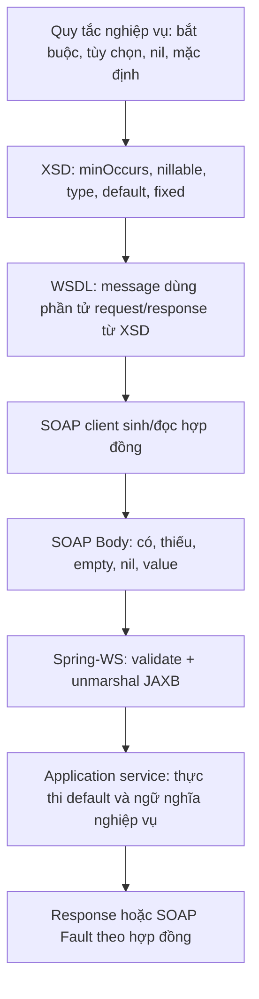

# Quy định trường bắt buộc, giá trị thiếu và ngữ nghĩa mặc định

Trong một dịch vụ SOAP, câu hỏi “trường này có bắt buộc không?” không thể trả lời chỉ bằng việc nhìn xem thuộc tính Java có được gắn `@NotNull` hay không. Hai hệ thống cần thống nhất trực tiếp trong **hợp đồng XML/XSD**: phần tử nào phải có mặt, phần tử nào có thể vắng mặt, giá trị rỗng có hợp lệ không, khi nào được gửi `xsi:nil`, và nếu không gửi thì server hiểu theo nghĩa nào.

Đây là chủ đề cốt lõi của chương **Thiết kế hợp đồng** trong Spring Web Services (Spring-WS). Với phương pháp **contract-first**, nhóm tích hợp thiết kế XSD và WSDL trước, sau đó ánh xạ JAXB để triển khai endpoint và SOAP client. Nếu ngữ nghĩa về trường thiếu hoặc giá trị mặc định mơ hồ, client Java, .NET và các hệ thống doanh nghiệp có thể cùng gửi XML hợp lệ nhưng diễn giải nghiệp vụ khác nhau. Sai lệch này cũng ảnh hưởng đến SOAP Fault, interceptor kiểm tra schema, chính sách WS-Security và các bài kiểm thử tương thích.

## 1. Một trường có nhiều trạng thái hơn “có giá trị” và “null”

Xem yêu cầu tạo đơn hàng có trường `deliveryNote` (ghi chú giao hàng). Bốn thông điệp dưới đây có thể biểu đạt bốn ý nghĩa khác nhau:

**1. Phần tử vắng mặt hoàn toàn (absent):**

```xml
<ord:CreateOrderRequest xmlns:ord="https://example.com/orders/v1">
    <ord:customerId>C102</ord:customerId>
</ord:CreateOrderRequest>
```

**2. Phần tử hiện diện nhưng nội dung rỗng (empty):**

```xml
<ord:deliveryNote/>
```

Tương đương về nội dung với `<ord:deliveryNote></ord:deliveryNote>`; điều này **khác** với việc không có thẻ `deliveryNote`.

**3. Phần tử hiện diện và được đánh dấu nil:**

```xml
<ord:deliveryNote xmlns:xsi="http://www.w3.org/2001/XMLSchema-instance"
                  xsi:nil="true"/>
```

Đây là cách XML Schema biểu thị *nil* có chủ đích. Nó chỉ hợp lệ nếu phần tử tương ứng được khai báo `nillable="true"`; phần tử `xsi:nil="true"` phải rỗng nội dung.

**4. Phần tử có giá trị cụ thể:**

```xml
<ord:deliveryNote>Giao giờ hành chính</ord:deliveryNote>
```

Trong SOAP, các phần tử này nằm bên trong payload của `soap:Body`. SOAP Envelope tự nó không quyết định trường nào bắt buộc, có thể bỏ qua hay được phép nil; những ràng buộc đó thường được định nghĩa trong **XSD**, còn cách hiểu nghiệp vụ phải được ghi rõ trong hợp đồng tích hợp.

| Trạng thái trên wire | Dấu hiệu XML | Có đồng nghĩa với Java `null` không? |
| --- | --- | --- |
| **Absent** | Không có phần tử | Thường có thể ánh xạ thành `null`, nhưng điều đó không cho biết client cố ý bỏ qua hay không |
| **Empty** | `<ord:deliveryNote/>` | Có thể là chuỗi `""` nếu kiểu và binding cho phép |
| **Nil** | `xsi:nil="true"` | Có thể ánh xạ thành `null` hoặc `JAXBElement` có trạng thái nil |
| **Value** | Có nội dung hợp lệ | Ánh xạ thành giá trị kiểu Java tương ứng |

**Nguyên tắc:** `absent`, `empty`, `nil` và *giá trị thông thường* là các trạng thái XML cần được xem xét riêng. Việc chúng có được phép xuất hiện hay có nghĩa khác nhau hay không là một quyết định thiết kế hợp đồng.

## 2. XSD xác định trường bắt buộc bằng `minOccurs` và `maxOccurs`

Đối với một phần tử cục bộ trong `xs:sequence`, hai thuộc tính quan trọng là:

- `minOccurs`: số lần xuất hiện tối thiểu. Mặc định là **1**.
- `maxOccurs`: số lần xuất hiện tối đa. Mặc định là **1**; có thể đặt `unbounded` cho danh sách.

| Khai báo phần tử | Ý nghĩa về số lần xuất hiện |
| --- | --- |
| `<xs:element name="id" type="xs:string"/>` | Bắt buộc, xuất hiện đúng một lần |
| `<xs:element name="note" type="xs:string" minOccurs="0"/>` | Có thể vắng mặt; tối đa một lần |
| `<xs:element name="item" type="xs:string" minOccurs="1" maxOccurs="unbounded"/>` | Danh sách có ít nhất một phần tử |
| `<xs:element name="tag" type="xs:string" minOccurs="0" maxOccurs="unbounded"/>` | Danh sách có thể rỗng |

Với phần tử **toàn cục** khai báo trực tiếp dưới `xs:schema`, `minOccurs/maxOccurs` không được khai báo ở vị trí đó; ràng buộc số lần xuất hiện thuộc về **vị trí sử dụng phần tử trong content model** của phần tử cha, chẳng hạn `xs:element ref="tns:Code" minOccurs="0"`.

Một trường có mặt đúng một lần chưa chắc đã có giá trị sử dụng được. Ví dụ `xs:string` thông thường cho phép chuỗi rỗng. Nếu `customerId` phải chứa ký tự có nghĩa, hợp đồng phải thêm giới hạn kiểu dữ liệu như `minLength` và quy tắc xử lý whitespace.

### XSD ví dụ: yêu cầu tạo đơn hàng

Giả sử quy tắc nghiệp vụ được thống nhất như sau:

| Trường | Ý định hợp đồng |
| --- | --- |
| `customerId` | Bắt buộc, không được rỗng hoặc chỉ chứa khoảng trắng |
| `couponCode` | Có thể không gửi; nếu gửi thì phải có mã hợp lệ, không được empty/nil |
| `deliveryNote` | Có thể không gửi, gửi chuỗi rỗng hoặc gửi `xsi:nil` |
| `priority` | Có thể không gửi; nghiệp vụ mặc định `NORMAL`; chỉ nhận `NORMAL` hoặc `EXPRESS` |
| `giftWrap` | Có thể không gửi; ứng dụng hiểu vắng mặt là `false` |

XSD cụ thể:

```xml
<?xml version="1.0" encoding="UTF-8"?>
<xs:schema xmlns:xs="http://www.w3.org/2001/XMLSchema"
           xmlns:tns="https://example.com/orders/v1"
           targetNamespace="https://example.com/orders/v1"
           elementFormDefault="qualified">

    <xs:simpleType name="NonBlankText">
        <xs:restriction base="xs:token">
            <xs:minLength value="1"/>
        </xs:restriction>
    </xs:simpleType>

    <xs:simpleType name="Priority">
        <xs:restriction base="xs:string">
            <xs:enumeration value="NORMAL"/>
            <xs:enumeration value="EXPRESS"/>
        </xs:restriction>
    </xs:simpleType>

    <xs:element name="CreateOrderRequest">
        <xs:complexType>
            <xs:sequence>
                <xs:element name="customerId"
                            type="tns:NonBlankText"/>

                <xs:element name="couponCode"
                            type="tns:NonBlankText"
                            minOccurs="0"/>

                <xs:element name="deliveryNote"
                            type="xs:string"
                            minOccurs="0"
                            nillable="true"/>

                <xs:element name="priority"
                            type="tns:Priority"
                            minOccurs="0"
                            default="NORMAL"/>

                <xs:element name="giftWrap"
                            type="xs:boolean"
                            minOccurs="0"/>
            </xs:sequence>
        </xs:complexType>
    </xs:element>
</xs:schema>
```

Các chi tiết đáng chú ý:

1. `customerId` có `minOccurs=1` và `maxOccurs=1` theo mặc định. `xs:token` chuẩn hóa whitespace dạng *collapse*; kết hợp `minLength=1` sẽ từ chối chuỗi rỗng hoặc toàn khoảng trắng sau khi chuẩn hóa.
2. `couponCode` có `minOccurs=0`, nghĩa là **không gửi được phép**. Nhưng gửi `<ord:couponCode/>` vẫn không hợp lệ vì ràng buộc `NonBlankText`.
3. `deliveryNote` đồng thời có `minOccurs=0` và `nillable=true`. Hai thuộc tính phục vụ **hai mục đích độc lập**: cho phép *vắng mặt* và cho phép *hiện diện nhưng nil*.
4. `priority` có cả `minOccurs=0` và `default="NORMAL"`. Điều này đòi hỏi hiểu đúng **ngữ nghĩa mặc định của XSD** ở phần sau.
5. `giftWrap` là `xs:boolean`. Chuỗi rỗng không phải giá trị boolean hợp lệ; `false`, `0`, `true`, `1` là các dạng lexical hợp lệ theo XML Schema.
6. `elementFormDefault="qualified"` yêu cầu các phần tử cục bộ trong payload thuộc namespace `https://example.com/orders/v1`; chỉ trùng tên địa phương là chưa đủ.

## 3. `minOccurs`, `nillable` và kiểm tra giá trị là ba chiều độc lập

**`minOccurs="0"` không tự động cho phép `xsi:nil`.** Tương tự, **`nillable="true"` không khiến phần tử trở thành tùy chọn**. Xét trường `amount` có kiểu `xs:decimal`:

| Khai báo | Bỏ phần tử | `<amount/>` | `<amount xsi:nil="true"/>` | `<amount>10.50</amount>` |
| --- | --- | --- | --- | --- |
| `minOccurs="1" nillable="false"` | Không hợp lệ | Không hợp lệ | Không hợp lệ | Hợp lệ |
| `minOccurs="0" nillable="false"` | Hợp lệ | Không hợp lệ | Không hợp lệ | Hợp lệ |
| `minOccurs="1" nillable="true"` | Không hợp lệ | Không hợp lệ | Hợp lệ | Hợp lệ |
| `minOccurs="0" nillable="true"` | Hợp lệ | Không hợp lệ | Hợp lệ | Hợp lệ |

Bảng giả định `amount` có kiểu `xs:decimal`, **không có khai báo `default`**, xuất hiện trong content model hợp lệ và `xsi` được khai báo namespace. Với `xs:string`, phần tử rỗng có thể hợp lệ; với kiểu có giới hạn `minLength`, `pattern` hoặc `enumeration`, kết quả phụ thuộc những giới hạn đó.

Ví dụ phần tử bắt buộc nhưng cho phép nil:

```xml
<xs:element name="taxNumber"
            type="xs:string"
            minOccurs="1"
            nillable="true"/>
```

Client bắt buộc **gửi phần tử `taxNumber`**, nhưng có thể gửi `xsi:nil="true"` khi chưa có mã số thuế. Nếu yêu cầu nghiệp vụ là “không biết thông tin” khác với “đã cung cấp chuỗi trống”, đây có thể là thiết kế có chủ đích. Ngược lại, nếu `taxNumber` không cần xuất hiện ở mọi request, `minOccurs=0` mới là ràng buộc phù hợp.

Khi `xsi:nil="true"`, phần tử không được mang nội dung văn bản hay phần tử con. Trường hợp `<amount xsi:nil="true">10</amount>` không hợp lệ, ngay cả khi schema cho phép nil.

### Không đánh đồng các kiểu “rỗng”

| XML | Kiểu XSD | Ghi chú |
| --- | --- | --- |
| `<name/>` | `xs:string` | Có thể hợp lệ với giá trị chuỗi rỗng |
| `<name>   </name>` | `xs:string` | Thông thường giữ nguyên khoảng trắng |
| `<name>   </name>` | `xs:token` + `minLength=1` | Sau chuẩn hóa whitespace thành rỗng nên không hợp lệ |
| `<count/>` | `xs:int` | Không hợp lệ nếu không có giá trị mặc định phù hợp |
| `<count>0</count>` | `xs:int` | Hợp lệ, bằng **0**, không phải “thiếu” |
| `<enabled>false</enabled>` | `xs:boolean` | Giá trị **false** tường minh, không phải “thiếu” |

Đối với số tiền, cần tránh dùng `0` làm tín hiệu “không có dữ liệu” nếu `0` là giá trị nghiệp vụ hợp lệ. Trong XML/SOAP không có một cách hiểu chung rằng mọi chuỗi rỗng, số 0 và `xsi:nil` đều là “không cung cấp”.

## 4. `default` trong XSD: tác động chính xác và những hiểu lầm phổ biến

Trong XSD, một phần tử có thể có ràng buộc `default`:

```xml
<xs:element name="priority"
            type="tns:Priority"
            minOccurs="0"
            default="NORMAL"/>
```

Hành vi quan trọng của **giá trị mặc định ở phần tử** là:

- **Phần tử có mặt nhưng rỗng**: nếu có kiểu nội dung phù hợp và được schema validator xử lý, giá trị mặc định `NORMAL` được áp dụng trong thông tin sau xác thực schema (*post-schema-validation infoset*, PSVI).
- **Phần tử vắng mặt hoàn toàn**: XSD **không tự tạo ra một phần tử `priority` còn thiếu** chỉ vì khai báo có `default`. Nếu hợp đồng muốn bỏ `priority` có nghĩa `NORMAL`, đó là **quy tắc nghiệp vụ** cần ghi rõ và triển khai ở server.
- **Phần tử có giá trị tường minh**: giá trị hợp lệ được dùng như đã gửi; không bị `default` ghi đè.
- **Phần tử `xsi:nil="true"`**: chỉ hợp lệ khi `nillable=true`, và nil không tương đương với áp dụng giá trị mặc định.

| Request fragment | Ràng buộc schema trên `priority` | Cách hiểu |
| --- | --- | --- |
| Không có `priority` | `minOccurs=0` | XSD chấp nhận sự vắng mặt; **nghiệp vụ** quyết định fallback `NORMAL` |
| `<ord:priority/>` | `default="NORMAL"` | Validator hiểu giá trị mặc định ở mức schema khi xác thực thích hợp |
| `<ord:priority>EXPRESS</ord:priority>` | Giá trị hợp lệ thuộc enum | Sử dụng `EXPRESS` |
| `<ord:priority>UNKNOWN</ord:priority>` | Không thuộc enum | Không hợp lệ theo XSD |
| `<ord:priority xsi:nil="true"/>` | `nillable` mặc định là `false` | Không hợp lệ |

> **Điểm dễ sai:** Đừng kỳ vọng cứ thấy `default="NORMAL"` trong XSD là JAXB hoặc ứng dụng Java sẽ tự điền `NORMAL` cho mọi trường `null`. Kết quả còn phụ thuộc việc parser có chạy schema validation, binding JAXB và cách xử lý của ứng dụng.

### Default của phần tử khác default của thuộc tính

Với **thuộc tính XML** (attribute), một khai báo mặc định thường áp dụng khi thuộc tính *vắng mặt* trong trường hợp validator xử lý schema và thuộc tính không được cung cấp:

```xml
<xs:complexType name="OrderOptions">
    <xs:attribute name="channel"
                  type="xs:string"
                  default="WEB"/>
</xs:complexType>
```

Giả sử `OrderOptions` được dùng làm kiểu của một phần tử, khi instance không chứa thuộc tính `channel`, thông tin sau validation có thể cung cấp giá trị `WEB`. Khác với default của *phần tử*, default của *thuộc tính* áp dụng khi thuộc tính bị bỏ qua. Các thuộc tính dùng `use="required"` hoặc `use="optional"`, **không sử dụng `minOccurs`**.

Vì WSDL/XSD được tiêu thụ bởi nhiều công cụ khác nhau, không nên đặt tính đúng đắn của nghiệp vụ chỉ trên việc một client cụ thể có nạp giá trị từ PSVI hay không.

### `fixed` khác `default`

```xml
<xs:element name="schemaVersion"
            type="xs:string"
            fixed="1"/>
```

`fixed="1"` biểu đạt ràng buộc giá trị: nếu phần tử xuất hiện với giá trị tường minh thì giá trị đó phải là `1`; giá trị khác không hợp lệ. Đây không chỉ là lời gợi ý về giá trị nên dùng. Với element, khi phần tử xuất hiện rỗng, cơ chế giá trị ràng buộc cũng có thể áp dụng trong quá trình schema validation; nếu phần tử được phép vắng mặt thì ràng buộc này không có nghĩa validator sẽ tự chèn element vắng mặt. Không dùng đồng thời `default` và `fixed` trên cùng một khai báo.

## 5. Định nghĩa ngữ nghĩa nghiệp vụ bằng bảng trạng thái rõ ràng

XSD xác định *hình dạng hợp lệ*; nó không quyết định được toàn bộ ý định nghiệp vụ. Ví dụ cùng là `deliveryNote`:

- Khi tạo đơn, **vắng mặt** có thể nghĩa là “không cung cấp ghi chú”; **empty** có thể nghĩa là “ghi chú được chỉ định là chuỗi rỗng”; **nil** có thể nghĩa là “không xác định/không có ghi chú”.
- Khi cập nhật đơn, **vắng mặt** thường được chọn với nghĩa “giữ nguyên dữ liệu cũ”; **nil** có thể có nghĩa “xóa giá trị đang lưu”; **empty** có thể có nghĩa “đặt chuỗi rỗng”.

Không có chuẩn SOAP chung tự quy định các ý nghĩa *giữ nguyên*, *xóa* và *đặt rỗng* cho thao tác cập nhật. Các bên phải ghi vào tài liệu của operation. Nếu không có nhu cầu phân biệt, nên đơn giản hóa hợp đồng và từ chối những trạng thái không dùng đến.

Ví dụ **quy ước nghiệp vụ đã được nhóm tích hợp thống nhất** cho thao tác `CreateOrder`:

| Trường | Absent | Empty | `xsi:nil` | Có giá trị |
| --- | --- | --- | --- | --- |
| `customerId` | Lỗi schema | Lỗi schema | Lỗi schema | Mã khách hàng không rỗng |
| `couponCode` | Không áp mã giảm giá | Lỗi schema | Lỗi schema | Tra cứu và áp mã |
| `deliveryNote` | Không có ghi chú được gửi | Chuỗi rỗng tường minh | Giá trị nil tường minh | Lưu chuỗi ghi chú |
| `priority` | Áp dụng mặc định nghiệp vụ `NORMAL` | XSD default `NORMAL` nếu validation có hỗ trợ | Lỗi schema | `NORMAL` hoặc `EXPRESS` |
| `giftWrap` | Áp dụng mặc định nghiệp vụ `false` | Lỗi schema | Lỗi schema | `true` hoặc `false` |

Các quy ước trên **là một ví dụ thiết kế**, không phải hành vi tự động của Spring-WS. Trường hợp `deliveryNote` absent và nil đang được giữ khác nhau để minh họa cách lưu dấu sự lựa chọn của client; một hệ thống không cần phân biệt có thể gộp chúng sau khi kiểm tra dữ liệu XML hợp lệ.

Với API cập nhật, nên làm bảng trạng thái riêng cho từng field để xác định chính xác “không thay đổi”, “đặt null”, “đặt rỗng”, “đặt giá trị”. Nếu bắt buộc phân biệt ít nhất ba trạng thái, chỉ sử dụng một trường Java `String` nullable thường không đủ, vì mất thông tin liệu phần tử đã xuất hiện hay chưa.

### Ví dụ SOAP request hợp lệ

```xml
<?xml version="1.0" encoding="UTF-8"?>
<soap:Envelope
    xmlns:soap="http://schemas.xmlsoap.org/soap/envelope/"
    xmlns:ord="https://example.com/orders/v1"
    xmlns:xsi="http://www.w3.org/2001/XMLSchema-instance">
    <soap:Body>
        <ord:CreateOrderRequest>
            <ord:customerId>C102</ord:customerId>
            <ord:deliveryNote xsi:nil="true"/>
            <ord:priority>EXPRESS</ord:priority>
            <ord:giftWrap>false</ord:giftWrap>
        </ord:CreateOrderRequest>
    </soap:Body>
</soap:Envelope>
```

Ở đây `couponCode` vắng mặt hợp lệ, `deliveryNote` có mặt với nil hợp lệ, `priority` là enum được cho phép, `giftWrap=false` là giá trị tường minh. Thứ tự các phần tử tuân theo `xs:sequence` trong XSD. Namespace SOAP Envelope phục vụ giao thức, namespace `ord` xác định hợp đồng dữ liệu nghiệp vụ.

## 6. Vai trò của WSDL trong quy định trường bắt buộc

Trong thiết kế **document/literal**, WSDL 1.1 thường tham chiếu đến các **global element** do XSD khai báo:

```xml
<wsdl:message name="CreateOrderInput">
    <wsdl:part name="parameters" element="ord:CreateOrderRequest"/>
</wsdl:message>
```

Đoạn trên giả định `wsdl` là namespace `http://schemas.xmlsoap.org/wsdl/`, còn `ord` là namespace `https://example.com/orders/v1`. WSDL mô tả operation và message, trong khi XSD quy định các trường con như `customerId`, `priority`, `deliveryNote`.

Sơ đồ quan hệ:



Đừng tìm thuộc tính `required=true` của các field nghiệp vụ trong `wsdl:operation`: hợp đồng về sự hiện diện của chúng nằm ở content model XSD. Một WSDL tham chiếu schema thiếu hoặc sai phiên bản vẫn có thể khiến client sinh ra model không đúng dù endpoint HTTP hoạt động bình thường.

Nếu Spring-WS tạo WSDL động bằng `DefaultWsdl11Definition` từ XSD, cần xem **WSDL thực tế được công bố** và thử client generation, vì tên operation, cách import schema và vị trí endpoint có thể phụ thuộc cấu hình. Khi thay `minOccurs`, `nillable` hoặc `default`, thường không cần đổi tên operation, nhưng **hợp đồng dữ liệu đã thay đổi**; client sinh code cần cập nhật/kiểm tra lại.

## 7. JAXB: tại sao `null` trong Java chưa nói hết trạng thái XML?

Khi ánh xạ XSD sang Java, JAXB/XJC có thể sinh:

- Kiểu tham chiếu như `String`, `Integer`, `BigDecimal`, enum, hoặc `JAXBElement<T>` để biểu diễn phần tử.
- Kiểu nguyên thủy như `int` hoặc `boolean` cho một số khai báo không tùy chọn, tùy cấu hình và binding.
- Các annotation như `@XmlElement`, `@XmlElementRef`, `@XmlRootElement`, `@XmlType`.

**Kiểu Java sinh ra phụ thuộc schema, công cụ và tùy chỉnh binding**. Không nên viết tài liệu tích hợp dựa trên giả định mọi phần tử tùy chọn đều thành `String` hoặc mọi phần tử `nillable=true` đều sinh `JAXBElement`.

Ví dụ minh họa một JAXB property được sinh ở dạng `JAXBElement<String>` (đây là **một trường hợp binding có thể gặp**, không phải đầu ra bảo đảm của mọi XJC):

```java
JAXBElement<String> note = request.getDeliveryNote();

if (note == null) {
    // Phần tử không xuất hiện trong XML (absent)
    // nếu binding bảo toàn được trạng thái hiện diện.
} else if (note.isNil()) {
    // Phần tử hiện diện và có xsi:nil="true".
} else if (note.getValue().isEmpty()) {
    // Phần tử hiện diện với chuỗi rỗng.
} else {
    String content = note.getValue();
    // Phần tử hiện diện với nội dung.
}
```

Đoạn code giả định request đã được unmarshal theo đúng binding và dữ liệu hợp lệ theo XSD. Nếu JAXB sinh `String getDeliveryNote()`, `null` có thể đại diện cho nhiều trạng thái, khiến không thể phân biệt absent và nil chỉ từ getter đó. Khi nghiệp vụ phụ thuộc sự khác biệt, cần thiết kế/binding để giữ thông tin hiện diện, hoặc kiểm tra XML payload ở lớp thích hợp.

### Giá trị mặc định nên được xử lý có chủ đích trong service

Với quy ước **absent priority = NORMAL**, service cần có bước chuẩn hóa rõ ràng, bất kể JAXB có áp dụng XSD default cho phần tử rỗng hay không:

```java
// Ví dụ trong lớp ứng dụng, sau bước unmarshal và validation.
Priority rawPriority = request.getPriority();
Priority effectivePriority =
        rawPriority != null ? rawPriority : Priority.NORMAL;

Boolean rawGiftWrap = request.isGiftWrap();
boolean effectiveGiftWrap =
        rawGiftWrap != null && rawGiftWrap;
```

Đây là **mã ý tưởng**: `Priority` là enum Java, getter của `giftWrap` được giả định trả `Boolean`; chữ ký thực tế do XJC sinh có thể khác. Nếu generator sinh boolean primitive mà schema cho phép vắng mặt, cần kiểm tra cách nó biểu diễn sự thiếu giá trị để tránh nhầm `false` tường minh với `false` mặc định.

Nếu ứng dụng muốn hoàn toàn dựa vào schema validation để áp dụng giá trị của *phần tử rỗng* theo XSD, phải kiểm thử chính xác bộ parser/validator và marshaller đang sử dụng. **Unmarshal JAXB không chạy schema validation mặc định trong mọi cấu hình**; validation cần được thiết lập và kiểm thử, không suy ra từ sự tồn tại của `schema.xsd`.

Với một SOAP endpoint khai báo `@PayloadRoot` và `@RequestPayload`, Spring-WS dùng payload QName để chọn handler và có thể sử dụng JAXB marshalling/unmarshalling khi cấu hình adapter phù hợp. Lớp nghiệp vụ nên nhận một mô hình đã chuẩn hóa về ý nghĩa (*effective priority*, *effective giftWrap*, trạng thái ghi chú) thay vì lặp lại logic kiểm tra `null` trong nhiều endpoint.

## 8. Kiểm tra schema bằng interceptor và trả SOAP Fault có ý nghĩa

Trong Spring-WS, `PayloadValidatingInterceptor` có thể được cấu hình kiểm tra SOAP payload theo XSD ở phía request và/hoặc response. Việc này giúp phát hiện:

1. Thiếu `customerId` bắt buộc.
2. Gửi `couponCode` rỗng trái `minLength=1`.
3. Dùng `xsi:nil=true` trên `priority` khi `nillable=false`.
4. Gửi `priority=HIGH` ngoài tập enum.
5. Gửi `giftWrap` rỗng, không phải giá trị boolean hợp lệ.
6. Gửi các phần tử con không đúng thứ tự `xs:sequence` hoặc sai namespace.

Ví dụ cấu hình ở mức ý tưởng:

```java
@Bean
public PayloadValidatingInterceptor payloadValidator(XsdSchema ordersSchema) {
    PayloadValidatingInterceptor interceptor =
            new PayloadValidatingInterceptor();
    interceptor.setXsdSchema(ordersSchema);
    interceptor.setValidateRequest(true);
    interceptor.setValidateResponse(true);
    return interceptor;
}
```

Đây mới là khai báo bean; để có hiệu lực trên message flow, interceptor còn phải được **đăng ký vào cấu hình interceptor của Spring-WS**. Các import, cách tạo bean và lifecycle thực tế cần phù hợp phiên bản Spring-WS. Bật response validation hữu ích để phát hiện server trả dữ liệu không khớp contract, nhưng thường phải xem xét chi phí và cách xử lý lỗi ở môi trường production.

Các lỗi XSD có thể dẫn đến **SOAP Fault** cho request không hợp lệ (SOAP 1.1 thường dùng `Client`, SOAP 1.2 dùng `Sender`, tùy lỗi và cách cấu hình). Spring-WS hỗ trợ ánh xạ ngoại lệ bằng các `EndpointExceptionResolver`, chẳng hạn `SoapFaultMappingExceptionResolver`.

Phân biệt hai lớp lỗi:

- **Lỗi hợp đồng/schema**: XML không khớp XSD, chẳng hạn thiếu `customerId` hoặc giá trị enum không hợp lệ. Nên được phát hiện sớm trước khi chạy nghiệp vụ.
- **Lỗi nghiệp vụ**: `couponCode` đúng định dạng XML nhưng đã hết hạn hoặc không áp dụng cho khách hàng. XSD không đủ để xác định điều này; application service phải kiểm tra và trả lỗi theo quy ước của hợp đồng.

Nếu đối tác cần xử lý lỗi có cấu trúc, hãy định nghĩa kiểu/element lỗi trong XSD và khai báo fault tương ứng trong WSDL khi cần. Không nên chỉ gửi stack trace hoặc nội dung nội bộ ở `faultstring`.

**WS-Security và các chuẩn WS-* không thay thế validation XSD.** Một thông điệp ký số hợp lệ vẫn có thể thiếu `customerId`; ngược lại, thông điệp hợp lệ theo XSD vẫn có thể bị từ chối vì chữ ký, chứng chỉ hoặc timestamp không hợp lệ. Khi dùng XML Signature, mọi bên phải bảo đảm phần payload được xác minh chữ ký chính là nội dung được xử lý; tránh tự sửa payload sau xác minh mà không kiểm soát tác động bảo mật. Quy tắc bắt buộc và mặc định của *SOAP Header* do chính sách WS-* quy định có thể khác với các trường trong SOAP Body nghiệp vụ.

## 9. Kiểm thử contract-first: ma trận dữ liệu thiếu, rỗng và nil

Đừng chỉ kiểm thử “happy path” với đầy đủ trường. Một bộ kiểm thử tương thích tốt phải gửi cả các trạng thái biên qua đúng SOAP endpoint và đúng schema đã công bố.

| Mã ca | Payload trong `CreateOrderRequest` | Kết quả mong đợi |
| --- | --- | --- |
| T01 | Có `customerId=C102`, bỏ tất cả trường tùy chọn | Hợp lệ; service dùng priority `NORMAL`, giftWrap `false` |
| T02 | Thiếu `customerId` | Không hợp lệ theo XSD |
| T03 | `customerId` là chuỗi khoảng trắng | Không hợp lệ theo `NonBlankText` |
| T04 | Bỏ `couponCode` | Hợp lệ; không áp mã |
| T05 | `<ord:couponCode/>` | Không hợp lệ theo XSD |
| T06 | `<ord:couponCode xsi:nil="true"/>` | Không hợp lệ vì `nillable=false` |
| T07 | Bỏ `deliveryNote` | Hợp lệ; nhận biết absent nếu nghiệp vụ cần |
| T08 | `<ord:deliveryNote/>` | Hợp lệ; chuỗi rỗng tường minh |
| T09 | `<ord:deliveryNote xsi:nil="true"/>` | Hợp lệ; giá trị nil tường minh |
| T10 | `<ord:priority/>` | Hợp lệ theo XSD có `default=NORMAL` khi schema validation phù hợp; xác minh giá trị sau unmarshalling |
| T11 | `<ord:priority>HIGH</ord:priority>` | Không hợp lệ theo enum |
| T12 | Bỏ `giftWrap` | Hợp lệ; service dùng mặc định `false` |
| T13 | `<ord:giftWrap>false</ord:giftWrap>` | Hợp lệ; **false tường minh** |
| T14 | `<ord:giftWrap/>` | Không hợp lệ vì không có giá trị boolean |
| T15 | Đảo thứ tự `priority` và `couponCode` khi cùng hiện diện | Không hợp lệ nếu trái `xs:sequence` |
| T16 | Đúng local name nhưng sai namespace | Không hợp lệ theo schema hoặc không được endpoint nhận diện đúng |

Chú ý các fragment trong bảng cần được đặt trong **request đầy đủ**, giữ đúng các phần tử bắt buộc và namespace. Ca T10 đặc biệt quan trọng: một parser có schema validation có thể cung cấp giá trị XSD default, còn unmarshal không sử dụng schema có thể cho kết quả khác; kiểm thử phải kiểm tra cả response và giá trị mà service thực sự xử lý.

Ở hệ Spring-WS, có thể sử dụng:

- **`MockWebServiceClient`** để kiểm thử endpoint nhận SOAP payload, validate và trả response/Fault như mong đợi.
- **`MockWebServiceServer`** để kiểm thử client tạo request đúng theo XSD, gửi/nhận SOAP và xử lý lỗi.
- **Bộ request/response mẫu** được lưu cùng hợp đồng XSD/WSDL để đối chiếu khi nâng cấp thư viện, cấu hình JAXB, interceptor hoặc chứng chỉ WS-Security.

Nên kết hợp ít nhất ba tầng xác nhận: (1) schema validation độc lập; (2) unmarshal/marshal qua đúng JAXB binding; (3) gọi qua Spring-WS endpoint/client với cấu hình thực tế. Nếu yêu cầu kiểm thử liên thông với .NET hoặc nền tảng khác, sinh client từ **WSDL và XSD được công bố**, rồi chạy lại các ca thiếu/rỗng/nil để phát hiện chênh lệch mapping kiểu `null`, `Optional`, nullable value type và default.

## 10. Thay đổi tính bắt buộc hoặc default có thể phá vỡ hợp đồng

Một trường có thể đúng XML cả trước và sau khi cập nhật schema nhưng vẫn làm hệ thống khác đi về nghiệp vụ. Khi đánh giá tương thích, hãy xem cả **cú pháp hợp lệ**, **code sinh từ schema** và **ngữ nghĩa xử lý**.

| Thay đổi | Rủi ro |
| --- | --- |
| `minOccurs=0` → `1` trên request | Client cũ bỏ trường sẽ không còn hợp lệ: thường là thay đổi phá vỡ tương thích |
| `minOccurs=1` → `0` trên request | Schema nới lỏng, nhưng server code hoặc client đã giả định field luôn có mặt có thể phát sinh lỗi |
| `nillable=false` → `true` | Cho phép thông điệp nil mới, nhưng client/server cũ có thể chưa xử lý nil |
| `nillable=true` → `false` | Từ chối các message cũ có `xsi:nil=true` |
| Đổi `default=NORMAL` thành `EXPRESS` | Có thể thay đổi hành vi với message rỗng và với message vắng mặt nếu service cũng đổi fallback; rủi ro nghiệp vụ cao |
| Đổi kiểu `xs:string` sang enum/kiểu hạn chế | Những giá trị cũ có thể trở thành không hợp lệ |
| Thêm trường **bắt buộc** vào request | Client cũ không gửi nên bị từ chối |
| Thêm trường tùy chọn vào response | Thường dễ tương thích hơn, nhưng client sinh code, validation cứng hoặc parser không chấp nhận phần tử lạ vẫn có thể lỗi |

Quy trình thay đổi hợp đồng:

1. **Xác định ngữ nghĩa chính thức** của từng trạng thái, đặc biệt là operation *update*; phân tích ảnh hưởng đến client cũ.
2. **Sửa XSD** và các tài liệu mô tả nghiệp vụ cùng nhau; cân nhắc WSDL, SOAP Fault và policy có cần thay đổi không.
3. **Sinh lại model JAXB và client thử nghiệm** từ artifact hợp đồng; quan sát trường có đổi từ primitive sang wrapper hoặc `JAXBElement` không.
4. **Chạy lại ma trận kiểm thử** với request/response cũ và mới, ở cả chiều client và server.
5. **Quản lý phiên bản hợp đồng**: nếu không thể duy trì tương thích, cân nhắc operation/namespace/schema version mới và kế hoạch chuyển đổi đối tác.

Thay đổi `default` đặc biệt nhạy cảm vì client có thể gửi **cùng một SOAP message** trước và sau nâng cấp nhưng nhận được kết quả nghiệp vụ khác. Giá trị mặc định vì thế phải là một phần của cam kết API, được quản lý tương tự các quy tắc nghiệp vụ công khai.

## 11. Bài tập vận dụng: cập nhật thông tin khách hàng

Hệ thống có operation `UpdateCustomer` với ba trường tùy chọn: `phone`, `middleName`, `receivePromotion`. Yêu cầu nghiệp vụ:

- Nếu không gửi `phone`, giữ nguyên số cũ; nếu gửi `xsi:nil`, xóa số; nếu gửi chuỗi rỗng, trả lỗi.
- Nếu không gửi `middleName`, giữ nguyên; nếu gửi `xsi:nil`, xóa; nếu gửi `<middleName/>`, đặt thành chuỗi rỗng.
- Nếu không gửi `receivePromotion`, giữ nguyên; nếu gửi `true` hoặc `false`, cập nhật đúng giá trị đó; không cho phép nil.

**Đề xuất schema:**

```xml
<xs:sequence>
    <xs:element name="phone"
                type="tns:NonBlankText"
                minOccurs="0"
                nillable="true"/>
    <xs:element name="middleName"
                type="xs:string"
                minOccurs="0"
                nillable="true"/>
    <xs:element name="receivePromotion"
                type="xs:boolean"
                minOccurs="0"/>
</xs:sequence>
```

Schema này cần được đặt trong kiểu request có định danh khách hàng bắt buộc, cùng định nghĩa `tns:NonBlankText` như ở phần trước. **Giải thích:** cả ba trường có thể vắng mặt nhờ `minOccurs=0`; hai trường đầu cho phép nil để xóa giá trị; `phone` từ chối chuỗi rỗng nhờ ràng buộc kiểu; `receivePromotion` không cho phép nil nhưng chấp nhận `false` tường minh.

Ở tầng Java, nếu binding đang gộp absent và nil thành cùng một `null`, phải thay đổi binding/mô hình nhận dữ liệu trước khi triển khai quy tắc “giữ nguyên” so với “xóa”. Đồng thời, không thể thay việc xác định “absent” của `receivePromotion` bằng một primitive `boolean` mặc định `false`, vì điều đó sẽ vô tình tắt nhận quảng cáo khi client không gửi trường này.

## 12. Checklist trước khi chốt hợp đồng SOAP

Với mỗi field trong request **và** response, nhóm thiết kế nên ghi nhận:

1. Có bắt buộc xuất hiện không? Nếu là danh sách, `minOccurs` và `maxOccurs` là bao nhiêu?
2. `empty` có hợp lệ không? Kiểu XSD và `minLength`, `pattern`, `enumeration`, giới hạn số có đủ chặt chưa?
3. Có cho phép `xsi:nil` không? Nil khác absent và empty ở ý nghĩa nghiệp vụ nào?
4. Khi field vắng mặt, service làm gì: giữ nguyên, áp default, từ chối hay không xử lý? Quy tắc này đã được tài liệu hóa chưa?
5. Khi field có mặt nhưng rỗng, XSD có `default` hay không? Ứng dụng có dựa vào PSVI/JAXB hay xử lý rõ trong code?
6. Mô hình JAXB có bảo toàn được các trạng thái mà nghiệp vụ cần phân biệt không?
7. `PayloadValidatingInterceptor` và luồng xử lý SOAP Fault đã được kiểm thử với XML sai schema chưa?
8. Việc thay schema/default có được kiểm thử với client sinh từ WSDL cũ, các hệ thống liên thông và cấu hình WS-Security đang áp dụng chưa?

**Kết luận:** Hợp đồng SOAP đáng tin cậy không dừng ở một danh sách tên trường. `minOccurs`, `nillable`, kiểu XSD, `default` và `fixed` quyết định phần XML nào hợp lệ; tài liệu nghiệp vụ quyết định ý nghĩa của absent/empty/nil; JAXB và Spring-WS phải giữ và thực hiện chính xác những quyết định đó. Khi các lớp này nhất quán, dịch vụ contract-first có thể phát triển mà giảm nguy cơ lỗi tích hợp khó phát hiện.
