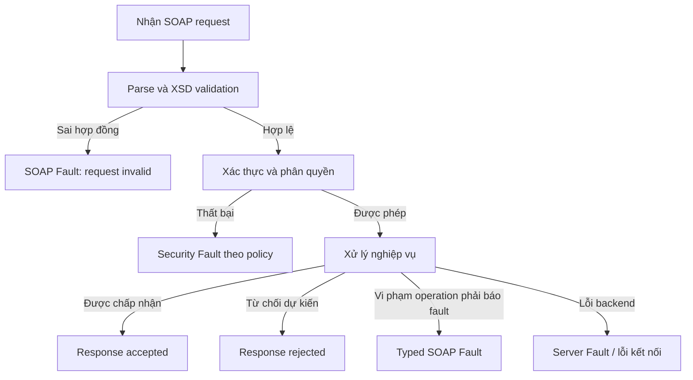

# Thiết kế lỗi nghiệp vụ thành hợp đồng có cấu trúc

## 1. Vì sao lỗi nghiệp vụ phải là một phần của hợp đồng?

Trong tích hợp SOAP với Spring Web Services (Spring-WS), **contract-first** có nghĩa là thiết kế XSD/WSDL và quy tắc trao đổi thông điệp trước khi viết endpoint hoặc SOAP client. Cách làm này không chỉ áp dụng cho yêu cầu và dữ liệu thành công: **lỗi nghiệp vụ cũng là dữ liệu mà bên gọi cần hiểu và xử lý một cách ổn định**.

Giả sử hệ thống A gửi yêu cầu tạo giao dịch thanh toán đến hệ thống B. Hệ thống B có thể trả về một trong các kết quả:

- Giao dịch được chấp nhận.
- Yêu cầu hợp lệ về XML nhưng bị từ chối vì vượt hạn mức hoặc tài khoản bị khóa.
- Dữ liệu gửi lên không tuân theo hợp đồng.
- Bên gọi không vượt qua xác thực hoặc không có quyền thực hiện.
- Hạ tầng gặp sự cố hoặc phản hồi bị timeout.

Nếu tất cả trường hợp đều chỉ trả chuỗi `"Operation failed"`, client khó biết nên sửa dữ liệu, hiển thị thông báo, thử lại hay kiểm tra trạng thái giao dịch. Nếu lỗi được biểu diễn bằng **mã ổn định, phân loại rõ, các trường có kiểu và chính sách xử lý đã thỏa thuận**, hai bên có thể viết client tương thích, kiểm thử tự động, giám sát và xử lý sự cố đáng tin cậy hơn.

Mục tiêu bài học:

1. Phân biệt lỗi nghiệp vụ, lỗi hợp đồng SOAP/XML, lỗi xác thực và lỗi hạ tầng.
2. Quyết định khi nào biểu diễn lỗi bằng **response có cấu trúc**, khi nào dùng **SOAP Fault có `detail` được khai báo trong hợp đồng**.
3. Thiết kế kiểu lỗi bằng XSD và, khi cần, khai báo `wsdl:fault` trong WSDL 1.1.
4. Ánh xạ lỗi qua JAXB, endpoint, exception resolver và SOAP client của Spring-WS.
5. Quản lý mã lỗi, phiên bản, khả năng retry, tính idempotent, bảo mật và kiểm thử tương thích.

## 2. Phân loại lỗi trước khi chọn cách biểu diễn

Hợp đồng lỗi tốt bắt đầu từ ý nghĩa của sự kiện, không bắt đầu từ exception Java.

| Nhóm | Ví dụ | Điều client cần biết | Biểu diễn thường phù hợp |
| --- | --- | --- | --- |
| **Kết quả nghiệp vụ dự kiến** | Vượt hạn mức, hồ sơ không đạt điều kiện, tài khoản bị khóa | Quyết định nghiệp vụ, lý do và hành động tiếp theo | Response nghiệp vụ có nhánh `accepted`/`rejected`; cũng có thể dùng typed SOAP Fault nếu hợp đồng quy định |
| **Yêu cầu không hợp lệ** | Thiếu trường bắt buộc, namespace sai, giá trị không hợp lệ, ràng buộc liên trường bị vi phạm | Sửa dữ liệu hoặc điều chỉnh cách gọi | SOAP Fault dạng Client/Sender hoặc response lỗi validation đã được chuẩn hóa |
| **Lỗi an ninh** | Chữ ký XML sai, chứng chỉ không được tin cậy, không có quyền truy cập | Không nên tự retry khi chưa khắc phục quyền/chứng chỉ | Cơ chế lỗi của security stack, SOAP Fault và/hoặc HTTP tùy chính sách |
| **Lỗi xử lý tạm thời** | Phụ thuộc downstream hỏng, hết tài nguyên xử lý | Có thể cần retry/backoff, chuyển dự phòng hoặc cảnh báo | SOAP Fault dạng Server/Receiver hoặc lỗi kết nối; không giả làm từ chối nghiệp vụ |
| **Không rõ kết quả** | Client timeout sau khi gửi lệnh tạo giao dịch | Giao dịch có thể đã được thực hiện; cần tra cứu theo request ID | Quy trình tra cứu trạng thái/idempotency, không tự suy luận từ timeout |

**Điểm phân biệt quan trọng:** “Bị từ chối theo quy tắc nghiệp vụ” thường là **một kết quả hoàn tất thành công về mặt xử lý yêu cầu**, dù mục tiêu kinh doanh không đạt được. Trái lại, XML không thể parse, chữ ký không hợp lệ hoặc server không thể xử lý là sự cố trong quá trình nhận/thi hành thông điệp.

Vì vậy, không nên dùng một exception Java chung và tự động chuyển tất cả thành SOAP Fault giống nhau.

### 2.1. Đừng lấy HTTP status làm mã lỗi nghiệp vụ

Ở một binding SOAP/HTTP, mã trạng thái HTTP thuộc tầng vận chuyển, còn SOAP Fault và payload nghiệp vụ thuộc tầng thông điệp. Trong SOAP 1.1, SOAP Fault qua HTTP thường được trả với HTTP 500 theo quy tắc binding; không nên ánh xạ tùy tiện `ACCOUNT_BLOCKED` thành HTTP 403 hoặc `LIMIT_EXCEEDED` thành HTTP 429 nếu WSDL/SOAP client không quy định cách hiểu đó.

Client phải phân tích **đúng hợp đồng SOAP**: response có nhánh từ chối, hoặc Fault với mã và `detail`. Trường hợp timeout/mất kết nối lại là một kết quả khác, vì có thể chưa nhận được bất cứ thông điệp SOAP nào.

### 2.2. Tách lỗi kỹ thuật nội bộ khỏi mã hợp đồng công khai

Ví dụ, server có thể gặp `DuplicateKeyException` trong database, `ConnectTimeoutException` khi gọi đối tác hoặc `InvalidSignatureException` trong bộ xử lý bảo mật. Những tên exception này không nên trở thành `error.code` công khai.

Hợp đồng nên công bố mã có ý nghĩa với client, chẳng hạn `DUPLICATE_REQUEST_CONFLICT`, `DEPENDENCY_UNAVAILABLE` hoặc `SECURITY_VALIDATION_FAILED`, kèm quy tắc hành vi cụ thể. Một lỗi database có thể ánh xạ thành mã khác nhau tùy ngữ cảnh và không nên làm lộ cấu trúc hạ tầng.

## 3. Hai cách thiết kế lỗi có cấu trúc trong SOAP

### 3.1. Phương án A: lỗi là một nhánh của response nghiệp vụ

Dùng khi kết quả từ chối là trạng thái bình thường, có dự kiến trong quy trình nghiệp vụ:

```text
SubmitPaymentResponse
├── requestId
└── lựa chọn duy nhất
    ├── accepted
    │   ├── paymentId
    │   └── state
    └── rejected
        ├── code
        ├── category
        ├── message
        ├── retryDirective
        └── correlationId / violations (nếu có)
```

Trong XSD, có thể dùng `xs:choice` để đảm bảo response chỉ chứa **một trong hai** nhánh `accepted` hoặc `rejected`.

**Ưu điểm:** operation có một kiểu phản hồi dự kiến; client kiểm tra kết quả nghiệp vụ qua JAXB object; có thể biểu diễn từ chối nghiệp vụ mà không cần biến thành exception. **Đánh đổi:** client bắt buộc kiểm tra nhánh từ chối; ứng dụng cần thống nhất rằng HTTP/SOAP response hợp lệ không đồng nghĩa nghiệp vụ được chấp thuận.

### 3.2. Phương án B: typed SOAP Fault với `detail` theo XSD/WSDL

Dùng khi hợp đồng quy định một nhóm sự kiện là failure của operation và bên gọi xử lý qua nhánh fault/exception. SOAP Fault có các phần xác định loại lỗi ở cấp giao thức; phần `detail` chứa dữ liệu có cấu trúc của ứng dụng.

**Ưu điểm:** tách nhánh thông thường và nhánh lỗi ở mức thông điệp SOAP, nhiều công cụ client có cơ chế bắt Fault. **Đánh đổi:** phải kiểm tra độ tương thích codegen, WSDL `fault`, SOAP version và cách client đọc `detail`; các client khác nhau có thể sinh/ánh xạ exception khác nhau.

**Không có quy tắc “mọi lỗi nghiệp vụ phải là SOAP Fault”.** Cả hai phương án đều có thể hợp lệ nếu hợp đồng công bố và các client tuân thủ nhất quán. Điều quan trọng là không trộn chúng tùy hứng cho cùng một loại lỗi.

| Tiêu chí | Response `rejected` | Typed SOAP Fault |
| --- | --- | --- |
| Ý nghĩa chính | Một quyết định nghiệp vụ đã xử lý | Thất bại khi xử lý operation theo quy ước hợp đồng |
| Khai báo XSD | Kiểu response với `xs:choice` | Global element làm nội dung `detail` |
| Khai báo WSDL | `wsdl:output` chứa kiểu response | `wsdl:fault` cùng message và binding fault |
| Hành vi client | Unmarshal response, kiểm tra nhánh | Đọc Fault và typed detail/exception |
| Tương thích tooling | Thường đơn giản để ánh xạ model | Cần test từng SOAP stack/codegen |
| Trường hợp mẫu | Vượt hạn mức là từ chối dự kiến | Request vi phạm ràng buộc mà operation không thể thực hiện |

Trong các hệ thống cũ, có thể gặp quy ước khác. Khi tích hợp với đối tác, **WSDL và tài liệu đối tác là nguồn quyết định**, không tự thay đổi cách biểu diễn chỉ theo sở thích của service mới.

## 4. Những trường hợp phải được chuẩn hóa thành trường dữ liệu

Một kiểu lỗi nghiệp vụ nên trả lời được các câu hỏi sau:

| Trường | Ý nghĩa | Quy tắc thiết kế |
| --- | --- | --- |
| `code` | Mã máy đọc, ổn định theo thời gian | Ví dụ `LIMIT_EXCEEDED`; không dùng nội dung `message` để điều khiển logic |
| `category` | Nhóm tổng quát để client dự phòng | Ví dụ `RULE_VIOLATION`, `VALIDATION`, `CONFLICT`; công bố tập nhóm rõ ràng |
| `message` | Diễn giải ngắn cho người vận hành/người dùng | Không chứa thông tin bí mật; có thể đổi theo ngôn ngữ nên không được dùng để so khớp |
| `retryDirective` | Hành động an toàn được hợp đồng gợi ý | Phân biệt sửa request, đợi rồi thử lại và tra cứu trạng thái trước |
| `correlationId` | Liên kết log và yêu cầu hỗ trợ | Chỉ là định danh tra cứu, không là thông tin xác thực |
| `violations[]` | Lỗi trên trường cụ thể | Mỗi phần tử có tên trường và mã lỗi; giúp UI/đối tác sửa dữ liệu |
| `requestId` | Định danh duy nhất của thao tác mà client gửi | Hỗ trợ idempotency và tra cứu trạng thái khi hai bên triển khai cơ chế tương ứng |

**Không phải mọi trường đều bắt buộc trong mọi hệ thống.** XSD nên phản ánh đúng nhu cầu; một mô hình quá nhiều trường hiếm sử dụng sẽ tăng chi phí tương thích và xử lý.

Với retry, boolean `retryable=true` thường chưa đủ để đảm bảo an toàn. Ví dụ, retry một lệnh chuyển tiền sau timeout có thể tạo giao dịch thứ hai. Một mã chỉ dẫn chi tiết hơn thường dễ hiểu:

- `NO_RETRY`: dừng hoặc báo người dùng; không gọi lại cùng yêu cầu.
- `FIX_REQUEST`: thay đổi dữ liệu đầu vào rồi tạo yêu cầu mới theo quy tắc nghiệp vụ.
- `RETRY_LATER`: có thể gọi lại sau thời gian chờ **khi operation và client hỗ trợ retry an toàn**.
- `QUERY_STATUS_FIRST`: tra cứu kết quả bằng request ID trước khi quyết định gửi lại.

Các mã này chỉ là hợp đồng ví dụ; khi triển khai cần thống nhất rõ retry có giữ nguyên request ID không, sau bao lâu, giới hạn tối đa và cách xử lý việc kết quả đã được ghi nhận.

## 5. Thiết kế XSD contract-first

Giả sử dịch vụ thanh toán nội bộ sử dụng namespace `urn:example:payments:v1`. Operation `SubmitPayment` nhận `requestId`, `accountId`, `amount`. Response có thể chấp nhận hoặc từ chối yêu cầu.

### 5.1. XSD mẫu

Dưới đây là schema minh họa đầy đủ cho các phần tử được dùng trong bài:

```xml
<?xml version="1.0" encoding="UTF-8"?>
<xs:schema
    xmlns:xs="http://www.w3.org/2001/XMLSchema"
    xmlns:pay="urn:example:payments:v1"
    targetNamespace="urn:example:payments:v1"
    elementFormDefault="qualified">

  <xs:simpleType name="RetryDirectiveType">
    <xs:restriction base="xs:string">
      <xs:enumeration value="NO_RETRY"/>
      <xs:enumeration value="FIX_REQUEST"/>
      <xs:enumeration value="RETRY_LATER"/>
      <xs:enumeration value="QUERY_STATUS_FIRST"/>
    </xs:restriction>
  </xs:simpleType>

  <xs:complexType name="FieldViolationType">
    <xs:sequence>
      <xs:element name="field" type="xs:string"/>
      <xs:element name="code" type="xs:string"/>
      <xs:element name="message" type="xs:string" minOccurs="0"/>
    </xs:sequence>
  </xs:complexType>

  <xs:complexType name="BusinessErrorType">
    <xs:sequence>
      <xs:element name="code" type="xs:string"/>
      <xs:element name="category" type="xs:string"/>
      <xs:element name="message" type="xs:string"/>
      <xs:element name="retryDirective" type="pay:RetryDirectiveType"/>
      <xs:element name="correlationId" type="xs:string" minOccurs="0"/>
      <xs:element name="violations" minOccurs="0">
        <xs:complexType>
          <xs:sequence>
            <xs:element
                name="violation"
                type="pay:FieldViolationType"
                minOccurs="1"
                maxOccurs="unbounded"/>
          </xs:sequence>
        </xs:complexType>
      </xs:element>
    </xs:sequence>
  </xs:complexType>

  <xs:element name="SubmitPaymentRequest">
    <xs:complexType>
      <xs:sequence>
        <xs:element name="requestId" type="xs:string"/>
        <xs:element name="accountId" type="xs:string"/>
        <xs:element name="amount" type="xs:decimal"/>
      </xs:sequence>
    </xs:complexType>
  </xs:element>

  <xs:element name="SubmitPaymentResponse">
    <xs:complexType>
      <xs:sequence>
        <xs:element name="requestId" type="xs:string"/>
        <xs:choice>
          <xs:element name="accepted">
            <xs:complexType>
              <xs:sequence>
                <xs:element name="paymentId" type="xs:string"/>
                <xs:element name="state" type="xs:string"/>
              </xs:sequence>
            </xs:complexType>
          </xs:element>
          <xs:element name="rejected" type="pay:BusinessErrorType"/>
        </xs:choice>
      </xs:sequence>
    </xs:complexType>
  </xs:element>

  <!-- Dùng nếu hợp đồng quy định typed SOAP Fault. -->
  <xs:element name="PaymentFaultDetail" type="pay:BusinessErrorType"/>
</xs:schema>
```

Những lựa chọn thiết kế đáng chú ý:

1. `elementFormDefault="qualified"` yêu cầu các phần tử con thuộc đúng target namespace. Client phải tạo đúng QName, không chỉ đúng tên chữ.
2. `xs:choice` đảm bảo chỉ có một kết quả `accepted` hoặc `rejected`. Nếu bỏ `choice` và cho phép hai trường `minOccurs="0"` độc lập, server có thể trả về cả hai hoặc không trường nào.
3. `code` và `category` dùng `xs:string` có chủ đích để có thể thêm mã lỗi mà không bắt buộc cập nhật enum JAXB ở client cũ. Giá trị hợp lệ vẫn phải được quản lý trong **danh mục mã lỗi**.
4. `RetryDirectiveType` là enum có tập nhỏ và được coi là ổn định. Thêm giá trị enum trong tương lai vẫn có thể phá vỡ client được sinh sẵn; phải cân nhắc version hoặc cơ chế giá trị dự phòng.
5. `correlationId` và `violations` là tùy chọn vì không phải lỗi nào cũng có dữ liệu này. Nếu cần phân biệt “không có” và “có nhưng rỗng”, phải quy định bằng hợp đồng, không suy ra từ Java `null`.
6. Kiểu `xs:decimal` phù hợp hơn số thực dấu phẩy động cho số tiền trong ví dụ. Hệ thống thật còn phải quy định đơn vị tiền tệ, scale, precision, quy tắc làm tròn và mức giá trị hợp lệ.
7. Schema chỉ kiểm tra **cấu trúc và kiểu**; các điều kiện như “tài khoản đang bị khóa” hoặc “số tiền vượt hạn mức hiện tại” thuộc logic nghiệp vụ.

### 5.2. Response bị từ chối nhưng XML vẫn hợp lệ

Một request vượt hạn mức có thể trả response:

```xml
<soap:Envelope
    xmlns:soap="http://schemas.xmlsoap.org/soap/envelope/"
    xmlns:pay="urn:example:payments:v1">
  <soap:Body>
    <pay:SubmitPaymentResponse>
      <pay:requestId>REQ-2026-0218</pay:requestId>
      <pay:rejected>
        <pay:code>LIMIT_EXCEEDED</pay:code>
        <pay:category>RULE_VIOLATION</pay:category>
        <pay:message>So tien vuot han muc cho phep</pay:message>
        <pay:retryDirective>FIX_REQUEST</pay:retryDirective>
        <pay:correlationId>CORR-83e6b2</pay:correlationId>
      </pay:rejected>
    </pay:SubmitPaymentResponse>
  </soap:Body>
</soap:Envelope>
```

Đây **không phải SOAP Fault**. Server xử lý được request và đưa ra quyết định từ chối. Bên gọi phải nhận biết `rejected` từ response, không tự kết luận thành công chỉ vì nhận HTTP 200.

Ví dụ ở đây dùng thông báo dạng ASCII để minh họa dữ liệu XML; trong triển khai thực tế, các message Unicode tiếng Việt UTF-8 đều có thể được sử dụng, đồng thời không nên cố định nội dung message làm khóa logic.

### 5.3. Response được chấp nhận

```xml
<soap:Envelope
    xmlns:soap="http://schemas.xmlsoap.org/soap/envelope/"
    xmlns:pay="urn:example:payments:v1">
  <soap:Body>
    <pay:SubmitPaymentResponse>
      <pay:requestId>REQ-2026-0219</pay:requestId>
      <pay:accepted>
        <pay:paymentId>PMT-97241</pay:paymentId>
        <pay:state>PROCESSING</pay:state>
      </pay:accepted>
    </pay:SubmitPaymentResponse>
  </soap:Body>
</soap:Envelope>
```

Trạng thái `PROCESSING` nghĩa là tác vụ đã được chấp nhận để xử lý, chưa nhất thiết hoàn tất tài chính. Hợp đồng phải định nghĩa trạng thái cuối và operation tra cứu nếu có xử lý bất đồng bộ.

## 6. Thiết kế SOAP Fault có `detail` được định kiểu

Với lỗi operation theo chính sách dịch vụ, có thể sử dụng SOAP Fault. Ví dụ: XML parse được và đúng schema nhưng vi phạm một điều kiện kiểm tra hợp lệ bổ sung của operation, nên server không chấp nhận xử lý.

### 6.1. Cấu trúc SOAP 1.1 Fault

```xml
<soap:Envelope
    xmlns:soap="http://schemas.xmlsoap.org/soap/envelope/"
    xmlns:pay="urn:example:payments:v1">
  <soap:Body>
    <soap:Fault>
      <faultcode>soap:Client</faultcode>
      <faultstring>Request validation failed</faultstring>
      <detail>
        <pay:PaymentFaultDetail>
          <pay:code>REQUEST_VALIDATION_FAILED</pay:code>
          <pay:category>VALIDATION</pay:category>
          <pay:message>Yeu cau khong hop le</pay:message>
          <pay:retryDirective>FIX_REQUEST</pay:retryDirective>
          <pay:correlationId>CORR-a1642f</pay:correlationId>
          <pay:violations>
            <pay:violation>
              <pay:field>amount</pay:field>
              <pay:code>MIN_VALUE</pay:code>
              <pay:message>Gia tri phai lon hon 0</pay:message>
            </pay:violation>
          </pay:violations>
        </pay:PaymentFaultDetail>
      </detail>
    </soap:Fault>
  </soap:Body>
</soap:Envelope>
```

Trong SOAP 1.1, `faultcode` thường dùng `Client` khi thông điệp cần được sửa trước khi gửi lại và `Server` khi bên nhận không xử lý được dù thông điệp có thể hợp lệ. Không nên mặc định mọi từ chối nghiệp vụ là `Client`; ý nghĩa phải dựa trên chính sách cụ thể. Chuỗi `faultstring` phục vụ con người; client nên phân nhánh theo mã cấu trúc trong `detail` khi hợp đồng đã định nghĩa.

SOAP 1.2 dùng namespace Envelope `http://www.w3.org/2003/05/soap-envelope`, cấu trúc Fault khác (`Code`, `Reason`, `Detail`) và các mã cơ bản `Sender`/`Receiver` tương ứng về mục đích với `Client`/`Server`. Không được dùng nguyên XML Fault SOAP 1.1 cho binding SOAP 1.2.

### 6.2. Công bố `wsdl:fault` để client có thể hiểu hợp đồng

XSD ở mục 5 đã công bố global element `PaymentFaultDetail`. Nếu quyết định đây là typed fault của operation, WSDL 1.1 cần khai báo message fault và ràng buộc binding phù hợp.

Đoạn sau là **trích đoạn WSDL 1.1** cho kiểu document/literal; một file WSDL hoàn chỉnh phải có `definitions`, namespace, phần khai báo/import XSD, service và địa chỉ endpoint tương ứng:

```xml
<wsdl:message name="SubmitPaymentInput">
  <wsdl:part name="parameters" element="tns:SubmitPaymentRequest"/>
</wsdl:message>

<wsdl:message name="SubmitPaymentOutput">
  <wsdl:part name="parameters" element="tns:SubmitPaymentResponse"/>
</wsdl:message>

<wsdl:message name="PaymentValidationFaultMessage">
  <wsdl:part name="fault" element="tns:PaymentFaultDetail"/>
</wsdl:message>

<wsdl:portType name="PaymentPortType">
  <wsdl:operation name="SubmitPayment">
    <wsdl:input message="tns:SubmitPaymentInput"/>
    <wsdl:output message="tns:SubmitPaymentOutput"/>
    <wsdl:fault
        name="PaymentValidationFault"
        message="tns:PaymentValidationFaultMessage"/>
  </wsdl:operation>
</wsdl:portType>

<wsdl:binding name="PaymentBinding" type="tns:PaymentPortType">
  <soap:binding
      style="document"
      transport="http://schemas.xmlsoap.org/soap/http"/>
  <wsdl:operation name="SubmitPayment">
    <soap:operation soapAction="urn:example:payments:v1/SubmitPayment"/>
    <wsdl:input>
      <soap:body use="literal"/>
    </wsdl:input>
    <wsdl:output>
      <soap:body use="literal"/>
    </wsdl:output>
    <wsdl:fault name="PaymentValidationFault">
      <soap:fault name="PaymentValidationFault" use="literal"/>
    </wsdl:fault>
  </wsdl:operation>
</wsdl:binding>
```

Trong trích đoạn này, tiền tố `wsdl` phải ánh xạ đến `http://schemas.xmlsoap.org/wsdl/`, `soap` đến `http://schemas.xmlsoap.org/wsdl/soap/` và `tns` đến namespace `urn:example:payments:v1` trong file WSDL đầy đủ.

Một typed fault thường được tooling sinh thành lớp hoặc exception đặc thù, nhưng hành vi thực tế tùy SOAP client stack. **Khai báo `wsdl:fault` không tự động khiến server tạo đúng `detail`.** Phía Spring-WS vẫn cần resolver tương ứng để tạo Fault theo contract; client phải được kiểm thử với XML Fault thật.

Nếu lỗi đã được biểu diễn bằng nhánh `rejected` trong response thông thường, **không cần** khai báo riêng một `wsdl:fault` cho cùng loại lỗi đó. Một operation có thể vừa có response bị từ chối theo nghiệp vụ, vừa có typed Fault cho lỗi request không hợp lệ hoặc lỗi xử lý đặc biệt.

## 7. Ánh xạ vào endpoint Spring-WS và JAXB

### 7.1. Giữ mã lỗi ở domain, không phụ thuộc exception công nghệ

Nên định nghĩa một mô hình domain độc lập với XML và Spring-WS. Chẳng hạn:

```java
public record BusinessRejection(
        String code,
        String category,
        String message,
        RetryDirective retryDirective) {}

public sealed interface PaymentDecision {
    record Accepted(String paymentId, String state)
            implements PaymentDecision {}
    record Rejected(BusinessRejection error)
            implements PaymentDecision {}
}
```

Ví dụ trên dùng các tính năng Java hiện đại; ở project sử dụng Java cũ hơn có thể thay bằng class/interface thông thường. `RetryDirective` ở tầng domain là enum hoặc value type riêng, không nhất thiết trùng trực tiếp với enum JAXB được sinh từ XSD.

Lợi ích: tầng nghiệp vụ không cần biết phần tử `xs:choice`, namespace hoặc class exception của Spring-WS. Tầng mapping chịu trách nhiệm chuyển từ `PaymentDecision` sang response XML theo hợp đồng.

### 7.2. Endpoint trả về response dự kiến

```java
@Endpoint
public class SubmitPaymentEndpoint {

    private static final String NS = "urn:example:payments:v1";

    private final PaymentService paymentService;
    private final PaymentContractMapper contractMapper;

    public SubmitPaymentEndpoint(
            PaymentService paymentService,
            PaymentContractMapper contractMapper) {
        this.paymentService = paymentService;
        this.contractMapper = contractMapper;
    }

    @PayloadRoot(namespace = NS, localPart = "SubmitPaymentRequest")
    @ResponsePayload
    public SubmitPaymentResponse submit(
            @RequestPayload SubmitPaymentRequest request) {

        PaymentDecision decision = paymentService.submit(
                request.getRequestId(),
                request.getAccountId(),
                request.getAmount());

        return contractMapper.toResponse(request.getRequestId(), decision);
    }
}
```

Ví dụ này minh họa ranh giới trách nhiệm. Các lớp `SubmitPaymentRequest`/`SubmitPaymentResponse` và cách khởi tạo nhánh `accepted`/`rejected` phụ thuộc vào lớp JAXB được sinh từ XSD. Với một số cách sinh code, Spring-WS endpoint có thể sử dụng `JAXBElement<T>` thay vì trực tiếp `T`; phải kiểm tra ObjectFactory và cấu hình marshaller thực tế.

`PaymentContractMapper` phải đảm bảo:

- Với `Accepted`: tạo đúng một nhánh `accepted`.
- Với `Rejected`: tạo đúng một nhánh `rejected`, ánh xạ `code`, `category`, `retryDirective` và trường tùy chọn.
- Không đặt hai nhánh cùng lúc hoặc bỏ cả hai.
- Không tự tạo lỗi dữ liệu dựa trên nội dung `message`.
- Có kiểm thử marshalling/unmarshalling và schema validation trên XML kết quả.

Đừng ném exception chỉ để biểu diễn từ chối nghiệp vụ thường gặp rồi để một resolver chung biến nó thành `Server` Fault.

### 7.3. Chuyển exception thành SOAP Fault một cách có chủ đích

Spring-WS có các cơ chế như `SoapFaultAnnotationExceptionResolver` và `SoapFaultMappingExceptionResolver` để chuyển exception thành SOAP Fault. Có thể dùng annotation để định nghĩa dạng Fault cơ bản:

```java
@SoapFault(
        faultCode = FaultCode.CLIENT,
        faultStringOrReason = "Request validation failed")
public final class RequestValidationSoapException
        extends RuntimeException {
    public RequestValidationSoapException(String message) {
        super(message);
    }
}
```

Đoạn này chỉ khai báo fault code và reason cho resolver có hỗ trợ annotation; nó **chưa tự sinh** `PaymentFaultDetail`. Nếu WSDL yêu cầu typed fault, cần một custom `EndpointExceptionResolver` hoặc triển khai `SoapFaultMappingExceptionResolver` tùy biến để tạo `SoapFaultDetail` và marshal payload lỗi đúng QName/namespace/XSD.

Luồng khuyến nghị:



Đối với lỗi do Spring-WS hoặc interceptor sinh ra trước khi endpoint chạy, custom resolver cũng cần xem xét thứ tự xử lý và cơ chế lỗi của framework. Không phải mọi lỗi XML/security đều đi qua chính exception resolver của ứng dụng.

### 7.4. Client xử lý cả response lẫn Fault

Client dùng `WebServiceTemplate` với JAXB marshaller/unmarshaller cần phân biệt:

```java
try {
    Object payload = webServiceTemplate.marshalSendAndReceive(request);

    // Tùy XSD/JAXB, payload có thể là JAXBElement<...>.
    SubmitPaymentResponse response =
            contractMapper.unwrapSubmitPaymentResponse(payload);

    if (response.getRejected() != null) {
        handleBusinessRejection(response.getRejected());
    } else {
        handleAccepted(response.getAccepted());
    }
} catch (SoapFaultClientException ex) {
    // Lỗi SOAP; đọc fault code và typed detail khi hợp đồng có.
    handleSoapFault(ex);
}
```

Đây là ví dụ thiết kế luồng, trong đó các hàm `contractMapper.unwrapSubmitPaymentResponse`, `handleBusinessRejection`, `handleAccepted` và `handleSoapFault` là hàm ứng dụng cần triển khai. Cách nhận Fault thực tế còn phụ thuộc `FaultMessageResolver` đã cấu hình trong `WebServiceTemplate`; mặc định không bảo đảm mọi typed detail tự chuyển thành một exception JAXB cụ thể.

Tách rõ ba luồng: **response nghiệp vụ**, **SOAP Fault**, **lỗi kết nối không có SOAP response**. Trường hợp thứ ba phải có chính sách timeout, tra cứu trạng thái và retry độc lập.

## 8. Thiết kế danh mục mã lỗi ổn định

Không nên để mỗi endpoint phát minh mã lỗi khác nhau. Một registry mã lỗi có thể là tài liệu được version hoặc dữ liệu cấu hình được kiểm soát. Ví dụ:

| Mã | Nhóm | Ý nghĩa ổn định | Hành động đề xuất |
| --- | --- | --- | --- |
| `LIMIT_EXCEEDED` | `RULE_VIOLATION` | Giá trị yêu cầu vượt hạn mức áp dụng | `FIX_REQUEST` |
| `ACCOUNT_BLOCKED` | `RULE_VIOLATION` | Tài khoản hiện không được thực hiện operation | `NO_RETRY` |
| `INVALID_AMOUNT` | `VALIDATION` | Số tiền không đáp ứng ràng buộc nghiệp vụ | `FIX_REQUEST` |
| `DUPLICATE_REQUEST_CONFLICT` | `CONFLICT` | Request ID đã dùng với nội dung khác | `NO_RETRY`, kiểm tra request ID |
| `DEPENDENCY_UNAVAILABLE` | `TECHNICAL` | Hệ thống phụ thuộc chưa đáp ứng | `RETRY_LATER`, với điều kiện retry an toàn |
| `PROCESSING_OUTCOME_UNKNOWN` | `TECHNICAL` | Server đã nhận yêu cầu nhưng chưa xác định trạng thái cuối | `QUERY_STATUS_FIRST` |

Cần quản lý từng mã với ít nhất: tên, mô tả, operation áp dụng, điều kiện phát sinh, trạng thái hiện tại, hành động client, cách chuyển phiên bản và ví dụ XML.

**Không dùng mã lỗi để mã hóa dữ liệu biến đổi liên tục**. Chẳng hạn, thay vì `LIMIT_EXCEEDED_5000000`, dùng `LIMIT_EXCEEDED` và trường số liệu được định kiểu nếu nghiệp vụ cần công bố hạn mức. Không đưa dữ liệu nhạy cảm vào code hoặc message.

### 8.1. Message có thể thay đổi; code phải ổn định

Client không nên viết:

```java
if (error.getMessage().contains("vượt hạn mức")) {
    // ...
}
```

Lý do: message có thể thay đổi theo bản dịch, cách diễn đạt hoặc chính sách bảo mật. Đúng hơn:

```java
switch (error.getCode()) {
    case "LIMIT_EXCEEDED" -> showAmountCorrection();
    case "ACCOUNT_BLOCKED" -> showContactSupport();
    default -> showGenericBusinessError();
}
```

Ví dụ `switch` minh họa xử lý dự phòng cho mã chưa biết. Hành vi phải tương thích với phiên bản Java được sử dụng trong project và hợp đồng của dịch vụ.

### 8.2. Thêm mã lỗi mới cũng là thay đổi hợp đồng

Nếu `code` là `xs:enumeration`, nhiều công cụ JAXB sinh enum Java cố định. Khi server trả một giá trị mới, client cũ có thể không unmarshal được hoặc ném lỗi. Vì vậy, có thể chọn `xs:string` cho danh sách mã mở rộng và yêu cầu client xử lý unknown code theo `category` hoặc hành vi mặc định an toàn.

Khi thêm trường mới vào XML, cần kiểm tra client cũ và schema validation của họ có chấp nhận phần tử mới hay không. **`minOccurs="0"` không tự đảm bảo tương thích hai chiều**. Các thay đổi như đổi namespace, đổi thứ tự trong `xs:sequence`, đổi kiểu dữ liệu hoặc đổi nghĩa của code có thể phá vỡ hợp đồng.

## 9. Quy tắc an toàn khi xử lý lỗi

### 9.1. Retry, timeout và idempotency

Với operation thay đổi dữ liệu, ví dụ tạo thanh toán, timeout không cho biết server đã xử lý hay chưa. Quy trình an toàn thường gồm:

1. Client tạo `requestId` ổn định cho một ý định nghiệp vụ.
2. Server lưu trạng thái xử lý theo request ID và kiểm tra dữ liệu của các lần gọi lặp.
3. Nếu request ID được gửi lại với cùng dữ liệu, server trả kết quả nhất quán theo chính sách idempotency.
4. Nếu request ID được gửi lại với dữ liệu khác, server trả một mã conflict có cấu trúc.
5. Khi không nhận được response, client ưu tiên gọi operation tra cứu trạng thái hoặc làm theo chính sách được thỏa thuận, thay vì tự giả định lần đầu thất bại.

Chỉ dẫn `RETRY_LATER` không thay thế cơ chế idempotency. Tính an toàn của retry phụ thuộc operation, dấu vết xử lý, thời gian lưu khóa idempotency và giới hạn retry đã được hai phía thống nhất.

### 9.2. Security và quyền truy cập

Một request đúng XSD và hợp lệ về chữ ký WS-Security vẫn có thể không có quyền thao tác trên tài khoản được chỉ định. Cần kiểm tra quyền ở lớp nghiệp vụ.

Trong thông điệp lỗi công khai:

- Không trả stack trace, câu SQL, tên bảng, cấu trúc mạng, token hoặc private key.
- Không đưa dữ liệu khách hàng, số định danh nhạy cảm hoặc thông tin xác thực vào `faultstring`/`message`.
- Đối với lỗi xác thực/ủy quyền, hạn chế chi tiết có thể giúp dò tìm tài khoản hoặc chính sách nội bộ.
- Chỉ dùng `correlationId` để tra cứu nội bộ; hệ thống log cần mask thông tin nhạy cảm và có chính sách lưu giữ.
- Với XML đầu vào, cấu hình parser chống external entity và entity expansion, có giới hạn kích thước/depth thích hợp.
- Nếu dùng WS-Security, kiểm thử chữ ký, timestamp, bảo vệ replay và chứng chỉ theo profile đối tác.

Một hợp đồng lỗi rõ ràng giúp phân tích lỗi tốt hơn, nhưng **không thể tự cung cấp bảo mật** nếu các cơ chế xử lý XML/WS-Security và phân quyền chưa được cấu hình đúng.

### 9.3. Không trả thông tin không ổn định thành hợp đồng

Ví dụ không nên để `detail` chứa `ExceptionClass`, `stackTrace` hoặc đường dẫn filesystem. Các thông tin này thay đổi theo mã nguồn và thư viện, khiến client phụ thuộc vào nội bộ và tăng rủi ro lộ dữ liệu.

Hợp đồng chỉ nên gồm các thuộc tính mà đội phát triển cam kết duy trì và giải thích được cho đối tác.

## 10. SOAP Fault, transport failure và khả năng quan sát

Để vận hành ổn định, nên ghi nhận ít nhất các chiều sau:

| Loại quan sát | Dữ liệu nên thống kê |
| --- | --- |
| Kết quả nghiệp vụ | Số lượng `accepted`, `rejected` và phân bố `code` |
| SOAP Fault | Số lượng, loại Client/Sender hoặc Server/Receiver, typed detail code (nếu có) |
| Lỗi kết nối | Timeout, DNS, TLS handshake, connection reset, không nhận được response |
| Độ trễ | p50/p95/p99 cho từng operation và nhóm kết quả |
| Tương thích | Sai schema, SOAP version, namespace, SOAPAction, chữ ký XML |
| Truy vết | Correlation ID, request ID, thời điểm và service liên quan, với dữ liệu nhạy cảm đã được bảo vệ |

Không nên đếm mọi `rejected` như lỗi hệ thống làm hỏng SLO hạ tầng. Chẳng hạn, nhiều giao dịch vượt hạn mức có thể là kết quả nghiệp vụ đúng. Tuy vậy, tỉ lệ bị từ chối bất thường vẫn là tín hiệu quan trọng của hoạt động kinh doanh và chất lượng đầu vào.

## 11. Kiểm thử hợp đồng lỗi với nhiều loại client

Một bộ test tốt cần xác minh XML và hành vi client, không chỉ kiểm tra hàm Java trả về đúng object.

| Ca kiểm thử | Kỳ vọng |
| --- | --- |
| Request hợp lệ, xử lý thành công | Response có `accepted`, không có `rejected`, XML đúng XSD |
| Request hợp lệ, vượt hạn mức | Response có `rejected/code=LIMIT_EXCEEDED`, không có `accepted` |
| Request không hợp lệ về ràng buộc operation | SOAP Fault Client/Sender hoặc response validation theo quy ước đã công bố |
| Sai namespace, thiếu phần tử bắt buộc | Bị từ chối tại validation hoặc handler; không rơi vào xử lý nghiệp vụ |
| Lỗi Fault có `detail` | QName `PaymentFaultDetail` và cấu trúc theo XSD; client đọc được |
| Sai SOAP version hoặc SOAPAction | Hành vi lỗi đúng binding, không trộn SOAP 1.1 và 1.2 |
| Thêm một mã lỗi mà client chưa biết | Client dùng nhánh mặc định an toàn, không crash/unmarshal sai |
| Response có cả `accepted` và `rejected` | XML không hợp lệ với `xs:choice` |
| Request lặp cùng ID và cùng nội dung | Hành vi idempotent đúng thỏa thuận, không tạo giao dịch thứ hai |
| Request lặp cùng ID nhưng khác nội dung | Trả conflict có mã rõ ràng |
| Timeout sau khi server đã ghi nhận yêu cầu | Client tra cứu trạng thái hoặc phục hồi theo hợp đồng, không tự nhân đôi |
| Chữ ký/timestamp/chứng chỉ sai | Bị từ chối theo chính sách WS-Security, không lộ thông tin bí mật |

Cần thử bằng ít nhất một client được sinh từ WSDL trên stack của đối tác nếu đây là yêu cầu tích hợp thực tế. JAXB round-trip trong cùng một ứng dụng chưa chứng minh được tương thích liên nền tảng.

### 11.1. Phân tầng kiểm thử trong Spring-WS

- **Schema test:** validate request/response/Fault detail theo XSD, kiểm tra QName, namespace, thứ tự và kiểu dữ liệu.
- **Endpoint test:** gửi SOAP XML thật vào endpoint, kiểm tra nhánh accepted/rejected, logic ánh xạ và SOAP Fault.
- **Exception resolver test:** giả lập lỗi có kiểm soát, kiểm tra SOAP Fault code, reason và payload `detail` được công bố.
- **Client contract test:** đọc cả response nghiệp vụ và Fault; thử mã mới, trường tùy chọn, message không cố định và timeout.
- **Security/interceptor test:** xác thực, phân quyền, WS-Security, chứng chỉ, schema validation và việc không rò rỉ dữ liệu trong Fault/log.
- **Interoperability test:** dùng client/tool của đối tác trên môi trường tích hợp, xác minh SOAP version, binding và các chuẩn WS-* thực sự được hai bên hỗ trợ.

Spring-WS có thể dùng các interceptor để validate schema; nhưng validation bằng XSD không kiểm tra được toàn bộ luật nghiệp vụ. Các lỗi do validation interceptor sinh ra cũng phải được quan sát và kiểm thử theo chính sách Fault của dịch vụ.

## 12. Tình huống tích hợp: từ thông báo lỗi chuỗi sang hợp đồng rõ ràng

Một dịch vụ doanh nghiệp ban đầu trả:

```xml
<SubmitPaymentResponse>
  <result>FAILED</result>
  <errorMessage>Giao dich that bai</errorMessage>
</SubmitPaymentResponse>
```

Cách này tạo ra ba vấn đề: không biết nguyên nhân, không phân biệt lỗi tạm thời và lỗi vĩnh viễn, và các client khác nhau có thể diễn giải cùng thông báo theo những cách khác nhau.

Khi thiết kế lại, nhóm thống nhất:

1. **Từ chối nghiệp vụ dự kiến** như `LIMIT_EXCEEDED` và `ACCOUNT_BLOCKED` là nhánh `rejected`, có mã ổn định và hướng xử lý.
2. **Vi phạm hợp đồng hoặc lỗi xử lý operation** được biểu diễn bằng SOAP Fault; lỗi nào cần typed detail thì phải có phần tử XSD và WSDL Fault tương ứng.
3. **Timeout không có response** không tạo ra “lỗi nghiệp vụ giả”; client dựa vào request ID và operation tra cứu để biết kết quả.
4. **Client cũ** không nhận biết mã mới phải có fallback an toàn; những thay đổi phá vỡ schema sẽ được xử lý bằng version mới.
5. **Các nhóm vận hành** đo riêng tỉ lệ từ chối nghiệp vụ, SOAP Fault và sự cố hạ tầng.

Kết quả mong muốn là client có thể hành động chính xác: yêu cầu người dùng sửa số tiền, hướng dẫn liên hệ hỗ trợ, tra cứu trạng thái, hoặc thử lại có điều kiện. Chính sách xử lý được kiểm chứng bằng XML và test tự động, thay vì suy diễn từ một chuỗi lỗi.

## 13. Checklist trước khi chốt hợp đồng

Dùng các câu hỏi sau khi review XSD/WSDL và implementation:

- [ ] Đã phân biệt kết quả nghiệp vụ bị từ chối, lỗi validation, lỗi security, lỗi hạ tầng và trạng thái không rõ kết quả.
- [ ] Đã chọn nhất quán response `rejected` hoặc typed SOAP Fault cho từng nhóm lỗi.
- [ ] Các trường bắt buộc và tùy chọn có kiểu, namespace, cardinality và ý nghĩa rõ trong XSD.
- [ ] Nếu dùng typed SOAP Fault, có global element ở XSD và `wsdl:fault` đúng binding; server thực sự sinh đúng `detail`.
- [ ] Mã lỗi ổn định, có danh mục, có fallback cho unknown code; client không parse message.
- [ ] Quy tắc retry, timeout, request ID và idempotency đủ để tránh thao tác lặp nguy hiểm.
- [ ] Không có stack trace, thông tin bảo mật hoặc dữ liệu khách hàng nhạy cảm trong Fault và log.
- [ ] Có test XML thực, test client từ WSDL, test schema, test bảo mật và tương thích SOAP version.
- [ ] Có chiến lược cập nhật version khi bổ sung/thay đổi phần tử, enum hoặc ý nghĩa mã lỗi.
- [ ] Có quan sát riêng cho lỗi nghiệp vụ và lỗi hệ thống.

## 14. Kết luận

Thiết kế lỗi nghiệp vụ có cấu trúc là một phần cốt lõi của **thiết kế hợp đồng contract-first với Spring Web Services**. XSD mô tả dữ liệu lỗi mà client có thể đọc bằng máy; WSDL cho biết khi nào operation có typed Fault; JAXB và Spring-WS đảm nhiệm ánh xạ thông điệp, endpoint, SOAP client và xử lý Fault tại runtime.

Một hợp đồng tốt phân biệt được **quyết định từ chối nghiệp vụ**, **lỗi xử lý SOAP** và **trường hợp chưa biết kết quả sau mất kết nối**. Nó cam kết mã lỗi ổn định, hành động khôi phục rõ ràng, chính sách versioning và kiểm thử tương thích bằng thông điệp thực. Nhờ vậy, việc tích hợp liên hệ thống có thể duy trì đáng tin cậy ngay cả khi backend, client, chứng chỉ và quy tắc nghiệp vụ thay đổi theo thời gian.
