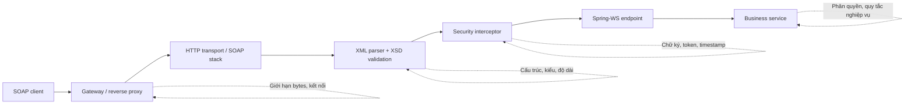

# Định nghĩa giới hạn dữ liệu, kích thước thông điệp và yêu cầu bảo mật

## Mục tiêu học tập

Sau bài này, bạn có thể:

1. Thiết kế **giới hạn dữ liệu** trong hợp đồng XML Schema (XSD): kiểu dữ liệu, độ dài, miền giá trị, số lượng phần tử, tính bắt buộc và định dạng.
2. Phân biệt giới hạn của **giá trị nghiệp vụ**, **cấu trúc XML**, **SOAP Envelope**, **HTTP request/response** và **tệp đính kèm MTOM**.
3. Xây dựng **ngân sách kích thước** khả thi, tính đến mã hóa Base64, namespace, SOAP Header, chữ ký, mã hóa, MIME multipart và giải nén.
4. Mô tả rõ yêu cầu **TLS, xác thực, phân quyền, WS-Security, chữ ký, timestamp, chứng chỉ** và chống tấn công vào XML ngay từ khi thiết kế contract-first.
5. Hiểu những gì XSD/WSDL có thể diễn đạt và những gì phải được cấu hình, thực thi và kiểm thử ở **Spring Web Services (Spring-WS)**, SOAP client, interceptor, gateway và hạ tầng.
6. Thiết kế trường hợp kiểm thử ranh giới, tải lớn, lỗi bảo mật và tương thích giữa các hệ thống doanh nghiệp.

## 1. Vì sao phải định nghĩa giới hạn ngay khi thiết kế hợp đồng SOAP?

Trong phát triển dịch vụ SOAP theo hướng **contract-first** với `SPRING_WEB_SERVICES`, nhóm xây dựng XSD cho dữ liệu nghiệp vụ, dùng WSDL mô tả các thao tác và bản tin, ánh xạ XML bằng JAXB, triển khai endpoint và SOAP client. Các bên trao đổi dữ liệu theo **hợp đồng có phiên bản**, vì vậy những giới hạn cần được thỏa thuận trước khi viết logic xử lý.

Xem một dịch vụ nhận tài liệu có thao tác `SubmitDocuments`. Nếu hợp đồng chỉ nói “gửi danh sách tài liệu”, nhiều câu hỏi chưa được trả lời:

- Một request có bao nhiêu tài liệu? Tên mỗi tài liệu được dài bao nhiêu?
- Có chấp nhận tài liệu rỗng, mã định danh trống hoặc số tiền âm không?
- Giới hạn 2 MiB áp dụng lên XML, byte HTTP hay dữ liệu tệp sau giải mã Base64?
- SOAP Header phục vụ bảo mật có được tính vào giới hạn không?
- Kẻ gửi có thể khai báo rất nhiều phần tử lồng nhau hoặc DTD để khiến parser tốn tài nguyên không?
- Ai phải xác thực thông điệp, kiểm tra chữ ký, phân quyền thao tác và trả SOAP Fault khi không đạt?

Nếu không trả lời rõ, client có thể gửi thông điệp hợp lệ theo một cách hiểu nhưng bị gateway chặn hoặc khiến server tiêu thụ quá nhiều bộ nhớ. Giới hạn rõ ràng bảo vệ cả **tính tương thích**, **tính toàn vẹn dữ liệu**, **tính sẵn sàng** và **an ninh tích hợp**.

### 1.1. Ba nhóm ràng buộc

| Nhóm | Câu hỏi trung tâm | Nơi mô tả/thực thi điển hình |
| --- | --- | --- |
| **Giới hạn dữ liệu** | Dữ liệu nào hợp lệ về tên, kiểu, giá trị, độ dài và số lượng? | XSD; quy tắc nghiệp vụ ở endpoint/domain service. |
| **Giới hạn thông điệp/tài nguyên** | Hệ thống nhận tối đa bao nhiêu byte, độ sâu XML, phần tử, tệp và thời gian xử lý? | Thỏa thuận tích hợp, gateway/HTTP server, SOAP stack, XML parser, hạ tầng, ứng dụng. |
| **Yêu cầu bảo mật** | Ai được gọi, thông điệp được tin cậy bằng cách nào, cần xác minh/chống replay ra sao? | TLS/mTLS, WS-Security, chính sách bảo mật, interceptor, keystore/truststore, nghiệp vụ phân quyền. |

**Một quy tắc có thể cần nhiều lớp cùng bảo vệ.** Ví dụ, XSD giới hạn dữ liệu nhị phân của một tài liệu ở 256 KiB, trong khi tầng HTTP vẫn phải chặn request vượt 2 MiB trước khi để JAXB hoặc endpoint xử lý.

## 2. Phân biệt hợp đồng, cấu hình khi chạy và chính sách tích hợp

### 2.1. XSD nói gì?

XSD định nghĩa **hình dạng và giá trị của XML**: phần tử, thứ tự, cấu trúc, loại dữ liệu, thuộc tính, số lượng xuất hiện, các điều kiện về giá trị và độ dài. Nó giúp client/server kiểm tra payload tuân thủ hợp đồng đã thống nhất.

Nhưng XSD **không tự giới hạn** tổng kích thước HTTP request, chi phí parse XML, tổng byte sau giải nén, số lượng request đồng thời hay thời gian chạy XPath. XML có thể phù hợp XSD nhưng toàn bản tin SOAP, HTTP header và MIME attachments vẫn vượt ngân sách.

### 2.2. WSDL nói gì?

WSDL 1.1 có thể mô tả operation, message, binding, service endpoint và thông tin SOAP header ở mức hợp đồng. Nó giúp công cụ và lập trình viên hiểu **dữ liệu được gửi tới thao tác nào**.

**WSDL 1.1 thuần không có một thuộc tính chuẩn chung để mọi SOAP stack tự hiểu “maxMessageSize=2MiB”.** Các ràng buộc hạ tầng thường được công bố trong tài liệu tích hợp hoặc cơ chế policy được hai bên hỗ trợ. Có thể gắn chính sách bảo mật thông qua **WS-Policy/WS-SecurityPolicy** trong môi trường tương thích, nhưng phải kiểm tra thực tế khả năng hiểu và thi hành policy của cả client lẫn server.

### 2.3. Ai thực thi điều gì?



Đây là sơ đồ trách nhiệm khái niệm; **thứ tự chính xác** giữa parse, validation, interceptor và xử lý bảo mật tùy SOAP stack/cấu hình. Không thể tránh parse XML hoàn toàn trước mọi kiểm tra, nên các giới hạn kích thước và parser an toàn phải được đặt càng sớm càng tốt tại những tầng có khả năng kiểm soát.

## 3. Thiết kế giới hạn dữ liệu bằng XSD

### 3.1. Những công cụ ràng buộc phổ biến

| Cấu trúc/facet XSD | Ý nghĩa | Tình huống sử dụng |
| --- | --- | --- |
| `xs:string`, `xs:integer`, `xs:decimal`, `xs:dateTime`, `xs:boolean` | Xác định kiểu XML Schema | Mã, số lượng, tiền tệ, thời điểm, cờ trạng thái. |
| `xs:minLength` / `xs:maxLength` | Giới hạn độ dài giá trị tương ứng với kiểu dữ liệu | Mã giao dịch, tên, mô tả; với `xs:base64Binary` độ dài đo theo octet sau giải mã. |
| `xs:pattern` | Giới hạn định dạng lexical bằng biểu thức chính quy theo cú pháp XSD | Mã gồm chữ hoa, chữ số và dấu gạch nối. |
| `xs:enumeration` | Giới hạn danh sách giá trị hợp lệ | `NEW`, `APPROVED`, `REJECTED`. |
| `xs:minInclusive` / `xs:maxInclusive` | Giới hạn miền giá trị, có tính biên | Số lượng hoặc giá trị tiền tối đa. |
| `xs:minExclusive` / `xs:maxExclusive` | Giới hạn miền giá trị, không tính biên | Chỉ chấp nhận số lớn hơn 0. |
| `xs:totalDigits` / `xs:fractionDigits` | Ràng buộc chữ số của `xs:decimal` | Tiền có tối đa hai chữ số phần thập phân. |
| `minOccurs` / `maxOccurs` | Ràng buộc số lần xuất hiện **phần tử** | Mỗi request có 1–3 tài liệu. |
| `use="required"`, `use="optional"` | Ràng buộc sự hiện diện của **thuộc tính** | Mã phiên bản/loại dữ liệu trên một phần tử. |
| `xs:sequence` / `xs:choice` | Quy định thứ tự hoặc lựa chọn các phần tử con | Payload cần các trường theo đúng thứ tự, hoặc chọn một trong hai loại dữ liệu. |
| `nillable`, `default`, `fixed` | Điều kiện với nil/giá trị mặc định hoặc cố định | Quy ước vắng mặt, nil và giá trị được ấn định. |

Các facet phải dùng đúng theo **kiểu cơ sở**. Ví dụ, `maxLength` trên `xs:string` là giới hạn độ dài chuỗi, không phải tổng byte của một SOAP message. `maxOccurs` áp dụng cho số lượng phần tử lặp, không phải số request gửi mỗi giây.

Một số quy tắc nghiệp vụ như “`endDate` phải sau `startDate`” hoặc “tổng tiền của các dòng bằng trường `total`” thường cần logic ứng dụng nếu hệ thống dùng **XSD 1.0**. XSD 1.1 có khả năng biểu đạt một số ràng buộc nâng cao như `xs:assert`, nhưng không nên giả định bộ kiểm tra schema trong môi trường Java/Spring-WS có hỗ trợ XSD 1.1; cần kiểm tra tính tương thích của parser thực tế.

### 3.2. XSD đầy đủ cho request gửi tài liệu

Giả sử ta đồng thuận các yêu cầu:

- `requestId` có 8–40 ký tự, chỉ gồm chữ Latin in hoa, số và dấu `-`.
- Mỗi request chứa **1 đến 3 tài liệu**.
- Tên tài liệu dài **1 đến 120 ký tự**.
- Trạng thái tài liệu thuộc một tập cho trước.
- Mỗi tài liệu có giá trị `amount` từ **0,01 đến 9.999.999,99**, tối đa 2 chữ số thập phân.
- Nội dung nhị phân sau giải mã Base64 tối đa **256 KiB (262.144 byte)**.
- Các phần tử nghiệp vụ dùng namespace `urn:example:documents:v1`.

Có thể diễn đạt trong XSD 1.0:

```xml
<?xml version="1.0" encoding="UTF-8"?>
<xs:schema
    xmlns:xs="http://www.w3.org/2001/XMLSchema"
    xmlns:tns="urn:example:documents:v1"
    targetNamespace="urn:example:documents:v1"
    elementFormDefault="qualified">

    <xs:simpleType name="RequestIdType">
        <xs:restriction base="xs:string">
            <xs:minLength value="8"/>
            <xs:maxLength value="40"/>
            <xs:pattern value="[A-Z0-9-]+"/>
        </xs:restriction>
    </xs:simpleType>

    <xs:simpleType name="TitleType">
        <xs:restriction base="xs:string">
            <xs:minLength value="1"/>
            <xs:maxLength value="120"/>
        </xs:restriction>
    </xs:simpleType>

    <xs:simpleType name="DocumentStatusType">
        <xs:restriction base="xs:string">
            <xs:enumeration value="NEW"/>
            <xs:enumeration value="APPROVED"/>
            <xs:enumeration value="REJECTED"/>
        </xs:restriction>
    </xs:simpleType>

    <xs:simpleType name="MoneyType">
        <xs:restriction base="xs:decimal">
            <xs:totalDigits value="9"/>
            <xs:fractionDigits value="2"/>
            <xs:minInclusive value="0.01"/>
            <xs:maxInclusive value="9999999.99"/>
        </xs:restriction>
    </xs:simpleType>

    <xs:simpleType name="DocumentContentType">
        <xs:restriction base="xs:base64Binary">
            <xs:maxLength value="262144"/>
        </xs:restriction>
    </xs:simpleType>

    <xs:complexType name="DocumentType">
        <xs:sequence>
            <xs:element name="title" type="tns:TitleType"/>
            <xs:element name="status" type="tns:DocumentStatusType"/>
            <xs:element name="amount" type="tns:MoneyType"/>
            <xs:element name="content" type="tns:DocumentContentType"/>
        </xs:sequence>
    </xs:complexType>

    <xs:element name="SubmitDocumentsRequest">
        <xs:complexType>
            <xs:sequence>
                <xs:element name="requestId" type="tns:RequestIdType"/>
                <xs:element name="document"
                            type="tns:DocumentType"
                            minOccurs="1"
                            maxOccurs="3"/>
            </xs:sequence>
        </xs:complexType>
    </xs:element>

</xs:schema>
```

Những điều quan trọng trong ví dụ:

1. `targetNamespace` và `elementFormDefault="qualified"` giúp xác định đúng namespace cho các phần tử trong payload, nhất là khi JAXB marshal/unmarshal qua WSDL.
2. `xs:sequence` nghĩa là `title`, `status`, `amount`, `content` phải xuất hiện đúng thứ tự ở mỗi `document`.
3. `requestId` được kiểm tra **theo nội dung chuỗi**. XSD pattern có cú pháp regex riêng; nó không tự biến thành Java regex, và trong XSD pattern, việc khớp áp dụng lên giá trị lexical theo quy tắc schema.
4. Giới hạn của `xs:base64Binary` đo theo **số octet của giá trị nhị phân đã giải mã**. Nội dung Base64 trong XML dài hơn số byte nhị phân, vì vậy giới hạn này **không thay thế** giới hạn tổng request.
5. Chỉ thiết kế schema không đảm bảo ứng dụng thực thi validation. Cần bật bộ xác thực thích hợp và kiểm thử các trường hợp biên.

### 3.3. Một payload phù hợp XSD

```xml
<doc:SubmitDocumentsRequest
    xmlns:doc="urn:example:documents:v1">
    <doc:requestId>DOC-2026-0001</doc:requestId>
    <doc:document>
        <doc:title>Biên bản bàn giao</doc:title>
        <doc:status>NEW</doc:status>
        <doc:amount>1250.00</doc:amount>
        <doc:content>SGVsbG8=</doc:content>
    </doc:document>
</doc:SubmitDocumentsRequest>
```

`SGVsbG8=` là Base64 của chuỗi byte `Hello`, dùng làm ví dụ tối giản; đây không phải tài liệu thực tế. Payload có đúng một `document`, tên nằm trong giới hạn, trạng thái thuộc enumeration và số tiền thỏa điều kiện.

### 3.4. Hai payload well-formed nhưng vi phạm hợp đồng

**Trường hợp 1: sai dữ liệu**

```xml
<doc:SubmitDocumentsRequest
    xmlns:doc="urn:example:documents:v1">
    <doc:requestId>abc</doc:requestId>
    <doc:document>
        <doc:title>Hợp đồng</doc:title>
        <doc:status>ARCHIVED</doc:status>
        <doc:amount>-10.00</doc:amount>
        <doc:content>SGVsbG8=</doc:content>
    </doc:document>
</doc:SubmitDocumentsRequest>
```

XML này đúng cú pháp XML nhưng vi phạm **ít nhất ba điều kiện XSD**: `requestId` sai định dạng/độ dài, `status` không thuộc enumeration và `amount` nhỏ hơn mức tối thiểu.

**Trường hợp 2: quá số lượng phần tử**

```xml
<doc:SubmitDocumentsRequest
    xmlns:doc="urn:example:documents:v1">
    <doc:requestId>DOC-2026-0001</doc:requestId>
    <!-- Nếu thêm bốn phần tử document hợp lệ ở đây:
         vẫn well-formed nhưng maxOccurs="3" sẽ không thỏa -->
</doc:SubmitDocumentsRequest>
```

Đoạn minh họa trên **cũng chưa hợp lệ** với XSD vì không chứa phần tử `document` bắt buộc; nó chỉ mô tả tình huống thêm bốn phần tử. Để kiểm thử chính xác lỗi `maxOccurs`, phải tạo **bốn `document` hoàn chỉnh** như định nghĩa trong schema và giữ tất cả dữ liệu còn lại hợp lệ.

### 3.5. Các quyết định cần tách khỏi XSD

Ngoài kiểm tra schema, người thiết kế cần ghi rõ:

- **Đơn vị đo:** “120 ký tự” khác “120 byte UTF-8”, đặc biệt với tiếng Việt có dấu. XSD giới hạn chuỗi theo đơn vị ký tự của kiểu schema; HTTP/gateway tính byte của biểu diễn thực tế.
- **Giá trị vắng mặt:** `minOccurs="0"` (không có phần tử) khác với phần tử rỗng (`<title/>`) và `xsi:nil="true"` khi có `nillable="true"`; không dùng các dạng thay thế nhau nếu contract không cho phép.
- **Giới hạn ứng dụng:** Một số ràng buộc liên trường, quota theo tài khoản, quyền xem tài liệu và kiểm tra checksum/cấu trúc file phải do nghiệp vụ hoặc thành phần chuyên trách đảm nhận.
- **Phiên bản:** Thay `maxOccurs=3` thành `maxOccurs=10` có thể gây tăng tải; siết `maxLength` từ 120 xuống 40 có thể làm client cũ không còn phù hợp. Thay đổi cần xem xét tương thích và kế hoạch versioning.

## 4. Định nghĩa kích thước thông điệp: phải nói rõ đang đo gì

Một bản tin SOAP có thể đi qua nhiều dạng dữ liệu:

```text
Đối tượng Java / giá trị nghiệp vụ
       |
       v
Payload XML + SOAP Header + SOAP Envelope
       |
       +---- Nếu gắn tệp kiểu inline Base64: dữ liệu nhị phân nở khoảng 4/3
       |
       +---- Nếu dùng MTOM/XOP: MIME multipart + XML part + binary parts
       |
       v
HTTP request/response (headers, body, có thể truyền chunked)
       |
       v
TLS, proxy, gateway, server container và SOAP stack
```

**Không có một đơn vị “kích thước thông điệp” duy nhất** đúng cho mọi hệ thống. Cần công bố rõ giới hạn đo tại lớp nào.

### 4.1. Các loại kích thước hay bị nhầm

| Loại giới hạn | Đối tượng được đo | Vì sao khác nhau? |
| --- | --- | --- |
| Giá trị trường XML | Độ dài chuỗi, số phần tử, octet của binary value theo XSD | Phản ánh dữ liệu hợp đồng, không phản ánh chi phí truyền tải. |
| Payload XML | Phần tử nghiệp vụ nằm trong SOAP Body | Không tính SOAP Envelope/Header và nhiều overhead khác. |
| SOAP Envelope XML | Toàn XML sau serialize, gồm Header và Body | Namespace, security header, chữ ký và mã hóa làm tăng kích thước. |
| HTTP entity body | Dữ liệu body truyền qua HTTP, có thể là XML hoặc MIME multipart | Khác SOAP Envelope nếu có attachments hoặc content coding. |
| Dữ liệu sau giải nén/giải mã | XML, text, tệp và các cấu trúc sau khi giải nén, decode | Có thể lớn hơn rất nhiều dữ liệu truyền trên dây. |
| HTTP request tổng thể | Request line, HTTP headers và body | Giới hạn của reverse proxy/container có thể áp dụng khác nhau cho từng phần. |
| Bộ nhớ khi xử lý | Object tree, DOM, JAXB object, buffers và dữ liệu tạm | Thường vượt xa số byte đầu vào; không suy ra đơn giản từ Content-Length. |

Ví dụ, “tối đa 2 MiB” phải được viết thành một câu đo lường cụ thể: “**HTTP request body tối đa 2.097.152 byte sau khi áp dụng quy tắc xử lý Content-Encoding đã thống nhất**”, kèm quy định riêng cho dữ liệu chưa giải nén nếu cho phép nén. Hai phía cần biết lúc nào và ở đâu đo.

### 4.2. Base64 làm tăng kích thước bao nhiêu?

Khi truyền nhị phân trực tiếp dưới dạng Base64 trong XML, độ dài chuỗi Base64 thuần (chưa tính khoảng trắng, thẻ XML, SOAP Header) thường là:

```text
base64EncodedLength(n) = 4 * ceil(n / 3)
```

Trong đó `n` là số byte nhị phân đầu vào. Với 262.144 byte (256 KiB), chuỗi Base64 chuẩn dài **349.528 ký tự ASCII**, tức khoảng **341,34 KiB** nếu ghi liền bằng UTF-8.

**Ví dụ ngân sách:** 3 tài liệu × 256 KiB = 768 KiB nhị phân. Chỉ riêng Base64 inline cho 3 tài liệu có thể đạt khoảng **1 MiB** trước khi thêm thẻ, namespace, Header, chữ ký và metadata. Vì vậy, giới hạn “mỗi file 256 KiB” không suy ra ngay một giới hạn toàn request 768 KiB.

Dùng **MTOM/XOP** có thể giúp truyền binary theo MIME parts mà tránh nội tuyến hóa toàn bộ thành Base64 dài, nhưng không làm tệp biến mất khỏi giới hạn tổng request và không loại bỏ nhu cầu kiểm soát số lượng, kích thước và nội dung attachments.

### 4.3. Bộ ngân sách minh họa cho dịch vụ SubmitDocuments

Giả sử kiến trúc chấp nhận file nhỏ và muốn giới hạn ở mức thận trọng. Có thể thỏa thuận:

| Quy tắc minh họa | Giá trị | Nơi thực thi |
| --- | --- | --- |
| Tài liệu trong một request | 1–3 | XSD `minOccurs/maxOccurs`, kiểm thử endpoint. |
| Nhị phân mỗi tài liệu | Tối đa 256 KiB sau Base64 decode | XSD facet `maxLength` cho `base64Binary` khi dữ liệu inline; kiểm soát attachment/binary ở runtime. |
| Tổng nhị phân tài liệu | Tối đa 768 KiB | Endpoint/attachment handler và quota tài nguyên; với đúng 3 file × 256 KiB thì đây là giới hạn suy ra. |
| HTTP request body | Tối đa 2 MiB (2.097.152 byte) | Gateway, HTTP server, streaming reader; quy định rõ trước/sau giải nén. |
| SOAP Envelope XML đã giải nén | Tối đa 2 MiB | Tầng có khả năng giới hạn dữ liệu XML sau giải nén/trước khi xử lý hoàn chỉnh. |
| Độ sâu cây XML | Tối đa 32 cấp | Parser/giới hạn ứng dụng khi nền tảng hỗ trợ. |
| Số phần tử XML trong thông điệp | Tối đa 10.000 | Parser/streaming filter/giới hạn ứng dụng khi nền tảng hỗ trợ. |
| Thời gian xử lý request | Theo SLA cụ thể của hệ thống | Gateway, timeout HTTP, thread pool, call downstream. |
| Số request đồng thời/quota | Theo năng lực và chính sách khách hàng | Gateway, rate limiter, admission control. |

**Đây là ví dụ thiết kế, không phải mặc định của Spring-WS hay chuẩn SOAP.** Giá trị phải được điều chỉnh bằng dữ liệu tải thực tế, đặc điểm tệp, bảo mật và SLA. Nếu cho phép MTOM, cần thêm giới hạn **từng MIME part**, tổng số part, tổng MIME body và overhead; nếu chỉ cho phép XML thuần thì phải từ chối hoặc xử lý rõ các content type ngoài hợp đồng.

### 4.4. Những bẫy thường gặp khi giới hạn theo byte

1. **Content-Length không đáng tin để làm biện pháp duy nhất.** Request có thể truyền chunked hoặc qua proxy biến đổi; phải áp giới hạn lên lượng byte thực sự đọc.
2. **Nén dữ liệu:** body nhỏ khi nén có thể phình rất lớn sau giải nén. Cần giới hạn cả kích thước đầu vào và kích thước sau giải nén, hoặc không chấp nhận content coding chưa được hỗ trợ.
3. **XML ký/tích hợp bảo mật:** chữ ký, khóa, timestamp và encryption làm tăng kích thước; ngân sách cho message được bảo mật phải có headroom.
4. **Unicode:** một ký tự tiếng Việt có thể chiếm nhiều byte UTF-8; `xs:maxLength` của chuỗi không thay cho giới hạn số byte.
5. **DOM/JAXB:** tải toàn bộ XML hoặc tệp vào bộ nhớ có thể tốn RAM hơn raw bytes đáng kể. Một request 2 MiB không tương đương chỉ 2 MiB RAM.
6. **Request và response:** áp giới hạn cho cả yêu cầu đầu vào và phản hồi đầu ra, kể cả SOAP Fault hoặc danh sách dữ liệu lớn.
7. **Nhiều hop:** client, reverse proxy, SOAP gateway, endpoint và đối tác cần thống nhất giới hạn hiệu dụng; mức thấp nhất trên đường đi sẽ quyết định bản tin có qua được không.

## 5. Định nghĩa yêu cầu bảo mật ngay trong thiết kế contract-first

### 5.1. Mô hình đe dọa tối thiểu

| Rủi ro | Ví dụ | Biện pháp hợp đồng/vận hành |
| --- | --- | --- |
| Nghe lén trên đường truyền | Kẻ thứ ba đọc nội dung hợp đồng trong SOAP body | TLS đúng cấu hình; khi cần bảo mật xuyên qua intermediary, dùng mã hóa thông điệp phù hợp. |
| Giả mạo client | Ứng dụng không được phép gọi `SubmitDocuments` | mTLS, token hoặc cơ chế xác thực được hỗ trợ và xác nhận ở phía nhận. |
| Sửa payload hoặc header | Giá trị số tiền, quyền hạn bị thay trên đường đi | Chữ ký thông điệp với phạm vi ký rõ ràng, kiểm tra integrity và ràng buộc danh tính. |
| Phát lại thông điệp | Kẻ tấn công gửi lại cùng lệnh đã ký | Timestamp, nonce/message ID, cửa sổ thời gian, bộ nhớ chống replay, idempotency ở nghiệp vụ. |
| Truy cập vượt quyền | Client hợp lệ đọc/gửi tài liệu của khách hàng khác | Phân quyền theo tenant, người dùng, operation và đối tượng nghiệp vụ. |
| Tấn công vào XML parser | DTD/XXE, entity expansion, payload lồng sâu | Tắt xử lý external entities/DTD nếu không cần; parser an toàn và giới hạn tài nguyên. |
| Tấn công cạn tài nguyên | Gửi payload rất lớn, quá nhiều tệp hoặc nhiều kết nối | Byte limit, part limit, concurrency quota, timeout, rate limit và theo dõi. |
| Lộ thông tin trong lỗi/log | Fault hoặc nhật ký chứa token, tài liệu, khóa | Ẩn thông tin nhạy cảm, kiểm soát log, không phản hồi stack trace cho client. |

Các biện pháp trên bổ sung nhau: **XML Schema không xác minh quyền**, **TLS không tự đảm bảo dữ liệu vẫn được bảo vệ khi gateway kết thúc TLS**, và **WS-Security không thay cho giới hạn tài nguyên**.

### 5.2. TLS và mTLS: bảo vệ kênh truyền

- **TLS** mã hóa và bảo vệ kết nối giữa hai đầu của một hop; xác minh chứng chỉ máy chủ và cấu hình phiên bản/cipher theo chính sách hiện hành.
- **mTLS** thêm chứng chỉ client để xác thực bên kết nối. Cần xác định CA tin cậy, chuỗi chứng chỉ, thời hạn, thu hồi, vòng đời gia hạn và ánh xạ danh tính chứng chỉ vào quyền ứng dụng.
- Nếu đường đi là `client → gateway → backend` và gateway kết thúc TLS, tính bảo mật của kênh TLS đầu tiên **không tự động kéo dài xuyên qua gateway**. Cần bảo vệ hop tiếp theo bằng TLS và đánh giá có cần chữ ký/mã hóa ở **mức thông điệp** hay không.

Hợp đồng tích hợp nên ghi rõ các endpoint HTTPS, yêu cầu xác thực hai chiều hay một chiều, danh tính client được chấp nhận và chính sách cấp/đổi chứng chỉ; không ghi mật khẩu hoặc private key trong WSDL/XSD.

### 5.3. WS-Security: bảo vệ ở mức thông điệp SOAP

WS-Security định nghĩa cách đặt các thành phần bảo mật vào **SOAP Header** để các bên trao đổi và xác minh token, chữ ký hoặc nội dung mã hóa theo bộ chuẩn và cấu hình tương thích.

Các yêu cầu phải thống nhất:

1. **Xác thực bằng gì?** Ví dụ token theo chính sách hoặc chứng chỉ X.509; ai cấp và ai là bên tin cậy.
2. **Ký những phần nào?** Chỉ ký Body có thể không bảo vệ đủ thông tin định tuyến hoặc các header bắt buộc quan trọng. Cần xác định rõ các phần được ký, ID và cách chống signature wrapping.
3. **Có mã hóa trường/toàn phần thông điệp không?** Nếu có, ai là bên có thể giải mã, thuật toán được cho phép và những intermediary nào phải xem nội dung?
4. **Đồng hồ/timestamp:** Dung sai lệch thời gian, khoảng hiệu lực, cách xử lý thông điệp cũ và đồng bộ thời gian hệ thống.
5. **Chống replay:** Cơ chế phát hiện lặp `MessageId`/nonce/chữ ký hoặc nghiệp vụ idempotency, thời gian lưu trạng thái, phạm vi theo client.
6. **Quản lý khóa:** keystore/truststore, chọn bí danh chứng chỉ, xoay vòng, thu hồi và giới hạn truy cập khóa riêng.
7. **Thuật toán:** bộ thuật toán chữ ký, digest, mã hóa và canonicalization được hai phía hỗ trợ và không bị chính sách tổ chức cấm.
8. **Thất bại:** SOAP Fault và thông tin lỗi đủ để client xử lý, nhưng không lộ token, chữ ký đầy đủ, private key hoặc chi tiết nội bộ.

Ví dụ *rút gọn để minh họa vị trí* một header WS-Security:

```xml
<soap:Envelope
    xmlns:soap="http://schemas.xmlsoap.org/soap/envelope/"
    xmlns:wsse="http://docs.oasis-open.org/wss/2004/01/oasis-200401-wss-wssecurity-secext-1.0.xsd"
    xmlns:wsu="http://docs.oasis-open.org/wss/2004/01/oasis-200401-wss-wssecurity-utility-1.0.xsd"
    xmlns:doc="urn:example:documents:v1">
    <soap:Header>
        <wsse:Security soap:mustUnderstand="1">
            <wsu:Timestamp wsu:Id="TS-1">
                <wsu:Created>2026-11-27T02:00:00Z</wsu:Created>
                <wsu:Expires>2026-11-27T02:05:00Z</wsu:Expires>
            </wsu:Timestamp>
            <!-- Trong bản tin thật, có thể cần token, Signature,
                 EncryptedData và các tham chiếu theo profile bảo mật. -->
        </wsse:Security>
    </soap:Header>
    <soap:Body>
        <!-- Payload SubmitDocumentsRequest theo XSD hợp đồng. -->
    </soap:Body>
</soap:Envelope>
```

**Đây không phải bản tin đã xác thực hay có chữ ký hợp lệ**: Timestamp mẫu cũng chỉ minh họa hình dạng, không chứng minh chống replay. Hệ thống thật phải tạo và xác minh đầy đủ cấu trúc chuẩn tương ứng theo chính sách WS-Security. Dấu `mustUnderstand="1"` nghĩa là node nhận phù hợp phải xử lý ngữ nghĩa của header; nó **không tự kiểm tra chữ ký**.

### 5.4. XML security: bảo vệ parser trước khi dữ liệu thành đối tượng Java

SOAP dựa trên XML nên có các rủi ro đặc thù:

- **XXE (XML External Entity):** parser truy cập tài nguyên ngoài, đọc file hoặc gọi dịch vụ mạng nếu DTD/external entity được cho phép.
- **Entity expansion/billion laughs:** mở rộng thực thể tạo dữ liệu khổng lồ từ đầu vào nhỏ.
- **Độ sâu và số node cực lớn:** XML hợp lệ về cú pháp nhưng làm CPU/RAM tăng cao.
- **XPath/XSLT và các bước xử lý XML phức tạp:** cần giới hạn tính năng và tài nguyên theo công cụ sử dụng.
- **XML Signature Wrapping:** ứng dụng kiểm tra chữ ký trên một phần tử nhưng lại xử lý một phần tử khác có cùng ý nghĩa nghiệp vụ; cần ràng buộc chính xác phần tử đã được xác minh.

Thiết lập parser theo hướng an toàn: **vô hiệu DTD/external entities nếu không cần**, không cho phép tải external schema tùy ý, dùng secure processing phù hợp, giới hạn kích thước và độ sâu; kiểm tra cấu hình của mọi XML parser trên đường đi, bao gồm gateway, security library, JAXB và công cụ chuyển đổi XML.

Không tự viết parser xác minh XML Signature bằng cách so sánh chuỗi XML thô. Sử dụng thư viện WS-Security/crypto được duy trì và cấu hình xác minh dựa trên phần tử/nội dung đã ký.

### 5.5. Xác thực khác phân quyền

Một request có chữ ký hợp lệ chỉ chứng minh một tập điều kiện xác thực và tính toàn vẹn đã được đáp ứng theo chính sách. **Nó chưa chứng minh client được phép thực hiện operation hay thao tác trên documentId đó.**

Ví dụ kiểm tra nghiệp vụ:

```text
1. Xác thực danh tính client / chứng chỉ / token.
2. Xác minh chữ ký, timestamp, chống replay.
3. Định danh tenant và vai trò nghiệp vụ của client.
4. Kiểm tra quyền SubmitDocuments của client với tenant cụ thể.
5. Kiểm tra requestId/idempotency và quy tắc dữ liệu nghiệp vụ.
6. Chỉ sau đó ghi dữ liệu hoặc phát sinh hiệu ứng nghiệp vụ.
```

Thứ tự thực tế tùy kiến trúc, nhưng các kiểm tra phải cùng được đáp ứng trước khi thay đổi trạng thái nghiệp vụ.

## 6. Thể hiện ràng buộc trong bộ tài liệu hợp đồng

Một hợp đồng đầy đủ thường có nhiều lớp tài liệu tương ứng:

| Hiện vật | Nội dung nên có |
| --- | --- |
| **XSD** | Kiểu dữ liệu, min/max, pattern, enumeration, số lượng phần tử, namespace, quy tắc vắng mặt/nil. |
| **WSDL** | Operation, request/response, binding SOAP 1.1/1.2, các thông điệp và header được định nghĩa cho giao dịch. |
| **WS-Policy / WS-SecurityPolicy** (khi tương thích) | Những security assertion mà công cụ hai bên hiểu và hỗ trợ. |
| **Integration profile / API contract bổ sung** | Kích thước tính theo lớp nào, byte limit, MIME/MTOM, timeout, rate limit, compression, encoding, những quy tắc chưa thể diễn tả bằng XSD/WSDL. |
| **Security profile** | TLS/mTLS, danh tính/chứng chỉ tin cậy, các phần cần ký, bảo mật header, thuật toán, timestamp, chống replay, key rotation, xử lý lỗi. |
| **Conformance test cases** | Positive/negative cases, ranh giới byte, dữ liệu nhị phân, chữ ký, Fault và hành vi giữa các phiên bản. |

Ví dụ tóm tắt tích hợp (các con số chỉ là minh họa):

```yaml
# Ví dụ profile hợp đồng, không phải tệp cấu hình Spring-WS có thể chạy trực tiếp.
operation: SubmitDocuments
soapVersion: "1.1"
encoding: UTF-8
input:
  namespace: "urn:example:documents:v1"
  schema: "documents-v1.xsd"
  minDocuments: 1
  maxDocuments: 3
  binaryBytesPerDocumentMax: 262144
transport:
  allowedContentTypes:
    - "text/xml"
  requestBodyBytesMax: 2097152
  responseBodyBytesMax: 2097152
  contentEncoding: identity
  mtomEnabled: false
security:
  tlsRequired: true
  mutualTlsRequired: true
  wsSecuritySignatureRequired: true
  signedParts:
    - "SOAP Body"
    - "WS-Security Timestamp"
  timestampToleranceSeconds: 300
  replayProtectionRequired: true
```

Bảng cấu hình mẫu này **không thay thế** XSD hoặc WS-SecurityPolicy. Các hệ thống phải chuyển nó thành cấu hình thật của gateway, HTTP server, Spring-WS, WSS4J, client và chính sách vận hành. Ví dụ giả định profile **chỉ chấp nhận XML inline**; nếu triển khai MTOM phải thay đổi `allowedContentTypes`, giới hạn MIME và cách đo byte cho phù hợp.

Các trường `signedParts` ở đây chỉ mô tả ý định; cách chỉ định chính xác các phần được ký trong WS-Security phụ thuộc vào chính sách và thư viện được dùng.

## 7. Triển khai kiểm soát ở Spring Web Services

### 7.1. Xác thực XSD ở tầng endpoint

Spring-WS cung cấp các interceptor kiểm tra schema, chẳng hạn `PayloadValidatingInterceptor`. Dưới đây là **một phần cấu hình Java** minh họa kiểm tra payload yêu cầu và phản hồi theo XSD đã thiết kế:

```java
import org.springframework.context.annotation.Bean;
import org.springframework.core.io.ClassPathResource;
import org.springframework.ws.soap.server.endpoint.interceptor.PayloadValidatingInterceptor;

public class ValidationConfiguration {

    @Bean
    public PayloadValidatingInterceptor payloadValidatingInterceptor() {
        PayloadValidatingInterceptor interceptor =
                new PayloadValidatingInterceptor();

        interceptor.setXsdSchema(
                new ClassPathResource("xsd/documents-v1.xsd"));
        interceptor.setValidateRequest(true);
        interceptor.setValidateResponse(true);
        return interceptor;
    }
}
```

Giả sử `xsd/documents-v1.xsd` nằm trong classpath và interceptor **được đăng ký vào chuỗi xử lý endpoint** theo cấu hình Spring-WS thực tế. Chỉ khai báo bean ở ví dụ này **chưa đủ để chắc chắn interceptor đã tham gia xử lý**, nếu chưa cấu hình đăng ký phù hợp.

Phần kiểm tra XSD chỉ xử lý quy tắc có trong schema. Cần thêm chặn kích thước byte đầu vào, giới hạn parser, kiểm tra WS-Security, phân quyền và chống replay riêng.

**Chú ý phiên bản:** API và cách đăng ký có thể khác tùy Spring-WS/Spring Boot đang dùng. Trước khi áp dụng vào dự án thật, hãy đối chiếu dependency và tài liệu của đúng phiên bản.

### 7.2. Kiểm tra giới hạn trước khi tạo đối tượng lớn

Giả sử endpoint dùng JAXB để nhận dữ liệu:

```java
@Endpoint
public class DocumentEndpoint {

    private static final String NS = "urn:example:documents:v1";

    @PayloadRoot(
        namespace = NS,
        localPart = "SubmitDocumentsRequest")
    @ResponsePayload
    public SubmitDocumentsResponse submit(
            @RequestPayload SubmitDocumentsRequest request) {
        // Giả sử JAXB classes được sinh hoặc định nghĩa theo XSD.
        // Thực thi phân quyền, chống replay và nghiệp vụ tại tầng phù hợp.
        return documentService.submit(request);
    }
}
```

Đây chỉ là **khung minh họa**, không phải lớp Java biên dịch độc lập: các lớp JAXB, `documentService`, import và cấu hình được cung cấp bởi ứng dụng.

Giới hạn HTTP body và kích thước XML **phải được áp trước khi endpoint tạo/cầm trong tay cây đối tượng quá lớn**. Nếu chờ vào phương thức `submit(...)` rồi mới kiểm tra request dài 100 MiB, hệ thống có thể đã tiêu thụ tài nguyên để parse và unmarshal. Vì thế:

1. **Gateway/reverse proxy** chặn request quá lớn, giới hạn timeout, kết nối và tốc độ.
2. **HTTP servlet container / transport layer** áp giới hạn body, streaming và connection khi hỗ trợ.
3. **SOAP parser/message factory** dùng cấu hình XML an toàn, hạn chế DTD/external entity, entity expansion, depth/element counts khi công cụ hỗ trợ.
4. **Schema validation interceptor** kiểm tra payload XSD.
5. **Security interceptor** kiểm tra các yêu cầu WS-Security và tạo lỗi thích hợp nếu không hợp lệ.
6. **Endpoint/domain** kiểm tra quyền, tính nhất quán liên trường, idempotency và quota theo chủ thể.

Không nên giả định mọi giới hạn đều có sẵn thành một property chung của Spring-WS. Một số giới hạn thuộc server/container, gateway hoặc thư viện xử lý XML; cách cấu hình cần được xác minh với stack thực tế.

### 7.3. WS-Security và WSS4J

Spring-WS có thể tích hợp WSS4J để tạo hoặc xác minh các thành phần WS-Security. Ví dụ các kiểm tra cần cấu hình trong một hệ thống yêu cầu chữ ký và timestamp:

```text
Inbound SOAP message
  |
  +-- Chọn SOAP role/actor và chính sách header bắt buộc
  |
  +-- Xác minh WS-Security Timestamp (cửa sổ hiệu lực)
  |
  +-- Xác minh chữ ký trên các phần được yêu cầu
  |     +-- Tin cậy chứng chỉ / định danh / chain
  |     +-- Kiểm tra phần tử thực sự được ký
  |
  +-- Chống replay / kiểm tra idempotency
  |
  +-- Đối chiếu danh tính và phân quyền thao tác
  |
  +-- Xử lý payload theo XSD và nghiệp vụ
```

Sơ đồ thể hiện **các điều kiện cần kiểm tra**, không ấn định thứ tự chạy tuyệt đối của interceptor trong framework.

Phải thỏa thuận đầu vào của WSS4J/WS-Security với phía client: loại token, chữ ký, thuật toán, truststore, alias, phần ký, timestamp và Fault. Không sử dụng chứng chỉ thử nghiệm hoặc mật khẩu cứng trong tài liệu contract hay mã nguồn production.

### 7.4. SOAP Fault và HTTP error

Khi giới hạn bị vi phạm, cần quy định **kênh phản hồi**:

| Lỗi | Tầng phát hiện điển hình | Phản hồi thường phù hợp |
| --- | --- | --- |
| HTTP body vượt giới hạn của gateway | Gateway/reverse proxy | HTTP `413 Content Too Large` (hoặc hành vi gateway tương ứng); có thể chưa có SOAP Fault vì chưa giải mã SOAP. |
| XML sai cú pháp / Envelope không đọc được | SOAP parser/stack | Fault SOAP nếu stack đã nhận diện và tạo được phản hồi; nếu lỗi ở tầng HTTP có thể trả HTTP error. |
| Payload sai XSD | Validation interceptor | SOAP Fault phù hợp với phiên bản SOAP và quy ước ứng dụng. |
| Header `mustUnderstand` bắt buộc nhưng node đích không hiểu | SOAP node đúng actor/role | SOAP Fault mã `MustUnderstand`. |
| Chữ ký, token, timestamp không hợp lệ | Security interceptor | Lỗi/Fault bảo mật theo WS-Security và chính sách. |
| Caller không được phép gửi tài liệu | Authorization layer | Lỗi phân quyền an toàn, không lộ quy tắc nội bộ. |
| Hết quota hoặc quá nhiều request | Gateway/rate limiter/ứng dụng | Lỗi/throttling nhất quán, hướng dẫn retry khi thích hợp. |

SOAP 1.1 và SOAP 1.2 có định dạng Fault khác nhau. **Không** khẳng định “mọi lỗi đều trả HTTP 500 với cùng một Fault”, vì gateway có thể từ chối trước khi SOAP được parse, còn các kết nối và binding có quy tắc riêng.

## 8. Bảo vệ tính tương thích khi giới hạn thay đổi

### 8.1. Giảm giới hạn có thể phá vỡ client cũ

Giả sử `documents-v1.xsd` đang cho phép `maxOccurs=10`, sau đó dịch vụ giảm xuống `maxOccurs=3`. Dù hai bản đều là XSD hợp lệ, client đang gửi 5 tài liệu sẽ bị từ chối. Đây là thay đổi **không tương thích** đối với client đó.

Cần xem xét phiên bản hợp đồng, giao tiếp trước với đối tác, giai đoạn chuyển đổi và conformance tests. Không nên chỉ sửa hạ tầng rồi để client gặp lỗi ngẫu nhiên.

### 8.2. Nới XSD có thể tạo vấn đề tài nguyên

Nếu tăng `maxOccurs` từ 3 lên 100 nhưng vẫn giới hạn mỗi tài liệu 256 KiB, chỉ riêng dữ liệu nhị phân có thể lên đến **25 MiB**, vượt xa HTTP request body 2 MiB minh họa. Vì vậy thay đổi **schema, kích thước, hạ tầng và SLA phải được xem xét cùng nhau**.

Ngay cả khi nới giới hạn chỉ mang tính “chấp nhận thêm”, nó vẫn có thể ảnh hưởng đến bộ nhớ, timeout, số request xử lý đồng thời và chi phí chữ ký/giải mã.

### 8.3. Thay đổi bảo mật cần điều phối

Đổi chứng chỉ, thuật toán, cấu trúc WS-Security Header hoặc chính sách signed parts có thể khiến client và server không còn nói chuyện được với nhau mặc dù payload vẫn hợp lệ theo XSD.

Một kế hoạch tương thích nên xác định:

- Khả năng chạy đồng thời chứng chỉ cũ/mới trong giai đoạn rollover, và cách thu hồi chứng chỉ cũ.
- Thời gian cho phép đối tác nâng cấp cấu hình bảo mật.
- Hành vi khi thiếu header, sai role, thiếu chữ ký hoặc timestamp quá hạn.
- Cách phát hiện các client còn dùng phiên bản cấu hình cũ bằng metric/log không chứa dữ liệu nhạy cảm.
- Chính sách thử nghiệm trước khi cho phép gọi production.

## 9. Kiểm thử giới hạn: đo đúng biên, đúng lớp

Bộ kiểm thử cần bao gồm **happy path**, giá trị sát biên, vượt biên và payload có cấu trúc đối kháng. Bảng sau là gợi ý cho ví dụ `SubmitDocuments`:

| Kiểm thử | Dữ liệu đưa vào | Kỳ vọng |
| --- | --- | --- |
| Số tài liệu tối thiểu | 1 `document` hợp lệ | XSD chấp nhận. |
| Số tài liệu tối đa | 3 `document` hợp lệ | XSD chấp nhận. |
| Số tài liệu vượt mức | 4 `document` hợp lệ | Bị từ chối vì `maxOccurs`. |
| ID quá ngắn | `requestId="ABC"` | Bị từ chối theo `minLength`/pattern. |
| Tên dài đúng biên | `title` dài 120 ký tự hợp lệ | XSD chấp nhận. |
| Tên vượt biên | `title` dài 121 ký tự | XSD từ chối. |
| Số tiền tối thiểu | `0.01` | XSD chấp nhận. |
| Số tiền dưới biên | `0.00` hoặc `-1` | XSD từ chối. |
| Số tiền thừa phần thập phân | `1.234` | XSD từ chối do `fractionDigits=2`. |
| File đúng kích thước | Binary value đúng 262.144 byte | Phù hợp facet `maxLength` nếu các điều kiện khác hợp lệ. |
| File vượt mức | Binary value 262.145 byte | XSD từ chối theo `maxLength` khi được validation. |
| Request body đúng ngưỡng | 2.097.152 byte HTTP entity body | Được phép qua bước giới hạn byte; vẫn phải đáp ứng schema, policy và nội dung. |
| Request body quá ngưỡng | 2.097.153 byte HTTP entity body | Gateway/container từ chối theo cấu hình. |
| Nén quá mức | HTTP body nhỏ nhưng giải nén vượt giới hạn | Bị từ chối ở giới hạn sau giải nén hoặc do không hỗ trợ Content-Encoding. |
| XML có external entity | Payload cố sử dụng DTD/XXE | Parser an toàn ngăn xử lý nguy hiểm. |
| XML rất sâu/nhiều phần tử | Gần/vượt depth và node limit | Bị từ chối trước khi gây cạn tài nguyên. |
| Header bảo mật thiếu chữ ký | Request body hợp lệ XSD | Bị từ chối theo chính sách WS-Security. |
| Timestamp quá hạn hoặc replay | Thông điệp gửi lại | Bị từ chối theo chính sách bảo mật/anti-replay. |
| Không có quyền thao tác | Chữ ký hợp lệ, tenant sai | Bị từ chối ở tầng authorization. |
| Client sử dụng schema cũ | Request v1/v2 khác nhau | Quan sát đúng chính sách backward compatibility. |

**Phân biệt hai mục tiêu:** kiểm tra XSD bằng tài liệu payload độc lập, và kiểm thử tích hợp bằng SOAP Envelope qua HTTP/gateway. Nếu chỉ gọi trực tiếp phương thức Java của endpoint, bạn sẽ không kiểm tra được đúng giới hạn transport hay cách xử lý SOAP Header.

### 9.1. Dùng công cụ kiểm tra XSD cho payload

Nếu môi trường có `xmllint` và đã lưu XSD vào `documents-v1.xsd`, payload XML vào `request.xml`:

```bash
# Xác nhận XML well-formed
xmllint --noout request.xml

# Xác thực payload độc lập theo XSD
xmllint --noout --schema documents-v1.xsd request.xml
```

Ví dụ trên dành cho **payload riêng**, không phải toàn SOAP Envelope. Nếu cần kiểm tra SOAP Envelope, phải dùng công cụ biết SOAP hoặc trích đúng payload để kiểm tra schema tương ứng.

### 9.2. Kiểm thử tích hợp và quan sát

Trong hệ thống thật, cần đo được số request bị chặn theo nguyên nhân: body vượt ngưỡng, schema violation, security failure, timeout, rate limit. Nên ghi **request ID**, endpoint, phiên bản SOAP, kích thước body, loại lỗi và hop phát hiện; tuyệt đối không mặc định log nguyên văn SOAP body, Authorization header, mật khẩu hay khóa riêng.

Kết hợp thử nghiệm tải nhỏ có kiểm soát, kiểm thử dưới ngưỡng/sát ngưỡng/vượt ngưỡng và đo CPU/RAM/thời gian validate signature để chọn giới hạn phù hợp. Tránh chạy kiểm thử phá tải trực tiếp trên hệ thống sản xuất.

## 10. Bài tập thực hành

### Bài 1: phân loại ràng buộc

Cho các quy tắc sau:

1. `orderId` có 8–40 ký tự.
2. SOAP request tối đa 2 MiB qua HTTP.
3. Mỗi yêu cầu tối đa 3 tài liệu.
4. Client phải dùng chứng chỉ được doanh nghiệp tin cậy.
5. Một client tối đa 100 request/phút.

Hãy chọn nơi mô tả/thực thi chính.

**Đáp án gợi ý:** (1) và (3) trong XSD; (2) công bố trong integration profile và thực thi ở gateway/HTTP server; (4) security profile và TLS/mTLS/truststore; (5) rate limiter/gateway và quota ứng dụng. Quy tắc nào cũng cần kiểm thử tích hợp, nhưng không phải mọi quy tắc đều diễn tả được bằng XSD.

### Bài 2: Base64 và ngân sách thông điệp

Một request có 3 file, mỗi file 256 KiB. Nếu gửi inline Base64, phần chuỗi Base64 thuần chiếm khoảng bao nhiêu byte UTF-8?

**Đáp án:** Mỗi file 262.144 byte thành `4 × ceil(262144/3) = 349528` ký tự Base64. Ba file tạo ra `1.048.584` byte ASCII/Base64, khoảng 1 MiB, chưa gồm XML/SOAP và WS-Security. Dù dữ liệu gốc tổng 768 KiB, request không thể dùng chính 768 KiB làm giới hạn byte trên dây.

### Bài 3: hiểu mức bảo vệ của XSD

XSD có `xs:maxLength=262144` trên `xs:base64Binary`. Có thể bỏ hẳn giới hạn HTTP body không?

**Đáp án:** Không. XSD chỉ giới hạn **giá trị nhị phân** tương ứng sau khi decode (khi validation được thực thi). SOAP Header, các phần tử XML khác, nhiều file, multipart MTOM, payload ác ý hoặc chi phí parsing vẫn có thể tiêu tốn tài nguyên. Cần cả giới hạn transport, parser và ứng dụng.

### Bài 4: đánh giá phản hồi bảo mật

Client gửi request hợp lệ theo schema nhưng thiếu chữ ký WS-Security bắt buộc. Server có được xử lý dữ liệu nghiệp vụ vì JAXB unmarshal thành công không?

**Đáp án:** Không. Validation schema và unmarshal không thay thế kiểm tra bảo mật. Server phải thực thi các yêu cầu xác thực/toàn vẹn/timestamp/ủy quyền theo chính sách trước khi cho phép hiệu ứng nghiệp vụ và trả lỗi phù hợp khi thiếu chữ ký.

### Bài 5: thay đổi hợp đồng

Phiên bản v1 cho 1–3 file, tối đa 256 KiB mỗi file, HTTP body 2 MiB. Phiên bản v2 muốn tăng lên 1–20 file. Những việc cần rà soát?

**Đáp án gợi ý:** Cập nhật `maxOccurs` và kế hoạch tương thích XSD/WSDL; tính lại tổng binary và overhead Base64/MTOM; điều chỉnh hoặc giữ giới hạn HTTP body có chủ đích; kiểm tra CPU/RAM, timeout, concurrency, quota, chữ ký/mã hóa và hành vi lỗi; kiểm thử client/server/gateway với dữ liệu sát và vượt biên. Không nên chỉ sửa `maxOccurs` mà bỏ qua ngân sách tải.

## 11. Checklist thiết kế hợp đồng trước khi bàn giao

- [ ] Mỗi phần tử nghiệp vụ quan trọng có kiểu dữ liệu, tính bắt buộc và giới hạn hợp lý trong XSD.
- [ ] Các giá trị `minOccurs`/`maxOccurs`, `minLength`/`maxLength`, định dạng và số học có kiểm thử đúng biên.
- [ ] Quy định rõ có cho phép nil, phần tử rỗng, giá trị mặc định và trường tùy chọn hay không.
- [ ] Định nghĩa giới hạn HTTP body **theo byte**, phân biệt trước/sau giải nén và cách xử lý streaming/chunked.
- [ ] Định nghĩa giới hạn XML sau giải nén, độ sâu, số node, thời gian và tài nguyên parser khi nền tảng hỗ trợ.
- [ ] Nếu có tệp: giới hạn per-file, tổng file, số MIME parts, content type, kiểm tra nội dung và lựa chọn inline Base64 hay MTOM.
- [ ] Client và server dùng cùng SOAP version, namespace, schema và cách báo SOAP Fault.
- [ ] Chính sách TLS/mTLS, chứng chỉ tin cậy, chữ ký, phần được ký, timestamp, chống replay và phân quyền đã được hai bên thống nhất.
- [ ] XML parser/tầng xác minh security được cấu hình chống XXE, entity expansion và signature wrapping.
- [ ] Có bộ kiểm thử từ contract/XSD đến gateway, Spring-WS endpoint, SOAP client và WS-Security interceptor.
- [ ] Có kế hoạch thay đổi version/giới hạn, rollover chứng chỉ và nhật ký/metric không lộ thông tin nhạy cảm.

## Tổng kết

Thiết kế hợp đồng SOAP vững chắc phải trả lời đồng thời **dữ liệu hợp lệ là gì**, **hệ thống chấp nhận bao nhiêu tài nguyên** và **ai được phép gửi/xử lý thông điệp theo điều kiện bảo mật nào**. XSD quy định hình dạng và giới hạn giá trị; WSDL mô tả giao dịch SOAP; các security policy và tài liệu tích hợp bổ sung yêu cầu ngoài XSD. Spring-WS, SOAP client, interceptor, XML parser, gateway và hạ tầng phải **thực thi đúng những điều đã thỏa thuận**.

Trong triển khai contract-first với Spring Web Services, đừng xem `schema hợp lệ`, `message đủ nhỏ` và `message đủ tin cậy` là cùng một khái niệm. Chúng là những điều kiện khác nhau, và chỉ khi kết hợp kiểm thử ranh giới, quản lý chứng chỉ, xử lý Fault và kiểm soát tài nguyên ở nhiều lớp thì dịch vụ SOAP mới có khả năng tích hợp ổn định trong môi trường doanh nghiệp.

