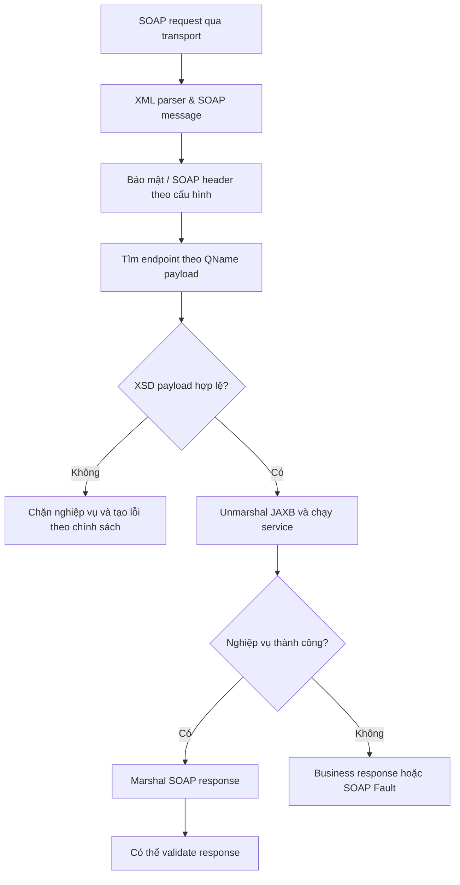

# Kiểm tra hợp đồng bằng ví dụ hợp lệ, không hợp lệ và phản hồi lỗi

Trong dự án **SPRING_WEB_SERVICES**, hợp đồng SOAP không chỉ là tài liệu để sinh mã. Hợp đồng còn là tiêu chuẩn để xác định một thông điệp XML có được chấp nhận hay không và dịch vụ phải phản hồi thế nào khi dữ liệu sai. Với cách phát triển **contract-first** bằng Spring Web Services (Spring-WS), nhóm tích hợp thống nhất XSD, WSDL và quy tắc lỗi trước; sau đó mới triển khai endpoint, ánh xạ JAXB và SOAP client.

Một kiểm thử hợp đồng hữu ích phải bao gồm **ví dụ hợp lệ**, **ví dụ không hợp lệ**, **phản hồi lỗi dự kiến** và **bằng chứng rằng lớp phù hợp đã phát hiện lỗi**. Chỉ thử một request thành công sẽ bỏ sót các tình huống phổ biến như sai namespace, thiếu trường bắt buộc, đảo thứ tự phần tử, dữ liệu sai kiểu hoặc thông điệp hợp lệ theo XSD nhưng sai nghiệp vụ.

Bài học xây dựng một hợp đồng đơn hàng nhỏ để minh họa toàn bộ quá trình: định nghĩa schema, tạo các ví dụ, kiểm tra payload SOAP, phân biệt XML/XSD/nghiệp vụ/bảo mật, cấu hình kiểm tra trong Spring-WS và lập bộ test tương thích.

## 1. Mục tiêu học tập và tiêu chí hoàn thành

Sau bài này, bạn có thể:

- Đọc `targetNamespace`, `elementFormDefault`, `minOccurs`, `maxOccurs`, kiểu dữ liệu và các facet của XSD để suy ra input hợp lệ.
- Tự tạo một bộ ví dụ **positive/negative** cho một operation SOAP từ XSD.
- Phân biệt lỗi cú pháp XML, QName/namespace, vi phạm XSD, lỗi nghiệp vụ và lỗi bảo mật.
- Nhận diện phản hồi SOAP thành công và SOAP Fault của SOAP 1.1/1.2; phân biệt lỗi của tầng HTTP với lỗi trong SOAP Body.
- Đặt validation ở đúng vị trí trong Spring-WS và viết kiểm thử endpoint/client để xác minh hợp đồng.
- Xác định một thay đổi contract có tương thích với client hiện hữu hay không.

**Tiêu chí hoàn thành thực hành:** với mỗi mẫu XML, phải nêu được (1) QName của phần tử gốc trong Body, (2) quy tắc XSD liên quan, (3) kết quả mong đợi ở lớp validation và (4) response hoặc SOAP Fault theo chính sách dịch vụ. Không kết luận bằng cách chỉ nhìn HTTP status.

## 2. Bộ hợp đồng minh họa: SubmitOrder

Giả sử dịch vụ nhận lệnh tạo đơn hàng qua một operation tên `SubmitOrder`. Hợp đồng quy định:

- `requestId`: bắt buộc, chuỗi sau khi chuẩn hóa whitespace dài từ 1 đến 64 ký tự, dùng nhận diện yêu cầu.
- `customerId`: bắt buộc, chuỗi không rỗng sau chuẩn hóa whitespace.
- `lines`: bắt buộc, chứa **ít nhất một** `line`.
- Mỗi `line` có `sku` dài từ 3 đến 20 ký tự thuộc tập chữ hoa, chữ số, dấu gạch ngang; `quantity` là số nguyên dương.
- `currency`: bắt buộc, chỉ nhận `VND` hoặc `USD`.
- Phản hồi thành công có `orderId` và `accepted` kiểu boolean.

XSD 1.0 minh họa:

```xml
<?xml version="1.0" encoding="UTF-8"?>
<xs:schema xmlns:xs="http://www.w3.org/2001/XMLSchema"
           xmlns:tns="https://example.org/contracts/order/v1"
           targetNamespace="https://example.org/contracts/order/v1"
           elementFormDefault="qualified"
           attributeFormDefault="unqualified">

    <xs:simpleType name="NonEmptyToken">
        <xs:restriction base="xs:token">
            <xs:minLength value="1"/>
        </xs:restriction>
    </xs:simpleType>

    <xs:simpleType name="RequestIdType">
        <xs:restriction base="tns:NonEmptyToken">
            <xs:maxLength value="64"/>
        </xs:restriction>
    </xs:simpleType>

    <xs:simpleType name="SkuType">
        <xs:restriction base="xs:string">
            <xs:pattern value="[A-Z0-9-]{3,20}"/>
        </xs:restriction>
    </xs:simpleType>

    <xs:simpleType name="CurrencyType">
        <xs:restriction base="xs:string">
            <xs:enumeration value="VND"/>
            <xs:enumeration value="USD"/>
        </xs:restriction>
    </xs:simpleType>

    <xs:complexType name="OrderLineType">
        <xs:sequence>
            <xs:element name="sku" type="tns:SkuType"/>
            <xs:element name="quantity" type="xs:positiveInteger"/>
        </xs:sequence>
    </xs:complexType>

    <xs:element name="SubmitOrderRequest">
        <xs:complexType>
            <xs:sequence>
                <xs:element name="requestId" type="tns:RequestIdType"/>
                <xs:element name="customerId" type="tns:NonEmptyToken"/>
                <xs:element name="lines">
                    <xs:complexType>
                        <xs:sequence>
                            <xs:element name="line"
                                        type="tns:OrderLineType"
                                        minOccurs="1"
                                        maxOccurs="unbounded"/>
                        </xs:sequence>
                    </xs:complexType>
                </xs:element>
                <xs:element name="currency" type="tns:CurrencyType"/>
            </xs:sequence>
        </xs:complexType>
    </xs:element>

    <xs:element name="SubmitOrderResponse">
        <xs:complexType>
            <xs:sequence>
                <xs:element name="orderId" type="tns:NonEmptyToken"/>
                <xs:element name="accepted" type="xs:boolean"/>
            </xs:sequence>
        </xs:complexType>
    </xs:element>

    <xs:element name="ValidationFault">
        <xs:complexType>
            <xs:sequence>
                <xs:element name="code" type="tns:NonEmptyToken"/>
                <xs:element name="message" type="tns:NonEmptyToken"/>
            </xs:sequence>
        </xs:complexType>
    </xs:element>
</xs:schema>
```

Các quy tắc quan trọng:

| Cấu hình XSD | Ý nghĩa khi kiểm tra request |
|---|---|
| `targetNamespace` | Các phần tử toàn cục được khai báo trong namespace `https://example.org/contracts/order/v1`. |
| `elementFormDefault="qualified"` | Các phần tử cục bộ như `requestId`, `sku`, `quantity` phải nằm trong namespace này. |
| `xs:sequence` | Phần tử con phải xuất hiện đúng thứ tự đã khai báo. |
| `minOccurs="1"` | Yêu cầu ít nhất một phần tử `line` (giá trị 1 cũng là mặc định nếu không ghi). |
| `maxOccurs="unbounded"` | Cho phép nhiều `line`, không chỉ một. |
| `xs:positiveInteger` | Giá trị số nguyên phải lớn hơn 0. |
| `xs:pattern` | Phần tử `sku` phải khớp mẫu ký tự và độ dài quy định. |
| `xs:enumeration` | `currency` phải là một trong các giá trị được liệt kê, xét phân biệt chữ hoa/chữ thường. |

**Chú ý giới hạn:** XSD nêu trên không kiểm tra rằng `customerId` có tồn tại trong cơ sở dữ liệu, `sku` đang được bán hay `requestId` chưa từng được xử lý. Đó là các điều kiện nghiệp vụ, phải xác minh ở tầng service.

### WSDL liên kết đến các phần tử XSD

Một phần trích của **WSDL 1.1** cho operation `SubmitOrder`:

```xml
<wsdl:definitions
    xmlns:wsdl="http://schemas.xmlsoap.org/wsdl/"
    xmlns:tns="https://example.org/wsdl/order-service/v1"
    xmlns:ord="https://example.org/contracts/order/v1"
    targetNamespace="https://example.org/wsdl/order-service/v1">

    <wsdl:message name="SubmitOrderInput">
        <wsdl:part name="parameters" element="ord:SubmitOrderRequest"/>
    </wsdl:message>

    <wsdl:message name="SubmitOrderOutput">
        <wsdl:part name="parameters" element="ord:SubmitOrderResponse"/>
    </wsdl:message>

    <wsdl:message name="ValidationFaultMessage">
        <wsdl:part name="fault" element="ord:ValidationFault"/>
    </wsdl:message>

    <wsdl:portType name="OrderPortType">
        <wsdl:operation name="SubmitOrder">
            <wsdl:input message="tns:SubmitOrderInput"/>
            <wsdl:output message="tns:SubmitOrderOutput"/>
            <wsdl:fault name="ValidationFault"
                        message="tns:ValidationFaultMessage"/>
        </wsdl:operation>
    </wsdl:portType>
</wsdl:definitions>
```

Đây là **đoạn trích để giải thích liên kết QName**, chưa phải WSDL hoàn chỉnh: cần bổ sung `wsdl:types` có schema được nhúng hoặc import, `wsdl:binding`, `wsdl:service` và binding cho Fault. `wsdl:fault` thể hiện hợp đồng lỗi ở mức WSDL; nó **không tự làm** Spring-WS sinh đúng `ValidationFault` trong `soap:Fault/detail`. Phải triển khai mapping lỗi tương ứng và kiểm thử output thực tế.

## 3. Ví dụ hợp lệ: request, response và những gì được xác nhận

Request SOAP 1.1 hợp lệ theo XSD ở mục 2:

```xml
<?xml version="1.0" encoding="UTF-8"?>
<soap:Envelope
    xmlns:soap="http://schemas.xmlsoap.org/soap/envelope/"
    xmlns:ord="https://example.org/contracts/order/v1">
    <soap:Header/>
    <soap:Body>
        <ord:SubmitOrderRequest>
            <ord:requestId>REQ-2026-001</ord:requestId>
            <ord:customerId>CUS-100</ord:customerId>
            <ord:lines>
                <ord:line>
                    <ord:sku>BOOK-001</ord:sku>
                    <ord:quantity>2</ord:quantity>
                </ord:line>
                <ord:line>
                    <ord:sku>PEN-003</ord:sku>
                    <ord:quantity>5</ord:quantity>
                </ord:line>
            </ord:lines>
            <ord:currency>VND</ord:currency>
        </ord:SubmitOrderRequest>
    </soap:Body>
</soap:Envelope>
```

Xác nhận từng điều:

1. Envelope thuộc namespace SOAP 1.1, Body chứa một payload nghiệp vụ.
2. QName của payload là `{https://example.org/contracts/order/v1}SubmitOrderRequest`.
3. Các phần tử con thuộc namespace nghiệp vụ và có đúng thứ tự `requestId`, `customerId`, `lines`, `currency`.
4. `lines` có hai `line`, thỏa ràng buộc tối thiểu một.
5. Cả hai SKU khớp pattern, số lượng đều dương, `currency` là `VND`.

Khi nghiệp vụ chấp nhận, endpoint có thể trả:

```xml
<soap:Envelope
    xmlns:soap="http://schemas.xmlsoap.org/soap/envelope/"
    xmlns:ord="https://example.org/contracts/order/v1">
    <soap:Body>
        <ord:SubmitOrderResponse>
            <ord:orderId>ORD-8801</ord:orderId>
            <ord:accepted>true</ord:accepted>
        </ord:SubmitOrderResponse>
    </soap:Body>
</soap:Envelope>
```

Phản hồi trên hợp lệ theo XSD, nhưng **kiểm tra schema không chứng minh** đơn hàng đã commit hay có đúng giá. Các quy tắc nghiệp vụ và tính toàn vẹn dữ liệu cần được kiểm tra độc lập.

### Hai cách viết XML, một QName

Request sau cũng có thể hợp lệ: prefix `x` thay `ord` nhưng cùng namespace URI.

```xml
<x:SubmitOrderRequest
    xmlns:x="https://example.org/contracts/order/v1">
    <x:requestId>REQ-2026-002</x:requestId>
    <x:customerId>CUS-100</x:customerId>
    <x:lines>
        <x:line>
            <x:sku>BOOK-001</x:sku>
            <x:quantity>1</x:quantity>
        </x:line>
    </x:lines>
    <x:currency>USD</x:currency>
</x:SubmitOrderRequest>
```

Đây là **payload** (phần tử trong SOAP Body), không phải Envelope đầy đủ. Dạng dùng default namespace cũng đúng:

```xml
<SubmitOrderRequest xmlns="https://example.org/contracts/order/v1">
    <requestId>REQ-2026-003</requestId>
    <customerId>CUS-100</customerId>
    <lines>
        <line>
            <sku>BOOK-001</sku>
            <quantity>1</quantity>
        </line>
    </lines>
    <currency>VND</currency>
</SubmitOrderRequest>
```

Ba payload có QName gốc giống nhau. Một endpoint kiểm tra theo namespace URI và local name phải chấp nhận cả ba cách biểu diễn nếu các giá trị nghiệp vụ hợp lệ.

## 4. Tạo tập ví dụ không hợp lệ có chủ đích

Hãy bắt đầu từ request hợp lệ ở mục 3 và mỗi lần chỉ thay **một điều kiện**. Cách làm này cho biết lỗi đến từ ràng buộc nào, tránh trường hợp một test sai nhiều thứ khiến kết quả trở nên khó giải thích.

### 4.1. Sai namespace URI

```xml
<ord:SubmitOrderRequest
    xmlns:ord="https://example.org/contracts/order/v2">
    <!-- Giữ nguyên các phần tử con như request hợp lệ -->
</ord:SubmitOrderRequest>
```

QName gốc bây giờ là `{https://example.org/contracts/order/v2}SubmitOrderRequest`, khác hợp đồng `v1`. Nếu gửi nguyên các phần tử con với namespace `v2`, toàn bộ payload không khớp XSD của `v1`.

Với Spring-WS, sai QName gốc còn có thể khiến **không tìm được endpoint** qua `@PayloadRoot` trước khi interceptor validation của endpoint đó chạy. Vì vậy không nên mặc định mọi lỗi namespace đều sẽ trở thành cùng một SOAP Fault schema validation.

### 4.2. Thiếu phần tử bắt buộc

Trong `line`, bỏ `quantity`:

```xml
<ord:line xmlns:ord="https://example.org/contracts/order/v1">
    <ord:sku>BOOK-001</ord:sku>
</ord:line>
```

Không hợp lệ vì `quantity` có mặc định `minOccurs="1"`. Tương tự, bỏ `customerId` hay `currency` đều sai.

### 4.3. Sai thứ tự trong `xs:sequence`

```xml
<ord:line xmlns:ord="https://example.org/contracts/order/v1">
    <ord:quantity>2</ord:quantity>
    <ord:sku>BOOK-001</ord:sku>
</ord:line>
```

Dù hai trường có đủ và giá trị đúng kiểu, thứ tự phải là `sku` rồi `quantity`.

### 4.4. Giá trị không đáp ứng kiểu dữ liệu

```xml
<ord:line xmlns:ord="https://example.org/contracts/order/v1">
    <ord:sku>BOOK-001</ord:sku>
    <ord:quantity>0</ord:quantity>
</ord:line>
```

`0` không thuộc miền giá trị `xs:positiveInteger`. `-2` hoặc `abc` cũng không hợp lệ, nhưng vì hai nguyên nhân khác nhau: `-2` là số nguyên không dương, `abc` không phải số nguyên.

### 4.5. Vi phạm pattern và enumeration

```xml
<ord:line xmlns:ord="https://example.org/contracts/order/v1">
    <ord:sku>book 001</ord:sku>
    <ord:quantity>1</ord:quantity>
</ord:line>
```

SKU chứa chữ thường và khoảng trắng, không khớp pattern. Nếu thay `<ord:currency>EUR</ord:currency>` vào request đầy đủ, request cũng sai vì XSD chỉ cho phép `VND` hoặc `USD`.

### 4.6. Danh sách rỗng

```xml
<ord:lines xmlns:ord="https://example.org/contracts/order/v1"/>
```

`lines` bắt buộc chứa ít nhất một `line`. Một phần tử container có mặt nhưng không có phần tử con vẫn không thỏa `minOccurs="1"` của `line`.

### 4.7. Phần tử không khai báo hoặc nillability sai

Ví dụ chèn thêm `<ord:discountCode>SALE</ord:discountCode>` trong request khi XSD không có phần tử này. Khi validator yêu cầu tuân thủ schema, request phải bị từ chối.

Với `xsi:nil="true"`, chỉ được dùng nếu khai báo phần tử cho phép `nillable="true"`. Trong XSD minh họa, `quantity` không khai báo nillable, nên:

```xml
<ord:quantity
    xmlns:ord="https://example.org/contracts/order/v1"
    xmlns:xsi="http://www.w3.org/2001/XMLSchema-instance"
    xsi:nil="true"/>
```

không hợp lệ. **Thiếu phần tử**, **phần tử rỗng** và **phần tử nil** không phải ba cách biểu diễn tương đương; cách chấp nhận phụ thuộc `minOccurs`, kiểu dữ liệu và `nillable`.

### 4.8. XML không well-formed

```xml
<ord:sku xmlns:ord="https://example.org/contracts/order/v1">
    BOOK-001
</ord:quantity>
```

Thẻ mở và đóng không khớp. Đây là lỗi **cú pháp XML**, parser có thể từ chối trước khi chạy XSD validation; không nên mô tả nó là một vi phạm facet của XSD.

### Bảng test negative tối thiểu

| ID | Thay đổi trên request hợp lệ | Quy tắc bị vi phạm | Kết quả kỳ vọng |
|---|---|---|---|
| N01 | Đổi namespace `/v1` thành `/v2` | QName payload | Không được định tuyến như operation `v1`; chi tiết lỗi tùy endpoint mapping. |
| N02 | Bỏ `customerId` | `xs:sequence`, `minOccurs` | XSD reject. |
| N03 | Đảo `sku` và `quantity` | `xs:sequence` | XSD reject. |
| N04 | `quantity=0` | `xs:positiveInteger` | XSD reject. |
| N05 | `sku=book 001` | `xs:pattern` | XSD reject. |
| N06 | `currency=EUR` | `xs:enumeration` | XSD reject. |
| N07 | `lines` rỗng | `line minOccurs=1` | XSD reject. |
| N08 | Thêm `discountCode` | Content model không có khai báo | XSD reject. |
| N09 | `quantity xsi:nil=true` | `nillable` mặc định false | XSD reject. |
| N10 | Sai thẻ đóng | XML well-formedness | XML parser reject trước hoặc ngoài bước XSD. |
| N11 | `customerId=CUS-DOES-NOT-EXIST` | Quy tắc dữ liệu nghiệp vụ | Có thể **hợp lệ theo XSD**, service từ chối theo chính sách nghiệp vụ. |
| N12 | Gửi lại đúng `requestId` đã xử lý | Idempotency | Có thể hợp lệ theo XSD; service phải giải quyết trùng lặp theo contract. |

Những ví dụ trên là **các fragment thay đổi**, trừ những mẫu hoàn chỉnh ở mục 3. Khi thực thi kiểm thử tự động, cần ghép chúng vào một payload có đầy đủ cấu trúc còn lại; chỉ gửi một `line` riêng sẽ thất bại vì nó không phải global root `SubmitOrderRequest` của hợp đồng.

## 5. Phân tầng kiểm tra: tại đâu lỗi được phát hiện?

Đối với dịch vụ SOAP doanh nghiệp, nên phân biệt ít nhất năm lớp:

| Lớp kiểm tra | Câu hỏi | Ví dụ lỗi |
|---|---|---|
| XML parser | Tài liệu XML có well-formed và tên prefix được khai báo không? | Thiếu thẻ đóng, prefix không khai báo. |
| SOAP protocol | Envelope/Body có đúng SOAP version, cấu trúc và header cần thiết không? | SOAP 1.2 Envelope gửi tới endpoint yêu cầu SOAP 1.1. |
| XML Schema (XSD) | QName payload, cấu trúc, kiểu và facet có tuân theo contract? | Thiếu `currency`, `quantity=0`, sai `sequence`. |
| Nghiệp vụ | Dữ liệu hợp lệ theo domain và trạng thái hệ thống? | Khách hàng không tồn tại, đơn hàng trùng `requestId`, hết hạn mức. |
| Security/policy | Caller có được phép thực hiện thao tác, chữ ký, token, timestamp và chứng chỉ có hợp lệ? | WS-Security UsernameToken sai, chữ ký không hợp lệ, certificate hết hạn. |

Các lớp có thể được thực thi theo thứ tự khác nhau tùy cấu hình handler, message factory, interceptor, endpoint mapping và security policy. Một lỗi có thể chặn request **trước khi gọi endpoint nghiệp vụ**. Không hứa mọi trường hợp đều được biến thành một Fault giống nhau: lỗi TLS có thể dừng ngay ở tầng kết nối, chưa có SOAP message để trả Fault.

### Hai ví dụ XSD không quyết định kết quả nghiệp vụ

```xml
<ord:customerId xmlns:ord="https://example.org/contracts/order/v1">
    CUS-DOES-NOT-EXIST
</ord:customerId>
```

Chuỗi này thỏa `NonEmptyToken`. Để biết khách hàng có tồn tại, dịch vụ cần tra cứu dữ liệu.

Tương tự, `requestId=REQ-2026-001` có thể đúng độ dài nhưng đã được xử lý trước đó. Kiểm tra idempotency có thể trả lại kết quả cũ, từ chối, hoặc xử lý theo một chính sách đã thỏa thuận. XSD không tự bảo đảm “mỗi yêu cầu chỉ được xử lý một lần”.

### SOAP Envelope không phải payload XSD

Nếu interceptor chỉ validate **payload**, tệp XSD ở mục 2 áp dụng cho `SubmitOrderRequest` chứ không áp dụng toàn bộ `soap:Envelope`. Envelope tuân theo schema/protocol SOAP riêng. Cần phân biệt khi viết test: schema payload thường không xác thực SOAP Header, chữ ký WS-Security hoặc logic truy cập.

## 6. Phản hồi hợp lệ và phản hồi lỗi theo hợp đồng

### 6.1. Thành công: SOAP response

Một lời gọi SOAP 1.1 over HTTP thông thường có thể trả `HTTP/1.1 200 OK`, content type `text/xml` và SOAP Body mang `SubmitOrderResponse`. Giá trị `accepted=true` là **dữ liệu nghiệp vụ** theo contract, không phải HTTP status.

```http
HTTP/1.1 200 OK
Content-Type: text/xml; charset=utf-8

[SOAP Envelope chứa ord:SubmitOrderResponse]
```

### 6.2. Lỗi dữ liệu hợp đồng: SOAP 1.1 Fault

Ví dụ **chính sách lỗi tùy biến**: khi dữ liệu `quantity=0` vi phạm XSD, server có thể tạo SOAP Fault thuộc nhóm lỗi client. Bên dưới là một mẫu phản hồi **minh họa do dịch vụ chủ động cấu hình**, không phải cấu trúc `detail` mặc định được bảo đảm bởi mọi interceptor Spring-WS:

```http
HTTP/1.1 500 Internal Server Error
Content-Type: text/xml; charset=utf-8
```

```xml
<soap:Envelope
    xmlns:soap="http://schemas.xmlsoap.org/soap/envelope/"
    xmlns:ord="https://example.org/contracts/order/v1">
    <soap:Body>
        <soap:Fault>
            <faultcode>soap:Client</faultcode>
            <faultstring>Request payload violates the XML contract</faultstring>
            <detail>
                <ord:ValidationFault>
                    <ord:code>INVALID_ORDER_REQUEST</ord:code>
                    <ord:message>One or more fields are invalid</ord:message>
                </ord:ValidationFault>
            </detail>
        </soap:Fault>
    </soap:Body>
</soap:Envelope>
```

Trong SOAP 1.1, `faultcode` và `faultstring` mô tả loại lỗi và lý do, `detail` có thể mang dữ liệu có cấu trúc phục vụ bên gọi. `faultcode=soap:Client` báo thông điệp phía gửi có vấn đề; `soap:Server` thường biểu thị lỗi phía xử lý.

Với SOAP 1.1 HTTP binding, SOAP Fault thường đi cùng HTTP 500. Nhưng mã HTTP, việc có Fault hay không, và nội dung `detail` phụ thuộc binding, cấu hình middleware, cách lỗi được phát sinh và xử lý. Không hard-code kiểm thử rằng **mọi** request sai đều nhận đúng mẫu trên, nếu API chưa quy định rõ.

**Không công khai** stack trace, tên bảng SQL, token bảo mật, dữ liệu cá nhân hoặc đường dẫn hệ thống nội bộ trong Fault. Nên thống nhất mã lỗi công khai và gắn correlation ID an toàn để tra cứu log chi tiết phía server.

### 6.3. SOAP 1.2 dùng cấu trúc Fault khác

SOAP 1.2 sử dụng `Code`, `Reason` và `Detail`, không sử dụng cấu trúc `faultcode`/`faultstring` của SOAP 1.1:

```xml
<env:Envelope xmlns:env="http://www.w3.org/2003/05/soap-envelope"
              xmlns:ord="https://example.org/contracts/order/v1">
    <env:Body>
        <env:Fault>
            <env:Code>
                <env:Value>env:Sender</env:Value>
            </env:Code>
            <env:Reason>
                <env:Text xml:lang="vi">
                    Dữ liệu yêu cầu không hợp lệ
                </env:Text>
            </env:Reason>
            <env:Detail>
                <ord:ValidationFault>
                    <ord:code>INVALID_ORDER_REQUEST</ord:code>
                    <ord:message>Invalid order payload</ord:message>
                </ord:ValidationFault>
            </env:Detail>
        </env:Fault>
    </env:Body>
</env:Envelope>
```

`env:Sender` tương ứng khái niệm lỗi do phía gửi; `env:Receiver` thường liên quan lỗi phía nhận. Khi đổi SOAP version, phải cập nhật namespace Envelope, HTTP binding, content type và cách tạo/đọc Fault tương ứng. Không thể chỉ thay prefix `soap` thành `env` để biến SOAP 1.1 thành SOAP 1.2.

### 6.4. Lỗi nghiệp vụ trả Fault hay response?

Có hai cách phổ biến, cần chọn và mô tả nhất quán trong contract:

- **SOAP Fault có cấu trúc**: thích hợp với lỗi khiến thao tác không thể xử lý, chẳng hạn dữ liệu không hợp lệ hoặc caller không đủ quyền, tùy chính sách dịch vụ.
- **Business response có trạng thái**: thích hợp với kết quả nghiệp vụ dự kiến và được mô hình hóa thành công khai trong XSD, ví dụ trạng thái `REJECTED`, `PENDING`, `ACCEPTED`.

Nếu muốn trả `SubmitOrderResponse(accepted=false)` cho trường hợp khách hàng không đủ hạn mức, có thể làm được nếu quy tắc API định nghĩa đó là một kết quả nghiệp vụ bình thường; nhưng phản hồi mẫu ở mục 2 chỉ có `orderId` bắt buộc nên vẫn phải cung cấp `orderId` hoặc **thiết kế lại schema** để mô hình hóa trường hợp từ chối. Không được trả payload thiếu `orderId` rồi gọi đó là “response lỗi hợp lệ”.

## 7. Triển khai validation trong Spring Web Services

Luồng xử lý ở mức khái niệm:



Sơ đồ chỉ mô tả các bước chức năng; thứ tự cụ thể giữa security, mapping, interceptor và unmarshalling phụ thuộc cấu hình Spring-WS. Một lỗi ở bước sớm có thể không đi đến các bước sau.

Trong Spring-WS, `PayloadValidatingInterceptor` là cơ chế thường dùng để validate request/response payload theo XSD. Ví dụ cấu hình Java minh họa một schema đã có trong classpath:

```java
import java.util.List;

import org.springframework.context.annotation.Bean;
import org.springframework.context.annotation.Configuration;
import org.springframework.core.io.ClassPathResource;
import org.springframework.ws.config.annotation.EnableWs;
import org.springframework.ws.config.annotation.WsConfigurer;
import org.springframework.ws.server.EndpointInterceptor;
import org.springframework.ws.soap.server.endpoint.interceptor.PayloadValidatingInterceptor;
import org.springframework.xml.xsd.SimpleXsdSchema;
import org.springframework.xml.xsd.XsdSchema;

@EnableWs
@Configuration
public class ContractValidationConfiguration implements WsConfigurer {

    @Bean
    public XsdSchema orderSchema() {
        return new SimpleXsdSchema(
            new ClassPathResource("xsd/order-v1.xsd")
        );
    }

    @Override
    public void addInterceptors(List<EndpointInterceptor> interceptors) {
        PayloadValidatingInterceptor interceptor =
            new PayloadValidatingInterceptor();
        interceptor.setXsdSchema(orderSchema());
        interceptor.setValidateRequest(true);
        interceptor.setValidateResponse(true);
        interceptors.add(interceptor);
    }
}
```

Đây là ví dụ cấu hình theo API Spring-WS phổ biến; khi áp dụng cần đối chiếu API của phiên bản đang dùng, đặt XSD vào `src/main/resources/xsd/order-v1.xsd` và cấu hình endpoint/JAXB phù hợp. `validateRequest=true` kiểm tra request payload; `validateResponse=true` giúp phát hiện response không đúng XSD nhưng có chi phí và cần xem xét kỹ cách dịch vụ tạo Fault khi response bị lỗi. Trong môi trường sản xuất, lựa chọn có validate response hay không phụ thuộc yêu cầu chất lượng và hiệu năng.

Điểm cần nhớ:

1. **Schema phải do dịch vụ quản lý**, không tự lấy schema theo `xsi:schemaLocation` do client gửi rồi tin cậy.
2. XSD được publish và schema validator đang dùng phải cùng phiên bản; nếu khác nhau, client có thể làm đúng WSDL nhưng server lại từ chối.
3. Việc validate payload không thay thế xác thực, phân quyền, WS-Security, giới hạn kích thước thông điệp hay các cấu hình XML parser an toàn.
4. Interceptor có thể chặn request trước khi endpoint nghiệp vụ chạy; nên test cả việc **không phát sinh tác động** khi request sai.
5. Phản hồi Fault mặc định khi interceptor phát hiện lỗi có thể khác chi tiết theo version/cấu hình. Nếu hợp đồng yêu cầu `ValidationFault` như mục 6, cần custom Fault mapping hoặc resolver và test chính xác đầu ra.

### Endpoint và định tuyến QName

Ví dụ annotation endpoint theo contract:

```java
@Endpoint
public class OrderEndpoint {
    private static final String NAMESPACE =
        "https://example.org/contracts/order/v1";

    @PayloadRoot(namespace = NAMESPACE,
                 localPart = "SubmitOrderRequest")
    @ResponsePayload
    public SubmitOrderResponse submit(
            @RequestPayload SubmitOrderRequest request) {
        // Dịch vụ nghiệp vụ: kiểm tra customer, chống trùng requestId,
        // lưu đơn hàng và tạo SubmitOrderResponse đúng XSD.
        return orderService.submit(request);
    }
}
```

Phần code giả định các import Spring-WS, biến `orderService` và lớp JAXB được cung cấp bởi ứng dụng. `@PayloadRoot` sử dụng namespace URI và local part: prefix khác nhưng cùng QName vẫn định tuyến đúng; sai namespace có thể không đến được interceptor validation của endpoint. Với JAXB sinh từ XSD, kiểu request/response thực tế có thể được bọc bằng `JAXBElement` tùy cấu trúc schema và phiên bản JAXB.

## 8. Viết kiểm thử contract với Spring-WS

### 8.1. Kiểm thử endpoint bằng MockWebServiceClient

`MockWebServiceClient` cho phép gửi SOAP payload mô phỏng vào cấu hình Spring-WS và kiểm tra response. Đây là ví dụ về ý tưởng test:

```java
import static org.springframework.ws.test.server.RequestCreators.withPayload;
import static org.springframework.ws.test.server.ResponseMatchers.noFault;
import static org.springframework.ws.test.server.ResponseMatchers.validPayload;

import org.springframework.core.io.ClassPathResource;
import org.springframework.xml.transform.StringSource;
import org.springframework.ws.test.server.MockWebServiceClient;

// mockClient được khởi tạo từ Spring application context
StringSource validRequest = new StringSource("""
    <ord:SubmitOrderRequest
        xmlns:ord="https://example.org/contracts/order/v1">
        <ord:requestId>REQ-TEST-01</ord:requestId>
        <ord:customerId>CUS-100</ord:customerId>
        <ord:lines>
            <ord:line>
                <ord:sku>BOOK-001</ord:sku>
                <ord:quantity>2</ord:quantity>
            </ord:line>
        </ord:lines>
        <ord:currency>VND</ord:currency>
    </ord:SubmitOrderRequest>
    """);

mockClient.sendRequest(withPayload(validRequest))
          .andExpect(noFault())
          .andExpect(validPayload(
              new ClassPathResource("xsd/order-v1.xsd")
          ));
```

Ví dụ sử dụng text block của Java 15+. `validPayload(...)` kiểm tra **payload response** có tuân theo schema; kết hợp `noFault()` để đảm bảo không bị chuyển sang Fault. Với test có điều kiện nghiệp vụ cụ thể, cũng nên kiểm tra `orderId`, `accepted` bằng expected payload hoặc XPath. Nếu chỉ kiểm tra “response hợp lệ theo XSD” có thể chưa phát hiện trả nhầm kết quả nghiệp vụ.

Với request sai, nên tách nhóm kết quả:

- Trường hợp N02–N09: khi validation interceptor hoạt động theo chính sách, kỳ vọng request bị chặn và không chạy xử lý nghiệp vụ.
- N01: có thể không match endpoint do QName sai. Khẳng định loại Fault chỉ sau khi cấu hình mapping lỗi cụ thể.
- N10: lỗi parse XML có thể xuất hiện ở lớp tạo message, trước khi đến endpoint.
- N11–N12: XSD vẫn có thể hợp lệ, nên kiểm tra domain rule và kết quả trả về theo chính sách đã công bố.

Nếu có xác định một lỗi client phải là SOAP Fault, `ResponseMatchers.clientOrSenderFault()` có thể giúp kiểm tra loại Fault; hãy bổ sung đối chiếu mã lỗi/`detail` nếu contract yêu cầu cấu trúc cụ thể. Đối với các trường hợp malformed XML hoặc security bị từ chối trước khi xử lý SOAP, test qua HTTP/transport thực sẽ phản ánh chính xác hơn.

### 8.2. Kiểm thử SOAP client bằng MockWebServiceServer

`MockWebServiceServer` mô phỏng SOAP server mà `WebServiceTemplate` gọi tới. Với client Spring-WS, cần xác minh:

- JAXB marshalling sinh đúng QName và thứ tự các trường.
- Client gửi đúng SOAP version, SOAPAction, Header và chứng chỉ/chữ ký nếu hợp đồng có yêu cầu.
- Client unmarshal response đúng schema và xử lý SOAP Fault có cấu trúc.
- Timeout hoặc lỗi HTTP được xử lý như lỗi transport, không nhầm thành business response hợp lệ.
- Nếu có retry, `requestId` giữ nguyên khi gửi lại để phía nhận có thể khử trùng lặp.

Ví dụ một test client cần assert rằng payload gửi ra khớp XSD `order-v1.xsd`, không chỉ kiểm tra rằng `WebServiceTemplate` gọi được mock server.

### 8.3. Kiểm tra XSD độc lập bằng Java

Có thể sử dụng bộ kiểm tra XSD chuẩn của Java để xác nhận **phần tử payload** mà không phải khởi động SOAP server:

```java
import java.io.StringReader;
import javax.xml.XMLConstants;
import javax.xml.transform.stream.StreamSource;
import javax.xml.validation.Schema;
import javax.xml.validation.SchemaFactory;
import javax.xml.validation.Validator;

SchemaFactory factory = SchemaFactory.newInstance(
    XMLConstants.W3C_XML_SCHEMA_NS_URI
);

// Hạn chế truy cập DTD/schema từ nguồn bên ngoài.
factory.setFeature(XMLConstants.FEATURE_SECURE_PROCESSING, true);
factory.setProperty(XMLConstants.ACCESS_EXTERNAL_DTD, "");
factory.setProperty(XMLConstants.ACCESS_EXTERNAL_SCHEMA, "");

// Đường dẫn XSD minh họa: dùng file tin cậy do dự án quản lý.
Schema schema = factory.newSchema(
    new java.io.File("src/main/resources/xsd/order-v1.xsd")
);

String payload = """
    <ord:SubmitOrderRequest
        xmlns:ord="https://example.org/contracts/order/v1">
        <ord:requestId>REQ-TEST-01</ord:requestId>
        <ord:customerId>CUS-100</ord:customerId>
        <ord:lines>
            <ord:line>
                <ord:sku>BOOK-001</ord:sku>
                <ord:quantity>2</ord:quantity>
            </ord:line>
        </ord:lines>
        <ord:currency>VND</ord:currency>
    </ord:SubmitOrderRequest>
    """;

Validator validator = schema.newValidator();
validator.setProperty(XMLConstants.ACCESS_EXTERNAL_DTD, "");
validator.setProperty(XMLConstants.ACCESS_EXTERNAL_SCHEMA, "");
validator.validate(new StreamSource(new StringReader(payload)));
```

Nếu validation thành công, `validate` hoàn tất không ném ngoại lệ; nếu sai, thường xuất hiện `SAXParseException` hoặc một `SAXException` phù hợp. Tùy JAXP provider, một số tính năng bảo mật có thể không được hỗ trợ và cần xử lý lỗi cấu hình rõ ràng thay vì âm thầm bỏ qua.

Trong thực tế phải cân nhắc `xs:import`/`xs:include` và catalog resolver tin cậy: cấu hình `ACCESS_EXTERNAL_SCHEMA=""` chặn tải schema ngoài, nên phải chuẩn bị trước các tài nguyên cần thiết hoặc resolver cho đường dẫn hợp lệ. Không bật truy cập mạng toàn cục chỉ để làm test chạy qua.

**Giới hạn của test độc lập:** nó không kiểm tra SOAP Envelope, WS-Security, binding WSDL, HTTP status, endpoint mapping hoặc business logic. Cần dùng các lớp test khác để phủ đầy đủ hợp đồng.

## 9. Thiết kế kiểm thử phản hồi lỗi

Một bộ test lỗi tốt kiểm tra không chỉ việc “có lỗi” mà còn kiểm tra **đúng lỗi**, **đúng vị trí**, **không gây tác động ngoài ý muốn**.

| Tình huống | Cách test | Điều cần assert |
|---|---|---|
| XML không well-formed | Gửi SOAP XML sai thẻ đóng | Parser hoặc transport từ chối; không có bản ghi đơn mới. |
| Namespace payload sai | Thay URI `v1` thành `v2` | Không được nhận như `SubmitOrderRequest` của `v1`. |
| Thiếu trường/vi phạm facet | Gửi đầy đủ Envelope nhưng sai nội dung `Body` | Validation từ chối, endpoint không thực thi nghiệp vụ nếu cấu hình validate trước xử lý. |
| Fault client | Gửi request sai theo contract | SOAP Fault có mã và `detail` đúng chính sách, không lộ nội bộ. |
| Response sai XSD | Cho service tạo response thiếu `orderId` | Test response thất bại; không được công bố response sai như thành công. |
| Lỗi nghiệp vụ | Gửi `customerId` không tồn tại | XSD có thể qua; service trả đúng business result/Fault đã khai báo. |
| Gửi trùng | Gửi lại `requestId` đã ghi | Không tạo đơn thứ hai nếu hợp đồng cam kết idempotency. |
| Chưa xác thực | Gửi thiếu token/chữ ký khi policy yêu cầu | Từ chối tại security layer; không thực thi nghiệp vụ. |
| Phản hồi bị ngắt | Cắt kết nối sau khi server commit | Client đối soát theo `requestId`, không tự tạo yêu cầu mới vô hạn. |

Nên dùng các tiêu chí khác nhau ở từng lớp:

1. **Schema-level**: đúng loại lỗi validation, XML source hợp lệ/không hợp lệ như kỳ vọng.
2. **Endpoint-level**: SOAP Fault hoặc response có cấu trúc, routing đúng QName, service không được gọi khi payload sai.
3. **Transport-level**: HTTP status, content type, SOAP version, timeout và đóng/mở kết nối.
4. **Contract-level giữa hai hệ thống**: một client thực dùng WSDL/XSD được publish để gửi và nhận thông điệp; kiểm tra cả các thay đổi về namespace và phiên bản.

### Không phụ thuộc vào câu chữ kỹ thuật của validator

Thông điệp từ `SAXParseException` có thể khác nhau giữa Java runtime, XML parser hoặc phiên bản thư viện. Không nên assert chính xác chuỗi lỗi như “cvc-complex-type.2.4.a” trong hợp đồng công khai, trừ khi API chủ động chuẩn hóa nó.

Tốt hơn, API trả mã lỗi ổn định như `INVALID_ORDER_REQUEST`; test nội bộ có thể log chi tiết validator, nhưng test tích hợp kiểm tra mã lỗi nghiệp vụ, QName Fault detail và các trường bắt buộc.

## 10. Quy trình review và thay đổi hợp đồng

Một thay đổi nhỏ trong XSD có thể phá vỡ client đang dùng JAXB sinh từ WSDL:

| Thay đổi contract | Khả năng tác động |
|---|---|
| Đổi `targetNamespace` hoặc tên root element | Thay QName; client cũ có thể bị từ chối hoặc không định tuyến được. |
| Đổi thứ tự phần tử trong `xs:sequence` | Payload cũ có thể sai XSD; mã JAXB có thể thay đổi. |
| Thêm phần tử **bắt buộc** | Request cũ không có phần tử mới sẽ bị từ chối. |
| Thêm phần tử **tùy chọn** | Thường dễ tương thích với request cũ, nhưng client/validator cũ vẫn cần kiểm tra khi nhận dữ liệu mới. |
| Siết pattern, maxLength, minOccurs hoặc enumeration | Một số thông điệp trước đây hợp lệ trở thành không hợp lệ. |
| Nới enumeration | Server mới có thể chấp nhận thêm giá trị, nhưng client cũ sinh enum có thể chưa xử lý giá trị mới. |
| Đổi cấu trúc SOAP Fault/`detail` | Client cũ có thể không giải mã hoặc phân loại lỗi đúng. |
| Đổi SOAP 1.1 sang SOAP 1.2 | Ảnh hưởng Envelope namespace, HTTP binding và SOAP Fault, không chỉ tên prefix. |

Quy trình sửa contract nên có:

1. Lưu bộ **golden messages** gồm request/response hợp lệ và các case âm tính N01–N12.
2. Đối chiếu tất cả ví dụ với schema mới; xác định case nào cố ý đổi kết quả.
3. Chạy lại kiểm thử endpoint và SOAP client, đặc biệt các lớp JAXB sinh mã.
4. Chạy một client đối tác/simulator thật qua HTTP với WSDL, XSD được publish.
5. Với thay đổi không tương thích, cân nhắc namespace/version mới hoặc chiến lược chuyển đổi để client cũ có thời gian nâng cấp.
6. Lưu lại kết quả test để có thể chứng minh vì sao một thông điệp được chấp nhận/từ chối.

Contract-first không có nghĩa XSD/WSDL chỉ được tạo một lần. Nó có nghĩa các thay đổi về giao diện phải được **chủ động thiết kế và kiểm thử trước** khi áp dụng vào triển khai.

## 11. Bảo mật liên quan đến kiểm tra hợp đồng

Validation theo XSD cần đi cùng các kiểm soát khác:

- **Parser an toàn:** hạn chế DTD/entity và truy cập tài nguyên bên ngoài, đặt giới hạn kích thước XML và độ sâu/cấu trúc phù hợp để chống tiêu hao tài nguyên.
- **SOAP/WS-Security:** kiểm tra chữ ký, timestamp, token, chứng chỉ hoặc yêu cầu xác thực đã thỏa thuận; một XML hợp lệ theo schema chưa có nghĩa được tin cậy.
- **TLS và chứng chỉ:** xác thực đầu mối kết nối; lỗi bắt tay TLS thường không tạo SOAP Fault vì chưa vào tầng SOAP.
- **Fault hygiene:** tránh đưa dữ liệu nhạy cảm trong `faultstring`, `Reason`, `Detail` hoặc log có thể truy cập công khai.
- **Quan sát:** ghi request/correlation ID, QName, mã lỗi có cấu trúc và thông tin giúp truy vết, nhưng áp dụng quy tắc che dữ liệu nhạy cảm.

Lưu ý: trong XML, giá trị `xsi:schemaLocation` do client cung cấp không phải là “hợp đồng đáng tin cậy” của server. XSD và chính sách xử lý phải được chọn từ cấu hình tin cậy. Với các operation yêu cầu signature, nội dung đem kiểm tra phải là dữ liệu đã được xử lý theo chính sách bảo mật nhất quán; mọi thay đổi nội dung sau xác thực cần được xem xét cẩn thận.

## 12. Bài thực hành: dự đoán kết quả trước khi chạy validator

Dùng XSD ở mục 2. Xem các thay đổi dưới đây và dự đoán trước kết quả:

| Mẫu | Thay đổi so với payload hợp lệ | Hợp lệ XSD? | Giải thích |
|---|---|---|---|
| A | Prefix `ord` đổi thành `p`, vẫn cùng URI `v1` | **Có** | QName không đổi. |
| B | `quantity=1` | **Có** | Là số nguyên dương. |
| C | `quantity=0` | **Không** | Không thuộc `xs:positiveInteger`. |
| D | `currency=usd` | **Không** | Enumeration phân biệt chữ hoa/chữ thường. |
| E | Bỏ `customerId` | **Không** | Thiếu phần tử bắt buộc trong `xs:sequence`. |
| F | Thêm `line` thứ ba hợp lệ | **Có** | `maxOccurs="unbounded"`. |
| G | `requestId` chỉ có dấu cách | **Không** | `xs:token` chuẩn hóa whitespace, `minLength=1`. |
| H | Dùng URI namespace `.../order/v2` | **Không** | QName không khớp global element `v1`. |
| I | `customerId=CUS-NOT-REGISTERED` | **Có thể có** | Hợp lệ theo kiểu XSD; dữ liệu nghiệp vụ có thể từ chối. |
| J | `sku=BOOK_001` | **Không** | Ký tự gạch dưới không thuộc pattern. |
| K | `lines` có một `line` thiếu `sku` | **Không** | Thiếu phần tử bắt buộc. |
| L | Thay `accepted=true` bằng `accepted=1` trong response | **Có** | `xs:boolean` chấp nhận lexical values `true`, `false`, `1`, `0`. |

Điểm dễ gây nhầm trong bài tập: một XML **hợp lệ XSD** chưa chắc hợp lệ nghiệp vụ; ngược lại, một request sai QName root có thể bị endpoint mapping chặn trước khi validator XSD chạy.

### Yêu cầu kiểm thử bổ sung

Hãy tạo thêm một request `SubmitOrderRequest` hợp lệ chứa hai `line`, sau đó tạo đúng ba bản sao không hợp lệ: một bản sai namespace, một bản `quantity=-1` và một bản bỏ `currency`. Với từng bản, ghi:

1. Payload XML đầy đủ sẽ gửi.
2. Quy tắc XSD hoặc QName bị vi phạm.
3. Lớp có khả năng phát hiện lỗi đầu tiên theo cấu hình.
4. SOAP Fault/HTTP behavior thật khi chạy với Spring-WS.
5. Bằng chứng rằng service không ghi đơn hàng mới nếu request bị từ chối.

Không chỉ ghi “test fail”: kết quả test phải cho thấy fail vì **đúng nguyên nhân** và bảo vệ được hành vi nghiệp vụ.

## Tổng kết

Kiểm tra hợp đồng SOAP bắt đầu từ **XSD và WSDL** nhưng phải đi đến **thông điệp XML thực, SOAP response/Fault và tác động nghiệp vụ**. Hãy giữ một bộ ví dụ hợp lệ làm chuẩn, tạo các case không hợp lệ theo từng ràng buộc, xác định lớp phát hiện lỗi và đối chiếu phản hồi thực tế với chính sách của API.

Trong Spring Web Services, `PayloadValidatingInterceptor`, ánh xạ JAXB, `@PayloadRoot`, `MockWebServiceClient` và `MockWebServiceServer` là các thành phần hỗ trợ kiểm tra hợp đồng từ payload đến client/endpoint. XSD validation không thay thế business validation, XML security hay WS-Security; chỉ kết hợp các lớp đó với kiểm thử tương thích mới giúp tích hợp SOAP giữa doanh nghiệp hoạt động ổn định.
