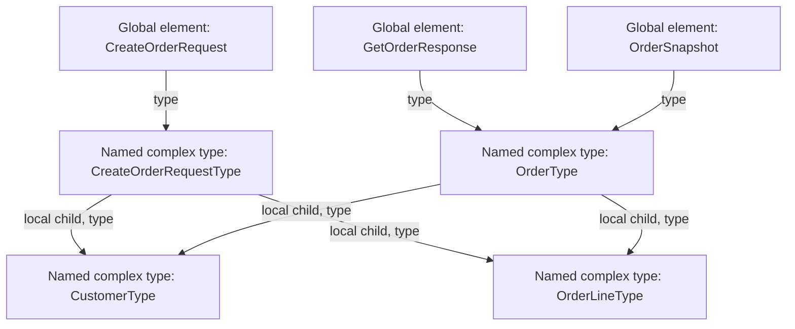

# Phần tử toàn cục, kiểu có tên và phạm vi tái sử dụng

## 1. Vì sao phải phân biệt phần tử toàn cục với kiểu dữ liệu?

Trong **Spring Web Services (Spring-WS)**, cách phát triển **contract-first** thường bắt đầu từ XSD: xác định XML request, XML response và các ràng buộc dữ liệu trước khi triển khai endpoint và SOAP client. XSD cho phép khai báo một **phần tử** (element) hoặc một **kiểu dữ liệu** (type). Chúng liên quan nhưng không thay thế nhau.

Xét bài toán hệ thống quản lý đơn hàng: client gửi `CreateOrderRequest`, hệ thống trả `CreateOrderResponse`; các thao tác khác có thể dùng lại thông tin khách hàng, dòng hàng hoặc trạng thái đơn hàng. Chúng ta muốn:

- Giữ **tên phần tử gốc** của từng thông điệp SOAP rõ ràng và ổn định.
- Định nghĩa **cấu trúc chung** một lần rồi tái sử dụng mà không nhân bản các trường.
- Kiểm soát namespace, thứ tự, số lần xuất hiện, tính bắt buộc và định dạng dữ liệu.
- Đảm bảo WSDL, lớp JAXB sinh ra, `@PayloadRoot` và SOAP client cùng hiểu một contract.

Điểm cốt lõi:

> **Phần tử toàn cục** định nghĩa một tên phần tử XML có thể được tham chiếu từ nơi khác trong schema. **Kiểu có tên** định nghĩa cấu trúc hoặc miền giá trị có thể áp dụng cho **nhiều** phần tử. Một kiểu có tên tự nó **không** khai báo phần tử XML gốc nào.

Trong module `SPRING_WEB_SERVICES`, kiến thức này là nền tảng để thiết kế XSD/WSDL, ánh xạ JAXB, xây dựng endpoint, SOAP client, phát hiện SOAP Fault do vi phạm contract và kiểm thử tương thích tích hợp doanh nghiệp. Các phần về interceptor, XML security, WS-Security và chứng chỉ sử dụng thông điệp SOAP được định hình bởi những contract này, nhưng không thay đổi quy tắc khai báo phần tử/kiểu của XSD.

### Kết quả học tập

Sau bài này, bạn có thể:

1. Phân biệt `xs:element` toàn cục, `xs:element` cục bộ, `xs:complexType` có tên, `xs:simpleType` có tên và kiểu vô danh.
2. Dùng `type="tns:..."` để tái sử dụng một **kiểu** và `ref="tns:..."` để tái sử dụng một **khai báo phần tử**.
3. Xác định namespace, phạm vi hiệu lực, giới hạn tái sử dụng và các quy tắc `minOccurs`/`maxOccurs`.
4. Thiết kế XSD theo hợp đồng SOAP document/literal và liên hệ nó với WSDL, JAXB, `@PayloadRoot`.
5. Nhận ra những thay đổi schema ảnh hưởng tới khả năng tương thích của client.

## 2. Năm khái niệm không nên trộn lẫn

| Khái niệm | Khai báo XSD | Có tên dùng để tham chiếu từ nơi khác? | Chức năng chính |
| --- | --- | --- | --- |
| **Phần tử toàn cục** (*global element declaration*) | `<xs:element name="CreateOrderRequest" type="tns:CreateOrderRequestType"/>` trực tiếp dưới `xs:schema` | Có, qua QName của phần tử và `ref` hoặc WSDL `element` | Xác định tên phần tử XML được công bố trong schema |
| **Phần tử cục bộ** (*local element declaration*) | `<xs:element name="customer" type="tns:CustomerType"/>` trong nội dung một kiểu | Không thể được tham chiếu trực tiếp như một khai báo toàn cục | Xác định phần tử con ở vị trí cụ thể |
| **Kiểu phức có tên** (*named complex type*) | `<xs:complexType name="CustomerType">...` trực tiếp dưới `xs:schema` | Có, qua `type="tns:CustomerType"` hoặc `base` | Mô tả cấu trúc phần tử con, thuộc tính và nội dung phức |
| **Kiểu đơn có tên** (*named simple type*) | `<xs:simpleType name="OrderIdType">...` trực tiếp dưới `xs:schema` | Có, qua `type="tns:OrderIdType"` | Giới hạn miền giá trị, ví dụ enumeration hoặc pattern |
| **Kiểu vô danh** (*anonymous inline type*) | `<xs:complexType>...` nằm trong một khai báo `xs:element`, không có `name` | Không tham chiếu lại được bằng QName kiểu | Mô tả cấu trúc chỉ dành cho một khai báo phần tử |

Sơ đồ quan hệ:



Hai phần tử toàn cục `GetOrderResponse` và `OrderSnapshot` có thể dùng **cùng** `OrderType`. Chúng có nội dung cùng hình dạng theo type nhưng **khác QName phần tử gốc**, nên không phải một XML message giống hệt nhau đối với WSDL hay `@PayloadRoot`.

## 3. XSD hoàn chỉnh: contract đơn hàng có khả năng tái sử dụng

Ví dụ dưới đây là một **XSD 1.0 độc lập** minh họa các kiểu có tên và phần tử toàn cục. Giả sử lưu vào `orders-v1.xsd`:

```xml
<?xml version="1.0" encoding="UTF-8"?>
<xs:schema
    xmlns:xs="http://www.w3.org/2001/XMLSchema"
    xmlns:tns="urn:example:orders:v1"
    targetNamespace="urn:example:orders:v1"
    elementFormDefault="qualified"
    attributeFormDefault="unqualified">

    <!-- 1. Kiểu đơn có tên: một mã đơn hàng được chuẩn hóa. -->
    <xs:simpleType name="OrderIdType">
        <xs:restriction base="xs:string">
            <xs:pattern value="ORD-[0-9]{6}"/>
        </xs:restriction>
    </xs:simpleType>

    <xs:simpleType name="OrderStatusType">
        <xs:restriction base="xs:string">
            <xs:enumeration value="CREATED"/>
            <xs:enumeration value="SHIPPED"/>
            <xs:enumeration value="CANCELLED"/>
        </xs:restriction>
    </xs:simpleType>

    <!-- 2. Kiểu phức có tên dùng lại trong nhiều message. -->
    <xs:complexType name="CustomerType">
        <xs:sequence>
            <xs:element name="customerId" type="xs:string"/>
            <xs:element name="displayName" type="xs:string"
                        minOccurs="0"/>
        </xs:sequence>
    </xs:complexType>

    <xs:complexType name="OrderLineType">
        <xs:sequence>
            <xs:element name="sku" type="xs:string"/>
            <xs:element name="quantity" type="xs:positiveInteger"/>
        </xs:sequence>
    </xs:complexType>

    <xs:complexType name="OrderType">
        <xs:sequence>
            <xs:element name="orderId" type="tns:OrderIdType"/>
            <xs:element name="customer" type="tns:CustomerType"/>
            <xs:element name="line" type="tns:OrderLineType"
                        minOccurs="1" maxOccurs="unbounded"/>
            <xs:element name="status" type="tns:OrderStatusType"/>
        </xs:sequence>
    </xs:complexType>

    <!-- 3. Các kiểu request/response có tên. -->
    <xs:complexType name="CreateOrderRequestType">
        <xs:sequence>
            <xs:element name="customer" type="tns:CustomerType"/>
            <xs:element name="line" type="tns:OrderLineType"
                        minOccurs="1" maxOccurs="unbounded"/>
        </xs:sequence>
        <xs:attribute name="requestId" type="xs:string"
                      use="required"/>
    </xs:complexType>

    <xs:complexType name="CreateOrderResponseType">
        <xs:sequence>
            <xs:element name="orderId" type="tns:OrderIdType"/>
            <xs:element name="status" type="tns:OrderStatusType"/>
        </xs:sequence>
    </xs:complexType>

    <xs:complexType name="GetOrderRequestType">
        <xs:sequence>
            <xs:element name="orderId" type="tns:OrderIdType"/>
        </xs:sequence>
    </xs:complexType>

    <!-- 4. Các phần tử toàn cục: điểm vào XML của thông điệp. -->
    <xs:element name="CreateOrderRequest"
                type="tns:CreateOrderRequestType"/>
    <xs:element name="CreateOrderResponse"
                type="tns:CreateOrderResponseType"/>
    <xs:element name="GetOrderRequest"
                type="tns:GetOrderRequestType"/>
    <xs:element name="GetOrderResponse"
                type="tns:OrderType"/>

    <!-- Một phần tử khác cùng dùng lại OrderType. -->
    <xs:element name="OrderSnapshot" type="tns:OrderType"/>

</xs:schema>
```

### 3.1. Cách đọc phần đầu schema

```xml
targetNamespace="urn:example:orders:v1"
elementFormDefault="qualified"
attributeFormDefault="unqualified"
```

- `targetNamespace` định danh namespace của **các khai báo toàn cục** và **các kiểu có tên** trong schema này.
- `xmlns:tns` khai báo prefix để tham chiếu đúng namespace đích trong các thuộc tính như `type="tns:OrderType"`; `tns` chỉ là bí danh.
- `elementFormDefault="qualified"` quy định **phần tử cục bộ** mặc định nằm trong namespace đích. Nó không phải điều kiện để phần tử toàn cục được qualified: khai báo toàn cục vốn đã nằm trong `targetNamespace`.
- `attributeFormDefault="unqualified"` quy định **thuộc tính cục bộ** mặc định không có namespace. Vì vậy `requestId` trên request sẽ viết **không có prefix**.

Namespace URI không cần truy cập bằng HTTP. Giá trị `urn:example:orders:v1` được dùng như một định danh: mọi hệ thống phải so khớp chính xác URI và local name.

### 3.2. XML instance đúng với `CreateOrderRequest`

```xml
<?xml version="1.0" encoding="UTF-8"?>
<CreateOrderRequest
    xmlns="urn:example:orders:v1"
    requestId="req-2026-001">
    <customer>
        <customerId>C-100</customerId>
        <displayName>Khách hàng A</displayName>
    </customer>
    <line>
        <sku>SKU-001</sku>
        <quantity>2</quantity>
    </line>
    <line>
        <sku>SKU-002</sku>
        <quantity>1</quantity>
    </line>
</CreateOrderRequest>
```

Phân tích:

| Nút XML | Vì sao hợp lệ? |
| --- | --- |
| `CreateOrderRequest` | Tồn tại khai báo **toàn cục** `{urn:example:orders:v1}CreateOrderRequest` |
| `customer` | Phần tử cục bộ trong `CreateOrderRequestType`, lấy nội dung từ `CustomerType` |
| `customerId` | Phần tử cục bộ của `CustomerType`, thuộc namespace đích |
| Hai phần tử `line` | `maxOccurs="unbounded"` trên khai báo cục bộ cho phép nhiều dòng |
| `quantity` là 2 hoặc 1 | `xs:positiveInteger` yêu cầu số nguyên lớn hơn 0 |
| Thuộc tính `requestId` | Bắt buộc (`use="required"`), không prefix vì thuộc tính cục bộ là unqualified |

Các tên phần tử không có prefix trong tài liệu này nhận namespace mặc định `urn:example:orders:v1`; riêng tên thuộc tính `requestId` không có namespace.

Nếu thay toàn bộ cách viết phần tử bằng prefix `ord:` trỏ tới cùng URI, các phần tử vẫn có QName tương đương. Ví dụ:

```xml
<ord:CreateOrderRequest
    xmlns:ord="urn:example:orders:v1"
    requestId="req-2026-002">
    <ord:customer>
        <ord:customerId>C-101</ord:customerId>
    </ord:customer>
    <ord:line>
        <ord:sku>SKU-003</ord:sku>
        <ord:quantity>3</ord:quantity>
    </ord:line>
</ord:CreateOrderRequest>
```

Đây cũng là request hợp lệ với cùng XSD. `displayName` không xuất hiện vì có `minOccurs="0"`.

### 3.3. XML response hợp lệ và tên gốc có ý nghĩa riêng

```xml
<CreateOrderResponse xmlns="urn:example:orders:v1">
    <orderId>ORD-000123</orderId>
    <status>CREATED</status>
</CreateOrderResponse>
```

Response này có kiểu `CreateOrderResponseType`. Một thông điệp khác, dùng lại `OrderType`:

```xml
<GetOrderResponse xmlns="urn:example:orders:v1">
    <orderId>ORD-000123</orderId>
    <customer>
        <customerId>C-100</customerId>
    </customer>
    <line>
        <sku>SKU-001</sku>
        <quantity>2</quantity>
    </line>
    <status>CREATED</status>
</GetOrderResponse>
```

Có thể thay tên gốc thành `OrderSnapshot` mà phần nội dung con vẫn hợp lệ vì hai **khai báo phần tử toàn cục** này cùng dùng `OrderType`. Tuy nhiên, QName gốc đã đổi từ `{urn:example:orders:v1}GetOrderResponse` sang `{urn:example:orders:v1}OrderSnapshot`. Trong SOAP contract, **cùng kiểu dữ liệu không đồng nghĩa cùng thông điệp**.

## 4. Phần tử toàn cục: tên XML được công bố ở cấp schema

### 4.1. Quy tắc khai báo và nhận diện

```xml
<xs:element name="CreateOrderRequest"
            type="tns:CreateOrderRequestType"/>
```

Khai báo này nằm trực tiếp dưới `xs:schema`, do đó là **phần tử toàn cục**. Nó có:

- **QName** `{urn:example:orders:v1}CreateOrderRequest`.
- **Kiểu** `{urn:example:orders:v1}CreateOrderRequestType`.
- Một tên có thể dùng làm **phần tử gốc của tài liệu XML** hoặc tham chiếu trong content model/WSDL.

Trong XSD có `targetNamespace`, phần tử toàn cục thuộc namespace đích. `elementFormDefault` dành cho cách xác định namespace của **phần tử cục bộ**, không thay đổi nguyên tắc này.

Các khai báo phần tử toàn cục thường làm **ranh giới công khai của SOAP message**: `CreateOrderRequest`, `CreateOrderResponse`, `GetOrderRequest`, `GetOrderResponse`. Nhưng **không phải** mọi phần tử toàn cục đều tự động trở thành một SOAP operation. Operation và message thực sự được xác định ở WSDL/binding và triển khai tương ứng.

### 4.2. Không đặt `minOccurs` hoặc `maxOccurs` lên phần tử toàn cục

Ví dụ **không hợp lệ**:

```xml
<!-- Sai: phần tử toàn cục không có minOccurs/maxOccurs. -->
<xs:element name="CreateOrderRequest"
            type="tns:CreateOrderRequestType"
            minOccurs="0"/>
```

`minOccurs` và `maxOccurs` điều khiển số lần xuất hiện của **particle trong content model**, thường là phần tử cục bộ hoặc tham chiếu `ref` bên trong `xs:sequence`/`xs:choice`. Chúng không dùng trên khai báo phần tử toàn cục trực tiếp dưới `xs:schema`.

Ví dụ **đúng** khi muốn cho một phần tử con xuất hiện nhiều lần:

```xml
<xs:complexType name="CreateOrderRequestType">
    <xs:sequence>
        <xs:element name="line" type="tns:OrderLineType"
                    minOccurs="1" maxOccurs="unbounded"/>
    </xs:sequence>
</xs:complexType>
```

Đoạn trên chỉ trích một phần để minh họa quy tắc số lần xuất hiện; **không thay thế** toàn bộ định nghĩa `CreateOrderRequestType` trong XSD ở mục 3.

## 5. Kiểu có tên: tái sử dụng cấu trúc và ràng buộc dữ liệu

### 5.1. `xs:complexType` có tên

```xml
<xs:complexType name="CustomerType">
    <xs:sequence>
        <xs:element name="customerId" type="xs:string"/>
        <xs:element name="displayName" type="xs:string"
                    minOccurs="0"/>
    </xs:sequence>
</xs:complexType>
```

`CustomerType` có tên đầy đủ `{urn:example:orders:v1}CustomerType`, nhưng bản thân khai báo này **không tạo ra** thẻ `<CustomerType>`, `<Customer>` hay `<customer>` trong XML instance.

Khi muốn dùng nó trong hai nơi khác nhau:

```xml
<xs:element name="customer" type="tns:CustomerType"/>
<xs:element name="recipient" type="tns:CustomerType"/>
```

Hai khai báo **cục bộ** trên (đặt trong hai content model tương ứng) quy định hai tên phần tử khác nhau nhưng cùng chia sẻ cấu trúc của `CustomerType`. Khi serialise XML, tên là `customer` hoặc `recipient`, **không phải** tên kiểu `CustomerType`.

Điều này cho phép dùng chung một kiểu khách hàng ở request tạo đơn, response truy vấn đơn hay thông điệp vận chuyển mà không ép chúng sử dụng cùng tên phần tử.

### 5.2. `xs:simpleType` có tên

```xml
<xs:simpleType name="OrderStatusType">
    <xs:restriction base="xs:string">
        <xs:enumeration value="CREATED"/>
        <xs:enumeration value="SHIPPED"/>
        <xs:enumeration value="CANCELLED"/>
    </xs:restriction>
</xs:simpleType>
```

Ví dụ này giới hạn giá trị hợp lệ của mọi phần tử/thuộc tính dùng `OrderStatusType`. Có thể tái sử dụng ở `CreateOrderResponseType` và `OrderType`:

```xml
<xs:element name="status" type="tns:OrderStatusType"/>
```

Ví dụ dữ liệu:

| Giá trị `status` | Kết quả theo schema |
| --- | --- |
| `CREATED` | Hợp lệ |
| `SHIPPED` | Hợp lệ |
| `CANCELLED` | Hợp lệ |
| `PENDING` | Không hợp lệ vì chưa được khai báo trong enumeration |
| `created` | Không hợp lệ vì giá trị enumeration phân biệt chữ hoa/chữ thường |

`OrderIdType` trong schema ở mục 3 cũng là một kiểu đơn có tên, nhưng dùng `xs:pattern` để ràng buộc mã như `ORD-000123`.

**Lưu ý:** XSD mô tả giới hạn cấu trúc và miền giá trị; không thay cho mọi kiểm tra nghiệp vụ. Ví dụ `xs:positiveInteger` ngăn số lượng không dương, nhưng không kiểm chứng một SKU thực sự tồn tại trong kho.

### 5.3. Một kiểu có tên có thể dùng trong phần tử hoặc thuộc tính

Kiểu đơn thường có thể dùng cho cả hai:

```xml
<xs:element name="orderId" type="tns:OrderIdType"/>
<xs:attribute name="externalOrderId"
              type="tns:OrderIdType"/>
```

Trong khi đó, kiểu phức như `CustomerType` quy định nội dung phần tử và các thuộc tính, nên không dùng làm kiểu của một thuộc tính XML thông thường. Thuộc tính XML mang một giá trị đơn theo kiểu đơn.

## 6. Kiểu vô danh: lựa chọn tốt cho cấu trúc chỉ dùng một lần

Không phải cấu trúc nào cũng cần tên riêng. Khi một kiểu chỉ phục vụ một phần tử, có thể khai báo **inline**:

```xml
<xs:element name="PingRequest">
    <xs:complexType>
        <xs:sequence>
            <xs:element name="clientVersion"
                        type="xs:string"
                        minOccurs="0"/>
        </xs:sequence>
    </xs:complexType>
</xs:element>
```

Đây là **phần tử toàn cục** `PingRequest` có kiểu phức **vô danh**. Không có QName kiểu nào tương đương để nơi khác viết `type="tns:PingRequestType"`, vì `PingRequestType` chưa từng được khai báo.

Nếu muốn tái sử dụng về sau, có thể tách kiểu có tên:

```xml
<xs:complexType name="PingRequestType">
    <xs:sequence>
        <xs:element name="clientVersion" type="xs:string"
                    minOccurs="0"/>
    </xs:sequence>
</xs:complexType>

<xs:element name="PingRequest" type="tns:PingRequestType"/>
```

Khi đặt hai khối ở cùng schema có `targetNamespace="urn:example:orders:v1"`, XML instance vẫn có thể sử dụng `PingRequest` như trước; khác biệt nằm ở khả năng **tham chiếu lại kiểu**.

| Tiêu chí | Kiểu vô danh | Kiểu có tên |
| --- | --- | --- |
| Độ gọn của contract rất nhỏ | Ít khai báo hơn | Nhiều khai báo hơn |
| Tái sử dụng ở nhiều phần tử | Không trực tiếp được bằng `type` | Dùng được bằng QName kiểu |
| Phát triển thư viện kiểu dùng chung | Hạn chế | Phù hợp |
| Dễ đọc phần tử cụ thể | Cấu trúc nằm ngay dưới phần tử | Cần truy cập khai báo kiểu |
| Thay đổi loại dữ liệu trong nhiều chỗ | Phải chỉnh nhiều khai báo nếu bị nhân bản | Chỉnh một kiểu có thể tác động mọi nơi dùng nó |

**Nguyên tắc thiết kế:** đặt tên cho kiểu khi có khả năng được dùng lại, có ngữ nghĩa miền nghiệp vụ riêng, hoặc cần giữ quy tắc thống nhất. Với một trường đơn giản chỉ xuất hiện đúng một lần, kiểu vô danh có thể đủ rõ ràng. Không cần đặt tên cho mọi chi tiết nhỏ chỉ để tăng số lượng kiểu.

## 7. `type` và `ref`: hai cách tái sử dụng khác nhau

Đây là điểm quan trọng nhất khi đọc XSD.

### 7.1. `type` tái sử dụng định nghĩa **kiểu**, giữ quyền chọn tên phần tử

```xml
<xs:element name="customer" type="tns:CustomerType"/>
<xs:element name="recipient" type="tns:CustomerType"/>
```

Hai phần tử có **local name khác nhau**, dù nội dung có cùng kiểu. Với `elementFormDefault="qualified"`, tên của chúng lần lượt là:

```text
{urn:example:orders:v1}customer
{urn:example:orders:v1}recipient
```

`type` trỏ tới QName của kiểu, không trỏ tới phần tử gốc hay operation. Đây là cách thường dùng để tái sử dụng cấu trúc dữ liệu bên trong các message khác nhau mà vẫn đặt tên phần tử phù hợp từng ngữ cảnh.

### 7.2. `ref` tái sử dụng một **phần tử toàn cục**, gồm cả tên phần tử đó

Giả sử trong cùng schema, ta có khai báo:

```xml
<xs:element name="Customer" type="tns:CustomerType"/>
```

Muốn chèn chính **phần tử Customer** vào một content model:

```xml
<xs:complexType name="TransferType">
    <xs:sequence>
        <xs:element ref="tns:Customer"/>
    </xs:sequence>
</xs:complexType>
```

XML tương ứng sẽ phải có:

```xml
<Transfer xmlns="urn:example:orders:v1">
    <Customer>
        <customerId>C-500</customerId>
    </Customer>
</Transfer>
```

Trong ví dụ này, giả sử đã khai báo thêm phần tử toàn cục `Transfer` với `type="tns:TransferType"` nếu muốn xác thực `<Transfer>` làm root. Các đoạn `Customer`/`TransferType` là **tình huống mở rộng**, không nằm trong schema hoàn chỉnh ở mục 3.

Với `ref="tns:Customer"`, tên của phần tử được tái sử dụng là `{urn:example:orders:v1}Customer`, không thể tùy tiện đổi thành `<customer>` chỉ bởi vì type bên trong vẫn là `CustomerType`.

### 7.3. Bảng chọn `type` hay `ref`

| Mục tiêu | Cách viết | Kết quả |
| --- | --- | --- |
| Dùng cấu trúc của `CustomerType` cho phần tử tên `customer` | `<xs:element name="customer" type="tns:CustomerType"/>` | Tên XML là `customer` |
| Dùng cấu trúc đó cho phần tử tên `recipient` | `<xs:element name="recipient" type="tns:CustomerType"/>` | Tên XML là `recipient` |
| Chèn nguyên khai báo phần tử toàn cục `Customer` | `<xs:element ref="tns:Customer"/>` | Tên XML là `Customer` |
| Định nghĩa root request cho SOAP | `<xs:element name="CreateOrderRequest" type="tns:CreateOrderRequestType"/>` | Công bố QName gốc rõ ràng |

Không được viết một khai báo `xs:element` vừa có `name`, `type`, lại vừa có `ref` với ý định “đặt tên mới cho phần tử tham chiếu”. Trong XSD 1.0, khi dùng `ref` để tham chiếu khai báo phần tử, các thuộc tính `name` và `type` không dùng cùng trên khai báo đó.

**Chú ý vị trí:** `ref` tham chiếu phần tử toàn cục tại **vị trí sử dụng** trong content model (ví dụ bên trong `xs:sequence`), không phải là cách tạo ra một alias toàn cục mới bằng `<xs:element ref="..."/>` trực tiếp dưới `xs:schema`.

### 7.4. `ref` vẫn có thể giới hạn số lần xuất hiện tại nơi sử dụng

```xml
<xs:complexType name="BatchType">
    <xs:sequence>
        <xs:element ref="tns:Customer"
                    minOccurs="1" maxOccurs="5"/>
    </xs:sequence>
</xs:complexType>
```

`minOccurs`/`maxOccurs` ở đây thuộc **vị trí tham chiếu trong content model**. Nó không chỉnh sửa định nghĩa toàn cục `Customer` và không thay đổi cách xuất hiện của phần tử đó ở những kiểu khác.

### 7.5. Thuộc tính có `ref` cũng cần chú ý namespace

XSD còn cho phép khai báo **thuộc tính toàn cục** rồi tham chiếu ở nơi khác:

```xml
<xs:attribute name="traceId" type="xs:string"/>

<xs:complexType name="AuditedType">
    <xs:attribute ref="tns:traceId" use="required"/>
</xs:complexType>
```

Nếu schema có namespace đích `urn:example:orders:v1`, thuộc tính toàn cục `traceId` **nằm trong namespace đích**, nên XML instance muốn dùng nó phải có prefix, ví dụ `ord:traceId="abc"` với `xmlns:ord="urn:example:orders:v1"`. Khác với `requestId` ở mục 3, đó là **thuộc tính cục bộ unqualified**.

Đây là một lý do phải thận trọng khi thay khai báo thuộc tính cục bộ bằng thuộc tính toàn cục dùng `ref`: QName trên wire có thể thay đổi.

## 8. Phạm vi tái sử dụng: toàn cục, cục bộ và liên tài liệu

### 8.1. Phạm vi trong một schema

| Thành phần | Phạm vi định nghĩa | Có thể được các thành phần khác tham chiếu trực tiếp? |
| --- | --- | --- |
| Phần tử toàn cục | Trực tiếp dưới `xs:schema` | Có, qua `ref` ở vị trí cục bộ và qua QName khi WSDL tham chiếu element |
| Kiểu có tên toàn cục | Trực tiếp dưới `xs:schema` | Có, qua `type` hoặc `base` khi quy tắc cho phép |
| Phần tử cục bộ | Nằm trong content model của một kiểu | Không phải khai báo toàn cục độc lập để tham chiếu bằng QName |
| Kiểu vô danh | Nằm trong phần tử/thuộc tính dùng nó | Không có tên kiểu để tham chiếu trực tiếp |
| Nhóm phần tử có tên `xs:group` | Trực tiếp dưới schema | Có thể tham chiếu nhóm qua `xs:group ref` |
| Nhóm thuộc tính có tên `xs:attributeGroup` | Trực tiếp dưới schema | Có thể tham chiếu nhóm qua `xs:attributeGroup ref` |

**Không nên nhầm phạm vi với quyền truy cập mã Java.** “Global” ở XSD nghĩa là component được khai báo ở cấp schema và có QName trong namespace, không liên quan đến từ khóa `public` của Java.

### 8.2. Tách nhiều file cùng namespace với `xs:include`

Một module lớn thường tách định nghĩa kiểu và message thành nhiều file:

```text
schemas/
├── orders-v1.xsd
├── order-types-v1.xsd
└── order-messages-v1.xsd
```

Ví dụ trong `orders-v1.xsd`:

```xml
<xs:schema
    xmlns:xs="http://www.w3.org/2001/XMLSchema"
    xmlns:tns="urn:example:orders:v1"
    targetNamespace="urn:example:orders:v1">
    <xs:include schemaLocation="order-types-v1.xsd"/>
    <xs:include schemaLocation="order-messages-v1.xsd"/>
</xs:schema>
```

`xs:include` dùng để kết hợp các schema có **cùng `targetNamespace`** (và XSD cũng có quy tắc áp dụng cho schema không có `targetNamespace` trong tình huống *chameleon*). Nếu các file được tổ chức như ví dụ này, mỗi file cùng namespace có thể chứa các định nghĩa kiểu hoặc phần tử riêng. Không sao chép cùng một tên toàn cục vào nhiều file gây xung đột.

*Đây là ví dụ tổ chức file,* không phải bộ ba file thực tế đã được tạo sẵn. Các file được include cần tồn tại, có XML/XSD hợp lệ và cấu hình namespace phù hợp.

### 8.3. Tái sử dụng từ namespace khác với `xs:import`

Giả sử kiểu địa chỉ thuộc schema đối tác trong namespace `urn:example:common:v1`. Trong schema đơn hàng:

```xml
<xs:schema
    xmlns:xs="http://www.w3.org/2001/XMLSchema"
    xmlns:tns="urn:example:orders:v1"
    xmlns:common="urn:example:common:v1"
    targetNamespace="urn:example:orders:v1">
    <xs:import namespace="urn:example:common:v1"
               schemaLocation="common-v1.xsd"/>

    <xs:complexType name="DeliveryType">
        <xs:sequence>
            <xs:element name="address"
                        type="common:AddressType"/>
        </xs:sequence>
    </xs:complexType>
</xs:schema>
```

`xs:import` dùng để làm việc với component từ **namespace khác**; định nghĩa `common:AddressType` phải có trong schema được import và khả dụng với trình xử lý. Khi triển khai, nên đóng gói tài nguyên XSD hoặc cấu hình resolver đáng tin cậy thay vì phụ thuộc một URL mạng luôn sẵn sàng.

| Cơ chế | Phạm vi điển hình | Mục đích |
| --- | --- | --- |
| Dùng `type`, `ref` | Trong tập schema hiện có | Tái sử dụng kiểu hoặc khai báo phần tử |
| `xs:include` | Cùng namespace (hoặc trường hợp chameleon theo XSD) | Tách component của cùng contract vào nhiều file |
| `xs:import` | Khác namespace | Sử dụng component của namespace contract khác |
| `xs:redefine` (XSD 1.0) | Cơ chế định nghĩa lại trong điều kiện giới hạn | Nâng cao, dễ tạo phụ thuộc; không cần cho thiết kế cơ bản |

## 9. Tái sử dụng kiểu không làm mất những quy tắc tại nơi sử dụng

Một kiểu có thể mô tả thứ tự phần tử, giá trị và thuộc tính. Nhưng khi đặt một phần tử cục bộ dùng kiểu đó vào parent, các ràng buộc **vị trí xuất hiện** vẫn thuộc về khai báo của parent.

### 9.1. `minOccurs`/`maxOccurs` thuộc phần tử cục bộ

```xml
<xs:element name="line" type="tns:OrderLineType"
            minOccurs="1" maxOccurs="unbounded"/>
```

Ở trong `CreateOrderRequestType`, khai báo này yêu cầu ít nhất một `line`; mỗi `line` mang nội dung của `OrderLineType`. Bản thân `OrderLineType` không nói rằng “kiểu này có thể xuất hiện vô hạn lần”; số lần xuất hiện gắn với **phần tử tại vị trí này**.

Ở một schema khác, cùng kiểu có thể dùng cho một phần tử chỉ xuất hiện một lần:

```xml
<xs:element name="mainLine" type="tns:OrderLineType"/>
```

Ở đây `mainLine` mặc định xuất hiện đúng một lần khi nằm trong một `xs:sequence` bắt buộc.

### 9.2. `minOccurs="0"` khác `nillable="true"`

```xml
<xs:element name="displayName" type="xs:string"
            minOccurs="0"/>
```

Trường này có thể **vắng mặt**. Vắng mặt khác với một phần tử có mặt nhưng đánh dấu nil. Nếu khai báo thêm `nillable="true"`, một XML instance có thể sử dụng `xsi:nil="true"` theo quy tắc XSD, ví dụ:

```xml
<displayName
    xmlns="urn:example:orders:v1"
    xmlns:xsi="http://www.w3.org/2001/XMLSchema-instance"
    xsi:nil="true"/>
```

Chỉ bổ sung `xsi:nil` là chưa đủ nếu schema không cho phép `nillable="true"`; request có thể không qua validation. Khi ánh xạ JAXB, vắng mặt và nil có thể khác nhau theo kiểu Java, binding và cách serialize; phải kiểm thử nhu cầu thực tế.

### 9.3. `xs:sequence` áp đặt thứ tự

Trong `OrderLineType`:

```xml
<xs:sequence>
    <xs:element name="sku" type="xs:string"/>
    <xs:element name="quantity" type="xs:positiveInteger"/>
</xs:sequence>
```

Vì dùng `xs:sequence`, thứ tự đúng là `sku` trước `quantity`. Một phần tử `line` chứa `quantity` trước `sku` sẽ không hợp lệ với schema này dù cả hai tên và giá trị đều đúng. Tái sử dụng `OrderLineType` cũng tái sử dụng **quy tắc thứ tự** đó.

### 9.4. Kiểu dùng chung tạo phụ thuộc thay đổi

Nếu `CustomerType` được dùng tại năm nơi, việc thêm một trường **bắt buộc** vào `CustomerType` ảnh hưởng đến cả năm nơi cùng lúc. Đây vừa là lợi ích nhất quán vừa là rủi ro tương thích.

Đặc biệt:

- Thêm phần tử mới với `minOccurs="1"` vào một `xs:sequence` thường làm các instance cũ thiếu trường trở nên không hợp lệ.
- Thêm phần tử với `minOccurs="0"` cho phép instance cũ tiếp tục hợp lệ theo schema mới trong nhiều trường hợp, nhưng client cũ vẫn có thể không xử lý phần tử mới trong response; cần kiểm tra khả năng tương thích ở cả hai chiều.
- Đổi tên phần tử, đổi namespace hoặc đổi thứ tự thường là thay đổi không tương thích với message cũ.
- Siết `xs:pattern`, enumeration hoặc ràng buộc số có thể loại bỏ dữ liệu trước đây hợp lệ.

Kiểu dùng chung nên biểu diễn một **khái niệm nghiệp vụ thực sự chung**, không chỉ vì hai thông điệp tình cờ có hai hoặc ba trường giống nhau ở thời điểm hiện tại.

## 10. Khi nào nên tái sử dụng kiểu, khi nào nên tách riêng?

Hãy đặt câu hỏi: *Nếu cấu trúc này thay đổi, tất cả nơi sử dụng có thật sự phải thay đổi cùng nhau không?*

### 10.1. Những trường hợp tái sử dụng hợp lý

| Tình huống | Thiết kế thường phù hợp | Lý do |
| --- | --- | --- |
| Mã đơn hàng có cùng quy tắc ở mọi operation | `OrderIdType` kiểu đơn có tên | Một chỗ quản lý pattern/ràng buộc |
| Cấu trúc dòng đơn hàng thống nhất | `OrderLineType` kiểu phức có tên | Tránh nhân bản `sku` và `quantity` |
| Các response mô tả cùng entity đơn hàng | `OrderType` được nhiều phần tử toàn cục sử dụng | Bảo đảm cấu trúc snapshot giống nhau |
| Root SOAP có tên nghiệp vụ riêng nhưng cùng nội dung | Hai `xs:element` toàn cục khác tên, cùng `type` | Giữ QName message riêng biệt |
| Một phần tử con vừa có tên vừa có kiểu dùng chung | `<xs:element name="customer" type="tns:CustomerType"/>` | Tái sử dụng cấu trúc, tự chọn tên theo ngữ cảnh |

### 10.2. Những trường hợp nên cân nhắc tách kiểu

| Tình huống | Rủi ro nếu dùng một kiểu duy nhất |
| --- | --- |
| `CustomerType` trong public API khác dữ liệu nội bộ | Rò rỉ trường, khó giới hạn quyền truy cập dữ liệu |
| Create request và Detail response có vòng đời khác nhau | Thêm trường chỉ phục vụ response có thể làm client tạo request phải cập nhật |
| Hai đối tác dùng quy tắc validation khác nhau | Một thay đổi ở kiểu dùng chung gây lỗi phía còn lại |
| Có nhu cầu version độc lập | Sửa một type làm tăng phạm vi ảnh hưởng ngoài dự định |

Không nên chọn “tái sử dụng tối đa” làm mục tiêu duy nhất. Mục tiêu của thiết kế contract là **tái sử dụng ở đúng ranh giới ổn định**.

### 10.3. Có thể mở rộng kiểu có tên, nhưng cần thận trọng

XSD cho phép dẫn xuất kiểu phức với `xs:extension`, ví dụ một kiểu biểu diễn đơn hàng có thêm mã vận chuyển:

```xml
<xs:complexType name="ShippedOrderType">
    <xs:complexContent>
        <xs:extension base="tns:OrderType">
            <xs:sequence>
                <xs:element name="trackingCode" type="xs:string"/>
            </xs:sequence>
        </xs:extension>
    </xs:complexContent>
</xs:complexType>
```

Đoạn này minh họa một khai báo bổ sung đặt trong cùng schema. Nó không làm thay đổi `OrderType`; `ShippedOrderType` có nội dung cơ sở của `OrderType` cộng phần tử `trackingCode` ở phía sau theo thứ tự XSD.

Đừng mặc định JAXB client hoặc SOAP stack xử lý mọi thay đổi kiểu dẫn xuất bằng `xsi:type` một cách tương thích. Nếu contract yêu cầu polymorphism, cần công bố rõ kiểu được phép, cấu hình binding, bảo mật và test với đối tác.

## 11. Từ XSD sang WSDL document/literal

Đối với SOAP contract-first, WSDL dùng **QName của phần tử toàn cục** làm nội dung request/response trong mô hình document/literal thông dụng.

Ví dụ một đoạn WSDL 1.1:

```xml
<wsdl:definitions
    xmlns:wsdl="http://schemas.xmlsoap.org/wsdl/"
    xmlns:tns="urn:example:orders:v1"
    targetNamespace="urn:example:orders:v1">

    <!-- Các khai báo XSD phải được đưa vào wsdl:types
         hoặc tham chiếu/import từ contract tương ứng. -->

    <wsdl:message name="CreateOrderInput">
        <wsdl:part name="parameters"
                   element="tns:CreateOrderRequest"/>
    </wsdl:message>

    <wsdl:message name="CreateOrderOutput">
        <wsdl:part name="parameters"
                   element="tns:CreateOrderResponse"/>
    </wsdl:message>

</wsdl:definitions>
```

Đây là đoạn **minh họa message**, chưa phải WSDL hoàn chỉnh: cần `types`, `portType`, `binding` và `service` để triển khai service.

Ý nghĩa:

- `element="tns:CreateOrderRequest"` trỏ tới **khai báo phần tử toàn cục** trong XSD, không trỏ tới tên kiểu `CreateOrderRequestType`.
- Phần tử toàn cục xác định **tên payload root** mà SOAP client phải gửi.
- `CreateOrderRequestType` xác định **cấu trúc bên trong** payload đó.

Trong WSDL 1.1 còn tồn tại trường hợp `wsdl:part type="..."`, thường gặp với những cách tổ chức interface/binding khác. Tuy nhiên, khi thiết kế document/literal theo phần tử toàn cục, thông lệ an toàn là dùng `element="tns:..."` và công bố rõ request/response global elements.

### 11.1. Phần tử root khác nhau dù dùng chung kiểu

Giả sử:

```xml
<xs:element name="GetOrderResponse" type="tns:OrderType"/>
<xs:element name="OrderSnapshot" type="tns:OrderType"/>
```

Một `wsdl:message` tham chiếu `tns:GetOrderResponse` không tự động chấp nhận `tns:OrderSnapshot` chỉ vì cả hai có `OrderType`. Các message và bộ định tuyến SOAP thường căn cứ vào **QName của phần tử gốc**.

## 12. Tác động đến JAXB và Spring-WS endpoint

### 12.1. JAXB ánh xạ phần tử và kiểu thành các thành phần khác nhau

Với contract ở mục 3, công cụ JAXB/XJC có thể sinh lớp cho các kiểu có tên như:

```text
CustomerType
OrderLineType
OrderType
CreateOrderRequestType
CreateOrderResponseType
GetOrderRequestType
```

Đồng thời, công cụ có thể biểu diễn **phần tử toàn cục** bằng `@XmlRootElement` trên một lớp, hoặc bằng các factory method trong `ObjectFactory` tạo `JAXBElement<T>`. Cách sinh cụ thể phụ thuộc phiên bản công cụ, schema và cấu hình binding; **không được giả định mỗi phần tử toàn cục luôn có một Java class riêng**.

Ví dụ về **ý nghĩa** của factory method (minh họa hình thức mã sinh):

```java
@XmlElementDecl(
    namespace = "urn:example:orders:v1",
    name = "CreateOrderRequest"
)
public JAXBElement<CreateOrderRequestType> createCreateOrderRequest(
        CreateOrderRequestType value) {
    return new JAXBElement<>(
        _CreateOrderRequest_QNAME,
        CreateOrderRequestType.class,
        null,
        value
    );
}
```

QName của `JAXBElement` là `CreateOrderRequest` trong namespace contract. `CreateOrderRequestType.class` chỉ mô tả phần dữ liệu Java. Cùng một class kiểu có thể được bọc bằng nhiều QName phần tử gốc khác nhau nếu XSD có nhiều khai báo toàn cục dùng type đó.

Đoạn trên là ví dụ trích về cơ chế, cần có `ObjectFactory`, `QName` và các import/annotation JAXB tương ứng khi sử dụng trong dự án. Trên Spring/JAXB hiện đại có thể gặp `jakarta.xml.bind.*`, còn nền tảng cũ có thể dùng `javax.xml.bind.*`; đây là khác biệt API Java, không phải khác biệt ở XSD.

### 12.2. `@PayloadRoot` khớp QName của element, không khớp tên type

```java
@Endpoint
public class OrderEndpoint {

    private static final String NS = "urn:example:orders:v1";

    @PayloadRoot(namespace = NS, localPart = "CreateOrderRequest")
    @ResponsePayload
    public JAXBElement<CreateOrderResponseType> createOrder(
            @RequestPayload JAXBElement<CreateOrderRequestType> payload) {

        CreateOrderRequestType request = payload.getValue();

        // Gọi service nghiệp vụ, tạo CreateOrderResponseType.
        CreateOrderResponseType response = orderService.create(request);

        // ObjectFactory wrap kiểu response vào QName CreateOrderResponse.
        return objectFactory.createCreateOrderResponse(response);
    }
}
```

Đây là **minh họa cách viết endpoint**, giả định đã có `orderService`, `objectFactory`, các lớp JAXB và cấu hình adapter/marshaller phù hợp. Dự án thực tế cần constructor injection, import và có thể điều chỉnh method signature theo cách JAXB generator biểu diễn root elements.

Phần định tuyến:

```java
@PayloadRoot(
    namespace = "urn:example:orders:v1",
    localPart = "CreateOrderRequest"
)
```

so khớp với phần tử XML:

```text
{urn:example:orders:v1}CreateOrderRequest
```

Nó **không** so khớp với tên kiểu `{urn:example:orders:v1}CreateOrderRequestType`. Nếu client gửi `<CreateOrderRequestType>...` dù phần tử con có nội dung giống nhau, request sẽ không có đúng QName được contract công bố.

### 12.3. Khi client dùng `WebServiceTemplate`

Với SOAP client dùng JAXB marshalling:

1. Tạo dữ liệu Java tương ứng kiểu `CreateOrderRequestType`.
2. Đảm bảo root object được marshal thành **phần tử toàn cục `CreateOrderRequest`** (trực tiếp qua `@XmlRootElement` hoặc bọc trong `JAXBElement` từ `ObjectFactory`).
3. Gửi SOAP message tới endpoint bằng `WebServiceTemplate` với message sender và SOAP version đúng cấu hình.
4. Unmarshal response dựa trên QName `CreateOrderResponse` và ràng buộc XSD tương ứng.

Nếu gửi một đối tượng `CreateOrderRequestType` mà marshaller không có thông tin phần tử gốc, có thể gặp lỗi JAXB không biết marshal root element. Đây là vấn đề **mapping element với type**, không nhất thiết là lỗi HTTP hay kết nối.

### 12.4. Lỗi XSD có thể thành SOAP Fault nhưng tùy pipeline

Khi client gửi sai QName root, sai thứ tự con, hoặc vi phạm `OrderIdType`, lỗi có thể được phát hiện tại lớp schema validation, JAXB unmarshalling hay endpoint dispatch, tùy cấu hình Spring-WS. Có hệ thống ánh xạ nó thành SOAP Fault, có hệ thống từ chối trước khi vào method endpoint. Do đó, cần log và kiểm tra các tầng xử lý thay vì dự đoán một mã HTTP/SOAP Fault cố định.

Trong môi trường có **interceptor**, có thể dùng `PayloadValidatingInterceptor` hoặc cơ chế validation phù hợp để kiểm tra XSD trên thông điệp. Cần xác định nó được đặt ở đâu trong chuỗi xử lý và cách xử lý lỗi. Với WS-Security, chữ ký XML cũng phụ thuộc vào QName/nội dung được ký; thay đổi schema, tên phần tử hoặc namespace mà không thỏa thuận có thể làm message không còn tương thích hoặc gây lỗi xác minh chữ ký.

## 13. Quản lý phiên bản và thiết kế thư viện type dùng chung

### 13.1. Không sửa kiểu dùng chung khi tác động chưa được đánh giá

Giả sử `OrderType` được dùng bởi hai phần tử:

```xml
<xs:element name="GetOrderResponse" type="tns:OrderType"/>
<xs:element name="OrderSnapshot" type="tns:OrderType"/>
```

Thêm một phần tử bắt buộc `warehouseCode` vào `OrderType` khiến **cả hai XML instance** đều phải có trường mới. Một nhóm làm integration có thể chỉ muốn mở rộng `GetOrderResponse`; nếu sửa type dùng chung, `OrderSnapshot` của đối tác khác cũng bị ảnh hưởng ngoài ý định.

Các hướng cân nhắc:

- Nếu hai thông điệp thực sự phải tiến hóa cùng nhau, tiếp tục dùng chung `OrderType` và quản lý tương thích cẩn thận.
- Nếu vòng đời khác nhau, tách `OrderSummaryType`, `OrderDetailType` hoặc tạo type riêng cho response tương ứng.
- Khi thay đổi phá vỡ hợp đồng, cân nhắc phiên bản namespace/endpoint/binding mới theo chính sách công bố API. Việc đổi URI namespace cũng là thay đổi QName và ảnh hưởng endpoint/client.

### 13.2. Bảng đánh giá thay đổi

| Thay đổi XSD | Ảnh hưởng có thể xảy ra | Cách kiểm tra |
| --- | --- | --- |
| Thêm phần tử tùy chọn `minOccurs="0"` vào kiểu dùng chung | Instance cũ thường vẫn qua schema mới; consumer cũ có thể không xử lý response mới | Kiểm thử client cũ với XML mới và ngược lại |
| Thêm phần tử bắt buộc `minOccurs="1"` | Instance cũ thường thiếu trường | Validation với các fixture từ client cũ |
| Đổi tên phần tử toàn cục | Đổi QName root của message | WSDL, `@PayloadRoot`, JAXB, SOAP client |
| Đổi `targetNamespace` | Đổi QName của thành phần toàn cục và tên qualified | Kiểm tra tất cả contract, binding và SOAP payload |
| Đổi `type="tns:OrderType"` trên một root | Có thể đổi cấu trúc payload dù QName root giữ nguyên | So schema và thử marshal/unmarshal |
| Đổi enumeration/pattern | Có thể làm giá trị hợp lệ cũ bị từ chối | Bộ dữ liệu test hợp lệ/không hợp lệ |
| Thay local `name/type` bằng global `ref` | Có thể đổi QName phần tử con hoặc thuộc tính | Diff XML instance và validation trước/sau |
| Thay đổi thứ tự trong `xs:sequence` | Có thể phá client có serialization cố định | Test request/response theo đúng thứ tự |

### 13.3. Tránh mô hình hóa kiểu dùng chung quá rộng

Một `CommonObjectType` chứa hàng chục trường tùy chọn có thể làm contract khó hiểu: client không biết trường nào thực sự có nghĩa trong từng operation. Nên ưu tiên type phản ánh miền nghiệp vụ rõ ràng, ví dụ `OrderLineType`, `CustomerReferenceType` hoặc `MoneyType` khi có đơn vị tiền tệ/ràng buộc phù hợp.

Không dùng `xs:any` hoặc `xs:anyType` tràn lan chỉ để “dễ mở rộng”; khả năng kiểm tra contract và sinh kiểu Java sẽ suy giảm. Nếu cần vùng mở rộng, phải định nghĩa quy tắc namespace, validation và compatibility rõ ràng.

## 14. Những lỗi thiết kế thường gặp

| Triệu chứng | Nguyên nhân | Hướng xử lý |
| --- | --- | --- |
| WSDL không tìm thấy `tns:CreateOrderRequestType` như một request element | Dùng QName **kiểu** thay vì QName **phần tử toàn cục** trong `wsdl:part element` | Khai báo `<xs:element name="CreateOrderRequest" type="tns:CreateOrderRequestType"/>` rồi tham chiếu element đó |
| XML gửi `<CreateOrderRequestType>` và endpoint không nhận | Dùng tên type làm root | Marshal đúng `CreateOrderRequest` |
| XSD báo không tìm thấy `tns:CustomerType` | Sai namespace, quên khai báo/import/include hoặc kiểu không có tên | Kiểm tra component QName và tài nguyên schema |
| Viết `ref="tns:CustomerType"` trên `xs:element` | `ref` trỏ tới **element declaration**, không phải type | Dùng `type="tns:CustomerType"` hoặc khai báo global element `Customer` rồi `ref="tns:Customer"` |
| Thêm `minOccurs="0"` vào global `xs:element` | Thuộc tính occurrence đặt sai vị trí | Đưa ràng buộc vào particle tại vị trí sử dụng |
| `requestId` được gửi có prefix trong khi schema yêu cầu unqualified | Nhầm namespace của attribute cục bộ với global | Dùng attribute không prefix theo `attributeFormDefault="unqualified"` |
| JAXB không marshal được object làm root | Class thể hiện type nhưng chưa có root element binding | Dùng `JAXBElement` do `ObjectFactory` tạo hoặc root annotation hợp lệ |
| Client cũ bị lỗi sau khi thêm trường mới | Thay kiểu dùng chung ở nơi client cũ không hỗ trợ | Đánh giá ảnh hưởng ở tất cả nơi dùng type; version nếu cần |
| Hai schema include có component global trùng QName | Định nghĩa chồng chéo không được xử lý đúng | Chia ownership của global component rõ ràng, kiểm tra bộ schema |

## 15. Quy trình thiết kế XSD contract-first cho SOAP service

Giả sử cần bổ sung operation `CancelOrder` cho hệ thống đơn hàng:

1. **Định nghĩa XML message trước:** muốn root là `CancelOrderRequest` và `CancelOrderResponse`, thuộc namespace contract đã công bố hoặc một namespace phiên bản mới có chủ đích.
2. **Xác định kiểu chung:** có thể tái sử dụng `OrderIdType` và `OrderStatusType` nếu cùng ý nghĩa và quy tắc.
3. **Định nghĩa kiểu request/response:** ví dụ `CancelOrderRequestType` có `orderId` và `reason`; `CancelOrderResponseType` có `orderId` và `status`.
4. **Công bố global elements:** `<xs:element name="CancelOrderRequest" type="tns:CancelOrderRequestType"/>` và response tương ứng.
5. **Chọn `type`/`ref` hợp lý:** dùng type có tên khi muốn tái sử dụng cấu trúc với tên phần tử khác nhau; dùng `ref` khi muốn chèn nguyên một global element với QName không đổi.
6. **Cập nhật WSDL:** `wsdl:part element` phải trỏ đúng global elements; thêm operation, binding và địa chỉ service theo thiết kế.
7. **Sinh JAXB và triển khai Spring-WS:** kiểm tra các QName root, wrapper `JAXBElement`/`ObjectFactory` và `@PayloadRoot`.
8. **Kiểm thử cả hai chiều:** validate XML với XSD, marshal/unmarshal, gửi SOAP request, đối chiếu response/Fault, và thử client phiên bản trước để nhận diện breaking change.

### 15.1. Ví dụ mở rộng kiểu cho `CancelOrder`

Đoạn sau có thể bổ sung vào **bên trong** `xs:schema` của mục 3, trước thẻ đóng:

```xml
<xs:complexType name="CancelOrderRequestType">
    <xs:sequence>
        <xs:element name="orderId" type="tns:OrderIdType"/>
        <xs:element name="reason" type="xs:string" minOccurs="0"/>
    </xs:sequence>
</xs:complexType>

<xs:complexType name="CancelOrderResponseType">
    <xs:sequence>
        <xs:element name="orderId" type="tns:OrderIdType"/>
        <xs:element name="status" type="tns:OrderStatusType"/>
    </xs:sequence>
</xs:complexType>

<xs:element name="CancelOrderRequest"
            type="tns:CancelOrderRequestType"/>
<xs:element name="CancelOrderResponse"
            type="tns:CancelOrderResponseType"/>
```

Với schema minh họa, một request:

```xml
<CancelOrderRequest xmlns="urn:example:orders:v1">
    <orderId>ORD-000123</orderId>
    <reason>Khách yêu cầu hủy</reason>
</CancelOrderRequest>
```

phù hợp kiểu dữ liệu request mới. Tuy nhiên, việc một đơn hàng đang ở trạng thái `SHIPPED` có được hủy hay không là **quy tắc nghiệp vụ**, cần được kiểm tra tại service và có thể trả SOAP Fault theo contract lỗi đã công bố; XSD alone không giải quyết điều kiện trạng thái này.

## 16. Bài luyện tập có đáp án

### Bài 1. Phân loại khai báo

Xét:

```xml
<xs:complexType name="AddressType">
    <xs:sequence>
        <xs:element name="city" type="xs:string"/>
    </xs:sequence>
</xs:complexType>

<xs:element name="DeliveryRequest">
    <xs:complexType>
        <xs:sequence>
            <xs:element name="shippingAddress"
                        type="tns:AddressType"/>
        </xs:sequence>
    </xs:complexType>
</xs:element>
```

Giả sử các khai báo nằm trực tiếp trong `xs:schema` có `targetNamespace="urn:example:orders:v1"` và `elementFormDefault="qualified"`.

**Câu hỏi:** `AddressType`, `DeliveryRequest`, `shippingAddress` là những thành phần nào?

**Đáp án:** `AddressType` là **kiểu phức có tên**. `DeliveryRequest` là **phần tử toàn cục** với **kiểu phức vô danh** nằm bên trong nó. `shippingAddress` là **phần tử cục bộ** dùng kiểu `tns:AddressType`.

### Bài 2. Chọn `type` hay `ref`

Cần tạo hai phần tử con có tên `billingCustomer` và `shippingCustomer`, cùng cấu trúc `CustomerType` nhưng có thể xuất hiện với `minOccurs` khác nhau.

**Câu hỏi:** Nên dùng gì?

**Đáp án:** Dùng hai khai báo cục bộ với `name` riêng và `type="tns:CustomerType"`. Ví dụ:

```xml
<xs:element name="billingCustomer"
            type="tns:CustomerType"/>
<xs:element name="shippingCustomer"
            type="tns:CustomerType"
            minOccurs="0"/>
```

Các khai báo này thuộc một content model phù hợp. Không dùng `ref="tns:CustomerType"` vì đó là QName **kiểu**, không phải QName **phần tử toàn cục**.

### Bài 3. Vì sao hai root không hoán đổi được?

```xml
<xs:element name="GetOrderResponse" type="tns:OrderType"/>
<xs:element name="OrderSnapshot" type="tns:OrderType"/>
```

WSDL mong nhận `tns:GetOrderResponse`, nhưng client gửi `tns:OrderSnapshot` với phần tử con giống hệt.

**Đáp án:** Hai phần tử toàn cục có QName khác nhau, dù `type` giống nhau. WSDL document/literal và endpoint mapping nhìn vào **element QName**. Client cần gửi đúng `GetOrderResponse` trong ngữ cảnh contract yêu cầu; không thể thay bằng `OrderSnapshot` chỉ vì cùng cấu trúc.

### Bài 4. Tìm lỗi trong XSD

```xml
<xs:element name="CreateOrderRequest"
            ref="tns:GetOrderRequest"
            type="tns:CreateOrderRequestType"
            minOccurs="1"/>
```

Giả sử dòng này nằm trực tiếp dưới `xs:schema`.

**Đáp án:** Khai báo đang trộn `name`/`type` với `ref` sai mục đích; `ref` không dùng để tạo alias phần tử toàn cục. `minOccurs` cũng không hợp lệ trên khai báo global element. Cách đúng để công bố root mới là:

```xml
<xs:element name="CreateOrderRequest"
            type="tns:CreateOrderRequestType"/>
```

### Bài 5. Dự đoán ảnh hưởng của thay đổi

`OrderLineType` hiện yêu cầu `sku` và `quantity`. Nhóm phát triển định thêm `warehouseCode` bắt buộc trực tiếp vào type này. Nó đang được dùng ở `CreateOrderRequestType` và `OrderType`.

**Câu hỏi:** Những luồng nào có nguy cơ bị ảnh hưởng?

**Đáp án:** Cả request tạo đơn lẫn response tra cứu đơn (và bất kỳ component nào khác dùng `OrderLineType`) đều có thể cần gửi/nhận thêm `warehouseCode`. Phải xem xét client cũ, thông điệp lưu trữ và các test schema. Nếu trường chỉ cần ở một luồng, cân nhắc type riêng hoặc thiết kế extension/version rõ ràng thay vì ép mọi nơi dùng một kiểu mới.

### Bài 6. Chọn cơ chế chia sẻ giữa hai schema

`orders-v1.xsd` thuộc `urn:example:orders:v1`. `customer-common.xsd` thuộc `urn:example:common:v1` và công bố `CustomerReferenceType`.

**Câu hỏi:** Dùng `xs:include` hay `xs:import`?

**Đáp án:** Dùng `xs:import namespace="urn:example:common:v1"` với `schemaLocation` phù hợp. Trong schema đơn hàng, khai báo `xmlns:common="urn:example:common:v1"` rồi tham chiếu `type="common:CustomerReferenceType"`. `xs:include` không phải cách thông thường để nối hai target namespace khác nhau.

## 17. Tổng kết kiến thức cần ghi nhớ

- **Global element** có QName dùng để nhận diện phần tử XML; nó có thể là root của SOAP payload và được tham chiếu bằng `wsdl:part element` trong contract document/literal.
- **Named type** mô tả cấu trúc hoặc miền giá trị; có thể dùng lại bởi nhiều phần tử với **tên phần tử khác nhau**.
- **Local element** mô tả phần tử con ở vị trí cụ thể; `minOccurs`, `maxOccurs` và thứ tự `xs:sequence` thuộc cấu trúc tại nơi sử dụng.
- **Anonymous type** chỉ phục vụ khai báo bao quanh, không có QName để dùng lại bằng `type`.
- **`type`** trỏ tới kiểu; **`ref`** trỏ tới một khai báo phần tử toàn cục và giữ nguyên QName của phần tử đó.
- **`targetNamespace`**, `elementFormDefault` và `attributeFormDefault` cần được đọc đúng để XML instance có namespace hợp lệ.
- **`xs:include`** chủ yếu kết hợp schema cùng namespace; **`xs:import`** cho phép tham chiếu thành phần từ namespace khác.
- Trong Spring-WS, `@PayloadRoot` khớp **QName phần tử payload root**, còn JAXB có thể biểu diễn **kiểu có tên** và **khai báo phần tử toàn cục** bằng những thành phần Java khác nhau.
- Kiểu được tái sử dụng tạo ra **phụ thuộc thay đổi**: chỉnh một type có thể ảnh hưởng nhiều request/response. Thiết kế tốt phải cân bằng tính nhất quán với khả năng tiến hóa từng contract.

### Tài liệu tham khảo

- [W3C — XML Schema Part 1: Structures (XSD 1.0)](https://www.w3.org/TR/xmlschema-1/).
- [W3C — XML Schema Part 2: Datatypes (XSD 1.0)](https://www.w3.org/TR/xmlschema-2/).
- [W3C — Namespaces in XML 1.0](https://www.w3.org/TR/xml-names/).
- [W3C — WSDL 1.1](https://www.w3.org/TR/2001/NOTE-wsdl-20010315).
- [Spring Web Services — Reference Documentation](https://docs.spring.io/spring-ws/docs/current/reference/html/).
