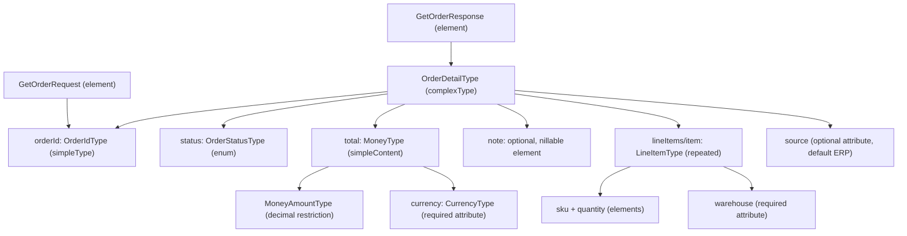

# simpleType, complexType và thuộc tính của cấu trúc dữ liệu

## 1. Vì sao phải thiết kế kiểu dữ liệu XSD trước khi viết endpoint SOAP?

Trong **Spring Web Services (Spring-WS)**, thiết kế dịch vụ theo hướng **contract-first** bắt đầu bằng định nghĩa chính xác thông điệp XML được phép trao đổi. **XML Schema Definition (XSD)** là ngôn ngữ mô tả cấu trúc và ràng buộc của các thông điệp đó. WSDL tham chiếu những phần tử XSD để mô tả operation, binding và endpoint; JAXB ánh xạ phần tử/kiểu XML sang Java; Spring-WS nhận request, xử lý và trả response dựa trên hợp đồng đã thống nhất.

Hai nhóm kiểu dữ liệu nền tảng của XSD là:

- **`xs:simpleType`**: mô tả **giá trị đơn** như chuỗi, mã đơn hàng, enum trạng thái, ngày, số tiền; có thể giới hạn bằng các *facet* như `pattern`, `enumeration`, `minInclusive`.
- **`xs:complexType`**: mô tả **cấu trúc** chứa phần tử con (*child elements*), thuộc tính XML (*attributes*) hoặc cả hai. Trường hợp đặc biệt, một `complexType` có thể mang giá trị văn bản và thuộc tính qua `simpleContent`.

Việc chọn kiểu dữ liệu và cách đặt thuộc tính ảnh hưởng trực tiếp đến **XML hợp lệ**, lớp JAXB sinh ra, schema validation, khả năng tương thích của các SOAP client và cách tiến hóa hợp đồng sau này.

Ví dụ xuyên suốt trong bài là dịch vụ SOAP **`GetOrder`** trả thông tin đơn hàng. Hợp đồng sẽ quy định mã đơn `ORD-000123`, trạng thái `CONFIRMED`, tổng tiền, các dòng hàng và metadata nguồn hệ thống. Namespace minh họa `https://example.org/orders/v1` chỉ là định danh XML, không bắt buộc là một địa chỉ HTTP truy cập được.

### Mục tiêu sau bài

Bạn cần có khả năng:

1. Phân biệt `simpleType`, `complexType`, **element** và **attribute**.
2. Thiết kế ràng buộc dữ liệu bằng các kiểu dựng sẵn, `restriction` và facet phù hợp.
3. Kết hợp `xs:sequence`, `xs:choice`, `xs:all`, `simpleContent`, `complexContent` và attribute.
4. Xác định rõ trường bắt buộc, tùy chọn, rỗng, `nil`, giá trị mặc định và namespace.
5. Dự đoán ảnh hưởng đến JAXB, Spring-WS validation và khả năng tương thích client.
6. Viết được bộ XML hợp lệ/không hợp lệ để kiểm chứng hợp đồng trước khi xây endpoint.

## 2. Đọc cấu trúc một file XSD

Một XSD thường có phần khai báo namespace và các định nghĩa toàn cục:

```xml
<?xml version="1.0" encoding="UTF-8"?>
<xs:schema xmlns:xs="http://www.w3.org/2001/XMLSchema"
           xmlns:tns="https://example.org/orders/v1"
           targetNamespace="https://example.org/orders/v1"
           elementFormDefault="qualified"
           attributeFormDefault="unqualified">

  <xs:simpleType name="OrderIdType">
    <xs:restriction base="xs:string">
      <xs:pattern value="ORD-[0-9]{6}"/>
    </xs:restriction>
  </xs:simpleType>

  <xs:element name="GetOrderRequest">
    <xs:complexType>
      <xs:sequence>
        <xs:element name="orderId" type="tns:OrderIdType"/>
      </xs:sequence>
    </xs:complexType>
  </xs:element>
</xs:schema>
```

Các thành phần cần hiểu:

| Thành phần | Vai trò | Trong ví dụ |
|---|---|---|
| `xmlns:xs` | Namespace của **ngôn ngữ XSD** | Các tag `xs:schema`, `xs:element`, `xs:restriction` |
| `targetNamespace` | Namespace của các **khai báo toàn cục** được schema định nghĩa | `https://example.org/orders/v1` |
| `xmlns:tns` | Prefix để tham chiếu đến các kiểu/phần tử nằm trong target namespace | `type="tns:OrderIdType"` |
| `elementFormDefault="qualified"` | Phần tử **cục bộ** trong XML instance phải thuộc target namespace, trừ khi override | `ord:orderId` |
| `attributeFormDefault="unqualified"` | Thuộc tính **cục bộ** mặc định không thuộc target namespace, trừ khi override | `currency="VND"`, không phải `ord:currency` |
| `xs:simpleType` | Khai báo kiểu giá trị đơn | `OrderIdType` |
| `xs:complexType` | Khai báo cấu trúc | Kiểu inline của `GetOrderRequest` |
| `xs:element` | Khai báo một phần tử có QName và kiểu | `GetOrderRequest`, `orderId` |

**Điểm dễ nhầm:** QName của phần tử được xác định bởi cặp **namespace URI + local name**, không phải chữ viết của prefix. `ord:orderId` và `o:orderId` là cùng phần tử nếu hai prefix cùng trỏ vào target namespace; `<orderId>` không có default namespace có thể là phần tử khác hẳn.

### Kiểu được đặt tên và kiểu inline

- **Kiểu đặt tên** `<xs:simpleType name="OrderIdType">...` hoặc `<xs:complexType name="OrderType">...` có thể được nhiều element tham chiếu bằng `type="tns:..."`, thuận lợi cho tái sử dụng.
- **Kiểu ẩn danh (inline)** được khai báo bên trong một `xs:element` khi chỉ element đó cần dùng. Kiểu inline có thể giảm số tên toàn cục nhưng khó dùng lại và có thể khiến mã JAXB sinh ra phụ thuộc mạnh hơn vào element chứa nó.

Trong hợp đồng dùng lâu dài, nên đặt tên các kiểu có **ý nghĩa nghiệp vụ ổn định** và được nhiều request/response dùng chung. Không cần đưa mọi kiểu nhỏ thành global nếu điều đó làm XSD khó đọc.

## 3. `simpleType`: mô hình hóa giá trị có ràng buộc

### 3.1. Các kiểu đơn dựng sẵn

XSD có nhiều kiểu đơn chuẩn. Một số kiểu hay gặp khi thiết kế SOAP:

| Kiểu | Ví dụ giá trị | Lưu ý |
|---|---|---|
| `xs:string` | `ORD-000123` | Cho phép chuỗi rỗng; không tự ràng buộc độ dài/định dạng |
| `xs:token` | `CONFIRMED` | Chuẩn hóa whitespace theo quy tắc `collapse`; vẫn có thể cần `enumeration` |
| `xs:boolean` | `true` hoặc `1` | Biểu diễn lexical hợp lệ gồm `true/false/1/0` |
| `xs:int`, `xs:long` | `42` | Có giới hạn miền số theo độ rộng kiểu |
| `xs:integer` | `1000000000000000000` | Không bị giới hạn 32/64 bit như `int/long` |
| `xs:positiveInteger` | `3` | Lớn hơn 0, phù hợp số lượng dương |
| `xs:decimal` | `249000.00` | Số thập phân chính xác, thường ánh xạ `BigDecimal` |
| `xs:date` | `2026-11-27` | Giá trị ngày; timezone có thể được ghi hoặc bỏ tùy hợp đồng |
| `xs:dateTime` | `2026-11-27T09:00:00Z` | Cần thống nhất quy ước timezone cho tích hợp |
| `xs:base64Binary` | `SGVsbG8=` | Dùng khi dữ liệu nhị phân phải nằm trong XML; cân nhắc MTOM với payload lớn |

Một **kiểu dựng sẵn** thường chưa đủ để diễn đạt cam kết nghiệp vụ. Ví dụ, `xs:string` chấp nhận mã đơn rỗng hoặc bất kỳ ký tự nào; `xs:decimal` không tự giới hạn giá trị âm; `xs:token` không có nghĩa “chỉ các trạng thái được công bố”.

### 3.2. Dùng `restriction` và facet để thu hẹp miền giá trị

Một `simpleType` có thể được tạo từ kiểu có sẵn bằng `restriction`:

```xml
<xs:simpleType name="OrderIdType">
  <xs:restriction base="xs:string">
    <xs:pattern value="ORD-[0-9]{6}"/>
  </xs:restriction>
</xs:simpleType>
```

Kiểu này nhận `ORD-000123` và từ chối `ORD-123` hoặc `INV-000123`. **Regex của XML Schema** có ngữ nghĩa riêng, không hoàn toàn giống regex Java. Pattern của XSD được đánh giá trên toàn giá trị; không áp dụng máy móc cách viết `^...$` như trong một số thư viện regex khác.

Các facet phổ biến:

| Facet | Áp dụng điển hình | Ví dụ / ý nghĩa |
|---|---|---|
| `enumeration` | Mã trạng thái, loại nghiệp vụ | Chỉ cho phép `NEW`, `CONFIRMED`, `CANCELLED` |
| `pattern` | Mã đơn, mã chi nhánh, định dạng chuỗi | `ORD-[0-9]{6}` |
| `length` | Chuỗi hoặc collection kiểu list có số đơn vị chính xác | Độ dài đúng 8 |
| `minLength` / `maxLength` | Chuỗi, list | Từ 1 đến 100 ký tự/đơn vị theo loại kiểu |
| `minInclusive` / `maxInclusive` | Số, ngày và kiểu có thứ tự phù hợp | `amount >= 0` |
| `minExclusive` / `maxExclusive` | Cận loại trừ | Giá trị phải lớn hơn 0 |
| `totalDigits` | `decimal` | Giới hạn tổng số chữ số trong giá trị |
| `fractionDigits` | `decimal` | Giới hạn số chữ số thập phân tối đa |
| `whiteSpace` | Kiểu chuỗi thích hợp | `preserve`, `replace`, `collapse` |

Không phải facet nào cũng áp dụng cho mọi kiểu đơn. Chẳng hạn, `fractionDigits` dành cho kiểu số thập phân phù hợp, không phải `xs:dateTime`. Cũng cần tách **ràng buộc schema** với quy tắc nghiệp vụ thay đổi theo dữ liệu: XSD có thể đảm bảo số tiền không âm, nhưng việc khách hàng được phép mua hay không cần kiểm tra nghiệp vụ.

### 3.3. Enum trạng thái

```xml
<xs:simpleType name="OrderStatusType">
  <xs:restriction base="xs:token">
    <xs:enumeration value="NEW"/>
    <xs:enumeration value="CONFIRMED"/>
    <xs:enumeration value="CANCELLED"/>
  </xs:restriction>
</xs:simpleType>
```

Các giá trị enum phân biệt chữ hoa/thường. JAXB generator có thể tạo Java enum cho kiểu này; thêm giá trị enum mới vào XSD tưởng như mở rộng hợp đồng nhưng có thể làm **client cũ với enum sinh tĩnh** không unmarshall được response. Vì vậy, cần kiểm thử client bên ngoài trước khi công bố trạng thái mới.

### 3.4. Giới hạn tiền tệ và số lượng

```xml
<xs:simpleType name="MoneyAmountType">
  <xs:restriction base="xs:decimal">
    <xs:totalDigits value="12"/>
    <xs:fractionDigits value="2"/>
    <xs:minInclusive value="0"/>
  </xs:restriction>
</xs:simpleType>

<xs:simpleType name="QuantityType">
  <xs:restriction base="xs:positiveInteger">
    <xs:maxInclusive value="1000000"/>
  </xs:restriction>
</xs:simpleType>
```

`totalDigits` và `fractionDigits` ràng buộc **giá trị thập phân**, không đơn giản là số ký tự của chuỗi XML. Các cách viết số khác nhau có thể biểu thị cùng một giá trị. Nếu tiền tệ có số chữ số thập phân khác nhau, cần thiết kế ràng buộc phù hợp với từng currency hoặc kiểm tra nghiệp vụ bổ sung; chỉ `fractionDigits="2"` không thể biểu diễn đầy đủ mọi quy tắc tiền tệ.

### 3.5. `list` và `union`: có thể dùng, nhưng phải cân nhắc

Ngoài `restriction`, XSD có:

```xml
<xs:simpleType name="TagListType">
  <xs:list itemType="xs:token"/>
</xs:simpleType>

<xs:simpleType name="ExternalCodeType">
  <xs:union memberTypes="xs:integer xs:token"/>
</xs:simpleType>
```

- `xs:list` mô tả **một giá trị XML dạng danh sách tách bằng khoảng trắng**, không phải nhiều XML element. Ví dụ `<tags>vip priority urgent</tags>`.
- `xs:union` cho phép giá trị thuộc **một trong các member type**; có thể làm việc diễn giải và ánh xạ JAXB phức tạp hơn.

Trong hợp đồng SOAP có nhiều client khác nền tảng, khi cần danh sách đối tượng có cấu trúc, thường rõ ràng hơn nếu dùng `xs:element maxOccurs="unbounded"` trong `complexType`. Không nên dùng `union` chỉ để né thiết kế kiểu dữ liệu nghiệp vụ nhất quán.

## 4. `complexType`: định nghĩa cấu trúc dữ liệu có nhiều thành phần

### 4.1. Phần tử con với `xs:sequence`

Kiểu phức hợp thông dụng nhất chứa các phần tử con theo thứ tự xác định:

```xml
<xs:complexType name="OrderHeaderType">
  <xs:sequence>
    <xs:element name="orderId" type="tns:OrderIdType"/>
    <xs:element name="status" type="tns:OrderStatusType"/>
  </xs:sequence>
</xs:complexType>
```

Trong XML instance, phần tử `orderId` phải đứng trước `status`. Nếu đảo thứ tự, tài liệu có thể **không hợp lệ theo XSD** dù cả hai trường đều có mặt. JAXB và nhiều SOAP toolkit thường tuần tự hóa theo thứ tự khai báo; người thiết kế không được tùy tiện đổi thứ tự chỉ vì Java không yêu cầu thứ tự thuộc tính.

### 4.2. So sánh `sequence`, `choice` và `all`

| Compositor | Ngữ nghĩa | Tình huống phù hợp |
|---|---|---|
| `xs:sequence` | Các child element xuất hiện theo **đúng thứ tự** và số lần cho phép | Payload request/response có cấu trúc rõ |
| `xs:choice` | Chọn một trong các nhánh, theo số lần xuất hiện của choice | Chỉ một trong `bankAccount` hoặc `cardToken` |
| `xs:all` | Các child element xuất hiện **không phụ thuộc thứ tự**, với ràng buộc chặt hơn về số lần | Nhóm trường đơn giản không quan tâm thứ tự |

Ví dụ «một trong hai»:

```xml
<xs:complexType name="PaymentReferenceType">
  <xs:choice>
    <xs:element name="bankTransferId" type="xs:token"/>
    <xs:element name="cardAuthorizationId" type="xs:token"/>
  </xs:choice>
</xs:complexType>
```

Không thể có cả hai phần tử trong cùng một instance hợp lệ với choice mặc định ở ví dụ này. Trong **XSD 1.0**, `xs:all` có giới hạn đáng kể: các phần tử trong nhóm chỉ được xuất hiện 0 hoặc 1 lần và nhóm cũng bị giới hạn số lần xuất hiện. Không thể xem `all` như phiên bản của `sequence` cho danh sách lặp. Các khả năng bổ sung trong XSD 1.1 cũng không nên được giả định có trong SOAP toolchain/JAXB đang dùng.

### 4.3. `minOccurs` và `maxOccurs` chỉ điều chỉnh element/particle

```xml
<xs:element name="note" type="xs:string" minOccurs="0"/>
<xs:element name="item" type="tns:LineItemType"
            minOccurs="1" maxOccurs="unbounded"/>
```

Trong ví dụ:

- `note` có thể **không xuất hiện**; không có nghĩa khi xuất hiện thì nó được tự động là `nil`.
- `item` phải xuất hiện ít nhất một lần **nếu nhóm chứa nó được hiện diện và được cấu trúc như ví dụ**; có thể lặp nhiều lần.
- Nếu không khai báo, giá trị mặc định thông dụng cho một particle element là `minOccurs="1"` và `maxOccurs="1"`.

Không gắn `minOccurs` vào `xs:attribute`: thuộc tính có cơ chế riêng là `use="optional|required|prohibited"`.

### 4.4. `nillable` không đồng nghĩa «tùy chọn»

```xml
<xs:element name="note" type="xs:string"
            minOccurs="0" nillable="true"/>
```

Với khai báo này, ba XML khác nhau có thể hợp lệ:

```xml
<!-- 1. Không có phần tử note -->
<!-- 2. Có note với giá trị rỗng -->
<ord:note xmlns:ord="https://example.org/orders/v1"/>
<!-- 3. Có note với nil -->
<ord:note xmlns:ord="https://example.org/orders/v1"
          xmlns:xsi="http://www.w3.org/2001/XMLSchema-instance"
          xsi:nil="true"/>
```

«Không có», «có nhưng rỗng» và «có với `xsi:nil="true"`» là ba trạng thái XML khác nhau, dù ứng dụng Java có thể ánh xạ một số trường hợp về `null`. Thiết kế hợp đồng phải nêu **ý nghĩa nghiệp vụ** của từng trạng thái: không gửi vì không áp dụng, gửi chuỗi rỗng, hay chủ động thông báo giá trị không có.

## 5. Thuộc tính XML: `xs:attribute` và lựa chọn với element

### 5.1. Attribute khác element ở đâu?

Xét hai cách mô tả cùng một thông tin:

```xml
<!-- Cách 1: thông tin nằm trong XML attribute -->
<ord:total currency="VND"
           xmlns:ord="https://example.org/orders/v1">249000.00</ord:total>

<!-- Cách 2: thông tin nằm trong XML element -->
<ord:total xmlns:ord="https://example.org/orders/v1">
  <ord:amount>249000.00</ord:amount>
  <ord:currency>VND</ord:currency>
</ord:total>
```

Cả hai đều có thể hợp lý, nhưng **không phải cùng cấu trúc XSD**.

| Tiêu chí | Attribute | Element |
|---|---|---|
| Cú pháp XML | `currency="VND"` | `<ord:currency>VND</ord:currency>` |
| Kiểu giá trị | Chỉ chứa giá trị **simple type** | Có thể có `simpleType` hoặc `complexType` |
| Nhiều giá trị cùng tên | Không lặp cùng tên trên một element | Có thể dùng `maxOccurs` |
| Thứ tự | Thứ tự attribute **không có ý nghĩa** | Có thể bị ràng buộc bằng `sequence` |
| Bắt buộc/tùy chọn | `use="required"` / `use="optional"` | `minOccurs` / `maxOccurs` |
| Null bằng XML Schema instance | Không dùng `xsi:nil` cho attribute | Có thể dùng `xsi:nil` nếu `nillable="true"` |
| Cấu trúc lồng nhau | Không chứa child element | Có thể chứa các element con |

**Quy tắc thiết kế thực dụng:** dùng element cho **dữ liệu nghiệp vụ chủ đạo** (orderId, customer, danh sách item) và dùng attribute khi nó mô tả **đặc tính ngắn, đơn trị của element** (currency, unit, version, source) và hợp đồng hai bên thống nhất cách biểu diễn. Đây là hướng dẫn thiết kế, không phải luật XSD cứng.

### 5.2. Khai báo thuộc tính local và các trạng thái `use`

```xml
<xs:complexType name="LineItemType">
  <xs:sequence>
    <xs:element name="sku" type="xs:token"/>
    <xs:element name="quantity" type="xs:positiveInteger"/>
  </xs:sequence>
  <xs:attribute name="category" type="xs:token" use="optional"/>
  <xs:attribute name="warehouse" type="xs:token" use="required"/>
</xs:complexType>
```

- `use="optional"`: attribute có thể vắng mặt; đây là mặc định nếu không khai báo `use`.
- `use="required"`: XML instance bắt buộc có attribute. Nếu thiếu, schema validator từ chối.
- `use="prohibited"`: attribute **không được xuất hiện** trong ngữ cảnh khai báo/giới hạn kiểu; thường có ý nghĩa khi dẫn xuất kiểu bằng restriction.

Với `use="required"`, không dựa vào default để thay thế việc phải khai báo trong XML. Attribute phải hiện diện; nếu cần không truyền giá trị, hãy thiết kế optional và thống nhất quy tắc default.

### 5.3. `default` và `fixed`

```xml
<xs:attribute name="source" type="xs:token"
              use="optional" default="ERP"/>
<xs:attribute name="version" type="xs:token"
              use="optional" fixed="v1"/>
```

**`default="ERP"`**: nếu attribute tùy chọn vắng mặt trong một document được **schema-aware validation**, schema có thể cung cấp giá trị mặc định trong **post-schema-validation infoset (PSVI)**. Tuy vậy, không mặc định rằng mọi DOM parser, JAXB marshaller hay XML client sẽ tự sinh thuộc tính này trên wire. Nếu giá trị nguồn hệ thống cần xuất hiện minh bạch, phía server nên ghi rõ nó khi serialize hoặc kiểm chứng cách thư viện xử lý default.

**`fixed="v1"`**: nếu attribute xuất hiện, giá trị phải bằng `v1`; nếu thiếu và attribute là optional, schema có thể cung cấp giá trị cố định qua PSVI. `fixed` ràng buộc giá trị, không biến một attribute optional thành required. Tránh thiết kế `default` và `fixed` đồng thời trên cùng một khai báo attribute.

**Lưu ý:** với element, cơ chế giá trị mặc định có điều kiện khác attribute; element vắng mặt do `minOccurs="0"` không tự nhiên xuất hiện trong XML instance chỉ vì có `default`. Không thiết kế quy tắc nghiệp vụ dựa vào hành vi tự «điền thêm node» chưa được kiểm chứng của XML parser.

### 5.4. Attribute namespace và khai báo global

Khi `attributeFormDefault="unqualified"`, local attribute như `currency` được viết **không prefix** trong instance:

```xml
<ord:total xmlns:ord="https://example.org/orders/v1"
           currency="VND">249000.00</ord:total>
```

Việc element đang dùng prefix `ord` không kéo local attribute vào namespace `ord`; **default namespace XML không áp dụng cho attribute không prefix**. Với một local attribute khai báo `form="qualified"` hoặc schema đặt `attributeFormDefault="qualified"`, instance phải dùng attribute thuộc target namespace, ví dụ `ord:currency="VND"`.

Nếu một attribute được khai báo **toàn cục**, nó thuộc target namespace của schema. Khi `ref` đến global attribute đó trong complex type, XML instance cần biểu diễn QName tương ứng. Đây là khác biệt quan trọng khi tái sử dụng attribute giữa nhiều schema.

### 5.5. `attributeGroup` để dùng chung metadata

```xml
<xs:attributeGroup name="AuditAttributes">
  <xs:attribute name="source" type="xs:token" use="optional"/>
  <xs:attribute name="traceId" type="xs:token" use="optional"/>
</xs:attributeGroup>

<xs:complexType name="AuditRecordType">
  <xs:sequence>
    <xs:element name="message" type="xs:string"/>
  </xs:sequence>
  <xs:attributeGroup ref="tns:AuditAttributes"/>
</xs:complexType>
```

`xs:attributeGroup` giúp dùng chung **tập khai báo attribute**; nó khác `xs:group` dùng để tái sử dụng **nhóm element/particle**. Dùng attributeGroup khi metadata thực sự có ý nghĩa thống nhất; đừng ép mọi kiểu dữ liệu mang cùng một tập attribute chỉ vì dễ khai báo.

## 6. `simpleContent`: text có thêm thuộc tính

Một `simpleType` không tự chứa attribute. Nếu muốn biểu diễn số tiền như:

```xml
<ord:total currency="VND"
           xmlns:ord="https://example.org/orders/v1">249000.00</ord:total>
```

hãy dùng **`complexType` có `simpleContent`**:

```xml
<xs:complexType name="MoneyType">
  <xs:simpleContent>
    <xs:extension base="tns:MoneyAmountType">
      <xs:attribute name="currency"
                    type="tns:CurrencyType"
                    use="required"/>
    </xs:extension>
  </xs:simpleContent>
</xs:complexType>
```

Ở đây:

- Giá trị text của element `total` là một số thuộc `MoneyAmountType`.
- Attribute `currency` là một giá trị thuộc `CurrencyType`; nó bắt buộc có.
- `MoneyType` là **complexType**, dù không có child element, vì nó chứa text **và attribute**.
- Trong JAXB, kiểu này thường được ánh xạ thành một class có thuộc tính Java gắn `@XmlValue` (giá trị text) và một field gắn `@XmlAttribute` (currency). Tên class/field thực tế phụ thuộc XJC và binding.

Đừng khai báo `<xs:element name="total" type="xs:decimal">` rồi cố gắn attribute bên trong; element khai báo kiểu simple theo cách đó không thể có cấu trúc con chứa attribute. `simpleContent` là công cụ phù hợp cho mẫu này.

## 7. Một XSD hoàn chỉnh: GetOrderRequest và GetOrderResponse

Dưới đây là ví dụ **tự chứa** ở mức schema, xây dựng từ các thành phần vừa học. Có thể lưu thành `orders.xsd` trong `src/main/resources/xsd`. Mọi kiểu, QName và quy tắc đều được công bố trong cùng một hợp đồng đơn giản.

```xml
<?xml version="1.0" encoding="UTF-8"?>
<xs:schema
    xmlns:xs="http://www.w3.org/2001/XMLSchema"
    xmlns:tns="https://example.org/orders/v1"
    targetNamespace="https://example.org/orders/v1"
    elementFormDefault="qualified"
    attributeFormDefault="unqualified">

  <!-- Các kiểu đơn có ràng buộc -->
  <xs:simpleType name="OrderIdType">
    <xs:restriction base="xs:string">
      <xs:pattern value="ORD-[0-9]{6}"/>
    </xs:restriction>
  </xs:simpleType>

  <xs:simpleType name="OrderStatusType">
    <xs:restriction base="xs:token">
      <xs:enumeration value="NEW"/>
      <xs:enumeration value="CONFIRMED"/>
      <xs:enumeration value="CANCELLED"/>
    </xs:restriction>
  </xs:simpleType>

  <xs:simpleType name="CurrencyType">
    <xs:restriction base="xs:token">
      <xs:enumeration value="VND"/>
      <xs:enumeration value="USD"/>
    </xs:restriction>
  </xs:simpleType>

  <xs:simpleType name="MoneyAmountType">
    <xs:restriction base="xs:decimal">
      <xs:totalDigits value="12"/>
      <xs:fractionDigits value="2"/>
      <xs:minInclusive value="0"/>
    </xs:restriction>
  </xs:simpleType>

  <xs:simpleType name="QuantityType">
    <xs:restriction base="xs:positiveInteger">
      <xs:maxInclusive value="1000000"/>
    </xs:restriction>
  </xs:simpleType>

  <!-- Text của element total + attribute currency -->
  <xs:complexType name="MoneyType">
    <xs:simpleContent>
      <xs:extension base="tns:MoneyAmountType">
        <xs:attribute name="currency"
                      type="tns:CurrencyType"
                      use="required"/>
      </xs:extension>
    </xs:simpleContent>
  </xs:complexType>

  <!-- Một dòng hàng; warehouse là metadata bắt buộc -->
  <xs:complexType name="LineItemType">
    <xs:sequence>
      <xs:element name="sku" type="xs:token"/>
      <xs:element name="quantity" type="tns:QuantityType"/>
    </xs:sequence>
    <xs:attribute name="warehouse" type="xs:token"
                  use="required"/>
    <xs:attribute name="category" type="xs:token"
                  use="optional"/>
  </xs:complexType>

  <!-- Response của dịch vụ: thứ tự phần tử được xác định -->
  <xs:complexType name="OrderDetailType">
    <xs:sequence>
      <xs:element name="orderId" type="tns:OrderIdType"/>
      <xs:element name="status" type="tns:OrderStatusType"/>
      <xs:element name="total" type="tns:MoneyType"/>
      <xs:element name="note" type="xs:string"
                  minOccurs="0" nillable="true"/>
      <xs:element name="lineItems" minOccurs="0">
        <xs:complexType>
          <xs:sequence>
            <xs:element name="item" type="tns:LineItemType"
                        minOccurs="1" maxOccurs="unbounded"/>
          </xs:sequence>
        </xs:complexType>
      </xs:element>
    </xs:sequence>
    <xs:attribute name="source" type="xs:token"
                  use="optional" default="ERP"/>
  </xs:complexType>

  <!-- Global elements để WSDL reference -->
  <xs:element name="GetOrderRequest">
    <xs:complexType>
      <xs:sequence>
        <xs:element name="orderId" type="tns:OrderIdType"/>
      </xs:sequence>
    </xs:complexType>
  </xs:element>

  <xs:element name="GetOrderResponse"
              type="tns:OrderDetailType"/>

</xs:schema>
```

Sơ đồ các phụ thuộc chính:



### 7.1. XML response hợp lệ với schema trên

```xml
<?xml version="1.0" encoding="UTF-8"?>
<ord:GetOrderResponse
    xmlns:ord="https://example.org/orders/v1"
    xmlns:xsi="http://www.w3.org/2001/XMLSchema-instance"
    source="ERP">
  <ord:orderId>ORD-000123</ord:orderId>
  <ord:status>CONFIRMED</ord:status>
  <ord:total currency="VND">249000.00</ord:total>
  <ord:note xsi:nil="true"/>
  <ord:lineItems>
    <ord:item warehouse="HCM-01" category="BOOK">
      <ord:sku>ISBN-0001</ord:sku>
      <ord:quantity>2</ord:quantity>
    </ord:item>
  </ord:lineItems>
</ord:GetOrderResponse>
```

Giải thích:

1. Root element `GetOrderResponse` nằm trong namespace nghiệp vụ.
2. Thứ tự `orderId → status → total → note → lineItems` khớp `xs:sequence`.
3. `orderId` khớp pattern `ORD-[0-9]{6}`; `status` nằm trong enum.
4. `total` có giá trị thập phân không âm và có attribute `currency` bắt buộc.
5. `note` có `xsi:nil="true"` vì schema cho phép; có thể thay bằng chuỗi hoặc bỏ hẳn.
6. `item` có attribute `warehouse`, đồng thời chứa element `sku` và `quantity`.
7. `source`, `currency`, `warehouse` và `category` **không prefix** vì được khai báo local với `attributeFormDefault="unqualified"`.

### 7.2. Các XML không hợp lệ và nguyên nhân

**Sai giá trị của simpleType:**

```xml
<ord:orderId xmlns:ord="https://example.org/orders/v1">ORD-12</ord:orderId>
```

Nếu phần tử này nằm trong `GetOrderResponse` như ví dụ, nó vi phạm `OrderIdType`. Chú ý: **một fragment rời không tự động được validate như toàn bộ response**; schema validator cần biết element toàn cục hoặc ngữ cảnh thích hợp.

**Thiếu required attribute:**

```xml
<ord:total xmlns:ord="https://example.org/orders/v1">249000.00</ord:total>
```

Trong `OrderDetailType`, thiếu `currency` sẽ không đạt schema.

**Sai thứ tự phần tử:**

```xml
<ord:GetOrderResponse xmlns:ord="https://example.org/orders/v1">
  <ord:status>CONFIRMED</ord:status>
  <ord:orderId>ORD-000123</ord:orderId>
  <ord:total currency="VND">249000.00</ord:total>
</ord:GetOrderResponse>
```

Không hợp lệ vì `status` đứng trước `orderId`.

**Nhầm namespace của attribute:**

```xml
<ord:total xmlns:ord="https://example.org/orders/v1"
           ord:currency="VND">249000.00</ord:total>
```

Trong ví dụ này, schema yêu cầu attribute **không namespace** tên `currency`. `ord:currency` là QName khác và không thỏa mãn attribute bắt buộc.

**Nhầm thiếu phần tử với `nil`:**

```xml
<ord:orderId xmlns:ord="https://example.org/orders/v1"
             xmlns:xsi="http://www.w3.org/2001/XMLSchema-instance"
             xsi:nil="true"/>
```

Không hợp lệ nếu nằm trong response, vì `orderId` không được khai báo `nillable="true"` và là trường bắt buộc. `minOccurs="1"` khác với `nillable="true"`; muốn gửi `nil` phải có ràng buộc cho phép.

## 8. Các dạng `complexType` và dẫn xuất kiểu

### 8.1. Bốn nhóm nội dung cần phân biệt

| Dạng | Thành phần được phép trong instance | Ví dụ |
|---|---|---|
| **Element-only complex content** | Các child element theo model | `OrderDetailType` chứa `orderId`, `status`, `total` |
| **Simple content** | Text có kiểu đơn + attribute | `<total currency="VND">249000.00</total>` |
| **Empty complex content** | Không có text/child element; có thể có attribute | `<Acknowledged at="..."/>` nếu schema thiết kế vậy |
| **Mixed content** | Text xen kẽ child element, cần `mixed="true"` | Một đoạn văn định dạng có inline child tag |

Trong SOAP nghiệp vụ, **element-only** và **simple content** thường dễ ánh xạ và kiểm thử hơn mixed content. Chỉ dùng `mixed="true"` nếu thông điệp thực sự là văn bản có các phần tử nhúng.

### 8.2. `complexContent` và `extension`

Khi một kiểu phức hợp cần **mở rộng** một kiểu phức hợp khác bằng phần tử/attribute bổ sung:

```xml
<xs:complexType name="BaseAuditType">
  <xs:sequence>
    <xs:element name="createdAt" type="xs:dateTime"/>
  </xs:sequence>
  <xs:attribute name="source" type="xs:token" use="required"/>
</xs:complexType>

<xs:complexType name="DetailedAuditType">
  <xs:complexContent>
    <xs:extension base="tns:BaseAuditType">
      <xs:sequence>
        <xs:element name="updatedAt" type="xs:dateTime"
                    minOccurs="0"/>
      </xs:sequence>
      <xs:attribute name="reviewed" type="xs:boolean"
                    use="optional"/>
    </xs:extension>
  </xs:complexContent>
</xs:complexType>
```

Lưu ý:

- `extension` thêm nội dung vào cấu trúc cơ sở theo quy tắc dẫn xuất XSD, không giống việc kế thừa Java tùy ý.
- Với `BaseAuditType` dùng `xs:sequence`, thứ tự child element của kiểu mở rộng tuân thủ quy tắc model, chẳng hạn `createdAt` trước `updatedAt`.
- `restriction` trên `complexContent` dùng để **thu hẹp** cấu trúc theo quy tắc XSD, không phải cách tùy tiện xóa trường hoặc đổi nghĩa của hợp đồng.
- Dẫn xuất phức tạp làm mô hình JAXB và khả năng dùng `xsi:type` khó đoán hơn. Nếu chỉ để tránh lặp vài dòng XSD, hãy cân nhắc cấu thành bằng kiểu được đặt tên hoặc `xs:group` thay vì một cây kế thừa sâu.

### 8.3. `simpleContent/restriction` và giới hạn của nó

`simpleContent` cũng có thể dùng `restriction` để thu hẹp simple content/attribute phù hợp với type cơ sở. Đây là kỹ thuật nâng cao cần hiểu rõ cơ chế derivation hợp lệ của XSD. Đối với người bắt đầu thiết kế SOAP, thứ tự học nên là:

1. Bắt đầu với `simpleType/restriction` để diễn đạt value constraints.
2. Dùng `complexType/sequence` cho object nghiệp vụ.
3. Dùng `simpleContent/extension` khi text phải có attribute.
4. Chỉ dùng `complexContent/extension` hoặc `restriction` khi cấu trúc kế thừa thực sự thuộc mô hình hợp đồng.

Không mô phỏng trực tiếp mọi quan hệ kế thừa trong domain Java thành XSD inheritance: domain model là chi tiết nội bộ, còn XSD phục vụ sự ổn định của hợp đồng trao đổi.

## 9. XSD và JAXB: kiểu dữ liệu trong Java được sinh ra thế nào?

Trong dự án Spring-WS contract-first, XSD nên là **nguồn chuẩn**. Công cụ JAXB/XJC sinh class Java hoặc binding metadata từ XSD. Hình dạng Java chính xác phụ thuộc phiên bản XJC, file binding và lựa chọn generator; các ánh xạ dưới đây mang tính **điển hình**.

| XSD | Java/JAXB thường gặp | Điều cần kiểm tra |
|---|---|---|
| `xs:string`, `xs:token` | `String` | Whitespace normalization diễn ra ở lớp nào? |
| `xs:int`, `xs:long` | `int/Integer`, `long/Long` tùy tính optional/nillable và cấu hình | Giá trị vắng mặt có cần phân biệt với 0? |
| `xs:decimal` | `BigDecimal` | Tránh chuyển sang `double` khi cần số chính xác |
| `xs:boolean` | `boolean/Boolean` | Boolean null/không truyền có ý nghĩa gì? |
| `xs:dateTime` | `XMLGregorianCalendar` hoặc ánh xạ tùy biến | Quy ước timezone và conversion |
| `simpleType` enum | Java `enum` nếu generator hỗ trợ ánh xạ tương ứng | Thêm enum value mới có phá client cũ? |
| `complexType` có sequence | Class JAXB chứa các field/collection | `@XmlElement`, `@XmlType(propOrder=...)` |
| `xs:attribute` | Property/field gắn `@XmlAttribute` | `required`, namespace và default |
| `simpleContent` | Class có `@XmlValue` và `@XmlAttribute` | Text và currency đều được marshal đúng |
| `maxOccurs="unbounded"` | `List<T>` hoặc dạng tương đương | Phân biệt list rỗng với thiếu wrapper |
| Global element | `@XmlRootElement` hoặc `JAXBElement<T>` qua `ObjectFactory` | Root QName đúng, không tự giả định có `@XmlRootElement` |

Ví dụ sau thể hiện **dạng mã minh họa**, không phải file XJC được bảo đảm sinh đúng từng tên property:

```java
@XmlAccessorType(XmlAccessType.FIELD)
@XmlType(name = "MoneyType")
public class MoneyType {

    @XmlValue
    protected BigDecimal value;

    @XmlAttribute(name = "currency", required = true)
    protected CurrencyType currency;
}
```

Trong thực tế, hãy **sinh từ XSD**, đọc các annotation của class sinh ra và tạo round-trip tests; không tự sửa file generated để làm cho request đầu ra «trông đúng». Nếu cần thay đổi tên property hoặc kiểu Java, dùng JAXB binding customization có quản lý phiên bản.

### 9.1. Nhận biết lỗi mapping do schema

Một số lỗi thường xảy ra:

- **Root QName sai:** package namespace hoặc `ObjectFactory` không tạo đúng phần tử `GetOrderRequest`.
- **Thứ tự phần tử sai:** JAXB không serialize theo `xs:sequence` mong đợi hoặc domain object bị ánh xạ thủ công sai.
- **Attribute biến thành element:** client gửi `<currency>VND</currency>` trong khi schema định nghĩa `currency="VND"`.
- **Sai namespace attribute:** gắn prefix cho attribute vốn phải unqualified.
- **Giá trị enum không nhận:** contract mới thêm enum nhưng client cũ vẫn có generated enum từ bản cũ.
- **Giá trị số sai:** ép `BigDecimal` sang `double` gây thay đổi giá trị/độ chính xác.
- **Vắng mặt vs nil:** giá trị Java `null` chưa chắc được serialize thành `xsi:nil="true"`; phụ thuộc JAXB annotations và thiết kế schema.

Tuy JAXB có thể thành công khi unmarshalling một XML, điều đó **không bảo đảm** mọi facet XSD được kiểm tra. Trong nhiều cấu hình JAXB, schema validation phải được bật riêng. Vì vậy, kiểm tra schema trên đường biên SOAP vẫn cần thiết.

### 9.2. Hệ sinh thái `javax` và `jakarta`

Java/Spring cũ có thể dùng API `javax.xml.bind.*`; hệ Spring Boot 3 và Spring-WS 4 dùng hệ `jakarta.xml.bind.*`. Khi sinh JAXB, chọn phiên bản generator phù hợp với runtime và dependencies. Lẫn hai hệ tên package có thể gây lỗi compile hoặc runtime dù bản XSD không thay đổi.

## 10. Kết nối XSD vào WSDL và Spring-WS

### 10.1. XSD cung cấp dữ liệu, WSDL công bố thông điệp

Ví dụ XSD ở mục 7 có hai **global elements**:

```xml
<xs:element name="GetOrderRequest">...</xs:element>
<xs:element name="GetOrderResponse" type="tns:OrderDetailType"/>
```

WSDL 1.1 theo document/literal có thể tham chiếu chúng qua `wsdl:message/wsdl:part@element`:

```xml
<wsdl:message name="GetOrderInput"
              xmlns:wsdl="http://schemas.xmlsoap.org/wsdl/"
              xmlns:tns="https://example.org/orders/v1">
  <wsdl:part name="parameters" element="tns:GetOrderRequest"/>
</wsdl:message>

<wsdl:message name="GetOrderOutput"
              xmlns:wsdl="http://schemas.xmlsoap.org/wsdl/"
              xmlns:tns="https://example.org/orders/v1">
  <wsdl:part name="parameters" element="tns:GetOrderResponse"/>
</wsdl:message>
```

Đây chỉ là WSDL fragment. Một WSDL đầy đủ còn có phần `definitions`, `types` import/include XSD, `portType`, SOAP `binding`, `service` và `port`. Chọn document/literal giúp client khác nền tảng dùng **element QName** và cấu trúc XSD cụ thể thay cho dựa vào class Java.

### 10.2. Schema validation trong Spring-WS

Spring-WS có `PayloadValidatingInterceptor` để kiểm tra SOAP payload theo XSD:

```java
@Configuration
@EnableWs
public class OrdersWsConfig extends WsConfigurerAdapter {

    @Bean
    public XsdSchema ordersSchema() {
        return new SimpleXsdSchema(
            new ClassPathResource("xsd/orders.xsd"));
    }

    @Override
    public void addInterceptors(List<EndpointInterceptor> interceptors) {
        PayloadValidatingInterceptor validator =
            new PayloadValidatingInterceptor();
        validator.setXsdSchema(ordersSchema());
        validator.setValidateRequest(true);
        validator.setValidateResponse(true);
        interceptors.add(validator);
    }
}
```

Đoạn minh họa giả định ứng dụng đã có `MessageDispatcherServlet`, endpoint, dependency Spring Web Services và các import Spring tương ứng. `@EnableWs` kích hoạt cấu hình xử lý SOAP; bean schema được dùng để kiểm tra XML payload. Việc tải XSD từ classpath phải bao gồm các schema import/include hợp lệ nếu hợp đồng có nhiều file.

**Một điểm dễ hiểu nhầm:** SOAP Envelope và metadata HTTP không được định nghĩa bởi XSD nghiệp vụ trên. Validator của payload thường kiểm tra phần tử gốc trong **SOAP Body**. Nó không tự kiểm tra định tuyến action, chứng chỉ TLS, WS-Security hay quyền truy cập domain. Các kiểm tra khác này vẫn cần cơ chế Spring-WS/gateway phù hợp.

Đối với mã kết nối JAXB, endpoint thường nhận `@RequestPayload GetOrderRequest` và trả `@ResponsePayload GetOrderResponse` hoặc wrapper `JAXBElement`, tùy kiểu do XJC sinh. Điều cần bảo đảm là:

1. Input XML khớp global element `GetOrderRequest`.
2. JAXB ánh xạ đúng kiểu và attribute của XSD.
3. Response serialize thành `GetOrderResponse`, có QName và thứ tự element đúng.
4. Khi response sai schema, kiểm thử/interceptor phát hiện **trước khi dữ liệu sai được đưa cho đối tác**.

### 10.3. SOAP Fault khi vi phạm schema

Request sai schema cần bị từ chối bằng lỗi phù hợp, thường được biểu diễn qua SOAP Fault theo cấu hình Spring-WS. Nên phân biệt:

- **Sai định dạng XML/XSD:** thiếu element bắt buộc, sai pattern, thiếu required attribute, namespace sai.
- **Sai nghiệp vụ:** mã đơn hợp lệ về cấu trúc nhưng không tồn tại, không có quyền truy cập hoặc trạng thái không cho phép xử lý.
- **Lỗi hệ thống:** lỗi hạ tầng, kết nối database, timeout nội bộ.

Không đưa stack trace, đường dẫn file XSD nội bộ, secret hoặc thông tin cá nhân vào nội dung fault trả cho bên ngoài. Contract-first cần quy định **mã lỗi, cấu trúc lỗi và test âm tính** để client xử lý ổn định.

## 11. Thiết kế schema bền vững: tái sử dụng, version và tương thích

### 11.1. Khi nào nên tách loại chung?

Nên cân nhắc dùng **named simpleType** khi mã định danh, trạng thái, đơn vị đo, code list được dùng tại nhiều vị trí. Dùng **named complexType** khi một cấu trúc có ý nghĩa nghiệp vụ và được tái sử dụng. Dùng **attributeGroup** cho metadata dùng chung.

Không nên:

- Tạo một kiểu `AnyStringType` rồi dùng cho mọi trường, làm mất ý nghĩa ràng buộc.
- Đặt tên kiểu theo DTO nội bộ, tên bảng hoặc tên entity mà đối tác không hiểu.
- Dồn mọi trường thành XML attribute để làm XML «ngắn»; attribute không hỗ trợ cấu trúc con và lặp.
- Lạm dụng inheritance sâu chỉ vì domain Java có quan hệ kế thừa.
- Dùng `xs:anyType` hoặc `xs:any` tràn lan, khiến validator không thể bảo vệ hợp đồng.

### 11.2. Tiến hóa kiểu dữ liệu và tác động đến consumer

| Thay đổi XSD | Rủi ro tương thích |
|---|---|
| Thu hẹp `xs:string` thành pattern mới | XML request hợp lệ trước đây có thể bị từ chối |
| Tăng `minLength` hoặc giảm `maxLength` | Client gửi dữ liệu cũ có thể không còn hợp lệ |
| Thêm giá trị `enumeration` | Client sinh enum tĩnh có thể không đọc được response mới |
| Đổi `minOccurs="0"` thành `1` | Client cũ có thể không gửi đủ trường |
| Thêm `xs:element` tùy chọn vào `sequence` | Có thể ảnh hưởng parser/client cũ kiểm tra schema hoặc thứ tự |
| Thêm attribute bắt buộc | Client cũ thiếu attribute sẽ không validate được |
| Thêm attribute tùy chọn | Có thể tương thích trong nhiều tình huống, nhưng phải test schema/JAXB phía consumer |
| Đổi attribute thành element hoặc ngược lại | Thay đổi wire format, thường phá hợp đồng |
| Đổi `elementFormDefault`/`attributeFormDefault` | Đổi QName của các khai báo local, có thể phá tất cả client |
| Đổi global element/target namespace | Thay đổi QName của message, thường là breaking change |

Không thể kết luận một thay đổi **chắc chắn tương thích** chỉ từ việc nó là optional. Nhiều client dùng lớp sinh tĩnh từ XSD cũ hoặc bật validation nghiêm ngặt. Cần lưu artifact XSD/WSDL của từng bản, chạy test với client cũ và, với thay đổi phá vỡ, cân nhắc namespace/endpoint phiên bản mới hoặc cung cấp hai hợp đồng song song.

### 11.3. Mở rộng bằng `xs:any` và `xs:anyAttribute` khi nào?

XSD cung cấp wildcard cho phần tử/attribute ngoài schema hiện tại. Chúng có thể hữu ích ở **điểm mở rộng được kiểm soát**, nhưng đi kèm rủi ro:

- Validator có thể không nắm đủ ràng buộc dữ liệu ở vùng mở.
- Client JAXB có thể cần nhận DOM hoặc các kiểu động.
- Namespace không giới hạn và `processContents="skip"` có thể khiến dữ liệu không được kiểm tra như mong đợi.

Nếu chọn wildcard, cần chỉ rõ namespace được phép, quy tắc xử lý, kích thước, bảo mật và cách các client cũ bỏ qua phần mở rộng. Với SOAP tích hợp ổn định, chỉ mở rộng tại các điểm đã được thiết kế từ trước.

## 12. Kiểm thử schema trước khi công bố hợp đồng

Một bộ kiểm thử tốt cần chứng minh schema **chấp nhận XML hợp lệ** và **từ chối XML sai**. Có thể dùng công cụ dòng lệnh, IDE, XMLUnit, Java Validator hoặc framework test của dự án.

### 12.1. Kiểm tra XSD và XML độc lập bằng Java

Ví dụ dưới đây minh họa validation XML ở lớp Java, không cần server SOAP chạy. Import các lớp JAXP tương ứng: `javax.xml.XMLConstants`, `javax.xml.validation.SchemaFactory`, `javax.xml.validation.Schema` và `javax.xml.validation.Validator`, cùng `javax.xml.transform.stream.StreamSource`, `java.io.File`:

```java
SchemaFactory factory = SchemaFactory.newInstance(
    XMLConstants.W3C_XML_SCHEMA_NS_URI);

// Hạn chế truy cập tài nguyên bên ngoài từ schema/parser.
factory.setFeature(XMLConstants.FEATURE_SECURE_PROCESSING, true);
factory.setProperty(XMLConstants.ACCESS_EXTERNAL_DTD, "");
factory.setProperty(XMLConstants.ACCESS_EXTERNAL_SCHEMA, "");

Schema schema = factory.newSchema(new File("orders.xsd"));
Validator validator = schema.newValidator();
validator.setProperty(XMLConstants.ACCESS_EXTERNAL_DTD, "");
validator.setProperty(XMLConstants.ACCESS_EXTERNAL_SCHEMA, "");
validator.validate(new StreamSource(new File("response-valid.xml")));
```

Nếu XML sai schema, `validate(...)` sẽ báo lỗi (thường là `SAXParseException`); trong test nên assert **loại lỗi và kịch bản** thay vì phụ thuộc nguyên văn thông điệp của một parser cụ thể.

Đây là ví dụ cho môi trường dùng JAXP hỗ trợ các thuộc tính bảo vệ trên. Trong dự án dùng `xs:include`/`xs:import`, muốn tắt truy cập external mà vẫn resolve schema nội bộ thì cần resource resolver/XML catalog được kiểm soát. Không nên bật tải schema từ URL tùy ý chỉ để làm ví dụ chạy nhanh.

### 12.2. Ma trận test trực tiếp từ quy tắc XSD

| Ca kiểm thử | Thay đổi so với response hợp lệ | Kỳ vọng |
|---|---|---|
| Happy path | `ORD-000123`, `CONFIRMED`, total hợp lệ, warehouse có mặt | PASS |
| Pattern sai | `orderId=ORD-12` | FAIL `OrderIdType` |
| Enum sai | `status=RETURNED` | FAIL `OrderStatusType` |
| Số âm | `total=-1.00` | FAIL `minInclusive` |
| Quá nhiều chữ số thập phân | `total=10.123` | FAIL `fractionDigits` |
| Thiếu attribute bắt buộc | Xóa `currency` khỏi `total` | FAIL |
| Thiếu warehouse | Xóa `warehouse` khỏi `item` | FAIL |
| Thiếu attribute tùy chọn | Xóa `source` hoặc `category` | PASS nếu phần còn lại hợp lệ |
| Element optional không xuất hiện | Xóa `note` hoặc cả `lineItems` | PASS |
| `note` có `xsi:nil="true"` | Giữ `note` và đặt nil | PASS |
| `orderId` có nil | Đặt `xsi:nil="true"` vào `orderId` | FAIL |
| Sai thứ tự | Đưa `status` trước `orderId` | FAIL `sequence` |
| QName attribute sai | Đổi `currency` thành `ord:currency` | FAIL |
| QName element sai | Bỏ namespace của `orderId` | FAIL |
| Item wrapper rỗng | Có `<lineItems/>` | FAIL vì bên trong cần ít nhất một `item` |
| Toàn bộ `lineItems` vắng mặt | Bỏ wrapper | PASS vì `minOccurs="0"` |

Đặc biệt, so sánh hai trường hợp **không có wrapper** và **wrapper rỗng**: chúng không tương đương khi `lineItems` là optional nhưng child `item` bên trong bắt buộc có ít nhất một.

### 12.3. Tiêu chí kiểm chứng hợp đồng

Bài thực hành nên chỉ được coi là hoàn tất khi:

1. XSD tự compile, tất cả import/include được resolve theo cách có kiểm soát.
2. XML mẫu request và response validate đúng với global elements tương ứng.
3. Có test âm tính cho pattern, enum, số tiền, required attribute, nil và namespace.
4. JAXB round-trip tạo XML hợp lệ, **đúng thứ tự và QName**, không làm mất attribute quan trọng.
5. Spring-WS validation interceptor phát hiện request/response sai schema.
6. WSDL tham chiếu đúng global elements và client từ stack khác có thể tiêu thụ message.
7. Kết quả test được giữ trong CI để phát hiện thay đổi hợp đồng vô tình.

## 13. Các sai lầm thường gặp và cách xử lý

| Triệu chứng | Nguyên nhân có thể | Cách khắc phục |
|---|---|---|
| `cvc-pattern-valid` | Giá trị không khớp `xs:pattern` | Kiểm tra miền mã, độ dài, case và regex XSD |
| `cvc-enumeration-valid` | Enum nhận giá trị không được công bố | Thống nhất code list; không tự gửi giá trị Java tùy ý |
| `cvc-complex-type...` báo thiếu child | `minOccurs` mặc định bằng 1, hoặc sai sequence | Kiểm tra thứ tự và cardinality |
| `cvc-complex-type...` báo thiếu attribute | `use="required"` chưa được thỏa | Gửi attribute đúng QName và kiểu |
| Client gửi `ord:currency` nhưng server yêu cầu `currency` | Nhầm `attributeFormDefault` | Kiểm tra attribute local/global và namespace |
| `<lineItems/>` bị lỗi trong khi có thể bỏ `lineItems` | Wrapper optional, child item required | Bỏ cả wrapper hoặc gửi ít nhất một item |
| JAXB tạo element thay vì attribute | Java model không đúng binding schema | Sinh lại JAXB từ XSD, kiểm tra `@XmlAttribute` |
| Giá trị `null` không thành `xsi:nil` | `minOccurs`/`nillable` và JAXB behavior khác nhau | Chốt ý nghĩa vắng mặt/nil, test XML thực |
| Java parse được nhưng schema validator báo sai | JAXB unmarshalling không tự bảo đảm mọi constraint | Bật XSD validation độc lập hoặc ở Spring-WS boundary |
| Đổi từ simple sang complex làm client cũ hỏng | Thay wire format của element | Quản lý version và thực hiện consumer contract tests |

Hãy ưu tiên xem **XML request/response thực tế** và báo lỗi validator trước khi sửa model Java. Việc sửa Java annotation để vượt qua một lỗi validate có thể che đi mâu thuẫn của hợp đồng XSD/WSDL.

## 14. Bài tập tổng hợp: thiết kế kiểu dữ liệu cho SOAP contract-first

Từ ví dụ `GetOrder`, hãy tự mở rộng schema với yêu cầu:

1. `OrderIdType` giữ định dạng `ORD-` và đúng sáu chữ số.
2. `CustomerCodeType` chỉ gồm 2–12 ký tự chữ in hoa hoặc số; dùng `simpleType/restriction`, mô tả rõ ký tự nào hợp lệ.
3. `OrderStatusType` chỉ nhận `NEW`, `CONFIRMED` hoặc `CANCELLED`.
4. Mỗi đơn có một `orderId`, một `status`, một `total`; `note` được vắng mặt hoặc nil.
5. `total` sử dụng `simpleContent` để chứa số tiền và attribute `currency` bắt buộc.
6. Danh sách item có thể không có; nếu có wrapper thì ít nhất một item, mỗi item có `warehouse` bắt buộc.
7. Thêm `trackingId` tùy chọn dưới dạng attribute vào `OrderDetailType` và giải thích tại sao bạn chọn attribute thay vì element.
8. Sinh JAXB từ schema, marshal/unmarshal một response, kiểm tra bản XML bằng validator.
9. Thay `trackingId` thành required, chứng minh bằng test rằng client cũ không gửi attribute sẽ bị từ chối, từ đó đánh giá tính tương thích.

**Câu hỏi tự kiểm tra:** Tại sao `<ord:total currency="VND">249000.00</ord:total>` cần `complexType/simpleContent`, trong khi phần text vẫn chỉ là số? Vì sao `@XmlAttribute(required=true)` không thay thế schema validation? Vì sao một XML thiếu `note` có thể hợp lệ nhưng một XML thiếu `status` lại không?

## 15. Checklist thiết kế và tài liệu tham khảo

Trước khi công bố XSD cho dịch vụ SOAP doanh nghiệp:

- [ ] Mọi kiểu có tên và ý nghĩa nghiệp vụ rõ; các trường mã sử dụng facet thay vì `xs:string` không giới hạn.
- [ ] Phân biệt rành mạch `simpleType`, `complexType`, `simpleContent`, `element` và `attribute`.
- [ ] Đã xác định và kiểm thử thứ tự, cardinality, `minOccurs`, `maxOccurs` và `nillable`.
- [ ] Đã quyết định có chủ đích thuộc tính nào là optional/required, default/fixed; không nhầm attribute với element.
- [ ] Namespace của element và attribute có quy ước nhất quán, phù hợp document/literal SOAP.
- [ ] XSD và WSDL có phiên bản được quản lý; global elements đầu vào/đầu ra đúng hợp đồng.
- [ ] JAXB được sinh và kiểm thử round-trip; kiểm tra tương thích `javax`/`jakarta`.
- [ ] Spring-WS kiểm tra request và response bằng schema; SOAP Fault không làm lộ thông tin nhạy cảm.
- [ ] Có test âm tính, test client khác nền tảng, và đánh giá breaking changes trước khi phát hành.

### Tài liệu nền tảng

- [W3C — XML Schema Part 1: Structures, Second Edition (XSD 1.0)](https://www.w3.org/TR/xmlschema-1/): khai báo element, attribute, complex type, content model, derivation, namespace và schema validation.
- [W3C — XML Schema Part 2: Datatypes, Second Edition (XSD 1.0)](https://www.w3.org/TR/xmlschema-2/): kiểu đơn chuẩn, `restriction`, `enumeration`, `pattern`, numeric facets, list và union.
- [W3C — XML Schema 1.1 Part 1: Structures](https://www.w3.org/TR/xmlschema11-1/) và [Part 2: Datatypes](https://www.w3.org/TR/xmlschema11-2/): các khả năng mới của XSD 1.1; chỉ dùng khi toolchain và đối tác hỗ trợ.
- [W3C — Web Services Description Language (WSDL) 1.1](https://www.w3.org/TR/wsdl.html): các phần `types`, `message`, `portType` và SOAP document/literal binding.
- [Spring Web Services — Reference Documentation](https://docs.spring.io/spring-ws/docs/current/reference/html/): contract-first, XSD/WSDL, JAXB mapping và payload validation.
- [Jakarta XML Binding Specification](https://jakarta.ee/specifications/xml-binding/): quy tắc liên kết XML Schema với mô hình Java và marshalling/unmarshalling.

**Kết luận:** `simpleType` trả lời **«giá trị nào hợp lệ?»**; `complexType` trả lời **«các thành phần được sắp xếp và lồng nhau như thế nào?»**; `xs:attribute` trả lời **«metadata đơn trị nào gắn với một element?»**. Khi ba phần này được thiết kế chính xác, XSD trở thành hợp đồng kiểm chứng được, giúp Spring-WS endpoint, JAXB model và SOAP client tích hợp ổn định thay vì phụ thuộc vào suy đoán từ mã Java.
