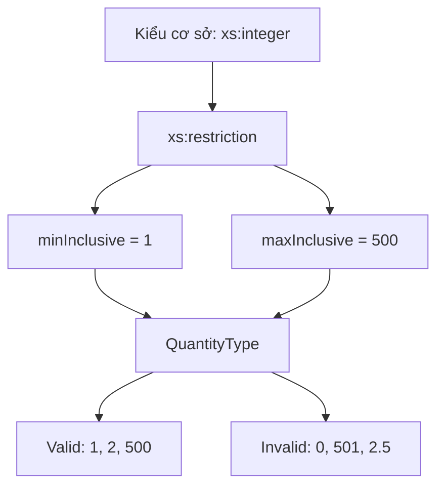

# Ràng buộc kiểu bằng enumeration, pattern, độ dài và miền giá trị

Khi thiết kế dịch vụ SOAP theo hướng **contract-first** với **Spring Web Services (Spring-WS)**, XSD (XML Schema Definition) là phần mô tả cấu trúc và quy tắc dữ liệu mà client và server cùng phải tuân thủ. Nếu chỉ dùng `xs:string` cho mọi mã, trạng thái và số tiền, XML có thể hợp lệ về mặt cú pháp nhưng lại mang giá trị nghiệp vụ vô nghĩa. XSD cho phép **hạn chế một kiểu đơn giản** bằng `xs:restriction` và các *facet* như `xs:enumeration`, `xs:pattern`, `xs:length`, `xs:minLength`, `xs:maxLength`, `xs:minInclusive`, `xs:maxExclusive`, `xs:totalDigits`, `xs:fractionDigits`.

Bài học thuộc chương **Thiết kế XSD**, tập trung vào cách chọn facet phù hợp, kết hợp chúng thành hợp đồng XML rõ ràng, kiểm thử giá trị hợp lệ/không hợp lệ và nhận biết tác động khi hợp đồng được ánh xạ sang JAXB, endpoint, SOAP client, SOAP Fault và interceptor. Các ví dụ chủ yếu dùng **XSD 1.0** để phù hợp với những hệ thống Java/SOAP doanh nghiệp thường gặp.

## 1. Tại sao phải ràng buộc dữ liệu ngay trong XSD?

Giả sử dịch vụ tạo đơn hàng nhận request:

```xml
<ord:CreateOrderRequest xmlns:ord="urn:example:orders:v1">
  <ord:clientOrderId>WEB-20261127-0042</ord:clientOrderId>
  <ord:quantity>2</ord:quantity>
  <ord:unitPrice>1250000.00</ord:unitPrice>
  <ord:currency>VND</ord:currency>
</ord:CreateOrderRequest>
```

Nếu tất cả trường đều là `xs:string`, một request với `quantity=abc`, `currency=XYZ` hoặc `unitPrice=-100` vẫn có thể thỏa cấu trúc XSD quá lỏng. Lập trình viên phải kiểm tra lại nhiều quy tắc ở endpoint, các client khó biết trước dữ liệu nào được chấp nhận, và lỗi tích hợp thường chỉ xuất hiện khi chạy thật.

Thiết kế ràng buộc hợp lý đem lại các lợi ích sau:

- **Hợp đồng có thể kiểm tra tự động:** đối tác có thể validate thông điệp trước khi gửi; server có thể chặn payload sai tại tầng XSD.
- **Giảm mơ hồ giữa các ngôn ngữ:** Java, .NET và các SOAP client khác đều nhìn thấy cùng một miền giá trị và định dạng.
- **Giúp sinh mã JAXB:** tên kiểu, kiểu dữ liệu và một số miền enumeration có thể được phản ánh vào class hoặc enum khi generate code.
- **Thông báo lỗi sớm:** các lỗi như mã đơn sai định dạng, số lượng ngoài giới hạn hoặc trạng thái không hỗ trợ được phát hiện trước khi cập nhật dữ liệu.
- **Tạo nền tảng cho kiểm thử tương thích:** thay đổi facet có thể làm request cũ trở nên không hợp lệ, vì vậy phải có kế hoạch versioning.

Tuy nhiên, **XSD không thay thế tất cả kiểm tra nghiệp vụ**. Ví dụ một số tiền phù hợp `xs:decimal` và nằm trong giới hạn XSD vẫn có thể vượt hạn mức riêng của khách hàng, hoặc một đơn hàng hợp lệ về cấu trúc vẫn có thể trùng mã theo cơ sở dữ liệu.

## 2. Cơ chế `xs:simpleType` và `xs:restriction`

*Simple type* mô tả một giá trị đơn giản như chuỗi, số, ngày tháng hoặc kiểu danh sách/union. Một **kiểu hạn chế** (*restriction type*) được xây từ kiểu cơ sở và các facet để thu hẹp tập giá trị được chấp nhận:

```xml
<xs:simpleType name="QuantityType">
  <xs:restriction base="xs:integer">
    <xs:minInclusive value="1"/>
    <xs:maxInclusive value="500"/>
  </xs:restriction>
</xs:simpleType>
```

Ở đây:

- `QuantityType` là tên kiểu định nghĩa trong schema hiện tại.
- `base="xs:integer"` nói rằng giá trị phải là số nguyên theo quy tắc XSD trước khi xét miền giá trị.
- `minInclusive=1` chấp nhận **1**; `maxInclusive=500` chấp nhận **500**.
- Giá trị `0`, `501` và `2.5` không hợp lệ với `QuantityType`.

Để sử dụng kiểu, khai báo phần tử `<xs:element name="quantity" type="ord:QuantityType"/>` trong schema có `xmlns:ord` trỏ tới `targetNamespace`. Một kiểu có tên ở cấp schema có thể được dùng cho nhiều element; một kiểu khai báo *anonymous* bên trong element chỉ dành cho vị trí đó.



**Phân biệt hai khái niệm:** một tài liệu XML có thể *well-formed* vì thẻ đóng mở đúng, nhưng *invalid theo XSD* vì giá trị `quantity` nằm ngoài miền cho phép. XSD validation là bước riêng sau khi parse XML.

### 2.1. Kiểu cơ sở quyết định facet nào có ý nghĩa

| Kiểu cơ sở | Các facet thường dùng | Mục đích |
| --- | --- | --- |
| `xs:string`, `xs:normalizedString`, `xs:token` | `length`, `minLength`, `maxLength`, `pattern`, `enumeration` | Mã, tên, chuỗi có định dạng, nhóm giá trị hữu hạn. |
| `xs:integer`, `xs:decimal` | `minInclusive`, `maxInclusive`, `minExclusive`, `maxExclusive`, `enumeration`; riêng số thập phân còn có `totalDigits`, `fractionDigits` | Số lượng, hạn mức, giá tiền, tỷ lệ. |
| `xs:date`, `xs:dateTime` | Các giới hạn `min*`, `max*`, `enumeration`, `pattern` nếu phù hợp | Khoảng ngày/giờ hợp lệ theo hợp đồng. |
| `xs:token` | `enumeration`, `pattern`, độ dài | Trạng thái hoặc mã định danh không cần giữ khoảng trắng thừa. |

Không phải facet nào cũng dùng được cho mọi kiểu. Ví dụ `maxLength` không phải cách đúng để giới hạn trị số của `xs:integer`; cần `maxInclusive`/`maxExclusive`. Ngược lại, `minInclusive` không dùng để nói tên khách phải có ít nhất hai ký tự; cần `minLength`.

## 3. `xs:enumeration` — danh sách giá trị được phép

**Enumeration** xác định tập giá trị hữu hạn, rõ ràng. Đây là lựa chọn tự nhiên cho trạng thái đơn hàng, loại giao dịch, đơn vị tiền tệ hoặc mã hành động được hợp đồng hỗ trợ.

```xml
<xs:simpleType name="CurrencyCodeType">
  <xs:restriction base="xs:token">
    <xs:enumeration value="VND"/>
    <xs:enumeration value="USD"/>
  </xs:restriction>
</xs:simpleType>
```

| Giá trị nhận | Kết quả | Lý do |
| --- | --- | --- |
| `VND` | Hợp lệ | Có trong danh sách. |
| `USD` | Hợp lệ | Có trong danh sách. |
| `EUR` | Không hợp lệ | Không nằm trong enumeration này, dù là mã tiền tệ có thật. |
| `vnd` | Không hợp lệ | Khác chữ hoa/chữ thường với `VND`. |
| ` VND ` | Có thể hợp lệ với kiểu cơ sở `xs:token` | `xs:token` chuẩn hóa khoảng trắng theo quy tắc `whiteSpace=collapse` trước khi đánh giá giá trị. |

Vì sao nên dùng `xs:token` cho mã? Nó loại bỏ khoảng trắng đầu/cuối và gộp các chuỗi khoảng trắng theo quy tắc XSD. Nếu hợp đồng yêu cầu **từ chối cả khoảng trắng thừa trong raw XML**, `xs:token` có thể quá dễ dãi; khi đó cần chọn kiểu cơ sở/chính sách validation có tính đến `whiteSpace`.

Thêm một kiểu trạng thái:

```xml
<xs:simpleType name="OrderStatusType">
  <xs:restriction base="xs:token">
    <xs:enumeration value="NEW"/>
    <xs:enumeration value="ACCEPTED"/>
    <xs:enumeration value="REJECTED"/>
  </xs:restriction>
</xs:simpleType>
```

Nếu hệ thống sau này bổ sung trạng thái `PENDING_REVIEW`, đây là **thay đổi hợp đồng**: một client cũ được generate enum JAXB hoặc code .NET từ XSD cũ có thể không xử lý được giá trị mới trong response. Đừng mặc định rằng bổ sung một mục enumeration là thay đổi hoàn toàn tương thích.

**Chú ý với kiểu số:** enumeration dựa trên miền giá trị của kiểu cơ sở, không chỉ so chuỗi nguyên văn. Ví dụ hai biểu diễn thập phân `1.0` và `1.00` có cùng giá trị theo `xs:decimal`; muốn buộc số chữ số thể hiện trong văn bản XML theo một mẫu, phải phân biệt bài toán lexical format với numeric value.

## 4. `xs:pattern` — quy tắc định dạng chuỗi

Pattern thường được dùng cho mã đơn hàng, mã khách hàng, số hiệu nghiệp vụ hoặc các chuỗi có cấu trúc. Ví dụ ID ở dạng `WEB-20261127-0042`: ba chữ cái ASCII viết hoa, dấu nối, tám chữ số, dấu nối, bốn chữ số.

```xml
<xs:simpleType name="ClientOrderIdType">
  <xs:restriction base="xs:token">
    <xs:length value="17"/>
    <xs:pattern value="[A-Z]{3}-[0-9]{8}-[0-9]{4}"/>
  </xs:restriction>
</xs:simpleType>
```

Độ dài được tính như sau: `3 + 1 + 8 + 1 + 4 = 17` ký tự. Ví dụ hợp lệ: `WEB-20261127-0042`, `APP-20261015-0001`. Ví dụ không hợp lệ: `web-20261127-0042`, `WEB-20261127-042`, `WEB_20261127_0042`.

### 4.1. Pattern của XSD khác regex Java/JavaScript

| Chủ đề | XML Schema regex | Lưu ý cho người viết hợp đồng |
| --- | --- | --- |
| Ghép toàn bộ giá trị | Pattern XSD ràng buộc **toàn bộ chuỗi** cần khớp. | Không cần thêm ký hiệu neo `^` và `$` như trong một số regex engine; các dấu này không có cùng ngữ nghĩa neo trong XSD regex. |
| Lượng từ | `?`, `*`, `+`, `{n}`, `{m,n}` | Hữu ích cho đoạn tùy chọn, số lần lặp. |
| Lớp ký tự | `[A-Z]`, `[0-9]`, các lớp Unicode được XSD hỗ trợ | Dùng `[0-9]` nếu thật sự muốn chữ số ASCII; không mặc định mọi shorthand như `\d` đều chỉ là ASCII. |
| Tính năng regex nâng cao | Cú pháp không giống hoàn toàn Java `Pattern`/PCRE. | Tránh dùng lookahead, lookbehind hay non-capturing group kiểu Java khi XSD không hỗ trợ. |
| Escaping của XML | Pattern nằm trong giá trị thuộc tính XML. | Dấu `&` phải viết `&amp;`, dấu `<` phải viết `&lt;` nếu xuất hiện trong thuộc tính. |
| Khoảng trắng | Kiểu cơ sở có facet `whiteSpace` riêng. | Pattern kiểm tra giá trị sau các bước chuẩn hóa tương ứng. |

Ví dụ pattern để nhận mã ưu tiên `PRIO-001` đến `PRIO-999` về **hình thức**:

```xml
<xs:pattern value="PRIO-[0-9]{3}"/>
```

Pattern này cũng chấp nhận `PRIO-000`, nên nếu nghiệp vụ cấm giá trị 0 cần thêm quy tắc biểu diễn phù hợp hoặc kiểm tra ở tầng khác. Một pattern nhìn phức tạp chưa chắc biểu diễn chính xác mọi quy tắc nghiệp vụ.

### 4.2. Kết hợp nhiều pattern cần chú ý

Trong **cùng một bước `xs:restriction`**, nhiều `xs:pattern` được kết hợp theo phép **OR** (khớp một trong các biểu thức), không phải lúc nào cũng là AND:

```xml
<xs:simpleType name="ExternalCodeType">
  <xs:restriction base="xs:token">
    <xs:pattern value="WEB-[0-9]{4}"/>
    <xs:pattern value="POS-[0-9]{4}"/>
  </xs:restriction>
</xs:simpleType>
```

Kiểu này chấp nhận `WEB-1234` **hoặc** `POS-1234`. Nếu tạo một kiểu dẫn xuất tiếp từ `ExternalCodeType` và bổ sung một pattern mới, các điều kiện pattern từ **những bước restriction khác nhau** cần đồng thời được thỏa mãn. Hãy dùng tên kiểu và tập ví dụ kiểm thử để tránh hiểu nhầm khi mở rộng schema.

**Giới hạn của pattern:** Có thể mô tả hình dạng của `20261127` là 8 chữ số, nhưng không bảo đảm đó là ngày hợp lệ trong lịch (ví dụ ngày 31 tháng 2). Nếu cần ý nghĩa ngày, cân nhắc kiểu `xs:date` hoặc kiểm tra nghiệp vụ bổ sung.

## 5. `xs:length`, `minLength`, `maxLength` — kiểm soát độ dài

Ba facet có ý nghĩa khác nhau:

| Facet | Điều kiện | Ví dụ |
| --- | --- | --- |
| `xs:length value="17"` | Độ dài **đúng bằng** 17 | Client order ID có định dạng cố định. |
| `xs:minLength value="2"` | Ít nhất 2 ký tự | Tên người nhận. |
| `xs:maxLength value="80"` | Nhiều nhất 80 ký tự | Giới hạn trường tên theo hợp đồng. |

Ví dụ với tên người nhận:

```xml
<xs:simpleType name="CustomerNameType">
  <xs:restriction base="xs:normalizedString">
    <xs:minLength value="2"/>
    <xs:maxLength value="80"/>
  </xs:restriction>
</xs:simpleType>
```

`xs:normalizedString` thay TAB, CR, LF bằng khoảng trắng theo quy tắc `whiteSpace=replace`; khác với `xs:token` là **không tự gộp** mọi khoảng trắng liên tiếp và không tự bỏ khoảng trắng đầu/cuối. Vì vậy `minLength=2` chỉ bảo đảm độ dài sau chuẩn hóa, **không tự bảo đảm tên có chữ cái thật**. Dữ liệu hai dấu cách có thể qua điều kiện độ dài nhưng không phải tên hợp lý; cần quy tắc bổ sung thích hợp.

### 5.1. Không đo độ dài bằng byte UTF-8 hoặc `String.length()`

Trong kiểu chuỗi XSD, `length` kiểm soát độ dài chuỗi theo đơn vị ký tự XML, không đếm số byte khi lưu UTF-8. Ví dụ `Hà` có hai ký tự Unicode nhưng thường nhiều hơn hai byte UTF-8. Một emoji ngoài mặt phẳng BMP có thể chiếm bốn byte UTF-8 và hai `char` trong Java (`String.length() == 2` cho chính emoji đó), trong khi schema không vì thế đếm như hai ký tự XML.

Cũng cần phân biệt *ký tự Unicode* với *ký tự người dùng nhìn thấy*: một chữ có thể được biểu diễn bằng mã điểm tổ hợp. Nếu nghiệp vụ tính độ dài theo grapheme cluster (cụm ký tự hiển thị), XSD facet có thể không trùng với quy tắc UI; hãy quy định thêm tại tầng ứng dụng khi cần.

### 5.2. Độ dài và pattern kiểm soát hai chiều khác nhau

`xs:length` không xác định những ký tự nào được phép; `xs:pattern` không thay thế giới hạn chiều dài trong mọi trường hợp. Kết hợp chúng khi có lý do:

```xml
<xs:restriction base="xs:token">
  <xs:length value="17"/>
  <xs:pattern value="[A-Z]{3}-[0-9]{8}-[0-9]{4}"/>
</xs:restriction>
```

Với pattern này, độ dài đúng 17 vốn đã được suy ra từ lượng từ cố định. Facet `length` được nêu riêng làm rõ hợp đồng và minh họa cách kết hợp; nếu thay đổi pattern sau này cần kiểm tra hai điều kiện có còn đồng nhất không.

## 6. `minInclusive`, `maxInclusive`, `minExclusive`, `maxExclusive` — miền giá trị

Các facet miền giá trị hoạt động theo **thứ tự so sánh giá trị** của kiểu cơ sở, không theo độ dài chuỗi.

```xml
<xs:simpleType name="QuantityType">
  <xs:restriction base="xs:integer">
    <xs:minInclusive value="1"/>
    <xs:maxInclusive value="500"/>
  </xs:restriction>
</xs:simpleType>

<xs:simpleType name="UnitPriceType">
  <xs:restriction base="xs:decimal">
    <xs:minExclusive value="0.00"/>
    <xs:maxInclusive value="999999999.99"/>
    <xs:totalDigits value="11"/>
    <xs:fractionDigits value="2"/>
  </xs:restriction>
</xs:simpleType>
```

| Facet | Diễn giải | Kiểm tra ranh giới |
| --- | --- | --- |
| `minInclusive=1` | Giá trị ≥ 1 | `1` hợp lệ, `0` sai. |
| `maxInclusive=500` | Giá trị ≤ 500 | `500` hợp lệ, `501` sai. |
| `minExclusive=0.00` | Giá trị > 0 | `0` sai, `0.01` hợp lệ nếu thỏa các facet khác. |
| `maxExclusive=100` | Giá trị < 100 | `99` hợp lệ, `100` sai. |

Khi thiết kế miền giá trị, xác định rõ biên có được chấp nhận không. Ví dụ số tiền phải **lớn hơn 0** nên dùng `minExclusive=0`; số lượng từ **1 đến 500** dùng cặp `minInclusive=1` và `maxInclusive=500`.

Không được đồng thời đặt các ranh giới mâu thuẫn khiến không còn giá trị hợp lệ. Khi restriction dẫn xuất từ một simpleType đã có giới hạn, các facet mới phải **thu hẹp** hợp đồng theo quy tắc XSD; không thể tùy ý mở rộng ngưỡng của kiểu cha bằng cách restriction.

### 6.1. Số thập phân: `totalDigits` và `fractionDigits`

Hai facet khác với min/max:

- `xs:totalDigits` giới hạn tổng số chữ số có nghĩa của giá trị `xs:decimal`.
- `xs:fractionDigits` giới hạn số chữ số phần thập phân có nghĩa, theo quy tắc của giá trị thập phân.

Với `UnitPriceType` trên, `1250000.00` hợp lệ (miễn đồng thời đúng min/max); `12.345` không hợp lệ vì có ba chữ số thập phân có nghĩa; `0` không hợp lệ vì vi phạm `minExclusive`; `1000000000` không hợp lệ vì vượt `maxInclusive`.

**Cảnh báo quan trọng:** `fractionDigits=2` có nghĩa là **tối đa hai chữ số thập phân**, không phải “trên wire luôn phải có đúng hai chữ số sau dấu chấm”. `1`, `1.5` và `1.50` có thể biểu diễn cùng tập giá trị hợp lệ theo góc nhìn số học. Nếu hệ thống cần định dạng hiển thị `1.50`, quy tắc format là vấn đề khác với tính hợp lệ của giá trị thập phân.

Đối với tiền, nên dùng `xs:decimal` thay vì `xs:float`/`xs:double` khi yêu cầu tính toán thập phân chính xác. Client Java thường ánh xạ sang `BigDecimal` khi lớp được sinh hoặc cấu hình phù hợp. Khi so sánh các giá trị tiền, vẫn phải biết đơn vị `currency` và quy tắc làm tròn nghiệp vụ.

## 7. Một XSD contract-first hoàn chỉnh kết hợp các ràng buộc

Dưới đây là **một tài liệu XSD 1.0 tự chứa** cho request/response tạo đơn hàng. Giữ schema này thành file `orders.xsd` khi thực hành:

```xml
<?xml version="1.0" encoding="UTF-8"?>
<xs:schema xmlns:xs="http://www.w3.org/2001/XMLSchema"
           xmlns:ord="urn:example:orders:v1"
           targetNamespace="urn:example:orders:v1"
           elementFormDefault="qualified">

  <!-- Ma don client: vi du WEB-20261127-0042 -->
  <xs:simpleType name="ClientOrderIdType">
    <xs:restriction base="xs:token">
      <xs:length value="17"/>
      <xs:pattern value="[A-Z]{3}-[0-9]{8}-[0-9]{4}"/>
    </xs:restriction>
  </xs:simpleType>

  <!-- Ma don do server cap: vi du ORD-000184 -->
  <xs:simpleType name="OrderIdType">
    <xs:restriction base="xs:token">
      <xs:pattern value="ORD-[0-9]{6}"/>
    </xs:restriction>
  </xs:simpleType>

  <xs:simpleType name="CustomerNameType">
    <xs:restriction base="xs:normalizedString">
      <xs:minLength value="2"/>
      <xs:maxLength value="80"/>
    </xs:restriction>
  </xs:simpleType>

  <xs:simpleType name="QuantityType">
    <xs:restriction base="xs:integer">
      <xs:minInclusive value="1"/>
      <xs:maxInclusive value="500"/>
    </xs:restriction>
  </xs:simpleType>

  <xs:simpleType name="UnitPriceType">
    <xs:restriction base="xs:decimal">
      <xs:minExclusive value="0.00"/>
      <xs:maxInclusive value="999999999.99"/>
      <xs:totalDigits value="11"/>
      <xs:fractionDigits value="2"/>
    </xs:restriction>
  </xs:simpleType>

  <xs:simpleType name="CurrencyCodeType">
    <xs:restriction base="xs:token">
      <xs:enumeration value="VND"/>
      <xs:enumeration value="USD"/>
    </xs:restriction>
  </xs:simpleType>

  <xs:simpleType name="PriorityType">
    <xs:restriction base="xs:token">
      <xs:enumeration value="STANDARD"/>
      <xs:enumeration value="EXPRESS"/>
    </xs:restriction>
  </xs:simpleType>

  <xs:simpleType name="OrderStatusType">
    <xs:restriction base="xs:token">
      <xs:enumeration value="NEW"/>
      <xs:enumeration value="ACCEPTED"/>
      <xs:enumeration value="REJECTED"/>
    </xs:restriction>
  </xs:simpleType>

  <xs:element name="CreateOrderRequest">
    <xs:complexType>
      <xs:sequence>
        <xs:element name="clientOrderId"
                    type="ord:ClientOrderIdType"/>
        <xs:element name="customerName"
                    type="ord:CustomerNameType"/>
        <xs:element name="quantity"
                    type="ord:QuantityType"/>
        <xs:element name="unitPrice"
                    type="ord:UnitPriceType"/>
        <xs:element name="currency"
                    type="ord:CurrencyCodeType"/>
        <xs:element name="priority"
                    type="ord:PriorityType"
                    minOccurs="0"/>
      </xs:sequence>
    </xs:complexType>
  </xs:element>

  <xs:element name="CreateOrderResponse">
    <xs:complexType>
      <xs:sequence>
        <xs:element name="orderId"
                    type="ord:OrderIdType"/>
        <xs:element name="status"
                    type="ord:OrderStatusType"/>
        <xs:element name="acceptedTotal"
                    type="ord:UnitPriceType"/>
      </xs:sequence>
    </xs:complexType>
  </xs:element>
</xs:schema>
```

**Cách đọc:** Mọi phần tử con trong `CreateOrderRequest` và `CreateOrderResponse` đều thuộc namespace `urn:example:orders:v1` vì `elementFormDefault="qualified"`. Mỗi `xs:element` tham chiếu một kiểu được đặt tên, để có thể tái sử dụng và generate model từ cùng hợp đồng.

### 7.1. Request XML hợp lệ theo schema ví dụ

```xml
<?xml version="1.0" encoding="UTF-8"?>
<ord:CreateOrderRequest xmlns:ord="urn:example:orders:v1">
  <ord:clientOrderId>WEB-20261127-0042</ord:clientOrderId>
  <ord:customerName>Nguyễn Thị Hà</ord:customerName>
  <ord:quantity>2</ord:quantity>
  <ord:unitPrice>1250000.00</ord:unitPrice>
  <ord:currency>VND</ord:currency>
  <ord:priority>STANDARD</ord:priority>
</ord:CreateOrderRequest>
```

Kiểm tra lần lượt: mã đơn đúng 17 ký tự và pattern, tên đủ độ dài, số lượng trong đoạn [1, 500], đơn giá dương và không vượt giới hạn số học, tiền tệ có trong enum, ưu tiên là `STANDARD` và các phần tử xuất hiện đúng thứ tự `xs:sequence`.

Ví dụ response hợp lệ:

```xml
<?xml version="1.0" encoding="UTF-8"?>
<ord:CreateOrderResponse xmlns:ord="urn:example:orders:v1">
  <ord:orderId>ORD-000184</ord:orderId>
  <ord:status>ACCEPTED</ord:status>
  <ord:acceptedTotal>2500000.00</ord:acceptedTotal>
</ord:CreateOrderResponse>
```

Ở thực tế, các phần tử request/response này là **payload nằm trong `soap:Body`** của SOAP Envelope; WSDL dùng binding `document/literal` để mô tả giao tiếp. Khi chạy validator với file `orders.xsd` trực tiếp như ví dụ Java ở mục 9, hãy validate **payload XML độc lập**, không đưa nguyên một `soap:Envelope` vào validator chỉ biết namespace nghiệp vụ.

### 7.2. Các request bị từ chối

Bảng sau mô tả cách sửa **một trường tại một thời điểm** trong request hợp lệ ở trên, giữ nguyên các phần khác:

| Thay đổi thử nghiệm | Facet hoặc quy tắc vi phạm | Kết quả mong đợi |
| --- | --- | --- |
| `clientOrderId=web-20261127-0042` | `pattern` dùng `[A-Z]` | Không hợp lệ do chữ thường. |
| `clientOrderId=WEB-20261127-042` | `length=17` và `pattern` | Không hợp lệ vì thiếu một chữ số. |
| `customerName=A` | `minLength=2` | Không hợp lệ vì quá ngắn. |
| `quantity=0` | `minInclusive=1` | Không hợp lệ tại biên dưới. |
| `quantity=501` | `maxInclusive=500` | Không hợp lệ tại biên trên. |
| `quantity=2.5` | Kiểu cơ sở `xs:integer` | Không hợp lệ dù trị số nằm giữa 1 và 500. |
| `unitPrice=0` | `minExclusive=0` | Không hợp lệ vì cấm giá trị 0. |
| `unitPrice=12.345` | `fractionDigits=2` | Không hợp lệ do phần thập phân vượt giới hạn. |
| `unitPrice=1000000000` | `maxInclusive=999999999.99` | Không hợp lệ do vượt trần. |
| `currency=EUR` | `enumeration` chỉ có VND/USD | Không hợp lệ theo hợp đồng ví dụ. |
| `priority=OVERNIGHT` | `enumeration` chỉ có STANDARD/EXPRESS | Không hợp lệ. |
| Đảo thứ tự `currency` và `unitPrice` | `xs:sequence` | Không hợp lệ dù các giá trị riêng lẻ đúng. |
| Đổi `xmlns:ord` sang URI khác | Namespace của global element | Không tìm thấy phần tử đúng theo schema. |

Các trường hợp này kiểm tra ràng buộc của hợp đồng, **không dự đoán một SOAP Fault duy nhất**. HTTP status, Fault code và thông điệp lỗi cụ thể phụ thuộc SOAP stack, interceptor, handler và exception resolver.

## 8. Kết hợp facet: thứ tự đánh giá và những hiểu nhầm thường gặp

Một restriction có thể kết hợp nhiều facet. Giá trị phải hợp lệ với **kiểu cơ sở** và đồng thời thỏa **các nhóm ràng buộc áp dụng**. Ví dụ `UnitPriceType` phải là `xs:decimal`, lớn hơn 0, không quá 999999999.99 và phù hợp các ràng buộc chữ số.

Tuy nhiên, các điểm dưới đây dễ bị bỏ qua:

1. **Whitespace là một phần của cơ chế kiểu:** `xs:string` giữ khoảng trắng, `xs:normalizedString` thay TAB/LF/CR bằng space, `xs:token` collapse. Vì vậy giá trị từ raw XML có thể được chuẩn hóa trước khi so với enumeration, pattern hoặc length.
2. **Pattern sử dụng ngữ nghĩa regex XSD:** không sao chép vô điều kiện regex Java `^...$` hoặc lookahead vào `xs:pattern`.
3. **Nhiều pattern trong một bước restriction là OR:** muốn có những ràng buộc đồng thời, phải hiểu logic facet/derivation thay vì thêm các pattern và mặc định chúng đều là AND.
4. **Miền giá trị khác dạng chữ viết:** với `xs:decimal`, giá trị số và biểu diễn lexical không nhất thiết trùng; `fractionDigits` không buộc serializer luôn in hai số thập phân.
5. **Ràng buộc một trường khác ràng buộc liên trường:** XSD 1.0 facets không trực tiếp bảo đảm `quantity * unitPrice <= creditLimit`, sự tồn tại `clientOrderId` trong database hay quy tắc thay đổi trạng thái.
6. **Có thể vô tình tạo kiểu vô nghiệm:** đặt pattern loại trừ mọi giá trị enumeration hoặc thiết lập min lớn hơn max sẽ làm không có instance thỏa mãn, dù cấu trúc schema có thể bị tool phát hiện ở những mức khác nhau.

Trong XSD 1.1 có các tính năng như `xs:assert` và `xs:alternative` hỗ trợ điều kiện phong phú hơn, nhưng **không phải mọi XML Schema validator trong hệ Java/Spring-WS mặc định hỗ trợ XSD 1.1**. Với tích hợp doanh nghiệp, chọn rõ phiên bản XSD trong hợp đồng; nhiều ứng dụng chọn XSD 1.0 cho tính tương thích và kiểm tra liên trường tại tầng nghiệp vụ.

## 9. Kiểm tra XSD độc lập bằng Java và tích hợp Spring-WS

### 9.1. Validate một payload XML bằng JAXP

Đặt hai file `orders.xsd` và `request.xml` (lần lượt từ mục 7 và 7.1) trong thư mục thử nghiệm. Ví dụ JAXP sau đọc một **file payload XML độc lập**, không phải toàn bộ SOAP Envelope:

```java
import java.io.File;
import javax.xml.XMLConstants;
import javax.xml.transform.stream.StreamSource;
import javax.xml.validation.Schema;
import javax.xml.validation.SchemaFactory;
import javax.xml.validation.Validator;

public class ValidateOrderXml {
    public static void main(String[] args) throws Exception {
        SchemaFactory factory =
                SchemaFactory.newInstance(
                        XMLConstants.W3C_XML_SCHEMA_NS_URI);

        factory.setFeature(XMLConstants.FEATURE_SECURE_PROCESSING, true);
        factory.setProperty(XMLConstants.ACCESS_EXTERNAL_DTD, "");
        factory.setProperty(XMLConstants.ACCESS_EXTERNAL_SCHEMA, "");

        Schema schema = factory.newSchema(new File("orders.xsd"));
        Validator validator = schema.newValidator();

        validator.validate(new StreamSource(new File("request.xml")));
        System.out.println("XML payload valid theo orders.xsd");
    }
}
```

Nếu request không phù hợp facet hoặc cấu trúc, `validate` ném ngoại lệ validation, thường là `SAXParseException` với vị trí/dòng và mô tả lỗi. Chương trình này cần được chạy ở môi trường có Java/JAXP tương thích. Khi hợp đồng có `xs:include`/`xs:import` từ các tài liệu tin cậy, chính sách external schema và resolver phải được thiết kế rõ thay vì mở truy cập mạng tùy ý.

Với đầu vào không tin cậy, hạn chế DTD/external entity và tài nguyên ngoài, đặt giới hạn kích thước/độ sâu, đồng thời kiểm tra cấu hình parser cụ thể. XSD validation không tự thay thế toàn bộ biện pháp **XML security**.

### 9.2. Đặt XSD validation ở Spring-WS đúng vị trí

Trong Spring Web Services, có thể dùng **`PayloadValidatingInterceptor`** để kiểm tra payload theo XSD trước hoặc sau xử lý, tùy cấu hình. Ví dụ phần thiết lập interceptor:

```java
import org.springframework.core.io.ClassPathResource;
import org.springframework.ws.soap.server.endpoint.interceptor.PayloadValidatingInterceptor;

// Doan cau hinh minh hoa; can dang ky interceptor
// voi Spring-WS theo WsConfigurer#addInterceptors.
PayloadValidatingInterceptor interceptor =
        new PayloadValidatingInterceptor();

interceptor.setXsdSchema(new ClassPathResource("xsd/orders.xsd"));
interceptor.setValidateRequest(true);
interceptor.setValidateResponse(true);
```

Đăng ký vào chuỗi interceptor của Spring-WS theo phiên bản/cấu hình ứng dụng. `setValidateRequest(true)` phù hợp để chặn dữ liệu đầu vào sai hợp đồng; `setValidateResponse(true)` có ích để phát hiện server trả sai XSD trong thử nghiệm. Trong production, phải cân nhắc chi phí và ảnh hưởng đến việc xử lý response lỗi. Trình tự chính xác với security interceptors, payload mapping và exception resolver phụ thuộc cấu hình hệ thống.

Khi interceptor từ chối một payload, hệ thống có thể tạo SOAP Fault theo quy tắc của stack; hãy kiểm tra SOAP version, HTTP status, cấu trúc Fault và log để phân biệt **lỗi schema** với lỗi business. Đừng giả định mọi `SAXParseException` hoặc lỗi validation sẽ tự động có cùng `faultcode`/`faultstring` trên mọi phiên bản Spring-WS.

### 9.3. JAXB và validation là hai việc khác nhau

Sau khi sinh mã từ XSD, một số enumeration có thể trở thành Java enum, `xs:integer` có thể ánh xạ sang `BigInteger` hoặc kiểu nguyên phù hợp, `xs:decimal` thường ánh xạ sang `BigDecimal`. Kiểu Java chính xác phụ thuộc loại khai báo và binding JAXB.

Điểm quan trọng là **việc marshal/unmarshal JAXB không đồng nghĩa luôn validate toàn bộ facet XSD**. Không nên dựa vào việc JAXB deserialize thành công để kết luận đã tuân thủ `minLength`, `pattern` hoặc ngưỡng giá trị. Muốn bảo đảm contract, phải cấu hình validation rõ ràng ở pipeline Spring-WS, `Unmarshaller`/`Marshaller` với `Schema` khi phù hợp, hoặc bước validation riêng.

Các annotation như Bean Validation `@NotBlank`, `@Size`, `@Pattern` trong Java hữu ích cho tầng ứng dụng, nhưng không tự bảo đảm trùng ngữ nghĩa với facet XSD. Ví dụ `@Pattern` của Java dùng dialect regex khác XSD và `String.length()`/định nghĩa length ở các thư viện có thể khác. Nên có **một tập ca kiểm thử chung** để phát hiện sai lệch giữa XSD và Java.

## 10. Thay đổi ràng buộc ảnh hưởng tương thích hợp đồng thế nào?

Một contract-first SOAP service thường có nhiều đối tác được generate client từ WSDL/XSD. Thay đổi facet có thể phá vỡ khả năng tương thích dù namespace và tên element không đổi.

| Thay đổi XSD | Tác động thường gặp | Hành động nên cân nhắc |
| --- | --- | --- |
| Thêm `xs:enumeration` hoặc bỏ một giá trị enum cũ | Request cũ có thể bị từ chối. | Xem đây là thay đổi siết chặt, đánh giá client hiện tại. |
| Thêm giá trị enum vào response | Client cũ có thể không xử lý enum mới do code sinh cố định. | Lập kế hoạch phiên bản, thỏa thuận khả năng mở rộng. |
| Tăng `minLength` từ 2 lên 5 | Chuỗi ngắn từng hợp lệ nay bị từ chối. | Kiểm tra dữ liệu lịch sử và hợp đồng đối tác. |
| Giảm `maxLength` từ 80 xuống 40 | Payload dài đã triển khai bị từ chối. | Đánh giá thực tế và phiên bản XSD. |
| Giảm `maxInclusive` từ 500 xuống 200 | Giá trị 201–500 không còn hợp lệ. | Kiểm tra ranh giới đã cam kết trong WSDL/XSD. |
| Đổi pattern mã từ `[A-Z]` sang `[A-Z0-9]` | Mở rộng tập input được phép; có thể tác động code/validation của client. | Kiểm tra yêu cầu nghiệp vụ và khả năng xử lý của mọi thành phần. |
| Đổi kiểu `xs:string` thành `xs:integer` | Thay đổi kiểu và mapping JAXB, có thể phá tương thích mạnh. | Xem xét schema version mới và kế hoạch migration. |
| Thêm element bắt buộc `minOccurs=1` | Request cũ thiếu element trở nên sai. | Xem xét element tùy chọn hoặc version mới. |

Sự tương thích có thể **bất đối xứng**: server mới chấp nhận thêm một giá trị chưa chắc giúp client cũ hiểu được response mới; client phát hành từ schema mới cũng có thể gửi dữ liệu ngoài phạm vi server cũ.

Khi thay hợp đồng, nên tạo bộ **contract tests** từ dữ liệu thực tế đã loại bỏ thông tin nhạy cảm, kiểm tra cả client/server cũ và mới. Nếu thay đổi không tương thích, cân nhắc namespace/version WSDL và chiến lược triển khai song song; đừng âm thầm siết restriction trong production mà không thông báo đối tác.

## 11. Ràng buộc XSD trong chuỗi xử lý SOAP bảo mật

Một luồng xử lý thường trải qua: giải mã HTTP → parse SOAP XML → xử lý SOAP header/security → validate XSD payload → JAXB → endpoint/business logic → response. **Thứ tự thực tế tùy message factory, interceptors và cấu hình bảo mật**; đừng giả định pipeline cố định ở mọi ứng dụng.

- **XML security:** parser cần chống XXE/external entity, entity expansion, quá tải dung lượng hoặc độ sâu. Một pattern hay maxLength chưa giới hạn toàn bộ kích thước SOAP envelope.
- **WS-Security:** SOAP Header có thể mang timestamp, token, chữ ký số hoặc thông tin chứng chỉ. Kiểm tra chữ ký và XSD là hai việc riêng; một request có chữ ký hợp lệ vẫn có thể vi phạm `xs:enumeration`.
- **XML Signature:** canonicalization ảnh hưởng tới dữ liệu được ký; sửa text, namespace hay serialized XML sau khi ký có thể làm xác minh thất bại.
- **Thông điệp lỗi:** đừng trả `faultstring` chứa dữ liệu nhạy cảm, nội dung chứng chỉ hoặc stack trace; nên có mã lỗi nghiệp vụ ổn định và thông điệp đủ để client sửa payload.

Trong giai đoạn tích hợp, nên log **schema/phiên bản hợp đồng, QName payload, tên facet vi phạm và correlation ID** (đã lọc dữ liệu nhạy cảm) để phân biệt sai kiểu với lỗi SOAP Fault, HTTP gateway hay lỗi chữ ký.

## 12. Bài tập thực hành và checklist thiết kế

Dùng schema `orders.xsd` ở mục 7 và tạo từng bản `request.xml` từ request hợp lệ. Với mỗi thử nghiệm, giữ nguyên các trường còn lại, đổi một giá trị, chạy JAXP validator rồi thử gửi SOAP đến endpoint có validation interceptor.

| Ca thử | Thao tác | Kết quả dự kiến của XSD |
| --- | --- | --- |
| 1 | `quantity=1` rồi `quantity=500` | Cả hai hợp lệ tại biên inclusive. |
| 2 | `quantity=0` và `quantity=501` | Không hợp lệ. |
| 3 | `unitPrice=0.01` và `unitPrice=999999999.99` | Hợp lệ nếu không vi phạm facet khác. |
| 4 | `unitPrice=0` và `unitPrice=-1` | Không hợp lệ do `minExclusive`. |
| 5 | `unitPrice=12.345` | Không hợp lệ do `fractionDigits`. |
| 6 | `currency=VND`, `USD` rồi `EUR` | Hai giá trị đầu hợp lệ, `EUR` không hợp lệ. |
| 7 | `clientOrderId=APP-20261231-9999` | Hợp lệ về format, dù tính tồn tại/duy nhất cần nghiệp vụ. |
| 8 | `clientOrderId=app-20261231-9999` | Không hợp lệ vì `pattern`. |
| 9 | `customerName=Hà`, rồi chỉ `A` | `Hà` hợp lệ về độ dài, `A` quá ngắn. |
| 10 | Bỏ `priority` hoàn toàn | Hợp lệ nhờ `minOccurs=0`. |
| 11 | Đặt `priority=OVERNIGHT` | Không hợp lệ do enumeration. |
| 12 | Đặt `status=UNKNOWN` trong response | Không hợp lệ với `OrderStatusType`. |

Sau khi có kết quả validation, trả lời thêm:

1. Nếu client gửi `<ord:currency> VND </ord:currency>`, kết quả của `xs:token` khác gì với `xs:string`?
2. Tại sao `xs:fractionDigits=2` không bảo đảm XML hiển thị đúng hai số sau dấu thập phân?
3. Vì sao việc mở thêm enum trạng thái response có thể ảnh hưởng một client đã sinh enum JAXB?
4. Nếu một message có `quantity=2` và `unitPrice=1250000.00` nhưng khách hàng không đủ hạn mức, lỗi thuộc XSD hay quy tắc nghiệp vụ?
5. Nếu server nhận SOAP Envelope sai phiên bản nhưng payload bên trong đúng ràng buộc XSD, vì sao vẫn có thể phát sinh SOAP Fault trước validation?
6. XSD `maxLength` đã đủ để chống XML parser DoS hoặc XXE chưa? Cần thêm biện pháp nào?

### Ghi nhớ khi thiết kế hợp đồng

- **`enumeration`** biểu diễn tập giá trị hữu hạn; **`pattern`** kiểm soát định dạng; **`length/minLength/maxLength`** kiểm soát chiều dài; **`min/max Inclusive/Exclusive`** giới hạn miền giá trị.
- Luôn chọn **kiểu cơ sở phù hợp** (`xs:token` cho mã, `xs:integer` cho số lượng, `xs:decimal` cho giá trị tiền) trước khi đặt facet.
- Khi kết hợp facet, chú ý **chuẩn hóa khoảng trắng, ngữ nghĩa regex XSD, giá trị số so với cách viết, và tác động đến compatibility**.
- Thiết kế XSD, validate payload, ánh xạ JAXB và kiểm tra nghiệp vụ là các bước liên quan nhưng **không thay thế lẫn nhau**.
- Trong hệ SOAP contract-first với Spring-WS, kiểm thử **schema + WSDL binding + SOAP request/response + interceptor/WS-Security** để bảo đảm hợp đồng và xử lý tích hợp nhất quán.

