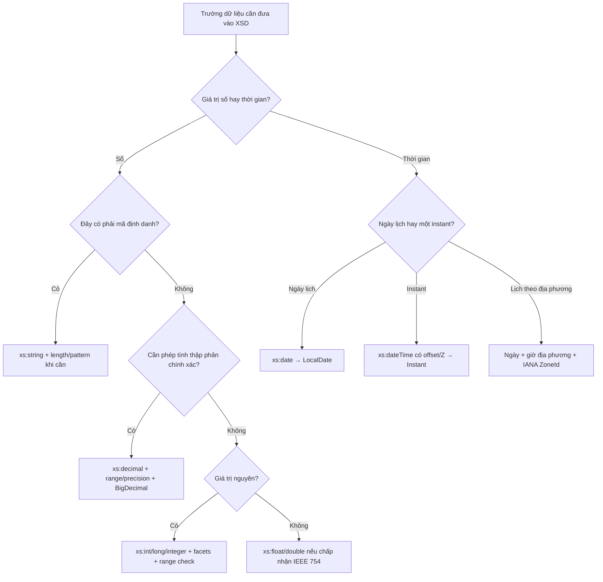

# Kiểu số, decimal, ngày giờ, múi giờ và ánh xạ phù hợp

## 1. Tại sao chọn kiểu dữ liệu XSD là một quyết định hợp đồng?

Giả sử đối tác gửi yêu cầu ghi nhận thanh toán đến một dịch vụ SOAP. Thông điệp có số tiền `149.50`, số lượng `2` và thời điểm `2026-11-27T09:00:00+07:00`. Nếu máy chủ đọc tiền bằng `double`, ứng dụng có thể tích lũy sai số khi tính toán. Nếu một bên hiểu thời điểm là giờ UTC còn bên kia hiểu là giờ địa phương, hai hệ thống có thể ghi nhận giao dịch vào ngày khác nhau. Nếu schema giới hạn số lượng trong kiểu `xs:int` nhưng business code lại cho giá trị âm, hợp đồng và nghiệp vụ không thống nhất.

Trong **Spring Web Services (Spring-WS)**, hai hệ thống không trao đổi trực tiếp `BigDecimal` hay `Instant` của Java. Chúng trao đổi XML theo **hợp đồng XSD/WSDL**. Vì vậy việc chọn kiểu cho mỗi phần tử XML phải dựa trên **ý nghĩa nghiệp vụ, phạm vi giá trị, độ chính xác, đơn vị và quy tắc thời gian**, rồi mới ánh xạ sang Java qua JAXB.

Phạm vi bài học thuộc chương **Thiết kế XSD** của module **SPRING_WEB_SERVICES**: thiết kế dịch vụ SOAP theo hướng contract-first, viết XSD/WSDL ổn định, dùng JAXB tại endpoint và SOAP client, xử lý dữ liệu đúng nghĩa khi validation, SOAP Fault, security và kiểm thử liên thông với đối tác.

**Mục tiêu học tập:**

- Chọn đúng kiểu nguyên, số thập phân và số thực trong XSD; dùng facets để ràng buộc miền giá trị.
- Giải thích vì sao tiền tệ cần `xs:decimal`/`BigDecimal` và chính sách làm tròn riêng.
- Phân biệt `xs:date`, `xs:time`, `xs:dateTime`, mốc thời gian tuyệt đối, giờ địa phương và múi giờ.
- Thiết kế hợp đồng thời gian có offset rõ ràng, ánh xạ JAXB sang `java.time` mà không tự suy đoán timezone.
- Đánh giá tác động tương thích khi sửa kiểu dữ liệu, precision, range hoặc quy tắc timestamp.

## 2. Bắt đầu từ ý nghĩa nghiệp vụ, không bắt đầu từ kiểu Java

Trước khi viết schema, với mỗi dữ liệu hãy trả lời:

| Câu hỏi | Ví dụ | Ảnh hưởng tới XSD |
|---|---|---|
| Đây là **số lượng**, **tiền**, **tỷ lệ**, **phép đo** hay **mã định danh**? | `quantity=2`, `amount=149.50`, `orderId=000123` | Số lượng dùng kiểu nguyên; tiền dùng decimal; mã định danh thường nên là string để giữ số 0 đầu. |
| Có thể âm, bằng 0 hay chỉ dương? | Số lượng mua phải lớn hơn 0 | `xs:positiveInteger` hoặc `minInclusive` phù hợp. |
| Giá trị lớn tối đa bao nhiêu? | Tổng số bản ghi có thể vượt 2 tỷ | Xem phạm vi `xs:int`/`xs:long`/`xs:integer`. |
| Cần chính xác tới bao nhiêu chữ số? | Số tiền có hai chữ số thập phân | `xs:decimal` và quy tắc precision/scale nghiệp vụ. |
| Thời gian biểu diễn **một ngày** hay **một khoảnh khắc**? | Ngày kế toán khác thời điểm thanh toán | `xs:date` khác `xs:dateTime`. |
| Offset/múi giờ có ý nghĩa gì? | Giờ thực hiện ở Hà Nội, lịch giao hàng theo địa phương | Xác định yêu cầu về `Z`/`+07:00` và có cần zone ID như `Asia/Ho_Chi_Minh` không. |
| Thiếu trường khác gì giá trị 0 hoặc rỗng? | Chưa có số tiền quyết toán | Xem `minOccurs`, `nillable` và quy tắc trạng thái. |

**Sai lầm điển hình:** khai báo mọi giá trị là `xs:string` rồi parse tùy ý trong ứng dụng. Cách này bỏ mất nhiều cơ hội kiểm tra tự động của XSD, làm hợp đồng kém rõ ràng và tăng khả năng hai hệ thống hiểu khác nhau.

## 3. Kiểu số nguyên trong XML Schema

### 3.1. Các kiểu thường gặp

XML Schema hỗ trợ kiểu số nguyên với độ rộng và dấu khác nhau:

| Kiểu XSD | Miền giá trị / đặc tính | Ví dụ sử dụng | Ánh xạ JAXB/Java thường gặp |
|---|---|---|---|
| `xs:byte` | −128 đến 127 | Mã cấp độ nhỏ nếu thực sự là số | `byte`/`Byte` |
| `xs:short` | −32.768 đến 32.767 | Một số bộ đếm có giới hạn | `short`/`Short` |
| `xs:int` | −2.147.483.648 đến 2.147.483.647 | Số thứ tự, số lượng trong phạm vi rõ | `int`/`Integer` |
| `xs:long` | −2⁶³ đến 2⁶³−1 | Bộ đếm lớn, một số ID dạng số thật | `long`/`Long` |
| `xs:integer` | Số nguyên chính xác, không cố định giới hạn 32/64 bit | Giá trị có thể vượt `long` | `BigInteger` |
| `xs:nonNegativeInteger` | Số nguyên ≥ 0 | Số hàng lỗi, số lượng đã xử lý | Thường `BigInteger` |
| `xs:positiveInteger` | Số nguyên > 0 | Số lượng đặt hàng | Thường `BigInteger` |
| `xs:unsignedInt` | 0 đến 4.294.967.295 | Số nguyên không âm có giới hạn 32 bit unsigned | Thường `long`/`Long` |
| `xs:unsignedLong` | 0 đến 2⁶⁴−1 | Bộ đếm unsigned rất lớn | Thường `BigInteger` |

Các kiểu Java là ánh xạ **thông dụng**, không phải cam kết áp dụng nguyên xi cho mọi XJC/JAXB generator. Tùy cấu hình binding, `minOccurs`, `nillable`, `JAXBElement` và công cụ sinh mã, property có thể là primitive, wrapper hoặc kiểu khác.

Nếu một `orderId` có dạng `"000123"` thì đây là **mã**, không phải số để cộng/trừ. Dùng `xs:string` với quy tắc pattern/length thích hợp, vì chuyển thành số nguyên có thể làm mất số 0 ở đầu.

### 3.2. Ràng buộc bằng facets

Thay vì để mọi giá trị từ 1 đến một số nguyên không giới hạn, hãy biểu diễn giới hạn đã được nghiệp vụ chấp nhận:

```xml
<xs:simpleType name="OrderQuantity">
  <xs:restriction base="xs:positiveInteger">
    <xs:maxInclusive value="1000000"/>
  </xs:restriction>
</xs:simpleType>
```

Kiểu này cho phép các giá trị nguyên từ 1 đến 1.000.000, nhưng không cho phép 0, −1 hoặc phần thập phân.

Một số facet cơ bản:

| Facet | Ý nghĩa |
|---|---|
| `minInclusive` / `maxInclusive` | Cận có bao gồm giá trị biên |
| `minExclusive` / `maxExclusive` | Cận không bao gồm giá trị biên |
| `totalDigits` | Giới hạn số chữ số của giá trị decimal/kiểu số nguyên liên quan |
| `fractionDigits` | Giới hạn số chữ số phần thập phân theo **giá trị số**, không phải quy tắc trình bày cố định |
| `enumeration` | Chỉ cho một tập giá trị được liệt kê |
| `pattern` | Ràng buộc biểu diễn dạng chuỗi theo cú pháp regex của XSD |

Giới hạn schema không thay thế mọi bất biến nghiệp vụ. Ví dụ `OrderQuantity` nằm trong khoảng cho phép nhưng chưa chắc tồn kho đáp ứng được. Ngoài ra, cần thống nhất liệu việc tăng `maxInclusive` có ảnh hưởng đến client cũ hay không, nhất là khi client sinh kiểu Java nhỏ hơn hoặc có validation riêng.

### 3.3. Chọn `BigInteger` hay `int` trong Java

Nếu XJC sinh `BigInteger` cho `xs:positiveInteger`, không nên ép về `int` bằng cách cắt giá trị:

```java
import java.math.BigInteger;

BigInteger quantity = request.getQuantity();
if (quantity == null) {
    throw new IllegalArgumentException("quantity is required");
}

// Ném ArithmeticException nếu giá trị vượt phạm vi int.
int quantityForDomain = quantity.intValueExact();
```

Đây là ví dụ sau khi JAXB đã unmarshal request và hệ thống đã xác định kiểu miền Java mong muốn. Khi chuyển từ kiểu số lớn sang kiểu nhỏ, dùng phép kiểm tra range tường minh; không bỏ mất phần dữ liệu cao một cách âm thầm.

## 4. `xs:decimal`, `xs:float` và `xs:double` khác nhau thế nào?

### 4.1. `xs:decimal` biểu diễn số thập phân chính xác

`xs:decimal` mô tả các giá trị dạng thập phân, ví dụ `149.50`, `0.125`, `-12.75`. Nó **không cần phép biểu diễn nhị phân xấp xỉ** như IEEE 754. Trong JAXB, kiểu này thường ánh xạ sang `java.math.BigDecimal`.

Chú ý cú pháp XML Schema 1.0: `149.50`, `-0.25` là các ví dụ hợp lệ; notation khoa học như `1.2E3` **không phải lexical form hợp lệ của `xs:decimal`**. Nếu hợp đồng cần truyền các giá trị khoa học có exponent hoặc `NaN`/`INF`, hãy cân nhắc kiểu khác và nói rõ ý nghĩa của chúng.

### 4.2. `xs:float`/`xs:double` biểu diễn số thực dấu phẩy động

`xs:float` và `xs:double` theo mô hình IEEE 754, phù hợp với nhiều phép đo khoa học, thống kê hoặc dữ liệu mà sai số xấp xỉ được chấp nhận. Chúng hỗ trợ các giá trị đặc biệt như `INF`, `-INF`, `NaN` theo quy tắc XML Schema.

Tuy nhiên, các số thập phân như `0.1` thường không được biểu diễn chính xác dưới dạng dấu phẩy động nhị phân. Ví dụ trong Java:

```java
System.out.println(0.1 + 0.2); // Có thể in 0.30000000000000004
```

Vì thế:

| Dữ liệu | Kiểu XSD nên xem xét | Kiểu domain Java |
|---|---|---|
| Giá bán, số tiền đã thanh toán | `xs:decimal` | `BigDecimal` |
| Thuế suất cần lưu chính xác theo hệ thập phân | `xs:decimal` | `BigDecimal` |
| Khối lượng/sai số đo khoa học cần floating-point | `xs:float` hoặc `xs:double` | `float`/`double` |
| Số lượng nguyên | `xs:positiveInteger`, `xs:int`, ... | `BigInteger`/`int`/`long` tùy range |
| Mã hóa đơn có số 0 đầu | `xs:string` | `String` |

Đừng chọn `xs:double` cho tiền chỉ vì nó dễ dùng để tính toán. Ngay cả khi XSD dùng `xs:decimal`, code Java vẫn có thể làm mất chính xác nếu chuyển qua `double` ở giữa.

## 5. Thiết kế decimal cho tiền: precision, scale và chính sách làm tròn

### 5.1. Ví dụ XSD cho một hợp đồng thanh toán hai chữ số thập phân

Giả sử hợp đồng minh họa **chỉ hỗ trợ USD và EUR** và lưu số tiền theo quy tắc tối đa hai chữ số sau dấu chấm:

```xml
<xs:simpleType name="MoneyAmount">
  <xs:restriction base="xs:decimal">
    <xs:totalDigits value="16"/>
    <xs:fractionDigits value="2"/>
    <xs:minInclusive value="0"/>
  </xs:restriction>
</xs:simpleType>

<xs:simpleType name="CurrencyCode">
  <xs:restriction base="xs:string">
    <xs:enumeration value="USD"/>
    <xs:enumeration value="EUR"/>
  </xs:restriction>
</xs:simpleType>
```

Ý nghĩa:

- `totalDigits=16` giới hạn tổng số chữ số có nghĩa của giá trị; nó không có nghĩa chuỗi XML phải dài đúng 16 ký tự.
- `fractionDigits=2` giới hạn **độ chính xác phần thập phân của giá trị**. Không nên dựa vào facet này để buộc XML luôn trình bày đúng hai ký tự sau dấu chấm: `149.5` và `149.50` có cùng giá trị thập phân và đều biểu diễn được chính xác tới hai chữ số.
- `minInclusive=0` không cho phép số âm. Nếu hệ thống có khoản hoàn tiền hoặc điều chỉnh âm, hãy mô hình hóa nghiệp vụ riêng hoặc thiết kế kiểu cho phép giá trị âm theo chủ đích.
- `CurrencyCode` giới hạn hai đồng tiền cho ví dụ; khi muốn mở rộng đồng tiền, phải quản lý tương thích với các client sử dụng enum sinh từ schema.

**Không nên dùng mặc định `fractionDigits=2` cho mọi loại tiền.** Các đồng tiền và phép tính tài chính có quy tắc đơn vị nhỏ nhất, precision nội bộ và rounding khác nhau. Một số phép tính phí/tỷ giá còn cần nhiều chữ số hơn số tiền quyết toán. Nếu hợp đồng hỗ trợ nhiều đồng tiền, cần ghi rõ chính sách scale **theo currency và từng loại amount**, đồng thời quyết định kiểm soát ở XSD hay tầng nghiệp vụ.

### 5.2. `BigDecimal` dùng thế nào cho an toàn?

`BigDecimal` lưu số thập phân với phần unscaled value và scale; không sử dụng biểu diễn floating-point nhị phân cho giá trị được tạo từ chuỗi decimal.

```java
import java.math.BigDecimal;
import java.math.RoundingMode;

BigDecimal correct = new BigDecimal("149.50");
BigDecimal alsoCorrect = BigDecimal.valueOf(149.50);

// Tránh dùng BigDecimal(double) trực tiếp khi nguồn là giá trị tiền:
BigDecimal risky = new BigDecimal(0.1);

// Chỉ chấp nhận giá trị biểu diễn được chính xác với 2 chữ số thập phân.
BigDecimal amountForSettlement =
        correct.setScale(2, RoundingMode.UNNECESSARY);

// Ví dụ chính sách làm tròn minh họa, phải được business phê duyệt:
BigDecimal tax = correct.multiply(new BigDecimal("0.075"))
        .setScale(2, RoundingMode.HALF_EVEN);
```

`BigDecimal.valueOf(double)` thường an toàn hơn `new BigDecimal(double)` khi giá trị double đã có sẵn vì nó dùng cách biểu diễn chuỗi tương ứng, nhưng **không khôi phục được độ chính xác đã mất trước đó**. Với dữ liệu tiền từ bên ngoài, ưu tiên parse trực tiếp chuỗi decimal hoặc giữ `BigDecimal` do JAXB sinh.

Hai lưu ý khi làm việc với `BigDecimal`:

1. `new BigDecimal("1.0").equals(new BigDecimal("1.00"))` trả `false` vì scale khác nhau; `compareTo(...) == 0` so sánh giá trị số. Hợp đồng phải quyết định có yêu cầu canonical format hay không.
2. Phép chia có thể cho kết quả thập phân vô hạn. Dùng `divide(..., scale, roundingMode)` hoặc `MathContext` theo chính sách nghiệp vụ; không dựa vào rounding mặc định mơ hồ.

### 5.3. Kiểm tra các tình huống biên

| Giá trị XML | `xs:decimal` + `fractionDigits=2` | Lưu ý |
|---|---|---|
| `149.50` | Hợp lệ | Biểu diễn giá trị tiền ví dụ. |
| `149.5` | Hợp lệ | Không có yêu cầu trình bày hai chữ số cố định. |
| `149.5000` | Có thể hợp lệ vì phần số 0 cuối không tăng độ chính xác giá trị | Kiểm tra facet trên **giá trị**, đừng coi nó là regex kiểm tra số ký tự. |
| `149.501` | Không hợp lệ | Có chữ số phần thập phân có nghĩa vượt giới hạn 2. |
| `-1.00` | Không hợp lệ | Vi phạm `minInclusive=0`. |
| `1E2` | Không hợp lệ đối với `xs:decimal` | Exponent không thuộc lexical space của decimal. |
| `NaN` | Không hợp lệ đối với `xs:decimal` | Giá trị đặc biệt thuộc float/double, không phải money decimal. |

Nếu đối tác yêu cầu **đúng hai chữ số sau dấu chấm trong XML**, đó là yêu cầu về biểu diễn chuỗi; nên mô tả rõ ràng và kiểm tra pattern/canonical serialization riêng. Đừng nhầm giữa giá trị số học và cách trình bày.

## 6. Kiểu dữ liệu ngày và thời gian trong XSD

XML Schema cung cấp nhiều kiểu thời gian, mỗi kiểu có mục đích riêng:

| Kiểu XSD | Biểu diễn | Dùng khi |
|---|---|---|
| `xs:date` | Ngày lịch, ví dụ `2026-11-27` | Ngày hạch toán, ngày giao hàng theo quy tắc địa phương. |
| `xs:time` | Thời gian trong ngày, ví dụ `09:30:00` | Giờ mở cửa hoặc khung giờ hàng ngày, khi đã quy định timezone riêng. |
| `xs:dateTime` | Ngày + giờ, ví dụ `2026-11-27T09:30:00+07:00` | Thời điểm xử lý/ghi nhận sự kiện có offset. |
| `xs:gYearMonth` | Tháng/năm, ví dụ `2026-11` | Kỳ kế toán, chu kỳ tổng hợp. |
| `xs:duration` | Khoảng thời gian, ví dụ `P1M` hoặc `PT30M` | Thời hạn; cần phân biệt “một tháng” với “30 ngày”. |

`xs:dateTime` trong XML Schema 1.0 **cho phép không ghi timezone**. Ví dụ `2026-11-27T09:30:00` vẫn có thể đúng kiểu XSD nhưng **không xác định được một instant tuyệt đối** nếu thiếu quy ước về timezone.

### 6.1. Ngày lịch khác mốc thời gian tuyệt đối

Hãy phân biệt:

**Ngày nghiệp vụ:** “Đơn hàng thuộc kỳ kế toán ngày 27/11/2026”. Đây là khái niệm lịch, thường biểu diễn bằng `xs:date`/`LocalDate`. Việc chuyển nó thành midnight UTC có thể làm lệch ngày nghiệp vụ.

**Thời điểm sự kiện:** “Thanh toán được ghi nhận vào lúc 09:00 ngày 27/11/2026 theo UTC+07:00”. Đây là một khoảnh khắc xác định được trên trục thời gian, nên dùng `xs:dateTime` **có offset hoặc Z**.

**Giờ theo lịch địa phương:** “Kho mở cửa lúc 09:00 mỗi ngày ở một khu vực”. `09:00` chưa đủ xác định một instant nếu không biết ngày và timezone khu vực. Đây thường là `LocalTime` + `ZoneId` + ngày áp dụng, không nên ép thành `Instant`.

Ba kiểu domain Java tương ứng:

- `LocalDate`: ngày lịch không mang giờ và offset.
- `Instant`: khoảnh khắc trên trục UTC, thích hợp cho audit, correlation và so thứ tự sự kiện.
- `LocalTime` cùng `ZoneId` (và ngày khi cần): lịch hoạt động gắn với vùng địa lý.

## 7. Offset không đồng nghĩa múi giờ khu vực

Xét ba timestamp:

```text
2026-11-27T09:00:00+07:00
2026-11-27T02:00:00Z
2026-11-27T09:00:00
```

Hai dòng đầu cùng biểu diễn **một instant**. Dòng thứ ba không có offset; không được tự kết luận nó là giờ Hà Nội, UTC hay giờ của JVM.

Với `xs:dateTime`, phần `Z` hoặc `+07:00` cho biết **độ lệch so với UTC tại thời điểm đó**. Nó **không cho biết đầy đủ timezone khu vực** như `Asia/Ho_Chi_Minh` hoặc `Europe/Paris`. Một zone ID chứa các quy tắc lịch sử và thay đổi giờ mùa hè mà một offset đơn lẻ không thể thể hiện.

| Dữ liệu cần trao đổi | Biểu diễn khuyến nghị | Vì sao |
|---|---|---|
| Thời điểm phát hành hóa đơn | `xs:dateTime` yêu cầu offset/`Z` | Client/server có thể chuyển về cùng một `Instant`. |
| Ngày lập sổ theo lịch Việt Nam | `xs:date` + quy tắc vùng nghiệp vụ trong tài liệu | Tránh bị lệch ngày do chuẩn hóa timezone. |
| Lịch hẹn “09:00 ngày 15/04 tại Paris” | Ngày địa phương + giờ địa phương + IANA zone ID | Có thể xác định offset theo quy tắc của khu vực tại ngày đó. |
| Thời lượng 45 phút | `xs:duration` dạng `PT45M` hoặc giá trị giây rõ đơn vị | Không phải timestamp và không cần offset. |

**Đặc biệt với lịch tương lai:** không thay `Europe/Paris` bằng một offset cố định như `+01:00` nếu hệ thống cần áp dụng quy tắc mùa hè tại thời điểm diễn ra. Với một instant đã xảy ra, offset thường đủ để xác định mốc thời gian; với lịch theo vùng, cần giữ zone ID.

### 7.1. Làm thế nào yêu cầu timezone trong hợp đồng?

Với `xs:dateTime` của XSD 1.0, timezone là tùy chọn. Có thể tạo kiểu dẫn xuất có pattern yêu cầu hậu tố offset hoặc `Z`:

```xml
<xs:simpleType name="OffsetDateTime">
  <xs:restriction base="xs:dateTime">
    <xs:pattern value=".+(Z|[+-][0-9]{2}:[0-9]{2})"/>
  </xs:restriction>
</xs:simpleType>
```

Ở đây base `xs:dateTime` vẫn kiểm tra cú pháp và giới hạn thời gian, còn pattern yêu cầu có hậu tố timezone. Đây là một ràng buộc ví dụ cho stack XSD 1.0; hãy kiểm chứng với validator thực tế của cả hai bên, đồng thời thống nhất quy tắc UTC hay chấp nhận các offset khác nhau.

Trong XSD 1.1 có khái niệm `explicitTimezone` và `xs:dateTimeStamp` yêu cầu timezone, nhưng **không nên mặc định Spring-WS, XJC/JAXB và mọi client SOAP hỗ trợ XSD 1.1**. Với hệ sinh thái chỉ hỗ trợ XSD 1.0, dùng restriction phù hợp và kiểm tra ở application boundary.

Đối với hệ thống có yêu cầu chuẩn hóa, có thể quy ước:

> Mỗi thời điểm sự kiện phải mang offset hợp lệ; server chuyển về UTC để lưu/so sánh, nhưng không tự diễn giải timestamp thiếu offset bằng timezone mặc định của máy.

Nếu chỉ chấp nhận biểu diễn `Z`, cần công bố yêu cầu lexical đó và kiểm tra khi unmarshalling/validation. Có offset rõ ràng **không đồng nghĩa** bắt buộc mọi producer gửi cùng một dạng chuỗi.

## 8. Thiết kế XSD đầy đủ cho request thanh toán

Giả sử hợp đồng `RecordPayment` ghi nhận một khoản thanh toán bằng USD hoặc EUR, có số lượng tham chiếu, ngày nghiệp vụ và thời điểm phát sinh. Ta thống nhất:

1. `quantity` là số nguyên dương, tối đa một triệu.
2. `amount` là số decimal không âm, tối đa 16 chữ số có nghĩa và tối đa hai chữ số thập phân.
3. `currency` chỉ nhận `USD` hoặc `EUR` trong phiên bản hợp đồng này.
4. `occurredAt` phải có timezone để ánh xạ thành một instant.
5. `businessDate` là **ngày lịch**, không tự thay bằng thời điểm 00:00 UTC.

File `payment.xsd` minh họa:

```xml
<?xml version="1.0" encoding="UTF-8"?>
<xs:schema xmlns:xs="http://www.w3.org/2001/XMLSchema"
           xmlns:tns="urn:example:payment:v1"
           targetNamespace="urn:example:payment:v1"
           elementFormDefault="qualified">

  <xs:simpleType name="Quantity">
    <xs:restriction base="xs:positiveInteger">
      <xs:maxInclusive value="1000000"/>
    </xs:restriction>
  </xs:simpleType>

  <xs:simpleType name="MoneyAmount">
    <xs:restriction base="xs:decimal">
      <xs:totalDigits value="16"/>
      <xs:fractionDigits value="2"/>
      <xs:minInclusive value="0"/>
    </xs:restriction>
  </xs:simpleType>

  <xs:simpleType name="CurrencyCode">
    <xs:restriction base="xs:string">
      <xs:enumeration value="USD"/>
      <xs:enumeration value="EUR"/>
    </xs:restriction>
  </xs:simpleType>

  <xs:simpleType name="OffsetDateTime">
    <xs:restriction base="xs:dateTime">
      <xs:pattern value=".+(Z|[+-][0-9]{2}:[0-9]{2})"/>
    </xs:restriction>
  </xs:simpleType>

  <xs:element name="RecordPaymentRequest">
    <xs:complexType>
      <xs:sequence>
        <xs:element name="clientRequestId" type="xs:string"/>
        <xs:element name="quantity" type="tns:Quantity"/>
        <xs:element name="amount" type="tns:MoneyAmount"/>
        <xs:element name="currency" type="tns:CurrencyCode"/>
        <xs:element name="occurredAt" type="tns:OffsetDateTime"/>
        <xs:element name="businessDate" type="xs:date"/>
      </xs:sequence>
    </xs:complexType>
  </xs:element>

  <xs:element name="RecordPaymentResponse">
    <xs:complexType>
      <xs:sequence>
        <xs:element name="paymentId" type="xs:string"/>
        <xs:element name="acceptedAt" type="tns:OffsetDateTime"/>
      </xs:sequence>
    </xs:complexType>
  </xs:element>
</xs:schema>
```

Các kiểu simpleType và phần tử toàn cục giúp schema có thể dùng để tạo WSDL hoặc quản lý WSDL tĩnh. Với Spring-WS, một cấu hình `DefaultWsdl11Definition` có thể suy ra operation `RecordPayment` theo convention hậu tố `Request` và `Response`; nếu hợp đồng doanh nghiệp quy định binding, SOAPAction hoặc fault đặc thù, cần review WSDL thực tế hoặc công bố WSDL tĩnh đã thống nhất.

### 8.1. Request SOAP mẫu

```xml
<soap:Envelope
    xmlns:soap="http://schemas.xmlsoap.org/soap/envelope/"
    xmlns:p="urn:example:payment:v1">
  <soap:Header/>
  <soap:Body>
    <p:RecordPaymentRequest>
      <p:clientRequestId>REQ-2026-001</p:clientRequestId>
      <p:quantity>2</p:quantity>
      <p:amount>149.50</p:amount>
      <p:currency>USD</p:currency>
      <p:occurredAt>2026-11-27T09:00:00+07:00</p:occurredAt>
      <p:businessDate>2026-11-27</p:businessDate>
    </p:RecordPaymentRequest>
  </soap:Body>
</soap:Envelope>
```

Ví dụ phản hồi:

```xml
<soap:Envelope
    xmlns:soap="http://schemas.xmlsoap.org/soap/envelope/"
    xmlns:p="urn:example:payment:v1">
  <soap:Body>
    <p:RecordPaymentResponse>
      <p:paymentId>PAY-1001</p:paymentId>
      <p:acceptedAt>2026-11-27T02:00:01Z</p:acceptedAt>
    </p:RecordPaymentResponse>
  </soap:Body>
</soap:Envelope>
```

Ở đây `occurredAt` là thời điểm nghiệp vụ do bên gửi công bố, còn `acceptedAt` là thời điểm server ghi nhận chấp nhận yêu cầu. Hai khái niệm khác nhau dù đều có kiểu `xs:dateTime`.

**Ranh giới của XSD:** schema này chưa chứng minh người gọi có quyền ghi nhận thanh toán, `clientRequestId` có bị dùng trùng hay không, ngày nghiệp vụ có đang mở sổ, tỷ giá có hợp lệ hoặc số tiền có khớp chứng từ. Những điều đó thuộc application service, interceptor và logic nghiệp vụ.

## 9. Ánh xạ JAXB: từ XML Schema sang Java

Trong triển khai Spring Web Services theo hướng contract-first, XSD được đưa vào công cụ sinh lớp JAXB/XJC. Kết quả chịu ảnh hưởng của phiên bản JAXB và binding customization, nhưng các ánh xạ thường gặp là:

| XSD | JAXB mặc định thường gặp | Kiểu domain Java nên cân nhắc |
|---|---|---|
| `xs:string` | `String` | `String` hoặc value object định danh |
| `xs:int`, `xs:long` | `int`/`long` hoặc wrapper | `int`/`long` phù hợp giới hạn nghiệp vụ |
| `xs:integer`, `xs:positiveInteger` | `BigInteger` | `BigInteger` hoặc số nguyên nhỏ hơn có kiểm tra range |
| `xs:decimal` | `BigDecimal` | `BigDecimal`, value object `Money`/`Amount` |
| `xs:float`/`xs:double` | `float`/`double` | Chỉ dùng khi chấp nhận sai số nhị phân |
| `xs:date` | `XMLGregorianCalendar` | `LocalDate` cho ngày lịch |
| `xs:time` | `XMLGregorianCalendar` | `LocalTime`/`OffsetTime` tùy semantics |
| `xs:dateTime` | `XMLGregorianCalendar` | `Instant` nếu offset bắt buộc; `OffsetDateTime` nếu cần giữ offset |
| `xs:duration` | Kiểu `javax.xml.datatype.Duration` trong nhiều binding | `Duration` cho lượng thời gian cố định, `Period` cho kỳ lịch nếu phù hợp |

**Lưu ý về package:** các stack Jakarta JAXB mới dùng `jakarta.xml.bind.*`, trong khi `XMLGregorianCalendar` và `DatatypeFactory` vẫn thuộc `javax.xml.datatype.*` của JDK. Điều này không phải dấu hiệu dùng JAXB đời cũ. Khi dùng Spring Boot 3+/Spring-WS tương ứng, cần tránh lẫn các JAXB dependency `javax.xml.bind.*` cũ với Jakarta runtime mới.

### 9.1. Sinh mã không thay thế domain model

Một lớp JAXB `RecordPaymentRequest` có nhiệm vụ phản ánh XML đã công bố. Business service có thể sử dụng command riêng:

```java
import java.math.BigDecimal;
import java.time.Instant;
import java.time.LocalDate;

public record RecordPaymentCommand(
        String clientRequestId,
        int quantity,
        BigDecimal amount,
        String currency,
        Instant occurredAt,
        LocalDate businessDate) {
}
```

Tách **JAXB contract object** và **domain/application command** giúp:

- Giữ ổn định XSD/WSDL dù domain được cải tiến.
- Kiểm tra thêm nghĩa vụ nghiệp vụ sau schema validation.
- Áp dụng kiểu Java thích hợp: `Instant` cho event, `LocalDate` cho ngày hạch toán.
- Hạn chế tác động khi công cụ sinh mã JAXB thay đổi property type hoặc package.

## 10. Chuyển `XMLGregorianCalendar` sang `java.time` an toàn

Giả sử JAXB đã sinh các getter `getOccurredAt()`, `getBusinessDate()`, `getAmount()` và `getQuantity()`. Ví dụ mapper dưới đây thể hiện điểm cần kiểm tra khi chuyển đổi. Nó **không** tự thay thế toàn bộ validation hay authorization:

```java
import java.math.BigDecimal;
import java.math.BigInteger;
import java.math.RoundingMode;
import java.time.Instant;
import java.time.LocalDate;
import java.time.OffsetDateTime;
import javax.xml.datatype.DatatypeConstants;
import javax.xml.datatype.DatatypeConfigurationException;
import javax.xml.datatype.DatatypeFactory;
import javax.xml.datatype.XMLGregorianCalendar;

public final class XmlValueMapper {
    private XmlValueMapper() {}

    public static int toQuantity(BigInteger source) {
        if (source == null || source.signum() <= 0) {
            throw new IllegalArgumentException("quantity must be positive");
        }
        return source.intValueExact();
    }

    public static BigDecimal toSettlementAmount(BigDecimal source) {
        if (source == null || source.signum() < 0) {
            throw new IllegalArgumentException("amount must be non-negative");
        }
        // Không tự làm tròn dữ liệu bên gửi nếu hợp đồng yêu cầu chính xác.
        return source.setScale(2, RoundingMode.UNNECESSARY);
    }

    public static Instant toInstant(XMLGregorianCalendar source) {
        if (source == null
                || source.getTimezone() == DatatypeConstants.FIELD_UNDEFINED) {
            throw new IllegalArgumentException("occurredAt needs a timezone");
        }

        // Ví dụ cho timestamp nghiệp vụ thông thường, năm dương và
        // độ chính xác tối đa nanosecond mà java.time hỗ trợ.
        return OffsetDateTime.parse(source.toXMLFormat()).toInstant();
    }

    public static LocalDate toBusinessDate(XMLGregorianCalendar source) {
        if (source == null) {
            throw new IllegalArgumentException("businessDate is required");
        }
        // Đọc ngày lịch trực tiếp; không chuyển sang UTC.
        return LocalDate.of(
                source.getYear(), source.getMonth(), source.getDay());
    }

    public static XMLGregorianCalendar fromInstant(Instant value)
            throws DatatypeConfigurationException {
        // Instant.toString() có Z, không phụ thuộc timezone của máy.
        return DatatypeFactory.newInstance()
                .newXMLGregorianCalendar(value.toString());
    }
}
```

Phân tích:

1. `toQuantity` dùng `intValueExact()` để phát hiện tràn số nếu domain giới hạn `int`; `intValue()` thông thường có thể làm mất dữ liệu.
2. `toSettlementAmount` dùng `UNNECESSARY` để từ chối phần thập phân không biểu diễn được chính xác với scale 2. Quy tắc business này minh họa cho hợp đồng USD/EUR ở trên, chưa phải chính sách cho mọi currency.
3. `toInstant` **không suy đoán timezone** khi XML thiếu offset. Nó chuyển một `OffsetDateTime` thành mốc thời gian UTC.
4. `toBusinessDate` giữ nguyên năm/tháng/ngày; lấy `xs:date` rồi ép về một instant có thể làm lệch ngày theo timezone.
5. `fromInstant` biểu diễn một instant bằng chuỗi UTC có `Z` khi trả response.

**Giới hạn quan trọng:** phạm vi và phép biểu diễn ngày giờ của XML Schema và `java.time` không trùng hoàn toàn ở mọi trường hợp biên (ví dụ năm ngoài phạm vi ứng dụng, leap second hoặc độ chính xác phần giây vượt nanosecond). Với hệ thống nghiệp vụ thông thường, nên quy định rõ miền năm, độ chính xác timestamp và kiểm thử các giá trị biên. Không mặc định mọi lexical form hợp lệ của XML Schema đều chuyển được sang mọi kiểu `java.time`.

### 10.1. Vì sao không chuyển thời gian bằng timezone mặc định của JVM?

Những cách chuyển đổi kiểu sau dễ gây sai:

```java
// Sai về mặt hợp đồng nếu source thiếu timezone:
// giả định mặc định hệ thống là timezone nghiệp vụ.
// LocalDateTime.parse("2026-11-27T09:00:00")
//              .atZone(ZoneId.systemDefault()).toInstant();
```

Khi triển khai cùng phần mềm trên máy chạy UTC, máy chạy UTC+07 và máy chạy ở một timezone có daylight saving, kết quả có thể khác nhau. **Timezone phải đến từ hợp đồng hoặc quy tắc nghiệp vụ được khai báo**, không phải trạng thái ngẫu nhiên của máy chủ.

### 10.2. Khi nào nên giữ `OffsetDateTime`?

Nếu consumer cần hiển thị lại chính offset mà đối tác đã gửi, value object có thể chứa `OffsetDateTime` hoặc lưu thêm metadata offset. Nếu chỉ cần so thứ tự/thời gian tuyệt đối, `Instant` thường đủ. Hai timestamp có offset khác nhau vẫn có thể cùng một instant:

```java
import java.time.OffsetDateTime;

var a = OffsetDateTime.parse("2026-11-27T09:00:00+07:00");
var b = OffsetDateTime.parse("2026-11-27T02:00:00Z");

System.out.println(a.toInstant().equals(b.toInstant())); // true
System.out.println(a.equals(b));                         // false
```

`OffsetDateTime.equals` xét cả local date-time và offset. Để so **cùng thời điểm**, hãy chuyển sang `Instant` hoặc dùng phép so theo timeline phù hợp.

### 10.3. Nếu muốn dùng `java.time` trực tiếp trong JAXB?

Có thể cấu hình binding customization hoặc `XmlAdapter` để ánh xạ kiểu generated JAXB sang Java time type. Tuy nhiên:

- XSD là nguồn chân lý; đừng để binding mới âm thầm đổi `xs:dateTime` thành `xs:string` trong hợp đồng.
- Adapter phải quy định rõ timezone khi unmarshal và định dạng khi marshal.
- Không áp dụng cùng một adapter `Instant` cho `xs:date` và `xs:dateTime` vì semantics khác nhau.
- Trước khi áp dụng, kiểm tra khả năng hỗ trợ của JAXB provider và generated code thực tế.

Ở giai đoạn học contract-first, cách đơn giản và dễ kiểm soát là giữ generated classes theo XSD, dùng mapper chuyển chúng thành domain objects.

## 11. Dữ liệu thiếu, `nil` và giá trị 0 không giống nhau

Giả sử hóa đơn chưa được quyết toán, `settledAmount` có thể chưa có giá trị.

Ba trạng thái cần phân biệt:

| Trạng thái XML | Ý nghĩa khả dĩ |
|---|---|
| Không có phần tử `settledAmount` | Trường tùy chọn chưa được cung cấp (`minOccurs=0`). |
| `<settledAmount xsi:nil="true"/>` | Phần tử hiện diện nhưng được đánh dấu nil; cần `nillable="true"` và quy tắc nghiệp vụ rõ ràng. |
| `<settledAmount>0.00</settledAmount>` | Giá trị đã biết là số 0. |

Ví dụ:

```xml
<xs:element name="settledAmount"
            type="tns:MoneyAmount"
            minOccurs="0"
            nillable="true"/>
```

Việc cho cả “vắng mặt” và “nil” có thể làm contract phức tạp. Chỉ dùng khi hai trạng thái thực sự có ý nghĩa khác nhau. JAXB có thể sinh `JAXBElement`, wrapper hoặc `null` tùy cấu hình và binding; cần kiểm thử cách phân biệt trạng thái đầu vào. Đừng coi field không xuất hiện là `0.00` trừ khi đó là quy tắc nghiệp vụ công khai.

Tương tự, `xs:dateTime` không xuất hiện khác với một timestamp mơ hồ “hiện tại”. Server không nên tự điền `Instant.now()` cho dữ liệu thiếu nếu hợp đồng nói client phải gửi thời điểm phát sinh; có thể đặt một trường khác như `receivedAt` do server tạo.

## 12. Validation: XSD, ứng dụng và SOAP Fault

Thiết kế hợp đồng nên phân tách ba lớp kiểm tra:

| Lớp | Ví dụ kiểm tra | Điểm triển khai |
|---|---|---|
| **XML/XSD** | `quantity > 0`, `amount` đúng decimal, `currency` nằm trong enum, `occurredAt` có offset | XML parser/schema validator, interceptor hoặc JAXB validator được cấu hình |
| **Ánh xạ Java** | `BigInteger` chuyển sang `int` không tràn; timestamp chuyển thành `Instant`; domain giữ đúng scale | Mapper giữa JAXB và application service |
| **Nghiệp vụ/bảo mật** | Client có quyền ghi thanh toán; request ID không trùng; ngày nghiệp vụ còn mở; amount khớp chứng từ | Application service, authorization và security policy |

Một ví dụ lỗi của SOAP contract:

- `<amount>1E3</amount>`: sai lexical form của `xs:decimal`.
- `<amount>1.234</amount>`: vượt `fractionDigits=2`.
- `<occurredAt>2026-11-27T09:00:00</occurredAt>`: base `xs:dateTime` chấp nhận thời gian không timezone, nhưng kiểu dẫn xuất `OffsetDateTime` ở ví dụ sẽ từ chối.
- `<businessDate>2026-02-30</businessDate>`: không phải ngày lịch hợp lệ.
- `<currency>JPY</currency>`: không được hợp đồng minh họa phiên bản này hỗ trợ.
- XML đúng XSD nhưng người gọi không có quyền: lỗi nghiệp vụ/authorization, không phải lỗi schema.

Trong Spring-WS, `PayloadValidatingInterceptor` hỗ trợ kiểm tra payload theo XSD; các ngoại lệ có thể được ánh xạ thành SOAP Fault bằng cơ chế như `SoapFaultMappingExceptionResolver` hoặc exception resolver riêng. **Không mặc định JAXB tự validate XSD chỉ vì có lớp được sinh từ schema**: cần cấu hình validator/`Schema` thực tế trong pipeline.

SOAP Fault cần công bố mã và thông điệp ổn định, tránh đẩy stack trace/chi tiết nội bộ ra ngoài. Với SOAP 1.1 và SOAP 1.2, cú pháp và mã fault khác nhau; client phải nhận đúng phiên bản mà WSDL/binding đã thống nhất.

## 13. An toàn XML và WS-Security khi có dữ liệu số/thời gian

Các XML parser và JAXB marshaller cần cấu hình giới hạn **external entity, DTD, nguồn schema**, kích thước và độ sâu tài liệu phù hợp. XML chỉ chứa số và timestamp vẫn có thể mang payload tấn công dưới dạng DTD hoặc entity expansion; quy tắc `fractionDigits` không thay thế XML security.

Đối với doanh nghiệp cần WS-Security, phải tách:

- **Timestamp nghiệp vụ:** ví dụ `occurredAt` do đối tác khai báo trong SOAP Body; phục vụ tính toán và đối soát.
- **WS-Security Timestamp:** thường nằm trong SOAP Header, dùng để giới hạn hiệu lực và kiểm soát replay theo policy.
- **Thời điểm nhận tại server:** `acceptedAt`/audit timestamp do server ghi nhận.

Ba giá trị không tự đồng nghĩa. Một SOAP Body có `occurredAt` hợp lệ nhưng WS-Security signature/timestamp không hợp lệ vẫn phải bị từ chối theo policy. Ngược lại, chữ ký XML hợp lệ không bảo đảm amount, quantity hay ngày nghiệp vụ hợp lệ.

Khi dùng `Wss4jSecurityInterceptor`, TLS/mTLS, chữ ký XML hoặc chứng chỉ X.509, các bên cần thống nhất policy về vùng cần ký, chứng chỉ tin cậy, clock skew và vòng quay chứng chỉ. Không nên lấy timestamp từ body rồi sử dụng thay cho xác minh WS-Security timestamp mà không có thiết kế bảo mật tương ứng.

## 14. Tương thích XSD/WSDL khi thay đổi kiểu số hoặc thời gian

Các thay đổi kiểu dữ liệu có thể phá vỡ client đã sinh mã từ schema cũ, kể cả khi thông điệp mới vẫn “nhìn giống XML”.

| Thay đổi | Nguy cơ | Cách quản lý |
|---|---|---|
| `xs:int` → `xs:long` | Client sinh `int` cũ có thể không đọc được giá trị vượt 32 bit | Đánh giá range thực tế, consumer cũ và kế hoạch version |
| `xs:decimal` → `xs:double` | Thay đổi độ chính xác, lexical form và mapping Java | Tránh đổi kiểu chỉ để tiện lập trình |
| `fractionDigits=2` → `fractionDigits=4` | Client cũ có thể từ chối giá trị có hơn hai chữ số lẻ | Versioning hoặc kiểm thử compatibility trước rollout |
| `minInclusive=0` → cho phép số âm | Mở rộng miền giá trị nhưng có thể làm hỏng logic client cũ | Tài liệu hóa ngữ nghĩa hoàn tiền/điều chỉnh |
| `xs:date` → `xs:dateTime` | Thay đổi ngày lịch thành timestamp, có thể lệch ngày | Tạo field/operation mới nếu semantics khác |
| `xs:dateTime` không offset → bắt buộc offset | Request cũ thiếu timezone bị từ chối | Thỏa thuận deprecation, hợp đồng mới hoặc lộ trình chuyển đổi |
| Trả thêm trạng thái `nil` | Consumer xử lý primitive hoặc null có thể lỗi | Kiểm tra binding và golden XML |
| Đổi namespace hoặc QName phần tử | Endpoint Spring-WS/JAXB không còn tìm đúng payload | Quản lý version XSD/WSDL, không đổi âm thầm |

**Đánh giá tương thích theo chiều dữ liệu thật:** khi nới range `amount` hay `quantity`, không chỉ hỏi server mới có nhận được request cũ không mà còn hỏi **client cũ có đọc được response mới không**. Nên giữ bộ golden request/response của từng đối tác để kiểm thử cả hai chiều.

## 15. Kiểm thử hợp đồng với các ca dữ liệu đặc biệt

Một bộ kiểm thử hữu ích cho `RecordPayment` gồm:

| Nhóm | Input hoặc kịch bản | Kỳ vọng |
|---|---|---|
| Happy path | `149.50 USD`, `2026-11-27T09:00:00+07:00` | XSD hợp lệ; Java nhận `BigDecimal` và `Instant` đúng. |
| Decimal lexical | `1E2` | Không hợp lệ cho `xs:decimal`. |
| Decimal precision | `149.501` | Không hợp lệ với `fractionDigits=2`. |
| Decimal scale | `149.5` và `149.50` | Đều hợp lệ; mapper biểu diễn giá trị quyết toán theo scale thống nhất. |
| Boundary | `quantity=1`, `quantity=1000000` | Hợp lệ nếu thỏa những ràng buộc khác. |
| Out of range | `quantity=0`, `quantity=1000001` | Bị validation từ chối. |
| Timezone equivalence | `09:00+07:00` và `02:00Z` cùng ngày tương ứng | Chuyển thành cùng một `Instant`. |
| Missing timezone | `2026-11-27T09:00:00` | Bị loại bởi kiểu `OffsetDateTime` hoặc application rule. |
| Business date | `2026-11-27` | Giữ `LocalDate`, không ép về giờ UTC. |
| Invalid date | `2026-02-30` | XSD validation thất bại. |
| Unsupported currency | `JPY` | Không hợp lệ ở phiên bản minh họa này. |
| SOAP integration | Request sai namespace hoặc sai thứ tự phần tử | Endpoint/validator từ chối theo hợp đồng. |
| Security | XML cố dùng external entity hoặc WS-Security timestamp sai | Bị xử lý an toàn, không tạo side effect. |

### 15.1. Ví dụ xác minh hai timestamp là cùng một instant

```java
import java.time.Instant;
import java.time.OffsetDateTime;

Instant first = OffsetDateTime.parse(
        "2026-11-27T09:00:00+07:00").toInstant();
Instant second = OffsetDateTime.parse(
        "2026-11-27T02:00:00Z").toInstant();

if (!first.equals(second)) {
    throw new AssertionError("Timestamps should represent the same instant");
}
```

### 15.2. Tổ chức test trong Spring-WS

Với server, `MockWebServiceClient` của `spring-ws-test` cho phép gửi XML SOAP/payload qua endpoint và kiểm tra kết quả hoặc SOAP Fault. Với phía client, `MockWebServiceServer` giúp kiểm tra XML được gửi và response được đọc. Kết hợp thêm:

1. Test **XSD validation** độc lập để kiểm chứng facets và lexical form.
2. Test **mapper** để xác nhận `BigDecimal` không mất độ chính xác, thời gian có offset chuyển đúng `Instant`.
3. Test **SOAP end-to-end** với namespace, SOAP version, WSDL, Fault và authentication.
4. Test **interoperability** bằng client khác công nghệ (ví dụ .NET hoặc một SOAP tool độc lập).

So sánh XML nên xét QName, giá trị và schema; không mặc định prefix `p` khác `ns2` là sai. Với decimal cần phân biệt phép so giá trị và phép so biểu diễn: `149.5` và `149.50` có thể cùng giá trị nhưng cách format khác nhau.

## 16. Các lỗi thiết kế thường gặp và cách sửa

| Triệu chứng | Nguyên nhân thường gặp | Cách khắc phục |
|---|---|---|
| Tổng tiền lệch vài đơn vị nhỏ sau nhiều phép cộng | Dùng `double` cho tiền hoặc làm tròn ở nhiều nơi khác nhau | Dùng `xs:decimal`/`BigDecimal`; thống nhất rounding policy. |
| JAXB chuyển `quantity` sang Java rồi bị số âm/nhỏ sai | Ép `BigInteger` sang `int` không kiểm tra range | Dùng `intValueExact()` và XSD facets. |
| XML có `149.50` nhưng client sinh code không giữ hai số lẻ | Hiểu sai `fractionDigits` như định dạng hiển thị | Phân biệt giá trị decimal và canonical formatting. |
| Dịch vụ ghi sự kiện sai giờ sau deploy | Dùng `ZoneId.systemDefault()` cho timestamp thiếu offset | Yêu cầu offset/`Z`, chuyển qua `Instant` rõ ràng. |
| Báo cáo “ngày 27” bị hiển thị thành “ngày 26” | Chuyển ngày lịch sang instant UTC rồi hiển thị theo múi giờ khác | Giữ `xs:date`/`LocalDate` theo business calendar. |
| Đặt lịch tương lai bị lệch giờ mùa hè | Chỉ lưu offset thay cho zone ID | Lưu ngày + giờ địa phương + IANA zone ID. |
| XSD pass nhưng `BigDecimal` vượt giới hạn hệ thống thanh toán | Schema chưa phản ánh giới hạn cụ thể hoặc không validate nghiệp vụ | Ràng buộc giới hạn đã thống nhất và thêm domain validation. |
| Thay kiểu `xs:int` thành `xs:long` khiến client cũ lỗi | Bỏ qua ảnh hưởng generated stub/binding | Version contract và kiểm thử với consumer cũ. |
| Request có số đúng nhưng sai schema | Sai namespace hoặc thứ tự trong `xs:sequence` | Kiểm tra QName, element form và XSD. |
| Tích hợp SOAP có chữ ký hợp lệ nhưng thanh toán sai | Đồng nhất kiểm tra WS-Security với business validation | Tách security, schema và kiểm tra nghiệp vụ. |

## 17. Quy trình ra quyết định khi thiết kế một trường số hoặc thời gian



Sau khi chọn kiểu, áp dụng thêm ba bước chung: (1) xác định absence/nil/default, (2) ghi semantics và timezone/rounding policy, (3) kiểm thử JAXB, XSD, SOAP và client liên thông.

## 18. Bài tập thực hành

### Bài tập 1 — Thiết kế số đo và tiền

Một dịch vụ SOAP nhận phí vận chuyển, khối lượng kiện hàng và số kiện. Hãy chọn kiểu XSD cho:

- `shippingFee`: số tiền USD chính xác hai chữ số thập phân, không âm.
- `weightKg`: dữ liệu cân cần ba chữ số thập phân chính xác để phục vụ tính phí.
- `packageCount`: số nguyên dương tối đa 10.000.
- `shipmentCode`: mã `"00001234"` phải giữ số 0 đầu.

Giải thích vì sao một số trường nên dùng `xs:decimal` chứ không phải `xs:double`, và field nào nên dùng `xs:string`.

### Bài tập 2 — Múi giờ và ngày nghiệp vụ

Cho các giá trị:

```text
A = 2026-11-27T09:00:00+07:00
B = 2026-11-27T02:00:00Z
C = 2026-11-27T09:00:00
D = 2026-11-27
```

Hãy cho biết A và B có phải cùng instant hay không; tại sao C chưa đủ để xác định instant; và vì sao D không nên tự chuyển sang midnight UTC trong một hợp đồng ngày kế toán.

### Bài tập 3 — Viết schema và mapper

Từ `payment.xsd` trong bài:

1. Sinh JAXB classes theo phiên bản Jakarta/JAXB của ứng dụng.
2. Viết mapper đổi `MoneyAmount`, `Quantity`, `OffsetDateTime` và `xs:date` sang Java domain types.
3. Dùng `BigDecimal` để tính phí, ghi rõ `RoundingMode` và nơi áp dụng rounding.
4. Tạo test cho decimal `149.501`, quantity bằng 0 và occurredAt thiếu offset.
5. Test hai timestamp cùng instant và business date không đổi khi deploy trên JVM timezone khác.

### Bài tập 4 — Đánh giá thay đổi hợp đồng

Đối tác muốn hỗ trợ thêm JPY và số lượng `quantity` vượt giới hạn một triệu. Hãy xác định:

- Facet và enum nào cần sửa trong XSD.
- Có cần thay đổi chính sách scale/rounding theo currency hay không.
- Các client cũ có thể bị ảnh hưởng thế nào khi nhận giá trị mới.
- Có nên tăng version namespace/WSDL, cho phép chuyển tiếp hay tạo operation mới.
- Những integration test và golden XML nào phải bổ sung.

## 19. Ghi nhớ các nguyên tắc cốt lõi

Thiết kế XSD tốt thể hiện **nghĩa vụ dữ liệu mà hai bên đã thống nhất**, chứ không chỉ chọn kiểu dễ lập trình:

1. **Số nguyên** chọn theo miền giá trị và dùng facets; mã định danh có số 0 đầu thường vẫn là string.
2. **Tiền tệ** dùng `xs:decimal` và `BigDecimal`; precision, scale, currency và rounding phải có quy tắc nghiệp vụ rõ.
3. **Ngày lịch** dùng `xs:date`/`LocalDate`; **mốc thời gian tuyệt đối** dùng `xs:dateTime` có offset hoặc `Z` rồi chuyển thành `Instant`.
4. **Offset không phải zone ID**. Lịch tương lai theo khu vực cần quy tắc múi giờ địa lý, đặc biệt ở nơi có daylight saving.
5. **JAXB là lớp ánh xạ hợp đồng**, không thay thế domain validation, security, XSD validation hay kiểm thử với client đối tác.

Với Spring Web Services, những quyết định này tác động trực tiếp đến các lớp JAXB, SOAP endpoint/client, Fault handling, interceptor, XML/WS-Security và khả năng tương thích lâu dài của WSDL. Hãy kiểm tra các giá trị biên, timezone và precision ngay từ lúc review XSD để tránh những sai lệch âm thầm khi hệ thống đã chạy production.
