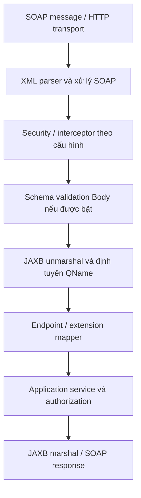

# xs:any, điểm mở rộng và giới hạn của khả năng tiến hóa hợp đồng XSD

## 1. Vì sao dịch vụ SOAP cần tính mở rộng?

Trong phát triển **Spring Web Services (Spring-WS)** theo hướng **contract-first**, nhóm tích hợp thiết kế XML Schema (XSD) trước, rồi dùng nó để xây dựng WSDL, sinh JAXB và triển khai SOAP endpoint cùng SOAP client. Những hợp đồng này có thể được nhiều đối tác sử dụng trong nhiều năm. Vì thế, khi nhu cầu xuất hiện trường dữ liệu mới, điều cần đánh giá là **client cũ còn nhận và hiểu đúng XML mới hay không**, chứ không chỉ là phần mềm máy chủ mới có chạy hay không.

Ví dụ, một dịch vụ công bố phản hồi tra cứu đơn hàng:

```xml
<ord:GetOrderResponse xmlns:ord="https://example.com/orders/v1">
    <ord:orderId>ORD-2026-001</ord:orderId>
    <ord:status>CONFIRMED</ord:status>
</ord:GetOrderResponse>
```

Sau đó, đối tác vận chuyển muốn nhận ngày giao dự kiến; một đối tác khác muốn nhận mã kho. Thêm phần tử XML tùy ý vào response có thể khiến các client được sinh từ XSD cũ từ chối phản hồi, dù thao tác nghiệp vụ vẫn là `GetOrder`.

**`xs:any`** là một **wildcard** của XSD, cho phép tại một vị trí cụ thể xuất hiện các phần tử thuộc tập namespace nhất định. Nếu thiết kế từ đầu, wildcard tạo được một **điểm mở rộng** để hệ thống trao đổi metadata bổ sung mà không luôn phải đổi phần tử nghiệp vụ gốc.

Nhưng `xs:any` **không tự bảo đảm tương thích ngược**: validator có thể chấp nhận XML, còn JAXB client hoặc code nghiệp vụ không biết cách xử lý nó; một extension có thể làm thay đổi ý nghĩa của dữ liệu cũ hoặc tạo rủi ro về XML security và WS-Security.

### Mục tiêu học tập

Sau bài học thuộc chương **Thiết kế XSD** của module `SPRING_WEB_SERVICES`, bạn có thể:

1. Giải thích `xs:any` cùng các thuộc tính `namespace`, `processContents`, `minOccurs`, `maxOccurs`.
2. Thiết kế một vị trí mở rộng có giới hạn rõ ràng trong hợp đồng SOAP/XSD.
3. Phân biệt `strict`, `lax`, `skip` khi validator có hoặc thiếu schema extension.
4. Phân biệt `xs:any` với `xs:anyAttribute`, `xs:extension` và phiên bản hóa hợp đồng.
5. Hiểu những gì JAXB, Spring-WS endpoint và SOAP client có thể hoặc không thể tự suy ra từ wildcard.
6. Lập phương án kiểm thử schema, client, bảo mật và tương thích giữa các phiên bản.

## 2. Cấu trúc và thuộc tính của xs:any

Một kiểu phức hợp XSD bình thường có thể mô tả chính xác trường và thứ tự:

```xml
<xs:sequence>
    <xs:element name="orderId" type="xs:string"/>
    <xs:element name="status" type="xs:string"/>
</xs:sequence>
```

Thêm một hạt wildcard vào cuối sequence:

```xml
<xs:sequence>
    <xs:element name="orderId" type="xs:string"/>
    <xs:element name="status" type="xs:string"/>
    <xs:any namespace="##other"
            processContents="lax"
            minOccurs="0"
            maxOccurs="3"/>
</xs:sequence>
```

Các thuộc tính điều khiển bốn câu hỏi riêng:

| Thuộc tính | Câu hỏi | Ví dụ và tác động |
| --- | --- | --- |
| `namespace` | Phần tử từ **namespace nào** được phép xuất hiện? | `##other` nhằm vào namespace khác namespace đích của schema. |
| `processContents` | Bộ xác thực **xử lý schema của phần tử wildcard** như thế nào? | `lax` validate khi có khai báo phù hợp, cho phép khi không có khai báo phù hợp. |
| `minOccurs` | Ít nhất bao nhiêu phần tử tại vị trí wildcard? | `0` cho phép vắng mặt. |
| `maxOccurs` | Nhiều nhất bao nhiêu phần tử tại vị trí wildcard? | `3` giới hạn ba phần tử. |

Nếu viết đơn giản:

```xml
<xs:any/>
```

thì trong ngữ cảnh wildcard là một hạt của mô hình nội dung, các giá trị mặc định là `namespace="##any"`, `processContents="strict"`, `minOccurs="1"` và `maxOccurs="1"`. **Không nên hiểu `<xs:any/>` là “không cần trường nào cũng được và muốn truyền gì cũng được”**.

Wildcards chỉ nói các **phần tử XML có thể xuất hiện**. Chúng không mô tả đầy đủ ngữ nghĩa nghiệp vụ, không cho phép đọc/ghi dữ liệu tùy ý, không thay thế chính sách bảo mật, cũng không buộc endpoint phải xử lý nội dung đó.

## 3. Thiết kế điểm mở rộng có wrapper trong hợp đồng đơn hàng

Thay vì xen một wildcard rộng vào tất cả các trường đã biết, ta dành một phần tử `ord:extensions` ở cuối response. Cách này giúp phân biệt dữ liệu tiêu chuẩn và dữ liệu mở rộng, tránh một số mơ hồ trong XSD.

### 3.1. XSD contract-first

Giả sử file `src/main/resources/xsd/orders-v1.xsd` định nghĩa:

```xml
<?xml version="1.0" encoding="UTF-8"?>
<xs:schema xmlns:xs="http://www.w3.org/2001/XMLSchema"
           xmlns:ord="https://example.com/orders/v1"
           targetNamespace="https://example.com/orders/v1"
           elementFormDefault="qualified">

    <xs:simpleType name="OrderIdType">
        <xs:restriction base="xs:string">
            <xs:minLength value="1"/>
            <xs:maxLength value="40"/>
        </xs:restriction>
    </xs:simpleType>

    <xs:simpleType name="PublicOrderStatusType">
        <xs:restriction base="xs:string">
            <xs:enumeration value="PENDING"/>
            <xs:enumeration value="CONFIRMED"/>
            <xs:enumeration value="SHIPPED"/>
            <xs:enumeration value="CANCELLED"/>
        </xs:restriction>
    </xs:simpleType>

    <xs:complexType name="ExtensionsType">
        <xs:sequence>
            <xs:any namespace="##other"
                    processContents="lax"
                    minOccurs="0"
                    maxOccurs="5"/>
        </xs:sequence>
    </xs:complexType>

    <xs:element name="GetOrderResponse">
        <xs:complexType>
            <xs:sequence>
                <xs:element name="orderId" type="ord:OrderIdType"/>
                <xs:element name="status" type="ord:PublicOrderStatusType"/>
                <xs:element name="extensions"
                            type="ord:ExtensionsType"
                            minOccurs="0"/>
            </xs:sequence>
        </xs:complexType>
    </xs:element>
</xs:schema>
```

Đọc các ranh giới của schema:

- `orderId` và `status` vẫn bắt buộc và có kiểu dữ liệu xác định.
- `ord:extensions` có thể vắng mặt; client không cần metadata mới vẫn nhận cấu trúc cũ.
- Chỉ **các phần tử con trực tiếp của `ord:extensions`** được wildcard tiếp nhận; không thể đưa phần tử tùy ý vào giữa `orderId` và `status`.
- Các phần tử con đó phải thuộc namespace **khác** namespace chính `https://example.com/orders/v1`.
- Tối đa năm phần tử extension ở vị trí này nếu schema validation được bật; đó chưa phải giới hạn độ sâu, kích thước text hay tài nguyên XML parser.

Đây là **XSD phản hồi minh họa**. Dịch vụ hoàn chỉnh còn cần `GetOrderRequest`, WSDL mô tả operation/binding, quy ước lỗi SOAP Fault, chính sách bảo mật và quy định ý nghĩa extension. Không nên coi một schema mẫu độc lập là project Spring-WS chạy ngay.

### 3.2. XML không có extension

```xml
<ord:GetOrderResponse xmlns:ord="https://example.com/orders/v1">
    <ord:orderId>ORD-2026-001</ord:orderId>
    <ord:status>CONFIRMED</ord:status>
</ord:GetOrderResponse>
```

XML này hợp lệ: `ord:extensions` không bắt buộc. Điểm mở rộng có giá trị ngay cả trước khi ứng dụng phát sinh phần tử mới.

### 3.3. XML có hai phần tử extension

```xml
<ord:GetOrderResponse
    xmlns:ord="https://example.com/orders/v1"
    xmlns:ext="https://partner.example.com/orders-ext/v1">
    <ord:orderId>ORD-2026-001</ord:orderId>
    <ord:status>CONFIRMED</ord:status>
    <ord:extensions>
        <ext:deliveryWindow>2026-12-02</ext:deliveryWindow>
        <ext:warehouseZone>HCM-01</ext:warehouseZone>
    </ord:extensions>
</ord:GetOrderResponse>
```

Hai phần tử `ext:*` thuộc namespace khác `ord` và đúng vị trí. Nếu validator **không có khai báo schema** của `ext:deliveryWindow` và `ext:warehouseZone`, `processContents="lax"` cho phép chúng xuất hiện. Điều đó **không chứng minh** `2026-12-02` thực sự là ngày hợp lệ theo ngữ nghĩa đối tác hoặc mã kho tồn tại.

Khi cần kiểm tra sâu, bên quản trị extension có thể công bố một XSD riêng:

```xml
<?xml version="1.0" encoding="UTF-8"?>
<xs:schema xmlns:xs="http://www.w3.org/2001/XMLSchema"
           xmlns:ext="https://partner.example.com/orders-ext/v1"
           targetNamespace="https://partner.example.com/orders-ext/v1"
           elementFormDefault="qualified">
    <xs:element name="deliveryWindow" type="xs:date"/>
    <xs:element name="warehouseZone">
        <xs:simpleType>
            <xs:restriction base="xs:string">
                <xs:maxLength value="20"/>
            </xs:restriction>
        </xs:simpleType>
    </xs:element>
</xs:schema>
```

Nếu validator được cấu hình có schema này, `lax` sẽ kiểm tra phần tử đã được khai báo; `<ext:deliveryWindow>ngay-khong-hop-le</ext:deliveryWindow>` sẽ bị từ chối vì sai kiểu `xs:date`.

Namespace URI không mặc nhiên là URL tải schema. Không dựa vào `xsi:schemaLocation` do client tự khai như nguồn tải XSD đáng tin cậy: cần dùng tập schema và XML resolver do hệ thống quản trị để tránh kết nối mạng hoặc tài nguyên ngoài ý muốn.

### 3.4. Envelope SOAP không thay đổi vì có wildcard

Khi truyền bằng SOAP 1.1, dữ liệu nằm trong `Body`:

```xml
<?xml version="1.0" encoding="UTF-8"?>
<env:Envelope xmlns:env="http://schemas.xmlsoap.org/soap/envelope/"
              xmlns:ord="https://example.com/orders/v1"
              xmlns:ext="https://partner.example.com/orders-ext/v1">
    <env:Body>
        <ord:GetOrderResponse>
            <ord:orderId>ORD-2026-001</ord:orderId>
            <ord:status>CONFIRMED</ord:status>
            <ord:extensions>
                <ext:deliveryWindow>2026-12-02</ext:deliveryWindow>
            </ord:extensions>
        </ord:GetOrderResponse>
    </env:Body>
</env:Envelope>
```

`xs:any` **không phải một element được gửi trên đường truyền**; nó chỉ là cách mô tả phần tử hợp lệ trong **file XSD**. SOAP Header, SOAP Body và SOAP Fault tuân theo quy tắc giao thức SOAP riêng. Việc có extension trong Body không mặc nhiên tạo thêm operation hoặc header bảo mật.

## 4. namespace: wildcard rộng đến đâu?

Các kiểu giá trị thường dùng trong XML Schema 1.0:

| Giá trị | Tập namespace được diễn đạt | Khi cân nhắc |
| --- | --- | --- |
| `##any` | Mọi namespace trong giới hạn wildcard. | Linh hoạt nhất, nhưng có nguy cơ mơ hồ với phần tử đã biết. |
| `##other` | Namespace **khác namespace đích** của schema. | Điểm mở rộng của đối tác với namespace riêng. |
| `##targetNamespace` | Namespace đích của schema. | Mở rộng nội dung trong namespace chính, cần quản trị tránh xung đột. |
| `##local` | Phần tử không thuộc namespace. | Phù hợp một số định dạng XML cũ, dễ gây mơ hồ trong hệ thống SOAP nhiều namespace. |
| Một hoặc nhiều URI cụ thể | Chỉ các namespace đã nêu. | Tập extension đã biết và kiểm soát rõ ràng. |

Ví dụ giới hạn cho một namespace:

```xml
<xs:any namespace="https://partner.example.com/orders-ext/v1"
        processContents="lax"
        minOccurs="0"
        maxOccurs="5"/>
```

Hoặc hai namespace:

```xml
<xs:any namespace="https://partner-a.example.com/ext/v1 https://partner-b.example.com/ext/v1"
        processContents="lax"
        minOccurs="0"
        maxOccurs="5"/>
```

**Namespace URI**, không phải tiền tố XML, quyết định phần tử có khớp không. Một client đổi tiền tố từ `ext` thành `p` nhưng giữ nguyên URI và local name vẫn gửi cùng QName. Ngược lại, `<ord:deliveryWindow>` không thể đặt trong wildcard `##other` của `ExtensionsType` ở mục trước, bởi `ord` vẫn là namespace của schema chính.

Khi cần sử dụng các ràng buộc namespace nâng cao của XML Schema 1.1, chẳng hạn khả năng loại trừ namespace/QName nhất định, phải kiểm tra mức hỗ trợ của toàn bộ validator, JAXB/XJC và đối tác. Không phải mọi hệ thống SOAP cũ đều hỗ trợ XSD 1.1.

## 5. processContents: strict, lax và skip

Giá trị `processContents` kiểm soát mức độ **schema validation** đối với các phần tử được wildcard bắt:

| Chế độ | Có khai báo schema phù hợp cho phần tử? | Không có khai báo phù hợp? |
| --- | --- | --- |
| **`strict`** | Phải validate và hợp lệ. | Validation thất bại vì không thể kiểm tra đúng khai báo. |
| **`lax`** | Validate theo khai báo tìm được; sai kiểu thì thất bại. | Không bắt buộc khai báo; có thể chấp nhận phần tử tại wildcard. |
| **`skip`** | Không yêu cầu validate nội dung phần tử wildcard theo khai báo kiểu. | Không yêu cầu validate nội dung phần tử wildcard theo khai báo kiểu. |

### 5.1. strict khi extension đã được chuẩn hóa

```xml
<xs:any namespace="https://partner.example.com/orders-ext/v1"
        processContents="strict"
        minOccurs="0"
        maxOccurs="5"/>
```

Hướng này phù hợp khi mọi bên tham gia có schema extension được cung cấp cho validator và cần kiểm tra cấu trúc chặt chẽ. Đổi lại, client/validator cũ không có khai báo phần tử mới có thể từ chối XML trước khi nghiệp vụ chạy.

### 5.2. lax khi cho phép một số extension chưa biết

```xml
<xs:any namespace="##other"
        processContents="lax"
        minOccurs="0"
        maxOccurs="5"/>
```

Chế độ này hữu ích cho vùng metadata tùy chọn. Nhưng **lax không có nghĩa là bỏ qua tất cả**: schema có sẵn của phần tử vẫn được sử dụng để kiểm tra. Nếu đã nạp XSD extension khai báo `ext:deliveryWindow` là `xs:date`, giá trị `khong-phai-ngay` không nên được chấp nhận qua validation.

### 5.3. skip không làm XML tự động an toàn

```xml
<xs:any namespace="##other"
        processContents="skip"
        minOccurs="0"
        maxOccurs="5"/>
```

`skip` cho phép vùng XML không bị kiểm tra kiểu con thông qua wildcard. XML vẫn phải well-formed; vị trí, namespace và giới hạn số lượng wildcard vẫn có ý nghĩa khi validate cấu trúc bao quanh. Vì vùng này ít ràng buộc schema, cần hạn chế parser, độ sâu, kích thước, thời gian xử lý và cách diễn giải dữ liệu.

### 5.4. Thuộc tính XSD không tự bật validation trong Spring-WS

Giữa **JAXB unmarshalling** và **XML Schema validation** có ranh giới. Một `Unmarshaller` được dùng chỉ để biến XML thành Java object chưa chắc đã cấu hình schema để xác thực. Việc XSD chứa `processContents="strict"` không tự đảm bảo mọi SOAP request đều được kiểm tra nếu ứng dụng không thực thi validation.

Với Spring-WS, có thể cấu hình cơ chế validation như `PayloadValidatingInterceptor` cùng tập schema đúng phạm vi. Cần xác nhận nó thực sự hoạt động trên request/response cần kiểm tra, đồng thời bổ sung kiểm tra nghiệp vụ và bảo mật vì schema không thể thay thế các nhiệm vụ đó.

## 6. minOccurs, maxOccurs, thứ tự XML và UPA

### 6.1. Điểm mở rộng tùy chọn khác điểm mở rộng bắt buộc

- `minOccurs="0"` cho phép không có phần tử extension.
- `minOccurs="1"` yêu cầu ít nhất một phần tử tại vị trí wildcard, dễ gây vấn đề cho client cũ nếu thêm sau khi hợp đồng đã phát hành.
- `maxOccurs="1"` cho phép tối đa một phần tử extension.
- `maxOccurs="5"` giới hạn năm phần tử trực tiếp thuộc wildcard.
- `maxOccurs="unbounded"` không đặt mức trần trong schema; đây không phải lựa chọn mặc định tốt cho dữ liệu không tin cậy.

Trong schema ví dụ, phần tử `ord:extensions` có thể không xuất hiện. Nếu nó xuất hiện thì bên trong có thể có tối đa năm phần tử con mở rộng. Hai giới hạn này thuộc **hai tầng khác nhau**.

### 6.2. Vị trí wildcard vẫn phải tuân thủ xs:sequence

`xs:sequence` yêu cầu thứ tự. Đặt `xs:any` quá rộng, xen với các phần tử optional đã biết có thể tạo mô hình nhập nhằng. Ví dụ cần tránh trong XSD 1.0:

```xml
<!-- ##any có thể khớp cùng QName với comment. -->
<xs:sequence>
    <xs:element name="comment" type="xs:string" minOccurs="0"/>
    <xs:any namespace="##any"
            minOccurs="0"
            maxOccurs="unbounded"/>
</xs:sequence>
```

Quy tắc **Unique Particle Attribution (UPA)** của XSD 1.0 yêu cầu xác định được particle tiếp nhận một phần tử mà không phụ thuộc việc nhìn xa hơn trong nội dung. Với hai khả năng cùng khớp `comment`, validator có thể từ chối schema là không xác định duy nhất. XML Schema 1.1 có thay đổi về ưu tiên phần tử tường minh so với wildcard, nhưng không nên dựa vào khác biệt đó nếu còn client XSD 1.0.

**Thiết kế dễ kiểm soát hơn:** dùng `ord:extensions` làm wrapper ở cuối sequence và bên trong đặt wildcard chỉ nhận namespace khác schema chính (hoặc danh sách URI rõ ràng). Kiểm tra schema bằng đúng validator của hệ thống triển khai.

### 6.3. maxOccurs không bảo vệ khỏi XML quá lớn

`maxOccurs="5"` giới hạn số element trực tiếp khớp wildcard **nếu có validation**, nhưng mỗi element vẫn có thể chứa text rất dài hoặc nhiều cấp XML lồng nhau. Hạn mức byte, độ sâu XML, số node, tài nguyên DOM, timeout và chính sách parser là những biện pháp riêng không thể chỉ dựa vào `maxOccurs`.

## 7. xs:any, xs:anyAttribute, xs:extension và trường tùy chọn

| Cơ chế | Đối tượng được mở rộng | Ví dụ phù hợp |
| --- | --- | --- |
| **`xs:any`** | Các **phần tử con** XML tại một vị trí trong content model. | `ord:extensions` chứa `ext:deliveryWindow`. |
| **`xs:anyAttribute`** | Các **thuộc tính** XML chưa biết trên một kiểu complex. | `ext:traceKey` đặt trên phần tử hợp lệ. |
| **`xs:extension`** | Định nghĩa **kiểu dẫn xuất** có thêm nội dung/thuộc tính so với kiểu cơ sở. | `ExtendedOrderType` thêm `priority`. |
| **`xs:element minOccurs="0"`** | Một trường **đã có tên/kiểu và ngữ nghĩa rõ ràng** nhưng tùy chọn. | `estimatedDelivery` tùy chọn, nếu tương thích được xác nhận. |
| **Hợp đồng phiên bản mới** | Một giao diện mới với cam kết cấu trúc/ngữ nghĩa khác. | Namespace `.../orders/v2` khi có thay đổi bắt buộc. |

### 7.1. xs:anyAttribute

Ví dụ cho kiểu có nội dung text và cho phép attribute khác namespace:

```xml
<xs:complexType name="ExtensionLabelType">
    <xs:simpleContent>
        <xs:extension base="xs:string">
            <xs:anyAttribute namespace="##other"
                             processContents="lax"/>
        </xs:extension>
    </xs:simpleContent>
</xs:complexType>
```

Nếu phần tử `ord:label` được khai báo dùng kiểu đó, XML có thể có:

```xml
<ord:label xmlns:ord="https://example.com/orders/v1"
           xmlns:ext="https://partner.example.com/orders-ext/v1"
           ext:traceKey="t-93">Đơn ưu tiên</ord:label>
```

`ext:traceKey` trong ví dụ là **thuộc tính**, không phải `<ext:traceKey>` nằm bên trong phần tử. `xs:anyAttribute` và `xs:any` không thể thay thế nhau.

### 7.2. xs:extension dẫn xuất kiểu, không phải wildcard

```xml
<xs:complexType name="BaseOrderType">
    <xs:sequence>
        <xs:element name="orderId" type="xs:string"/>
    </xs:sequence>
</xs:complexType>

<xs:complexType name="ExtendedOrderType">
    <xs:complexContent>
        <xs:extension base="ord:BaseOrderType">
            <xs:sequence>
                <xs:element name="priority" type="xs:boolean"/>
            </xs:sequence>
        </xs:extension>
    </xs:complexContent>
</xs:complexType>
```

`ExtendedOrderType` biết rõ trường `priority` và kế thừa kiểu cơ sở. Nếu một phần tử được khai báo dùng kiểu cơ sở mà thực tế gửi kiểu dẫn xuất, khả năng xử lý còn phụ thuộc `xsi:type`, lược đồ/schema được nạp và khả năng binding của client. **`xs:extension` không đồng nghĩa với chấp nhận mọi node chưa biết**.

### 7.3. XML Schema 1.1 có xs:openContent

XSD 1.1 hỗ trợ `xs:openContent` và `xs:defaultOpenContent` để diễn đạt nội dung mở trong một số mô hình, ví dụ thêm phần tử mở ở cuối hoặc cho phép đan xen theo chế độ phù hợp. Đây là cơ chế mở rộng khác với việc đặt `xs:any` trực tiếp trong `xs:sequence`.

Trong hệ thống doanh nghiệp, nhiều công cụ sinh JAXB/XJC hoặc XML validator vẫn lấy XSD 1.0 làm ranh giới tương thích. Vì vậy phải kiểm tra **toàn bộ chuỗi công cụ** trước khi dùng tính năng XSD 1.1; một IDE đọc được file không chứng minh client đối tác có thể sinh mã và validate nó.

## 8. JAXB, Spring-WS và xử lý phần tử mở rộng

### 8.1. JAXB có thể ánh xạ wildcard thành danh sách

Một lớp JAXB minh họa cho `ExtensionsType` có thể trông như sau:

```java
import jakarta.xml.bind.annotation.XmlAccessType;
import jakarta.xml.bind.annotation.XmlAccessorType;
import jakarta.xml.bind.annotation.XmlAnyElement;
import java.util.ArrayList;
import java.util.List;

@XmlAccessorType(XmlAccessType.FIELD)
public class ExtensionsType {
    @XmlAnyElement(lax = true)
    private List<Object> any = new ArrayList<>();

    public List<Object> getAny() {
        return any;
    }
}
```

Với `@XmlAnyElement(lax = true)`, phần tử chưa có binding thường xuất hiện dưới dạng **DOM `org.w3c.dom.Element`**. Phần tử đã có binding trong `JAXBContext` có thể trở thành **JAXB object** hoặc `JAXBElement<?>`. Kiểu Java cụ thể do XJC sinh phụ thuộc schema, cấu hình binding và toolchain. Không sửa tay lớp được sinh: đặt logic diễn giải trong mapper hoặc adapter riêng.

Ví dụ nhận diện một phần tử DOM bằng QName:

```java
import javax.xml.namespace.QName;
import org.w3c.dom.Element;

public final class ExtensionInspector {
    private static final QName DELIVERY_WINDOW = new QName(
        "https://partner.example.com/orders-ext/v1", "deliveryWindow");

    public void inspect(ExtensionsType extensions) {
        if (extensions == null) {
            return;
        }
        for (Object item : extensions.getAny()) {
            if (item instanceof Element element) {
                QName name = new QName(
                    element.getNamespaceURI(), element.getLocalName());
                if (DELIVERY_WINDOW.equals(name)) {
                    // Kiểm tra giới hạn, kiểu, quyền, schema trước khi dùng.
                    String rawDate = element.getTextContent();
                    // rawDate chỉ là đầu vào cho bộ parse nghiệp vụ an toàn.
                }
            } else {
                // Có thể là JAXBElement hoặc JAXB object đã được biết.
            }
        }
    }
}
```

Đây là code **minh họa** cho Java hiện đại (`instanceof` pattern matching). Nó chưa phải cơ chế validation hoặc security hoàn chỉnh. `getTextContent()` không tự xác minh ngày, định danh, quyền hay chữ ký số.

**Phân biệt hai lớp `lax`:**

- `processContents="lax"` là quy tắc **XSD validation** khi wildcard khớp phần tử.
- `@XmlAnyElement(lax=true)` là cơ chế **JAXB binding** khi có hoặc không có kiểu đã biết trong JAXB context.

Một XML được validator chấp nhận không có nghĩa JAXB client tự hiểu ngữ nghĩa. Bật JAXB lax cũng không tự động cấu hình schema validation cho ứng dụng.

### 8.2. Spring-WS định tuyến theo QName phần tử gốc của SOAP Body

```java
import org.springframework.ws.server.endpoint.annotation.Endpoint;
import org.springframework.ws.server.endpoint.annotation.PayloadRoot;
import org.springframework.ws.server.endpoint.annotation.RequestPayload;
import org.springframework.ws.server.endpoint.annotation.ResponsePayload;

@Endpoint
public class OrderEndpoint {
    private static final String NS = "https://example.com/orders/v1";
    private final OrderQueryService orderQueryService;

    public OrderEndpoint(OrderQueryService orderQueryService) {
        this.orderQueryService = orderQueryService;
    }

    @PayloadRoot(namespace = NS, localPart = "GetOrderRequest")
    @ResponsePayload
    public GetOrderResponse getOrder(
            @RequestPayload GetOrderRequest request) {
        return orderQueryService.findAsContractResponse(request.getOrderId());
    }
}
```

Đoạn code giả định `GetOrderRequest`/`GetOrderResponse` là lớp JAXB sinh từ hợp đồng có cả request và response, còn `OrderQueryService` là dịch vụ nghiệp vụ do dự án triển khai. Cần bổ sung cấu hình Spring-WS, servlet mapping, marshalling, schema validation, SOAP Fault, interceptor và bảo mật để chạy hoàn chỉnh.

Ở đây Spring-WS định tuyến bằng QName `{https://example.com/orders/v1}GetOrderRequest`. Phần tử extension nằm trong `GetOrderResponse` không tạo operation mới hoặc đổi QName root. Tên Java `getOrder` không phải nguồn sự thật của XML contract.

### 8.3. Các lớp xử lý cần được phân trách nhiệm



Đây là **sơ đồ trách nhiệm**, không quy định thứ tự thực tế của mọi cấu hình Spring-WS. Các thành phần có thể chạy ở thứ tự khác nhau tùy stack; một interceptor bảo mật có thể từ chối yêu cầu sớm hơn. Cần giữ nguyên tắc **chỉ diễn giải và thực thi extension đã có hợp đồng/ngữ nghĩa/quyền sử dụng rõ ràng**.

## 9. xs:any không đồng nghĩa với khả năng tương thích ngược

Khi xét khả năng tiến hóa của SOAP contract, cần phân biệt ít nhất bốn cấp độ:

1. **Schema compatibility:** XML mới có còn hợp lệ theo schema **đã công bố cho client cũ** không?
2. **Binding/runtime compatibility:** client JAXB, .NET hoặc một runtime khác có parse/unmarshal được XML đó không?
3. **Semantic compatibility:** bên nhận có thể hiểu đúng hoặc bỏ qua phần mới mà không làm sai kết quả nghiệp vụ không?
4. **Operational/security compatibility:** chính sách XML security, chữ ký WS-Security, gateway, log, quota và điều kiện xử lý thông điệp có còn đáp ứng không?

`xs:any` chủ yếu mở một phần của **khả năng tương thích ở mức schema**. Với một JAXB client đã được kiểm thử hỗ trợ wildcard, nó cũng có thể giúp binding đọc được XML mới; tuy nhiên không thể kết luận tương thích chỉ dựa trên việc XSD có wildcard.

### 9.1. Điều kiện để client cũ nhận phần tử mới

Giả sử client v1 đã được sinh từ `orders-v1.xsd` ở mục 3, tức XSD **ngay từ đầu** có `ord:extensions`. Server v1.1 gửi thêm:

```xml
<ord:extensions xmlns:ord="https://example.com/orders/v1"
                xmlns:ext="https://partner.example.com/orders-ext/v1">
    <ext:warehouseZone>HCM-01</ext:warehouseZone>
</ord:extensions>
```

Client v1 *có khả năng* tiếp nhận nếu tất cả điều kiện sau thỏa mãn:

- XML nằm đúng `ord:extensions`, đúng namespace được phép và số lượng không vượt quá `maxOccurs`.
- Cấu hình schema validation của client không yêu cầu một XSD extension chưa có.
- JAXB/runtime cũ thực sự xử lý được phần tử lạ theo binding đã sinh, không ném lỗi bất ngờ.
- Ứng dụng phía client không bắt buộc phải hiểu phần mới để đưa ra quyết định nghiệp vụ an toàn.
- Các interceptor, WS-Security và hệ thống trung gian tiếp tục xử lý đúng thông điệp có extension.

Nếu XSD v1 **chưa có `ord:extensions`**, việc bổ sung `xs:any` trong XSD v1.1 **không tự động cập nhật client đã sinh từ XSD v1**. Client đó vẫn có thể từ chối phản hồi chứa extension. Đây là một trong những giới hạn quan trọng nhất khi đưa wildcard vào hợp đồng sau khi API đã phát hành.

### 9.2. Những thay đổi wildcard không thể giải quyết

| Thay đổi | Vì sao có thể phá vỡ hợp đồng? |
| --- | --- |
| Đổi tên root `GetOrderResponse` | QName response cũ thay đổi; wildcard bên trong không sửa được phần tử root. |
| Đổi namespace `.../orders/v1` sang `.../orders/v2` | QName của phần tử tiêu chuẩn và mapping WSDL/JAXB thay đổi. |
| Xóa `status` hoặc chuyển nó thành optional | Client cũ có thể phụ thuộc vào việc trường luôn tồn tại. |
| Đổi kiểu `orderId` hoặc thứ tự các phần tử trong `xs:sequence` | Vi phạm schema/logic giải mã mà client cũ sử dụng. |
| Gửi enum `RETURNED` trong `status` khi XSD cũ chưa định nghĩa | Client sinh enum cũ có thể không đọc được giá trị mới; wildcard ở nơi khác không ảnh hưởng enum này. |
| Thêm `ord:estimatedDelivery` **ngoài** wrapper | Không khớp wildcard được đặt trong `ord:extensions`. |
| Thêm `ord:deliveryWindow` vào wildcard `##other` | Cùng namespace chính nên không thuộc tập wildcard cho phép. |
| Gửi sáu phần tử extension khi `maxOccurs=5` | Vi phạm cardinality trong schema. |
| Dùng extension tùy chọn để truyền thay đổi bắt buộc về thanh toán | Client cũ bỏ qua extension có thể hành động sai, dù XML hợp lệ. |
| Đòi client cũ bắt buộc kiểm tra chữ ký/cấu trúc của phần tử mới | Client chưa được nâng cấp không tự biết quy tắc bảo mật mới. |

### 9.3. Thay đổi ngữ nghĩa là điểm giới hạn khó nhất

Giả sử `status=CONFIRMED` trước đây có nghĩa “đơn được phép xuất kho”. Server mới thêm:

```xml
<ord:extensions
    xmlns:ord="https://example.com/orders/v1"
    xmlns:ext="https://partner.example.com/orders-ext/v1">
    <ext:holdReason>FRAUD_REVIEW</ext:holdReason>
</ord:extensions>
```

Nếu `CONFIRMED` bây giờ chỉ có nghĩa “đã nhận yêu cầu” và phải đọc `holdReason` mới biết có được xuất kho hay không, client v1 có thể bỏ qua extension và **thực hiện quyết định sai**. Không thể dùng `xs:any` để gọi đây là thay đổi tương thích ngược. Cần giữ ngữ nghĩa cũ, hoặc thiết kế hợp đồng/operation/phiên bản mới và nâng cấp các bên theo kế hoạch.

**Nguyên tắc quan trọng:** một extension thật sự tùy chọn phải có thể bị bỏ qua **mà không làm sai ngữ nghĩa của các trường đã cam kết**.

### 9.4. SOAP Header mustUnderstand không tự áp dụng cho Body extension

Trong giao thức SOAP, thuộc tính `mustUnderstand` điều khiển việc **nút SOAP đích** phải xử lý một **Header block**. Nếu header bắt buộc không được hiểu, nút có thể tạo SOAP Fault `MustUnderstand` theo phiên bản SOAP được dùng.

Một phần tử do `xs:any` chấp nhận trong **SOAP Body** không tự thừa hưởng quy tắc đó. Không nên đặt tùy ý `env:mustUnderstand` vào extension nghiệp vụ trong Body và kỳ vọng client áp dụng xử lý SOAP Header. Khi một quy tắc mới **bắt buộc** để xử lý nghiệp vụ, hãy thiết kế/thương lượng một cơ chế hợp đồng hoặc phiên bản rõ ràng; nếu là metadata xử lý SOAP phù hợp, có thể cân nhắc Header/policy có tài liệu đầy đủ.

## 10. Những rủi ro bảo mật khi chấp nhận XML mở rộng

Wildcard làm tăng tập đầu vào có thể đi vào parser, DOM, JAXB, validation, log, chữ ký và nghiệp vụ. Mô hình “chấp nhận XML không biết trước” đòi hỏi kiểm soát cụ thể.

| Nguy cơ | Ví dụ | Cách giảm thiểu |
| --- | --- | --- |
| **XXE và tài nguyên ngoài** | Parser xử lý entity ngoài/DTD hoặc schema được tham chiếu từ nguồn không tin cậy. | Cấu hình parser và schema resolver an toàn, vô hiệu hóa truy cập ngoài khi không cần thiết. |
| **Cạn tài nguyên** | Một extension chứa text rất lớn hoặc cây XML sâu dù chỉ là một phần tử trực tiếp. | Giới hạn byte, số node, độ sâu, thời gian xử lý, quota truyền tải và bộ nhớ. |
| **Rò rỉ dữ liệu** | Đối tác gửi thông tin cá nhân vào extension; SOAP logger ghi toàn bộ Body. | Chỉ định danh mục dữ liệu được phép, masking/redaction và chính sách lưu giữ log. |
| **Mass assignment hoặc thao tác trái phép** | Ứng dụng đọc `<ext:approved>true</ext:approved>` và cập nhật entity. | Không chép trực tiếp wildcard vào model/domain hoặc dùng nó làm cơ sở ủy quyền. |
| **XML Signature wrapping** | Chữ ký xác minh một node nhưng ứng dụng xử lý một node khác bị cài vào extension. | Kiểm tra chữ ký trên chính dữ liệu được sử dụng; quản lý ID, namespace và tham chiếu nhất quán. |
| **Chuyển tiếp mất kiểm soát** | Gateway chuyển toàn bộ phần tử không biết sang hệ thống nội bộ có đặc quyền cao hơn. | Chỉ cho phép QName/namespace được quản trị, lọc và validate theo chính sách. |
| **Schema download không kiểm soát** | Validator tải XSD theo `xsi:schemaLocation` do client gửi. | Sử dụng danh mục schema/resolver tin cậy, cấm hoặc giới hạn truy cập mạng. |

### 10.1. WS-Security phải bảo vệ đúng dữ liệu được sử dụng

Chữ ký hoặc mã hóa WS-Security không tự động phủ mọi trường mới theo cùng chính sách. Khi xuất hiện extension, cần xác minh **cụ thể phần SOAP nào được ký/mã hóa**: toàn bộ Body, một số element, hay các node được tham chiếu bằng ID. Nếu nghiệp vụ ra quyết định dựa trên một phần tử extension chưa được bảo vệ như yêu cầu, việc chấp nhận nó có thể mở ra đường thay đổi dữ liệu.

**TLS** bảo vệ kênh truyền, chứng chỉ hỗ trợ thiết lập danh tính/tin cậy theo cấu hình; nó không xác minh kiểu XML hay ý nghĩa của wildcard. **WS-Security** có thể giúp bảo vệ thông điệp và danh tính khi đi qua trung gian, nhưng chỉ khi cấu hình và xác minh thực sự chính xác. **XSD validation**, chữ ký, xác thực, phân quyền và giới hạn parser là các trách nhiệm bổ sung cho nhau.

### 10.2. Chính sách xử lý extension chưa biết

Một quy tắc triển khai thực tế:

1. Công bố danh mục **namespace/QName extension** được chấp nhận; tách extension “được phép xuất hiện” khỏi extension “được phép tác động nghiệp vụ”.
2. Với extension có xử lý, kiểm tra cấu trúc/kiểu, số lượng, dung lượng, quyền sử dụng và ngữ nghĩa đã thống nhất.
3. Với extension **thật sự tùy chọn** mà ứng dụng chưa hỗ trợ, bỏ qua hoặc ghi nhận theo chính sách, không thực thi hành vi ngầm.
4. Nếu extension mới là thành phần **bắt buộc**, dùng cơ chế versioning/negotiation phù hợp thay vì âm thầm yêu cầu client cũ phải hiểu.
5. Khi lưu hoặc chuyển tiếp phần tử lạ, đánh giá riêng dữ liệu nhạy cảm, chữ ký, namespace và quota.

Nếu payload vi phạm hợp đồng hoặc chính sách, Spring-WS có thể ánh xạ lỗi thành SOAP Fault bằng cơ chế exception resolver/fault handling thích hợp. Mã, reason và `detail` nên công bố ổn định, tránh trả exception Java, stack trace hoặc đường dẫn nội bộ cho đối tác.

## 11. Nên chọn xs:any, trường tùy chọn hay hợp đồng mới?

Không phải mọi tính năng mới đều cần wildcard. Lựa chọn theo bản chất yêu cầu:

| Nhu cầu | Phương án phù hợp hơn | Điều cần xác minh |
| --- | --- | --- |
| Một trường có tên, kiểu và ý nghĩa đã thống nhất giữa nhiều client | Thêm `xs:element` optional với kiểu cụ thể, hoặc phát hành v2 khi cần. | Client cũ có chấp nhận response thêm trường không? |
| Metadata tùy chọn do một đối tác sở hữu, client khác có thể bỏ qua | `ord:extensions` + `xs:any` giới hạn namespace. | Bỏ qua không làm sai nghiệp vụ; runtime xử lý phần tử lạ. |
| Thuộc tính metadata của một element | `xs:anyAttribute` trên kiểu được chọn. | Bảo mật attribute, conflict tên và JAXB mapping. |
| Mở rộng một kiểu dựa trên kiểu cơ sở đã định nghĩa | `xs:extension` theo type derivation. | Tương thích `xsi:type`/binding và validator. |
| Thay đổi field bắt buộc, hành vi nghiệp vụ, quyền hoặc cách diễn giải response | Operation/WSDL/namespace phiên bản mới. | Kế hoạch chuyển đổi và hỗ trợ song song. |
| Dữ liệu chỉ phục vụ logic lưu trữ hoặc vận hành nội bộ | Giữ trong domain/persistence model, không đưa vào contract. | Bảo đảm không lộ dữ liệu từ mapper/JAXB. |

### 11.1. Quản trị namespace extension

Ví dụ namespace chính `https://example.com/orders/v1` có thể giữ ổn định, trong khi đối tác logistics quản trị `https://logistics.example.com/orders-ext/v1`. Nếu extension thay đổi không tương thích, bên sở hữu có thể công bố `.../orders-ext/v2`, kèm schema và tài liệu mới.

Wildcard `##other` của hợp đồng chính **có thể cho phép nhiều namespace extension** mà không tự phân biệt version extension. Do đó application layer vẫn phải kiểm tra QName, phiên bản, quyền và ngữ nghĩa của từng extension.

Một namespace URI có hậu tố `/v1` chỉ là quy ước định danh; hệ thống phải quản lý sự thay đổi và phạm vi hỗ trợ thật sự. Không sử dụng lại cùng một namespace để đảo ngược ngữ nghĩa đã công bố chỉ vì XML vẫn validate được.

### 11.2. WSDL phát hành và điểm mở rộng phải được bảo toàn

Trong Spring-WS, `DefaultWsdl11Definition` có thể tạo WSDL 1.1 từ XSD theo quy ước `Request`/`Response`. Việc WSDL được sinh từ XSD vẫn là **contract-first**. Khi XSD có wildcard, cần công bố đúng schema đó trong WSDL/import và bảo đảm khách hàng có thể sinh binding phù hợp.

Nếu wildcard **chỉ mới thêm vào XSD bản sau**, một client sinh từ WSDL/XSD bản trước không nhận được khả năng này theo cách tự động. Cần thử client cũ trên wire format thực tế, đánh giá breaking changes và cân nhắc một hợp đồng phiên bản mới.

Với đối tác yêu cầu WSDL cố định, nên lưu và version hóa chính WSDL/XSD đã cam kết, có kiểm tra drift khi build/deploy, tránh để nâng cấp cấu hình hoặc công cụ sinh WSDL làm thay đổi giao diện không được duyệt.

## 12. Ma trận kiểm thử xs:any

Hợp đồng có wildcard cần **schema test, JAXB test, endpoint/client integration test và security test**. Test chỉ chạy với XSD mới của server chưa chứng minh một client cũ hoạt động.

### 12.1. Schema validation

Với `ExtensionsType` ở mục 3:

| Ca | Nội dung XML | Kết quả mong đợi khi validate XSD |
| --- | --- | --- |
| A | Không có `ord:extensions`. | Hợp lệ vì wrapper `minOccurs=0`. |
| B | `ord:extensions` tồn tại nhưng rỗng. | Hợp lệ vì wildcard `minOccurs=0`. |
| C | Một `ext:deliveryWindow` đúng namespace, chưa có khai báo ext. | Hợp lệ theo `lax` nếu không có khai báo được tìm thấy. |
| D | `ext:deliveryWindow` sai kiểu ngày, validator có schema ext định nghĩa `xs:date`. | Không hợp lệ dưới `lax` khi khai báo được tìm thấy. |
| E | `ord:deliveryWindow` nằm trong wrapper. | Không hợp lệ do wildcard `##other` không cho phép namespace chính. |
| F | Sáu phần tử ext trong wrapper. | Không hợp lệ vì `maxOccurs=5`. |
| G | `ord:extensions` nằm trước `ord:status`. | Không hợp lệ vì vi phạm thứ tự `xs:sequence`. |
| H | `ord:status` là giá trị ngoài enumeration. | Không hợp lệ; wildcard không thay ràng buộc trường tiêu chuẩn. |
| I | `processContents=strict` nhưng phần tử ext chưa có khai báo. | Không hợp lệ vì strict cần khai báo để validate. |
| J | `processContents=skip` với giá trị extension sai kiểu. | Nội dung wildcard không được validate theo kiểu; các ràng buộc ngoài vẫn áp dụng. |

Kiểm tra cả lỗi **XML không well-formed** để phân biệt parser với validator. `skip` không cho phép các tài liệu có tag sai cấu trúc trở thành XML hợp lệ.

### 12.2. JAXB và SOAP client đã phát hành

Kiểm thử với client được sinh từ **WSDL/XSD thực sự đã gửi cho đối tác**, không chỉ client được sinh lại sau khi sửa schema:

1. Client v1 nhận response không có extension.
2. Client v1 nhận response có extension lạ, bỏ qua hoặc giữ lại theo chính sách.
3. Client nhận extension đã biết và kiểm tra nó trở thành JAXB object hay DOM `Element`.
4. Client nhận cùng một QName với tiền tố XML khác, xác nhận code không phụ thuộc chuỗi prefix.
5. Client nhận SOAP Fault khi extension vi phạm chính sách hoặc không đủ dữ liệu bắt buộc.
6. Client sinh từ nền tảng khác (ví dụ .NET) xử lý được phần tử mở rộng theo hợp đồng liên nền tảng.

Spring-WS có thể dùng `MockWebServiceClient` để kiểm tra SOAP endpoint, `WebServiceTemplate` cho phía client và cơ chế validation/XPath để so khớp payload. Cần thêm thử nghiệm với runtime thực tế của đối tác nếu tương thích là yêu cầu bắt buộc.

### 12.3. Security và ngữ nghĩa

Kiểm thử các trường hợp mà XML hợp lệ nhưng không được phép xử lý:

- Extension chưa biết không kích hoạt giao dịch hoặc cập nhật entity.
- Extension yêu cầu chữ ký hoặc danh tính nhưng thiếu xác thực bị từ chối đúng chính sách.
- Gateway không tự động sao chép dữ liệu tùy ý sang hệ thống nội bộ có đặc quyền cao hơn.
- Parser không tải tài nguyên ngoài, không quá giới hạn kích thước/độ sâu, không ghi log token hoặc PII.
- Dữ liệu mở rộng không làm thay đổi ngữ nghĩa các trường tiêu chuẩn mà client cũ dựa vào.

### 12.4. Ma trận tương thích phiên bản

```text
Client v1   -> Server v1:   Request/response gốc phải hoạt động.
Client v1   -> Server v1.1: Response có extension mới phải được thử thật.
Client v1.1 -> Server v1:   Client mới vẫn xử lý được khi extension vắng mặt.
Client v1.1 -> Server v1.1: Các extension được hỗ trợ phải đúng ngữ nghĩa.
Client v2   -> Server v1:   Không mặc định tương thích khi v2 thay đổi bắt buộc.
```

Các mẫu XML cũ, WSDL/XSD đã xuất bản và danh sách hành vi của từng client nên được lưu trong pipeline CI hoặc bộ thử nghiệm tích hợp đối tác, giúp phát hiện việc nâng cấp JAXB, Spring-WS hay XSD validator làm lệch wire format.

## 13. Bài tập tình huống: dữ liệu mở rộng nào có thể bỏ qua?

Một đối tác logistics gửi các trường trong vùng mở rộng:

```xml
<ord:extensions
    xmlns:ord="https://example.com/orders/v1"
    xmlns:log="https://logistics.example.com/orders-ext/v1">
    <log:deliveryWindow>2026-12-02</log:deliveryWindow>
    <log:handlingCode>HANDLE_WITH_CARE</log:handlingCode>
    <log:releaseWithoutPayment>true</log:releaseWithoutPayment>
</ord:extensions>
```

**Ở tầng XSD**, cả ba phần tử có namespace khác namespace chính và số lượng không quá năm; khi schema logistics chưa được nạp, `lax` có thể chấp nhận hình dạng này.

**Ở tầng nghiệp vụ**, ba trường không thể xem như tương đương:

- **`deliveryWindow`:** có thể là metadata tùy chọn phục vụ hiển thị. Cần thống nhất kiểu `xs:date` hoặc một mô hình khoảng thời gian phù hợp, múi giờ khi có timestamp và quy tắc dữ liệu khi chưa biết.
- **`handlingCode`:** có thể là mã hướng dẫn xử lý bổ sung; chỉ cho phép bỏ qua nếu client cũ không cần nó để bảo đảm an toàn/quy tắc đóng gói quan trọng.
- **`releaseWithoutPayment`:** ảnh hưởng điều kiện thanh toán và quyền xuất hàng. Không được coi một giá trị `true` tự khai trong wildcard là phê duyệt nghiệp vụ. Cần hệ thống quyền, chữ ký/chứng thực phù hợp, operation hoặc hợp đồng được thương lượng chính thức.

Một chiến lược hợp lý là giữ hai extension đầu nếu chúng thực sự tùy chọn và có tài liệu, namespace/version và kiểm thử. Đưa thay đổi về quyền phát hàng sang quy trình nghiệp vụ đã xác thực, có thể cần SOAP operation hoặc hợp đồng v2.

**Bài học:** “XSD cho phép nhận” chỉ là điều kiện cú pháp; **“hệ thống được phép tin và thực thi”** phải qua quyết định nghiệp vụ, bảo mật và tương thích.

## 14. Ngộ nhận và cách sửa

| Ngộ nhận | Cách hiểu chính xác |
| --- | --- |
| “Có `xs:any` thì không bao giờ phải tăng phiên bản contract.” | Wildcard không thay thế versioning khi thay đổi cấu trúc hoặc ngữ nghĩa bắt buộc. |
| “`<xs:any/>` mặc định là tùy chọn.” | `minOccurs` mặc định `1`; phải ghi `0` khi muốn vắng mặt. |
| “`lax` bỏ qua tất cả validation.” | Nếu validator có khai báo schema phù hợp, phần tử được kiểm tra. |
| “`skip` cho phép XML sai cú pháp.” | XML vẫn phải well-formed; schema ngoài wildcard vẫn ràng buộc vị trí/số lượng. |
| “JAXB luôn đưa wildcard vào DOM `Element`.” | `lax=true` có thể tạo JAXB object hoặc `JAXBElement<?>` cho phần tử đã biết. |
| “`processContents=lax` tự kích hoạt schema validator Spring-WS.” | Cần cấu hình validation/interceptor và tập XSD rõ ràng. |
| “Prefix `ext` giống nhau nghĩa là extension hợp lệ.” | Validator so sánh namespace URI/QName, không so sánh tên prefix tùy ý. |
| “Wildcard `##other` nhận cả element ở namespace chính.” | Nó được dùng để loại namespace chính khỏi tập mở rộng. |
| “`xs:any` và `xs:anyAttribute` thay thế được nhau.” | Một cái dành cho element, một cái dành cho attribute. |
| “`xs:extension` là cách viết khác của `xs:any`.” | `xs:extension` dẫn xuất kiểu; `xs:any` là wildcard trong content model. |
| “SOAP `mustUnderstand` tự áp dụng cho Body extension.” | Quy tắc này điều khiển SOAP Header block. |
| “XML hợp XSD nghĩa là extension đáng tin.” | Còn phải xác minh danh tính, quyền, chữ ký, ngữ nghĩa và an toàn parser. |

## 15. Checklist thiết kế điểm mở rộng cho Spring Web Services

- [ ] Có lý do nghiệp vụ rõ cho wildcard thay vì field tùy chọn có kiểu hoặc hợp đồng phiên bản mới.
- [ ] Vị trí `xs:any` được giới hạn trong một wrapper rõ tên và ở thứ tự ổn định.
- [ ] Namespace được quản trị, tránh `##any` quá rộng nếu không có lý do chính đáng.
- [ ] `minOccurs`/`maxOccurs` lựa chọn có chủ ý, không mở vô hạn tùy tiện.
- [ ] `processContents` phù hợp quy trình cung cấp/nạp XSD extension của các đối tác.
- [ ] XSD được biên dịch bằng các validator thực tế; kiểm tra UPA và mức hỗ trợ XSD 1.0/1.1.
- [ ] JAXB/XJC binding được kiểm thử với DOM và phần tử đã biết; không sửa tay class sinh ra.
- [ ] Extension có namespace, chủ sở hữu, tài liệu, version và quy tắc bỏ qua/không hỗ trợ.
- [ ] Không đặt yêu cầu nghiệp vụ **bắt buộc** vào vùng mà client cũ có thể bỏ qua.
- [ ] Có kiểm soát XML parser, schema resolver, kích thước/độ sâu, WS-Security, chứng chỉ, log và authorization.
- [ ] Có ánh xạ SOAP Fault cho lỗi extension theo hợp đồng, không lộ exception nội bộ.
- [ ] Có schema test, mapper test, SOAP endpoint/client test và kiểm thử tương thích với WSDL/XSD đã phát hành.
- [ ] Quản trị hợp đồng công khai độc lập với mô hình domain, cơ sở dữ liệu và các lần nâng cấp framework.

## 16. Câu hỏi tự kiểm tra

1. Nếu viết `<xs:any/>`, các giá trị mặc định của `namespace`, `processContents`, `minOccurs` và `maxOccurs` là gì?
2. Với `namespace="##other"`, vì sao `<ord:deliveryWindow>` không khớp wildcard của ví dụ `ExtensionsType`?
3. `processContents=lax` có chấp nhận `ext:deliveryWindow` với giá trị `not-a-date` khi validator đã có khai báo `xs:date` của phần tử đó không?
4. Vì sao thêm `xs:any` vào XSD v1.1 không thể làm một client đã sinh từ **XSD v1 không có wildcard** tự động đọc được XML mới?
5. Phân biệt `xs:any`, `xs:anyAttribute` và `xs:extension` bằng một ví dụ cho mỗi cơ chế.
6. Khi trạng thái `CONFIRMED` đổi ý nghĩa và cần hiểu thêm extension để quyết định xuất kho, có thể coi đây là thay đổi tương thích không? Vì sao?
7. SOAP `mustUnderstand` dùng cho Header hay Body? Nó có yêu cầu mọi client tự xử lý phần tử trong wildcard không?
8. Vì sao `@XmlAnyElement(lax=true)` không thay thế schema validation và WS-Security?
9. Một phần tử extension duy nhất có cây con rất sâu. `maxOccurs=5` có ngăn quá tải được không? Cần kiểm soát thêm gì?
10. Bạn sẽ thử nghiệm những tổ hợp client/server và tập schema nào trước khi phát hành một extension mới?

**Ghi nhớ:** `xs:any` tạo ra **điểm mở rộng cú pháp có giới hạn**, không phải cam kết mọi thay đổi trong tương lai đều tương thích. Với Spring Web Services contract-first, cần thiết kế namespace, thứ tự, cardinality và mức validation ngay từ XSD; sau đó kiểm tra JAXB binding, SOAP client, interceptor, XML security, WS-Security/chứng chỉ và nghiệp vụ bằng thông điệp thực tế. Khi quy tắc mới buộc client phải hiểu hoặc thay đổi quyền xử lý, hãy thương lượng và phát hành hợp đồng phù hợp thay vì dựa vào wildcard.
