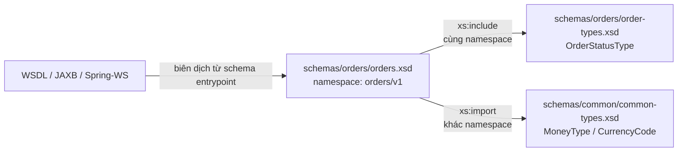
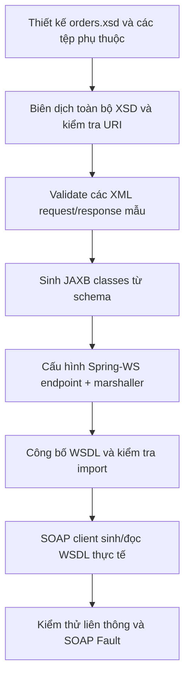

# Phát hiện schema không hợp lệ và giải quyết tham chiếu giữa các tệp

Trong hệ thống SOAP theo hướng **contract-first**, XSD đóng vai trò hợp đồng về cấu trúc và kiểu dữ liệu XML. Dịch vụ Spring Web Services (Spring-WS) thường sử dụng các XSD để công bố WSDL, tạo lớp Java bằng JAXB/XJC, xác thực SOAP payload tại endpoint và hỗ trợ SOAP client của hệ thống khác. Một XSD viết sai hoặc tham chiếu sai tệp phụ thuộc có thể làm **cả quá trình tích hợp thất bại trước khi xử lý bất kỳ nghiệp vụ nào**.

Bài học thuộc chương **Thiết kế XSD**. Mục tiêu là phân biệt các loại lỗi, xác định vì sao công cụ không tìm thấy định nghĩa kiểu hoặc phần tử, hiểu rõ `xs:include` và `xs:import`, xây dựng chuỗi kiểm tra schema độc lập và xử lý tham chiếu ổn định khi đóng gói, triển khai Spring-WS. Những quyết định này ảnh hưởng trực tiếp đến WSDL, JAXB, SOAP Fault, interceptor kiểm tra dữ liệu và khả năng tương thích giữa các hệ thống doanh nghiệp.

## 1. Phải xác định lỗi nằm ở tầng nào

“Schema không hợp lệ” thường được dùng chung cho nhiều lỗi khác nhau. Trên thực tế, cần kiểm tra theo những tầng riêng biệt:

| Tầng | Câu hỏi | Ví dụ lỗi |
| --- | --- | --- |
| **XML well-formedness** | Bản thân tệp XSD có phải XML đúng cú pháp? | Thiếu thẻ đóng, namespace prefix chưa khai báo, ký tự `&` chưa escape |
| **Cấu trúc XSD** | Nội dung schema có tuân theo ngôn ngữ XML Schema? | Đặt `xs:element` ở vị trí không cho phép, khai báo `minOccurs` trên phần tử toàn cục |
| **Liên kết schema** | Các `include`, `import` và QName có phân giải đúng? | Thiếu `common-types.xsd`; import sai `targetNamespace`; `type="com:MoneyType"` không tìm thấy |
| **Tính nhất quán của mô hình XSD** | Các khai báo kiểu/phần tử có xung đột hoặc mơ hồ? | Trùng khai báo toàn cục; content model vi phạm quy tắc xác định duy nhất phần tử |
| **Hợp lệ của XML instance** | SOAP Body cụ thể có tuân theo bộ XSD đã biên dịch? | `orderId` chứa chữ; thiếu trường bắt buộc; sai thứ tự `xs:sequence` |
| **Hợp đồng WSDL** | WSDL tham chiếu đúng XSD và operation/binding? | `wsdl:part` trỏ tới element không tồn tại; URL import không tải được |
| **Nghiệp vụ và bảo mật** | Dữ liệu hợp lệ theo schema có được phép sử dụng? | Mã đơn hàng không tồn tại; token WS-Security không hợp lệ |

Các tầng này không thay thế nhau. Một tệp `orders.xsd` có thể là XML hoàn toàn đúng cú pháp nhưng **không thể biên dịch thành schema** vì thiếu một tệp import. Ngược lại, schema có thể biên dịch thành công nhưng payload `GetOrderRequest` không hợp lệ vì sai kiểu dữ liệu. XML instance hợp lệ vẫn có thể dẫn đến SOAP Fault do luật nghiệp vụ.

Để chẩn đoán có hệ thống, hãy đi từ **tệp XSD gốc → các tệp phụ thuộc → mô hình được biên dịch → payload thử nghiệm → WSDL thực tế**. Không nên sửa endpoint Spring-WS hoặc model JAXB khi chưa biết schema có biên dịch được hay không.

## 2. Hiểu QName, `targetNamespace` và cách tham chiếu định nghĩa

XSD sử dụng QName (*qualified name*) để gọi tên các thành phần của schema. QName gồm **namespace URI** và **local name**. Ví dụ:

```xml
<xs:element name="totalAmount" type="com:MoneyType"/>
```

Khi `com` được khai báo:

```xml
xmlns:com="https://example.com/common/v1"
```

thì `com:MoneyType` định danh kiểu có tên mở rộng `{https://example.com/common/v1}MoneyType`. Tiền tố `com` là bí danh trong tệp XML; có thể thay bằng tiền tố khác cùng URI mà không đổi thành phần được tham chiếu.

Ba điều cần phân biệt:

1. **`targetNamespace`** trên `xs:schema`: namespace của các thành phần toàn cục được khai báo trong XSD đó.
2. **`xmlns:prefix`**: khai báo bí danh để tham chiếu QName; không tự tạo ra hoặc tải bất kỳ kiểu nào.
3. **`schemaLocation`**: gợi ý vị trí của tài liệu XSD khác để trình biên dịch/validator có thể tải và liên kết.

Namespace thường trông giống URL, nhưng bản thân URI đó **không phải đường dẫn tự động để tải XSD**. Hai schema có thể có namespace hợp lệ mà không có máy chủ web nào tại URI namespace. Ngược lại, đường dẫn vật lý của XSD có thể đổi mà namespace công bố cho đối tác vẫn giữ nguyên.

Ví dụ `type="MoneyType"` và `type="com:MoneyType"` không nhất thiết trỏ đến cùng một định nghĩa. Trong các thuộc tính QName của XSD như `type` và `ref`, phải **viết đúng namespace**; không được suy ra rằng `targetNamespace` tự động áp dụng cho một QName không có tiền tố. Cách rõ ràng và dễ kiểm thử là khai báo `xmlns:tns` hoặc `xmlns:com`, rồi dùng tiền tố đó trong `type`/`ref`.

## 3. `xs:include` và `xs:import`: cùng nạp schema nhưng khác phạm vi

Đây là cặp khái niệm thường gây lỗi nhất khi phân chia hợp đồng thành nhiều tệp.

| Đặc điểm | `xs:include` | `xs:import` |
| --- | --- | --- |
| Mục tiêu | Ghép các khai báo của **cùng target namespace** | Tham chiếu các thành phần thuộc **namespace khác** |
| Thuộc tính trọng tâm | `schemaLocation` | `namespace`, và thường có `schemaLocation` |
| Namespace của schema được nạp | Thông thường phải trùng `targetNamespace` của schema chứa include; có trường hợp *chameleon* | Phải khớp namespace được import nếu schema được tải |
| Có tự khai báo QName prefix không? | Không | Không |
| Ứng dụng điển hình | Tách kiểu đơn hàng vào `order-types.xsd` | Dùng kiểu tiền tệ chung từ `common-types.xsd` |

### Dùng `xs:include` cho cùng namespace

```xml
<xs:include schemaLocation="order-types.xsd"/>
```

Schema chứa `include` và schema được include có thể cùng khai báo:

```xml
targetNamespace="https://example.com/orders/v1"
```

Nếu `order-types.xsd` lại khai báo `targetNamespace="https://example.com/common/v1"`, include đó không hợp lệ theo quy tắc namespace. Khi cần dùng kiểu thuộc namespace khác, hãy đổi mô hình tham chiếu sang `xs:import`.

Một ngoại lệ cần biết là **chameleon include**: schema được include không khai báo `targetNamespace` có thể được sử dụng trong ngữ cảnh namespace của schema include. Cơ chế này có ích khi tái sử dụng cấu trúc không gắn namespace nhưng dễ gây khó hiểu nếu nhiều schema cùng include một tệp. Với hợp đồng SOAP doanh nghiệp, nên quy định rõ chiến lược namespace và hạn chế dùng chameleon include nếu không có nhu cầu.

### Dùng `xs:import` cho namespace khác

```xml
<xs:import namespace="https://example.com/common/v1"
           schemaLocation="../common/common-types.xsd"/>
```

Ở đây `namespace` là **URI định danh thành phần**. `schemaLocation` chỉ vị trí cụ thể mà công cụ có thể thử phân giải. Thuộc tính `schemaLocation` của `xs:import` có thể vắng mặt theo XML Schema; khi đó trình xử lý phải có cách khác để biết các thành phần đã import, chẳng hạn schema được cung cấp sẵn hoặc trình phân giải catalog. Vì vậy **import không kèm location không bảo đảm các công cụ sẽ tự tìm được schema**.

Để sử dụng kiểu `MoneyType` từ schema chung, tệp import còn cần tiền tố:

```xml
xmlns:com="https://example.com/common/v1"
```

và tham chiếu:

```xml
<xs:element name="total" type="com:MoneyType"/>
```

Chỉ thêm `xmlns:com` mà quên `xs:import` thường dẫn đến lỗi không tìm thấy định nghĩa; chỉ thêm `xs:import` mà dùng sai QName cũng có kết quả tương tự.

## 4. Ví dụ hoàn chỉnh: một hợp đồng chia thành ba tệp XSD

Hãy thiết kế service truy vấn đơn hàng. Để tái sử dụng kiểu tiền tệ, ta chia schema theo cấu trúc minh họa:

```text
schemas/
├── common/
│   └── common-types.xsd
└── orders/
    ├── order-types.xsd
    └── orders.xsd
```

Ba tệp dưới đây là **ví dụ đầy đủ có thể dùng cùng nhau để biên dịch XSD**.

### Tệp 1 — `schemas/common/common-types.xsd`

```xml
<?xml version="1.0" encoding="UTF-8"?>
<xs:schema xmlns:xs="http://www.w3.org/2001/XMLSchema"
           targetNamespace="https://example.com/common/v1"
           xmlns:com="https://example.com/common/v1"
           elementFormDefault="qualified">

    <xs:simpleType name="CurrencyCode">
        <xs:restriction base="xs:string">
            <xs:enumeration value="VND"/>
            <xs:enumeration value="USD"/>
        </xs:restriction>
    </xs:simpleType>

    <xs:complexType name="MoneyType">
        <xs:sequence>
            <xs:element name="amount" type="xs:decimal"/>
            <xs:element name="currency" type="com:CurrencyCode"/>
        </xs:sequence>
    </xs:complexType>
</xs:schema>
```

Schema này định nghĩa `{https://example.com/common/v1}MoneyType` và `CurrencyCode`. Nhờ `elementFormDefault="qualified"`, hai phần tử con `amount` và `currency` cũng mang namespace `common/v1` trong XML instance.

### Tệp 2 — `schemas/orders/order-types.xsd`

```xml
<?xml version="1.0" encoding="UTF-8"?>
<xs:schema xmlns:xs="http://www.w3.org/2001/XMLSchema"
           targetNamespace="https://example.com/orders/v1"
           elementFormDefault="qualified">

    <xs:simpleType name="OrderStatusType">
        <xs:restriction base="xs:string">
            <xs:enumeration value="NEW"/>
            <xs:enumeration value="PAID"/>
            <xs:enumeration value="CANCELLED"/>
        </xs:restriction>
    </xs:simpleType>
</xs:schema>
```

Tệp này cùng namespace với `orders.xsd`, nên có thể được include.

### Tệp 3 — `schemas/orders/orders.xsd`

```xml
<?xml version="1.0" encoding="UTF-8"?>
<xs:schema xmlns:xs="http://www.w3.org/2001/XMLSchema"
           xmlns:ord="https://example.com/orders/v1"
           xmlns:com="https://example.com/common/v1"
           targetNamespace="https://example.com/orders/v1"
           elementFormDefault="qualified">

    <xs:include schemaLocation="order-types.xsd"/>
    <xs:import namespace="https://example.com/common/v1"
               schemaLocation="../common/common-types.xsd"/>

    <xs:element name="GetOrderRequest">
        <xs:complexType>
            <xs:sequence>
                <xs:element name="orderId" type="xs:positiveInteger"/>
            </xs:sequence>
        </xs:complexType>
    </xs:element>

    <xs:element name="GetOrderResponse">
        <xs:complexType>
            <xs:sequence>
                <xs:element name="status" type="ord:OrderStatusType"/>
                <xs:element name="total" type="com:MoneyType"/>
            </xs:sequence>
        </xs:complexType>
    </xs:element>
</xs:schema>
```

Giải thích quan hệ:



`orders.xsd` là **entrypoint** của ví dụ: trình biên dịch bắt đầu từ đây và lần theo hai tham chiếu. `order-types.xsd` không cần import lại `orders.xsd` chỉ vì hai tệp cùng namespace. `common-types.xsd` không cần biết đến đơn hàng; điều này làm schema chung tái sử dụng được.

Một XML response hợp lệ theo schema:

```xml
<ord:GetOrderResponse
    xmlns:ord="https://example.com/orders/v1"
    xmlns:com="https://example.com/common/v1">
    <ord:status>PAID</ord:status>
    <ord:total>
        <com:amount>125.50</com:amount>
        <com:currency>USD</com:currency>
    </ord:total>
</ord:GetOrderResponse>
```

Chú ý `ord:total` là tên **phần tử được khai báo trong schema đơn hàng**, nhưng các phần tử con `com:amount` và `com:currency` thuộc **schema của `MoneyType`**. Nếu đổi `com:amount` thành `ord:amount`, XML vẫn đúng cú pháp nhưng không hợp lệ theo XSD.

## 5. Đường dẫn `schemaLocation` được phân giải như thế nào?

Đa số lỗi liên kết bắt nguồn từ **base URI**. Đường dẫn trong:

```xml
<xs:include schemaLocation="order-types.xsd"/>
<xs:import namespace="https://example.com/common/v1"
           schemaLocation="../common/common-types.xsd"/>
```

là các tham chiếu **tương đối với URI của tài liệu XSD đang chứa chúng** (hoặc base URI được cấp cho trình xử lý). Chúng không mặc nhiên tương đối với:

- thư mục gốc của dự án;
- thư mục chạy JVM;
- thư mục chứa SOAP client;
- đường dẫn `targetNamespace`;
- URL endpoint SOAP.

Ví dụ, nếu `orders.xsd` được nạp từ `file:/app/schemas/orders/orders.xsd`, thông thường hai tham chiếu trên được phân giải thành:

```text
file:/app/schemas/orders/order-types.xsd
file:/app/schemas/common/common-types.xsd
```

Nếu công cụ chỉ nhận `InputStream` mà **không có system ID/base URI**, nó có thể không biết dùng thư mục nào để tìm `order-types.xsd`. Trong ứng dụng Java, nạp schema từ `File`, `URL` hoặc `StreamSource` có `systemId` rõ ràng thường dễ kiểm soát hơn.

Với tài nguyên trong JAR, URL có thể mang dạng `jar:file:...!/schemas/orders/orders.xsd`; khả năng phân giải tham chiếu phụ thuộc parser, resource resolver và cách thư viện đóng gói dữ liệu. **Đừng giả định hai XSD có thể tìm thấy nhau chỉ vì cả hai đều tồn tại đâu đó trong classpath.**

### Một đường dẫn đúng lúc phát triển có thể sai sau khi đóng gói

Giả sử dùng đường dẫn tuyệt đối:

```xml
<xs:include schemaLocation="C:/dev/project/schemas/orders/order-types.xsd"/>
```

Khi deploy lên Linux, container hoặc hệ thống đối tác, đường dẫn không còn tồn tại. Tương tự, đường dẫn `../common/common-types.xsd` đúng trong cây nguồn nhưng có thể hỏng nếu pipeline chỉ đóng gói `orders.xsd` mà bỏ thư mục `common`.

Thiết kế nên **đóng gói trọn bộ schema phụ thuộc**, giữ cấu trúc tương đối ổn định hoặc dùng trình phân giải XML Catalog được cấu hình tường minh. Nếu WSDL được công bố qua HTTP, hãy kiểm tra lại vị trí thực tế từ góc nhìn của client ngoài hệ thống, vì URL tương đối có thể được diễn giải theo địa chỉ WSDL mà client truy cập.

## 6. Những lỗi thường gặp và thông điệp chẩn đoán

Các parser XSD khác nhau (JAXP/Xerces, công cụ XJC, IDE, XML tooling) có thể dùng mã lỗi và câu chữ khác nhau. Bảng sau mô tả **mẫu thông báo thường gặp**, không phải chuỗi cố định cho mọi phiên bản:

| Triệu chứng / thông báo tương tự | Khả năng cao | Cách kiểm tra |
| --- | --- | --- |
| `Content is not allowed in prolog` | Tệp không phải XML đúng cú pháp; nội dung bất thường trước root | Mở đúng tệp, kiểm tra encoding/nội dung và thẻ gốc |
| `The prefix ... is not bound` | Chưa khai báo `xmlns:...` | Kiểm tra QName và prefix trong từng tệp |
| `schema_reference.4: Failed to read schema document` | Sai location, HTTP lỗi, quyền truy cập, resolver chặn truy cập | Ghi lại URI đã phân giải; xác nhận file/URL tồn tại |
| `src-include` hoặc thông báo namespace của include không khớp | `xs:include` trỏ đến schema khác `targetNamespace` | So sánh `targetNamespace` hai tệp; cân nhắc `xs:import` |
| `src-import` hoặc thông báo namespace của import không khớp | `namespace` trong import không khớp schema được tải | So sánh URI nguyên vẹn, kể cả chữ hoa/thường và dấu `/` cuối |
| `src-resolve: Cannot resolve the name ...` | QName chưa được khai báo hoặc schema chưa được nạp | Kiểm tra `type`, `ref`, import/include và tệp phụ thuộc |
| `Two global ... have the same name` | Khai báo trùng QName khi ghép schema | Dò các tệp include, lệnh import/entrypoint và định nghĩa trùng |
| `cos-nonambig` hoặc `Unique Particle Attribution` | Content model mơ hồ, chẳng hạn hai nhánh có thể nhận cùng element | Kiểm tra `xs:choice`, wildcard và các phần tử trùng |
| `cvc-elt.1.a: Cannot find the declaration of element` | XML instance có root QName không thuộc schema đã nạp | Xem root namespace, schema entrypoint, document type |
| `cvc-complex-type.2.4...` | XML instance thiếu/sai thứ tự element | So sánh với `xs:sequence` và `minOccurs` |
| XJC báo kiểu không tìm thấy | Đồ thị schema chưa hoàn chỉnh hoặc binding tùy chỉnh không phù hợp | Biên dịch XSD độc lập trước, rồi kiểm tra công cụ sinh mã |

Đừng dựa hoàn toàn vào mã lỗi đầu tiên. Khi một `xs:import` không nạp được, parser có thể phát sinh thêm hàng chục lỗi `src-resolve` ở những nơi tham chiếu kiểu thuộc namespace đó. **Sửa lỗi tải tệp gốc trước**, rồi biên dịch lại để xem lỗi phía sau còn tồn tại không.

### Các ví dụ lỗi và cách sửa

**Lỗi 1: dùng include cho namespace khác.**

```xml
<!-- Sai nếu common-types.xsd có targetNamespace common/v1 -->
<xs:include schemaLocation="../common/common-types.xsd"/>
```

Sửa:

```xml
<xs:import namespace="https://example.com/common/v1"
           schemaLocation="../common/common-types.xsd"/>
```

**Lỗi 2: import đúng nhưng tham chiếu sai QName.**

```xml
<!-- Sai: kiểu không thuộc namespace không tiền tố -->
<xs:element name="total" type="MoneyType"/>
```

Sửa thành `type="com:MoneyType"` sau khi khai báo `xmlns:com` đúng URI. Không nên “sửa” bằng cách copy `MoneyType` vào schema đơn hàng vì làm trùng lặp mô hình giữa các hệ thống.

**Lỗi 3: namespace giống nhau bằng mắt nhưng khác chính xác.**

```xml
<!-- Import khai báo có / cuối -->
<xs:import namespace="https://example.com/common/v1/"
           schemaLocation="../common/common-types.xsd"/>
```

Nếu `common-types.xsd` khai báo `targetNamespace="https://example.com/common/v1"` (không có `/` cuối), hai namespace **khác nhau**. Không có quy tắc tự cắt dấu slash hoặc chuẩn hóa chữ hoa/chữ thường để coi chúng là một.

**Lỗi 4: tệp phụ thuộc có mặt nhưng resolver tìm sai chỗ.** Nếu `orders.xsd` được nạp bằng luồng không có URI nguồn, giải pháp là cung cấp `systemId` cho nguồn, dùng đường dẫn chuẩn với `new File(...)`, hoặc gắn một `LSResourceResolver`/XML Catalog phù hợp. Không nên thay mọi `schemaLocation` bằng URL môi trường production để làm cho test local chạy.

## 7. Quy trình kiểm tra schema độc lập bằng Java

Trước khi sinh JAXB model hoặc chạy Spring-WS, nên **biên dịch schema entrypoint** bằng một XML Schema processor. Trong Java, `SchemaFactory` thuộc JAXP cung cấp cơ chế biên dịch XSD; `Validator` kiểm tra XML instance theo `Schema` đã biên dịch.

Ví dụ dưới đây chạy với Java hiện đại có JAXP, nhận đường dẫn file XSD và XML instance làm đối số. Nó cho phép nạp các schema phụ thuộc bằng **đường dẫn file**, và không cho phép parser truy cập tài nguyên tùy ý qua HTTP(S):

```java
import java.io.File;
import javax.xml.XMLConstants;
import javax.xml.transform.stream.StreamSource;
import javax.xml.validation.Schema;
import javax.xml.validation.SchemaFactory;
import javax.xml.validation.Validator;
import org.xml.sax.SAXParseException;

public final class CheckXsd {
    public static void main(String[] args) throws Exception {
        if (args.length != 2) {
            throw new IllegalArgumentException(
                "Usage: java CheckXsd <entrypoint.xsd> <instance.xml>");
        }

        File xsd = new File(args[0]);
        File xml = new File(args[1]);
        if (!xsd.isFile() || !xml.isFile()) {
            throw new IllegalArgumentException("XSD or XML file not found");
        }

        SchemaFactory factory = SchemaFactory.newInstance(
                XMLConstants.W3C_XML_SCHEMA_NS_URI);
        factory.setFeature(XMLConstants.FEATURE_SECURE_PROCESSING, true);
        factory.setProperty(XMLConstants.ACCESS_EXTERNAL_DTD, "");
        // Chỉ cho phép import/include qua file: URI.
        factory.setProperty(XMLConstants.ACCESS_EXTERNAL_SCHEMA, "file");

        try {
            // newSchema(File) cung cấp system ID từ URI của file.
            // Biên dịch toàn bộ include/import trước khi đọc XML instance.
            Schema schema = factory.newSchema(xsd);
            System.out.println("XSD compiled successfully");

            Validator validator = schema.newValidator();
            validator.setProperty(XMLConstants.ACCESS_EXTERNAL_DTD, "");
            validator.setProperty(XMLConstants.ACCESS_EXTERNAL_SCHEMA, "file");
            validator.validate(new StreamSource(xml));
            System.out.println("XML instance is valid");
        } catch (SAXParseException ex) {
            System.err.printf("File: %s, line %d, column %d%n",
                    ex.getSystemId(), ex.getLineNumber(),
                    ex.getColumnNumber());
            System.err.println(ex.getMessage());
            throw ex;
        }
    }
}
```

Ví dụ dùng file `GetOrderResponse.xml` chứa response hợp lệ như ở phần 4:

```text
javac CheckXsd.java
java CheckXsd schemas/orders/orders.xsd GetOrderResponse.xml
```

Đây là **lệnh tham khảo để tự chạy trong dự án phù hợp**, không phải lệnh đã được thực thi trong bài học. Khi đường dẫn và ba tệp XSD đúng, kết quả mong đợi là biên dịch thành công và instance hợp lệ. Nếu bỏ tệp `order-types.xsd`, quá trình `newSchema(...)` thường thất bại trước bước `validator.validate(...)`; nếu giữ schema đúng nhưng đổi `<com:currency>USD</com:currency>` thành `EUR`, lỗi thuộc về **instance validation**.

JAXP `SchemaFactory` mặc định cho `XMLConstants.W3C_XML_SCHEMA_NS_URI` thường phục vụ **XML Schema 1.0**. Nếu hợp đồng sử dụng tính năng **XSD 1.1** như `xs:assert`, cần chủ động chọn và kiểm thử processor hỗ trợ XSD 1.1; không nên giả định mọi công cụ Spring/JAXB đều hiểu cú pháp XSD 1.1.

### Tại sao cần hai bước “compile” và “validate”?

Biên dịch schema giúp phát hiện cấu trúc schema không hợp lệ, định nghĩa không tìm thấy và import/include hỏng. Validate XML instance tiếp tục phát hiện giá trị hoặc thứ tự phần tử sai. Nếu chỉ gọi `JAXBContext` rồi unmarshal mà không gắn schema validation, có thể không thấy các lỗi như `orderId=-1`, enum ngoài tập giá trị hoặc trường bắt buộc bị thiếu.

Đối với nhiều entrypoint XSD, cần kiểm thử riêng từng hợp đồng được công bố và những bộ schema tương ứng. `SchemaFactory.newSchema(Source[])` có thể hỗ trợ biên dịch một tập nguồn, nhưng các tài liệu trùng định nghĩa hoặc mâu thuẫn namespace vẫn cần giải quyết thay vì cố đưa mọi tệp vào một mảng.

## 8. Đảm bảo resolver hoạt động khi không có Internet

Hệ thống doanh nghiệp thường yêu cầu build ổn định, có thể kiểm thử ngoại tuyến và không tải schema ngoài ý muốn. Nếu XSD tham chiếu URL:

```xml
<xs:import namespace="https://partner.example.com/common/v1"
           schemaLocation="https://partner.example.com/xsd/common-types.xsd"/>
```

thì môi trường CI có thể không truy cập được trang, máy chủ có thể đổi nội dung hoặc thời gian chờ mạng gây lỗi build. Một giải pháp là **đưa bản schema đã được quản lý phiên bản vào repository/artifact** và dùng **XML Catalog** hoặc resolver để ánh xạ URI công bố sang tài nguyên local.

Ví dụ tài liệu catalog theo XML Catalogs (mang tính minh họa):

```xml
<?xml version="1.0" encoding="UTF-8"?>
<catalog xmlns="urn:oasis:names:tc:entity:xmlns:xml:catalog">
    <uri name="https://partner.example.com/xsd/common-types.xsd"
         uri="schemas/common/common-types.xsd"/>
</catalog>
```

Trong ví dụ này, vị trí `uri` là đường dẫn tương đối so với base URI của **tệp catalog**. Cần cấu hình rõ schema processor hoặc build plugin sử dụng catalog; **đặt tệp catalog trong dự án không tự khiến mọi JAXP parser, Spring-WS hay XJC dùng nó**. Tùy bộ công cụ, có thể dùng XML Catalog, `LSResourceResolver`, `EntityResolver` hoặc cấu hình riêng của plugin JAXB.

Trong Java, resolver được gắn vào `SchemaFactory` qua `setResourceResolver(...)` (giao diện `org.w3c.dom.ls.LSResourceResolver`). Resolver phải xử lý đúng `namespaceURI`, `systemId` và `baseURI`; khi trả tài nguyên bằng `LSInput`, nên cung cấp nội dung và system ID nhất quán để import/include lồng nhau tiếp tục phân giải được.

### Lưu ý an toàn XML

Tham chiếu XSD là đầu vào có thể khiến công cụ truy cập tài nguyên khác nếu cho phép tự do. Với schema hoặc SOAP payload từ nguồn không tin cậy:

- Giới hạn giao thức được phép tải bằng các thuộc tính như `ACCESS_EXTERNAL_DTD`, `ACCESS_EXTERNAL_SCHEMA` và chính sách của parser đang dùng.
- Không vô điều kiện cho phép `file:`, HTTP(S) hoặc mạng nội bộ trong môi trường production; ví dụ JAXP ở phần 7 cho phép `file:` chỉ để phục vụ kiểm thử **schema local đã tin cậy**.
- Sử dụng schema đã kiểm soát nguồn và phiên bản; tránh resolver tải bất kỳ URL nào do client cung cấp.
- Cấu hình chế độ xử lý an toàn cho các parser có thể sử dụng, đồng thời kiểm thử thực tế các giới hạn tài nguyên.

**XML Schema validation không thay thế WS-Security**. Kiểm tra schema giúp ràng buộc dữ liệu, còn kiểm tra chữ ký XML, chứng chỉ, timestamp và token trong SOAP thuộc cơ chế bảo mật thông điệp. Cả hai cần được cấu hình nếu hợp đồng đòi hỏi.

## 9. Ứng dụng với JAXB/XJC và Spring Web Services

Quy trình phát triển contract-first phổ biến:



### JAXB/XJC cần thấy cùng một đồ thị schema

Giả sử `GetOrderResponse` dùng `com:MoneyType`. Khi sinh lớp JAXB, công cụ XJC phải giải quyết được `orders.xsd` → `common-types.xsd`. Nếu chỉ đưa vào một tệp nhưng không giữ đường dẫn tham chiếu, XJC có thể báo không tìm thấy `MoneyType`.

Những kiểm tra thực tế:

1. Cấu hình **schema entrypoint** và đường dẫn đầu vào của plugin sinh mã nhất quán với cấu trúc thư mục.
2. Xác nhận build đã đưa toàn bộ schema phụ thuộc vào vị trí mà compiler có thể tìm thấy.
3. Nếu dùng XML Catalog, cấu hình catalog cho cả bước kiểm tra schema **và** bước sinh mã.
4. Khi chia namespace, kiểm tra package JAXB sinh ra; tránh nhầm hai kiểu Java cùng tên ở hai namespace khác nhau.
5. Không dùng bản XSD khác nhau giữa build và WSDL mà server công bố; điều đó có thể gây lỗi runtime dù code Java đã biên dịch thành công.

Trong dự án Java hiện đại, nhiều thư viện JAXB dùng package `jakarta.xml.bind`, trong khi dự án cũ có thể dùng `javax.xml.bind`. Đây là khác biệt ở API runtime/build, không làm thay đổi quy tắc `xs:include`, `xs:import` và QName của XSD.

### Spring-WS nạp schema và kiểm tra SOAP payload

Một cấu hình đơn giản dùng tài nguyên trên classpath:

```java
import org.springframework.context.annotation.Bean;
import org.springframework.context.annotation.Configuration;
import org.springframework.core.io.ClassPathResource;
import org.springframework.xml.xsd.SimpleXsdSchema;
import org.springframework.xml.xsd.XsdSchema;

@Configuration
public class OrdersSchemaConfig {

    @Bean
    public XsdSchema ordersSchema() {
        return new SimpleXsdSchema(
                new ClassPathResource("schemas/orders/orders.xsd"));
    }
}
```

Giả sử ba tệp XSD được đóng gói cùng cấu trúc dưới `src/main/resources/schemas/`. Đây là minh họa vị trí resource để Spring-WS nạp entrypoint; **việc xử lý schema phụ thuộc còn tùy Spring-WS, underlying parser và cách cung cấp resolver**. Với hợp đồng phức tạp, nhiều namespace hoặc WSDL tự sinh, cần kiểm thử toàn bộ collection XSD bằng cơ chế phù hợp với phiên bản Spring-WS, thay vì giả định rằng một `SimpleXsdSchema` tự xử lý mọi tình huống.

Schema có thể được dùng cho `PayloadValidatingInterceptor` nếu interceptor được đăng ký vào đường xử lý message. Khi request SOAP chứa `<ord:GetOrderRequest>` nhưng thiếu `ord:orderId`, validation theo schema phải phát hiện thiếu trường. Khi request khai báo `xmlns:ord` sai URI, nó có thể không khớp phần tử toàn cục trong XSD hoặc không được chọn đúng endpoint `@PayloadRoot`.

XSD hợp lệ không bảo đảm nghiệp vụ thành công. Một `orderId` dương có thể không tồn tại trong cơ sở dữ liệu; khi đó ứng dụng xử lý lỗi nghiệp vụ và trả SOAP Fault theo quy ước. Cần tách **lỗi validation** ra khỏi **lỗi xử lý nghiệp vụ** trong log, metric và test.

## 10. WSDL có thể hợp lệ nhưng đường dẫn XSD vẫn hỏng

Một WSDL 1.1 thường chứa `wsdl:types` tham chiếu schema. Ví dụ minh họa:

```xml
<wsdl:types xmlns:wsdl="http://schemas.xmlsoap.org/wsdl/"
            xmlns:xs="http://www.w3.org/2001/XMLSchema">
    <xs:schema targetNamespace="https://example.com/orders/v1">
        <xs:include schemaLocation="schemas/orders/orders.xsd"/>
    </xs:schema>
</wsdl:types>
```

Mảnh này giả định URI của `wsdl:types` là base URI phù hợp và phần `xs:schema` có cùng namespace với `orders.xsd`. Khi dùng **WSDL tĩnh**, cần bảo đảm đường dẫn tham chiếu có thể phân giải từ địa chỉ **WSDL mà client thật sự lấy về**, không chỉ từ file nguồn trong repository.

Với WSDL công bố tại:

```text
https://api.example.com/ws/orders.wsdl
```

một tham chiếu `schemas/orders/orders.xsd` thường được client phân giải tương đối thành:

```text
https://api.example.com/ws/schemas/orders/orders.xsd
```

Nếu máy chủ không phục vụ XSD tại URL đó, client sẽ không sinh mã được, mặc dù endpoint `https://api.example.com/ws` có thể vẫn xử lý SOAP request. Trong WSDL tạo động bằng `DefaultWsdl11Definition`, artifact được công bố có thể **inline** hoặc trình bày lại các định nghĩa schema tùy cách cấu hình/triển khai; phải kiểm tra chính **WSDL thực tế**.

Phân biệt:

- `xs:include`/`xs:import` liên kết các **tài liệu XML Schema**.
- `wsdl:import` trong WSDL 1.1 liên kết các **tài liệu WSDL**.
- `wsdl:types` chứa hoặc tham chiếu các khai báo **XSD**.
- `soap:address` trong WSDL là địa chỉ **endpoint gọi dịch vụ**, không phải vị trí file schema.

Trong bài kiểm tra tương thích, hãy tải WSDL từ URL public/test đúng như đối tác, mở tất cả các import/include và thử sinh client mới từ bản công bố. Điều này có giá trị hơn việc chỉ nhìn file XSD trong IDE.

## 11. Chiến lược chẩn đoán khi gặp lỗi ngoài môi trường thật

Giả sử client báo:

```text
src-resolve: Cannot resolve the name 'com:MoneyType'
to a(n) 'type definition' component.
```

Hãy điều tra theo thứ tự:

1. **Xác định entrypoint**: công cụ bắt đầu từ `orders.xsd`, một WSDL chứa schema inline, hay XSD khác? Kiểm tra artifact đúng phiên bản.
2. **Kiểm tra QName**: `com` có ánh xạ tới `https://example.com/common/v1` không? `MoneyType` có được khai báo toàn cục với đúng chữ hoa/chữ thường không?
3. **Kiểm tra import**: `orders.xsd` có `xs:import` với namespace đó không? Tệp `common-types.xsd` có đúng `targetNamespace` không?
4. **Tính URI tuyệt đối**: từ base URI thực tế của `orders.xsd`, `../common/common-types.xsd` trỏ đến đâu? Tệp đó có nằm trong package/URL công bố không?
5. **Kiểm tra hạn chế truy cập**: resolver/catalog có được gắn không? Java có chặn truy cập qua `ACCESS_EXTERNAL_SCHEMA` không? Proxy, TLS, chứng chỉ và quyền file có ảnh hưởng không?
6. **Biên dịch độc lập**: chạy test JAXP ở phần 7 với đúng bộ schema đã lấy từ môi trường; nếu lỗi xuất hiện trước validation instance, tập trung vào schema/resource.
7. **Sinh client mới và gọi thử**: chỉ sau khi schema và WSDL hợp lệ mới kiểm tra JAXB, SOAP payload, endpoint và SOAP Fault.

Nếu trình biên dịch báo `schema_reference.4` và `src-resolve` cùng lúc, nên ưu tiên **lỗi không tải được schema**. Lỗi QName thường chỉ là hệ quả của việc parser chưa thấy thành phần cần tham chiếu.

### Những cách “sửa nhanh” nên tránh

| Cách sửa tạm | Vì sao có hại |
| --- | --- |
| Sao chép `MoneyType` vào mọi XSD | Tạo nhiều phiên bản định nghĩa, dễ lệch nhau giữa các dịch vụ |
| Thay namespace URI để khớp tên tệp | Làm đổi QName công khai, có thể phá client/endpoint hiện tại |
| Đặt `schemaLocation` là đường dẫn tuyệt đối trên máy lập trình viên | Phá build/deploy ở môi trường khác |
| Bỏ bước validation vì “SOAP vẫn chạy” | Dồn lỗi contract sang runtime và cho phép dữ liệu không đúng dạng |
| Cho phép mọi external schema qua mạng | Gây build không ổn định và mở rộng bề mặt rủi ro bảo mật |
| Chỉ sửa WSDL local mà không kiểm tra bản đang công bố | Client đối tác vẫn dùng artifact cũ/sai |

## 12. Ma trận kiểm thử cho một bộ schema nhiều tệp

Hãy tự động hóa các ca kiểm thử tối thiểu sau trong pipeline contract-first:

| Ca | Thay đổi có chủ đích | Kết quả mong đợi |
| --- | --- | --- |
| S01 | Giữ nguyên cả ba XSD mẫu | `orders.xsd` biên dịch thành công |
| S02 | Xóa/đổi tên `order-types.xsd` | Báo lỗi không thể giải quyết include hoặc `OrderStatusType` |
| S03 | Đổi `targetNamespace` của `order-types.xsd` thành `common/v1` | Include thất bại vì namespace không khớp |
| S04 | Đổi `namespace` trong import thành `common/v2` | Import không khớp schema thực tế |
| S05 | Bỏ import common nhưng vẫn dùng `com:MoneyType` | Không phân giải được định nghĩa kiểu |
| S06 | Đổi `type="com:MoneyType"` thành QName sai | Không phân giải được kiểu |
| S07 | Định nghĩa trùng `OrderStatusType` trong các XSD include cùng namespace | Phát hiện định nghĩa trùng hoặc mâu thuẫn |
| S08 | Để XSD hợp lệ, gửi `orderId=-1` | XML instance bị từ chối bởi `xs:positiveInteger` |
| S09 | Để XSD hợp lệ, gửi `currency=EUR` | XML instance bị từ chối bởi `xs:enumeration` |
| S10 | Giữ response hợp lệ như phần 4 | XML instance được chấp nhận |
| S11 | Trong response, đổi `<com:amount>` thành `<ord:amount>` | Sai namespace, XML instance không hợp lệ |
| S12 | Đóng gói jar/artifact bỏ thư mục `common` | Phải phát hiện lỗi ngay khi nạp schema phụ thuộc |
| S13 | Tải WSDL công khai và tất cả XSD tham chiếu | Client có thể phân giải toàn bộ đồ thị phụ thuộc |
| S14 | Sinh JAXB client từ artifact thực tế đã công bố | Client build thành công, kiểu tiền tệ và status ánh xạ đúng |
| S15 | Gửi SOAP request sai schema vào Spring-WS với interceptor đã bật | Nhận lỗi validation/SOAP Fault theo cấu hình, không chạy nghiệp vụ thành công |

Với mỗi ca thất bại, cần kiểm tra **loại lỗi** (schema compilation, instance validation, WSDL resolution, SOAP runtime) chứ không chỉ kiểm tra một chuỗi log cụ thể; thông điệp của các XML parser có thể khác nhau. Lưu lại request/response mẫu để kiểm thử tương thích khi nâng cấp Spring-WS, JAXB/XJC hoặc thay đổi cấu trúc deployment.

## 13. Bài tập thực hành: tìm và sửa đồ thị tham chiếu sai

Giả sử nhóm tích hợp nhận ba tệp ở phần 4, nhưng tệp `orders.xsd` bị thay bằng đoạn khai báo sau:

```xml
<xs:schema xmlns:xs="http://www.w3.org/2001/XMLSchema"
           xmlns:ord="https://example.com/orders/v1"
           xmlns:com="https://example.com/common/v1"
           targetNamespace="https://example.com/orders/v1">

    <xs:include schemaLocation="../common/common-types.xsd"/>
    <xs:import namespace="https://example.com/orders/v1"
               schemaLocation="order-types.xsd"/>

    <xs:element name="total" type="MoneyType"/>
</xs:schema>
```

**Yêu cầu:** chỉ ra ít nhất ba lỗi và cách sửa mà không thay đổi định nghĩa gốc của hai schema phụ thuộc.

**Phân tích:**

1. `xs:include` đang trỏ đến `common-types.xsd` có namespace **khác**. Phải thay bằng `xs:import namespace="https://example.com/common/v1"` với location tương ứng.
2. `order-types.xsd` có cùng namespace với `orders.xsd`. Với cấu trúc chia tệp ví dụ, cần dùng `xs:include schemaLocation="order-types.xsd"` thay cho import cùng namespace.
3. `type="MoneyType"` dùng QName không có namespace đúng; phải dùng `type="com:MoneyType"` sau khi import schema chung.
4. Trong ví dụ rút gọn thiếu `elementFormDefault="qualified"`, làm hợp đồng con có thể không thống nhất với quy ước đã chọn. Đây không nhất thiết là lỗi biên dịch, nhưng là **vấn đề thiết kế** cần sửa để payload có namespace như mong đợi.

Sau khi sửa, kiểm tra lại entrypoint bằng `SchemaFactory`, validate XML mẫu, sinh JAXB class và thử client từ WSDL công bố. Không kết luận thành công chỉ vì IDE đã hết gạch đỏ ở phần `xs:import`.

## 14. Checklist trước khi bàn giao bộ XSD/WSDL

1. **Mỗi XSD đúng cú pháp XML** và được biên dịch với processor hỗ trợ đúng phiên bản XSD đang sử dụng.
2. **Namespace/QName nhất quán**: `targetNamespace`, các prefix và giá trị trong `type`/`ref` trỏ đúng định nghĩa; không bỏ qua dấu slash ở cuối URI.
3. **Đúng quan hệ include/import**: same namespace dùng include; different namespace dùng import; nếu có chameleon schema thì được thiết kế và kiểm thử chủ động.
4. **Mọi tham chiếu giải quyết được** từ entrypoint với base URI thực tế, kể cả include/import nhiều tầng.
5. **Không có khai báo trùng, mô hình mơ hồ hoặc kiểu không được hỗ trợ** bởi processor mục tiêu.
6. **Schema phụ thuộc được đóng gói đầy đủ** hoặc có XML Catalog/resolver đáng tin cậy cho môi trường offline và CI.
7. **XML request/response mẫu được validate**: cả giá trị hợp lệ và trường hợp sai kiểu, sai namespace, sai thứ tự, thiếu field.
8. **WSDL công bố được tải và phân giải đầy đủ** từ góc nhìn client ngoài hệ thống; endpoint address và schema URLs đúng.
9. **JAXB/XJC, Spring-WS endpoint, SOAP client và interceptor** dùng cùng bộ hợp đồng được quản lý phiên bản.
10. **Giới hạn truy cập tài nguyên XML được cấu hình**; test validation/WS-Security và SOAP Fault phản ánh đúng trường hợp lỗi.
11. **Bộ regression test chạy trong build/CI** để phát hiện lỗi tham chiếu khi đổi cấu trúc thư mục, tên tệp hoặc namespace.

Một hợp đồng SOAP ổn định cần có XSD **hợp lệ về cú pháp, liên kết đầy đủ về tham chiếu và nhất quán về QName**. Khi xác định được loại lỗi và biết chính xác công cụ phân giải từng `schemaLocation` từ đâu, ta có thể xử lý tận gốc lỗi XSD trước khi nó lan sang WSDL, JAXB và Spring Web Services runtime.
