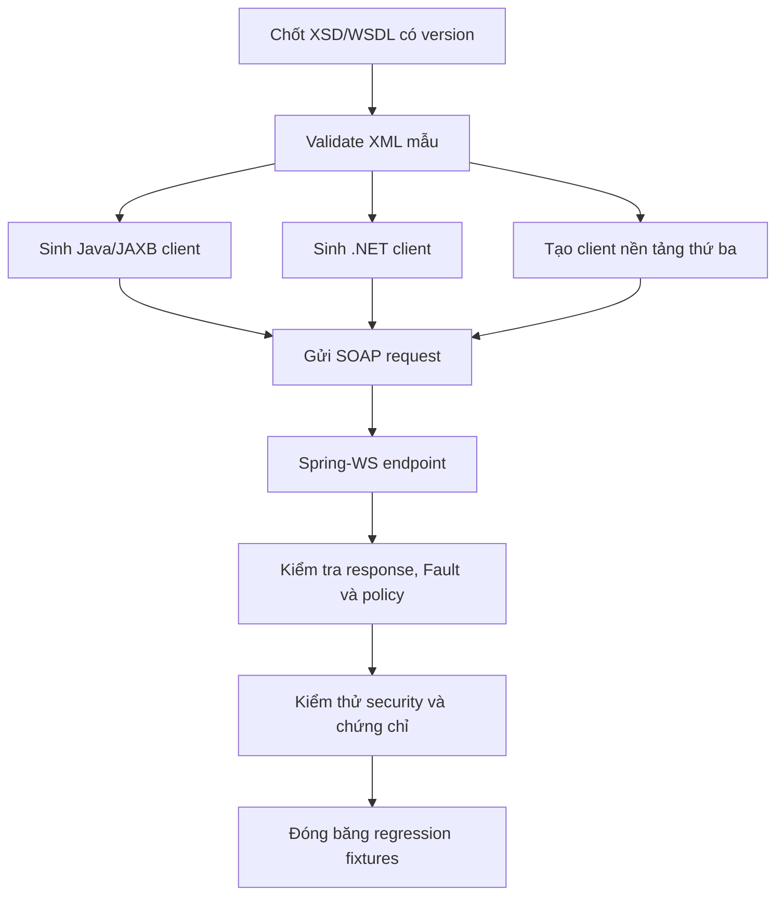

# Thiết kế schema theo khả năng tương tác của các nền tảng khác nhau

## 1. Bối cảnh và mục tiêu

Một dịch vụ SOAP xây dựng bằng Spring Web Services (Spring-WS) thường phải trao đổi thông điệp với các hệ thống dùng Java/JAXB, .NET, Python, PHP hoặc nền tảng ESB. Khi triển khai **contract-first**, XSD/WSDL là hợp đồng chung, còn mỗi hệ thống có thư viện XML và cơ chế sinh mã riêng. **Schema hợp lệ không tự đảm bảo các nền tảng sẽ sinh và hiểu cùng một thông điệp XML.**

Ví dụ: phần tử tùy chọn có thể được JAXB ánh xạ thành `JAXBElement`, trong khi client .NET tạo property có cờ `Specified`. Hai object nhìn khác nhau nhưng vẫn có thể biểu diễn cùng XML. Ngược lại, hai object cùng chứa giá trị `null` có thể sinh hai XML khác nhau: không có phần tử, hoặc phần tử có `xsi:nil="true"`. Nếu hợp đồng không quy định ngữ nghĩa, client sẽ hiểu khác nhau.

Bài học thuộc chương **Thiết kế XSD** của module **SPRING_WEB_SERVICES**, tập trung vào việc phát triển SOAP service theo hướng contract-first, thiết kế schema để dùng với WSDL/JAXB, endpoint và SOAP client Spring-WS, đồng thời tính đến SOAP Fault, interceptor, XML security, WS-Security, chứng chỉ và kiểm thử tương thích giữa các nền tảng.

Mục tiêu:

1. Phân biệt XML đúng cú pháp, đúng XSD, đúng WSDL/SOAP binding và tương thích thực tế.
2. Thiết kế QName, namespace, kiểu dữ liệu, ràng buộc và số lần xuất hiện dễ dùng qua nhiều ngôn ngữ.
3. Giảm các rủi ro liên quan đến `minOccurs`, `nillable`, ngày giờ, decimal, enum, collection và codegen.
4. Xây dựng hợp đồng XSD/WSDL document/literal có thể trao đổi qua Spring-WS và client khác nhau.
5. Thiết lập ma trận kiểm thử XML thật, phiên bản hợp đồng và chính sách bảo mật.

## 2. Khả năng tương tác có nhiều cấp độ

| Cấp | Tiêu chí | Ví dụ thất bại |
| --- | --- | --- |
| XML well-formed | Tài liệu có cú pháp XML hợp lệ. | Tag không đóng hoặc ký tự đặc biệt không escape. |
| XSD-valid | Phần tử đúng QName, thứ tự, kiểu, cardinality. | Phần tử con thiếu namespace hoặc sai thứ tự `xs:sequence`. |
| WSDL-valid | Message/operation/binding khớp hợp đồng. | Dùng SOAP 1.2 gọi SOAP 1.1 endpoint. |
| Tooling-compatible | Client sinh mã, marshal và unmarshal được. | Codegen không hỗ trợ cách dùng `xs:choice` phức tạp. |
| Semantic-compatible | Hai phía hiểu cùng ý nghĩa nghiệp vụ. | DateTime thiếu timezone, tiền tệ không rõ đơn vị. |
| Security-compatible | Chính sách TLS/WS-Security được hiểu thống nhất. | Chữ ký XML bị sai sau khi middleware sửa thông điệp. |

Điều quan trọng là **không lấy việc sinh mã thành công làm bằng chứng duy nhất**. Client còn phải gửi XML thật đến endpoint, nhận response/Fault, đọc đúng dữ liệu biên và xử lý đúng các tình huống lỗi.

### 2.1. Tư duy contract-first

Với contract-first:

- XSD công bố cấu trúc dữ liệu XML; WSDL công bố operation, message và SOAP binding.
- Java class JAXB, C# proxy hay Python data model chỉ là biểu diễn kỹ thuật của hợp đồng.
- Khi refactor class nội bộ hoặc database, XML công khai không nhất thiết phải đổi.
- Khi thay đổi namespace, QName hoặc kiểu XML, phải đánh giá tác động trên tất cả client kể cả khi Java code vẫn biên dịch.

Vì vậy, **định danh phần tử trong XML và ý nghĩa dữ liệu** cần được quản lý như một giao diện phiên bản hóa lâu dài.

## 3. Lập hồ sơ nền tảng mục tiêu

Trước khi thiết kế schema, thống nhất các ràng buộc:

| Chủ đề | Điều cần xác định |
| --- | --- |
| SOAP | SOAP 1.1/1.2, HTTP binding, media type và SOAPAction/Action. |
| WSDL | WSDL 1.1, document/literal hay binding cụ thể theo đối tác. |
| XSD | Tập tính năng XML Schema được hỗ trợ; XSD 1.0 thường là nền tảng có độ phủ rộng. |
| Toolchain | JAXB/XJC hoặc CXF trên Java; Connected Services/dotnet-svcutil trên .NET; SOAP/XML library của nền tảng khác. |
| Dữ liệu | Precision/scale, timezone, null, empty string, list rỗng, enum và mã lỗi. |
| Bảo mật | HTTPS/mTLS, WS-Security, chữ ký XML, mã hóa, chứng chỉ và trust store. |
| Vận hành | Timeout, max payload, retry, SOAP Fault, compatibility test và vòng đời phiên bản. |

**Tránh giả định mọi nền tảng hỗ trợ XSD 1.1.** Các khả năng như `xs:assert`, `xs:alternative` có thể không được các trình sinh client hoặc validator phổ biến hỗ trợ. Nếu cần tương thích rộng, nên bắt đầu bằng một subset XSD 1.0 đơn giản và chuyển quy tắc nghiệp vụ phức tạp sang validation ứng dụng có kiểm thử.

Nếu đối tác yêu cầu WS-I Basic Profile, phải xác nhận **phiên bản, profile và phạm vi** cụ thể. Tuân thủ cú pháp XML hay SOAP nói chung chưa chứng minh đáp ứng chính sách tích hợp của họ.

## 4. Namespace và QName quyết định phần tử nào được đọc

Một phần tử có QName gồm **namespace URI + local name**. Prefix chỉ là bí danh.

Hai phần tử sau tương đương về QName:

```xml
<inv:invoiceId xmlns:inv="urn:example:invoice:v1">INV-0042</inv:invoiceId>
<m:invoiceId xmlns:m="urn:example:invoice:v1">INV-0042</m:invoiceId>
```

Phần tử sau không tương đương nếu không có default namespace:

```xml
<invoiceId>INV-0042</invoiceId>
```

Bởi vậy:

1. Công bố `targetNamespace` ổn định, ví dụ `urn:example:invoice:v1`.
2. Chọn chính sách nhất quán về `elementFormDefault`; với `qualified`, các phần tử con trong ví dụ đều cần namespace phù hợp.
3. Tìm phần tử bằng QName, không bằng chuỗi prefix `inv` hoặc `m`.
4. Không sửa namespace chỉ vì thay địa chỉ endpoint giữa development, staging và production.
5. Khi chia nhiều XSD, dùng `xs:include` cho schema phù hợp cùng namespace, `xs:import` cho schema namespace khác theo quy tắc của XML Schema.
6. Đừng xem namespace URI là URL bắt buộc phải tải được; `schemaLocation`/WSDL import và cơ chế phân phối artifact là vấn đề riêng.

**Sai lầm điển hình:** Java endpoint `@PayloadRoot(namespace="urn:example:invoice:v1", localPart="GetInvoiceStatusRequest")` sẽ không nhận phần tử gốc cùng local name nhưng namespace rỗng. Đây là lỗi contract, không phải lỗi tìm method trong Java.

## 5. Chọn kiểu dữ liệu dễ ánh xạ

| XSD | Java/JAXB điển hình | .NET điển hình | Lưu ý liên nền tảng |
| --- | --- | --- | --- |
| `xs:string` | `String` | `string` | Quy định Unicode, khoảng trắng, độ dài nếu cần. |
| `xs:boolean` | `boolean`/`Boolean` | `bool`/`bool?` | Lexical form hợp lệ gồm `true`, `false`, `1`, `0`; không dùng `yes/no`. |
| `xs:int` | `int`/`Integer` | `int` | Giới hạn 32 bit; ID thường nên dùng string. |
| `xs:long` | `long`/`Long` | `long` | Giới hạn 64 bit; hệ JavaScript cần chú ý integer precision. |
| `xs:decimal` | `BigDecimal` | `decimal` | Phù hợp tiền, tránh lỗi floating point; thống nhất scale/currency. |
| `xs:double` | `Double` | `double` | Có sai số nhị phân, không mặc định dùng cho số tiền. |
| `xs:dateTime` | Thường `XMLGregorianCalendar` | Kiểu DateTime tùy tooling | Phải công bố timezone/offset; XSD 1.0 cho phép thiếu timezone. |
| `xs:base64Binary` | `byte[]` hoặc attachment mapping | `byte[]` | Cân nhắc MTOM khi có payload nhị phân lớn và hai bên hỗ trợ. |

Các ánh xạ trên mang tính ví dụ, **không phải cam kết về class sinh ra**. Kết quả phụ thuộc phiên bản công cụ, cách bind, tính optional/nillable và nội dung WSDL.

### 5.1. Tiền và số thập phân

Đối với số tiền, `xs:decimal` là lựa chọn phổ biến:

```xml
<xs:simpleType name="MoneyAmountType">
  <xs:restriction base="xs:decimal">
    <xs:totalDigits value="14"/>
    <xs:fractionDigits value="2"/>
    <xs:minInclusive value="0"/>
  </xs:restriction>
</xs:simpleType>
```

Dữ liệu hợp lệ về dạng số là `1200.50`, không phải chuỗi định dạng hiển thị theo locale như `1.200,50`. `1200.5` và `1200.50` có thể là cùng giá trị decimal, nên nếu nghiệp vụ bắt buộc hiển thị chính xác số chữ số sau dấu phẩy, cần công bố quy tắc riêng.

Schema không tự giải quyết currency, quy tắc làm tròn, tính thuế hay giới hạn thanh toán. Những điều đó phải thuộc hợp đồng nghiệp vụ và kiểm thử.

### 5.2. Ngày giờ và timezone

XSD 1.0 `xs:dateTime` cho phép cả hai biểu diễn:

```xml
<updatedAt>2026-11-27T09:00:00</updatedAt>
<updatedAt>2026-11-27T09:00:00+07:00</updatedAt>
```

Giá trị đầu không có timezone; không được tự động xem là UTC hoặc giờ server. Với timestamp biểu diễn thời điểm tuyệt đối, nên thống nhất yêu cầu luôn có offset và ưu tiên UTC:

```xml
<updatedAt>2026-11-27T02:00:00Z</updatedAt>
```

Không tuyên bố chỉ khai báo `xs:dateTime` trong XSD 1.0 đã ép được offset. Cần validation nghiệp vụ và test kết hợp, hoặc ràng buộc lexical được tất cả nền tảng chấp nhận.

### 5.3. Định danh không phải số học

Mã hóa đơn `000042` hoặc mã khách hàng có thể chứa số 0 đầu, gạch nối và ký tự theo quy tắc mới. `xs:string` với `minLength`/`maxLength`/`pattern` thường thích hợp hơn `xs:int`. Không biến business ID thành số chỉ vì các ví dụ hiện tại toàn chữ số.

## 6. Phân biệt absent, nil và empty

Với phần tử:

```xml
<xs:element name="note"
            type="xs:string"
            minOccurs="0"
            nillable="true"/>
```

có ít nhất ba cách biểu diễn cần được định nghĩa:

```xml
<!-- 1. Không xuất hiện phần tử note: không cung cấp dữ liệu. -->

<!-- 2. Có phần tử nhưng giá trị null. -->
<inv:note xmlns:inv="urn:example:invoice:v1"
          xmlns:xsi="http://www.w3.org/2001/XMLSchema-instance"
          xsi:nil="true"/>

<!-- 3. Có phần tử với chuỗi rỗng. -->
<inv:note xmlns:inv="urn:example:invoice:v1"/>
```

| Cấu hình | Omitted | `xsi:nil="true"` | Ý nghĩa |
| --- | --- | --- | --- |
| `minOccurs="1", nillable="false"` | Sai XSD | Sai XSD | Phải hiện diện với giá trị hợp lệ. |
| `minOccurs="0", nillable="false"` | Hợp lệ | Sai XSD | Có hoặc không có phần tử. |
| `minOccurs="1", nillable="true"` | Sai XSD | Hợp lệ | Bắt buộc có phần tử, có thể nil. |
| `minOccurs="0", nillable="true"` | Hợp lệ | Hợp lệ | Cần quy định rõ sự khác nhau giữa omitted và nil. |

Không nhất thiết dùng cả absent và nil; nếu nghiệp vụ chỉ cần “có hoặc không”, mô hình `minOccurs=0, nillable=false` dễ xử lý hơn.

Với API cập nhật, có thể quy định **omitted = giữ nguyên**, **nil = xóa giá trị**, **present = cập nhật**. Nhưng khi đó phải kiểm tra Java/JAXB và client .NET có giữ được ba trạng thái sau serialization hay không. `null` trong object Java/C# **không đủ** để suy ra XML được tạo.

## 7. Danh sách, thứ tự và số lượng phần tử

Ví dụ:

```xml
<xs:element name="lines" minOccurs="0">
  <xs:complexType>
    <xs:sequence>
      <xs:element name="line" type="tns:InvoiceLineType"
                  minOccurs="1" maxOccurs="unbounded"/>
    </xs:sequence>
  </xs:complexType>
</xs:element>
```

Nếu `lines` xuất hiện, cấu trúc này bắt buộc có ít nhất một `line`; container rỗng `<lines/>` không hợp lệ. Nếu muốn chấp nhận container rỗng, cân nhắc `minOccurs="0"` ở phần tử `line` và giải thích cách phân biệt absent container với empty list.

Các rủi ro khác:

- `xs:sequence` yêu cầu **đúng thứ tự**, không giống object JSON thường không gắn thứ tự khóa.
- `xs:choice` bảo đảm chọn một nhánh nhưng có thể tạo API codegen khó thao tác nếu lồng nhiều cấp; dùng khi cần ràng buộc này và đã test.
- `xs:all` có ngữ nghĩa khác sequence và giới hạn riêng; đừng chọn chỉ để né thứ tự nếu chưa xác nhận tooling.
- `maxOccurs="unbounded"` không thay giới hạn kích thước vận hành; cần ngăn payload quá lớn.
- Container vắng mặt, có 0 item, có 1 item và có nhiều item phải có cách diễn giải nhất quán.

## 8. Những tính năng XSD cần cân nhắc trước khi công bố

| Tính năng | Vấn đề tiềm ẩn | Gợi ý |
| --- | --- | --- |
| `xs:anyType` | Codegen có thể trả `Object`/DOM không có kiểu nghiệp vụ. | Dùng complex type cụ thể khi có thể. |
| `xs:any` | Wildcard làm client xử lý phần mở rộng không đồng nhất. | Chỉ dùng với extension policy, namespace và `processContents` rõ. |
| `xs:choice` phức tạp | Java/C# có thể sinh mô hình polymorphic khó dùng. | Giữ choice gọn hoặc chia operation nếu phù hợp. |
| `xs:union`, `xs:list` | Kiểu ánh xạ khác biệt giữa công cụ. | Thử codegen hoặc chọn kiểu đơn giản. |
| `xsi:type`, substitution groups | Client phải biết các subtype và cách ánh xạ kế thừa. | Hạn chế polymorphism công khai nếu không cần. |
| Recursive type | Dễ tạo payload lớn, khác biệt khi duyệt object graph. | Giới hạn độ sâu và kiểm thử. |
| `mixed="true"` | Kết hợp text và element khó ánh xạ dữ liệu doanh nghiệp. | Tránh nếu chỉ cần dữ liệu cấu trúc. |
| XSD 1.1 assertions/alternatives | Tooling hỗ trợ không đều. | Ưu tiên subset XSD 1.0 với đối tác đa dạng. |
| Import XSD từ mạng ngoài | Codegen/build phụ thuộc DNS, TLS và hosting. | Package schema, dùng import tương đối/catalog, version rõ. |

Những cấu trúc này **không sai chuẩn**. Mức độ chấp nhận phụ thuộc yêu cầu và bằng chứng test với stack thực tế.

## 9. Ví dụ xuyên suốt: tra cứu trạng thái hóa đơn

Giả sử một doanh nghiệp cung cấp operation `GetInvoiceStatus` cho ba client: Java/JAXB, .NET và Python. Hợp đồng dùng SOAP 1.1, WSDL 1.1, document/literal và XSD 1.0.

- Namespace: `urn:example:invoice:v1`.
- Request có `invoiceId`.
- Response có `invoiceId`, `state`, `paidAmount` tùy chọn, `updatedAt` tùy chọn, `note` tùy chọn.
- `state` dùng string với danh mục mã như `PENDING`, `PAID`; client có fallback nếu có mã mới.
- Trường hợp operation thất bại có thể dùng SOAP Fault với typed `detail`.

### 9.1. XSD hoàn chỉnh

Artifact ví dụ tên `invoice-v1.xsd`:

```xml
<?xml version="1.0" encoding="UTF-8"?>
<xs:schema
    xmlns:xs="http://www.w3.org/2001/XMLSchema"
    xmlns:tns="urn:example:invoice:v1"
    targetNamespace="urn:example:invoice:v1"
    elementFormDefault="qualified"
    attributeFormDefault="unqualified">

  <xs:simpleType name="InvoiceIdType">
    <xs:restriction base="xs:string">
      <xs:minLength value="1"/>
      <xs:maxLength value="40"/>
      <xs:pattern value="[A-Z0-9-]+"/>
    </xs:restriction>
  </xs:simpleType>

  <xs:simpleType name="MoneyAmountType">
    <xs:restriction base="xs:decimal">
      <xs:totalDigits value="14"/>
      <xs:fractionDigits value="2"/>
      <xs:minInclusive value="0"/>
    </xs:restriction>
  </xs:simpleType>

  <xs:complexType name="ServiceFaultType">
    <xs:sequence>
      <xs:element name="code" type="xs:string"/>
      <xs:element name="message" type="xs:string"/>
      <xs:element name="correlationId"
                  type="xs:string" minOccurs="0"/>
    </xs:sequence>
  </xs:complexType>

  <xs:element name="GetInvoiceStatusRequest">
    <xs:complexType>
      <xs:sequence>
        <xs:element name="invoiceId"
                    type="tns:InvoiceIdType"/>
      </xs:sequence>
    </xs:complexType>
  </xs:element>

  <xs:element name="GetInvoiceStatusResponse">
    <xs:complexType>
      <xs:sequence>
        <xs:element name="invoiceId"
                    type="tns:InvoiceIdType"/>
        <xs:element name="state"
                    type="xs:string"/>
        <xs:element name="paidAmount"
                    type="tns:MoneyAmountType"
                    minOccurs="0"/>
        <xs:element name="updatedAt"
                    type="xs:dateTime"
                    minOccurs="0"/>
        <xs:element name="note"
                    type="xs:string"
                    minOccurs="0"
                    nillable="true"/>
      </xs:sequence>
    </xs:complexType>
  </xs:element>

  <xs:element name="InvoiceServiceFault"
              type="tns:ServiceFaultType"/>
</xs:schema>
```

Thiết kế này dùng **global elements** cho WSDL message, giữ thứ tự XML rõ ràng, dùng string cho ID và status mở rộng, decimal cho tiền. Trường `updatedAt` cần chính sách UTC bổ sung vì XSD 1.0 không tự ép timezone. `note` cố ý biểu diễn absent/nil/empty để minh họa vấn đề tương tác; nếu không có nhu cầu nghiệp vụ, có thể bỏ nillable.

### 9.2. SOAP request/response đúng hợp đồng

Request SOAP 1.1 qua HTTP (địa chỉ và SOAPAction chỉ là ví dụ):

```http
POST /soap/invoice/v1 HTTP/1.1
Content-Type: text/xml; charset=utf-8
SOAPAction: "urn:example:invoice:v1/GetInvoiceStatus"
```

```xml
<soapenv:Envelope
    xmlns:soapenv="http://schemas.xmlsoap.org/soap/envelope/"
    xmlns:inv="urn:example:invoice:v1">
  <soapenv:Body>
    <inv:GetInvoiceStatusRequest>
      <inv:invoiceId>INV-0042</inv:invoiceId>
    </inv:GetInvoiceStatusRequest>
  </soapenv:Body>
</soapenv:Envelope>
```

Response:

```xml
<soapenv:Envelope
    xmlns:soapenv="http://schemas.xmlsoap.org/soap/envelope/"
    xmlns:inv="urn:example:invoice:v1"
    xmlns:xsi="http://www.w3.org/2001/XMLSchema-instance">
  <soapenv:Body>
    <inv:GetInvoiceStatusResponse>
      <inv:invoiceId>INV-0042</inv:invoiceId>
      <inv:state>PAID</inv:state>
      <inv:paidAmount>1200.50</inv:paidAmount>
      <inv:updatedAt>2026-11-27T02:00:00Z</inv:updatedAt>
      <inv:note xsi:nil="true"/>
    </inv:GetInvoiceStatusResponse>
  </soapenv:Body>
</soapenv:Envelope>
```

Prefix có thể đổi từ `inv` sang bất kỳ tiền tố nào trỏ đúng URI; thứ tự `invoiceId`, `state`, `paidAmount`, `updatedAt`, `note` phải phù hợp `xs:sequence`.

### 9.3. Hai lỗi XSD mà client phải phát hiện

**Sai namespace của trường con:**

```xml
<inv:GetInvoiceStatusRequest xmlns:inv="urn:example:invoice:v1">
  <invoiceId>INV-0042</invoiceId>
</inv:GetInvoiceStatusRequest>
```

**Sai thứ tự `xs:sequence`:**

```xml
<inv:GetInvoiceStatusResponse xmlns:inv="urn:example:invoice:v1">
  <inv:invoiceId>INV-0042</inv:invoiceId>
  <inv:updatedAt>2026-11-27T02:00:00Z</inv:updatedAt>
  <inv:state>PAID</inv:state>
</inv:GetInvoiceStatusResponse>
```

XML vẫn đúng cú pháp nhưng không hợp lệ theo schema. Nếu client bỏ qua XSD, hai hệ thống có thể xử lý khác nhau; vì thế cần bật validation và test thông điệp thật.

## 10. WSDL document/literal với các global elements

WSDL 1.1 công bố operation, message, binding và endpoint. Với yêu cầu tương tác rộng, cấu trúc SOAP document/literal dùng một global element làm body wrapper thường dễ dùng hơn SOAP RPC/encoded cũ.

WSDL minh họa dưới đây tham chiếu `invoice-v1.xsd`. Địa chỉ `example.invalid` là placeholder, không phải máy chủ thật.

```xml
<?xml version="1.0" encoding="UTF-8"?>
<wsdl:definitions
    xmlns:wsdl="http://schemas.xmlsoap.org/wsdl/"
    xmlns:soap="http://schemas.xmlsoap.org/wsdl/soap/"
    xmlns:xs="http://www.w3.org/2001/XMLSchema"
    xmlns:tns="urn:example:invoice:v1"
    targetNamespace="urn:example:invoice:v1"
    name="InvoiceService">

  <wsdl:types>
    <xs:schema>
      <xs:import namespace="urn:example:invoice:v1"
                 schemaLocation="invoice-v1.xsd"/>
    </xs:schema>
  </wsdl:types>

  <wsdl:message name="GetInvoiceStatusInput">
    <wsdl:part name="parameters"
               element="tns:GetInvoiceStatusRequest"/>
  </wsdl:message>
  <wsdl:message name="GetInvoiceStatusOutput">
    <wsdl:part name="parameters"
               element="tns:GetInvoiceStatusResponse"/>
  </wsdl:message>
  <wsdl:message name="InvoiceFaultMessage">
    <wsdl:part name="fault"
               element="tns:InvoiceServiceFault"/>
  </wsdl:message>

  <wsdl:portType name="InvoicePortType">
    <wsdl:operation name="GetInvoiceStatus">
      <wsdl:input message="tns:GetInvoiceStatusInput"/>
      <wsdl:output message="tns:GetInvoiceStatusOutput"/>
      <wsdl:fault name="InvoiceFault"
                  message="tns:InvoiceFaultMessage"/>
    </wsdl:operation>
  </wsdl:portType>

  <wsdl:binding name="InvoiceSoap11Binding"
                type="tns:InvoicePortType">
    <soap:binding style="document"
                  transport="http://schemas.xmlsoap.org/soap/http"/>
    <wsdl:operation name="GetInvoiceStatus">
      <soap:operation
          soapAction="urn:example:invoice:v1/GetInvoiceStatus"/>
      <wsdl:input><soap:body use="literal"/></wsdl:input>
      <wsdl:output><soap:body use="literal"/></wsdl:output>
      <wsdl:fault name="InvoiceFault">
        <soap:fault name="InvoiceFault" use="literal"/>
      </wsdl:fault>
    </wsdl:operation>
  </wsdl:binding>

  <wsdl:service name="InvoiceService">
    <wsdl:port name="InvoiceSoap11Port"
               binding="tns:InvoiceSoap11Binding">
      <soap:address
          location="https://soap.example.invalid/invoice/v1"/>
    </wsdl:port>
  </wsdl:service>
</wsdl:definitions>
```

Điểm cần kiểm tra:

- `wsdl:part` tham chiếu global XSD element bằng `element`, không suy ra từ class Java.
- Binding đặt `style="document"`, `use="literal"` và SOAPAction nhất quán với client.
- Các wrapper Request/Response theo quy ước document/literal wrapped có ích cho nhiều tooling, nhưng **không đảm bảo** mọi client tạo chữ ký phương thức giống nhau.
- `wsdl:fault` khai báo typed fault; server vẫn phải tạo SOAP Fault có `detail` đúng QName và cấu trúc.
- Bộ XSD/WSDL phải được đóng gói để import `invoice-v1.xsd` giải quyết được trong build client, kể cả khi CI không có internet.
- SOAP 1.2 có Envelope namespace, Fault format và media type khác SOAP 1.1; không tự thay binding mà giữ nguyên request SOAP.

## 11. Ánh xạ Spring-WS và JAXB

Spring-WS định tuyến payload theo QName. Ví dụ cấu trúc endpoint:

```java
@Endpoint
public class InvoiceEndpoint {
    private static final String NS = "urn:example:invoice:v1";

    private final InvoiceService invoiceService;
    private final InvoiceContractMapper mapper;

    public InvoiceEndpoint(InvoiceService invoiceService,
                           InvoiceContractMapper mapper) {
        this.invoiceService = invoiceService;
        this.mapper = mapper;
    }

    @PayloadRoot(namespace = NS,
                 localPart = "GetInvoiceStatusRequest")
    @ResponsePayload
    public GetInvoiceStatusResponse getInvoiceStatus(
            @RequestPayload GetInvoiceStatusRequest request) {
        InvoiceStatus result =
                invoiceService.findStatus(request.getInvoiceId());
        return mapper.toResponse(result);
    }
}
```

`InvoiceService` và `InvoiceContractMapper` là lớp ứng dụng giả định. `GetInvoiceStatusRequest` và `GetInvoiceStatusResponse` được hiểu là lớp JAXB đã sinh từ XSD; chữ ký cụ thể tùy tooling có thể yêu cầu `JAXBElement<T>`. Đây là ví dụ kiến trúc, không phải mã có thể chạy độc lập.

Một số nguyên tắc:

- Tách JAXB DTO khỏi domain model để refactor backend không phá hợp đồng công khai.
- Đừng lấy kiểu Java suy ra toàn bộ XSD constraint: `BigDecimal` không nói `totalDigits`, `nillable` hay `minOccurs`.
- Bật/kiểm thử schema validation phù hợp, ví dụ interceptor hỗ trợ validation trong Spring-WS; việc dùng JAXB không có nghĩa mọi XSD facet luôn được kiểm tra tại runtime.
- Phân biệt lỗi parse, lỗi schema, lỗi business, lỗi security, SOAP Fault và timeout không có SOAP response.
- Khi định nghĩa typed SOAP Fault, cấu hình exception resolver phù hợp; WSDL `fault` không tự sinh chi tiết Fault.
- `WebServiceTemplate` cần marshaller/unmarshaller và SOAPAction nếu binding yêu cầu; hành vi đọc Fault phụ thuộc cấu hình `FaultMessageResolver`.

Spring-WS có thể tạo WSDL bằng `DefaultWsdl11Definition` từ XSD ở một số cấu hình. Dù thuận tiện, hãy review WSDL được xuất: operation, binding, import, Fault, SOAPAction và địa chỉ. Nếu đối tác yêu cầu hợp đồng đã ký kết chính xác, có thể công bố WSDL tĩnh đã kiểm soát phiên bản.

## 12. Những lỗi liên nền tảng thường gặp

### 12.1. JAXB và .NET sinh class khác nhau

Khác biệt `JAXBElement`, property nullable hoặc `Specified` không nhất thiết là vấn đề. Hãy so sánh **XML marshal thực tế** trước khi sửa XSD chỉ để các lớp trông giống nhau.

### 12.2. Enum được sinh cứng

Khi dùng:

```xml
<xs:simpleType name="InvoiceStateType">
  <xs:restriction base="xs:string">
    <xs:enumeration value="PENDING"/>
    <xs:enumeration value="PAID"/>
  </xs:restriction>
</xs:simpleType>
```

một server thêm `PARTIALLY_PAID` có thể làm client cũ không unmarshal được. Nếu trạng thái được mở rộng thường xuyên, `xs:string` cộng registry mã và fallback an toàn có thể thích hợp hơn. Với tập giá trị đóng cần validation mạnh, enum vẫn hữu ích nếu quản lý version.

### 12.3. Ngày giờ bị bỏ timezone

Java/client A có thể gửi `2026-11-27T02:00:00Z`, client B gửi `2026-11-27T09:00:00` và nghĩ hai giá trị bằng nhau. Bên nhận không thể suy timezone từ giá trị thứ hai. Cần quy định UTC/offset và test điều kiện biên.

### 12.4. Prefix, whitespace và thứ tự attribute

Không so XML theo chuỗi byte khi mục tiêu là so **ý nghĩa XML**. Prefix khác nhau có thể cùng QName; thứ tự attribute không mang ý nghĩa theo XML thông thường. Nhưng khi dùng XML Digital Signature/WS-Security, canonicalization và phần tử được ký rất quan trọng: tránh tự ý reserialize thông điệp đã ký.

### 12.5. Import WSDL thất bại

WSDL chạy trên máy phát triển nhưng client generator ở CI báo không tìm thấy schema do `schemaLocation` phụ thuộc mạng, TLS hoặc đường dẫn máy cá nhân. Cần đóng gói artifact, cố định version, dùng đường dẫn tương đối hoặc XML catalog đáng tin cậy.

## 13. Versioning và tương thích hai chiều

Một thay đổi “có vẻ nhỏ” vẫn có thể phá client cũ:

| Thay đổi | Nguy cơ |
| --- | --- |
| Đổi targetNamespace hoặc tên global element | Thay QName và định tuyến payload. |
| Đổi thứ tự trong `xs:sequence` | Không qua schema validation. |
| Thêm trường bắt buộc | Client cũ không gửi đủ dữ liệu. |
| Thêm trường optional | Client/schema cũ có thể từ chối phần tử mới khi server gửi. |
| Thêm giá trị `xs:enumeration` | Client cũ sinh enum không chấp nhận mã mới. |
| Đổi `minOccurs`, `nillable`, default | Thay ngữ nghĩa absent/nil/value. |
| Thu hẹp giới hạn số/độ dài | Dữ liệu từng hợp lệ có thể bị từ chối. |
| Đổi SOAP version hoặc chính sách security | Client cũ không có binding/chứng chỉ phù hợp. |

**Backward compatibility** là khả năng client cũ tiếp tục làm việc với server mới theo kỳ vọng. **Forward compatibility** là khả năng client mới làm việc với server cũ hoặc chấp nhận mở rộng theo cơ chế đã thiết kế. Hai hướng cần kiểm thử riêng.

Chiến lược thường dùng:

1. Lưu XSD/WSDL có version trong source control và artifact repository.
2. Dùng namespace có version, ví dụ `urn:example:invoice:v1`; với thay đổi phá vỡ rõ ràng, phát hành `v2` và kế hoạch migration.
3. Giữ endpoint/contract cũ song song nếu đối tác nâng cấp theo lịch khác nhau.
4. Định nghĩa cách client xử lý mã trạng thái hoặc mã lỗi không nhận biết.
5. Không âm thầm thay đổi file WSDL tại đường dẫn cũ mà không thông báo và đánh giá tác động.
6. Quản lý chính sách chứng chỉ và thuật toán tương thích qua các giai đoạn nâng cấp.

`minOccurs="0"` không tự đảm bảo việc thêm phần tử optional tương thích với client cũ; schema của client cũ vẫn có thể không biết phần tử mới.

## 14. Ma trận kiểm thử tương thích



| Ca kiểm thử | Java/JAXB | .NET | Client khác |
| --- | --- | --- | --- |
| Đọc WSDL/XSD và import | Pass | Pass | Pass |
| Marshal đúng QName/namespace | Pass | Pass | Pass |
| Đọc đúng decimal và dateTime offset | Pass | Pass | Pass |
| Omitted/nil/empty phân biệt theo contract | Pass | Pass | Pass |
| `xs:sequence` và list cardinality | Pass | Pass | Pass |
| Mã trạng thái mới có fallback | Pass | Pass | Pass |
| SOAP Fault typed `detail` | Pass | Pass | Pass |
| Sai schema hoặc SOAP binding bị từ chối | Pass | Pass | Pass |
| WS-Security/chứng chỉ khi áp dụng | Pass | Pass | Pass |

Toolchain ví dụ: JAXB/XJC, Apache CXF trên Java; Connected Services hoặc `dotnet-svcutil` trên .NET; Python SOAP client như Zeep. Phiên bản và tùy chỉnh codegen cần được ghi rõ; không giả định các công cụ sinh cùng kiểu dữ liệu.

### 14.1. Bộ dữ liệu biên

- ID có số 0 đầu, chuỗi dài sát `maxLength`, ký tự sai pattern.
- Decimal đúng/sai precision, giá trị 0, giá trị âm, lỗi định dạng theo locale.
- DateTime có `Z`, có offset, thiếu offset để kiểm policy.
- Optional field absent, nil, empty string, present.
- Danh sách rỗng, một phần tử, nhiều phần tử, payload vượt giới hạn vận hành.
- Namespace đúng với prefix khác, namespace sai, sai thứ tự, phần tử lạ.
- Mã state mới, SOAP Fault có typed detail, lỗi kết nối không có SOAP response.
- Dữ liệu Unicode, ký tự XML escape, chữ ký số và payload lớn nếu có.

Test object Java thuần không đủ. **XML qua mạng** là bằng chứng: client A marshal, server Spring-WS xử lý, client B unmarshal, và ngược lại khi có giao tiếp hai chiều.

## 15. Bảo mật XML và WS-Security cũng là vấn đề tương thích

XSD không thay thế cấu hình an toàn cho XML parser. Trong môi trường doanh nghiệp:

- Chống external entities, DTD/entity expansion, giới hạn kích thước và độ sâu tài liệu; bảo vệ cơ chế tải schema từ nguồn không tin cậy.
- Kiểm tra WS-Security profile thực tế: token, XML Signature, encryption, timestamp, replay, thuật toán và certificate trust.
- Phân biệt TLS/mTLS trên kênh với chữ ký/mã hóa cấp thông điệp.
- Đảm bảo các phần tử nghiệp vụ thực sự được ký và được ứng dụng xử lý đúng, tránh nhầm lẫn do XML wrapping.
- Không sửa XML đã ký tùy ý; canonicalization và signature reference phải được stack security xử lý đúng.
- Khi chứng chỉ hết hạn, thay khóa hoặc thay thuật toán, kiểm thử client cũ theo lịch rollout.
- Không lộ private key, stack trace, SQL hay thông tin nội bộ trong SOAP Fault/log.

Spring-WS có thể phối hợp interceptor và WSS4J, nhưng chỉ dùng SOAP/XSD không tự động bật đầy đủ các cơ chế bảo mật. Cần kiểm thử client thực của đối tác với thông điệp đã ký.

## 16. Checklist trước khi công bố hợp đồng

- [ ] Namespace, QName và `elementFormDefault` nhất quán, không phụ thuộc prefix.
- [ ] XSD chỉ dùng các tính năng đã được toàn bộ nền tảng mục tiêu thử nghiệm.
- [ ] WSDL document/literal có request/response global element, `wsdl:part` và binding rõ.
- [ ] Kiểu ID, decimal, dateTime và quy tắc locale/timezone được công bố.
- [ ] `minOccurs`, `nillable`, empty string và empty list có ngữ nghĩa rõ.
- [ ] Thứ tự `xs:sequence`, `xs:choice` và `maxOccurs` được thử với codegen thực.
- [ ] XSD/WSDL import resolve được ở CI và môi trường đối tác.
- [ ] Mã trạng thái/lỗi mới có chiến lược tương thích và fallback.
- [ ] SOAP Fault, validation, timeout, retry và idempotency được phân biệt.
- [ ] XML parser, WS-Security và chứng chỉ được cấu hình/kiểm thử đúng policy.
- [ ] Có ma trận Java/.NET/nền tảng khác chạy thông điệp XML thật.
- [ ] Mọi thay đổi contract được đánh giá trên client cũ, có chiến lược versioning.

## 17. Bài tập áp dụng

**Bài tập 1 — Phân tích lỗi XML:** Dựa vào `invoice-v1.xsd`, tạo một request thiếu `invoiceId`, một response sai thứ tự, một response dùng số tiền `1.200,50` và một response chứa `note xsi:nil="true"`. Dự đoán và giải thích kết quả schema validation.

**Bài tập 2 — So sánh codegen:** Tạo Java/JAXB và .NET client từ cùng WSDL. Serialize `note` ở ba trạng thái absent/nil/empty; lưu XML để đối chiếu. Nếu kết quả khác contract, điều chỉnh binding hoặc đơn giản hóa schema.

**Bài tập 3 — Thiết kế version mới:** Thêm trạng thái `PARTIALLY_PAID` và trường `settledAt`. Lập bảng các client bị ảnh hưởng, đề xuất fallback, xác định thay đổi nào cần namespace version mới và viết contract tests cần thiết.

**Bài tập 4 — Xác thực security:** Dùng client thực để kiểm thử chữ ký XML, thời gian chứng chỉ, sai namespace và sai timestamp theo policy đã thống nhất; phân biệt lỗi XSD, lỗi SOAP binding và lỗi WS-Security.

## 18. Kết luận

Một XSD có khả năng tương tác tốt là **hợp đồng XML được định nghĩa chính xác, có cách ánh xạ dự đoán được trên các nền tảng mục tiêu và được chứng minh bằng kiểm thử SOAP thực tế**. Những quyết định như namespace, kiểu decimal, dateTime, `xs:sequence`, `minOccurs` và `nillable` có ảnh hưởng trực tiếp đến độ ổn định của Java/JAXB, .NET và các SOAP client khác.

Trong Spring-WS, contract-first tách XSD/WSDL khỏi triển khai endpoint, cho phép ánh xạ JAXB, xử lý SOAP Fault, cấu hình interceptor và áp dụng WS-Security có kiểm soát. Việc quản lý version, thực hiện regression test đa nền tảng và xác thực chính sách bảo mật giúp hợp đồng tiếp tục vận hành ổn định khi các hệ thống tích hợp thay đổi.
