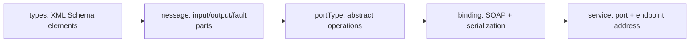

# WSDL 1.1: types, message, portType, binding và service

## Mục tiêu học tập

Kết thúc bài học trong chương **Đọc và công bố WSDL**, bạn có thể:

1. Giải thích WSDL 1.1 dùng để làm gì trong dịch vụ SOAP theo hướng **contract-first**, và phân biệt hợp đồng WSDL với dữ liệu XML gửi lúc chạy.
2. Đọc chính xác năm thành phần cốt lõi: `types`, `message`, `portType`, `binding` và `service`.
3. Lần theo một thao tác từ địa chỉ endpoint đến SOAP binding, operation, message và XSD; phân biệt **tên QName** với tên hiển thị.
4. Viết và đọc một WSDL 1.1 kiểu **document/literal** có request, response, SOAP Fault và địa chỉ công bố.
5. Phân biệt các lựa chọn `document`/`rpc`, `literal`/`encoded` và quy ước **document/literal bare** với **document/literal wrapped**.
6. Hiểu cách **Spring Web Services (Spring-WS)** công bố WSDL từ XSD hoặc sử dụng một WSDL tĩnh, ánh xạ payload vào endpoint và ánh xạ XML qua JAXB.
7. Kiểm tra khả năng tương thích của WSDL với SOAP client, SOAP version, endpoint URL, namespace, schema, SOAP Fault và yêu cầu bảo mật.

## 1. WSDL là gì và vì sao quan trọng với SOAP contract-first?

**WSDL (Web Services Description Language)** là tài liệu XML mô tả giao diện trao đổi thông điệp của một web service. Với **WSDL 1.1**, một client có thể đọc được dịch vụ cung cấp thao tác nào, dữ liệu XML nào được trao đổi, giao thức SOAP/binding nào được dùng và địa chỉ mạng nào cung cấp dịch vụ.

Trong module `SPRING_WEB_SERVICES`, ta xây dựng dịch vụ SOAP theo hướng **contract-first**: xác định cấu trúc dữ liệu bằng XSD, mô tả giao diện bằng WSDL, ánh xạ XML với Java qua JAXB, rồi triển khai Spring-WS endpoint và SOAP client. Thiết kế hợp đồng trước giúp các hệ thống doanh nghiệp thống nhất dữ liệu, không phụ thuộc cách viết lớp Java của từng bên.

Điểm quan trọng là WSDL 1.1 **không phải bản tin SOAP**. Nó là **mô tả hợp đồng**; bản tin lúc chạy mới có `soap:Envelope`, `soap:Header`, `soap:Body` và các phần tử nghiệp vụ.

Một cách hiểu ngắn:

- **XSD**: Dữ liệu XML hợp lệ có hình dạng và kiểu gì?
- **WSDL 1.1**: Dịch vụ có những thao tác nào, trao đổi các loại message nào, dùng binding/giao thức nào và truy cập ở đâu?
- **Spring-WS runtime**: Nhận SOAP message, xử lý header/security/validation, chọn endpoint và trả response hoặc SOAP Fault.
- **JAXB**: Ánh xạ giữa đối tượng Java và các phần tử XML phù hợp schema.

WSDL được sử dụng rộng rãi trong tích hợp SOAP; trong thực tế nhiều hệ thống vẫn dùng WSDL **1.1**. Cần chú ý **WSDL 1.1 và WSDL 2.0 có mô hình thuật ngữ khác nhau**: WSDL 2.0 dùng khái niệm `interface`, trong khi bài này sử dụng `portType` của **WSDL 1.1**.

## 2. Bức tranh toàn cảnh: năm thành phần WSDL 1.1

WSDL 1.1 có phần tử gốc `wsdl:definitions` (namespace `http://schemas.xmlsoap.org/wsdl/`). Các thành phần con quan trọng là:

| Thành phần | Câu hỏi trả lời | Chức năng |
| --- | --- | --- |
| **`types`** | Dữ liệu XML có hình dạng gì? | Chứa hoặc tham chiếu lược đồ kiểu dữ liệu, phổ biến nhất là XSD định nghĩa phần tử, kiểu và ràng buộc. |
| **`message`** | Operation gửi/nhận một thông điệp logic nào? | Định nghĩa message gồm một hoặc nhiều `part`, mỗi part tham chiếu phần tử/kiểu đã mô tả. |
| **`portType`** | Dịch vụ cung cấp thao tác logic nào? | Giao diện trừu tượng: `operation` và `input`/`output`/`fault` của operation. |
| **`binding`** | Giao diện logic được truyền trên giao thức nào, theo cách nào? | Gắn `portType` với SOAP binding, style, transport, SOAPAction, cách serialize body/fault. |
| **`service`** | Khách hàng kết nối tới đâu? | Gom một hay nhiều `port`, mỗi port chỉ tới một binding và một endpoint address. |

**Mô hình tham chiếu khi đọc một WSDL:**



Các mũi tên biểu diễn **quan hệ phụ thuộc ý nghĩa**, còn trong XML thực tế `message` tham chiếu ngược lại đến phần tử XSD, `operation` tham chiếu message, `binding` tham chiếu portType và `service/port` tham chiếu binding. Khi kiểm tra một endpoint cụ thể, người đọc thường đi **ngược chiều**:

```text
service/port (URL)
   └─ binding (SOAP 1.1 hoặc 1.2, document/rpc, literal/encoded)
      └─ portType (GetOrder operation)
         ├─ input → message → part → element trong types
         ├─ output → message → part → element trong types
         └─ fault → message → part → element trong types
```

WSDL không chứa đầy đủ mọi điều kiện vận hành. Những yêu cầu như kích thước request tối đa, số kết nối đồng thời, TLS/mTLS, chứng chỉ, WS-SecurityPolicy, rate limit hay xử lý replay có thể cần tài liệu policy và cấu hình riêng được hai phía hỗ trợ.

## 3. Namespace và QName: nguyên tắc đọc xuyên suốt WSDL

WSDL dùng nhiều namespace XML cùng lúc. Nếu chỉ nhìn tên sau dấu hai chấm mà bỏ qua namespace URI, bạn có thể hiểu sai một tham chiếu.

Ví dụ:

```xml
<wsdl:definitions
    xmlns:wsdl="http://schemas.xmlsoap.org/wsdl/"
    xmlns:soap="http://schemas.xmlsoap.org/wsdl/soap/"
    xmlns:xs="http://www.w3.org/2001/XMLSchema"
    xmlns:tns="urn:example:orders:wsdl"
    xmlns:ord="urn:example:orders:v1"
    targetNamespace="urn:example:orders:wsdl">
    <!-- Các thành phần hợp đồng -->
</wsdl:definitions>
```

Các namespace có vai trò khác nhau:

- `wsdl`: Các phần tử cấu trúc **WSDL 1.1** như `definitions`, `types`, `message`, `portType`, `binding`, `service`.
- `soap`: Các phần tử **WSDL SOAP 1.1 binding extension** như `soap:binding`, `soap:operation`, `soap:body`, `soap:address`. **Không phải** namespace Envelope của thông điệp SOAP 1.1.
- `xs`: XML Schema dùng để định nghĩa `xs:element`, `xs:complexType`, `xs:string`, ...
- `tns`: Quy ước tiền tố cho **target namespace của WSDL**, ở đây `urn:example:orders:wsdl`.
- `ord`: Namespace của **các phần tử nghiệp vụ trong XSD**, ở đây `urn:example:orders:v1`.

Hai URI sau khác nhau về ý nghĩa:

```text
WSDL SOAP 1.1 binding extension:
http://schemas.xmlsoap.org/wsdl/soap/

SOAP 1.1 Envelope khi gửi yêu cầu:
http://schemas.xmlsoap.org/soap/envelope/
```

Một QName được hiểu theo cặp **{namespace URI} + local name**. Ví dụ, `tns:GetOrderPortType` tham chiếu một `portType` trong namespace WSDL; `ord:GetOrderRequest` tham chiếu phần tử XML nghiệp vụ trong namespace XSD.

Có thể dùng tiền tố khác `tns` hoặc `ord` nếu khai báo URI tương ứng giống nhau. Ngược lại, cùng tên `GetOrderRequest` ở namespace khác là phần tử **khác**.

## 4. Ví dụ WSDL 1.1 hoàn chỉnh: dịch vụ tra cứu đơn hàng

Ta xây dựng hợp đồng cho thao tác **GetOrder**:

- Request: một `orderId` kiểu `xs:long`.
- Response: `orderId`, `status` và `total`.
- Lỗi nghiệp vụ được mô tả: `OrderNotFound` với mã và thông báo.
- SOAP binding: **SOAP 1.1**, **document/literal** qua HTTP.
- Địa chỉ minh họa: `https://api.example.com/ws/orders`.

Đây là một ví dụ đầy đủ để học cách lần theo các thành phần WSDL. Các namespace và địa chỉ `example.com` mang tính minh họa.

### 4.1. Toàn bộ file `orders.wsdl`

```xml
<?xml version="1.0" encoding="UTF-8"?>
<wsdl:definitions
    name="OrderService"
    targetNamespace="urn:example:orders:wsdl"
    xmlns:wsdl="http://schemas.xmlsoap.org/wsdl/"
    xmlns:soap="http://schemas.xmlsoap.org/wsdl/soap/"
    xmlns:xs="http://www.w3.org/2001/XMLSchema"
    xmlns:tns="urn:example:orders:wsdl"
    xmlns:ord="urn:example:orders:v1">

    <!-- 1. types: lược đồ dữ liệu XML -->
    <wsdl:types>
        <xs:schema
            targetNamespace="urn:example:orders:v1"
            elementFormDefault="qualified">

            <xs:element name="GetOrderRequest">
                <xs:complexType>
                    <xs:sequence>
                        <xs:element name="orderId" type="xs:long"/>
                    </xs:sequence>
                </xs:complexType>
            </xs:element>

            <xs:element name="GetOrderResponse">
                <xs:complexType>
                    <xs:sequence>
                        <xs:element name="orderId" type="xs:long"/>
                        <xs:element name="status" type="xs:string"/>
                        <xs:element name="total" type="xs:decimal"/>
                    </xs:sequence>
                </xs:complexType>
            </xs:element>

            <xs:element name="OrderNotFoundFault">
                <xs:complexType>
                    <xs:sequence>
                        <xs:element name="code" type="xs:string"/>
                        <xs:element name="message" type="xs:string"/>
                    </xs:sequence>
                </xs:complexType>
            </xs:element>

        </xs:schema>
    </wsdl:types>

    <!-- 2. message: phần tử XML của mỗi message logic -->
    <wsdl:message name="GetOrderInput">
        <wsdl:part name="parameters" element="ord:GetOrderRequest"/>
    </wsdl:message>

    <wsdl:message name="GetOrderOutput">
        <wsdl:part name="parameters" element="ord:GetOrderResponse"/>
    </wsdl:message>

    <wsdl:message name="OrderNotFoundMessage">
        <wsdl:part name="fault" element="ord:OrderNotFoundFault"/>
    </wsdl:message>

    <!-- 3. portType: giao diện và các operation trừu tượng -->
    <wsdl:portType name="GetOrderPortType">
        <wsdl:operation name="GetOrder">
            <wsdl:input message="tns:GetOrderInput"/>
            <wsdl:output message="tns:GetOrderOutput"/>
            <wsdl:fault
                name="OrderNotFound"
                message="tns:OrderNotFoundMessage"/>
        </wsdl:operation>
    </wsdl:portType>

    <!-- 4. binding: triển khai giao diện trên SOAP 1.1/HTTP -->
    <wsdl:binding
        name="GetOrderSoapBinding"
        type="tns:GetOrderPortType">

        <soap:binding
            style="document"
            transport="http://schemas.xmlsoap.org/soap/http"/>

        <wsdl:operation name="GetOrder">
            <soap:operation soapAction="urn:example:orders:v1/GetOrder"/>

            <wsdl:input>
                <soap:body use="literal"/>
            </wsdl:input>

            <wsdl:output>
                <soap:body use="literal"/>
            </wsdl:output>

            <wsdl:fault name="OrderNotFound">
                <soap:fault name="OrderNotFound" use="literal"/>
            </wsdl:fault>
        </wsdl:operation>
    </wsdl:binding>

    <!-- 5. service: cổng và địa chỉ truy cập dịch vụ -->
    <wsdl:service name="GetOrderService">
        <wsdl:port
            name="GetOrderPort"
            binding="tns:GetOrderSoapBinding">
            <soap:address
                location="https://api.example.com/ws/orders"/>
        </wsdl:port>
    </wsdl:service>

</wsdl:definitions>
```

### 4.2. Đọc ví dụ theo thứ tự các phụ thuộc

| Vị trí trong WSDL | Giá trị | Ý nghĩa |
| --- | --- | --- |
| `wsdl:types/xs:schema` | `urn:example:orders:v1` | Không gian tên của dữ liệu nghiệp vụ. |
| `xs:element` | `GetOrderRequest` | Phần tử gốc của payload request. |
| `wsdl:message` | `GetOrderInput` | Message logic có part `parameters` trỏ tới `ord:GetOrderRequest`. |
| `wsdl:portType` | `GetOrderPortType` | Có operation `GetOrder` cùng input, output, fault. |
| `wsdl:binding` | `GetOrderSoapBinding` | Dùng giao diện `tns:GetOrderPortType` và SOAP 1.1 document/literal. |
| `soap:operation` | `soapAction="urn:example:orders:v1/GetOrder"` | Giá trị SOAPAction của binding operation cho SOAP 1.1/HTTP. |
| `wsdl:service/wsdl:port` | `GetOrderPort` | Công bố binding `tns:GetOrderSoapBinding`. |
| `soap:address` | `https://api.example.com/ws/orders` | Địa chỉ endpoint SOAP lúc chạy. |

Đi từ đầu bảng xuống là cách hiểu quan hệ trừu tượng đến cụ thể; đi từ địa chỉ lên giúp kiểm tra “URL này xử lý operation nào và request XML phải có hình dạng gì?”.

## 5. `types`: mô tả dữ liệu XML bằng XSD

`wsdl:types` không trực tiếp định nghĩa thao tác nghiệp vụ. Nó chứa các định nghĩa kiểu hoặc phần tử mà `wsdl:message` sẽ tham chiếu. **XML Schema (XSD)** là cách phổ biến nhất.

Ví dụ rút từ WSDL ở trên:

```xml
<xs:element name="GetOrderRequest">
    <xs:complexType>
        <xs:sequence>
            <xs:element name="orderId" type="xs:long"/>
        </xs:sequence>
    </xs:complexType>
</xs:element>
```

Ý nghĩa:

- `GetOrderRequest` là phần tử XML toàn cục (global element).
- `orderId` là phần tử con kiểu số nguyên 64-bit có dấu theo miền giá trị `xs:long`.
- `xs:sequence` quy định thứ tự phần tử con nếu có nhiều trường.
- `elementFormDefault="qualified"` của schema ví dụ yêu cầu các phần tử con nghiệp vụ thuộc target namespace `urn:example:orders:v1`.

Payload request hợp lệ theo cấu trúc mẫu:

```xml
<ord:GetOrderRequest xmlns:ord="urn:example:orders:v1">
    <ord:orderId>42</ord:orderId>
</ord:GetOrderRequest>
```

Một payload có `<orderId>abc</orderId>` có thể **đúng cú pháp XML** nhưng không hợp lệ theo schema vì `abc` không phải `xs:long`. Payload dùng đúng local name mà sai namespace cũng không phải cùng phần tử với phần tử schema khai báo.

### 5.1. XSD đặt trực tiếp và XSD lưu riêng

WSDL có thể **nhúng XSD** ngay bên trong `wsdl:types` như ví dụ hoặc tham chiếu schema độc lập:

```xml
<wsdl:types>
    <xs:schema
        xmlns:xs="http://www.w3.org/2001/XMLSchema"
        targetNamespace="urn:example:orders:wsdl">
        <xs:import
            namespace="urn:example:orders:v1"
            schemaLocation="orders-v1.xsd"/>
    </xs:schema>
</wsdl:types>
```

Đây là ví dụ tham chiếu schema trong **namespace khác** bằng `xs:import`. Nếu các mảnh schema cùng namespace, `xs:include` mới là lựa chọn thường gặp; cả hai đều có quy tắc riêng về namespace và phân giải đường dẫn. `schemaLocation` chỉ là gợi ý vị trí tham chiếu, và công cụ đọc WSDL cần tìm được tài liệu đó để giải quyết các phần tử.

Trong dự án contract-first, giữ XSD thành file riêng thường có lợi: dễ version hóa và tái sử dụng, kiểm tra schema độc lập, sinh JAXB, và tránh sửa WSDL chỉ để điều chỉnh cách sinh code Java. Nhưng khi công bố WSDL ra bên ngoài, cần đảm bảo các đường dẫn/import có thể truy cập hoặc được đóng gói theo hợp đồng với đối tác.

### 5.2. Trường hợp cần `xs:element` và `xs:type`

`wsdl:message/wsdl:part` trong WSDL 1.1 có thể tham chiếu **`element`** hoặc **`type`**, tùy cách thiết kế binding. Với **document/literal** phù hợp thực hành liên thông SOAP, nên ưu tiên part tham chiếu **phần tử toàn cục**:

```xml
<wsdl:part name="parameters" element="ord:GetOrderRequest"/>
```

Đừng tự sửa thành `type="ord:GetOrderRequest"`: trong ví dụ `GetOrderRequest` là tên **element**, không phải tên global type. Nếu dùng part tham chiếu type thì QName phải trỏ tới một kiểu được khai báo tương ứng và cách mapping body cũng cần được đánh giá theo binding.

## 6. `message`: dữ liệu logic đầu vào, đầu ra và lỗi

`wsdl:message` định nghĩa một **thông điệp logic** với các `wsdl:part`. Nó chưa xác định HTTP, SOAPAction hay địa chỉ mạng.

Trong ví dụ:

```xml
<wsdl:message name="GetOrderInput">
    <wsdl:part name="parameters" element="ord:GetOrderRequest"/>
</wsdl:message>
```

Phân tích:

- `name="GetOrderInput"` định danh message trong target namespace WSDL.
- `part name="parameters"` là tên phần logic của message.
- `element="ord:GetOrderRequest"` trỏ tới phần tử XSD mà nội dung body sẽ mang trong document/literal binding tương ứng.

Input, output và fault có thể là **ba message khác nhau**. `wsdl:message` không phải là một SOAP Envelope và cũng không phải Java parameter. Việc tool sinh class hay tham số Java phụ thuộc vào quy ước binding và công cụ code generation.

Trong hợp đồng document/literal thường dùng **một part tham chiếu một global element** cho mỗi request/response; đó là lựa chọn giảm khác biệt giữa các SOAP stack, không phải một ràng buộc khiến mọi message WSDL 1.1 đều phải có đúng một part.

## 7. `portType`: giao diện trừu tượng và operation

`wsdl:portType` gom các `wsdl:operation`. Mỗi operation mô tả thông điệp đầu vào, đầu ra và các fault ở mức trừu tượng, **chưa ràng buộc** với SOAP/HTTP cụ thể.

```xml
<wsdl:portType name="GetOrderPortType">
    <wsdl:operation name="GetOrder">
        <wsdl:input message="tns:GetOrderInput"/>
        <wsdl:output message="tns:GetOrderOutput"/>
        <wsdl:fault
            name="OrderNotFound"
            message="tns:OrderNotFoundMessage"/>
    </wsdl:operation>
</wsdl:portType>
```

Có thể đọc thành: giao diện `GetOrderPortType` công bố thao tác `GetOrder`, nhận message `GetOrderInput`, trả `GetOrderOutput` và khai báo lỗi `OrderNotFound`.

WSDL 1.1 mô tả một số mẫu trao đổi message như **one-way**, **request-response**, **solicit-response** và **notification** ở mức giao diện trừu tượng. Trong ứng dụng SOAP/HTTP doanh nghiệp, **request-response** là mẫu rất phổ biến; nhưng không nên suy ra chỉ bằng việc thấy từ `operation` rằng mọi request đều có response nghiệp vụ.

### 7.1. Tên operation khác tên payload root

Một lỗi nhầm lẫn phổ biến là nghĩ payload request luôn phải có local name trùng tên operation. Trong WSDL mẫu:

- **operation** tên `GetOrder`;
- **request payload root** tên `GetOrderRequest`;
- **response payload root** tên `GetOrderResponse`.

Đây là các tên liên quan nhưng khác vai trò. Spring-WS thường định tuyến bằng **QName của phần tử payload** thông qua `@PayloadRoot` hoặc cơ chế endpoint mapping khác; không trực tiếp gọi Java method dựa trên chuỗi `operation name` trong WSDL.

## 8. `binding`: đưa portType lên SOAP/HTTP

`wsdl:binding` là phần gắn giao diện trừu tượng `portType` với **cơ chế truyền cụ thể**.

```xml
<wsdl:binding
    name="GetOrderSoapBinding"
    type="tns:GetOrderPortType">

    <soap:binding
        style="document"
        transport="http://schemas.xmlsoap.org/soap/http"/>

    <wsdl:operation name="GetOrder">
        <soap:operation soapAction="urn:example:orders:v1/GetOrder"/>
        <wsdl:input>
            <soap:body use="literal"/>
        </wsdl:input>
        <wsdl:output>
            <soap:body use="literal"/>
        </wsdl:output>
        <wsdl:fault name="OrderNotFound">
            <soap:fault name="OrderNotFound" use="literal"/>
        </wsdl:fault>
    </wsdl:operation>
</wsdl:binding>
```

Cần đọc đúng từng thuộc tính:

| Thành phần | Ý nghĩa |
| --- | --- |
| `binding@type` | QName của `portType` mà binding triển khai. |
| `soap:binding@style="document"` | Cách mô hình hóa dữ liệu trong SOAP Body theo document style. |
| `soap:binding@transport="http://schemas.xmlsoap.org/soap/http"` | Ràng buộc vận chuyển SOAP qua HTTP, không phải URL endpoint. |
| `soap:operation@soapAction` | Giá trị hành động của binding operation theo SOAP 1.1/HTTP; client cần gửi phù hợp với hợp đồng và stack. |
| `soap:body@use="literal"` | Nội dung body tuân theo định nghĩa XSD literal, không dùng SOAP encoding. |
| `soap:fault@use="literal"` | Cách diễn đạt nội dung SOAP Fault theo literal binding. |

### 8.1. SOAPAction là gì?

Trong SOAP 1.1 qua HTTP, `SOAPAction` là HTTP header cho biết ý định của lời gọi; binding khai báo một giá trị liên quan tới operation.

Ví dụ minh họa một HTTP request (Body được rút gọn để tập trung vào mapping):

```http
POST /ws/orders HTTP/1.1
Host: api.example.com
Content-Type: text/xml; charset=utf-8
SOAPAction: "urn:example:orders:v1/GetOrder"

<?xml version="1.0" encoding="UTF-8"?>
<soapenv:Envelope
    xmlns:soapenv="http://schemas.xmlsoap.org/soap/envelope/"
    xmlns:ord="urn:example:orders:v1">
    <soapenv:Body>
        <ord:GetOrderRequest>
            <ord:orderId>42</ord:orderId>
        </ord:GetOrderRequest>
    </soapenv:Body>
</soapenv:Envelope>
```

SOAPAction **không phải đường dẫn HTTP**, cũng không phải QName phần tử request. Một số SOAP stack có thể dựa vào SOAPAction để chọn operation; Spring-WS còn có cơ chế định tuyến theo payload root. Vì thế kiểm thử liên thông phải xác nhận **SOAPAction và payload QName** đều đúng theo hợp đồng.

### 8.2. Document/literal, RPC/literal và encoded

WSDL 1.1 cho phép các tổ hợp style/use khác nhau. Khi thiết kế mới để tích hợp doanh nghiệp, **document/literal** thường là lựa chọn ưu tiên.

| Thuật ngữ | Ý nghĩa | Khuyến nghị |
| --- | --- | --- |
| `style="document"` | SOAP Body chứa nội dung XML theo định nghĩa tài liệu. | Phổ biến cho contract-first với XSD. |
| `style="rpc"` | SOAP Body mô hình hóa lời gọi RPC và tham số theo quy tắc binding. | Có trong hệ thống cũ; đọc kỹ trước khi tích hợp. |
| `use="literal"` | XML phần được truyền tuân theo schema/định nghĩa literal. | Phù hợp mục tiêu interoperable contract-first. |
| `use="encoded"` | Dùng quy tắc mã hóa SOAP encoding. | Legacy; nhiều công cụ hiện đại hạn chế/không khuyến khích. |

**Không đồng nhất `document/literal` với `document/literal wrapped`.** Wrapped là **quy ước thiết kế** trên document/literal, không phải giá trị XML `style="wrapped"` trong WSDL.

- **Document/literal bare:** Request/response body được mô tả bởi phần tử XSD được tham chiếu trực tiếp; tên phần tử không bắt buộc là tên operation theo quy ước wrapped.
- **Document/literal wrapped:** Thường dùng một global element cho request có tên **trùng operation**, một element cho response theo quy ước hậu tố `Response`, và cấu trúc chứa các phần tử con tương ứng tham số. Các công cụ có thể áp những điều kiện wrapped chặt hơn (số part, tên, cấu trúc...).

**WSDL mẫu trong bài** dùng `GetOrderRequest` cho operation `GetOrder`, vì vậy hãy xem nó là ví dụ **document/literal bare**, không tự nhận là wrapped theo quy ước tên element trùng operation. Khi sử dụng công cụ sinh code tự động từ WSDL, cần kiểm tra nó suy diễn chữ ký Java như thế nào.

### 8.3. SOAP 1.1 binding khác SOAP 1.2 binding

WSDL 1.1 mẫu dùng namespace binding extension:

```xml
xmlns:soap="http://schemas.xmlsoap.org/wsdl/soap/"
```

Đó là SOAP **1.1 binding extension** trong WSDL. Một số công cụ hỗ trợ SOAP 1.2 binding extension với namespace khác (ví dụ `http://schemas.xmlsoap.org/wsdl/soap12/`) nhưng khả năng hỗ trợ phụ thuộc SOAP stack và công cụ.

Ở mức **runtime**:

- Envelope SOAP 1.1: `http://schemas.xmlsoap.org/soap/envelope/`, thường dùng HTTP `Content-Type: text/xml`.
- Envelope SOAP 1.2: `http://www.w3.org/2003/05/soap-envelope`, thường dùng `application/soap+xml`; thông tin action có thể được biểu diễn theo binding SOAP 1.2.

Không thể đổi SOAP 1.1 sang SOAP 1.2 chỉ bằng cách thay một tiền tố hoặc một chuỗi `Content-Type`; cần hợp đồng và cấu hình client/server tương thích.

## 9. `service`: port và địa chỉ endpoint

`wsdl:service` liên kết binding đã có với một hay nhiều **điểm kết nối**.

```xml
<wsdl:service name="GetOrderService">
    <wsdl:port
        name="GetOrderPort"
        binding="tns:GetOrderSoapBinding">
        <soap:address
            location="https://api.example.com/ws/orders"/>
    </wsdl:port>
</wsdl:service>
```

Phân biệt:

- **Service**: nhóm các cổng liên quan tới dịch vụ.
- **Port**: một endpoint được mô tả bởi binding và address cụ thể. Đây là khái niệm WSDL, không phải trực tiếp “TCP port 443”.
- **Binding**: quy định cách truyền thông điệp.
- **`soap:address@location`**: URL endpoint thực để **gửi SOAP request**.

Một service có thể chứa nhiều port, chẳng hạn port dùng binding SOAP 1.1 và port khác dùng binding SOAP 1.2 nếu hạ tầng và contract hỗ trợ. Các port có thể chung logic nghiệp vụ nhưng khác binding/địa chỉ.

### 9.1. URL công bố WSDL không nhất thiết là URL nhận SOAP request

Ví dụ khi triển khai Spring-WS:

```text
URL đọc hợp đồng: https://api.example.com/ws/orders.wsdl
URL gửi SOAP:    https://api.example.com/ws
```

Hai URL này **có thể khác**. URL chính xác mà client phải gọi được tìm trong `soap:address location` của port tương ứng (hoặc cấu hình override endpoint ở client), không suy ra bằng cách xóa đuôi `.wsdl` một cách tùy ý.

Khi đặt phía sau reverse proxy hoặc API gateway, hãy kiểm tra địa chỉ được công bố là **HTTPS và host/path có thể truy cập từ mạng client**, không bị lộ địa chỉ nội bộ như `http://localhost:8080/ws`. Việc tải được `?wsdl` hoặc `.wsdl` chỉ cho biết tài liệu hợp đồng có thể đọc; nó **không tự chứng minh** binding, security và endpoint xử lý request thành công.

## 10. Đọc WSDL theo thứ tự nào khi nhận từ đối tác?

Một quy trình đọc hiệu quả:

1. **Xác định phiên bản WSDL và namespace:** phần tử gốc có phải `wsdl:definitions` của WSDL 1.1 không? `targetNamespace` là gì?
2. **Tìm `service/port`:** có bao nhiêu port, mỗi port trỏ binding nào, `soap:address` là URL gì?
3. **Đi tới `binding`:** là SOAP 1.1 hay 1.2? `style` và `use` ra sao? Có `SOAPAction` hoặc fault binding nào?
4. **Tìm `portType` được binding tham chiếu:** những operation nào được hỗ trợ, request-response hay kiểu trao đổi khác?
5. **Đi tới `message` input/output/fault:** mỗi message có những part nào, mỗi part dùng `element` hay `type`, QName trỏ tới đâu?
6. **Đọc `types` và các XSD import:** kiểu dữ liệu, namespace, phần tử bắt buộc, số lần xuất hiện, giới hạn và thứ tự.
7. **Đọc policy và tài liệu vận hành:** TLS/mTLS, WS-Security, chứng chỉ, chữ ký, header, hạn mức message, timeout, phiên bản và SOAP Fault.
8. **Gửi request thử:** dùng payload đúng XSD cùng SOAPAction/Content-Type/Envelope phù hợp, xác minh response và trường hợp lỗi.

### 10.1. Mẹo lần theo QName

Nếu thấy:

```xml
<wsdl:port binding="tns:GetOrderSoapBinding" ... />
```

hãy tìm `<wsdl:binding name="GetOrderSoapBinding">` trong **namespace WSDL tương ứng**, không chỉ dùng chuỗi name mà bỏ qua namespace. Tương tự:

```xml
<wsdl:part name="parameters" element="ord:GetOrderRequest"/>
```

hãy tìm **global element** `GetOrderRequest` trong XSD có `targetNamespace="urn:example:orders:v1"`. Nhiều lỗi “không tìm thấy element” xuất phát từ sai URI namespace hoặc import bị lỗi, dù cùng local name.

### 10.2. Nếu WSDL có nhiều file

WSDL 1.1 dùng `wsdl:import` để nhập các định nghĩa WSDL khác; XSD dùng `xs:import` / `xs:include` để nhập schema:

```xml
<!-- Nhập định nghĩa WSDL từ namespace khác -->
<wsdl:import
    namespace="urn:example:shared:wsdl"
    location="shared.wsdl"/>
```

```xml
<!-- Nhập schema của namespace khác vào một xs:schema thích hợp -->
<xs:import
    namespace="urn:example:orders:v1"
    schemaLocation="orders-v1.xsd"/>
```

Cần phân biệt **import WSDL** với **import XSD**. Hãy kiểm tra đường dẫn tương đối, phân giải URL khi deploy, khả năng truy cập từ client, độ tin cậy của nguồn schema và các bản sao đã được version hóa. Tránh cấu hình parser tải tùy ý tài nguyên mạng ngoài từ tài liệu WSDL/XSD không đáng tin cậy.

## 11. Spring Web Services: công bố WSDL từ XSD

Spring-WS hỗ trợ phát triển theo hướng contract-first. Một phương án phổ biến là viết **XSD trước**, rồi dùng `DefaultWsdl11Definition` công bố WSDL 1.1 dựa trên schema và quy ước đặt tên phần tử.

Giả sử có file `src/main/resources/xsd/orders.xsd` chứa **global elements**:

```xml
<xs:element name="GetOrderRequest"> ... </xs:element>
<xs:element name="GetOrderResponse"> ... </xs:element>
```

Dấu `...` ở đây là ký hiệu rút gọn cho ví dụ, **không phải XSD có thể parse**. XSD thực phải có định nghĩa kiểu đầy đủ như phần `types` trước đó.

### 11.1. Ví dụ cấu hình Java

```java
import org.springframework.boot.web.servlet.ServletRegistrationBean;
import org.springframework.context.ApplicationContext;
import org.springframework.context.annotation.Bean;
import org.springframework.context.annotation.Configuration;
import org.springframework.core.io.ClassPathResource;
import org.springframework.ws.config.annotation.EnableWs;
import org.springframework.ws.transport.http.MessageDispatcherServlet;
import org.springframework.ws.wsdl.wsdl11.DefaultWsdl11Definition;
import org.springframework.xml.xsd.SimpleXsdSchema;
import org.springframework.xml.xsd.XsdSchema;

@EnableWs
@Configuration
public class WebServiceConfig {

    @Bean
    public ServletRegistrationBean<MessageDispatcherServlet>
            messageDispatcherServlet(ApplicationContext context) {
        MessageDispatcherServlet servlet = new MessageDispatcherServlet();
        servlet.setApplicationContext(context);
        servlet.setTransformWsdlLocations(true);
        return new ServletRegistrationBean<>(servlet, "/ws/*");
    }

    @Bean
    public XsdSchema ordersSchema() {
        return new SimpleXsdSchema(
                new ClassPathResource("xsd/orders.xsd"));
    }

    @Bean(name = "orders")
    public DefaultWsdl11Definition ordersWsdl(XsdSchema ordersSchema) {
        DefaultWsdl11Definition definition =
                new DefaultWsdl11Definition();
        definition.setPortTypeName("OrdersPort");
        definition.setLocationUri("/ws");
        definition.setTargetNamespace("urn:example:orders:v1");
        definition.setSchema(ordersSchema);
        definition.setCreateSoap11Binding(true);
        return definition;
    }
}
```

Trong một ứng dụng Spring Boot tương thích, bean có tên `orders` thường được công bố tại **`/ws/orders.wsdl`** (cộng context path nếu có). `MessageDispatcherServlet` xử lý URL dưới `/ws/*`. Việc cấu hình `setTransformWsdlLocations(true)` hỗ trợ biến đổi các địa chỉ `soap:address` được công bố để khớp URL request khi truy cập, nhưng cần **kiểm tra thực tế khi có reverse proxy, Forwarded/X-Forwarded headers và TLS termination**.

Đây là ví dụ độc lập về ý tưởng cấu hình, không phải cam kết một đoạn code phù hợp với mọi phiên bản Spring-WS/Spring Boot. Một số dự án đã có servlet registration hoặc message factory riêng; khi đó cần tích hợp vào cấu hình hiện có. Tên bean, schema path, portType, location và namespace phải được kiểm tra với ứng dụng thật.

### 11.2. Spring-WS suy ra operation từ phần tử XSD như thế nào?

`DefaultWsdl11Definition` thường dùng các quy ước hậu tố như `Request` và `Response` để nhận diện message input/output và tạo operation:

```text
XSD global element GetOrderRequest
            └─ input message cho operation GetOrder

XSD global element GetOrderResponse
            └─ output message cho operation GetOrder
```

Đây là cơ chế **sinh hợp đồng dựa trên quy ước**, không phải tuyên bố rằng mọi WSDL 1.1 đều bắt buộc dùng hậu tố Request/Response. Để điều chỉnh cách sinh, cần dùng API và cấu hình generator phù hợp phiên bản đang chạy.

**Chú ý:** WSDL tự sinh từ XSD và WSDL viết tay ở mục 4 có thể **không giống từng QName, tên portType, tên message/binding/service, SOAPAction hoặc fault**. Đó là **hai ví dụ minh họa cách công bố hợp đồng**, không nên mặc định WSDL sinh tự động chính là toàn văn file `orders.wsdl` đã viết thủ công. Nếu cần một hợp đồng đã được đối tác phê duyệt với tên và binding cố định, xem xét công bố **WSDL tĩnh** thay vì để generator đổi cấu trúc theo quy ước.

### 11.3. Công bố WSDL tĩnh

Nếu đã có một file WSDL 1.1 hoàn chỉnh được quản lý phiên bản, có thể dùng bean `SimpleWsdl11Definition`:

```java
import org.springframework.context.annotation.Bean;
import org.springframework.core.io.ClassPathResource;
import org.springframework.ws.wsdl.wsdl11.SimpleWsdl11Definition;

@Bean(name = "orders")
public SimpleWsdl11Definition ordersWsdl() {
    return new SimpleWsdl11Definition(
            new ClassPathResource("wsdl/orders.wsdl"));
}
```

Đây là **phương án thay thế** cho bean `DefaultWsdl11Definition` tên `orders` ở trên, không khai báo cả hai cùng tên trong cùng ứng dụng. Đường dẫn classpath phải có file WSDL thật, các schema/import đi kèm cần được công bố/phân giải đúng.

So sánh hai lựa chọn:

| Lựa chọn | Phù hợp khi | Điểm cần chú ý |
| --- | --- | --- |
| `DefaultWsdl11Definition` | Có XSD chuẩn, muốn sinh WSDL từ quy ước Spring-WS. | Tên operation/message/binding và output tùy quy ước/configuration; kiểm tra WSDL được sinh sau khi khởi động. |
| `SimpleWsdl11Definition` | Có WSDL được phê duyệt hoặc cần cố định tên/namespace/metadata. | Quản lý file tĩnh, import, URL endpoint, version và tương thích với runtime. |

Thay đổi XSD không có nghĩa mọi client tự nâng cấp an toàn. Một client sinh code từ WSDL cũ có thể phải regenerate, compile, triển khai và kiểm thử lại.

## 12. WSDL và Spring-WS endpoint: cách nối contract với Java

Khi WSDL có `GetOrderInput` tham chiếu `ord:GetOrderRequest`, endpoint có thể ánh xạ theo **payload root**:

```java
import org.springframework.ws.server.endpoint.annotation.Endpoint;
import org.springframework.ws.server.endpoint.annotation.PayloadRoot;
import org.springframework.ws.server.endpoint.annotation.RequestPayload;
import org.springframework.ws.server.endpoint.annotation.ResponsePayload;

@Endpoint
public class OrderEndpoint {

    private static final String NAMESPACE_URI = "urn:example:orders:v1";

    @PayloadRoot(namespace = NAMESPACE_URI, localPart = "GetOrderRequest")
    @ResponsePayload
    public GetOrderResponse getOrder(
            @RequestPayload GetOrderRequest request) {

        GetOrderResponse response = new GetOrderResponse();
        response.setOrderId(request.getOrderId());
        response.setStatus("CONFIRMED");
        response.setTotal(new java.math.BigDecimal("125.50"));
        return response;
    }
}
```

Đoạn mã giả định các lớp `GetOrderRequest` và `GetOrderResponse` đã được sinh từ XSD hoặc được cấu hình JAXB tương đương. Đây là **minh họa endpoint**, cần cấu hình JAXB marshalling/unmarshalling, dependencies và xử lý nghiệp vụ thực tế trong một dự án hoàn chỉnh.

Chú ý:

- `@PayloadRoot(namespace, localPart)` dùng **QName của phần tử request** trong SOAP Body, không dùng tên `wsdl:message`.
- `@RequestPayload` và `@ResponsePayload` thể hiện nội dung nghiệp vụ; lớp Java không tự chứng minh toàn SOAP Header đã được xử lý an toàn.
- `wsdl:portType` không tự gán một Java class/interface cho server theo cách Java RMI; Spring-WS xử lý SOAP message và ánh xạ endpoint theo cấu hình.
- Các ràng buộc XSD cần được xác thực tại tầng phù hợp nếu muốn từ chối payload sai hợp đồng. JAXB unmarshalling thành công **không đồng nghĩa** tất cả facet XSD đều được thực thi.
- Nếu WSDL khai báo `OrderNotFound` fault, ứng dụng cần ánh xạ lỗi nghiệp vụ sang SOAP Fault phù hợp; Spring-WS không tự biến mọi exception thành fault detail đúng hợp đồng chỉ nhờ đọc WSDL.

### 12.1. WSDL Fault và SOAP Fault có gì khác?

WSDL `wsdl:fault` là **khai báo lỗi** ở mức operation; khi runtime phát sinh lỗi, response SOAP chứa `soap:Fault` theo phiên bản SOAP tương ứng. Ví dụ một SOAP 1.1 Fault:

```xml
<soapenv:Envelope
    xmlns:soapenv="http://schemas.xmlsoap.org/soap/envelope/"
    xmlns:ord="urn:example:orders:v1">
    <soapenv:Body>
        <soapenv:Fault>
            <faultcode>soapenv:Client</faultcode>
            <faultstring>Không tìm thấy đơn hàng</faultstring>
            <detail>
                <ord:OrderNotFoundFault>
                    <ord:code>ORDER_NOT_FOUND</ord:code>
                    <ord:message>Không có đơn hàng 42</ord:message>
                </ord:OrderNotFoundFault>
            </detail>
        </soapenv:Fault>
    </soapenv:Body>
</soapenv:Envelope>
```

Cấu trúc `detail` mang phần tử XSD được khai báo bởi message fault; mã lỗi và thông điệp là ví dụ. Trong Spring-WS, thường cần bộ ánh xạ exception/Fault hoặc logic chuyên biệt để sinh `detail` đúng schema. Không phải SOAP Fault nào cũng có `detail` hay xuất hiện trong danh sách `wsdl:fault` (ví dụ lỗi SOAP version, mustUnderstand, parse hoặc security có thể xảy ra ở tầng protocol).

## 13. Kiểm thử đọc và công bố WSDL

Một WSDL tải được và well-formed XML chưa chắc là **hợp đồng đầy đủ, nhất quán hoặc có thể gọi**. Kiểm thử theo các lớp sau.

### 13.1. Kiểm tra cấu trúc và tham chiếu

- Có `wsdl:definitions` đúng namespace WSDL 1.1; `targetNamespace` và QName được khai báo chính xác?
- Có đủ `types` hoặc các schema tham chiếu, và client truy cập được các import?
- `message/part@element` có trỏ tới **global element** thực sự tồn tại trong XSD đúng namespace?
- `portType/operation/input/output/fault` có tham chiếu đúng `message`?
- `binding@type` có trỏ đúng `portType`, và operation của binding có tương thích operation trừu tượng?
- `service/port@binding` có trỏ đúng binding, `soap:address@location` có đúng địa chỉ ngoài?

### 13.2. Kiểm tra XML truyền thực tế

Gửi thông điệp SOAP 1.1 đúng binding WSDL mẫu:

```xml
<?xml version="1.0" encoding="UTF-8"?>
<soapenv:Envelope
    xmlns:soapenv="http://schemas.xmlsoap.org/soap/envelope/"
    xmlns:ord="urn:example:orders:v1">
    <soapenv:Header/>
    <soapenv:Body>
        <ord:GetOrderRequest>
            <ord:orderId>42</ord:orderId>
        </ord:GetOrderRequest>
    </soapenv:Body>
</soapenv:Envelope>
```

Kỳ vọng response nghiệp vụ theo dạng:

```xml
<soapenv:Envelope
    xmlns:soapenv="http://schemas.xmlsoap.org/soap/envelope/"
    xmlns:ord="urn:example:orders:v1">
    <soapenv:Body>
        <ord:GetOrderResponse>
            <ord:orderId>42</ord:orderId>
            <ord:status>CONFIRMED</ord:status>
            <ord:total>125.50</ord:total>
        </ord:GetOrderResponse>
    </soapenv:Body>
</soapenv:Envelope>
```

Đây là mô tả trao đổi ví dụ, chưa bao gồm chính sách xác thực/chữ ký thật. Kiểm thử tích hợp cần đi qua **SOAP client và URL endpoint thực**, không chỉ gọi trực tiếp Java method.

### 13.3. Bảng tình huống tích hợp

| Trường hợp | Kiểm tra mong đợi |
| --- | --- |
| WSDL tải thành công | Trả tài liệu WSDL 1.1 và mọi XSD/import được phân giải; không có URL nội bộ lộ ra ngoài. |
| Request đúng XSD và SOAP binding | Endpoint nhận đúng payload và trả response hợp lệ. |
| Sai payload namespace | Không ánh xạ nhầm endpoint; có lỗi phù hợp với SOAP stack/hợp đồng. |
| Sai SOAP version/Content-Type | Client/server báo lỗi version/binding thích hợp. |
| Thiếu `orderId` hoặc `orderId=abc` | Nếu bật schema validation, payload bị từ chối theo XSD. |
| SOAPAction không khớp binding | Quan sát server/gateway có xác thực SOAPAction và cách phản hồi; sửa client theo hợp đồng. |
| Không tìm thấy đơn hàng | SOAP Fault có cấu trúc phù hợp với quy ước `OrderNotFoundFault` khi đã triển khai mapping. |
| WSDL công bố qua reverse proxy | `soap:address` và các import trỏ tới URL public phù hợp scheme/host/path. |
| Thiếu WS-Security header bắt buộc | Bị từ chối theo chính sách; WSDL/XSD hợp lệ không bỏ qua kiểm tra bảo mật. |
| Chứng chỉ TLS không được tin cậy | Client từ chối kết nối theo cơ chế TLS; đây không phải lỗi XSD. |
| Client sinh code từ WSDL | Các QName, operation, wrapper/bare mapping, kiểu dữ liệu và Fault được sinh/hiểu như dự kiến. |
| Cập nhật WSDL/XSD | Client cũ được kiểm thử tương thích hoặc sử dụng phiên bản endpoint/hợp đồng riêng. |

### 13.4. Công cụ kiểm tra và tạo SOAP client

Các công cụ như **SoapUI**, **Apache CXF wsdl2java**, **JAX-WS wsimport** trong những môi trường cung cấp công cụ tương ứng, hoặc bộ thư viện client SOAP khác có thể giúp đọc WSDL, sinh proxy/client, tạo bản tin và kiểm thử. Tính sẵn có và khả năng hỗ trợ WSDL/WS-Security phụ thuộc phiên bản công cụ.

Ví dụ với môi trường đã cài bộ công cụ Apache CXF có lệnh `wsdl2java`:

```bash
wsdl2java -d generated-src https://api.example.com/ws/orders.wsdl
```

Lệnh chỉ minh họa **cách sử dụng công cụ khi đã cài và được cấu hình truy cập**. Đường dẫn URL chỉ là ví dụ, không phải endpoint tồn tại. Việc sinh code thành công chưa đủ để chứng minh quyền truy cập, TLS, WS-Security, fault mapping và dữ liệu runtime hoạt động đúng.

## 14. Những nhầm lẫn cần tránh

| Nhầm lẫn | Cách hiểu đúng |
| --- | --- |
| “WSDL là SOAP request.” | WSDL mô tả hợp đồng; request thực là SOAP Envelope. |
| “`types` và `message` giống nhau.” | `types` mô tả cấu trúc dữ liệu; `message` đặt tên message logic và trỏ tới dữ liệu đó bằng part. |
| “`portType` chứa URL endpoint.” | `portType` là giao diện logic; URL nằm trong `service/port/soap:address`. |
| “`binding` là Java interface.” | Binding là ràng buộc giao thức/serialization của một portType. |
| “`soap:binding transport` là địa chỉ dịch vụ.” | `transport` chỉ cơ chế vận chuyển; `soap:address location` là endpoint URL. |
| “Tên `GetOrder` bắt buộc bằng tên XML root.” | Tên operation và QName payload là hai khái niệm khác nhau. |
| “Mọi document/literal đều là wrapped.” | Wrapped là quy ước cấu trúc riêng; WSDL mẫu là document/literal bare. |
| “XSD đúng thì request chắc chắn bảo mật.” | XSD chỉ mô tả/kiểm tra cấu trúc dữ liệu; cần TLS, WS-Security, xác thực và phân quyền. |
| “Công bố WSDL nghĩa là endpoint đã hoạt động.” | Vẫn phải kiểm thử SOAP binding, URL, headers, security và phản hồi thực tế. |
| “Thay WSDL mà client cũ không ảnh hưởng.” | Thay QName, part, binding, port, kiểu dữ liệu hay Fault có thể phá vỡ client đã sinh code. |

## 15. Bài tập thực hành và đáp án

### Bài 1: lần theo thành phần WSDL

Cho:

```xml
<wsdl:port name="OrderPort" binding="tns:OrderSoapBinding"/>
<wsdl:binding name="OrderSoapBinding" type="tns:OrderPortType"/>
<wsdl:portType name="OrderPortType">
    <wsdl:operation name="GetOrder">
        <wsdl:input message="tns:GetOrderInput"/>
        <wsdl:output message="tns:GetOrderOutput"/>
    </wsdl:operation>
</wsdl:portType>
<wsdl:message name="GetOrderInput">
    <wsdl:part name="parameters" element="ord:GetOrderRequest"/>
</wsdl:message>
```

Đoạn rút gọn giả định các namespace và phần tử XSD đã khai báo đúng. Hãy nêu con đường tìm từ port tới XML request.

**Đáp án:** `OrderPort` → `tns:OrderSoapBinding` → `tns:OrderPortType` → operation `GetOrder` → input message `tns:GetOrderInput` → part `parameters` → global element `ord:GetOrderRequest` trong XSD.

### Bài 2: phân biệt endpoint và WSDL

Dịch vụ công bố WSDL tại `https://gateway.example.com/services/orders.wsdl`, nhưng `soap:address` trong WSDL là `https://gateway.example.com/api/orders`. Client nên gửi SOAP request tới đâu?

**Đáp án:** Theo hợp đồng, endpoint SOAP là `https://gateway.example.com/api/orders`; `/services/orders.wsdl` là URL lấy mô tả hợp đồng. Nếu ứng dụng cố ý override endpoint, việc override phải phù hợp cấu hình vận hành, không mặc định hai URL là một.

### Bài 3: namespace khác nhau

Có `wsdl:message` trong namespace `urn:example:orders:wsdl`, nhưng part tham chiếu `ord:GetOrderRequest` trong namespace `urn:example:orders:v1`. Điều này có mâu thuẫn không?

**Đáp án:** Không. WSDL có target namespace để định danh các thành phần hợp đồng; XSD có target namespace để định danh dữ liệu XML. Một WSDL hoàn toàn có thể trỏ tới global element trong namespace khác nếu import/định nghĩa thích hợp.

### Bài 4: có phải document/literal wrapped?

Operation tên `GetOrder`, input message chỉ có một part tham chiếu `ord:GetOrderRequest` và binding `style="document"`, `use="literal"`. Có nên tự khẳng định “wrapped” không?

**Đáp án:** Không. Với quy ước wrapped phổ biến, phần tử request wrapper thường trùng tên operation `GetOrder`. Bài này coi đó là **document/literal bare**. Nếu cần chính xác codegen signature phải kiểm tra bộ quy tắc của công cụ sử dụng.

### Bài 5: sinh WSDL với Spring-WS

Trong XSD có `CreateOrderRequest` và `CreateOrderResponse`. Khi dùng `DefaultWsdl11Definition` với quy ước `Request/Response`, operation có thể được suy ra là gì? Vì sao vẫn cần kiểm tra WSDL công bố?

**Đáp án:** Operation thường được suy ra là `CreateOrder`. Cần kiểm tra WSDL phát hành thật vì tên message, portType, binding, service, namespace, location và lựa chọn SOAP version còn phụ thuộc cấu hình generator và phiên bản công cụ.

### Bài 6: Fault khi không tìm thấy dữ liệu

Hợp đồng đã có message `OrderNotFoundMessage` và `wsdl:fault` tương ứng. Server ném một `RuntimeException` không được cấu hình chuyển thành SOAP Fault nghiệp vụ. Có thể coi response chắc chắn đúng contract không?

**Đáp án:** Không. Khai báo `wsdl:fault` mô tả dữ liệu lỗi dự kiến; runtime cần cơ chế chuyển exception thành SOAP Fault và chi tiết `OrderNotFoundFault` đúng schema. Nếu không có mapping, client có thể nhận một Fault khác hoặc lỗi nội bộ.

### Bài 7: WSDL sau reverse proxy

Server chạy nội bộ ở `http://localhost:8080/ws`, client truy cập qua `https://partner.example.com/ws` nhưng WSDL vẫn công bố `soap:address location="http://localhost:8080/ws"`. Lỗi thiết kế nằm ở đâu?

**Đáp án:** `service/port/soap:address` không phản ánh địa chỉ có thể truy cập từ client. Cần sửa/cấu hình cách công bố WSDL và xử lý proxy headers/rewriting để client lấy địa chỉ chính xác; đồng thời kiểm tra TLS, bảo mật và đường dẫn import.

## 16. Checklist khi bàn giao một hợp đồng WSDL 1.1

- [ ] Có `wsdl:definitions` đúng namespace WSDL 1.1 và target namespace được quản lý phiên bản.
- [ ] `types` khai báo/nhập đầy đủ XSD; schema import có thể phân giải từ phía client.
- [ ] `message` input/output/fault trỏ tới phần tử hoặc kiểu thực sự tồn tại với QName đúng.
- [ ] `portType` liệt kê operation, mô hình trao đổi message và fault phù hợp nghiệp vụ.
- [ ] `binding` dùng đúng SOAP version, `document/rpc`, `literal/encoded`, SOAPAction, SOAP Body/Fault.
- [ ] `service/port` tham chiếu đúng binding và công bố endpoint address có thể truy cập.
- [ ] Quy ước document/literal bare hay wrapped đã được kiểm tra với công cụ sinh client.
- [ ] JAXB/endpoint Spring-WS ánh xạ đúng **payload QName** và response đúng XSD.
- [ ] SOAP Fault nghiệp vụ có mapping thích hợp; các lỗi hạ tầng/bảo mật không bị nhầm với lỗi nghiệp vụ.
- [ ] WSDL và XSD được kiểm tra với ít nhất một SOAP client độc lập.
- [ ] TLS/mTLS, WS-Security, chứng chỉ, headers, giới hạn request và XML security có chính sách thực thi và kiểm thử.
- [ ] Khi đổi schema hoặc binding, có kế hoạch versioning và kiểm thử tương thích với client đã triển khai.

## Ghi nhớ

Trong **WSDL 1.1**, `types` mô tả **dữ liệu XML**, `message` mô tả **các message logic**, `portType` mô tả **operation trừu tượng**, `binding` định nghĩa **cách truyền SOAP**, còn `service` công bố **port và endpoint address**. Muốn hiểu chính xác một lời gọi từ client, hãy lần theo chuỗi **`service → binding → portType → message → types`**, luôn kiểm tra các QName theo namespace.

Trong Spring Web Services, WSDL/XSD là nền tảng cho **contract-first** nhưng chưa thay thế triển khai runtime. Việc công bố WSDL, định tuyến payload tới endpoint, chuyển JAXB, xác thực XML, xử lý SOAP Fault và áp dụng WS-Security/chứng chỉ phải được cấu hình và kiểm thử cùng nhau để bảo đảm tương thích với hệ thống doanh nghiệp.

