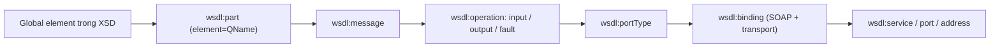

# Operation, input, output, fault và liên hệ với các phần tử XSD

Một tệp WSDL chỉ có giá trị khi người đọc trả lời được các câu hỏi thực tế: **dịch vụ có những thao tác nào, thao tác nhận phần tử XML nào, trả phần tử XML nào, và lỗi được mô tả ra sao?** Trong hệ thống SOAP xây dựng bằng **Spring Web Services (Spring-WS)**, đây là bước cốt lõi để phát triển theo hướng **contract-first**: định nghĩa XSD/WSDL trước, từ đó ánh xạ JAXB, viết endpoint và SOAP client, kiểm thử thông điệp và công bố hợp đồng cho đối tác.

Bài học tập trung vào **WSDL 1.1**, phiên bản phổ biến trong hệ sinh thái Spring-WS và nhiều tích hợp doanh nghiệp. Chúng ta sẽ theo dõi một hợp đồng mẫu từ khai báo **global element trong XSD** qua `wsdl:message`, `wsdl:portType`, `wsdl:binding`, `wsdl:service` đến SOAP Envelope trên đường truyền. Qua đó, bạn sẽ hiểu chính xác mối quan hệ giữa **operation, input, output, fault** và QName của từng phần tử nghiệp vụ, thay vì nhầm tên operation với tên phần tử XML.

## 1. Mục tiêu học tập

Sau bài học, bạn có thể:

- Giải thích chức năng của `wsdl:types`, `wsdl:message`, `wsdl:portType`, `wsdl:binding` và `wsdl:service`.
- Đọc một `wsdl:operation` để xác định mẫu trao đổi **request–response** hoặc **one-way**.
- Truy ngược các tham chiếu `input`, `output`, `fault` về `wsdl:message`, `wsdl:part` và **global element** tương ứng trong XSD.
- Phân biệt tên operation, message, part, XML element, XSD type, namespace URI và SOAPAction.
- Giải thích khi nào SOAP Fault tương ứng với một `wsdl:fault`, và những lỗi nào nằm ngoài phạm vi WSDL fault nghiệp vụ.
- Kiểm tra việc công bố WSDL/XSD để SOAP client, JAXB và endpoint Spring-WS sử dụng đúng một phiên bản contract.
- Tự lập bảng truy vết operation → message → element → SOAP Body để kiểm thử tương thích.

## 2. Phân biệt giao diện dịch vụ với cấu trúc dữ liệu

**XSD (XML Schema)** mô tả dữ liệu XML: phần tử nào tồn tại, thuộc namespace nào, phần tử con theo thứ tự nào, kiểu dữ liệu và ràng buộc ra sao. **WSDL (Web Services Description Language)** mô tả giao diện trao đổi thông điệp: operation nào nhận thông điệp nào, trả thông điệp nào, có những fault nào, dùng SOAP binding nào và truy cập ở địa chỉ nào.

Ví dụ hệ thống quản lý đơn hàng cung cấp hai thao tác:

1. `GetOrderStatus` nhận mã đơn hàng, trả trạng thái hoặc thông báo lỗi không tìm thấy đơn.
2. `NotifyOrderStateChanged` nhận thông báo thay đổi trạng thái, không khai báo output nghiệp vụ.

XSD sẽ định nghĩa các phần tử:

- `GetOrderStatusRequest`
- `GetOrderStatusResponse`
- `OrderNotFoundFault`
- `NotifyOrderStateChangedRequest`

WSDL sẽ nối những phần tử đó với các operation.



Mũi tên biểu diễn đường truy vết hợp đồng, không phải thứ tự thực thi trên server. Ở runtime, client gửi SOAP message theo binding và endpoint phân tích SOAP Body theo QName; các tệp XSD/WSDL không tự thực thi nghiệp vụ.

### Bảng thuật ngữ cần phân biệt

| Thành phần | Câu hỏi nó trả lời | Ví dụ |
|---|---|---|
| `wsdl:operation/@name` | Thao tác dịch vụ tên gì? | `GetOrderStatus` |
| `wsdl:input/@message` | Input tham chiếu WSDL message nào? | `tns:GetOrderStatusInput` |
| `wsdl:output/@message` | Output tham chiếu WSDL message nào? | `tns:GetOrderStatusOutput` |
| `wsdl:fault/@message` | Fault được khai báo bởi WSDL message nào? | `tns:OrderNotFoundFaultMessage` |
| `wsdl:part/@element` | Phần tử XSD toàn cục nào được truyền? | `ord:GetOrderStatusRequest` |
| `xs:element/@name` | Local name của phần tử dữ liệu? | `GetOrderStatusRequest` |
| `xs:complexType/@name` | Kiểu XSD được đặt tên? | `OrderStatusType` |
| `soap:operation/@soapAction` | Giá trị SOAPAction ở binding SOAP 1.1? | `urn:order:GetOrderStatus` |
| `soap:address/@location` | HTTP endpoint của dịch vụ? | `https://api.example.org/ws/orders` |

Các tên này có thể gần giống nhau để dễ hiểu, nhưng **không phải một trường duy nhất** và không thể tự thay thế nhau.

## 3. XSD: nguồn định nghĩa các phần tử input, output và fault

Hãy xây dựng một schema tên `order-v1.xsd`. Namespace nghiệp vụ được giữ ổn định trong toàn bộ ví dụ:

```text
https://example.org/contracts/order/v1
```

XSD minh họa:

```xml
<?xml version="1.0" encoding="UTF-8"?>
<xs:schema
    xmlns:xs="http://www.w3.org/2001/XMLSchema"
    xmlns:ord="https://example.org/contracts/order/v1"
    targetNamespace="https://example.org/contracts/order/v1"
    elementFormDefault="qualified">

    <xs:simpleType name="OrderState">
        <xs:restriction base="xs:string">
            <xs:enumeration value="NEW"/>
            <xs:enumeration value="PAID"/>
            <xs:enumeration value="SHIPPED"/>
        </xs:restriction>
    </xs:simpleType>

    <xs:element name="GetOrderStatusRequest">
        <xs:complexType>
            <xs:sequence>
                <xs:element name="orderId" type="xs:string"/>
            </xs:sequence>
        </xs:complexType>
    </xs:element>

    <xs:element name="GetOrderStatusResponse">
        <xs:complexType>
            <xs:sequence>
                <xs:element name="orderId" type="xs:string"/>
                <xs:element name="status" type="ord:OrderState"/>
            </xs:sequence>
        </xs:complexType>
    </xs:element>

    <xs:element name="OrderNotFoundFault">
        <xs:complexType>
            <xs:sequence>
                <xs:element name="code" type="xs:string"/>
                <xs:element name="message" type="xs:string"/>
                <xs:element name="orderId" type="xs:string"/>
            </xs:sequence>
        </xs:complexType>
    </xs:element>

    <xs:element name="NotifyOrderStateChangedRequest">
        <xs:complexType>
            <xs:sequence>
                <xs:element name="eventId" type="xs:string"/>
                <xs:element name="orderId" type="xs:string"/>
                <xs:element name="status" type="ord:OrderState"/>
            </xs:sequence>
        </xs:complexType>
    </xs:element>
</xs:schema>
```

Ở đây có **bốn global element** và một kiểu dữ liệu dùng lại là `OrderState`.

Global element `GetOrderStatusRequest` có QName:

```text
{https://example.org/contracts/order/v1}GetOrderStatusRequest
```

Điểm cần lưu ý:

- `targetNamespace` quyết định namespace của các khai báo toàn cục trong schema.
- `elementFormDefault="qualified"` yêu cầu các phần tử cục bộ trong payload, như `orderId` và `status`, xuất hiện ở cùng namespace nghiệp vụ trừ khi có khai báo khác.
- `ord:OrderState` là **QName của một kiểu XSD**, còn `ord:GetOrderStatusResponse` là **QName của một phần tử XSD**; chúng phục vụ các vị trí tham chiếu khác nhau.
- `xs:sequence` yêu cầu giữ đúng thứ tự phần tử; không được tự đảo `status` lên trước `orderId` chỉ vì mã Java có thứ tự field khác.
- Chỉ riêng schema chưa định nghĩa operation, địa chỉ service, SOAPAction hay cách đóng gói SOAP Fault.

Trong hệ thống doanh nghiệp, nên dùng kiểu XSD cụ thể hơn cho mã đơn, mã sự kiện và ràng buộc độ dài. Ví dụ giữ schema gọn để người học tập trung vào mối liên hệ với WSDL.

## 4. WSDL 1.1: các tầng cấu trúc và định danh

Một WSDL 1.1 thường gồm những phần chính:

```text
wsdl:definitions
├── wsdl:types
│   └── xs:schema / xs:import
├── wsdl:message
│   └── wsdl:part
├── wsdl:portType
│   └── wsdl:operation
│       ├── wsdl:input
│       ├── wsdl:output
│       └── wsdl:fault
├── wsdl:binding
│   └── wsdl:operation (+ SOAP binding details)
└── wsdl:service
    └── wsdl:port
        └── soap:address
```

Trong đó:

- **`definitions`** là phần tử gốc của WSDL 1.1, chứa namespace và các khai báo.
- **`types`** khai báo hoặc tham chiếu các schema mô tả payload.
- **`message`** định nghĩa một thông điệp trừu tượng qua một hoặc nhiều `part`.
- **`portType`** mô tả tập các operation độc lập với giao thức truyền tải (gần nghĩa “interface”; trong WSDL 2.0 thuật ngữ là `interface`, nhưng cấu trúc khác).
- **`binding`** gắn `portType` với giao thức cụ thể: SOAP 1.1, phong cách document, body literal và các cấu hình theo operation.
- **`service`** nhóm các port; mỗi port chỉ đến một binding và địa chỉ kết nối.

### Namespace WSDL khác namespace XSD

Ví dụ hợp đồng dùng hai URI:

```text
WSDL targetNamespace:
https://example.org/wsdl/order-service/v1

XSD targetNamespace:
https://example.org/contracts/order/v1
```

Ở đây, `tns:GetOrderStatusInput` là **QName của một WSDL message**, còn `ord:GetOrderStatusRequest` là **QName của phần tử XSD**. Hai QName dùng hai namespace riêng, hoàn toàn hợp lệ.

Prefix `tns` và `ord` chỉ là cách viết tắt. Tên thực của phần tử hay thành phần WSDL được xác định bởi namespace URI và local name. Đổi prefix không nhất thiết đổi contract; đổi namespace URI có thể làm mất tương thích.

## 5. Ví dụ WSDL 1.1 kết nối đầy đủ operation, input, output và fault

Dưới đây là một WSDL 1.1 minh họa có đủ cấu phần chính. Tệp được đặt tên `orders.wsdl`; tệp XSD `order-v1.xsd` ở cùng vị trí công bố để tham chiếu tương đối có thể được phân giải.

```xml
<?xml version="1.0" encoding="UTF-8"?>
<wsdl:definitions
    xmlns:wsdl="http://schemas.xmlsoap.org/wsdl/"
    xmlns:xs="http://www.w3.org/2001/XMLSchema"
    xmlns:soap="http://schemas.xmlsoap.org/wsdl/soap/"
    xmlns:tns="https://example.org/wsdl/order-service/v1"
    xmlns:ord="https://example.org/contracts/order/v1"
    targetNamespace="https://example.org/wsdl/order-service/v1"
    name="OrderService">

    <wsdl:types>
        <xs:schema
            targetNamespace="https://example.org/wsdl/order-service/v1">
            <xs:import
                namespace="https://example.org/contracts/order/v1"
                schemaLocation="order-v1.xsd"/>
        </xs:schema>
    </wsdl:types>

    <wsdl:message name="GetOrderStatusInput">
        <wsdl:part name="parameters"
                   element="ord:GetOrderStatusRequest"/>
    </wsdl:message>

    <wsdl:message name="GetOrderStatusOutput">
        <wsdl:part name="parameters"
                   element="ord:GetOrderStatusResponse"/>
    </wsdl:message>

    <wsdl:message name="OrderNotFoundFaultMessage">
        <wsdl:part name="detail"
                   element="ord:OrderNotFoundFault"/>
    </wsdl:message>

    <wsdl:message name="NotifyOrderStateChangedInput">
        <wsdl:part name="parameters"
                   element="ord:NotifyOrderStateChangedRequest"/>
    </wsdl:message>

    <wsdl:portType name="OrderPortType">
        <wsdl:operation name="GetOrderStatus">
            <wsdl:input message="tns:GetOrderStatusInput"/>
            <wsdl:output message="tns:GetOrderStatusOutput"/>
            <wsdl:fault name="OrderNotFound"
                        message="tns:OrderNotFoundFaultMessage"/>
        </wsdl:operation>

        <wsdl:operation name="NotifyOrderStateChanged">
            <wsdl:input
                message="tns:NotifyOrderStateChangedInput"/>
        </wsdl:operation>
    </wsdl:portType>

    <wsdl:binding name="OrderSoap11Binding"
                  type="tns:OrderPortType">
        <soap:binding
            style="document"
            transport="http://schemas.xmlsoap.org/soap/http"/>

        <wsdl:operation name="GetOrderStatus">
            <soap:operation soapAction="urn:order:GetOrderStatus"/>
            <wsdl:input>
                <soap:body use="literal"/>
            </wsdl:input>
            <wsdl:output>
                <soap:body use="literal"/>
            </wsdl:output>
            <wsdl:fault name="OrderNotFound">
                <soap:fault name="OrderNotFound" use="literal"/>
            </wsdl:fault>
        </wsdl:operation>

        <wsdl:operation name="NotifyOrderStateChanged">
            <soap:operation
                soapAction="urn:order:NotifyOrderStateChanged"/>
            <wsdl:input>
                <soap:body use="literal"/>
            </wsdl:input>
        </wsdl:operation>
    </wsdl:binding>

    <wsdl:service name="OrderService">
        <wsdl:port name="OrderPort"
                   binding="tns:OrderSoap11Binding">
            <soap:address
                location="https://api.example.org/ws/orders"/>
        </wsdl:port>
    </wsdl:service>
</wsdl:definitions>
```

Đây là ví dụ **document/literal** và các message đều có một `part` tham chiếu **global element** của XSD. Về mặt kỹ thuật, dạng này không mặc nhiên thỏa quy ước *document/literal wrapped* của một số công cụ sinh mã, bởi phần tử input được đặt tên `GetOrderStatusRequest` thay vì trùng tên operation `GetOrderStatus`. Một binding document/literal có thể dùng dạng bare hoặc wrapped; cần tuân theo profile và quy ước mà các bên cùng thống nhất.

Trong `wsdl:types`, `xs:import` cung cấp kết nối tới XSD nghiệp vụ. Giá trị `schemaLocation="order-v1.xsd"` là đường dẫn tham chiếu tương đối từ tài liệu WSDL được xuất bản; **không phải namespace URI**. Phải bảo đảm ứng dụng client tải được `orders.wsdl` và `order-v1.xsd` từ địa chỉ phù hợp. Nếu chỉ công bố WSDL nhưng XSD import trả 404, các công cụ sinh SOAP client vẫn có thể thất bại.

## 6. Truy vết một operation qua các lớp hợp đồng

Xét operation:

```xml
<wsdl:operation name="GetOrderStatus">
    <wsdl:input message="tns:GetOrderStatusInput"/>
    <wsdl:output message="tns:GetOrderStatusOutput"/>
    <wsdl:fault name="OrderNotFound"
                message="tns:OrderNotFoundFaultMessage"/>
</wsdl:operation>
```

**Bước 1 — Tìm message được tham chiếu.** `tns:GetOrderStatusInput` trỏ tới:

```xml
<wsdl:message name="GetOrderStatusInput">
    <wsdl:part name="parameters"
               element="ord:GetOrderStatusRequest"/>
</wsdl:message>
```

**Bước 2 — Phân giải QName của part.** `ord:GetOrderStatusRequest` sử dụng URI `https://example.org/contracts/order/v1`, nên QName mở rộng là:

```text
{https://example.org/contracts/order/v1}GetOrderStatusRequest
```

**Bước 3 — Tìm global element trong XSD.** Từ schema có `targetNamespace` trùng URI trên, tìm:

```xml
<xs:element name="GetOrderStatusRequest">
    ...
</xs:element>
```

**Bước 4 — Làm tương tự với output và fault.** Truy `tns:GetOrderStatusOutput` → `ord:GetOrderStatusResponse`; truy `tns:OrderNotFoundFaultMessage` → `ord:OrderNotFoundFault`.

Kết quả là bảng có thể dùng làm nền cho kiểm thử tích hợp:

| Vai trò | WSDL message QName | Global XSD element QName |
|---|---|---|
| Input | `tns:GetOrderStatusInput` | `ord:GetOrderStatusRequest` |
| Output | `tns:GetOrderStatusOutput` | `ord:GetOrderStatusResponse` |
| Declared fault: `OrderNotFound` | `tns:OrderNotFoundFaultMessage` | `ord:OrderNotFoundFault` |
| Input của one-way `NotifyOrderStateChanged` | `tns:NotifyOrderStateChangedInput` | `ord:NotifyOrderStateChangedRequest` |

Trong bảng trên, `tns` = `https://example.org/wsdl/order-service/v1` và `ord` = `https://example.org/contracts/order/v1`.

### Tại sao tên operation không nhất thiết trùng tên payload?

Operation là khái niệm về một hành động trong interface. Tên phần tử XML nằm trong `wsdl:part/@element` và thuộc về XSD. Trong ví dụ:

```text
Operation name:     GetOrderStatus
Input element name: GetOrderStatusRequest
Input element QName:
  {https://example.org/contracts/order/v1}GetOrderStatusRequest
```

Server Spring-WS có thể định tuyến theo **QName của phần tử trực tiếp trong SOAP Body**, ví dụ `@PayloadRoot(namespace=..., localPart="GetOrderStatusRequest")`. Không thể kết luận mapping đúng chỉ vì tên phương thức Java hoặc tên operation WSDL đều là `GetOrderStatus`.

**Tên `wsdl:message` cũng không xuất hiện tự động trong SOAP Body.** Nó là một định danh ở lớp mô tả hợp đồng, được nối với payload qua `wsdl:part`.

## 7. Input và output của request–response trên SOAP wire

Theo binding document/literal ở ví dụ, SOAP Body gửi đi chứa trực tiếp phần tử XSD của input. Ví dụ SOAP 1.1 request:

```xml
<soap:Envelope
    xmlns:soap="http://schemas.xmlsoap.org/soap/envelope/"
    xmlns:ord="https://example.org/contracts/order/v1">
    <soap:Header/>
    <soap:Body>
        <ord:GetOrderStatusRequest>
            <ord:orderId>ORD-1024</ord:orderId>
        </ord:GetOrderStatusRequest>
    </soap:Body>
</soap:Envelope>
```

Một lời gọi SOAP 1.1 qua HTTP có thể có:

```http
POST /ws/orders HTTP/1.1
Host: api.example.org
Content-Type: text/xml; charset=utf-8
SOAPAction: "urn:order:GetOrderStatus"

[SOAP 1.1 Envelope của GetOrderStatusRequest]
```

Giá trị `SOAPAction` được chỉ ra trong `soap:operation` của binding; nó **không phải** QName payload, tên operation cũng không tự động là giá trị SOAPAction. SOAPAction hữu ích cho middleware hoặc endpoint mapping nếu được cấu hình, nhưng không thay thế việc phân giải namespace của SOAP Body.

Phản hồi thành công:

```xml
<soap:Envelope
    xmlns:soap="http://schemas.xmlsoap.org/soap/envelope/"
    xmlns:ord="https://example.org/contracts/order/v1">
    <soap:Body>
        <ord:GetOrderStatusResponse>
            <ord:orderId>ORD-1024</ord:orderId>
            <ord:status>SHIPPED</ord:status>
        </ord:GetOrderStatusResponse>
    </soap:Body>
</soap:Envelope>
```

Payload này khớp phần tử `ord:GetOrderStatusResponse` trong XSD; giá trị `SHIPPED` nằm trong enumeration `OrderState`.

Ở mức WSDL 1.1, operation có **cả `input` và `output`** là request–response. Việc ứng dụng xử lý nội bộ nhanh hay chậm, đồng bộ hay có bước nền, không thay đổi định nghĩa MEP. Một operation có output dạng `Accepted(jobId)` nhưng công việc chưa hoàn tất vẫn là request–response.

### Không nhầm HTTP response với SOAP output

HTTP luôn có phản hồi ở mức transport của HTTP request, nhưng **SOAP output** là thông điệp nghiệp vụ được WSDL khai báo. HTTP status `200` không tự chứng minh payload đúng XSD. Muốn kiểm tra contract, phải kiểm tra SOAP Body, QName của phần tử output và nội dung dữ liệu theo XSD.

Tương tự, khi server trả HTTP `500`, phải phân tích xem đó là SOAP Fault, lỗi reverse proxy, lỗi TLS/transport hay response không đúng chuẩn. Không nên suy ra SOAP Fault chỉ từ HTTP status.

## 8. Fault: lỗi được khai báo trong operation và hình dạng SOAP Fault

Trong WSDL 1.1, `wsdl:fault` là một thông điệp lỗi được đặt tên gắn với một operation. Đoạn ví dụ:

```xml
<wsdl:fault name="OrderNotFound"
            message="tns:OrderNotFoundFaultMessage"/>
```

trỏ đến message:

```xml
<wsdl:message name="OrderNotFoundFaultMessage">
    <wsdl:part name="detail"
               element="ord:OrderNotFoundFault"/>
</wsdl:message>
```

Binding SOAP có cùng tên fault:

```xml
<wsdl:fault name="OrderNotFound">
    <soap:fault name="OrderNotFound" use="literal"/>
</wsdl:fault>
```

Chuỗi liên kết là:

```text
wsdl:operation / wsdl:fault name="OrderNotFound"
      ↓ message="tns:OrderNotFoundFaultMessage"
wsdl:message / wsdl:part
      ↓ element="ord:OrderNotFoundFault"
xs:element name="OrderNotFoundFault"
      ↓
soap:Fault / detail / ord:OrderNotFoundFault
```

**Điểm dễ nhầm:** `OrderNotFoundFault` là global element để mô tả **nội dung chi tiết** của một lỗi được khai báo, chứ **không phải** phần tử root của SOAP Body khi xảy ra lỗi. Root trong Body của thông điệp lỗi SOAP 1.1 vẫn là `soap:Fault`.

Ví dụ SOAP 1.1 Fault do dịch vụ chủ động tạo theo hợp đồng:

```xml
<soap:Envelope
    xmlns:soap="http://schemas.xmlsoap.org/soap/envelope/"
    xmlns:ord="https://example.org/contracts/order/v1">
    <soap:Body>
        <soap:Fault>
            <faultcode>soap:Client</faultcode>
            <faultstring>Order does not exist</faultstring>
            <detail>
                <ord:OrderNotFoundFault>
                    <ord:code>ORDER_NOT_FOUND</ord:code>
                    <ord:message>No matching order</ord:message>
                    <ord:orderId>ORD-9999</ord:orderId>
                </ord:OrderNotFoundFault>
            </detail>
        </soap:Fault>
    </soap:Body>
</soap:Envelope>
```

Với binding SOAP 1.1 trên HTTP, thông điệp Fault thường được gửi cùng HTTP `500` theo quy tắc binding. `faultcode=soap:Client` biểu thị lỗi liên quan phía gửi theo phân loại SOAP 1.1; `soap:Server` biểu thị lỗi phía nhận. Trong SOAP 1.2, cấu trúc Fault chuyển sang `Code`, `Reason` và `Detail`, với các mã khái quát như `Sender` và `Receiver`. Không áp dụng nguyên định dạng Fault 1.1 cho binding SOAP 1.2.

### Fault khai báo trong WSDL và lỗi thực tế không đồng nhất tuyệt đối

Có ba tầng phải xét riêng:

1. **Hợp đồng:** WSDL khai báo `OrderNotFound` và liên kết đến phần tử `ord:OrderNotFoundFault`.
2. **Triển khai:** Spring-WS phải bắt ngoại lệ và tạo `soap:Fault` chứa đúng detail element nếu yêu cầu hợp đồng. Khai báo `wsdl:fault` không tự sinh runtime behavior.
3. **Tình huống lỗi khác:** XML không well-formed, thiếu header WS-Security, sai certificate, timeout, endpoint không tìm thấy hoặc lỗi hệ thống có thể được xử lý theo chính sách riêng và không nhất thiết sử dụng `OrderNotFoundFault`.

Một số công cụ tạo client từ WSDL ánh xạ các **declared faults** thành exception kiểu riêng. Tuy vậy, contract vẫn cần nêu rõ trường hợp nào phát sinh fault và cấu trúc `detail`; phía client vẫn phải xử lý lỗi SOAP chung và transport error.

### Fault và kết quả nghiệp vụ bình thường

Đơn hàng ở trạng thái `NEW` hoặc `SHIPPED` là dữ liệu nghiệp vụ bình thường, không nên biến thành Fault. Việc đơn hàng không tồn tại có thể được mô hình hóa bằng Fault `OrderNotFound` như ví dụ, hoặc bằng response có trạng thái `NOT_FOUND` nếu contract thiết kế theo hướng đó. Hai cách đều có thể tồn tại nhưng **phải thống nhất trong XSD/WSDL và tài liệu nghiệp vụ**, tránh một phía mong output bình thường còn phía khác gửi Fault.

## 9. One-way operation: chỉ có input, không có output/fault nghiệp vụ được khai báo

Operation thứ hai:

```xml
<wsdl:operation name="NotifyOrderStateChanged">
    <wsdl:input message="tns:NotifyOrderStateChangedInput"/>
</wsdl:operation>
```

khai báo một input và **không khai báo output**. Đây là mẫu one-way trong WSDL 1.1, phù hợp với thông báo sự kiện đơn hàng:

```xml
<soap:Envelope
    xmlns:soap="http://schemas.xmlsoap.org/soap/envelope/"
    xmlns:ord="https://example.org/contracts/order/v1">
    <soap:Body>
        <ord:NotifyOrderStateChangedRequest>
            <ord:eventId>EVT-3001</ord:eventId>
            <ord:orderId>ORD-1024</ord:orderId>
            <ord:status>SHIPPED</ord:status>
        </ord:NotifyOrderStateChangedRequest>
    </soap:Body>
</soap:Envelope>
```

One-way trên SOAP/HTTP vẫn có thể nhận một HTTP acknowledgement, chẳng hạn `202 Accepted`. Giá trị đó **không phải SOAP output nghiệp vụ**, và không bảo đảm sự kiện đã được xử lý hoàn tất. Nếu người gửi cần theo dõi kết quả, cần callback, operation tra cứu hoặc cơ chế tương quan khác được thiết kế riêng.

Không tự thêm `wsdl:output` để “trả lỗi” rồi vẫn gọi operation là one-way: nếu cần phản hồi nghiệp vụ có cấu trúc trong cùng lời gọi, hãy thiết kế operation request–response. Lỗi transport hoặc lỗi xử lý SOAP có thể được báo qua binding/cơ chế xử lý riêng; hợp đồng one-way không biến những lỗi đó thành một `wsdl:fault` được khai báo giống request–response.

### WSDL 1.1 còn những MEP nào?

Ở mức mô tả `portType`, WSDL 1.1 còn có `solicit–response` và `notification`, nhưng request–response và one-way là hai mô hình thường gặp nhất khi xây dựng SOAP/HTTP client gọi server trong Spring-WS. Đọc kỹ vị trí `input` và `output` trước khi kết luận kiểu thao tác; không suy luận từ tên operation có chữ `Notify`, `Send` hay `Get`.

## 10. `wsdl:part/@element` và `wsdl:part/@type`: vì sao khác nhau?

WSDL 1.1 cho phép part liên hệ dữ liệu thông qua khai báo **`element`** hoặc **`type`** tùy phong cách binding:

```xml
<!-- Part tham chiếu một global element -->
<wsdl:part name="parameters"
           element="ord:GetOrderStatusRequest"/>

<!-- Part tham chiếu một kiểu dữ liệu -->
<wsdl:part name="status"
           type="ord:OrderState"/>
```

Ở ví dụ thứ nhất, `element` trỏ đến một **element declaration** cụ thể, mang QName đã biết. Ví dụ thứ hai, `type` trỏ đến **XSD type definition**, không tự cung cấp tên root element để đặt vào SOAP Body.

Trong kiểu **document/literal** sử dụng các message wrapper rõ ràng, cách tham chiếu global element giúp xác định XML payload nhất quán và dễ kiểm tra bằng XSD. Không tùy tiện đổi từ `element` sang `type` chỉ để làm tên trường Java trông gọn hơn; nó có thể thay đổi cách công cụ dựng SOAP message hoặc không thỏa profile tương thích mà đối tác yêu cầu.

Có thể có nhiều part trong một message WSDL 1.1, nhưng khi xây dựng contract document/literal phù hợp với quy ước **WS-I Basic Profile**, cần đặc biệt lưu ý các ràng buộc về số part, element và nội dung body. Với ví dụ bài này, mỗi message dùng **một part tham chiếu một global element**, một hình thức đơn giản và dễ tương thích.

## 11. Từ WSDL đến Spring Web Services endpoint và JAXB

Trong Spring-WS, endpoint thường được ánh xạ dựa trên QName của phần tử payload trong SOAP Body bằng `@PayloadRoot`. Ví dụ triển khai operation `GetOrderStatus`:

```java
import org.springframework.ws.server.endpoint.annotation.Endpoint;
import org.springframework.ws.server.endpoint.annotation.PayloadRoot;
import org.springframework.ws.server.endpoint.annotation.RequestPayload;
import org.springframework.ws.server.endpoint.annotation.ResponsePayload;

@Endpoint
public class OrderEndpoint {
    private static final String NS =
        "https://example.org/contracts/order/v1";

    private final OrderService orderService;

    public OrderEndpoint(OrderService orderService) {
        this.orderService = orderService;
    }

    @PayloadRoot(namespace = NS, localPart = "GetOrderStatusRequest")
    @ResponsePayload
    public GetOrderStatusResponse getStatus(
            @RequestPayload GetOrderStatusRequest request) {
        return orderService.getStatus(request.getOrderId());
    }

    @PayloadRoot(
        namespace = NS,
        localPart = "NotifyOrderStateChangedRequest")
    public void notifyStateChanged(
            @RequestPayload NotifyOrderStateChangedRequest request) {
        orderService.acceptEvent(request);
    }
}
```

Mã minh họa giả định `OrderService` là service nghiệp vụ của ứng dụng và các lớp `GetOrderStatusRequest`, `GetOrderStatusResponse`, `NotifyOrderStateChangedRequest` đã có mapping XML phù hợp. Trong thực tế, JAXB sinh từ XSD có thể tạo `JAXBElement<T>` và `ObjectFactory` thay vì đặt `@XmlRootElement` trên mọi lớp; khi đó chữ ký phương thức và cách marshalling cần điều chỉnh theo kiểu được sinh.

Điều quan trọng khi đối chiếu hợp đồng:

- `@PayloadRoot(namespace=NS, localPart="GetOrderStatusRequest")` khớp **global element của input** trong XSD.
- Phương thức trả về một response có QName **`GetOrderStatusResponse`**, thống nhất với `wsdl:output` thông qua `wsdl:part`.
- Phương thức one-way trả `void` và không cần `@ResponsePayload` cho business output.
- Ngoại lệ `OrderNotFound` cần được ánh xạ ra SOAP Fault chứa detail đúng `ord:OrderNotFoundFault` nếu đó là điều contract yêu cầu. Có thể sử dụng các exception resolver và tùy biến Fault detail của Spring-WS; chỉ ném một Java exception **không bảo đảm** detail trùng XSD.
- SOAPAction được xử lý bởi binding và thông tin yêu cầu; nó không thay thế QName mapping.

Trong môi trường chuyển đổi Jakarta, annotation JAXB có thể nằm dưới `jakarta.xml.bind.annotation` thay vì `javax.xml.bind.annotation`; cần thống nhất với phiên bản Spring, JAXB runtime và công cụ sinh mã. Riêng `javax.xml.namespace.QName` thuộc JDK vẫn giữ package đó.

### SOAP client lấy điều gì từ WSDL?

Từ WSDL/XSD, công cụ sinh client hoặc lập trình viên có thể xác định:

1. Endpoint trong `soap:address`.
2. Giao thức và phiên bản SOAP từ `wsdl:binding`.
3. SOAPAction của từng operation (khi dùng SOAP 1.1 HTTP).
4. QName, thứ tự và cấu trúc input/output từ `wsdl:message`, `wsdl:part`, XSD.
5. Các declared faults và kiểu detail tương ứng.

Với `WebServiceTemplate`, client có thể marshal payload JAXB bằng `marshalSendAndReceive` cho request–response hoặc dùng API gửi phù hợp one-way. Việc WSDL khai báo một operation không tự cấu hình toàn bộ `WebServiceTemplate`: endpoint URI, marshaller, security interceptor, transport timeout và SOAP version vẫn cần cấu hình tương ứng.

## 12. Công bố WSDL và XSD trong Spring-WS

Một contract tốt phải được **công bố nhất quán** để phía client lấy đúng WSDL lẫn mọi XSD được import. Có hai hướng triển khai phổ biến:

- **WSDL tĩnh:** tự quản lý tệp WSDL 1.1 trong mã nguồn, phù hợp khi cần kiểm soát chính xác operation, fault, binding và tên contract. Spring-WS cung cấp `SimpleWsdl11Definition` để expose tệp này.
- **WSDL sinh từ XSD:** sử dụng `DefaultWsdl11Definition` với quy ước tên và cấu hình tương ứng. Cách này tiện cho những interface đơn giản nhưng cần kiểm tra kỹ WSDL được sinh, đặc biệt khi yêu cầu fault, naming hoặc binding phức tạp.

Ví dụ Spring-WS sử dụng **WSDL tĩnh**:

```java
import org.springframework.context.ApplicationContext;
import org.springframework.context.annotation.Bean;
import org.springframework.context.annotation.Configuration;
import org.springframework.core.io.ClassPathResource;
import org.springframework.boot.web.servlet.ServletRegistrationBean;
import org.springframework.ws.config.annotation.EnableWs;
import org.springframework.ws.transport.http.MessageDispatcherServlet;
import org.springframework.ws.wsdl.wsdl11.SimpleWsdl11Definition;

@EnableWs
@Configuration
public class SoapConfiguration {

    @Bean
    public ServletRegistrationBean<MessageDispatcherServlet>
            messageDispatcherServlet(ApplicationContext context) {
        MessageDispatcherServlet servlet =
            new MessageDispatcherServlet();
        servlet.setApplicationContext(context);
        servlet.setTransformWsdlLocations(true);
        return new ServletRegistrationBean<>(servlet, "/ws/*");
    }

    @Bean(name = "orders")
    public SimpleWsdl11Definition ordersWsdl() {
        return new SimpleWsdl11Definition(
            new ClassPathResource("wsdl/orders.wsdl")
        );
    }
}
```

Đây là cấu hình minh họa theo API Spring-WS/Spring Boot tương ứng; cần kiểm tra phiên bản dependency của dự án trước khi áp dụng. Bean WSDL tên `orders` có thể được servlet công bố theo đường dẫn kiểu `/ws/orders.wsdl` nếu mapping servlet và ứng dụng phù hợp. Đường dẫn SOAP thực tế trong `soap:address` có thể là `/ws/orders`, tách biệt với URL tải WSDL.

**Quan trọng:** `SimpleWsdl11Definition` công bố WSDL, nhưng không thể mặc nhiên kết luận mọi tệp XSD được tham chiếu qua `schemaLocation` đều đã được phục vụ ở đúng URL. Tệp `order-v1.xsd` trong ví dụ phải được publish thành tài nguyên truy cập được, được nhúng trực tiếp, hoặc được tham chiếu bằng một URL/cơ chế phân giải schema phù hợp mà cả hai bên sử dụng được.

`setTransformWsdlLocations(true)` có thể điều chỉnh địa chỉ WSDL được công bố theo request trong các trường hợp được hỗ trợ, nhưng không thay thế cấu hình reverse proxy, TLS, địa chỉ service thực hoặc cơ chế xuất bản XSD. Đặc biệt, khi có ingress/proxy, phải kiểm tra WSDL tải từ **URL công khai thật** để bảo đảm `soap:address` không bị lộ địa chỉ nội bộ hoặc sai hostname.

### Các bước kiểm tra khi publish

1. Mở WSDL qua URL mà đối tác sẽ sử dụng.
2. Đọc `targetNamespace`, `wsdl:service`, `wsdl:port` và `soap:address`.
3. Kiểm tra tất cả `xs:import/@schemaLocation`, `xs:include/@schemaLocation` và `wsdl:import/@location` có thể được phân giải từ môi trường client.
4. Xác nhận QName được import tồn tại trong schema tương ứng và không nhầm với type hay element.
5. Thử công cụ sinh client/validator độc lập; gửi request đúng binding để xác nhận server thực sự triển khai contract.
6. Kiểm tra chính sách truy cập WSDL/XSD: công bố cho đối tác đúng mức, không vô tình để lộ tài liệu nội bộ hoặc URL môi trường riêng.

WSDL có thể công bố chính xác về mặt XML nhưng sai `soap:address`, hoặc có `schemaLocation` trỏ về ổ đĩa của developer. Đây là lỗi **triển khai contract**, không phải lỗi của XPath hay JAXB.

## 13. Bảng kiểm tra và lỗi tích hợp thường gặp

| Triệu chứng | Nguyên nhân thường gặp | Điều cần đối chiếu |
|---|---|---|
| Client không sinh mã từ WSDL | XSD import không tải được hoặc QName part không có trong schema. | `wsdl:types`, `xs:import`, `schemaLocation`, `targetNamespace`. |
| Client gửi đúng tên operation nhưng Spring-WS không tìm endpoint | QName phần tử đầu SOAP Body khác `@PayloadRoot`. | `wsdl:part/@element`, prefix→URI và local name thực tế. |
| Client giải mã response thất bại | SOAP Body không chứa đúng element output hoặc sai thứ tự/kiểu. | `wsdl:output` → `wsdl:message` → XSD response element. |
| Fault về nhưng không map được thành fault class | `detail` thiếu global element đã khai báo hoặc sai QName. | `wsdl:fault`, `soap:fault`, `wsdl:part`, `soap:Fault/detail`. |
| WSDL và SOAP HTTP không cùng phiên bản | Binding SOAP 1.1 nhưng client tạo Envelope SOAP 1.2. | Namespace binding, Envelope và content type. |
| SOAPAction đúng nhưng payload vẫn bị từ chối | SOAPAction khác QName và không tự bảo đảm cấu trúc XML. | `soap:operation` cùng `wsdl:part/@element`. |
| WSDL chỉ có input, client vẫn chờ output nghiệp vụ | Operation là one-way nhưng client sử dụng mẫu request–response. | Sự tồn tại của `wsdl:output` tại `portType`. |
| Endpoint hoạt động trong nội bộ nhưng client bên ngoài thất bại | `soap:address` hoặc URL XSD trỏ vào địa chỉ nội bộ. | WSDL thật được tải qua proxy, DNS, TLS và XSD imports. |
| Sau thay đổi XSD, client cũ bắt đầu lỗi | Đổi namespace, QName, thứ tự, bắt buộc/không bắt buộc hoặc enumeration. | So sánh contract trước và sau cùng bộ test tương thích. |
| Lỗi bảo mật không theo mẫu Fault nghiệp vụ | TLS, WS-Security hoặc policy chặn trước business endpoint. | Security configuration, SOAP header và quy định Fault cho từng lớp. |

Một cách debug hữu hiệu là ghi lại **đầy đủ QName mở rộng** ở từng bước, thay vì chỉ so sánh chuỗi tên:

```text
Operation: GetOrderStatus
  input message:
    {https://example.org/wsdl/order-service/v1}GetOrderStatusInput
  input element:
    {https://example.org/contracts/order/v1}GetOrderStatusRequest

  output message:
    {https://example.org/wsdl/order-service/v1}GetOrderStatusOutput
  output element:
    {https://example.org/contracts/order/v1}GetOrderStatusResponse

  declared fault:
    OrderNotFound
  fault detail element:
    {https://example.org/contracts/order/v1}OrderNotFoundFault
```

Đó là dữ liệu có thể dùng khi so sánh WSDL, JAXB annotations, `@PayloadRoot`, log SOAP và test XML.

## 14. Kiểm thử tương thích dựa vào operation, input, output, fault

Với SOAP tích hợp doanh nghiệp, nên tạo **ma trận kiểm thử contract** từ WSDL và XSD:

| ID | Tình huống | Kết quả kỳ vọng |
|---|---|---|
| C01 | `GetOrderStatusRequest` có `orderId` hợp lệ, đơn tồn tại | SOAP output có QName `ord:GetOrderStatusResponse`; `status` thuộc enumeration. |
| C02 | Request đổi prefix `ord` thành `x` nhưng giữ URI | Định tuyến và xử lý như cùng QName. |
| C03 | Request đổi URI `.../v1` thành `.../v2` | Không được xử lý như input `v1`; lỗi theo endpoint/policy. |
| C04 | Bỏ `orderId` hoặc thêm phần tử lạ | XSD payload từ chối nếu validation được bật; không có tác động nghiệp vụ không hợp lệ. |
| C05 | Đơn hàng không tồn tại | Theo chính sách minh họa: SOAP Fault có `detail/ord:OrderNotFoundFault` và đủ code/message/orderId. |
| C06 | Server tạo response có `status=CANCELLED` | Response không hợp lệ theo XSD ví dụ, vì enum chỉ có NEW/PAID/SHIPPED. |
| C07 | `NotifyOrderStateChangedRequest` hợp lệ | Operation one-way tiếp nhận input; không đòi SOAP output nghiệp vụ. |
| C08 | One-way bị timeout sau khi server đã nhận | Client không được tự kết luận chưa xử lý; dùng `eventId` chống lặp. |
| C09 | Request SOAP 1.2 gửi tới binding SOAP 1.1 | Bị từ chối/nhận lỗi theo cấu hình; không được coi là giao tiếp hợp lệ. |
| C10 | WSDL được public nhưng import XSD trả 404 | Test công bố contract thất bại dù ứng dụng có thể đang chạy. |

### Kiểm thử ở cấp Spring-WS

- Dùng `MockWebServiceClient` để gửi payload vào endpoint và kiểm tra SOAP response/Fault; xác minh QName, dữ liệu, trường bắt buộc và việc service không bị gọi khi validation chặn request.
- Dùng `MockWebServiceServer` để mô phỏng đối tác trong kiểm thử SOAP client, kiểm tra payload gửi đi, unmarshalling, SOAP Fault và xử lý lỗi kết nối.
- Dùng XSD validator để kiểm tra request/response độc lập với server, nhưng nhớ kiểm tra **đúng phần tử payload**, không áp schema nghiệp vụ trực tiếp lên SOAP Envelope.
- Bổ sung một kiểm thử HTTP thực tế tải WSDL từ URL public, phân giải import XSD, gửi SOAP qua TLS và nhận response/Fault. Mock test không thay thế kiểm thử publication, transport và chứng chỉ.
- Kiểm tra security policy và interceptor: WS-Security signature, token, timestamp, truststore/keystore hoặc XML parser limits nếu tích hợp yêu cầu. XSD đúng không có nghĩa request đã được xác thực hoặc được phép thực hiện.

Khi assert lỗi, ưu tiên **mã lỗi ổn định và QName của Fault detail** hơn câu chữ cụ thể của parser. Thông điệp validator có thể thay đổi giữa JDK và XML parser; hợp đồng không nên dựa vào chuỗi kỹ thuật không được cam kết ổn định.

## 15. Bài thực hành đọc WSDL

Cho trích đoạn sau (giả sử các message được định nghĩa trong cùng WSDL):

```xml
<wsdl:portType name="InventoryPortType"
    xmlns:wsdl="http://schemas.xmlsoap.org/wsdl/"
    xmlns:tns="urn:example:inventory-wsdl">
    <wsdl:operation name="CheckStock">
        <wsdl:input message="tns:CheckStockInput"/>
        <wsdl:output message="tns:CheckStockOutput"/>
        <wsdl:fault name="UnknownSku"
                    message="tns:UnknownSkuFaultMessage"/>
    </wsdl:operation>
    <wsdl:operation name="RecordStockEvent">
        <wsdl:input message="tns:RecordStockEventInput"/>
    </wsdl:operation>
</wsdl:portType>
```

Giả sử tiếp tục có ba message:

```xml
<wsdl:message name="CheckStockInput"
    xmlns:wsdl="http://schemas.xmlsoap.org/wsdl/"
    xmlns:inv="urn:example:inventory-data">
    <wsdl:part name="parameters" element="inv:CheckStockRequest"/>
</wsdl:message>

<wsdl:message name="CheckStockOutput"
    xmlns:wsdl="http://schemas.xmlsoap.org/wsdl/"
    xmlns:inv="urn:example:inventory-data">
    <wsdl:part name="parameters" element="inv:CheckStockResponse"/>
</wsdl:message>

<wsdl:message name="UnknownSkuFaultMessage"
    xmlns:wsdl="http://schemas.xmlsoap.org/wsdl/"
    xmlns:inv="urn:example:inventory-data">
    <wsdl:part name="detail" element="inv:UnknownSkuFault"/>
</wsdl:message>
```

Các đoạn trên chỉ minh họa `portType`/`message`, chưa tạo thành một WSDL đầy đủ. Hãy tự trả lời:

1. `CheckStock` là request–response hay one-way? `RecordStockEvent` thuộc MEP nào?
2. Global element nào xuất hiện trực tiếp trong SOAP Body khi gọi `CheckStock` với document/literal one-part?
3. QName mở rộng của phần tử input và output là gì?
4. Khi `CheckStock` trả lỗi `UnknownSku` theo declared fault, root của SOAP Body là gì? Phần tử `inv:UnknownSkuFault` xuất hiện ở đâu?
5. Nếu schema namespace của global element đổi thành `urn:example:inventory-data:v2` nhưng WSDL vẫn tham chiếu `inv:CheckStockRequest` với URI cũ, vì sao client có thể sinh mã hoặc gửi request sai?

**Đáp án tham khảo:**

- (1) `CheckStock` có input và output nên là request–response; `RecordStockEvent` chỉ có input nên one-way.
- (2) Global element là `inv:CheckStockRequest`, nếu binding document/literal sử dụng part `parameters` như ví dụ.
- (3) `{urn:example:inventory-data}CheckStockRequest` và `{urn:example:inventory-data}CheckStockResponse`.
- (4) Root của SOAP Body là `soap:Fault`; `inv:UnknownSkuFault` là phần tử detail khi dịch vụ tạo Fault theo contract.
- (5) WSDL part tham chiếu QName namespace cũ. Nếu schema không còn khai báo phần tử với QName đó, tham chiếu hợp đồng không giải quyết được; client có thể lỗi khi parse/generate hoặc phát sinh payload không tương thích.

## 16. Tổng kết

Trong WSDL 1.1, một **operation** liên kết **input**, **output** và các **fault** thông qua những tham chiếu đến `wsdl:message`. Mỗi message có `wsdl:part`, thường trỏ đến **global element** trong XSD bằng QName. `portType` mô tả giao diện trừu tượng; `binding` xác định SOAP/transport và cách biểu diễn thông điệp; `service/port` cung cấp địa chỉ truy cập.

Đối với **Spring Web Services contract-first**, hãy luôn truy vết theo chuỗi **operation → input/output/fault message → part → XSD element → SOAP Body/Fault detail**. Sau đó đối chiếu với JAXB, `@PayloadRoot`, SOAP client, interceptor, WS-Security và URL WSDL/XSD thực sự được công bố. Đọc đúng chuỗi liên kết này giúp phát hiện lỗi sai namespace, thiếu schema import, khai báo Fault không khớp thực tế và những khác biệt có thể phá vỡ tương thích khi tích hợp hệ thống doanh nghiệp.
