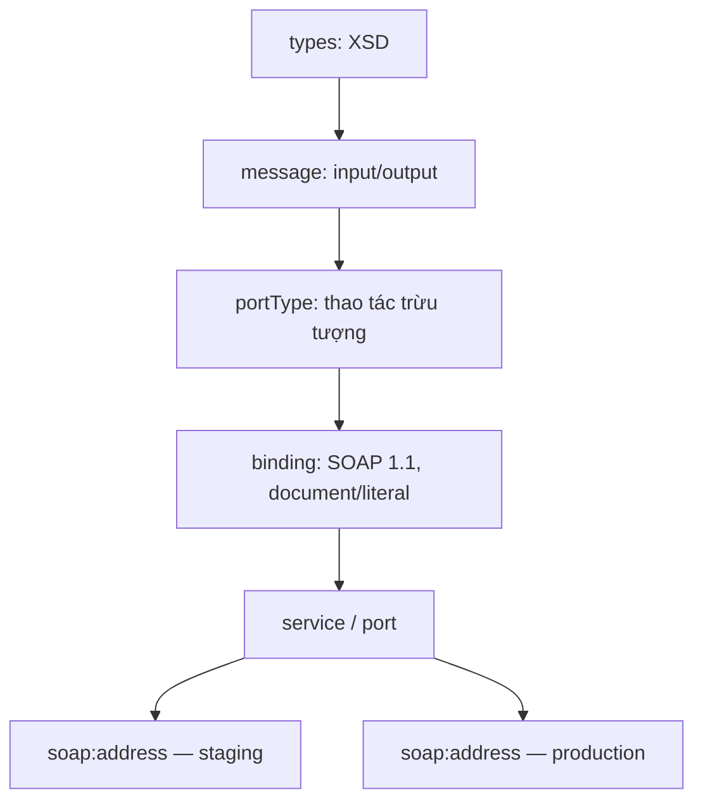
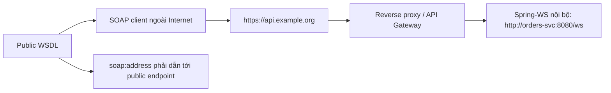

# Tách giao diện trừu tượng khỏi cấu hình địa chỉ triển khai trong WSDL

Trong hệ thống SOAP, cùng một nghiệp vụ có thể chạy ở `localhost`, môi trường kiểm thử, sau API Gateway hoặc trên nhiều máy chủ sản xuất. **Hợp đồng nghiệp vụ không nên đổi chỉ vì URL triển khai đổi.** WSDL được thiết kế để tách phần mô tả **dịch vụ cung cấp thao tác và dữ liệu gì** khỏi phần mô tả **gọi bằng giao thức nào và ở địa chỉ nào**.

Bài học thuộc chương **Đọc và công bố WSDL**, trong module **SPRING_WEB_SERVICES**. Bối cảnh là phát triển dịch vụ SOAP theo hướng *contract-first* bằng Spring Web Services (Spring-WS): thiết kế XSD/WSDL, ánh xạ JAXB, xây dựng endpoint và SOAP client, xử lý SOAP Fault, interceptor, XML security, WS-Security, chứng chỉ và kiểm thử tương thích trong tích hợp doanh nghiệp. Các ví dụ dùng **WSDL 1.1 với SOAP 1.1 qua HTTP** trừ khi ghi rõ. WSDL 2.0 sử dụng thuật ngữ và mô hình thành phần khác.

## 1. Phân biệt giao diện trừu tượng, binding và địa chỉ triển khai

Giả sử một ứng dụng khách cần thao tác `SubmitOrder`:

- **Giao diện trừu tượng** trả lời: có thao tác gì, nhận thông điệp nào, trả thông điệp nào, dữ liệu tuân thủ XSD nào?
- **Binding** trả lời: thao tác đó được đóng gói thành SOAP như thế nào, dùng SOAP 1.1 hay SOAP 1.2, document/literal hay kiểu khác, SOAPAction nào?
- **Triển khai** trả lời: gọi tới URL nào, môi trường nào, cổng/dịch vụ được công bố ở đâu?

Trong WSDL 1.1, sự tách biệt thể hiện bằng các thành phần sau:

| Thành phần WSDL | Vai trò | Có cần thay đổi khi chuyển máy chủ/URL? |
| --- | --- | --- |
| `wsdl:types` | Khai báo/nhập XSD mô tả dữ liệu | Thường **không**, nếu nghiệp vụ không thay đổi |
| `wsdl:message` | Khai báo các phần (`part`) của thông điệp | Thường **không** |
| `wsdl:portType` | Tập thao tác trừu tượng và các thông điệp input/output/fault | Thường **không** |
| `wsdl:binding` | Cách ánh xạ portType sang giao thức và định dạng trao đổi cụ thể | **Không** nếu vẫn cùng SOAP version/kiểu binding/transport |
| `wsdl:service` | Nhóm một hoặc nhiều cổng triển khai | Có thể thay đổi theo môi trường |
| `wsdl:port` | Cổng gắn với một binding và thông tin địa chỉ | Có thể thay đổi theo môi trường |
| `soap:address location` | Địa chỉ kết nối SOAP trên mạng | **Có**, khi endpoint đổi |



**Phân biệt:** `portType` là một *giao diện trừu tượng*, còn `port` là một *điểm truy cập được công bố* tham chiếu một binding cụ thể. Tên gần giống nhau dễ gây nhầm. Theo WSDL 1.1, `portType` không trực tiếp chứa URL, còn địa chỉ thực tế thường nằm trong `soap:address` bên trong `wsdl:port`.

## 2. Phần trừu tượng: `types`, `message` và `portType` 

Ta thiết kế nghiệp vụ gửi đơn hàng:

- Yêu cầu: mã đơn hàng và mã khách hàng.
- Phản hồi: mã đơn hàng và trạng thái đã nhận.
- Thao tác: `SubmitOrder`.

Định nghĩa XSD nghiệp vụ cần độc lập với hostname hay cổng HTTP. Một tài liệu WSDL **chỉ có phần trừu tượng** có thể được viết như sau.

### 2.1. Ví dụ `orders-contract.wsdl`

```xml
<?xml version="1.0" encoding="UTF-8"?>
<wsdl:definitions
    xmlns:wsdl="http://schemas.xmlsoap.org/wsdl/"
    xmlns:xs="http://www.w3.org/2001/XMLSchema"
    xmlns:tns="https://schemas.example.org/orders/contract/v1"
    xmlns:m="https://schemas.example.org/orders/model/v1"
    name="OrdersContract"
    targetNamespace="https://schemas.example.org/orders/contract/v1">

    <wsdl:types>
        <xs:schema
            targetNamespace="https://schemas.example.org/orders/model/v1"
            elementFormDefault="qualified">
            <xs:element name="SubmitOrderRequest">
                <xs:complexType>
                    <xs:sequence>
                        <xs:element name="orderId" type="xs:string"/>
                        <xs:element name="customerId" type="xs:string"/>
                    </xs:sequence>
                </xs:complexType>
            </xs:element>
            <xs:element name="SubmitOrderResponse">
                <xs:complexType>
                    <xs:sequence>
                        <xs:element name="orderId" type="xs:string"/>
                        <xs:element name="accepted" type="xs:boolean"/>
                    </xs:sequence>
                </xs:complexType>
            </xs:element>
        </xs:schema>
    </wsdl:types>

    <wsdl:message name="SubmitOrderInput">
        <wsdl:part name="parameters" element="m:SubmitOrderRequest"/>
    </wsdl:message>
    <wsdl:message name="SubmitOrderOutput">
        <wsdl:part name="parameters" element="m:SubmitOrderResponse"/>
    </wsdl:message>

    <wsdl:portType name="OrdersPortType">
        <wsdl:operation name="SubmitOrder">
            <wsdl:input message="tns:SubmitOrderInput"/>
            <wsdl:output message="tns:SubmitOrderOutput"/>
        </wsdl:operation>
    </wsdl:portType>
</wsdl:definitions>
```

File này đã mô tả **các yêu cầu dữ liệu và thao tác** nhưng chưa nói client gửi tới URL nào. Một số chi tiết cần hiểu chính xác:

1. `targetNamespace` của WSDL đang dùng cho `message` và `portType`; namespace của XSD payload ở ví dụ này **khác** namespace đó. Đây là cách tổ chức hợp lệ, miễn QName và các import được giải quyết chính xác.
2. `wsdl:part element="m:SubmitOrderRequest"` tham chiếu một **phần tử toàn cục XSD**; nó không mô tả địa chỉ mạng.
3. `wsdl:portType` khai báo thao tác trừu tượng `SubmitOrder` liên kết với thông điệp input/output.
4. Không có `wsdl:binding` và `wsdl:service`, tài liệu này chưa đủ để client biết định dạng SOAP cụ thể hoặc kết nối tới endpoint.

**Phần trừu tượng là phần nên được quản lý phiên bản ổn định.** Đổi `SubmitOrderRequest`, QName, phần tử, kiểu dữ liệu hoặc thông điệp phản hồi là thay đổi hợp đồng, có thể làm ảnh hưởng JAXB và các client hiện có.

## 3. Phần cụ thể: `binding`, `service`, `port`, `soap:address`

WSDL triển khai có thể nhập hợp đồng trừu tượng, khai báo binding và gắn địa chỉ SOAP của môi trường.

### 3.1. Ví dụ `orders-deployment.wsdl`

```xml
<?xml version="1.0" encoding="UTF-8"?>
<wsdl:definitions
    xmlns:wsdl="http://schemas.xmlsoap.org/wsdl/"
    xmlns:soap="http://schemas.xmlsoap.org/wsdl/soap/"
    xmlns:c="https://schemas.example.org/orders/contract/v1"
    xmlns:tns="https://schemas.example.org/orders/deployment/v1"
    name="OrdersDeployment"
    targetNamespace="https://schemas.example.org/orders/deployment/v1">

    <wsdl:import
        namespace="https://schemas.example.org/orders/contract/v1"
        location="orders-contract.wsdl"/>

    <wsdl:binding name="OrdersSoap11Binding" type="c:OrdersPortType">
        <soap:binding style="document"
            transport="http://schemas.xmlsoap.org/soap/http"/>

        <wsdl:operation name="SubmitOrder">
            <soap:operation
                soapAction="https://schemas.example.org/orders/SubmitOrder"/>
            <wsdl:input>
                <soap:body use="literal"/>
            </wsdl:input>
            <wsdl:output>
                <soap:body use="literal"/>
            </wsdl:output>
        </wsdl:operation>
    </wsdl:binding>

    <wsdl:service name="OrdersService">
        <wsdl:port name="OrdersSoap11Port"
                   binding="tns:OrdersSoap11Binding">
            <soap:address
                location="https://api.example.org/soap/orders"/>
        </wsdl:port>
    </wsdl:service>
</wsdl:definitions>
```

Đây là một **WSDL triển khai đầy đủ khi các tài liệu được nhập có thể truy cập và phân giải đúng**. Nếu `orders-deployment.wsdl` được công bố qua HTTP, đường dẫn tương đối `orders-contract.wsdl` trong `wsdl:import` phải dẫn tới tài liệu hợp đồng có thể lấy được ở URL tương ứng; việc chỉ có file trong classpath không tự động bảo đảm khách hàng bên ngoài tải được.

Phân tích các liên kết quan trọng:

| Dòng khai báo | Ý nghĩa |
| --- | --- |
| `wsdl:import namespace=... location=...` | Nạp định nghĩa trừu tượng thuộc namespace hợp đồng |
| `wsdl:binding type="c:OrdersPortType"` | Ánh xạ portType trừu tượng sang SOAP binding |
| `soap:binding style="document"` | Dùng kiểu document cho phần thân SOAP |
| `soap:body use="literal"` | Biểu diễn thông điệp theo schema/literal |
| `soap:operation soapAction=...` | Đặt action cho thao tác SOAP 1.1 theo HTTP binding |
| `wsdl:port binding="tns:OrdersSoap11Binding"` | Một cổng cụ thể dùng binding đã khai báo |
| `soap:address location="https://api.example.org/soap/orders"` | URL thực hiện lời gọi SOAP trên môi trường hiện tại |

`soap:binding` nằm trong namespace `http://schemas.xmlsoap.org/wsdl/soap/` dành cho **phần mở rộng binding WSDL 1.1**. Nó khác namespace SOAP 1.1 Envelope `http://schemas.xmlsoap.org/soap/envelope/` xuất hiện trong XML trao đổi trên đường truyền.

Với hợp đồng document/literal này, payload SOAP chứa **`m:SubmitOrderRequest`**, không cần tự thêm phần tử bao ngoài tên `SubmitOrder` dựa trên `portType`. Để chuyển từ SOAP 1.1 sang SOAP 1.2 hoặc từ document/literal sang RPC, cần xem lại binding và khả năng tương thích công cụ. Đó không còn đơn thuần là đổi địa chỉ.

### 3.2. Một lời gọi SOAP thật sự diễn ra ở đâu?

Client có thể tải WSDL từ một URL công bố như:

```text
GET https://api.example.org/soap/orders.wsdl
```

Sau khi phân giải `wsdl:service/wsdl:port/soap:address`, client gửi yêu cầu SOAP 1.1 tới **địa chỉ runtime**:

```http
POST /soap/orders HTTP/1.1
Host: api.example.org
Content-Type: text/xml; charset=utf-8
SOAPAction: "https://schemas.example.org/orders/SubmitOrder"

<soapenv:Envelope
    xmlns:soapenv="http://schemas.xmlsoap.org/soap/envelope/"
    xmlns:m="https://schemas.example.org/orders/model/v1">
    <soapenv:Header/>
    <soapenv:Body>
        <m:SubmitOrderRequest>
            <m:orderId>ORD-1001</m:orderId>
            <m:customerId>C-100</m:customerId>
        </m:SubmitOrderRequest>
    </soapenv:Body>
</soapenv:Envelope>
```

Ví dụ HTTP thể hiện SOAPAction dạng header có dấu ngoặc kép, phù hợp SOAP 1.1. SOAP 1.2 dùng media type và quy tắc action khác. **URL tải WSDL không nhất thiết là URL nhận SOAP POST**: WSDL là tài liệu mô tả, còn `soap:address` chỉ điểm gọi dịch vụ. Đường dẫn cụ thể cần đọc theo môi trường, không mặc định `.wsdl` là endpoint POST.

SOAP response thành công có thể mang:

```xml
<soapenv:Envelope
    xmlns:soapenv="http://schemas.xmlsoap.org/soap/envelope/"
    xmlns:m="https://schemas.example.org/orders/model/v1">
    <soapenv:Body>
        <m:SubmitOrderResponse>
            <m:orderId>ORD-1001</m:orderId>
            <m:accepted>true</m:accepted>
        </m:SubmitOrderResponse>
    </soapenv:Body>
</soapenv:Envelope>
```

## 4. Đổi địa chỉ triển khai mà giữ nguyên hợp đồng

Giả sử ba môi trường cùng thực thi thao tác `SubmitOrder` với cùng XSD và SOAP binding.

| Môi trường | Ví dụ `soap:address location` | Những gì giữ nguyên |
| --- | --- | --- |
| Local | `http://localhost:8080/ws/orders` | XSD, `message`, `portType` và binding |
| Staging | `https://staging-api.example.org/soap/orders` | XSD, `message`, `portType` và binding |
| Production | `https://api.example.org/soap/orders` | XSD, `message`, `portType` và binding |

Trong các biến thể WSDL triển khai, chỉ cần thay giá trị địa chỉ của `soap:address` **nếu** endpoint mới thực sự cung cấp cùng binding, SOAP version, message schema và chính sách giao tiếp. Vẫn phải xác minh firewall, TLS, quyền truy cập, chứng chỉ và các header bắt buộc. Đổi URL không tự tạo ra dịch vụ đang chạy ở URL đó.

### 4.1. Ví dụ một thay đổi nhỏ

Trước:

```xml
<soap:address xmlns:soap="http://schemas.xmlsoap.org/wsdl/soap/"
              location="https://staging-api.example.org/soap/orders"/>
```

Sau:

```xml
<soap:address xmlns:soap="http://schemas.xmlsoap.org/wsdl/soap/"
              location="https://api.example.org/soap/orders"/>
```

Khi chỉ thay địa chỉ, các lớp JAXB đại diện cho `SubmitOrderRequest` và `SubmitOrderResponse` **không cần đổi vì địa chỉ mạng**. Client có thể chỉ cần cấu hình endpoint mới, miễn binding/schema không thay đổi. Nếu tạo lại client từ WSDL thì phải đảm bảo tool không sinh mã từ một phiên bản WSDL/XSD khác vô tình.

### 4.2. Một service có thể có nhiều port

Trong WSDL 1.1, một `wsdl:service` có thể công bố nhiều `wsdl:port`:

```xml
<wsdl:service xmlns:wsdl="http://schemas.xmlsoap.org/wsdl/"
              xmlns:soap="http://schemas.xmlsoap.org/wsdl/soap/"
              xmlns:tns="https://schemas.example.org/orders/deployment/v1"
              name="OrdersService">
    <wsdl:port name="OrdersPrimary"
               binding="tns:OrdersSoap11Binding">
        <soap:address
            location="https://api-a.example.org/soap/orders"/>
    </wsdl:port>
    <wsdl:port name="OrdersSecondary"
               binding="tns:OrdersSoap11Binding">
        <soap:address
            location="https://api-b.example.org/soap/orders"/>
    </wsdl:port>
</wsdl:service>
```

Hai port dùng **cùng binding**, nên phải cung cấp cùng kiểu gọi và định dạng thông điệp, dù địa chỉ khác nhau. Tuy nhiên, WSDL chỉ liệt kê các cổng; nó **không định nghĩa mặc định cơ chế failover, cân bằng tải hay chọn địa chỉ** cho client. Client/gateway phải có quy tắc chọn port, retry và xử lý timeout phù hợp với nghiệp vụ, đặc biệt với thao tác có tác dụng phụ như tạo đơn hàng.

Một service cũng có thể công bố **hai binding khác nhau** cho cùng `portType`, ví dụ SOAP 1.1 và SOAP 1.2, nhưng phải khai báo rõ các binding và port tương ứng. Không được lấy địa chỉ của SOAP 1.2 và giả sử payload/header SOAP 1.1 vẫn được tiếp nhận.

## 5. Tách hợp đồng thành tài liệu tái sử dụng

Có nhiều cách tổ chức tài liệu, tùy giới hạn hệ thống tích hợp.

### 5.1. Một WSDL duy nhất

```text
orders.wsdl
  types
  message
  portType
  binding
  service / port / address
```

Ưu điểm: một URL dễ tải, client ít phải phân giải tài nguyên bên ngoài. Nhược điểm: phần địa chỉ môi trường nằm cùng tài liệu hợp đồng; khi xuất bản cho local/staging/production, cần biến đổi hoặc có các bản triển khai khác nhau.

### 5.2. Tách abstract WSDL và deployment WSDL

```text
orders-contract.wsdl
  types + message + portType
           ▲
           │ wsdl:import
orders-deployment.wsdl
  binding + service + port + address
```

Ưu điểm: dễ giữ phiên bản giao diện trừu tượng ổn định, trong khi tài liệu triển khai có thể khác theo môi trường. Nhược điểm: client phải **tải và phân giải được tất cả WSDL/XSD import**; đường dẫn tương đối cần được công bố đúng, công cụ code generation phải hỗ trợ tổ chức tài liệu đã chọn.

`wsdl:import` dùng để nhập các định nghĩa WSDL; `xs:import` hoặc `xs:include` dùng cho cấu trúc XSD theo quy tắc namespace/schema của XML Schema. Chúng không thay thế cho nhau. Với tài liệu ngoài, đặc biệt qua HTTP, nên kiểm tra namespace khai báo, tính ổn định URL, quyền truy cập và khả năng tải nội dung từ mạng của khách hàng. Không trỏ import đến đường dẫn file chỉ tồn tại trên máy chủ nếu khách hàng không thể tải được.

### 5.3. Quản lý phiên bản

Nên lưu các phiên bản hợp đồng bất biến hoặc kiểm soát thay đổi rõ ràng:

```text
/contracts/orders/v1/orders-contract.wsdl
/contracts/orders/v1/orders.xsd
/deployments/staging/orders-deployment.wsdl
/deployments/prod/orders-deployment.wsdl
```

Đây là **ví dụ tổ chức logic**, không bắt buộc ứng dụng phải dùng đúng cấu trúc thư mục này. Thay đổi hostname/path của một endpoint cùng hợp đồng có thể không cần tăng version XSD. Ngược lại, đổi QName, cấu trúc request/response, SOAP binding hoặc quy tắc tương tác có thể cần version mới và kiểm thử tương thích.

Không suy luận rằng chỉ cần giữ cùng `targetNamespace` là hai tài liệu luôn tương thích: namespace có thể bị sử dụng lại dù schema thay đổi. Cần kiểm tra nội dung hợp đồng, chính sách phiên bản và message thực tế.

## 6. Công bố WSDL bằng Spring Web Services

Spring-WS hỗ trợ cả **WSDL viết sẵn (static)** và **WSDL được sinh từ XSD (dynamic)**. Đây là lựa chọn về cách cung cấp metadata; endpoint SOAP vẫn phải được triển khai và lắng nghe tại URL công bố.

### 6.1. Công bố WSDL viết sẵn

Khi cần kiểm soát tên message, operation, binding, port và các import, có thể công bố WSDL tĩnh bằng `SimpleWsdl11Definition`:

```java
import org.springframework.context.annotation.Bean;
import org.springframework.context.annotation.Configuration;
import org.springframework.core.io.ClassPathResource;
import org.springframework.ws.config.annotation.EnableWs;
import org.springframework.ws.wsdl.wsdl11.SimpleWsdl11Definition;

@EnableWs
@Configuration
public class OrdersWsdlConfiguration {

    @Bean(name = "orders")
    public SimpleWsdl11Definition ordersWsdl() {
        return new SimpleWsdl11Definition(
                new ClassPathResource("wsdl/orders.wsdl"));
    }
}
```

Với `MessageDispatcherServlet` được ánh xạ dưới đường dẫn `/ws/*`, WSDL bean tên `orders` thường được công bố tại URL như `/ws/orders.wsdl`. Đây là **URL metadata**. Địa chỉ SOAP bên trong `soap:address` có thể là `/ws`, `/ws/orders` hoặc URL khác theo cấu hình servlet, router và triển khai thực tế.

Nếu nội dung WSDL chứa `wsdl:import location="orders-contract.wsdl"` như ví dụ ở mục 3, tài liệu được nhập **phải được phục vụ qua URL thực sự** mà client phân giải được; chỉ đăng ký `SimpleWsdl11Definition` cho file chính chưa bảo đảm file import tự được công bố. Có thể cung cấp tài nguyên nhập qua một tuyến phục vụ tài liệu phù hợp hoặc xuất bản bản WSDL đã gộp nếu công cụ và quy trình yêu cầu. Tránh public WSDL có đường dẫn import nội bộ như `file:/...`.

### 6.2. Sinh WSDL từ XSD

Spring-WS có `DefaultWsdl11Definition` giúp sinh WSDL 1.1 từ schema và một số quy ước đặt tên. Ví dụ XSD có phần tử toàn cục `SubmitOrderRequest` và `SubmitOrderResponse` trong namespace `https://example.org/orders/v1`:

```java
import org.springframework.context.annotation.Bean;
import org.springframework.context.annotation.Configuration;
import org.springframework.core.io.ClassPathResource;
import org.springframework.xml.xsd.SimpleXsdSchema;
import org.springframework.xml.xsd.XsdSchema;
import org.springframework.ws.config.annotation.EnableWs;
import org.springframework.ws.wsdl.wsdl11.DefaultWsdl11Definition;

@EnableWs
@Configuration
public class OrdersGeneratedWsdlConfiguration {

    @Bean
    public XsdSchema ordersSchema() {
        return new SimpleXsdSchema(
                new ClassPathResource("xsd/orders.xsd"));
    }

    @Bean(name = "orders")
    public DefaultWsdl11Definition ordersWsdl(XsdSchema ordersSchema) {
        DefaultWsdl11Definition wsdl =
                new DefaultWsdl11Definition();
        wsdl.setPortTypeName("OrdersPortType");
        wsdl.setTargetNamespace("https://example.org/orders/v1");
        wsdl.setLocationUri("/ws");
        wsdl.setSchema(ordersSchema);
        return wsdl;
    }
}
```

Ví dụ này là **phương án riêng** với WSDL tĩnh ở mục 6.1; không khai báo đồng thời hai bean cùng tên `orders`. Khi dùng cấu hình sinh động, Spring-WS dựa vào quy ước hậu tố phần tử request/response (thường là `Request` và `Response`) để dựng các thao tác. Vì vậy không mặc định WSDL được sinh có cùng tên binding, message và namespace như ví dụ hợp đồng viết tay ở mục 2–3.

`setLocationUri("/ws")` định nghĩa đường dẫn endpoint trong WSDL được sinh; phải khớp ánh xạ servlet/proxy thực tế. Giá trị này **không tự tạo servlet hay API Gateway route**. Nếu WSDL công bố đường dẫn khác với URL nhận POST, client có thể gửi sai đích dù schema đúng.

### 6.3. Ánh xạ `MessageDispatcherServlet` và chuyển đổi địa chỉ công bố

Trong một ứng dụng Spring Boot dùng Spring-WS, có thể đăng ký servlet:

```java
import org.springframework.boot.web.servlet.ServletRegistrationBean;
import org.springframework.context.ApplicationContext;
import org.springframework.context.annotation.Bean;
import org.springframework.ws.transport.http.MessageDispatcherServlet;

@Bean
public ServletRegistrationBean<MessageDispatcherServlet>
        messageDispatcherServlet(ApplicationContext context) {
    MessageDispatcherServlet servlet = new MessageDispatcherServlet();
    servlet.setApplicationContext(context);
    servlet.setTransformWsdlLocations(true);
    return new ServletRegistrationBean<>(servlet, "/ws/*");
}
```

Đoạn mã là một phần cấu hình, cần đặt trong một class `@Configuration` cùng các bean liên quan. `setTransformWsdlLocations(true)` yêu cầu servlet xem xét cập nhật các địa chỉ SOAP trong WSDL trả về theo URL request. Tùy cách ứng dụng được đặt sau reverse proxy, kết quả có thể phụ thuộc hostname, scheme và thông tin forwarded mà Spring nhận được. **Không chỉ bật cờ này rồi mặc định URL công bố chắc chắn đúng từ Internet.** Hãy tải WSDL qua đúng public URL và kiểm tra `soap:address` thực tế.

Khi cần **giữ nguyên một WSDL tĩnh, đã ký duyệt hoặc đã cấp phát cố định**, hãy xác định rõ có nên cho phép biến đổi địa chỉ lúc phục vụ hay không; công bố nội dung đã kiểm soát nếu đó là yêu cầu hợp đồng. Tránh để hệ thống vô tình quảng bá hostname nội bộ hoặc scheme `http` khi bên ngoài bắt buộc `https`.

### 6.4. Định tuyến endpoint Spring-WS vẫn dựa trên payload

Một ví dụ endpoint:

```java
import org.springframework.ws.server.endpoint.annotation.Endpoint;
import org.springframework.ws.server.endpoint.annotation.PayloadRoot;
import org.springframework.ws.server.endpoint.annotation.RequestPayload;
import org.springframework.ws.server.endpoint.annotation.ResponsePayload;

@Endpoint
public class OrdersEndpoint {
    private static final String NS =
            "https://schemas.example.org/orders/model/v1";

    @PayloadRoot(namespace = NS, localPart = "SubmitOrderRequest")
    @ResponsePayload
    public SubmitOrderResponse submit(
            @RequestPayload SubmitOrderRequest request) {
        SubmitOrderResponse result = new SubmitOrderResponse();
        result.setOrderId(request.getOrderId());
        result.setAccepted(true);
        return result;
    }
}
```

`SubmitOrderRequest` và `SubmitOrderResponse` là kiểu JAXB minh họa được sinh hoặc ánh xạ từ XSD tương ứng; cần cấu hình marshaller/unmarshaller phù hợp. `@PayloadRoot` định tuyến theo **QName payload**, tức namespace XSD và local name của phần tử gốc trong SOAP Body. Giá trị đó **không cần là hostname của endpoint** và không trực tiếp lấy từ `soap:address`.

Chuyển từ `https://staging-api.example.org/soap/orders` sang `https://api.example.org/soap/orders` không yêu cầu sửa `@PayloadRoot` khi QName XML và thao tác vẫn giữ nguyên. Ngược lại, đổi namespace XSD từ `/model/v1` sang `/model/v2` có thể đòi hỏi cập nhật JAXB và mapping, dù URL SOAP không đổi.

## 7. Spring-WS client: cấu hình endpoint riêng khỏi mã nghiệp vụ

Một client contract-first thường giữ lớp JAXB và cách marshal dữ liệu, đồng thời nhận URL từ cấu hình triển khai:

```java
import org.springframework.ws.client.core.WebServiceTemplate;
import org.springframework.ws.soap.client.core.SoapActionCallback;

public final class OrdersClient {
    private final WebServiceTemplate template;
    private final String endpointUri;

    public OrdersClient(WebServiceTemplate template, String endpointUri) {
        this.template = template;
        this.endpointUri = endpointUri;
    }

    public SubmitOrderResponse submit(SubmitOrderRequest request) {
        return (SubmitOrderResponse) template.marshalSendAndReceive(
            endpointUri,
            request,
            new SoapActionCallback(
                "https://schemas.example.org/orders/SubmitOrder"));
    }
}
```

`WebServiceTemplate` phải được cấu hình JAXB marshaller/unmarshaller tương thích với XSD. `endpointUri` có thể được cấp từ cấu hình môi trường hoặc service discovery (nếu ứng dụng có cơ chế này). Đừng hard-code hostname staging trong mã Java rồi biên dịch lại chỉ để chuyển lên production.

Ví dụ cấu hình theo môi trường:

```yaml
# application-staging.yml
orders:
  soap:
    endpoint: "https://staging-api.example.org/soap/orders"
```

```yaml
# application-prod.yml
orders:
  soap:
    endpoint: "https://api.example.org/soap/orders"
```

Hai đoạn YAML chỉ minh họa **giá trị cấu hình**; ứng dụng phải tự bind thuộc tính vào bean `OrdersClient` (chẳng hạn bằng `@ConfigurationProperties` hoặc `@Value`). Bản thân tên key `orders.soap.endpoint` không phải thuộc tính mặc định của Spring-WS.

Trong mã ví dụ, `SoapActionCallback` cấu hình SOAPAction cho SOAP 1.1 theo WSDL ở mục 3. **SOAPAction không phải URL endpoint** và không thay thế cho việc trỏ request tới địa chỉ đúng. Có hệ thống yêu cầu action khớp chính xác, có hệ thống định tuyến theo QName của Body; phải tuân thủ binding và chính sách triển khai cụ thể.

## 8. Các rủi ro khi công bố WSDL qua proxy và gateway

Ví dụ topology phổ biến:



Ứng dụng nội bộ có thể chỉ biết `http://orders-svc:8080/ws`. Nếu WSDL công bố nguyên địa chỉ đó ra bên ngoài, client có thể không phân giải hostname `orders-svc` hoặc dùng sai giao thức HTTP. Cần xem xét:

1. **Public scheme, hostname và path:** `soap:address` phải là URL thực sự được client bên ngoài truy cập và được gateway chuyển tiếp đến ứng dụng.
2. **Forwarded headers:** Khi dùng cơ chế biến đổi WSDL URL, phải cấu hình gateway/framework xử lý thông tin forwarded từ **proxy tin cậy**. Không tùy tiện tin các header hostname do client tự gửi để tạo URL công bố.
3. **TLS và chứng chỉ:** Địa chỉ `https` phải khớp chứng chỉ máy chủ, SNI/hostname và trust chain phía client. Thay đổi hostname có thể yêu cầu chứng chỉ hoặc cấu hình trust mới dù XSD và binding không đổi.
4. **Đường dẫn import:** WSDL/XSD có import/include cần truy cập được từ public URL, không dẫn tới địa chỉ máy nội bộ hoặc đường dẫn file local.
5. **Quyền truy cập metadata:** Một số hệ thống cho phép tải WSDL công khai, số khác yêu cầu xác thực. Client và công cụ sinh mã phải được cấp quyền phù hợp để tải cả tài liệu nhập.
6. **Cache và phiên bản:** Gateway/CDN có thể cache WSDL cũ chứa `soap:address` cũ. Cần kiểm tra chính sách cache và khả năng invalidation khi chuyển địa chỉ.
7. **Tính nhất quán:** WSDL công bố phải mô tả đúng SOAP version, header, action, policy và endpoint mà runtime thực sự phục vụ.

Ngoài HTTPS, hệ thống có thể yêu cầu **WS-Security** như chữ ký số, mã hóa XML, token hoặc chứng chỉ. Các yêu cầu đó có thể được mô tả bởi tài liệu chính sách đi kèm hoặc thỏa thuận tích hợp; `soap:address` **không thể hiện đầy đủ** các quy tắc WS-Security. Chuyển URL không đảm bảo tự chuyển được cấu hình khóa, chứng chỉ, truststore, keystore hoặc chính sách xác thực.

Một thông điệp đúng WSDL/XSD vẫn có thể bị từ chối do chứng chỉ không tin cậy hoặc chữ ký sai. Ngược lại, xác minh được chữ ký không chứng minh client đang dùng đúng endpoint hoặc đúng phiên bản hợp đồng.

## 9. Đổi địa chỉ có phải thay đổi hợp đồng không?

Từ góc nhìn mô hình WSDL, địa chỉ mạng được tách khỏi interface và binding. Nhưng tác động thực tế còn phụ thuộc cách client triển khai và các điều kiện vận hành.

| Thay đổi | Ảnh hưởng dự kiến | Việc cần làm |
| --- | --- | --- |
| Đổi hostname của `soap:address`, giữ nguyên SOAP binding và XSD | Không đổi giao diện trừu tượng; có thể ảnh hưởng kết nối client | Cập nhật cấu hình endpoint, DNS/gateway, TLS và kết nối |
| Đổi path SOAP endpoint | Không nhất thiết đổi `portType`; cần cập nhật URL client | Kiểm tra mapping servlet/proxy và WSDL công bố |
| Đổi từ HTTP sang HTTPS, giữ nguyên SOAP qua HTTP | Thao tác/schema có thể giữ nguyên; yêu cầu bảo mật kết nối thay đổi | Kiểm tra chứng chỉ, trust và chính sách truyền |
| Đổi SOAP 1.1 sang SOAP 1.2 | Đổi binding/wire protocol | Cấu hình lại client, content type/action và kiểm thử |
| Đổi `document/literal` sang `rpc/literal` | Đổi cách thể hiện request/response trên đường truyền | Thiết kế và kiểm thử binding, JAXB/tooling |
| Đổi tên `wsdl:operation` hoặc QName request | Có thể phá vỡ client/endpoint hiện hữu | Version hợp đồng, sinh lại client, contract test |
| Thêm field bắt buộc vào XSD | Thay đổi ràng buộc dữ liệu | Đánh giá tương thích và cập nhật consumer |
| Thêm một `wsdl:port` mới cùng binding | Công bố thêm lựa chọn địa chỉ | Xác định chính sách chọn port/failover của client |
| Đổi WSDL import sang URL không truy cập được | Client không phân giải được hợp đồng | Kiểm tra đường dẫn, quyền truy cập và public URL |

Mô hình ba lớp giúp xác định phạm vi thay đổi: **đổi URL không đòi hỏi sửa XSD**, nhưng vẫn phải triển khai và kiểm tra luồng kết nối. Không tuyên bố một thay đổi “an toàn” chỉ vì `portType` giữ nguyên.

## 10. Quy trình đọc WSDL của đối tác

Khi tiếp nhận một WSDL chưa quen, thực hiện theo thứ tự:

1. **Tìm `wsdl:service` và `wsdl:port`:** ghi nhận tên port và `soap:address location` thực tế.
2. **Từ `port binding=...` lần ngược tới `wsdl:binding`:** xác định SOAP 1.1/1.2, transport, style, use và operation action.
3. **Từ `binding type=...` lần tới `wsdl:portType`:** liệt kê operation, input, output và fault.
4. **Đọc `wsdl:message`:** tìm `wsdl:part` tham chiếu XSD element/type nào.
5. **Đọc `wsdl:types` và các XSD import/include:** xác định QName payload, thứ tự, số lần xuất hiện và namespace.
6. **Phân biệt URL metadata và URL runtime:** xác định GET WSDL, HTTP POST SOAP và quyền truy cập cho từng URL.
7. **Kiểm tra proxy/TLS/WS-Security:** xác định địa chỉ truy cập từ môi trường client, chứng chỉ và các header/chính sách bắt buộc.
8. **Gửi SOAP request thử từ môi trường thật:** đối chiếu wire format, SOAP Fault và log hai phía; không chỉ dựa vào việc tải được WSDL.

**Ví dụ chẩn đoán:** Client tải được `https://api.example.org/soap/orders.wsdl` nhưng gọi thất bại vì WSDL chứa `soap:address location="http://orders-svc:8080/ws"`. Vấn đề nằm ở **địa chỉ công bố và proxy**, không nhất thiết ở `wsdl:portType` hay schema. Hãy sửa cơ chế công bố địa chỉ hoặc cấu hình endpoint của client; vẫn xác minh URL thực sự chuyển đến handler Spring-WS.

## 11. Ma trận kiểm thử khi tách hợp đồng khỏi triển khai

| Ca kiểm thử | Mục tiêu xác minh |
| --- | --- |
| Tải WSDL từ public URL | HTTP thành công; tài liệu WSDL hợp lệ và đúng phiên bản |
| Tải các `wsdl:import` / `xs:import` / `xs:include` | Mọi tài liệu phụ có thể phân giải từ môi trường khách |
| Kiểm tra `soap:address location` | Khớp URL SOAP public, không lộ hostname nội bộ |
| Tạo SOAP client từ WSDL trên máy bên ngoài | Công cụ phân giải và sinh mã được từ toàn bộ hợp đồng |
| Gửi request đúng tới `soap:address` | Endpoint thực sự nhận và xử lý đúng SOAP 1.1/document-literal |
| Gửi request sai QName hoặc thứ tự XSD | Xác thực schema hoặc xử lý lỗi thích hợp, có SOAP Fault theo cấu hình |
| Đổi staging → production bằng cấu hình URL | Không phải sửa request/response JAXB khi hợp đồng giữ nguyên |
| Kiểm tra response và SOAP Fault | Client đọc được payload và Fault theo SOAP version đúng |
| Kiểm tra SOAPAction và các header liên quan | Gateway và server nhận/định tuyến thao tác đúng |
| Test HTTPS và hostname khác nhau | Chứng chỉ/trust chain và chuyển tiếp proxy hợp lệ |
| Kiểm tra WS-Security (nếu áp dụng) | Chữ ký, khóa, chứng chỉ và policy vẫn phù hợp |
| Kiểm tra nhiều port trong một service | Client chọn đúng port; có chiến lược retry/failover rõ ràng nếu cần |
| So sánh metadata staging/prod | XSD và interface trừu tượng đúng phiên bản; khác biệt endpoint được kiểm soát |
| Test WSDL sau khi deploy/restart | Không sinh địa chỉ sai do hostname, scheme, proxy hoặc cache |

Trong Spring-WS, có thể dùng `MockWebServiceClient` kiểm thử endpoint, `MockWebServiceServer` kiểm thử cách `WebServiceTemplate` gửi XML và contract test kiểm tra XSD/WSDL. Những kiểm thử giả lập này rất hữu ích cho cấu trúc message, nhưng **không thay thế** kiểm thử end-to-end cho public URL, TLS, gateway và tài liệu import sau triển khai.

## 12. Bài tập tự kiểm tra

### Bài 1: Xác định phần trừu tượng và địa chỉ

Cho:

```xml
<wsdl:portType name="CustomerPortType">...</wsdl:portType>
<wsdl:binding name="CustomerSoapBinding"
              type="tns:CustomerPortType">...</wsdl:binding>
<wsdl:service name="CustomerService">
    <wsdl:port name="CustomerPort"
               binding="tns:CustomerSoapBinding">
        <soap:address location="https://api.example.org/soap/customers"/>
    </wsdl:port>
</wsdl:service>
```

*Giả định* các namespace prefix đã khai báo ở `wsdl:definitions`.

**Câu hỏi:** Nếu chỉ chuyển endpoint sang `https://new-api.example.org/soap/customers` và vẫn hỗ trợ cùng binding/message, có cần đổi `CustomerPortType` không?

**Đáp án:** Không. Cập nhật `soap:address location` và cấu hình kết nối liên quan. Cần bảo đảm endpoint mới triển khai cùng hợp đồng và client dùng địa chỉ mới.

### Bài 2: Vì sao tải WSDL thành công nhưng gửi SOAP thất bại?

WSDL được tải từ domain public, nhưng `soap:address` trỏ tới `http://order-service:8080/ws` trong mạng nội bộ. Client ngoài mạng có thể gọi không?

**Đáp án:** Thông thường không, nếu tên nội bộ không thể phân giải hoặc không có đường kết nối. Cần công bố public SOAP URL và cấu hình gateway/proxy hoặc ghi đè endpoint trên client theo kiến trúc đã thống nhất.

### Bài 3: Có thể chọn port khác mà vẫn dùng cùng lớp JAXB?

Một WSDL có hai port dùng chung binding document/literal, khác địa chỉ. Liệu phải sinh lại các lớp JAXB cho từng port?

**Đáp án:** Không cần chỉ vì địa chỉ khác, nếu schema và binding giống nhau. Tuy vậy, phải chọn port/URL đúng, xử lý quyền truy cập, TLS và retry cho từng endpoint.

### Bài 4: `portType` và `port` khác nhau thế nào?

**Đáp án:** `portType` mô tả tập operation trừu tượng. `port` là một điểm truy cập cụ thể trong service, tham chiếu binding và chứa thông tin địa chỉ như `soap:address`.

### Bài 5: Thay SOAP version có phải chỉ thay `soap:address`?

**Đáp án:** Không. SOAP 1.1 và SOAP 1.2 khác envelope namespace, binding, media type và quy tắc action. Cần binding/client/server tương thích với phiên bản được công bố.

### Bài 6: Vì sao WSDL tách file vẫn có thể không dùng được?

File triển khai có `wsdl:import location="orders-contract.wsdl"`, nhưng URL tương ứng trên máy chủ trả về 404.

**Đáp án:** Công cụ client không thể phân giải định nghĩa `OrdersPortType` được nhập. Phải công bố tài liệu nhập ở địa chỉ có thể truy cập hoặc đóng gói lại metadata đúng quy trình.

### Bài 7: Điều gì vẫn phải kiểm thử khi chỉ đổi hostname?

**Đáp án:** Public URL trong WSDL, định tuyến gateway, khả năng kết nối, TLS/chứng chỉ, xác thực/quyền truy cập, tài liệu import, SOAPAction và response/Fault từ endpoint mới. Nếu có WS-Security, cũng phải kiểm tra chữ ký và trust configuration.

## Ghi nhớ

- **`wsdl:types`, `wsdl:message` và `wsdl:portType`** mô tả hợp đồng trừu tượng; **`wsdl:binding`** mô tả giao thức và định dạng; **`wsdl:service/wsdl:port/soap:address`** công bố điểm truy cập.
- **`portType` khác `port`.** PortType không chứa URL; port liên kết binding với địa chỉ triển khai.
- **Địa chỉ tải WSDL khác với địa chỉ gửi SOAP**, dù hệ thống có thể đặt chúng gần nhau về đường dẫn. Client phải gửi request tới endpoint thực tế.
- **Giữ XSD/JAXB ổn định khi chỉ chuyển môi trường** bằng cấu hình URL và công bố WSDL đúng. Đổi binding/schema cần đánh giá tương thích riêng.
- **Spring-WS có thể công bố WSDL tĩnh hoặc sinh WSDL từ XSD.** Khi đứng sau proxy, cần kiểm tra `soap:address`, import, public scheme/host/path và cấu hình bảo mật từ góc nhìn client.
- **Khả năng tương thích cần được kiểm chứng trên đường truyền.** WSDL, SOAP XML, SOAP Fault, interceptor validation và WS-Security phải nhất quán với runtime thực tế.
