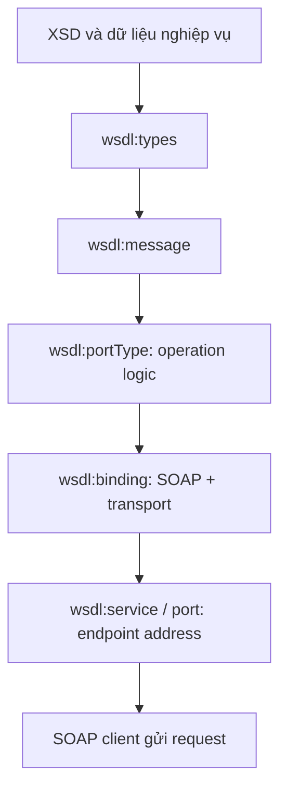
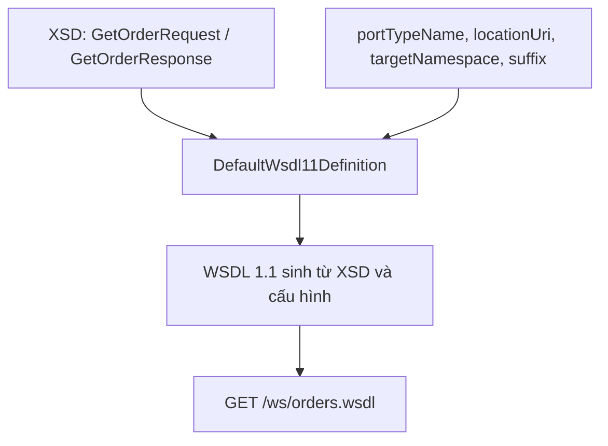

# WSDL tĩnh và WSDL được tạo từ XSD

## 1. Vì sao có hai cách công bố WSDL?

Một dịch vụ SOAP quản lý đơn hàng có operation `GetOrder`. Để tích hợp, đối tác cần biết thông điệp request/response, cấu trúc XSD, SOAP binding, action, địa chỉ endpoint và các quy tắc tương thích. Những thông tin đó được mô tả bằng **WSDL** (*Web Services Description Language*).

Trong **Spring Web Services (Spring-WS)** phát triển theo hướng **contract-first**, có hai cách thường dùng để công bố WSDL 1.1:

1. **WSDL tĩnh**: nhóm phát triển quản lý một tệp `.wsdl`, còn Spring-WS công bố tài nguyên đó bằng `SimpleWsdl11Definition`.
2. **WSDL tạo từ XSD**: nhóm phát triển giữ XSD làm hợp đồng dữ liệu, còn `DefaultWsdl11Definition` tạo WSDL dựa trên các phần tử toàn cục và cấu hình Spring-WS.

Hai hướng đều cần Java endpoint thật, mapping request, JAXB, cấu hình SOAP client và kiểm thử. Sự khác biệt chính là **ai định nghĩa và kiểm soát cấu trúc WSDL được công bố**.

Bài này nằm trong chương **Đọc và công bố WSDL** của module `SPRING_WEB_SERVICES`. Kiến thức còn liên quan đến thiết kế XSD/WSDL, ánh xạ JAXB, `@PayloadRoot`, SOAP Fault, interceptor, XML security, WS-Security, chứng chỉ và kiểm thử tương thích giữa các doanh nghiệp. Những thành phần xử lý đó phải khớp với contract mà đối tác thực sự tải được.

### Mục tiêu

- Đọc đúng vai trò của `types`, `message`, `portType`, `binding` và `service` trong WSDL 1.1.
- Phân biệt nguồn contract của WSDL tĩnh và WSDL do Spring-WS tạo từ XSD.
- Cấu hình `SimpleWsdl11Definition`, `DefaultWsdl11Definition` và `MessageDispatcherServlet`.
- Phân biệt URL tải tài liệu WSDL với URL gửi SOAP request.
- Phát hiện drift giữa XSD, WSDL được công bố và SOAP endpoint đang chạy.
- Chọn chiến lược phù hợp với yêu cầu versioning và interoperability.

## 2. Đọc WSDL 1.1 theo năm thành phần



| Thành phần | Mô tả | Ví dụ đơn hàng |
| --- | --- | --- |
| `wsdl:types` | Kiểu dữ liệu của thông điệp, thường là XML Schema | Global elements `GetOrderRequest` / `GetOrderResponse` |
| `wsdl:message` | Tập các part của input/output/fault message | `GetOrderInput` tham chiếu phần tử request |
| `wsdl:portType` | Các operation trừu tượng | `GetOrder` gồm input và output |
| `wsdl:binding` | Gắn portType với giao thức/transport và cách mã hóa | SOAP 1.1 document/literal qua HTTP |
| `wsdl:service` / `wsdl:port` | Địa chỉ truy cập một binding | `http://localhost:8080/ws` |

WSDL là **mô tả contract**, không phải SOAP message được truyền qua mạng. Một SOAP message thực tế có `Envelope`, `Body` và payload XML; WSDL chỉ cho client biết phải tạo và gửi những thứ đó như thế nào.

### 2.1. Những URI rất dễ nhầm

| URI | Vai trò |
| --- | --- |
| `http://schemas.xmlsoap.org/wsdl/` | Namespace của WSDL 1.1 như `wsdl:definitions` |
| `http://schemas.xmlsoap.org/wsdl/soap/` | Namespace extension SOAP 1.1 trong WSDL như `soap:binding` |
| `http://schemas.xmlsoap.org/soap/envelope/` | Namespace của SOAP 1.1 Envelope khi giao tiếp |
| `http://schemas.xmlsoap.org/soap/http` | Định danh SOAP 1.1 HTTP transport binding |
| `urn:example:orders:v1` | Namespace nghiệp vụ của contract đơn hàng |
| `http://localhost:8080/ws` | HTTP URL của endpoint trong ví dụ cục bộ |

Giá trị `transport="http://schemas.xmlsoap.org/soap/http"` **không** phải URL gửi SOAP request. Endpoint URL được khai báo bằng `soap:address location="..."` và còn có thể được client cấu hình lại khi chạy.

## 3. XSD chung cho cả WSDL tĩnh và WSDL được tạo

Để so sánh, cả hai phương án sẽ công bố cùng operation `GetOrder` với:

- Request: `{urn:example:orders:v1}GetOrderRequest`, có trường `orderId`.
- Response: `{urn:example:orders:v1}GetOrderResponse`, có `orderId` và `status`.
- SOAP binding ví dụ: SOAP 1.1, document/literal, HTTP.

Giả sử XSD lưu tại `src/main/resources/xsd/orders.xsd`:

```xml
<?xml version="1.0" encoding="UTF-8"?>
<xs:schema
    xmlns:xs="http://www.w3.org/2001/XMLSchema"
    xmlns:tns="urn:example:orders:v1"
    targetNamespace="urn:example:orders:v1"
    elementFormDefault="qualified">

    <xs:simpleType name="OrderStatusType">
        <xs:restriction base="xs:string">
            <xs:enumeration value="CREATED"/>
            <xs:enumeration value="SHIPPED"/>
            <xs:enumeration value="CANCELLED"/>
        </xs:restriction>
    </xs:simpleType>

    <xs:complexType name="GetOrderRequestType">
        <xs:sequence>
            <xs:element name="orderId" type="xs:string"/>
        </xs:sequence>
    </xs:complexType>

    <xs:complexType name="GetOrderResponseType">
        <xs:sequence>
            <xs:element name="orderId" type="xs:string"/>
            <xs:element name="status" type="tns:OrderStatusType"/>
        </xs:sequence>
    </xs:complexType>

    <xs:element name="GetOrderRequest"
                type="tns:GetOrderRequestType"/>
    <xs:element name="GetOrderResponse"
                type="tns:GetOrderResponseType"/>
</xs:schema>
```

Hai `xs:element` ở cuối là **phần tử toàn cục**. Chúng định nghĩa QName của payload root, trong khi `GetOrderRequestType` và `GetOrderResponseType` mô tả cấu trúc nội dung. Một WSDL document/literal dùng `wsdl:part element="tns:GetOrderRequest"` sẽ tham chiếu **phần tử**, không phải tên kiểu `GetOrderRequestType`.

Ví dụ XML instance hợp lệ theo schema:

```xml
<GetOrderRequest xmlns="urn:example:orders:v1">
    <orderId>ORD-100</orderId>
</GetOrderRequest>
```

```xml
<GetOrderResponse xmlns="urn:example:orders:v1">
    <orderId>ORD-100</orderId>
    <status>CREATED</status>
</GetOrderResponse>
```

Ở cả hai hướng công bố, **XSD mô tả dữ liệu, còn WSDL bổ sung operation, SOAP binding và endpoint address**. XSD không chứa đủ thông tin để biết URL HTTP nào cần được gọi.

## 4. Phương án A: WSDL tĩnh

### 4.1. Ý tưởng và đặc điểm

Với **WSDL tĩnh**, nhóm phát triển chủ động viết/kiểm duyệt một tệp `.wsdl`, quản lý nó trong source control và dùng Spring-WS để công bố. Đây là lựa chọn phù hợp khi cần kiểm soát chính xác tên operation, action, binding, port/service và artifact đã thống nhất với đối tác.

Lợi ích: xác định trực tiếp **từng chi tiết của WSDL**, có thể review/diff và phát hành bản contract được phê duyệt. Trách nhiệm: phải đồng bộ thủ công hoặc bằng quy trình kiểm thử giữa WSDL, XSD và hành vi endpoint Java.

### 4.2. Ví dụ WSDL tĩnh đầy đủ

Giả sử lưu `src/main/resources/wsdl/orders.wsdl`. Để ví dụ tự chứa, schema được nhúng trực tiếp trong `wsdl:types`. Nội dung này tương ứng với XSD ở mục 3.

```xml
<?xml version="1.0" encoding="UTF-8"?>
<wsdl:definitions
    xmlns:wsdl="http://schemas.xmlsoap.org/wsdl/"
    xmlns:xs="http://www.w3.org/2001/XMLSchema"
    xmlns:soap="http://schemas.xmlsoap.org/wsdl/soap/"
    xmlns:tns="urn:example:orders:v1"
    name="OrdersService"
    targetNamespace="urn:example:orders:v1">

    <wsdl:types>
        <xs:schema
            xmlns:xs="http://www.w3.org/2001/XMLSchema"
            xmlns:tns="urn:example:orders:v1"
            targetNamespace="urn:example:orders:v1"
            elementFormDefault="qualified">

            <xs:simpleType name="OrderStatusType">
                <xs:restriction base="xs:string">
                    <xs:enumeration value="CREATED"/>
                    <xs:enumeration value="SHIPPED"/>
                    <xs:enumeration value="CANCELLED"/>
                </xs:restriction>
            </xs:simpleType>

            <xs:complexType name="GetOrderRequestType">
                <xs:sequence>
                    <xs:element name="orderId" type="xs:string"/>
                </xs:sequence>
            </xs:complexType>

            <xs:complexType name="GetOrderResponseType">
                <xs:sequence>
                    <xs:element name="orderId" type="xs:string"/>
                    <xs:element name="status"
                                type="tns:OrderStatusType"/>
                </xs:sequence>
            </xs:complexType>

            <xs:element name="GetOrderRequest"
                        type="tns:GetOrderRequestType"/>
            <xs:element name="GetOrderResponse"
                        type="tns:GetOrderResponseType"/>
        </xs:schema>
    </wsdl:types>

    <wsdl:message name="GetOrderInput">
        <wsdl:part name="parameters"
                   element="tns:GetOrderRequest"/>
    </wsdl:message>

    <wsdl:message name="GetOrderOutput">
        <wsdl:part name="parameters"
                   element="tns:GetOrderResponse"/>
    </wsdl:message>

    <wsdl:portType name="OrdersPortType">
        <wsdl:operation name="GetOrder">
            <wsdl:input message="tns:GetOrderInput"/>
            <wsdl:output message="tns:GetOrderOutput"/>
        </wsdl:operation>
    </wsdl:portType>

    <wsdl:binding name="OrdersSoap11Binding"
                  type="tns:OrdersPortType">
        <soap:binding
            style="document"
            transport="http://schemas.xmlsoap.org/soap/http"/>
        <wsdl:operation name="GetOrder">
            <soap:operation
                soapAction="urn:example:orders:v1:GetOrder"/>
            <wsdl:input>
                <soap:body use="literal"/>
            </wsdl:input>
            <wsdl:output>
                <soap:body use="literal"/>
            </wsdl:output>
        </wsdl:operation>
    </wsdl:binding>

    <wsdl:service name="OrdersService">
        <wsdl:port name="OrdersSoap11Port"
                   binding="tns:OrdersSoap11Binding">
            <soap:address location="http://localhost:8080/ws"/>
        </wsdl:port>
    </wsdl:service>
</wsdl:definitions>
```

| Cấu hình WSDL | Ý nghĩa |
| --- | --- |
| `wsdl:definitions/@targetNamespace` | Namespace các component WSDL |
| `xs:schema/@targetNamespace` | Namespace phần tử/kiểu XSD |
| `wsdl:part element="tns:GetOrderRequest"` | QName của phần tử payload request |
| `wsdl:operation name="GetOrder"` | Tên operation của interface trừu tượng |
| `soap:binding style="document"` | SOAP body mô tả theo schema của tài liệu |
| `soap:body use="literal"` | Nội dung body theo XML Schema, không dùng SOAP encoding |
| `soap:operation/@soapAction` | Action khai báo cho SOAP 1.1 HTTP binding |
| `soap:address/@location` | URL SOAP endpoint trong môi trường minh họa |

WSDL trên **tự chứa** vì XSD được nhúng inline. Nếu ở project thật còn có file `orders.xsd` độc lập để sinh JAXB, cần kiểm soát để hai phiên bản schema không lệch nhau.

### 4.3. Tách XSD khỏi WSDL tĩnh

Để tránh lưu trùng schema, WSDL tĩnh có thể dùng `xs:import` trong `wsdl:types`:

```xml
<wsdl:types>
    <xs:schema xmlns:xs="http://www.w3.org/2001/XMLSchema">
        <xs:import namespace="urn:example:orders:v1"
                   schemaLocation="orders.xsd"/>
    </xs:schema>
</wsdl:types>
```

Đây là **đoạn thay thế phần `wsdl:types`**, không phải WSDL hoàn chỉnh. Trong tình huống này, client còn phải tải được tài nguyên `orders.xsd` theo URL tương đối với WSDL. Cần công bố XSD và kiểm thử import; chỉ có file `orders.xsd` ở classpath chưa chứng minh URL XSD mà client nhìn thấy là hợp lệ.

### 4.4. Công bố file với `SimpleWsdl11Definition`

```java
import org.springframework.context.annotation.Bean;
import org.springframework.context.annotation.Configuration;
import org.springframework.core.io.ClassPathResource;
import org.springframework.ws.wsdl.wsdl11.SimpleWsdl11Definition;

@Configuration
public class StaticOrdersWsdlConfig {

    @Bean(name = "orders")
    public SimpleWsdl11Definition ordersWsdl() {
        SimpleWsdl11Definition definition =
            new SimpleWsdl11Definition();
        definition.setWsdl(
            new ClassPathResource("wsdl/orders.wsdl")
        );
        return definition;
    }
}
```

Khi `MessageDispatcherServlet` đăng ký dưới `/ws/*`, tên bean `orders` cho phép WSDL được công bố theo URL:

```text
GET http://localhost:8080/ws/orders.wsdl
```

Spring-WS chỉ phục vụ tài nguyên WSDL, **không tự tạo method `GetOrder`** từ WSDL. Endpoint Java, JAXB binding và xử lý nghiệp vụ vẫn cần được triển khai.

## 5. Phương án B: Tạo WSDL từ XSD

### 5.1. Cơ chế tạo WSDL

`DefaultWsdl11Definition` nhận XSD và một số thông số, tạo WSDL 1.1 tương ứng. Với các global elements đặt tên theo hậu tố, Spring-WS có thể suy ra operation:

```text
GetOrderRequest  --> Operation GetOrder: input
GetOrderResponse --> Operation GetOrder: output
```

Đây là **quy ước tên**, không phải thông tin operation vốn đã có trong XSD. Nếu XSD chỉ khai báo một kiểu `GetOrderRequestType` mà không có global element `GetOrderRequest`, công cụ không có phần tử request mong đợi để suy ra operation.



Thuật ngữ **WSDL động** trong Spring-WS thường nói tới khả năng **tạo WSDL từ XSD/cấu hình ứng dụng**. Nó không có nghĩa mỗi HTTP GET đều đọc và biên dịch lại tệp XSD; WSDL definition thường được tạo khi Spring context khởi tạo. Việc sửa source XSD thường cần build/deploy hoặc khởi tạo lại ứng dụng để output thay đổi.

### 5.2. Java configuration

Giả sử XSD được lưu ở `src/main/resources/xsd/orders.xsd` theo mục 3:

```java
import org.springframework.context.annotation.Bean;
import org.springframework.context.annotation.Configuration;
import org.springframework.core.io.ClassPathResource;
import org.springframework.xml.xsd.SimpleXsdSchema;
import org.springframework.xml.xsd.XsdSchema;
import org.springframework.ws.wsdl.wsdl11.DefaultWsdl11Definition;

@Configuration
public class GeneratedOrdersWsdlConfig {

    @Bean
    public XsdSchema ordersSchema() {
        return new SimpleXsdSchema(
            new ClassPathResource("xsd/orders.xsd")
        );
    }

    @Bean(name = "orders")
    public DefaultWsdl11Definition ordersWsdl(XsdSchema ordersSchema) {
        DefaultWsdl11Definition definition =
            new DefaultWsdl11Definition();

        definition.setPortTypeName("OrdersPortType");
        definition.setLocationUri("/ws");
        definition.setTargetNamespace("urn:example:orders:v1");
        definition.setSchema(ordersSchema);
        return definition;
    }
}
```

| Setter | Ý nghĩa |
| --- | --- |
| `setPortTypeName("OrdersPortType")` | Tên `wsdl:portType` do generator tạo |
| `setLocationUri("/ws")` | Địa chỉ service trong WSDL được tạo; cần xem output thực tế sau rewrite |
| `setTargetNamespace("urn:example:orders:v1")` | Namespace của component WSDL do generator tạo |
| `setSchema(ordersSchema)` | XSD làm nguồn xác định các message element |
| `@Bean(name="orders")` | URL WSDL được công bố theo tên `orders.wsdl` |

Với hậu tố mặc định `Request` và `Response`, công cụ thường suy ra operation `GetOrder` từ cặp global elements. Nếu dùng cách đặt tên `GetOrderInput` và `GetOrderOutput`, có thể thay đổi hậu tố với các API hỗ trợ trong Spring-WS, ví dụ:

```java
definition.setRequestSuffix("Input");
definition.setResponseSuffix("Output");
```

Lúc đó **XSD phải có phần tử toàn cục** mang các tên phù hợp. Chỉ đổi suffix trong Java không tự đổi các QName mà SOAP client đang gửi.

**Hai configuration `StaticOrdersWsdlConfig` và `GeneratedOrdersWsdlConfig` là phương án thay thế**, không nên kích hoạt đồng thời dưới cùng một Spring context vì cả hai cùng khai báo bean tên `orders`. Nếu có nhu cầu công bố song song thì phải dùng tên bean khác nhau và quản lý cả hai contract rõ ràng.

### 5.3. Ranh giới của việc tự tạo

`DefaultWsdl11Definition` có thể tạo message/operation/binding/service từ XSD và cấu hình được hỗ trợ, nhưng nó **không tự tạo**:

- `@Endpoint`, logic truy vấn đơn, method Java hay database.
- Cấu hình JAXB marshaller/unmarshaller và client nghiệp vụ.
- Quy tắc SOAP Fault và fault resolver của ứng dụng.
- HTTP authentication, HTTPS, chứng chỉ, WS-Security hoặc XML Signature.
- Một WSDL đảm bảo giống chính xác bản WSDL thủ công trước đây.

Nếu cần một `soapAction` cụ thể, tên binding/service đặc thù hoặc extension ngoài khả năng cấu hình generator, hãy kiểm tra **WSDL thực tế sinh ra** rồi cân nhắc cấu hình bổ sung hoặc WSDL tĩnh. Không giả định SOAPAction do bộ sinh tạo sẽ trùng chuỗi action được ghi trong ví dụ thủ công.

## 6. Servlet phục vụ WSDL và SOAP request

`MessageDispatcherServlet` nhận SOAP request và phục vụ các bean WSDL/XSD theo cấu hình ứng dụng. Ví dụ Spring Boot Java configuration:

```java
import org.springframework.boot.web.servlet.ServletRegistrationBean;
import org.springframework.context.ApplicationContext;
import org.springframework.context.annotation.Bean;
import org.springframework.context.annotation.Configuration;
import org.springframework.ws.config.annotation.EnableWs;
import org.springframework.ws.transport.http.MessageDispatcherServlet;

@EnableWs
@Configuration
public class SoapWebConfig {

    @Bean
    public ServletRegistrationBean<MessageDispatcherServlet>
            messageDispatcherServlet(ApplicationContext context) {

        MessageDispatcherServlet servlet =
            new MessageDispatcherServlet();
        servlet.setApplicationContext(context);
        servlet.setTransformWsdlLocations(true);

        return new ServletRegistrationBean<>(servlet, "/ws/*");
    }
}
```

Để có ứng dụng chạy thực sự, cần dependencies Spring-WS/Spring Boot phù hợp, một trong hai phương án WSDL, Java endpoints và các bean ứng dụng còn lại.

### 6.1. URL tải WSDL khác URL thực thi SOAP

```text
GET  /ws/orders.wsdl  -> lấy tài liệu WSDL
POST /ws              -> gửi SOAP Envelope đến endpoint
```

Tên bean `orders` liên quan tới URL `orders.wsdl` do servlet công bố. SOAP operation **không tự động trở thành REST route `GET /ws/GetOrder`**. Client cần đọc WSDL binding/`soap:address`, rồi gửi payload SOAP đến endpoint thực sự.

### 6.2. `transformWsdlLocations(true)` và reverse proxy

WSDL tĩnh có thể lưu:

```xml
<soap:address location="http://localhost:8080/ws"/>
```

Trong production, đối tác có thể truy cập qua:

```text
https://api.example.org/orders/ws
```

Khi trả WSDL, `setTransformWsdlLocations(true)` cho phép Spring-WS điều chỉnh địa chỉ service trong WSDL dựa trên thông tin request được servlet nhìn thấy. Tính năng này có ích khi đổi host/port/đường dẫn theo môi trường, **nhưng không bảo đảm đúng public URL khi có proxy/forwarded headers chưa được cấu hình phù hợp**.

Vì vậy phải kiểm tra `soap:address` trong **WSDL tải từ đúng URL public**. Nếu WSDL trả địa chỉ nội bộ, cần xem cấu hình reverse proxy, xử lý forwarded headers, context path và chính sách URL công bố.

WSDL tĩnh vẫn được gọi là “tĩnh” khi Spring-WS rewrite `soap:address`: nguồn mô tả contract là file cố định, dù bytes trả qua HTTP có thể khác ở phần địa chỉ.

## 7. So sánh hai cách công bố

| Tiêu chí | WSDL tĩnh (`SimpleWsdl11Definition`) | WSDL tạo từ XSD (`DefaultWsdl11Definition`) |
| --- | --- | --- |
| Nguồn tài liệu WSDL | File `.wsdl` do nhóm phát triển quản lý | XSD + cấu hình và quy ước generator |
| Operation name | Công bố trực tiếp trong WSDL | Thường suy ra từ tên global elements và hậu tố |
| Tùy biến binding/action/service | Chủ động ở mức WSDL | Phụ thuộc tính năng và cấu hình generator |
| Khi thay XSD | Phải đảm bảo WSDL vẫn đồng bộ | WSDL có thể được tạo lại từ XSD được load |
| Nguy cơ chính | WSDL và endpoint/XSD lệch nhau | Output thay đổi do tên phần tử, cấu hình hoặc generator |
| Hợp đồng đã được đối tác duyệt nghiêm ngặt | Thường phù hợp để kiểm soát chính xác artifact | Chỉ nên dùng nếu có kiểm chứng output và compatibility |
| Service mới, contract document/literal đơn giản | Dùng được nhưng cần soạn thêm WSDL | Tiện khi XSD có request/response rõ ràng |
| Tính sẵn sàng SOAP endpoint | Không tự bảo đảm | Không tự bảo đảm |
| HTTPS, Fault, WS-Security | Cần cấu hình riêng | Cần cấu hình riêng |

**Chọn WSDL tĩnh** khi đối tác yêu cầu ổn định chính xác tên operation, port, binding, SOAPAction hoặc có extension đặc thù. **Chọn WSDL tạo từ XSD** khi contract chủ yếu là document/literal, tên request/response theo quy ước và nhóm có quy trình kiểm thử WSDL được sinh.

Đừng dùng “tự động tạo” làm đồng nghĩa “tự động tương thích”: mọi thay đổi làm client cũ không đọc được WSDL hoặc gửi sai message đều cần được kiểm tra trước khi phát hành.

## 8. Đọc WSDL thực tế được Spring-WS công bố

Cấu hình Java mô tả **ý định của người viết**. WSDL truy cập qua HTTP là **artifact mà SOAP client thực sự tiêu thụ**. Với WSDL được tạo từ XSD, việc đọc output đặc biệt quan trọng vì có các quy ước sinh message, operation, portType, binding và service.

Giả sử ứng dụng chạy tại `http://localhost:8080`, truy cập:

```text
http://localhost:8080/ws/orders.wsdl
```

Hãy kiểm tra theo thứ tự:

1. **`wsdl:definitions`**: `targetNamespace` có đúng namespace contract?
2. **`wsdl:types`**: có các phần tử toàn cục `GetOrderRequest` và `GetOrderResponse`? Nếu schema được import, URL của schema có truy cập được?
3. **`wsdl:message`**: input và output có `part` tham chiếu đúng element QName, không nhầm type name?
4. **`wsdl:portType`**: có operation `GetOrder` với đúng input/output?
5. **`wsdl:binding`**: SOAP 1.1 hay SOAP 1.2? `style` và `use` thế nào? SOAPAction là gì?
6. **`wsdl:service`**: `soap:address` có trỏ tới địa chỉ mà client bên ngoài có thể gọi?

```text
WSDL công bố
  |
  +-- definitions/targetNamespace
  +-- types / XSD (global elements)
  +-- message/part/@element
  +-- portType/operation
  +-- binding/soap:binding + soap:operation
  +-- service/port/soap:address
```

Nếu `DefaultWsdl11Definition` được dùng với cặp hậu tố `Request`/`Response`, ta kỳ vọng thấy operation `GetOrder`. Tuy vậy, **tên message, binding, port, service và SOAPAction phải kiểm tra từ WSDL thực tế**, vì chúng còn phụ thuộc cấu hình và phiên bản công cụ.

### 8.1. Giá trị SOAPAction không được suy từ local name một cách tùy tiện

WSDL tĩnh ở mục 4 công bố:

```xml
<soap:operation soapAction="urn:example:orders:v1:GetOrder"/>
```

Khi client gửi SOAP 1.1 qua HTTP, có thể sử dụng:

```http
SOAPAction: "urn:example:orders:v1:GetOrder"
```

Nhưng nếu `DefaultWsdl11Definition` tạo WSDL với action khác hoặc rỗng, việc giả định cùng giá trị trên có thể gây lỗi tương thích với server/client định tuyến theo action. Hãy **đọc action từ WSDL đã công bố**; nếu yêu cầu contract cần action đặc thù, cân nhắc cấu hình generator phù hợp hoặc WSDL tĩnh.

SOAPAction là metadata của SOAP 1.1 HTTP binding, **khác** với QName của phần tử payload `GetOrderRequest`. Spring-WS có thể dispatch theo `@PayloadRoot`; một số integration còn kiểm soát SOAPAction. Cả hai quy tắc cần tương thích với contract.

### 8.2. WSDL GET thành công vẫn có thể là phiên bản sai

Một URL WSDL trả HTTP 200 chưa chứng minh đó là WSDL đúng release:

- Artifact vừa deploy có thể dùng XSD cũ hoặc file `.wsdl` cũ.
- Reverse proxy/CDN có thể đang cache WSDL/XSD trước khi cập nhật.
- Client có thể tải nhầm WSDL staging thay vì production.
- WSDL static có thể chứa inline schema cũ dù file XSD chính đã đổi.
- WSDL generated có thể dùng schema khác tên hoặc khác classpath so với mong đợi.

Để chẩn đoán, lấy **tài liệu qua URL đối tác đang dùng** và so sánh với contract được phê duyệt. Khi cần tái tạo lỗi, lưu cả WSDL và mọi tài nguyên XSD được tham chiếu.

## 9. WSDL được công bố và endpoint Java là hai trách nhiệm

WSDL mô tả operation; Spring-WS runtime cần có endpoint thực sự. Ví dụ:

```java
import org.springframework.ws.server.endpoint.annotation.Endpoint;
import org.springframework.ws.server.endpoint.annotation.PayloadRoot;
import org.springframework.ws.server.endpoint.annotation.RequestPayload;
import org.springframework.ws.server.endpoint.annotation.ResponsePayload;

@Endpoint
public class OrdersEndpoint {

    private static final String NS = "urn:example:orders:v1";
    private final OrderService orderService;

    public OrdersEndpoint(OrderService orderService) {
        this.orderService = orderService;
    }

    @PayloadRoot(namespace = NS, localPart = "GetOrderRequest")
    @ResponsePayload
    public GetOrderResponse getOrder(
            @RequestPayload GetOrderRequest request) {
        return orderService.getOrder(request.getOrderId());
    }
}
```

Đây là đoạn mã **minh họa**: `OrderService` và các lớp request/response phải được định nghĩa hoặc sinh từ XSD trong dự án. JAXB generator có thể biểu diễn phần tử gốc bằng `@XmlRootElement` hoặc `JAXBElement`/`ObjectFactory`, nên method signature và marshaller phải khớp mã đã sinh.

Ba giá trị quan trọng phải đồng bộ:

```text
WSDL input element:   {urn:example:orders:v1}GetOrderRequest
Spring @PayloadRoot:  {urn:example:orders:v1}GetOrderRequest
SOAP Body root:       {urn:example:orders:v1}GetOrderRequest
```

Spring-WS `@PayloadRoot` xét **namespace URI và local name của phần tử payload**, không trực tiếp xét tên `wsdl:operation`. Nếu WSDL có operation `GetOrder` nhưng endpoint khai báo `localPart="FindOrderRequest"` thì request đúng WSDL có thể không vào method.

### 9.1. SOAP 1.1 request đúng với WSDL tĩnh ví dụ

```http
POST /ws HTTP/1.1
Host: localhost:8080
Content-Type: text/xml; charset=utf-8
SOAPAction: "urn:example:orders:v1:GetOrder"

<?xml version="1.0" encoding="UTF-8"?>
<soap:Envelope
    xmlns:soap="http://schemas.xmlsoap.org/soap/envelope/"
    xmlns:ord="urn:example:orders:v1">
    <soap:Body>
        <ord:GetOrderRequest>
            <ord:orderId>ORD-100</ord:orderId>
        </ord:GetOrderRequest>
    </soap:Body>
</soap:Envelope>
```

Đây là ví dụ theo **WSDL tĩnh ở mục 4**. Khi dùng WSDL generated, cần xem lại `soapAction` và SOAP binding mà Spring-WS đã công bố. Nếu server dùng SOAP 1.2, HTTP media type và namespace Envelope cũng phải thay đổi phù hợp.

### 9.2. Tải WSDL không tự kích hoạt XSD validation

Có WSDL/XSD trong Spring context **không có nghĩa** mọi incoming message được validate tự động. Ứng dụng cần cấu hình cơ chế kiểm tra tương ứng (ví dụ interceptor xác thực payload theo XSD) và xử lý lỗi.

Khi kiểm thử, gửi một request hợp lệ và một request sai `status`/thiếu trường được yêu cầu để xác nhận pipeline thực tế. Lỗi có thể phát sinh ở validation, JAXB unmarshalling hoặc dispatch, tùy cấu hình; SOAP Fault, HTTP status và logs không nhất thiết giống nhau giữa các hệ thống.

### 9.3. WSDL Fault và runtime Fault

WSDL có thể mô tả fault message theo operation. Tuy nhiên, exception Java chỉ tạo SOAP Fault với code, detail và nội dung mong đợi khi bộ xử lý lỗi/fault resolver được cấu hình phù hợp. WSDL công bố một fault **không tự sinh** mã Java xử lý fault; một runtime fault cũng không tự chứng minh mọi loại lỗi đã được mô tả đầy đủ trong WSDL.

## 10. Công bố WSDL khi có nhiều môi trường và đối tác

### 10.1. Public WSDL URL và SOAP endpoint URL

Một deployment có thể có:

```text
GET  https://api.example.org/ws/orders.wsdl
POST https://api.example.org/ws
```

Thậm chí hai WSDL khác nhau có thể cùng mô tả operation được phục vụ tại một SOAP endpoint chung. Đây là một lựa chọn thiết kế, không phải quy tắc bắt buộc. Phải đọc `soap:address` trong từng WSDL để biết địa chỉ được công bố.

| Giá trị | Đúng chức năng |
| --- | --- |
| `/ws/orders.wsdl` | Đường dẫn tải tài liệu WSDL |
| `soap:address location="..."` | URL mà WSDL công bố cho SOAP client gọi |
| `/ws` | Ví dụ đường dẫn servlet nhận SOAP POST |
| `urn:example:orders:v1` | Namespace định danh XML/QName, không phải endpoint URL |
| `soapAction="..."` | Metadata/action của SOAP binding, không thay thế HTTP URL |

Việc đổi runtime URL từ localhost sang HTTPS domain có thể không đổi QName request, nhưng có thể thay đổi TLS/chứng chỉ, proxy, authentication và chính sách mạng.

### 10.2. WSDL tĩnh theo từng môi trường

Một file WSDL tĩnh chứa `soap:address` cố định cho local dễ bị lộ địa chỉ không phù hợp khi deploy production. Có các hướng xử lý:

1. Công bố artifact riêng theo môi trường sau khi kiểm soát rewrite địa chỉ.
2. Bật biến đổi WSDL location ở Spring-WS và kiểm thử host/scheme được nhìn nhận chính xác.
3. Dùng chính sách public base URL/forwarded headers phù hợp khi chạy sau proxy.
4. Cung cấp client khả năng override endpoint nếu framework hỗ trợ, nhưng vẫn cần WSDL công bố hợp lý.

Không nên sửa ngầm `targetNamespace` theo hostname môi trường nếu contract không thiết kế như vậy. **Namespace nghiệp vụ và địa chỉ HTTP triển khai có hai vai trò khác nhau**.

### 10.3. Công bố XSD đi kèm

Nếu WSDL chứa:

```xml
<xs:import namespace="urn:example:orders:v1"
           schemaLocation="orders.xsd"/>
```

thì công cụ client có thể cần GET `orders.xsd` tại vị trí tương đối với URL WSDL. Với các schema nhiều file, cần kiểm tra thêm `xs:include` và `xs:import` bên trong XSD.

Mở WSDL trên browser thành công nhưng không tải được XSD sẽ làm các công cụ sinh mã client thất bại. Việc đặt `orders.xsd` trong thư mục resources là bước đóng gói, **không tự xác nhận URL public của schema**.

## 11. Thay đổi WSDL và khả năng tương thích

### 11.1. Các thay đổi thường ảnh hưởng tới client

| Thay đổi | Rủi ro |
| --- | --- |
| Đổi QName của `GetOrderRequest` | Request cũ không còn khớp WSDL hoặc `@PayloadRoot` |
| Đổi operation `GetOrder` | Stub client, mapping operation và tài liệu API có thể phải cập nhật |
| Đổi SOAPAction | Client/server phụ thuộc action có thể định tuyến sai |
| Đổi `soap:address` | Client gọi nhầm host/path hoặc gặp cấu hình chứng chỉ khác |
| Đổi SOAP 1.1 sang SOAP 1.2 | Envelope namespace, media type, Fault và binding khác |
| Đổi binding từ document/literal | Cách serialize và client code generation có thể không tương thích |
| Thêm phần tử bắt buộc vào XSD | Message cũ có thể không qua validation |
| Đổi `targetNamespace` | QName của các component/phần tử thay đổi |
| Đổi tên bean WSDL | URL `orders.wsdl` có thể thay đổi dù endpoint vẫn chạy |
| Nâng cấp Spring-WS/generator | Output WSDL được tạo có thể khác cần xác minh |

### 11.2. Drift của WSDL tĩnh

Giả sử nhóm đổi XSD request root thành `GetOrderRequestV2` nhưng quên cập nhật WSDL tĩnh đang có:

```xml
<wsdl:part name="parameters"
           element="tns:GetOrderRequest"/>
```

Nếu WSDL import schema đã đổi, part có thể tham chiếu tới phần tử không tồn tại và tool sinh client báo lỗi. Nếu WSDL nhúng schema cũ thì client có thể tiếp tục tạo request cũ trong khi server yêu cầu tên mới. Cả hai là **contract drift** cần phát hiện trước deploy.

### 11.3. Thay đổi quy ước WSDL generated

XSD ban đầu:

```xml
<xs:element name="GetOrderRequest"
            type="tns:GetOrderRequestType"/>
<xs:element name="GetOrderResponse"
            type="tns:GetOrderResponseType"/>
```

Sau đó đổi thành:

```xml
<xs:element name="GetOrderInput"
            type="tns:GetOrderRequestType"/>
<xs:element name="GetOrderOutput"
            type="tns:GetOrderResponseType"/>
```

Nếu generator vẫn tìm hậu tố `Request`/`Response`, operation có thể không được suy ra như kỳ vọng. Nếu chỉnh suffix để tạo `GetOrder`, **QName của XML request và response vẫn đã đổi**, nên client cũ chưa chắc tương thích. Sửa tên phần tử XSD không phải chỉ là đổi tên class.

### 11.4. Kiểm thử so sánh có ý nghĩa

Khi đánh giá thay đổi giữa hai bản WSDL, cần đối chiếu:

- Global element QName của request/response, quy tắc schema và các import.
- `wsdl:message`, `portType/operation` và input/output/fault.
- SOAP version, binding `style/use`, SOAPAction, service/port.
- `soap:address` theo môi trường; chấp nhận thay host khi đó là thay đổi có chủ đích.
- Việc sinh client stub và gửi thông điệp thật từ phiên bản client cũ.

Không nên coi sự khác biệt **prefix XML, khoảng trắng hoặc thứ tự thuộc tính** là thay đổi contract nếu QName/ngữ nghĩa không đổi. Ngược lại, hai WSDL đều có operation tên `GetOrder` chưa đủ để kết luận tương thích nếu binding, namespace hay SOAPAction khác nhau.

## 12. Kiểm thử WSDL và SOAP endpoint theo hai đường riêng

### 12.1. Tải WSDL bằng curl

Với ứng dụng local:

```bash
curl -i "http://localhost:8080/ws/orders.wsdl"
```

Kiểm tra:

1. HTTP status thành công và body là WSDL XML hợp lệ.
2. Phần tử gốc là `wsdl:definitions`.
3. `types`, `message`, `portType`, `binding` và `service` tồn tại đúng kỳ vọng.
4. `soap:address` phản ánh đúng URL nơi service thực sự được gọi.
5. Nếu WSDL import XSD, các URL XSD tải được và schema hợp lệ.

Không chỉ tìm chuỗi `<wsdl:definitions>` trong response: hãy dùng WSDL parser và XML Schema validation thích hợp để phát hiện các tham chiếu QName/import sai.

### 12.2. Gửi SOAP request tới endpoint

Lưu XML minh họa sau thành `get-order.xml`:

```xml
<?xml version="1.0" encoding="UTF-8"?>
<soap:Envelope
    xmlns:soap="http://schemas.xmlsoap.org/soap/envelope/"
    xmlns:ord="urn:example:orders:v1">
    <soap:Body>
        <ord:GetOrderRequest>
            <ord:orderId>ORD-100</ord:orderId>
        </ord:GetOrderRequest>
    </soap:Body>
</soap:Envelope>
```

Với action theo **WSDL tĩnh ở mục 4**, gửi SOAP 1.1:

```bash
curl -i -X POST "http://localhost:8080/ws" \
  -H "Content-Type: text/xml; charset=utf-8" \
  -H 'SOAPAction: "urn:example:orders:v1:GetOrder"' \
  --data-binary @get-order.xml
```

Lệnh dùng cú pháp Bash; PowerShell có thể dùng `curl.exe` và điều chỉnh cách quote/tiếp dòng. URL `localhost` và file `get-order.xml` chỉ là ví dụ: service và file phải tồn tại thì lệnh mới chạy được.

Nếu dùng **generated WSDL**, cần lấy SOAPAction thực tế từ WSDL được sinh. Response thành công nên là SOAP 1.1 Envelope chứa `GetOrderResponse` đúng namespace và XSD. Nếu nhận SOAP Fault thì đọc mã lỗi, nội dung `detail` và logs, không kết luận ngay việc publish WSDL có lỗi.

### 12.3. Checklist kiểm thử tích hợp

| Kiểm thử | Điều cần khẳng định |
| --- | --- |
| WSDL GET | HTTP trả đúng WSDL release mong đợi |
| WSDL parser | `definitions`, QName của message/operation/binding hợp lệ |
| Imported schema | Mọi XSD tham chiếu đều có thể tải và parse |
| Payload QName | Request/response root khớp contract và `@PayloadRoot` |
| HTTP/SOAP binding | SOAP version, media type và action đúng |
| SOAP endpoint POST | Response hợp XSD và nghiệp vụ đúng |
| Input không hợp lệ | XSD validation/Fault thể hiện theo thiết kế |
| Fault nghiệp vụ | Lỗi được ánh xạ đúng contract Fault nếu đã công bố |
| Public endpoint | `soap:address` đúng hostname/path HTTPS |
| Client interoperability | Một client độc lập có thể sinh mã/gửi request từ WSDL public |
| Version compatibility | Client cũ được thử với artifact WSDL/XSD mới |

### 12.4. Quy trình chuyển WSDL tĩnh sang generated

1. Tải WSDL tĩnh đang công bố và toàn bộ schema liên quan.
2. Cấu hình `DefaultWsdl11Definition` với đúng XSD, namespace và quy ước tên.
3. Chạy ứng dụng và tải **WSDL generated thực tế**.
4. So semantic diff: element QName, operation, action, binding, service và schema.
5. Dùng công cụ SOAP client thật sinh từ hai bản WSDL, gửi cùng request và so response/Fault.
6. Chỉ phát hành thay thế khi xác định các khác biệt là chủ đích và đáp ứng quy trình tương thích của đối tác.

## 13. Client tiêu thụ WSDL bằng cách nào?

SOAP client có thể:

- **Sinh mã từ WSDL** bằng công cụ phù hợp với stack: tạo class/binding/method từ contract rồi gọi service.
- **Dùng `WebServiceTemplate` và JAXB trực tiếp**: lập trình viên tự tạo payload đúng QName và cấu hình transport/response handling theo contract.

Ví dụ `WebServiceTemplate` ở mức cơ chế:

```java
import org.springframework.ws.client.core.WebServiceTemplate;
import org.springframework.ws.soap.client.core.SoapActionCallback;

public class OrdersSoapClient {

    private final WebServiceTemplate webServiceTemplate;

    public OrdersSoapClient(WebServiceTemplate webServiceTemplate) {
        this.webServiceTemplate = webServiceTemplate;
    }

    public Object getOrder(Object requestRoot) {
        return webServiceTemplate.marshalSendAndReceive(
            "https://api.example.org/ws",
            requestRoot,
            new SoapActionCallback("urn:example:orders:v1:GetOrder")
        );
    }
}
```

Đây là ví dụ **chưa hoàn chỉnh về model**: `requestRoot` phải là JAXB object được marshalled thành đúng global element `GetOrderRequest`, có thể cần `JAXBElement` từ `ObjectFactory`; `WebServiceTemplate` phải được cấu hình JAXB marshaller/unmarshaller, SOAP message factory và message sender. SOAPAction ví dụ lấy từ **WSDL tĩnh** đã nêu, không được tự áp cho mọi generated WSDL.

Client không nhất thiết tải WSDL ở mỗi request. Nhiều client sử dụng stub/mã sinh từ WSDL tại thời điểm phát triển và giữ cấu hình endpoint khi runtime. Vì vậy, **đổi WSDL của server không tự cập nhật các client đã deploy**; cần quản lý version và compatibility.

## 14. Bảo mật WSDL và SOAP endpoint

### 14.1. HTTPS, mTLS và công bố địa chỉ

Khi service dùng `https://api.example.org/ws`:

- Chứng chỉ TLS của server phải hợp lệ với hostname client gọi, cùng chuỗi CA được client tin cậy.
- Nếu dùng mTLS, hai bên cần thống nhất CA/chứng chỉ client và chính sách xác thực.
- `soap:address` không nên vô tình lộ địa chỉ nội bộ như `http://internal-app:8080/ws`.
- Reverse proxy terminate TLS có thể ảnh hưởng scheme/host được ứng dụng nhìn thấy; kiểm tra forwarded-header configuration.

Một client **tải WSDL bằng HTTPS thành công** vẫn có thể lỗi khi gọi SOAP endpoint nếu `soap:address` khác host hoặc chứng chỉ. Cần kiểm thử cả hai lượt kết nối.

### 14.2. WS-Security nằm ở SOAP message, không phải do XSD tự sinh

WSDL giúp mô tả giao diện và có thể chứa extension/policy khi kiến trúc yêu cầu, nhưng việc bảo vệ SOAP message vẫn cần cấu hình:

- SOAP Header `wsse:Security` theo profile đã thỏa thuận.
- Xác thực token và/hoặc chữ ký XML, xử lý tham chiếu và canonicalization.
- Mã hóa nội dung khi cần, quản lý key/keystore/truststore và chứng chỉ.
- Interceptor/bộ xử lý bảo mật trên cả server và client.

WSDL tĩnh cho phép nhóm kiểm soát các extension/policy được công bố nếu biết rõ yêu cầu. Một WSDL **tạo từ XSD mặc định** không nên được coi là tự động công bố mọi chính sách WS-Security. XML security, SOAP Fault và quyền truy cập vẫn cần được thiết kế và kiểm thử riêng.

### 14.3. Công bố WSDL là một quyết định vận hành

WSDL có thể làm lộ tên operation, cấu trúc payload, namespace và hostname nội bộ nếu cấu hình chưa đúng. Tổ chức có thể công bố công khai cho đối tác hoặc cung cấp qua kênh có kiểm soát, tùy chính sách.

Việc chặn truy cập GET WSDL **không** có nghĩa SOAP POST đã được xác thực. Ngược lại, việc public WSDL không nhất thiết đồng nghĩa cho phép bất kỳ ai thực thi operation. Hai mục đích cần chính sách bảo mật tương ứng.

## 15. Những lỗi thường gặp khi đọc và công bố WSDL

| Triệu chứng | Nguyên nhân thường gặp | Hướng xử lý |
| --- | --- | --- |
| `GET /ws/orders.wsdl` trả 404 | Sai bean name, servlet mapping/context path hoặc config chưa load | Kiểm tra `@Bean(name="orders")` và `MessageDispatcherServlet` |
| Generated WSDL thiếu `GetOrder` | Không có đúng cặp global elements hoặc suffix không khớp | Kiểm tra tên phần tử XSD và quy ước `Request`/`Response` |
| Client codegen không tìm thấy `GetOrderRequest` | WSDL/XSD thiếu khai báo element hoặc import hỏng | Đối chiếu `wsdl:part element`, `targetNamespace` và XSD |
| WSDL public trỏ về localhost/internal host | `soap:address` chưa được rewrite hợp lý | Kiểm tra WSDL qua URL public, proxy/forwarded headers |
| Request đúng WSDL nhưng không vào endpoint | `@PayloadRoot` sai namespace/localPart hoặc endpoint bean chưa đăng ký | Log QName payload root và so với mapping |
| SOAPAction mismatch | WSDL và callback/client/server cấu hình khác | Đọc action trong WSDL được tải thực tế |
| Lỗi SOAP version/content type | Client gửi SOAP 1.2 tới binding SOAP 1.1 hoặc ngược lại | So Envelope namespace, media type, binding |
| Đổi XSD nhưng WSDL tĩnh không đổi | Contract drift | Kiểm thử WSDL parser và schema mới/cũ |
| Generated WSDL đổi sau nâng cấp framework | Sự khác biệt generator/cấu hình | So WSDL snapshot và test client độc lập |
| GET WSDL trả 200, POST SOAP vẫn lỗi | WSDL chỉ mô tả; endpoint runtime có thể thiếu/sai | Gửi SOAP thật và phân tầng HTTP, SOAP Fault, JAXB |
| Tải WSDL được nhưng tool không sinh client | Import XSD URL không truy cập được | Tải toàn bộ dependency schema từ URL của đối tác |

## 16. Bài luyện tập có đáp án

### Bài 1. Xác định loại WSDL

```java
@Bean(name = "orders")
public SimpleWsdl11Definition ordersWsdl() {
    SimpleWsdl11Definition definition =
        new SimpleWsdl11Definition();
    definition.setWsdl(new ClassPathResource("wsdl/orders.wsdl"));
    return definition;
}
```

**Câu hỏi:** Khi sửa file `xsd/orders.xsd`, WSDL trên có tự tạo lại các operation không?

**Đáp án:** Không. `SimpleWsdl11Definition` công bố file WSDL có sẵn. Nếu WSDL inline schema hoặc import schema ngoài, nhóm phát triển phải kiểm tra tính nhất quán của mọi artifact; Java configuration này không tự sinh lại operation từ XSD.

### Bài 2. Dự đoán operation khi sinh WSDL

Trong XSD có:

```xml
<xs:element name="CancelOrderRequest"
            type="tns:CancelOrderRequestType"/>
<xs:element name="CancelOrderResponse"
            type="tns:CancelOrderResponseType"/>
```

Definition dùng hậu tố `Request` và `Response`.

**Đáp án:** Dự kiến generator tạo operation `CancelOrder` từ cặp global elements. Sau khi chạy, vẫn phải tải WSDL để kiểm tra operation, input/output, binding/action được sinh.

### Bài 3. Chọn đúng URL SOAP endpoint

Client tải WSDL tại:

```text
https://orders.example.org/ws/orders.wsdl
```

Nội dung WSDL có:

```xml
<soap:address location="https://orders.example.org/ws"/>
```

**Đáp án:** Client gửi SOAP POST theo endpoint công bố là `https://orders.example.org/ws`. Đường dẫn kết thúc bằng `orders.wsdl` chỉ dùng để tải contract. Việc runtime override endpoint có thể thực hiện nếu framework cho phép, nhưng phải có chủ đích.

### Bài 4. Sửa lỗi `wsdl:part`

WSDL viết:

```xml
<wsdl:part name="parameters"
           element="tns:GetOrderRequestType"/>
```

XSD chỉ khai báo `GetOrderRequestType` là `xs:complexType`, đồng thời có global element `GetOrderRequest` dùng type đó.

**Đáp án:** `wsdl:part element` cần trỏ tới **global element**, nên sửa thành `element="tns:GetOrderRequest"`. `GetOrderRequestType` là QName của kiểu, không phải element declaration.

### Bài 5. WSDL hiện địa chỉ nội bộ

WSDL tải từ public URL `https://api.company.example/ws/orders.wsdl` trả:

```xml
<soap:address location="http://internal-app:8080/ws"/>
```

**Đáp án:** Kiểm tra `soap:address` từ file/definition, `transformWsdlLocations`, URL public, reverse proxy, Host/Forwarded/X-Forwarded-* và context path. Sau chỉnh sửa, **tải lại từ URL public** và xác minh rằng địa chỉ dành cho SOAP client đã đúng HTTPS hostname/đường dẫn.

### Bài 6. Chọn WSDL tĩnh hay generated

Một tổ chức tài chính đã ký hợp đồng yêu cầu tên `portType`, `binding`, `operation` và SOAPAction không thay đổi ngoài quy trình versioning; nhiều đối tác sinh client code từ file WSDL đã phê duyệt.

**Đáp án:** WSDL tĩnh thường thích hợp để kiểm soát chính xác artifact, kết hợp contract tests và quy trình review. Generated WSDL vẫn có thể dùng nếu output được bảo đảm tương thích, nhưng phải so sánh WSDL thực tế và kiểm thử client trước khi chuyển.

### Bài 7. WSDL đúng nhưng runtime báo không tìm thấy endpoint

`GET /ws/orders.wsdl` trả 200 với operation `GetOrder`, nhưng SOAP POST `GetOrderRequest` không gọi được Java method.

**Đáp án:** Việc WSDL được công bố không tự tạo `@Endpoint`. Cần kiểm tra lớp endpoint đã được Spring đăng ký, `@PayloadRoot(namespace, localPart)` khớp QName request, marshaller/adapter và cấu hình dispatch. Không chỉ dựa vào GET WSDL để kết luận service hoạt động.

### Bài 8. So sánh WSDL tĩnh và WSDL được sinh

Hai WSDL cùng có operation `GetOrder` và cùng global element `GetOrderRequest`. Một WSDL dùng SOAP 1.1 `text/xml`, WSDL kia dùng binding SOAP 1.2 với `application/soap+xml`.

**Đáp án:** Chưa thể coi hai WSDL tương thích. SOAP Envelope namespace, HTTP media type, action và Fault format khác nhau. Cần so sánh binding/transport thực tế và kiểm thử client phù hợp phiên bản.

## 17. Checklist công bố WSDL cho tích hợp doanh nghiệp

1. **Xác định nguồn contract:** tệp WSDL tĩnh đã được review hoặc XSD + cấu hình generator được quản lý phiên bản.
2. **Đối chiếu QName:** `wsdl:part element` phải khớp global elements trong XSD và `@PayloadRoot` trong Spring-WS.
3. **Kiểm tra WSDL thực tế:** tải GET từ public URL, kiểm tra operation, binding, SOAPAction, service và `soap:address`.
4. **Kiểm tra dependency schema:** mọi `xs:import`/`xs:include` phải resolve được và đúng namespace.
5. **Kiểm tra runtime:** gửi SOAP request/response thật qua POST và test validation/Fault.
6. **Kiểm tra bảo mật:** HTTPS/mTLS, chứng chỉ, authentication/authorization, XML security và WS-Security nếu contract yêu cầu.
7. **Đối chiếu client:** generate hoặc chạy client từ WSDL public, bao gồm trường hợp sai dữ liệu và lỗi giao thức.
8. **Kiểm soát thay đổi:** giữ snapshot WSDL/XSD, review semantic diff, công bố version mới khi có breaking change.

**Điểm cần nhớ:** WSDL tĩnh cho phép kiểm soát trực tiếp tài liệu contract; WSDL tạo từ XSD dựa vào schema và quy ước sinh của Spring-WS. Dù theo cách nào, **WSDL/XSD mà client thực sự tải được phải thống nhất với SOAP endpoint đang chạy**. Công bố tài liệu thành công chỉ là bước đầu của một hệ thống SOAP tích hợp ổn định.

### Tài liệu tham khảo

- [W3C — Web Services Description Language (WSDL) 1.1](https://www.w3.org/TR/2001/NOTE-wsdl-20010315).
- [W3C — XML Schema Part 1: Structures](https://www.w3.org/TR/xmlschema-1/).
- [W3C — SOAP 1.1 Note](https://www.w3.org/TR/2000/NOTE-SOAP-20000508/).
- [Spring Web Services — Reference Documentation](https://docs.spring.io/spring-ws/docs/current/reference/html/).
