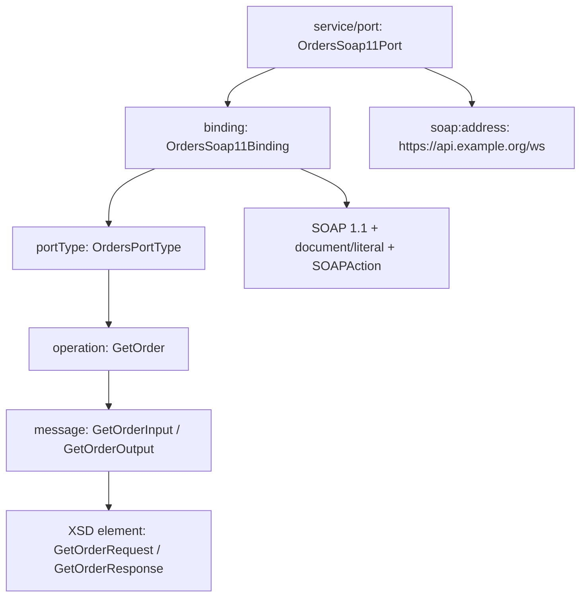
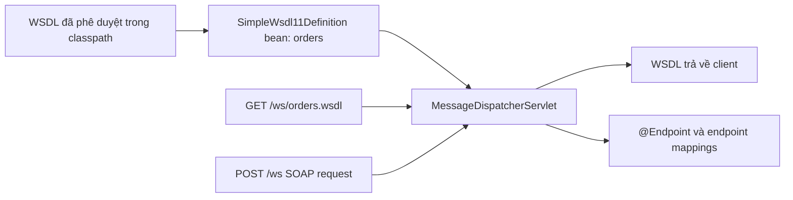
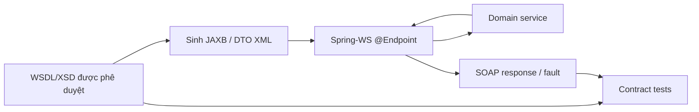
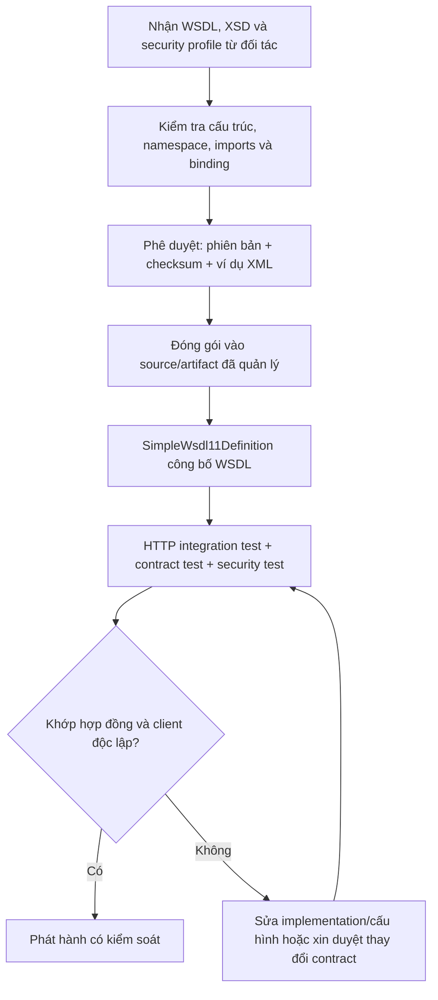

# SimpleWsdl11Definition và sử dụng hợp đồng đã được phê duyệt

## 1. Bối cảnh: khi WSDL là một hợp đồng đã được chấp thuận

Trong các dự án tích hợp SOAP doanh nghiệp, **WSDL** (*Web Services Description Language*) là giao diện chính thức để đối tác biết cách gọi dịch vụ: operation nào được cung cấp, thông điệp XML có cấu trúc gì, SOAP binding dùng phiên bản nào, địa chỉ dịch vụ ở đâu và các lỗi được công bố ra sao. Với cách tiếp cận **contract-first** của **Spring Web Services (Spring-WS)**, nhóm thiết kế và thống nhất hợp đồng **trước khi** triển khai JAXB model, endpoint và SOAP client.

Có hai tình huống phát hành WSDL rất khác nhau:

1. **Hợp đồng được sinh từ XSD**: nhóm chủ động thiết kế schema và cấu hình Spring-WS để tạo WSDL, chẳng hạn dùng `DefaultWsdl11Definition`. Hợp đồng phát hành vẫn cần được kiểm tra và quản lý phiên bản.
2. **Hợp đồng WSDL đã được phê duyệt**: WSDL do đối tác, tổ chức kiến trúc hoặc hội đồng tích hợp ký duyệt; tên operation, message, binding, namespace và cấu trúc fault phải được giữ đúng. Trong trường hợp này, `SimpleWsdl11Definition` cho phép Spring-WS **công bố chính file WSDL tĩnh** đã được quản lý.

Chủ đề của bài là tình huống thứ hai: **đọc, lưu, công bố và kiểm chứng WSDL 1.1 đã phê duyệt bằng `SimpleWsdl11Definition`**, bảo đảm mã Java phục vụ đúng giao diện hiện hữu. Đây cũng là nền tảng để xử lý tương thích, SOAP Fault, interceptor, bảo mật XML/WS-Security, chứng chỉ và kiểm thử kết nối hệ thống doanh nghiệp ổn định.

### Bạn cần đạt được gì?

Sau bài này, bạn có thể:

- Đọc đúng các phần của một WSDL 1.1, xác định binding và operation đang được client sử dụng.
- Giải thích vì sao cần `SimpleWsdl11Definition` khi WSDL đã được phê duyệt, và nó khác `DefaultWsdl11Definition` ở đâu.
- Cấu hình Spring-WS để công bố file WSDL tĩnh qua `MessageDispatcherServlet`.
- Xử lý địa chỉ `soap:address`, schema import, đường dẫn tương đối và reverse proxy một cách có kiểm soát.
- Ánh xạ payload QName từ XSD/WSDL vào JAXB, `@Endpoint` và SOAP client.
- Thiết lập kiểm thử để phát hiện lệch hợp đồng trước khi đối tác gặp lỗi tích hợp.

Ví dụ xuyên suốt: dịch vụ `OrdersService` có operation `GetOrder`, request `GetOrderRequest` và response `GetOrderResponse` trong namespace `https://example.org/orders/v1`. Mọi hostname, URI nghiệp vụ và đơn hàng ở đây chỉ là ví dụ, cần thay theo hợp đồng thực tế.

## 2. «Đã phê duyệt» nghĩa là phải cố định những thành phần nào?

Không nên coi WSDL đơn thuần là một trang XML để hiển thị trên URL. Một WSDL 1.1 mô tả nhiều lớp giao diện:

| Lớp hợp đồng | Thành phần WSDL 1.1 | Tác động đến client |
|---|---|---|
| Kiểu dữ liệu | `types` cùng XSD nhúng hoặc `xs:import`/`xs:include` | Client sinh hoặc validate kiểu request/response |
| Thông điệp | `message` và `part` | Chỉ rõ XML element/type mang theo trong thao tác |
| Giao diện trừu tượng | `portType`, `operation`, `input`, `output`, `fault` | Client biết thao tác và message cần gửi/nhận |
| Giao thức cụ thể | `binding`, `soap:binding`, `soap:operation`, `soap:body`, `soap:fault` | SOAP version, document/literal, SOAPAction và fault binding |
| Điểm truy cập | `service`, `port`, `soap:address` | Client xác định URL dịch vụ |

Các giá trị cần theo dõi đặc biệt là **QName** (*namespace URI + local name*) của phần tử XML, tên operation, SOAPAction, thứ tự/cấu trúc dữ liệu, phiên bản SOAP, địa chỉ và cách khai báo SOAP Fault. Đổi một phần trong các thành phần này có thể làm client đã sinh mã từ WSDL cũ không hoạt động.

Một hợp đồng được phê duyệt thường bao gồm **tập hiện vật**, không chỉ một file WSDL:

```text
orders-contract-v1/
  orders.wsdl
  orders.xsd               (nếu WSDL import XSD bên ngoài)
  common-types.xsd         (nếu cần)
  request-samples/
  response-samples/
  fault-samples/
  security-profile.md      (nếu có chính sách TLS/WS-Security)
  checksums.txt            (bằng chứng phiên bản đã chốt)
```

Đây là **minh họa một gói bàn giao**, không phải yêu cầu tạo thêm file trong bài học. Khi sử dụng WSDL thực của đối tác, cần giữ nguyên nguồn gốc và định danh phiên bản; nếu thay đổi, phải được phê duyệt lại theo quy trình dự án.

### Vì sao không sinh lại WSDL một cách tùy ý?

Giả sử phía đối tác đã dùng `wsdl:operation name="GetOrder"` với SOAPAction `urn:example:orders:GetOrder`. Nếu đổi mã Java và tự sinh WSDL làm operation trở thành `FetchOrder` hoặc SOAPAction khác, Java có thể vẫn biên dịch tốt nhưng client cũ sẽ không gọi được. **Hợp đồng đã phê duyệt là nguồn chuẩn để đánh giá tính đúng**, không phải sản phẩm phụ của cách đặt tên method Java.

## 3. Đọc một WSDL 1.1 tĩnh: ví dụ hoàn chỉnh

Đây là một **WSDL 1.1 tối thiểu nhưng đầy đủ cấu trúc** cho SOAP 1.1 document/literal. Ví dụ **nhúng XSD ngay trong `wsdl:types`** để tránh phụ thuộc vào đường dẫn import khi học cách công bố WSDL. Trong dự án thật, schema có thể nằm ở các file XSD riêng được quản lý cùng hợp đồng.

Tệp `src/main/resources/wsdl/orders.wsdl`:

```xml
<?xml version="1.0" encoding="UTF-8"?>
<wsdl:definitions
    xmlns:wsdl="http://schemas.xmlsoap.org/wsdl/"
    xmlns:xs="http://www.w3.org/2001/XMLSchema"
    xmlns:soap="http://schemas.xmlsoap.org/wsdl/soap/"
    xmlns:tns="https://example.org/orders/v1"
    targetNamespace="https://example.org/orders/v1"
    name="OrdersService">

  <wsdl:types>
    <xs:schema
        targetNamespace="https://example.org/orders/v1"
        elementFormDefault="qualified">
      <xs:element name="GetOrderRequest">
        <xs:complexType>
          <xs:sequence>
            <xs:element name="orderId" type="xs:string"/>
          </xs:sequence>
        </xs:complexType>
      </xs:element>

      <xs:element name="GetOrderResponse">
        <xs:complexType>
          <xs:sequence>
            <xs:element name="orderId" type="xs:string"/>
            <xs:element name="status" type="xs:string"/>
          </xs:sequence>
        </xs:complexType>
      </xs:element>
    </xs:schema>
  </wsdl:types>

  <wsdl:message name="GetOrderInput">
    <wsdl:part name="parameters" element="tns:GetOrderRequest"/>
  </wsdl:message>
  <wsdl:message name="GetOrderOutput">
    <wsdl:part name="parameters" element="tns:GetOrderResponse"/>
  </wsdl:message>

  <wsdl:portType name="OrdersPortType">
    <wsdl:operation name="GetOrder">
      <wsdl:input message="tns:GetOrderInput"/>
      <wsdl:output message="tns:GetOrderOutput"/>
    </wsdl:operation>
  </wsdl:portType>

  <wsdl:binding name="OrdersSoap11Binding" type="tns:OrdersPortType">
    <soap:binding
        style="document"
        transport="http://schemas.xmlsoap.org/soap/http"/>
    <wsdl:operation name="GetOrder">
      <soap:operation
          soapAction="urn:example:orders:GetOrder"
          style="document"/>
      <wsdl:input>
        <soap:body use="literal"/>
      </wsdl:input>
      <wsdl:output>
        <soap:body use="literal"/>
      </wsdl:output>
    </wsdl:operation>
  </wsdl:binding>

  <wsdl:service name="OrdersService">
    <wsdl:port
        name="OrdersSoap11Port"
        binding="tns:OrdersSoap11Binding">
      <soap:address location="https://api.example.org/ws"/>
    </wsdl:port>
  </wsdl:service>
</wsdl:definitions>
```

### 3.1. Cách lần theo operation từ WSDL đến XML

Để đọc đúng `GetOrder`, đi theo chuỗi tham chiếu sau:



Trong WSDL ở trên:

1. `service/port` chọn binding `OrdersSoap11Binding` và công bố `soap:address`.
2. `binding@type` trỏ đến `OrdersPortType`; operation `GetOrder` được gắn SOAP 1.1 document/literal.
3. `soap:operation@soapAction` xác định giá trị client gửi trong HTTP header `SOAPAction` cho thao tác này.
4. `wsdl:input` và `wsdl:output` trỏ đến hai `message`.
5. Mỗi `message/part@element` trỏ tới **global element XSD**. Đây là căn cứ để JAXB tạo đúng QName của payload.

**Phân biệt ba địa chỉ/định danh:**

| Giá trị | Ý nghĩa |
|---|---|
| `https://api.example.org/ws` | **HTTP endpoint** mà client POST request đến |
| `urn:example:orders:GetOrder` | **SOAPAction** biểu thị intent, không phải URL để kết nối |
| `{https://example.org/orders/v1}GetOrderRequest` | **QName** của phần tử XML trong SOAP Body |

Không sửa `soap:address` bằng cách thay nó thành SOAPAction, và cũng không suy ra QName XML chỉ từ tên Java method. Ba giá trị thuộc các lớp khác nhau của hợp đồng.

### 3.2. Request và response khớp WSDL

Request SOAP 1.1 gửi đến endpoint trong ví dụ:

```http
POST /ws HTTP/1.1
Host: api.example.org
Content-Type: text/xml; charset=utf-8
SOAPAction: "urn:example:orders:GetOrder"
```

```xml
<env:Envelope
    xmlns:env="http://schemas.xmlsoap.org/soap/envelope/"
    xmlns:ord="https://example.org/orders/v1">
  <env:Body>
    <ord:GetOrderRequest>
      <ord:orderId>ORD-001</ord:orderId>
    </ord:GetOrderRequest>
  </env:Body>
</env:Envelope>
```

Response minh họa:

```xml
<env:Envelope
    xmlns:env="http://schemas.xmlsoap.org/soap/envelope/"
    xmlns:ord="https://example.org/orders/v1">
  <env:Body>
    <ord:GetOrderResponse>
      <ord:orderId>ORD-001</ord:orderId>
      <ord:status>CONFIRMED</ord:status>
    </ord:GetOrderResponse>
  </env:Body>
</env:Envelope>
```

Vì WSDL ví dụ khai báo `status` là `xs:string`, XSD chỉ xác minh đó là chuỗi, **không** giới hạn nó vào `CONFIRMED`/`NEW`/`CANCELLED`. Nếu hợp đồng doanh nghiệp yêu cầu enum, cần định nghĩa `xs:simpleType` có `xs:enumeration` và đưa vào quy trình phê duyệt; không tự thêm ràng buộc này trong mã Java rồi tuyên bố WSDL không thay đổi.

**Chú ý:** WSDL trên chỉ minh họa đường thành công và **chưa công bố typed SOAP Fault**. Nếu hợp đồng thực có `wsdl:fault`, `soap:fault`, fault detail hoặc WS-Security policy, hãy giữ và kiểm thử toàn bộ những khai báo đó. Đừng loại bỏ fault/policy khi triển khai lại dịch vụ.

## 4. `SimpleWsdl11Definition` hoạt động như thế nào?

`SimpleWsdl11Definition` là implementation của interface `Wsdl11Definition` trong Spring-WS. Nó nhận một **resource WSDL 1.1 có sẵn** và cung cấp WSDL đó cho cơ chế công bố của Spring-WS. Nó không thiết kế schema nghiệp vụ, không tự sinh operation và không biến tên các Java method thành một bản hợp đồng mới.

Luồng công bố:



Đây là **hai luồng khác nhau**:

- **GET WSDL**: servlet tra cứu bean `Wsdl11Definition` theo tên và trả tài liệu hợp đồng.
- **POST SOAP**: servlet phân phối SOAP Envelope cho endpoint phù hợp, thông qua mapping và adapter của Spring-WS.

Vì thế, công bố được WSDL **không chứng minh** endpoint đã xử lý đúng request. Ngược lại, endpoint chạy đúng trên một XML mẫu **không chứng minh** WSDL công bố khớp giao diện Java.

### 4.1. So sánh với `DefaultWsdl11Definition`

| Tiêu chí | `SimpleWsdl11Definition` | `DefaultWsdl11Definition` |
|---|---|---|
| Nguồn hợp đồng | **WSDL tĩnh** có sẵn | **XSD** cùng các thiết lập dùng để sinh WSDL |
| Tạo `portType`, `binding` | Dùng đúng những gì WSDL đã khai báo | Sinh từ quy ước tên request/response và cấu hình |
| Điều khiển operation/soapAction | Định nghĩa sẵn trong tài liệu | Phụ thuộc quy tắc sinh và cấu hình generator |
| Phù hợp nhất | Đối tác yêu cầu WSDL đã phê duyệt, giao diện cố định | Nhóm kiểm soát XSD nguồn và chấp nhận WSDL sinh được |
| Rủi ro chính | Java implementation khác nội dung WSDL tĩnh | WSDL sinh ra thay đổi ngoài ý muốn khi thay cấu hình hoặc schema |
| Nhiệm vụ kiểm thử | Đối chiếu WSDL tĩnh với hành vi thực và tập schema kèm theo | Snapshot/diff WSDL sinh ra và xác minh với client |

Ví dụ `DefaultWsdl11Definition` thường đặt `setSchema(...)`, `setPortTypeName(...)` và `setLocationUri(...)`. Trong tình huống WSDL **đã được phê duyệt**, việc tạo lại từ XSD có thể làm mất các chi tiết như tên `message`, cấu hình `binding`, `soapAction` cụ thể hoặc `wsdl:fault`. Dùng `SimpleWsdl11Definition` để giữ tài liệu đã chốt làm nguồn chuẩn.

**Lưu ý quan trọng:** `SimpleWsdl11Definition` **không tự xác minh** WSDL đúng nghiệp vụ, đúng XSD, đúng SOAP version hay đúng endpoint; kiểm tra đó thuộc trách nhiệm build, test và quy trình phê duyệt.

## 5. Cấu hình Spring-WS để công bố WSDL tĩnh

Giả sử dự án Spring Boot có Spring Web Services và file WSDL tại:

```text
src/main/resources/
  wsdl/
    orders.wsdl
```

Khi ứng dụng đóng gói, WSDL phải có mặt trong classpath tương ứng. Đừng dùng đường dẫn file tuyệt đối chỉ tồn tại trên máy phát triển để cung cấp hợp đồng cho runtime.

### 5.1. Đăng ký `MessageDispatcherServlet` và bean WSDL

Ví dụ cấu hình Java:

```java
import org.springframework.boot.web.servlet.ServletRegistrationBean;
import org.springframework.context.ApplicationContext;
import org.springframework.context.annotation.Bean;
import org.springframework.context.annotation.Configuration;
import org.springframework.core.io.ClassPathResource;
import org.springframework.ws.config.annotation.EnableWs;
import org.springframework.ws.transport.http.MessageDispatcherServlet;
import org.springframework.ws.wsdl.wsdl11.SimpleWsdl11Definition;

@Configuration
@EnableWs
public class OrdersWsConfig {

    @Bean
    public ServletRegistrationBean<MessageDispatcherServlet>
            messageDispatcherServlet(ApplicationContext applicationContext) {

        MessageDispatcherServlet servlet = new MessageDispatcherServlet();
        servlet.setApplicationContext(applicationContext);

        // Giữ địa chỉ soap:address theo WSDL đã phê duyệt.
        servlet.setTransformWsdlLocations(false);

        return new ServletRegistrationBean<>(servlet, "/ws/*");
    }

    @Bean(name = "orders")
    public SimpleWsdl11Definition ordersWsdl() {
        SimpleWsdl11Definition definition =
            new SimpleWsdl11Definition();
        definition.setWsdl(new ClassPathResource("wsdl/orders.wsdl"));
        return definition;
    }
}
```

Với context path mặc định và servlet mapping `/ws/*`:

- WSDL thường được công bố tại **`GET http://localhost:8080/ws/orders.wsdl`**.
- SOAP request được gửi tới URL được công bố bởi `soap:address` hoặc URL endpoint tương ứng với môi trường triển khai, chẳng hạn **`POST http://localhost:8080/ws`** khi chạy cục bộ.
- Bean tên `orders` quyết định tên tài nguyên công bố **`orders.wsdl`** theo cơ chế tra cứu WSDL definition của `MessageDispatcherServlet`.
- Tên file classpath `wsdl/orders.wsdl` và tên bean `orders` tình cờ giống nhau, nhưng là hai cấu hình khác nhau.

File WSDL minh họa trong mục 3 công bố địa chỉ `https://api.example.org/ws`. Vì ví dụ cấu hình **không biến đổi location**, một client đọc WSDL cục bộ vẫn sẽ thấy địa chỉ `https://api.example.org/ws`, không phải localhost. Điều này **cố ý** khi muốn giữ địa chỉ đã được duyệt; muốn thử local, client phải **override endpoint URL** bằng cấu hình test mà không sửa hợp đồng đã khóa.

### 5.2. Vì sao tắt hoặc bật `transformWsdlLocations` phải có chủ đích?

`MessageDispatcherServlet` hỗ trợ `setTransformWsdlLocations(true)` để biến đổi địa chỉ SOAP service trong WSDL được trả về, dựa trên request hiện tại. Điều này hữu ích khi ứng dụng hoạt động phía sau reverse proxy hoặc có nhiều hostname theo môi trường.

Tuy nhiên, nếu đối tác đã **phê duyệt chính nội dung WSDL và địa chỉ `soap:address`**, biến đổi runtime có thể khiến bản được tải từ server **khác bản đã phê duyệt**. Cần quyết định rõ:

| Chính sách | Cách triển khai | Điều phải kiểm chứng |
|---|---|---|
| Địa chỉ dịch vụ là một phần **bất biến** của hợp đồng | Giữ `setTransformWsdlLocations(false)`; cấu hình URL công bố đúng | Client gọi được address ghi trong WSDL |
| Cho phép thay đổi **chỉ address theo môi trường** | Bật transform theo quy định tích hợp | WSDL trả về dùng đúng host, scheme, port và path công khai |
| Mỗi môi trường có một WSDL được phê duyệt | Đóng gói/triển khai artifact riêng theo môi trường | Mỗi bản triển khai khớp hợp đồng đã duyệt tương ứng |

Không nên bật transform một cách mặc định chỉ vì chạy sau proxy. Nếu reverse proxy không cung cấp đúng thông tin forwarded headers và ứng dụng không xử lý chúng an toàn, WSDL có thể quảng bá URL nội bộ, HTTP thay cho HTTPS, sai port hoặc sai context path. Nếu bật rewrite, phải thử **trên địa chỉ công khai thực tế** và kiểm tra chính xác `soap:address` trả về.

### 5.3. Tên URL công bố và endpoint SOAP là hai việc khác nhau

Một client thường tải `/ws/orders.wsdl` bằng HTTP GET để lấy hợp đồng, nhưng gửi SOAP qua HTTP POST tới địa chỉ `soap:address location`. Không gửi SOAP POST vào URL `*.wsdl` trừ khi một hệ thống bên ngoài được thiết kế rất khác và quy định rõ điều đó.

Việc đổi tên bean từ `orders` thành `ordersV1` có thể làm đường dẫn tài liệu thành `/ws/ordersV1.wsdl`. Dù nội dung WSDL bên trong không đổi, **URL tải hợp đồng** mà đối tác dùng có thể bị phá vỡ. Vì vậy, hãy đưa URL công bố WSDL vào danh sách kiểm soát tương thích.

## 6. WSDL tĩnh có `xs:import` hoặc `wsdl:import` phải được đóng gói thế nào?

Ví dụ ở mục 3 nhúng toàn bộ XSD trong `wsdl:types`. Trong hợp đồng doanh nghiệp thực, việc tách schema thành nhiều file là phổ biến:

```xml
<wsdl:types
    xmlns:wsdl="http://schemas.xmlsoap.org/wsdl/"
    xmlns:xs="http://www.w3.org/2001/XMLSchema">
  <xs:schema>
    <xs:import
        namespace="https://example.org/orders/v1"
        schemaLocation="ordersSchema.xsd"/>
  </xs:schema>
</wsdl:types>
```

Đây là **fragment minh họa**, dùng khi namespace của schema import khác với namespace của schema chứa import. Với nhiều XSD cùng namespace, có thể dùng `xs:include` nếu phù hợp quy tắc XSD. `wsdl:import` ở cấp WSDL lại là cơ chế nhập **định nghĩa WSDL khác**, không giống `xs:import`.

### 6.1. Đường dẫn trong WSDL phải giải quyết được từ nơi client tải

Giả sử WSDL được tải từ:

```text
https://api.example.org/ws/orders.wsdl
```

Tham chiếu tương đối `schemaLocation="ordersSchema.xsd"` thường được client giải quyết thành:

```text
https://api.example.org/ws/ordersSchema.xsd
```

Nếu server trả 404 cho XSD này, client có thể **không sinh được mã** dù WSDL chính tải thành công. Khi phê duyệt hợp đồng, cần kiểm tra **toàn bộ cây import/include**, kể cả sơ đồ import sâu nhiều cấp, không chỉ file `orders.wsdl`.

### 6.2. Công bố XSD cùng servlet

Spring-WS có thể công bố XSD từ bean `XsdSchema`. Ví dụ trong cùng cấu hình Spring, nếu muốn URL `ordersSchema.xsd`:

```java
import org.springframework.core.io.ClassPathResource;
import org.springframework.xml.xsd.SimpleXsdSchema;
import org.springframework.xml.xsd.XsdSchema;

@Bean(name = "ordersSchema")
public XsdSchema ordersSchema() {
    return new SimpleXsdSchema(
        new ClassPathResource("xsd/orders.xsd"));
}
```

Với servlet mapping `/ws/*`, bean tên `ordersSchema` có thể được công bố tại **`/ws/ordersSchema.xsd`** theo cơ chế công bố schema của `MessageDispatcherServlet`. Tên này cần khớp đường dẫn trong WSDL hoặc được ánh xạ qua một route ổn định. Khi có schema import/include tiếp, phải xác nhận các đường dẫn con tiếp tục được giải quyết đúng.

**Lưu ý:** khối code trên là **tùy chọn cho hợp đồng có XSD tách file**; WSDL ở mục 3 đã nhúng schema và không cần bean XSD bổ sung. Nếu hợp đồng có nhiều schema, có thể cần cấu hình `XsdSchemaCollection` hoặc cơ chế phục vụ resource phù hợp và kiểm thử từng URL. Đừng tự chỉnh `schemaLocation` của bản WSDL phê duyệt chỉ để khớp một cấu trúc classpath tùy tiện; hãy định nghĩa quy tắc đóng gói và publish trước.

### 6.3. Công bố WSDL không có nghĩa client đọc được resource nội bộ

`ClassPathResource("xsd/orders.xsd")` chỉ xác định nơi **ứng dụng server** đọc resource. Trình duyệt/client ngoài hệ thống không thể tự truy cập resource trong JAR; nó chỉ có thể tải nội dung qua HTTP endpoint được server công bố hoặc từ một gói artifact khác.

Với client sinh mã trong CI **offline**, phải cung cấp gói WSDL + XSD hoặc XML catalog/resource resolver để import giải quyết mà không cần truy cập URL production. Đây là cách giảm phụ thuộc vào uptime của dịch vụ đích trong bước build client.

## 7. Từ WSDL đã phê duyệt đến JAXB và Spring-WS endpoint

Hợp đồng tĩnh chỉ giải quyết **phần công bố giao diện**. Nhóm triển khai vẫn cần tạo JAXB model từ XSD và xây endpoint để xử lý các phần tử đã công bố.



### 7.1. Sinh JAXB từ schema thuộc hợp đồng

Với WSDL có XSD nhúng, quy trình build có thể **trích xuất schema đã được phê duyệt** hoặc dùng công cụ sinh client từ WSDL tương thích. Với WSDL import XSD riêng, XJC/JAXB plugin có thể sinh class trực tiếp từ các XSD liên quan. Điều quan trọng là **không tạo một XSD «giống gần đúng»** để sinh class Java, vì chỉ cần khác namespace, thứ tự `xs:sequence`, `nillable` hoặc loại attribute là XML trên wire có thể lệch hợp đồng.

Ví dụ giả định công cụ sinh các lớp:

```text
org.example.orders.contract.GetOrderRequest
org.example.orders.contract.GetOrderResponse
org.example.orders.contract.ObjectFactory
```

Tên lớp chính xác, `@XmlRootElement`, `JAXBElement` và metadata namespace phụ thuộc schema/binding thực. Với Spring Boot 3 và Spring-WS 4, hệ API JAXB là **`jakarta.xml.bind`**; ứng dụng Spring cũ có thể dùng `javax.xml.bind`. Cần chọn generator tương thích phiên bản Java/Spring để tránh lỗi compile/runtime.

### 7.2. Endpoint định tuyến theo QName của request

Ví dụ:

```java
import org.springframework.ws.server.endpoint.annotation.Endpoint;
import org.springframework.ws.server.endpoint.annotation.PayloadRoot;
import org.springframework.ws.server.endpoint.annotation.RequestPayload;
import org.springframework.ws.server.endpoint.annotation.ResponsePayload;

@Endpoint
public class OrdersEndpoint {

    private static final String NS = "https://example.org/orders/v1";
    private final OrdersService ordersService;

    public OrdersEndpoint(OrdersService ordersService) {
        this.ordersService = ordersService;
    }

    @PayloadRoot(namespace = NS, localPart = "GetOrderRequest")
    @ResponsePayload
    public GetOrderResponse getOrder(@RequestPayload GetOrderRequest request) {
        Order order = ordersService.findById(request.getOrderId());
        GetOrderResponse response = new GetOrderResponse();
        response.setOrderId(order.id());
        response.setStatus(order.status());
        return response;
    }
}
```

Đây là mã minh họa: `OrdersService`, `Order` và JAXB model phải được cài đặt/sinh riêng; kiểu trả về của `order.status()` phải khớp setter JAXB. Khi generator dùng `JAXBElement` cho root, xử lý wrapper qua `ObjectFactory` thay vì ép framework nhận class không phải root.

Những điểm cần nhớ:

- `@Endpoint` đánh dấu bean phục vụ thông điệp SOAP; khác `@RestController` trong Spring MVC.
- `@PayloadRoot` dùng **namespace và local name** của root element ở SOAP Body. Trong WSDL ví dụ là `{https://example.org/orders/v1}GetOrderRequest`.
- Tên Java method `getOrder` không quyết định operation công bố trong **WSDL tĩnh**.
- JAXB chuyển dữ liệu XML thành object nhưng không bảo đảm toàn bộ **XSD facet** được kiểm tra nếu không bật schema validation.
- Một endpoint hoạt động đúng phải trả payload đúng QName `GetOrderResponse` và kiểu/định dạng mà WSDL/XSD đã ký duyệt.

### 7.3. Validation và SOAP Fault theo hợp đồng

Spring-WS có `PayloadValidatingInterceptor` để kiểm tra request/response theo XSD của hợp đồng. Đây là tầng kiểm tra cấu trúc: namespace, kiểu, thứ tự phần tử, trường bắt buộc, `minOccurs`, `nillable`, `enumeration` và các facet khác.

Ngoài validation, cần thống nhất xử lý lỗi:

| Loại lỗi | Đối chiếu hợp đồng và hành vi |
|---|---|
| Payload sai XSD | Bị từ chối trước logic nghiệp vụ; SOAP Fault phù hợp cấu hình |
| Mã đơn không tồn tại | SOAP Fault nghiệp vụ hoặc kiểu response lỗi đã được hợp đồng mô tả |
| Lỗi server | SOAP Fault phù hợp SOAP version, không lộ stack trace hay secret |
| Sai SOAPAction hoặc SOAP version | Không âm thầm ánh xạ sang operation khác; điều tra theo binding |
| Xác thực/chữ ký không đạt | Bị chặn theo security policy, không cho qua endpoint nghiệp vụ |

Nếu WSDL đã phê duyệt khai báo `wsdl:fault` và `soap:fault` cụ thể, Java phải **tạo fault detail khớp kiểu XML**; một exception message ngẫu nhiên hoặc response JSON không đáp ứng hợp đồng. Có thể dùng `SoapFaultAnnotationExceptionResolver` hoặc resolver tùy biến để ánh xạ exception sang SOAP Fault, nhưng phải kiểm thử XML thực tế của fault.

**Cẩn trọng:** bản WSDL tĩnh không tự động cấu hình fault resolver, validation interceptor hay WS-Security; chúng là các thành phần runtime riêng cần thực thi theo hợp đồng.

## 8. SOAP client sử dụng hợp đồng đã công bố

Client có thể được sinh từ WSDL bằng công cụ phù hợp với stack của đối tác (ví dụ Apache CXF, JAX-WS tooling hoặc .NET). Một client Spring-WS có thể dùng `WebServiceTemplate` và JAXB model để gọi cùng operation.

Đối với WSDL SOAP 1.1 ở mục 3, thông tin HTTP cơ bản là:

```http
POST /ws HTTP/1.1
Host: api.example.org
Content-Type: text/xml; charset=utf-8
SOAPAction: "urn:example:orders:GetOrder"
```

Client Spring-WS minh họa:

```java
String endpoint = "https://api.example.org/ws";
String action = "urn:example:orders:GetOrder";

GetOrderRequest request = new GetOrderRequest();
request.setOrderId("ORD-001");

Object result = webServiceTemplate.marshalSendAndReceive(
    endpoint,
    request,
    new SoapActionCallback(action)
);

GetOrderResponse response = (GetOrderResponse) result;
```

`webServiceTemplate` cần có marshaller/unmarshaller JAXB và SOAP message factory phù hợp. `SoapActionCallback` thiết lập SOAP action; nó không tự chuyển SOAP 1.1 thành SOAP 1.2. Nếu JAXB sinh root thông qua `JAXBElement`, phải bọc/mở bọc bằng `ObjectFactory` và kiểm tra kiểu trả về thay vì ép kiểu trực tiếp như ví dụ.

**Lưu ý:** giá trị `soapAction` khác với `soap:address`. Client có thể **override endpoint URL** cho test/staging mà vẫn giữ SOAPAction, payload QName và binding tương ứng — miễn việc override được chính sách tích hợp cho phép.

Trong hệ thống thực, client cần thêm timeout kết nối/đọc, xử lý SOAP Fault, TLS truststore, xác thực, chứng chỉ mTLS hoặc WS-Security theo hợp đồng. Retry chỉ nên áp dụng với thao tác có tính an toàn/idempotency phù hợp; một SOAP call ghi dữ liệu không mặc nhiên an toàn khi gửi lặp.

## 9. Bảo vệ hợp đồng đã phê duyệt trong vòng đời phát hành

Sự ổn định của static WSDL đến từ **quy trình quản lý hiện vật và kiểm thử**, không chỉ từ việc chọn một bean Spring.

### 9.1. Quy trình nhận, khóa và triển khai



Một quy trình thực dụng:

1. **Tiếp nhận:** lấy WSDL/XSD đúng phiên bản và chính sách bảo mật từ nguồn được ủy quyền; kiểm tra tính toàn vẹn của gói.
2. **Khóa phiên bản:** lưu vào version control hoặc kho artifact được kiểm soát, ghi version/tag, checksum và hồ sơ phê duyệt; không sửa thủ công tài liệu đã duyệt trong quá trình build.
3. **Đọc hợp đồng:** xác định operation, input/output/fault, message QName, SOAP version, SOAPAction, endpoint address, schema imports, các chính sách WS-Security nếu có.
4. **Triển khai:** sinh JAXB từ schema thuộc hợp đồng, xây endpoint và resolver; công bố static WSDL bằng `SimpleWsdl11Definition`.
5. **Xác minh:** đọc WSDL qua URL công khai, tải được mọi import, gửi request thực, đối chiếu response/fault và chạy consumer contract tests.
6. **Phát hành:** liên kết version của code, WSDL/XSD và kết quả test; có kế hoạch rollback và giữ endpoint cũ nếu cần.

### 9.2. Kiểm soát sự thay đổi

| Thay đổi | Đánh giá bước đầu | Hành động |
|---|---|---|
| Chỉ sửa implementation Java, XML không đổi | Có thể không đổi hợp đồng | Chạy contract regression tests |
| Thêm field bắt buộc vào request XSD | Thường phá client cũ | Đổi version hoặc xin phê duyệt tương thích |
| Đổi tên `wsdl:operation` | Có thể phá mã client đã sinh | Phê duyệt lại hợp đồng và kiểm thử consumer |
| Đổi SOAPAction | Có thể bị gateway/client từ chối | Kiểm tra binding và chính sách đối tác |
| Đổi `targetNamespace` hoặc QName payload | Thường là breaking change | Version hóa namespace/endpoint, chuẩn bị migration |
| Đổi `soap:address` | Không đổi payload nhưng có thể phá kết nối/TLS/firewall | Xác nhận phương án cấu hình endpoint theo môi trường |
| Thay `xs:import schemaLocation` | Có thể khiến client không tải được schema | Kiểm tra cây import cả online và offline |
| Thay SOAP 1.1 thành SOAP 1.2 | Thay envelope, media type, fault và action | Dùng binding tương ứng, test toàn diện |
| Thay chính sách chữ ký/chứng chỉ | Có thể làm client không xác thực được | Phê duyệt profile bảo mật và thử xoay vòng chứng chỉ |

Không kết luận một thay đổi chắc chắn «tương thích» chỉ vì thêm một field optional; client sinh class tĩnh hoặc bật validation nghiêm có thể không chấp nhận dữ liệu mới. Với hệ thống tích hợp lâu dài, cần chạy thử trên các consumer thật hoặc môi trường mô phỏng sát consumer.

### 9.3. Bảo mật nội dung WSDL và XSD

WSDL/XSD là tài liệu mô tả giao diện. Việc công bố chúng qua HTTP(S) có thể là chủ đích để đối tác sinh client. Nhưng không nên vô tình nhúng:

- Địa chỉ nội bộ, hostname quản trị hoặc cổng không dành cho bên ngoài.
- Token, mật khẩu, khóa riêng, nội dung keystore/truststore hoặc dữ liệu cá nhân thực.
- URL import schema không tin cậy hoặc không kiểm soát, gây phụ thuộc vào mạng ngoài trong quá trình parse.

Sử dụng HTTPS phù hợp, chính sách cấp quyền tải tài liệu nếu tích hợp yêu cầu bảo mật, XML parser an toàn trước XXE/external entity và kiểm soát kích thước payload. Nếu hợp đồng được ký số hoặc có checksum trong quy trình phê duyệt, mọi bước rewrite/phát hành lại cần được đánh giá tác động đến cơ chế kiểm tra toàn vẹn.

## 10. Kiểm thử công bố WSDL và thực thi SOAP

### 10.1. Một loạt kiểm tra tối thiểu trên HTTP thực

Khi ứng dụng chạy local hoặc trong test environment, kiểm tra WSDL:

```bash
curl -i "http://localhost:8080/ws/orders.wsdl"
```

Điều kiện cần kiểm:

- HTTP trả thành công và body chứa tài liệu WSDL 1.1 hợp lệ.
- `definitions@targetNamespace` đúng hợp đồng.
- Có `OrdersPortType/GetOrder`, `OrdersSoap11Binding` và `soapAction="urn:example:orders:GetOrder"`.
- `soap:address@location` đúng **chính sách công bố của môi trường**; nếu transform tắt, phải khớp file WSDL tĩnh.
- Các tham chiếu `xs:import`, `xs:include` và `wsdl:import` truy cập được từ client hoặc giải quyết được bằng gói offline.

Gọi SOAP thực bằng file `get-order.xml` chứa Envelope request ở mục 3:

```bash
curl -i -X POST "http://localhost:8080/ws" \
  -H 'Content-Type: text/xml; charset=utf-8' \
  -H 'SOAPAction: "urn:example:orders:GetOrder"' \
  --data-binary @get-order.xml
```

Kết quả hợp lệ phải có SOAP 1.1 Envelope và `GetOrderResponse` đúng schema đã phê duyệt. Có thể cần cấu hình/giả lập `OrdersService` trả dữ liệu test xác định. Shell khác nhau có cú pháp trích dẫn khác nhau; ví dụ lệnh trên sử dụng shell tương thích POSIX.

### 10.2. Các loại test cần thiết

| Lớp kiểm thử | Đối tượng | Bằng chứng mong đợi |
|---|---|---|
| XML/WSDL cấu trúc | WSDL 1.1 và XSD phụ thuộc | Parse được, QName/refs tồn tại, binding và schema hợp lệ |
| Contract snapshot/diff | File được duyệt so với file đóng gói/công bố | Không có thay đổi ngoài phần đã cho phép |
| Publication test | GET `/ws/orders.wsdl` và URL schema | Thành công trên HTTP(S) thật, đầy đủ imports |
| Endpoint test | SOAP Body gửi đến Spring-WS `@Endpoint` | Chọn đúng handler, trả XML hợp lệ |
| JAXB test | Marshalling/unmarshalling | Đúng root element, namespace, thứ tự, giá trị và attribute |
| Fault test | Request sai, không có đơn, lỗi server | SOAP Fault/code/detail tương thích hợp đồng |
| Security test | TLS, mTLS, WS-Security nếu có | Request hợp lệ thành công, chữ ký/token sai bị chặn |
| Interoperability test | Client khác nền tảng | Sinh mã từ WSDL và gọi/đọc response/fault được |
| Proxy/staging test | URL từ network ngoài | Không lộ URL nội bộ, đúng scheme/host/path/chứng chỉ |

**Điểm mấu chốt:** unit test trực tiếp Java method của endpoint không kiểm tra việc công bố WSDL. `MockWebServiceClient` kiểm tra pipeline SOAP trong Spring context nhưng không thay thế test HTTP GET metadata/HTTP POST qua servlet và proxy. Cần cả hai khi hợp đồng đã được phê duyệt cho tích hợp bên ngoài.

### 10.3. Tạo phép kiểm tra có thể tự động hóa

Một workflow CI có thể kiểm tra:

```text
1. WSDL/XSD parse và resolve import
2. WSDL snapshot so với bản đã phê duyệt (có whitelist cho URL biến đổi được duyệt)
3. Sinh client thử từ WSDL đã đóng gói
4. JAXB round-trip theo XML mẫu
5. Start test application và GET WSDL/XSD
6. POST SOAP happy path và negative cases
7. Schema validation cho SOAP response/fault
8. Kiểm tra HTTPS/proxy/security policy trên môi trường tích hợp
9. Lưu kết quả + version WSDL trong CI artifact
```

Nếu chính sách cho phép `soap:address` thay đổi theo môi trường, hãy **tách phép so sánh nội dung logic với phép so sánh địa chỉ**: kiểm tra rằng khác biệt duy nhất nằm ở các trường được cho phép và giá trị địa chỉ mới phải hợp lệ. Nếu hợp đồng yêu cầu byte-for-byte identical, không bật rewrite và nên lưu checksum của file nguồn cũng như bản HTTP thực tế để nhận diện khác biệt trình bày/XML serialization.

## 11. Xử lý các lỗi thường gặp

| Triệu chứng | Nguyên nhân thường gặp | Cách kiểm tra |
|---|---|---|
| `GET /ws/orders.wsdl` trả 404 | Sai servlet mapping, sai tên bean WSDL hoặc context path | Xem bean `orders`, `/ws/*`, application context |
| File WSDL lấy từ server có địa chỉ localhost | `soap:address` chưa được chốt hoặc reverse proxy rewrite sai | Đọc raw WSDL từ URL công khai; xác nhận forwarded headers |
| Có WSDL nhưng `*.xsd` import trả 404 | Schema chưa được công bố hoặc `schemaLocation` sai | Truy cập từng URL import và cây phụ thuộc |
| Tool sinh client báo «undefined message/element» | WSDL tham chiếu QName sai hoặc import không resolve | Kiểm tra `targetNamespace`, prefix và `wsdl:part@element` |
| SOAP POST báo «No endpoint mapping» | `@PayloadRoot` không khớp QName Body hoặc bean endpoint chưa đăng ký | Xem XML thực, annotation và Spring context |
| HTTP 415 hoặc SOAP `VersionMismatch` | Media type / SOAP Envelope khác binding được công bố | Kiểm tra SOAP 1.1 `text/xml` và namespace Envelope |
| Server trả fault dù WSDL đúng | Runtime logic, validation hoặc security policy đang từ chối | Xem SOAP Fault an toàn, log có correlation ID |
| Client SOAPAction mismatch | Giá trị action thực khác `soap:operation@soapAction` | Chụp HTTP header, đối chiếu WSDL được duyệt |
| WSDL tĩnh đúng nhưng response sai XSD | JAXB model hoặc endpoint không khớp contract | Bật schema validation response và kiểm thử mẫu |
| Client bên ngoài lỗi, client Spring nội bộ chạy | Cả hai cùng chấp nhận sai lệch hoặc profile khác | Thử sinh client độc lập, kiểm tra WS-I/WS-Security |
| Sau deploy client cũ ngừng hoạt động | Artifact WSDL/XSD, URL hoặc policy thay đổi | Diff release, rollback hoặc phục vụ song song version |

Một quy trình điều tra thực tế:

1. Lấy **WSDL thực tế từ URL mà client dùng**, đối chiếu với bản phê duyệt.
2. Xác định binding mà client chọn, SOAP version, operation, SOAPAction, input QName và endpoint address.
3. Thu request/response HTTP ở mức metadata và XML đã khử dữ liệu nhạy cảm.
4. Kiểm tra servlet route, endpoint mapping, schema validation, fault resolver và security interceptor.
5. Dùng client thứ hai hoặc tool SOAP độc lập để phân biệt lỗi client cụ thể với lỗi hợp đồng.
6. Thêm test hồi quy tái hiện lỗi trước khi sửa.

## 12. Bài thực hành: công bố hợp đồng tĩnh cho `GetOrder`

Giả sử nhóm tích hợp đã phê duyệt WSDL trong mục 3. Hãy thực hiện theo trình tự:

1. **Lưu hợp đồng:** đưa `orders.wsdl` vào `src/main/resources/wsdl/`, ghi version và hash theo quy trình dự án.
2. **Cấu hình Spring-WS:** tạo bean `SimpleWsdl11Definition` tên `orders`, đăng ký `MessageDispatcherServlet` tại `/ws/*`.
3. **Quyết định chính sách address:** giữ `transformWsdlLocations=false` khi WSDL phải được giữ cố định; xác định URL endpoint override cho test local.
4. **Sinh JAXB:** dùng XSD trong WSDL để tạo request/response types; xác minh QName và thứ tự element.
5. **Triển khai endpoint:** tạo handler nhận `GetOrderRequest` và trả `GetOrderResponse`; không đổi operation/schema đã được duyệt.
6. **Kiểm thử GET:** tải `/ws/orders.wsdl`, kiểm tra binding, SOAPAction và `soap:address`.
7. **Kiểm thử POST:** gửi SOAP 1.1 Envelope với `SOAPAction: "urn:example:orders:GetOrder"`, xác nhận response đúng.
8. **Kiểm thử âm tính:** request sai namespace, thiếu `orderId`, sai SOAP version, đơn hàng không tồn tại.
9. **Kiểm thử liên thông:** dùng client khác nền tảng sinh từ WSDL tải qua URL công bố; xác minh happy path và fault.
10. **Kiểm thử thay đổi:** cố tình đổi `soapAction` hoặc QName trong bản thử nghiệm và chứng minh contract diff/test phát hiện; khôi phục bản được duyệt trước khi phát hành.

### Câu hỏi tự kiểm tra

1. Tại sao đã có `SimpleWsdl11Definition` và URL WSDL vẫn chưa đủ để chứng minh SOAP endpoint hoạt động?
2. Việc đổi tên bean `orders` có tác động gì đến URL WSDL? Có nhất thiết đổi operation trong tài liệu không?
3. Vì sao `soap:address location` và `soapAction` không thể dùng thay cho nhau?
4. Nếu file WSDL được duyệt có `xs:import schemaLocation="common.xsd"`, một client truy cập WSDL qua mạng sẽ tìm schema ở đâu?
5. Khi nào nên bật `setTransformWsdlLocations(true)` và cần điều kiện phê duyệt nào?
6. Nếu client chạy được với JAXB class của server nhưng client .NET thất bại, cần kiểm tra những thông tin nào?
7. Khi WSDL đã cố định, việc thêm một field bắt buộc vào XML request ở code server có được phép không? Vì sao?

## 13. Definition of Done cho hợp đồng WSDL đã phê duyệt

Một dịch vụ Spring-WS sử dụng `SimpleWsdl11Definition` chỉ nên được đánh dấu hoàn tất khi các bằng chứng sau sẵn có:

- [ ] **Nguồn chuẩn:** có WSDL 1.1 và XSD phụ thuộc đã phê duyệt, ghi rõ version, nguồn, checksum và phạm vi thay đổi được phép.
- [ ] **Công bố:** bean `SimpleWsdl11Definition` đọc đúng resource; URL WSDL và XSD tải được trên mạng mà client sử dụng.
- [ ] **Tính nhất quán:** namespace, operation, message, binding, SOAPAction, fault và `soap:address` khớp chính sách đã chốt.
- [ ] **Triển khai:** JAXB model và `@Endpoint` thực thi đúng input/output XML của hợp đồng; payload được schema validation.
- [ ] **Bảo mật:** HTTPS, WS-Security/X.509, XML parser hardening và thông điệp lỗi được cấu hình theo yêu cầu tích hợp.
- [ ] **Tương thích:** có test từ ít nhất một client độc lập; xử lý đúng response, SOAP Fault và các trường hợp dữ liệu sai.
- [ ] **Hồi quy:** CI phát hiện WSDL/XSD thay đổi ngoài ý muốn và lưu bằng chứng test qua từng release.

**Kết luận:** `SimpleWsdl11Definition` là lựa chọn phù hợp khi **WSDL đã được duyệt và phải được công bố đúng như hợp đồng nguồn**. Nó giữ vai trò **phát hành tài liệu giao diện**, trong khi JAXB, endpoint, validation, SOAP Fault và bảo mật chịu trách nhiệm **thực thi giao diện ấy**. Một tích hợp SOAP doanh nghiệp ổn định cần bảo đảm cả hai hướng luôn khớp nhau và được kiểm chứng bằng test có thể tái lập.

## 14. Tài liệu tham khảo

- [Spring Web Services — SimpleWsdl11Definition API](https://docs.spring.io/spring-ws/docs/current/api/org/springframework/ws/wsdl/wsdl11/SimpleWsdl11Definition.html): interface và cách cung cấp file WSDL tĩnh.
- [Spring Web Services — MessageDispatcherServlet API](https://docs.spring.io/spring-ws/docs/current/api/org/springframework/ws/transport/http/MessageDispatcherServlet.html): cơ chế SOAP servlet, công bố WSDL/schema và biến đổi location.
- [Spring Web Services — Reference Documentation](https://docs.spring.io/spring-ws/docs/current/reference/html/): Spring-WS contract-first, WSDL, endpoint, JAXB, validation và client.
- [W3C — Web Services Description Language (WSDL) 1.1](https://www.w3.org/TR/wsdl.html): ngữ nghĩa của `types`, `message`, `portType`, `binding`, `service` và SOAP binding.
- [W3C — XML Schema Part 1: Structures](https://www.w3.org/TR/xmlschema-1/) và [Part 2: Datatypes](https://www.w3.org/TR/xmlschema-2/): cấu trúc, kiểu dữ liệu, QName, import/include và ràng buộc validation.
- [WS-I — Basic Profile 1.1](https://www.ws-i.org/Profiles/BasicProfile-1.1-2004-08-24.html): các quy tắc tương thích khi trao đổi SOAP 1.1/WSDL giữa hệ thống khác nền tảng.
