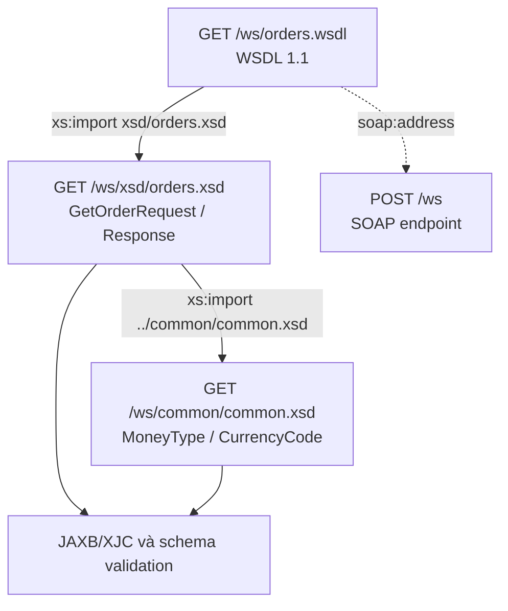
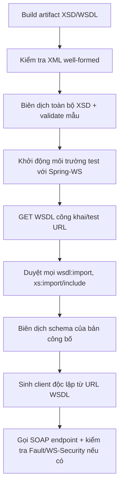

# Kiểm chứng WSDL tải được cùng toàn bộ XSD được import

Trong phát triển dịch vụ SOAP theo hướng **contract-first** với Spring Web Services (Spring-WS), WSDL là hợp đồng để hệ thống khác biết dịch vụ có những thao tác nào, sử dụng message nào và gọi ở đâu. WSDL thường chứa hoặc tham chiếu đến **XML Schema (XSD)**, nơi khai báo kiểu dữ liệu và phần tử dùng trong SOAP Body. Nếu client tải được tệp `orders.wsdl` nhưng không lấy được `orders.xsd`, `common-types.xsd` hoặc một schema ở tầng sâu hơn, việc sinh mã JAXB, tạo SOAP client và kiểm thử liên thông vẫn có thể thất bại.

Bài học thuộc chương **Đọc và công bố WSDL**, tập trung vào cách **chứng minh một WSDL đã công bố có thể được tải và giải quyết toàn bộ đồ thị phụ thuộc XSD**. Đây là một bước kiểm tra độc lập, cần thực hiện trước khi kết luận endpoint Spring-WS đã sẵn sàng tích hợp. Các bước dưới đây phù hợp với công việc thiết kế XSD/WSDL, ánh xạ JAXB, triển khai SOAP endpoint/client, kiểm tra SOAP Fault, interceptor và các chính sách bảo mật như TLS hoặc WS-Security.

## 1. Thế nào là “WSDL và toàn bộ XSD tải được”?

Thử mở một URL WSDL trên trình duyệt và thấy HTTP `200 OK` là **chưa đủ**. Chẳng hạn máy chủ có thể trả về trang đăng nhập HTML mã 200, hoặc WSDL hợp lệ nhưng chứa một đường dẫn import không tồn tại.

Một kiểm chứng đầy đủ cần trả lời lần lượt:

1. **HTTP/HTTPS:** Từ môi trường của đối tác, URL WSDL có truy cập được qua DNS, mạng, TLS, reverse proxy và cơ chế xác thực dự kiến không?
2. **Nội dung:** Response là XML WSDL đúng phiên bản/namespace, không phải HTML, trang lỗi hay một WSDL cũ trong cache?
3. **Liên kết:** Mỗi `wsdl:import`, `xs:import`, `xs:include` và các tham chiếu schema có đường dẫn cần truy cập đều phân giải được theo đúng **base URI** của tài liệu chứa tham chiếu.
4. **Tính hợp lệ:** Các tài liệu tải về đúng cú pháp; tên namespace và QName tương thích; tập XSD có thể **biên dịch thành schema**.
5. **Khả năng sử dụng:** Công cụ độc lập có thể đọc WSDL, phân giải các tệp phụ thuộc, sinh client hoặc model JAXB; request/response mẫu hợp lệ theo XSD.
6. **Đường gọi dịch vụ:** `soap:address` và binding công bố đúng endpoint và giao thức mà đối tác thực sự dùng. Đây là bước bổ sung sau khi hợp đồng đã đọc được.

Ba trạng thái nên báo cáo riêng là **tải tài nguyên thành công**, **phân giải/biên dịch hợp đồng thành công**, và **gọi SOAP endpoint thành công**. Chỉ một trong ba trạng thái thành công không suy ra hai trạng thái còn lại.

| Kết quả quan sát | Có thể khẳng định | Chưa thể khẳng định |
| --- | --- | --- |
| HTTP GET WSDL trả 200 và XML hợp lệ | WSDL gốc truy cập được, có cú pháp XML đúng | Import XSD ở mọi cấp đều tải được |
| Mọi URL phụ thuộc trả XML | Không thấy tài nguyên phụ thuộc bị thiếu | XSD có hợp lệ và QName có khớp không |
| Schema compile thành công | Đồ thị schema và các thành phần XSD đủ để compiler xử lý | WSDL operation/binding, SOAP runtime có chạy không |
| Client được sinh từ WSDL công bố | Hợp đồng đủ nhất quán đối với công cụ đó | WS-Security, dữ liệu nghiệp vụ, endpoint thực tế đều hoạt động |
| SOAP request thử nghiệm thành công | Một kịch bản runtime hoạt động | Mọi tài nguyên hợp đồng và mọi kịch bản của client khác đều tương thích |

## 2. Nhận diện đúng các liên kết cần lần theo

Một hệ SOAP thường công bố **WSDL 1.1**. Những liên kết trong tài liệu không đồng nhất về ý nghĩa:

| Cấu trúc | Thuộc tính chứa vị trí | Tài liệu đích | Điều cần kiểm tra |
| --- | --- | --- | --- |
| `wsdl:import` | `location` | WSDL khác | Namespace khai báo, URL thực tế và các import của WSDL con |
| `xs:import` | `schemaLocation` (nếu có) | XSD thuộc namespace khác | XSD có tải được, `targetNamespace` có khớp không |
| `xs:include` | `schemaLocation` | XSD cùng namespace; có ngoại lệ chameleon | Location và quy tắc namespace của include |
| `xs:redefine` trong XSD 1.0 | `schemaLocation` | XSD được tái định nghĩa | Tham chiếu và quy tắc redefine; cần compiler kiểm chứng |
| `xs:override` trong XSD 1.1 | `schemaLocation` | XSD được override | Processor có hỗ trợ XSD 1.1 không |
| `soap:address` | `location` | SOAP endpoint | URL gọi service; **không phải** XSD cần nhập |

Trong SOAP 1.1, WSDL sử dụng namespace `http://schemas.xmlsoap.org/wsdl/`, còn phần khai báo SOAP binding thường dùng `http://schemas.xmlsoap.org/wsdl/soap/`. XSD dùng namespace `http://www.w3.org/2001/XMLSchema`. Trình kiểm chứng nên nhận diện **namespace URI** thay vì dựa vào tiền tố `wsdl`, `xs` hay `soap`: tiền tố trong từng tệp XML có thể thay đổi.

**Điểm dễ nhầm:** `xs:import namespace="..."` có thể không chứa `schemaLocation` theo XML Schema. Khi đó, để xử lý thành phần import, compiler phải được cung cấp schema tương ứng bằng nguồn khác (chẳng hạn XML Catalog, schema source hoặc resolver). Do đó, “không có URL để tải” không tự động có nghĩa import sai; nhưng **không thể kết luận bộ tài liệu công bố là tự đủ** nếu chưa chứng minh cách client giải quyết import này.

### Quan hệ giữa namespace và URL

Trong khai báo:

```xml
<xs:import namespace="https://example.com/schema/common/v1"
           schemaLocation="../common/common.xsd"/>
```

`namespace` nhận diện **nhóm định nghĩa XSD**, còn `schemaLocation` là gợi ý **nơi tìm tệp**. URI namespace có hình thức URL nhưng không có nghĩa phải GET URI đó. Hai giá trị không cần giống nhau.

Tương tự, QName `com:MoneyType` trong XSD được giải nghĩa nhờ khai báo `xmlns:com="https://example.com/schema/common/v1"`. Chỉ cần tệp `common.xsd` tải được cũng chưa đủ: kiểu `MoneyType` phải được định nghĩa đúng QName và schema phải được compiler nhận diện.

## 3. Ví dụ một hợp đồng WSDL tham chiếu XSD theo nhiều tầng

Giả sử cổng tích hợp công bố dịch vụ tra cứu đơn hàng ở địa chỉ:

```text
https://api.example.com/ws/orders.wsdl
```

Bộ hợp đồng được dự kiến phục vụ từ ba URL:

```text
https://api.example.com/ws/orders.wsdl
https://api.example.com/ws/xsd/orders.xsd
https://api.example.com/ws/common/common.xsd
```

Các địa chỉ `example.com` chỉ dùng minh họa; chúng **không phải endpoint thật để gọi thử**. Ba tài liệu mẫu sau làm rõ cách client phải truy vết.

### 3.1. XSD chung: `/ws/common/common.xsd`

```xml
<?xml version="1.0" encoding="UTF-8"?>
<xs:schema xmlns:xs="http://www.w3.org/2001/XMLSchema"
           xmlns:com="https://example.com/schema/common/v1"
           targetNamespace="https://example.com/schema/common/v1"
           elementFormDefault="qualified">

    <xs:simpleType name="CurrencyCode">
        <xs:restriction base="xs:string">
            <xs:enumeration value="VND"/>
            <xs:enumeration value="USD"/>
        </xs:restriction>
    </xs:simpleType>

    <xs:complexType name="MoneyType">
        <xs:sequence>
            <xs:element name="amount" type="xs:decimal"/>
            <xs:element name="currency" type="com:CurrencyCode"/>
        </xs:sequence>
    </xs:complexType>
</xs:schema>
```

### 3.2. XSD nghiệp vụ: `/ws/xsd/orders.xsd`

```xml
<?xml version="1.0" encoding="UTF-8"?>
<xs:schema xmlns:xs="http://www.w3.org/2001/XMLSchema"
           xmlns:ord="https://example.com/schema/orders/v1"
           xmlns:com="https://example.com/schema/common/v1"
           targetNamespace="https://example.com/schema/orders/v1"
           elementFormDefault="qualified">

    <xs:import namespace="https://example.com/schema/common/v1"
               schemaLocation="../common/common.xsd"/>

    <xs:element name="GetOrderRequest">
        <xs:complexType>
            <xs:sequence>
                <xs:element name="orderId" type="xs:positiveInteger"/>
            </xs:sequence>
        </xs:complexType>
    </xs:element>

    <xs:element name="GetOrderResponse">
        <xs:complexType>
            <xs:sequence>
                <xs:element name="status" type="xs:string"/>
                <xs:element name="total" type="com:MoneyType"/>
            </xs:sequence>
        </xs:complexType>
    </xs:element>
</xs:schema>
```

### 3.3. WSDL 1.1: `/ws/orders.wsdl`

```xml
<?xml version="1.0" encoding="UTF-8"?>
<wsdl:definitions
    xmlns:wsdl="http://schemas.xmlsoap.org/wsdl/"
    xmlns:soap="http://schemas.xmlsoap.org/wsdl/soap/"
    xmlns:xs="http://www.w3.org/2001/XMLSchema"
    xmlns:tns="https://example.com/services/orders/v1"
    xmlns:ord="https://example.com/schema/orders/v1"
    targetNamespace="https://example.com/services/orders/v1"
    name="OrdersService">

    <wsdl:types>
        <xs:schema targetNamespace="https://example.com/services/orders/v1">
            <xs:import namespace="https://example.com/schema/orders/v1"
                       schemaLocation="xsd/orders.xsd"/>
        </xs:schema>
    </wsdl:types>

    <wsdl:message name="GetOrderInput">
        <wsdl:part name="parameters" element="ord:GetOrderRequest"/>
    </wsdl:message>
    <wsdl:message name="GetOrderOutput">
        <wsdl:part name="parameters" element="ord:GetOrderResponse"/>
    </wsdl:message>

    <wsdl:portType name="OrdersPortType">
        <wsdl:operation name="GetOrder">
            <wsdl:input message="tns:GetOrderInput"/>
            <wsdl:output message="tns:GetOrderOutput"/>
        </wsdl:operation>
    </wsdl:portType>

    <wsdl:binding name="OrdersSoapBinding" type="tns:OrdersPortType">
        <soap:binding style="document"
                      transport="http://schemas.xmlsoap.org/soap/http"/>
        <wsdl:operation name="GetOrder">
            <soap:operation soapAction="https://example.com/services/orders/v1/GetOrder"/>
            <wsdl:input><soap:body use="literal"/></wsdl:input>
            <wsdl:output><soap:body use="literal"/></wsdl:output>
        </wsdl:operation>
    </wsdl:binding>

    <wsdl:service name="OrdersService">
        <wsdl:port name="OrdersSoapPort" binding="tns:OrdersSoapBinding">
            <soap:address location="https://api.example.com/ws"/>
        </wsdl:port>
    </wsdl:service>
</wsdl:definitions>
```

Trong ví dụ, **namespace của WSDL** (`services/orders/v1`) khác **namespace phần tử nghiệp vụ** (`schema/orders/v1`). Điều đó hoàn toàn hợp lệ. `wsdl:part` tham chiếu phần tử toàn cục trong XSD nghiệp vụ; `xs:import` trong `wsdl:types` làm công cụ biết nơi lấy schema; schema nghiệp vụ tiếp tục import schema tiền tệ.



Muốn chứng minh WSDL này có thể sử dụng từ bên ngoài, phải kiểm chứng ít nhất cả **ba tài liệu**: WSDL gốc, XSD đơn hàng và XSD chung. Nếu schema chung lại include thêm một XSD khác, quá trình phải tiếp tục đến hết đồ thị.

## 4. Tính URL tuyệt đối từ từng base URI, không đoán theo thư mục dự án

Đường dẫn tương đối được phân giải dựa trên **URI của tài liệu chứa tham chiếu**, không dựa vào `targetNamespace` hoặc `soap:address`. Với ví dụ trên:

| Tài liệu chứa tham chiếu | Giá trị tương đối | URL đích sau khi phân giải |
| --- | --- | --- |
| `https://api.example.com/ws/orders.wsdl` | `xsd/orders.xsd` | `https://api.example.com/ws/xsd/orders.xsd` |
| `https://api.example.com/ws/xsd/orders.xsd` | `../common/common.xsd` | `https://api.example.com/ws/common/common.xsd` |
| `https://api.example.com/ws/orders.wsdl` | `/schemas/global.xsd` | `https://api.example.com/schemas/global.xsd` |
| `https://api.example.com/ws/orders.wsdl` | `https://schema.partner.example/api/types.xsd` | Giữ URL tuyệt đối đó |

Một dấu `/` ở đầu `schemaLocation` làm đường dẫn tính từ **gốc của host**, không phải thư mục `/ws/`. Khi tài liệu được chuyển qua proxy, đổi hostname hoặc thêm context path, cùng một tham chiếu tương đối có thể dẫn đến nơi khác.

Ví dụ WSDL được xem qua URL công khai `https://gateway.example.com/partners/ws/orders.wsdl`, nhưng server nội bộ dùng `http://localhost:8080/ws/orders.wsdl`. Nếu WSDL trả về:

```xml
<xs:import namespace="https://example.com/schema/orders/v1"
           schemaLocation="http://localhost:8080/ws/xsd/orders.xsd"/>
```

client bên ngoài sẽ cố truy cập **localhost của chính client**. Không thể kết luận hệ thống hoạt động chỉ vì file này tải được bên trong server. Đường dẫn dành cho đối tác phải được công bố và thử từ mạng đối tác hoặc một môi trường có tuyến mạng tương đương.

### Redirect, query string và cache

- HTTP redirect như `301` hoặc `302` có thể hợp lệ nếu dẫn đến tài nguyên hợp đồng cuối cùng có thể đọc được; phải kiểm tra **URL cuối** và xác thực ở từng bước.
- Nếu URL có query string như `/ws/orders?wsdl`, client/resolver phải sử dụng **URL và base URI thực tế**, không tự đoán rằng schema nằm cạnh một file `orders.wsdl`.
- Cache CDN, trình duyệt và proxy có thể trả WSDL cũ dù XSD mới đã deploy. Cần so phiên bản/hàm băm artifact hoặc kiểm tra dấu hiệu cache khi hành vi khác nhau giữa môi trường.
- `schemaLocation` hoặc `location` có thể được phân giải với `xml:base` khi công cụ hỗ trợ XML Base phù hợp; với hợp đồng cần tương thích rộng, nên tránh phụ thuộc vào cách xử lý base URI không được các công cụ phía đối tác kiểm chứng.

## 5. Kiểm chứng tài nguyên công khai bằng HTTP GET thực tế

Nên kiểm tra từ **máy client hoặc pipeline độc lập**, sử dụng đúng DNS, proxy, tài khoản và CA trust mà phía tích hợp sử dụng. Ví dụ lệnh `curl` dưới đây là mẫu tham khảo cho môi trường có `curl`:

```bash
curl -fSL --max-time 20 -D wsdl-headers.txt \
     -o orders.wsdl \
     "https://api.example.com/ws/orders.wsdl"
```

Sau đó kiểm tra từng URL XSD đã phân giải:

```bash
curl -fSL --max-time 20 -o orders.xsd \
     "https://api.example.com/ws/xsd/orders.xsd"

curl -fSL --max-time 20 -o common.xsd \
     "https://api.example.com/ws/common/common.xsd"
```

`-f` khiến `curl` báo lỗi với nhiều phản hồi HTTP lỗi; `-L` theo redirect; `-D` lưu header, `-o` lưu body và `--max-time` giới hạn thời gian. Một số ứng dụng trả **HTTP 200 kèm trang lỗi** nên luôn kiểm tra **nội dung XML nhận được**, không chỉ exit code. Trên Windows PowerShell, có thể dùng `curl.exe` để gọi đúng chương trình curl, tránh nhầm với alias của PowerShell đời cũ.

Việc chỉ gửi HTTP `HEAD` (`curl -I`) **không thay thế được GET**: một số server xử lý HEAD khác GET, hoặc HEAD trả thành công dù body XML có lỗi.

Kiểm tra cú pháp XML bằng công cụ có sẵn, ví dụ `xmllint`:

```bash
xmllint --noout orders.wsdl
xmllint --noout orders.xsd
xmllint --noout common.xsd
```

`--noout` ở đây chỉ giúp kiểm tra **well-formedness**, chưa chứng minh rằng WSDL/XSD đúng ngữ nghĩa hoặc schema có thể biên dịch. Cũng không nên suy từ `Content-Type` đơn lẻ: body phải được nhận dạng đúng namespace và phần tử gốc. Một số server trả XML WSDL dưới `text/xml` hoặc `application/xml` hợp lệ, tùy cấu hình và client.

### Cần thu thập bằng chứng gì?

Mỗi tài liệu trong đồ thị phụ thuộc nên có ít nhất:

| Thông tin | Ví dụ cần lưu |
| --- | --- |
| URL gốc và URL cuối sau redirect | `/ws/orders.wsdl` → cùng URL |
| HTTP status, thời gian và auth/TLS | `200`, kết nối TLS hợp lệ |
| Kiểu nội dung thực tế | Root `wsdl:definitions` hoặc `xs:schema` |
| Namespace công bố | WSDL `targetNamespace`, XSD `targetNamespace` |
| Tài liệu cha và loại cạnh | WSDL `xs:import` → `orders.xsd` |
| Kết quả biên dịch/kiểm thử | XSD compile PASS, sinh client PASS |

Đây là cách phân biệt lỗi từ server công bố, lỗi mạng của client và lỗi hợp đồng khi trao đổi với các nhóm khác.

## 6. Duyệt **toàn bộ đồ thị** import/include thay vì chỉ tải XSD đầu tiên

Một WSDL có thể import WSDL khác; mỗi WSDL lại nhúng một hoặc nhiều XSD; mỗi XSD tiếp tục import hoặc include các XSD khác. Cần duyệt **đệ quy**, có tập `visited` để tránh đọc lại hoặc lặp vô hạn khi có vòng tham chiếu.

Quy trình ở mức thuật toán:

```text
queue := [publicWsdlUrl]
visited := {}
edges := []

while queue is not empty:
    url := queue.pop()
    if url in visited: continue

    response := HTTP GET url (ghi nhận redirect, status, lỗi TLS/auth)
    xác nhận response là XML phù hợp với loại tài liệu mong đợi
    parse XML có cấu hình an toàn
    visited.add(effectiveDocumentUrl)

    for each external reference in document:
        - wsdl:import @location
        - xs:include / xs:redefine / xs:override @schemaLocation
        - xs:import @schemaLocation nếu được khai báo
        resolvedUrl := resolve(reference, effectiveDocumentBaseUri)
        edges.add(document -> resolvedUrl)
        queue.push(resolvedUrl)

    nếu xs:import không có schemaLocation:
        ghi nhận phụ thuộc cần resolver/schema source để kiểm chứng

kiểm tra từng namespace/QName và biên dịch schema bằng processor
thử công cụ đọc WSDL/sinh client từ URL công khai
chỉ PASS khi mọi tài nguyên bắt buộc được giải quyết thành công
```

Đây là **pseudocode minh họa**, không phải một công cụ hoàn chỉnh. Một trình kiểm tra thực tế còn cần theo dõi base URI/redirect phù hợp, `xml:base` nếu hỗ trợ, import lồng nhau, URL được chuẩn hóa để phát hiện vòng lặp, metadata namespace, lỗi parser và chính sách truy cập mạng. Dùng `visited` theo URI sau khi chuẩn hóa, đồng thời giữ dấu vết đường dẫn cha để báo chính xác “WSDL A → XSD B → XSD C hỏng”.

Khi đọc `xs:import`, phải xác minh `targetNamespace` của schema được nạp **khớp namespace import**. Với `xs:include`, schema được include thường phải cùng target namespace với schema chứa include; schema không có target namespace có thể thuộc trường hợp *chameleon*. Các kiểm tra này nên giao cho một **XML Schema compiler** để tránh tự diễn giải thiếu các quy tắc chi tiết.

**Quan trọng:** Bộ duyệt URL có thể chứng minh các tài nguyên *truy cập được*; chỉ **schema compilation** và thử công cụ đọc WSDL mới chứng minh các định nghĩa kiểu, QName, message và binding dùng được. Nếu XSD import không kèm location nhưng được resolver/catal​og cung cấp, cần ghi nhận rõ bộ catalog và cấu hình đã sử dụng khi kết luận PASS.

## 7. Biên dịch XSD từ bản đã tải về và validate một XML mẫu

Để không phụ thuộc website trong bước kiểm tra schema, có thể tải các tệp từ ví dụ về một thư mục local **giữ nguyên cấu trúc tương đối**:

```text
public-copy/
└── ws/
    ├── orders.wsdl
    ├── xsd/
    │   └── orders.xsd
    └── common/
        └── common.xsd
```

Với bản sao này, từ `public-copy/ws/xsd/orders.xsd`, import `../common/common.xsd` vẫn phân giải đúng. Nếu đặt `orders.xsd` và `common.xsd` chung một thư mục mà không sửa import, việc compile sẽ báo thiếu phụ thuộc dù server gốc hoàn toàn đúng.

### Ví dụ Java JAXP biên dịch schema

```java
import java.io.File;
import javax.xml.XMLConstants;
import javax.xml.validation.Schema;
import javax.xml.validation.SchemaFactory;
import javax.xml.validation.Validator;
import javax.xml.transform.stream.StreamSource;

public final class CheckPublishedSchema {
    public static void main(String[] args) throws Exception {
        if (args.length != 2) {
            throw new IllegalArgumentException(
                "Usage: CheckPublishedSchema <orders.xsd> <sample.xml>");
        }

        SchemaFactory factory = SchemaFactory.newInstance(
                XMLConstants.W3C_XML_SCHEMA_NS_URI);
        factory.setFeature(XMLConstants.FEATURE_SECURE_PROCESSING, true);
        factory.setProperty(XMLConstants.ACCESS_EXTERNAL_DTD, "");
        // Bộ schema mẫu được tải và quản lý như tài nguyên local.
        factory.setProperty(XMLConstants.ACCESS_EXTERNAL_SCHEMA, "file");

        // Dùng File để parser có base URI phân giải các import tương đối.
        Schema schema = factory.newSchema(new File(args[0]));
        System.out.println("XSD graph: COMPILED");

        Validator validator = schema.newValidator();
        validator.setProperty(XMLConstants.ACCESS_EXTERNAL_DTD, "");
        validator.setProperty(XMLConstants.ACCESS_EXTERNAL_SCHEMA, "file");
        validator.validate(new StreamSource(new File(args[1])));
        System.out.println("XML instance: VALID");
    }
}
```

Biên dịch schema ở bước `newSchema(...)` sẽ phát hiện nhiều lỗi về import, namespace, kiểu không tìm thấy hoặc cấu trúc XSD. Bước `Validator.validate(...)` chỉ bắt đầu sau khi schema compile thành công; nó kiểm tra XML instance theo các ràng buộc như `xs:sequence`, kiểu số và enum. Đây là ví dụ chạy trên một bộ XSD local đã được tin cậy; trong môi trường có schema từ bên thứ ba, phải thiết kế resolver và giới hạn quyền truy cập phù hợp.

Một XML response mẫu để kiểm thử:

```xml
<?xml version="1.0" encoding="UTF-8"?>
<ord:GetOrderResponse xmlns:ord="https://example.com/schema/orders/v1"
                      xmlns:com="https://example.com/schema/common/v1">
    <ord:status>PAID</ord:status>
    <ord:total>
        <com:amount>125.50</com:amount>
        <com:currency>USD</com:currency>
    </ord:total>
</ord:GetOrderResponse>
```

Giả sử lưu thành `sample-response.xml`, có thể dùng lệnh tham khảo:

```text
javac CheckPublishedSchema.java
java CheckPublishedSchema public-copy/ws/xsd/orders.xsd sample-response.xml
```

Nếu đổi `USD` thành `EUR`, schema vẫn compile được nhưng XML instance không còn hợp lệ theo enum `CurrencyCode`. Nếu xóa `common.xsd`, lỗi sẽ xảy ra ở bước compile trước khi validate response.

**Giới hạn cần nắm:** JAXP `SchemaFactory` giúp kiểm tra các XSD trong ví dụ; nó **không tự kiểm chứng toàn bộ định nghĩa WSDL**. Ngoài ra, nhiều triển khai JAXP mặc định hỗ trợ XSD 1.0; nếu sử dụng XSD 1.1, phải chọn processor tương thích.

## 8. Dùng công cụ sinh client để kiểm thử thực sự hợp đồng WSDL

Sau khi URL và schema graph vượt qua bước trên, hãy thử **một công cụ độc lập** đọc WSDL từ URL công bố. Ví dụ Apache CXF cung cấp công cụ `wsdl2java`; cú pháp có thể thay đổi tùy phiên bản đã cài:

```bash
wsdl2java -validate -d generated-src \
          "https://api.example.com/ws/orders.wsdl"
```

Lệnh mang tính tham khảo và cần cài Apache CXF tooling tương ứng. Mục đích là để công cụ phân giải WSDL, các import liên quan và tạo lớp/client từ **hợp đồng mà người dùng ngoài hệ thống nhìn thấy**. Kết quả cần kiểm tra gồm lỗi namespace, lỗi import, cấu trúc message/binding, khả năng tạo code và khả năng biên dịch code được sinh trong dự án mục tiêu.

Không cần dùng JAX-WS để chạy ứng dụng Spring-WS; CXF ở đây chỉ đóng vai trò **bộ kiểm tra liên thông**. Client Spring-WS có thể sử dụng `WebServiceTemplate` và `Jaxb2Marshaller` với JAXB classes được tạo từ XSD. Nếu dùng `wsimport` từ JAX-WS RI, chú ý rằng công cụ đó không được đóng gói sẵn trong mọi bản JDK hiện đại (đặc biệt từ JDK 11 trở đi).

Một kết quả sinh client thành công trên **một** toolkit chưa bảo đảm mọi toolkit khác đều tương thích. Với đối tác .NET/JAX-WS hoặc có WS-SecurityPolicy/WS-Addressing, cần thử công cụ và profile được hai bên cam kết.

## 9. Công bố WSDL trong Spring-WS: file tĩnh và WSDL tạo động

Spring-WS có thể công bố hợp đồng WSDL 1.1 bằng các cách khác nhau. Việc cấu hình được bean WSDL là một bước; kiểm tra **URL và các import từ bên ngoài** vẫn cần làm riêng.

### 9.1. WSDL tĩnh

Khi đối tác đã chốt một WSDL có cấu trúc rõ ràng, có thể giữ artifact tĩnh và công bố nó qua `SimpleWsdl11Definition`:

```java
import org.springframework.context.annotation.Bean;
import org.springframework.context.annotation.Configuration;
import org.springframework.core.io.ClassPathResource;
import org.springframework.ws.wsdl.WsdlDefinition;
import org.springframework.ws.wsdl.wsdl11.SimpleWsdl11Definition;

@Configuration
public class OrdersWsdlConfig {
    @Bean(name = "orders")
    public WsdlDefinition ordersWsdl() {
        return new SimpleWsdl11Definition(
                new ClassPathResource("wsdl/orders.wsdl"));
    }
}
```

Với `MessageDispatcherServlet` và mapping phù hợp, bean tên `orders` thường được công bố ở đường dẫn dạng `/ws/orders.wsdl`. Đây là ví dụ rút gọn: phần cấu hình servlet và việc phục vụ **các tệp XSD riêng** phải được thực hiện đồng bộ. Chỉ đặt `orders.xsd` vào classpath không có nghĩa nó sẽ tự được phục vụ tại `/ws/xsd/orders.xsd`.

Nếu WSDL tĩnh tham chiếu đường dẫn tương đối, hãy bảo đảm ứng dụng hoặc gateway thực sự **serve** mọi XSD ở các URL tương ứng; cần kiểm tra URI qua GET sau khi deployment.

### 9.2. WSDL tạo động từ XSD

`DefaultWsdl11Definition` có thể sinh WSDL 1.1 từ XSD và các cấu hình như port type, target namespace, đường dẫn endpoint:

```java
import org.springframework.context.annotation.Bean;
import org.springframework.context.annotation.Configuration;
import org.springframework.core.io.ClassPathResource;
import org.springframework.ws.wsdl.wsdl11.DefaultWsdl11Definition;
import org.springframework.xml.xsd.SimpleXsdSchema;
import org.springframework.xml.xsd.XsdSchema;

@Configuration
public class GeneratedOrdersWsdlConfig {
    @Bean
    public XsdSchema ordersSchema() {
        return new SimpleXsdSchema(
                new ClassPathResource("wsdl/xsd/orders.xsd"));
    }

    @Bean(name = "orders")
    public DefaultWsdl11Definition ordersWsdl(XsdSchema ordersSchema) {
        DefaultWsdl11Definition definition = new DefaultWsdl11Definition();
        definition.setPortTypeName("OrdersPort");
        definition.setTargetNamespace("https://example.com/services/orders/v1");
        definition.setLocationUri("/ws");
        definition.setSchema(ordersSchema);
        return definition;
    }
}
```

Đoạn này minh họa việc sinh WSDL và giả định servlet Spring-WS đã được cấu hình. Với **schema phức tạp có nhiều include/import**, cần kiểm tra phiên bản Spring-WS và cân nhắc `XsdSchemaCollection` phù hợp; đừng mặc định một `SimpleXsdSchema` sẽ xử lý hoặc công bố mọi schema phụ thuộc theo đúng cách mà client mong đợi.

WSDL tạo động có thể trình bày schema dưới dạng inline hoặc liên kết phụ thuộc tùy cấu hình và phiên bản. Vì vậy, kiểm chứng phải bắt đầu từ **WSDL thực tế được GET**, không được suy đoán cấu trúc từ tên bean hay tệp XSD nguồn.

### 9.3. Địa chỉ endpoint sau reverse proxy

`MessageDispatcherServlet` có hỗ trợ cấu hình `transformWsdlLocations` để điều chỉnh các địa chỉ service công bố theo request. Tuy nhiên, xử lý `soap:address` **không tự động giải quyết sai URL của mọi XSD import**. Ứng dụng sau reverse proxy vẫn phải được cấu hình đúng các header forwarded, context path và cách công bố tài nguyên tương ứng.

Kiểm tra riêng ít nhất:

- URL WSDL mà client tải là `https://...` như dự kiến;
- các đường dẫn XSD import đều truy cập được từ chính mạng client;
- `soap:address` trỏ đến endpoint công khai thay vì `localhost` hay hostname nội bộ;
- endpoint nhận đúng SOAP version, payload namespace và chính sách chứng thực/bảo mật.

## 10. Bảo mật, xác thực và tài nguyên ngoài

Một WSDL công bố qua HTTPS có thể có `xs:import` đến HTTP không mã hóa hoặc tới máy chủ khác. Các khả năng thường cần kiểm tra:

- **TLS và chuỗi tin cậy:** client có thể xác minh chứng chỉ máy chủ ở mọi URL cần truy cập không? Chứng chỉ của WSDL host không tự bảo đảm chứng chỉ của schema host khác.
- **Quyền truy cập:** WSDL cho phép GET, nhưng XSD trả `401/403` vì đường dẫn không nằm trong whitelist hoặc cookie/token không được chuyển tiếp. Công cụ sinh client cũng cần cơ chế xác thực phù hợp.
- **URL nội bộ:** import trỏ đến `localhost`, IP private hoặc tên service container mà đối tác không giải quyết được.
- **Tham chiếu ngoài không tin cậy:** parser hoặc build tool có thể vô ý truy cập URL do tài liệu bên ngoài cung cấp. Cần giới hạn host/protocol, chỉ sử dụng schema đã được kiểm soát hoặc XML Catalog/resolver được cấu hình rõ ràng.
- **XXE và xử lý XML:** cấu hình parser an toàn, hạn chế external DTD/entity, giới hạn tài nguyên theo môi trường. Không vô hiệu hóa toàn bộ giới hạn XML chỉ để “tải được XSD”.

XML Catalog cho phép ánh xạ một URL được công bố sang bản schema nội bộ có kiểm soát. Nhưng catalog chỉ có hiệu lực khi chính công cụ WSDL/XSD dùng resolver đó; nó cũng **không tự chứng minh đối tác ngoài hệ thống có thể truy cập URL XSD công khai**. Cần phân biệt chiến lược dùng schema local khi build với yêu cầu xuất bản hợp đồng cho bên thứ ba.

WS-Security trong SOAP Header (chữ ký, chứng chỉ, token, timestamp) chủ yếu liên quan đến **thông điệp SOAP khi gọi endpoint**, không phải phép kiểm tra syntax của WSDL/XSD. Một số hợp đồng còn công bố WS-Policy/WS-SecurityPolicy; khi đó cần xác nhận công cụ client hiểu policy và các tài liệu/định danh được policy tham chiếu theo profile tích hợp.

## 11. Chẩn đoán lỗi WSDL tải được nhưng XSD import thất bại

| Hiện tượng | Nguyên nhân thường gặp | Bước điều tra đầu tiên |
| --- | --- | --- |
| URL WSDL trả `200` nhưng parser báo `Content is not allowed in prolog` | Trả HTML đăng nhập/trang lỗi | Xem response body, redirect và Content-Type |
| `404` ở `xsd/orders.xsd` | Đường dẫn tương đối phân giải sai hoặc thiếu resource mapping | Tính URL tuyệt đối từ base WSDL rồi GET trực tiếp |
| `401/403` chỉ ở XSD | ACL/filter chỉ cho phép GET WSDL | Kiểm tra auth/route cho cả cây tài nguyên |
| TLS handshake thất bại trên schema host | Chứng chỉ/truststore/hostname sai | Kiểm tra certificate chain bằng client có cấu hình chuẩn |
| WSDL đọc được trong máy server nhưng lỗi từ Internet | URL dùng hostname nội bộ, proxy hoặc cổng không công bố | Ghi URL cuối từ mạng client |
| `Cannot resolve QName com:MoneyType` | Import không có, sai namespace, tệp common không tải được | Kiểm tra `xs:import` và `targetNamespace` của tệp đích |
| `xs:include` báo namespace mismatch | Tệp được include thuộc namespace khác | So `targetNamespace` và chọn include/import phù hợp |
| Client sinh code từ WSDL cũ dù deploy mới | Cache, URL nhầm môi trường, artifact chưa cập nhật | So bản tải về với bản release và header cache |
| `soap:address` là HTTP/localhost | Cấu hình base URL/proxy/transform location sai | Kiểm tra WSDL công khai và servlet/gateway |
| XJC/JAXB chạy local nhưng wsdl2java từ URL công khai lỗi | Bản classpath đầy đủ nhưng URL XSD public thiếu | So đồ thị import của artifact local và public |
| Request SOAP trả Fault dù WSDL/XSD hợp lệ | Sai SOAP version, sai payload hoặc nghiệp vụ/bảo mật | Kiểm tra request, interceptor và Fault details |

Một lỗi import ở tầng đầu có thể gây nhiều lỗi tiếp theo như `src-resolve` hoặc lỗi không tìm được class JAXB. Hãy **sửa lỗi tài nguyên đầu tiên trong đồ thị** rồi biên dịch lại trước khi thay định nghĩa nghiệp vụ.

### Ví dụ chẩn đoán theo đường dẫn

Client nhận:

```text
Failed to read schema document at xsd/orders.xsd
```

Nhóm triển khai lần theo:

1. Ghi lại URL WSDL **thực tế** mà client đã GET, ví dụ `https://api.example.com/ws/orders.wsdl`.
2. Từ `xsd/orders.xsd`, tính ra `https://api.example.com/ws/xsd/orders.xsd`.
3. GET trực tiếp URL trên, xem HTTP status, redirect và XML body.
4. Nếu trả `404`, kiểm tra mapping static resources/gateway cho `/ws/xsd/`.
5. Nếu trả XML, kiểm tra `targetNamespace` và tiếp tục lấy `../common/common.xsd`.
6. Biên dịch toàn bộ schema rồi mới kiểm tra client generation.

Không nên thay `xs:import` bằng việc copy toàn bộ kiểu dữ liệu chung vào `orders.xsd` để né lỗi URL; cách đó có thể tạo định nghĩa trùng và làm hợp đồng các dịch vụ lệch nhau.

## 12. Ma trận kiểm thử công bố WSDL/XSD

Các kiểm thử nên chạy sau mỗi lần đổi cấu hình Spring-WS, đường dẫn servlet, reverse proxy, file schema hoặc phiên bản hợp đồng.

| Ca | Tình huống | Kết quả mong đợi |
| --- | --- | --- |
| P01 | GET WSDL từ URL công khai với chứng chỉ hợp lệ | HTTP thành công; body là WSDL đúng phiên bản |
| P02 | GET WSDL khi thiếu quyền truy cập cần thiết | Lỗi xác thực rõ ràng, không trả HTML đăng nhập giả WSDL |
| P03 | GET `xsd/orders.xsd` từ URL phân giải từ WSDL | XSD truy cập được, root là `xs:schema` |
| P04 | GET `../common/common.xsd` từ `orders.xsd` | XSD chung truy cập được, namespace đúng |
| P05 | Cố tình bỏ/đổi tên XSD chung trong bản test | Bộ kiểm tra đồ thị báo thiếu đúng tài nguyên |
| P06 | Đổi `targetNamespace` schema chung | Schema compiler báo import/QName mismatch |
| P07 | Đổi `xsd/orders.xsd` thành HTML trả `200` | Bộ kiểm tra XML/root phát hiện sai nội dung |
| P08 | Cho XSD import trỏ đến URL nội bộ | Kiểm tra từ mạng client báo không truy cập được |
| P09 | WSDL import thêm một WSDL phụ có XSD phụ thuộc | Bộ duyệt lấy đủ WSDL phụ và các XSD phía sau |
| P10 | Thử một `xs:import` không có `schemaLocation` | Ghi rõ resolver/schema source cần thiết; không tuyên bố tự đủ nếu thiếu |
| P11 | Biên dịch schema và validate response mẫu hợp lệ | XSD COMPILED, XML VALID |
| P12 | Validate response có `currency=EUR` | XSD compile PASS, instance validation FAIL |
| P13 | Sinh client từ chính WSDL URL công khai | Công cụ độc lập phân giải hợp đồng và sinh code thành công |
| P14 | WSDL công bố `soap:address=localhost` qua proxy | Bài kiểm tra endpoint URL phát hiện sai địa chỉ |
| P15 | Test cùng URL qua release mới, cache cũ | Phát hiện khác biệt phiên bản/hàm băm và xử lý cache |
| P16 | Gửi SOAP request hợp lệ với đúng policy | Endpoint phản hồi hợp lệ hoặc SOAP Fault nghiệp vụ có cấu trúc |

Với mỗi ca cần lưu HTTP status, URL cuối, lỗi TLS/auth, tên tài liệu, kết quả parser/schema compiler và công cụ client. Đặc biệt, nếu đã có bộ request/response mẫu để kiểm thử SOAP Fault hoặc WS-Security, có thể chạy chúng tiếp sau bước WSDL/XSD để phát hiện sai lệch giữa **hợp đồng công bố** và **runtime đang triển khai**.

## 13. Gợi ý pipeline CI/CD và điều kiện chấp nhận

Một pipeline contract-first có thể triển khai theo chuỗi:



Để tránh cảnh chỉ kiểm thử tệp nguồn mà quên URL sau deploy, pipeline nên dùng **hai lớp xác minh**:

**Trước triển khai:** kiểm tra XSD local, cấu trúc WSDL tĩnh, JAXB generation và XML mẫu; sai cấu trúc hợp đồng phải bị chặn ở đây.

**Sau triển khai vào môi trường test/staging:** GET WSDL bằng **địa chỉ mà đối tác sử dụng**, duyệt mọi XSD/WSDL import, compile schema từ bản đã tải, thử client generation, kiểm tra địa chỉ endpoint và gọi một SOAP request mẫu. Nếu bước này không qua, không nên công bố phiên bản hợp đồng cho đối tác.

Gợi ý tiêu chí PASS:

1. Có một **entry URL WSDL** rõ ràng và truy cập thành công bằng GET từ môi trường client tương đương.
2. Mọi liên kết `wsdl:import`, `xs:import` có location, `xs:include` và tham chiếu schema liên quan đều được ghi nhận và phân giải; phụ thuộc không có location phải có resolver/schema source được xác nhận.
3. Không có response HTML ngụy trang, lỗi DNS/TLS/auth, `404` hoặc redirect không được chấp nhận trên đường import.
4. Namespace/QName đúng; **toàn bộ XSD compile được**; XML request/response mẫu validate thành công.
5. Ít nhất một công cụ client độc lập đọc được WSDL thực tế và xử lý các import.
6. `soap:address`, SOAP binding, policy, endpoint Spring-WS và dữ liệu mẫu phản ánh cùng một phiên bản hợp đồng.
7. Kết quả được lưu theo thời điểm deploy, URL, phiên bản và checksum/dấu vết artifact để đối chiếu khi phát sinh lỗi.

## 14. Checklist bàn giao cho đối tác tích hợp

Trước khi thông báo “WSDL đã sẵn sàng”, nhóm phát triển nên trao cho phía tích hợp:

- **URL WSDL chính thức** theo từng môi trường, cách xác thực/TLS và URL SOAP endpoint;
- **Bộ hợp đồng được version hóa**, gồm WSDL, mọi XSD phụ thuộc hoặc chính sách truy cập/schema catalog tương ứng;
- **Danh sách namespace, operation, SOAP version**, quy ước SOAPAction/WS-Addressing nếu sử dụng;
- **Ví dụ request/response và SOAP Fault** phù hợp XSD, kèm yêu cầu WS-Security/chứng chỉ nếu hợp đồng có bảo mật thông điệp;
- **Kết quả kiểm chứng** GET + đồ thị import + schema validation + client generation được thực hiện từ môi trường test;
- **Quy tắc thay đổi phiên bản**, để việc thêm/sửa XSD hoặc di chuyển URL không âm thầm làm hỏng client cũ.

**Kết luận:** WSDL là điểm khởi đầu của một **đồ thị hợp đồng**, không chỉ là một tệp XML đơn lẻ. Trong Spring-WS, công bố thành công `orders.wsdl` mới là bước đầu; hợp đồng chỉ thực sự dùng được khi toàn bộ XSD được import/include có thể truy cập, liên kết QName đúng, biên dịch thành schema, sinh client và hoạt động với endpoint công khai. Kiểm chứng cả đồ thị từ góc nhìn phía tích hợp là cách phát hiện sớm lỗi cấu hình URL, import, packaging và tương thích trước khi đưa dịch vụ SOAP vào sử dụng.
