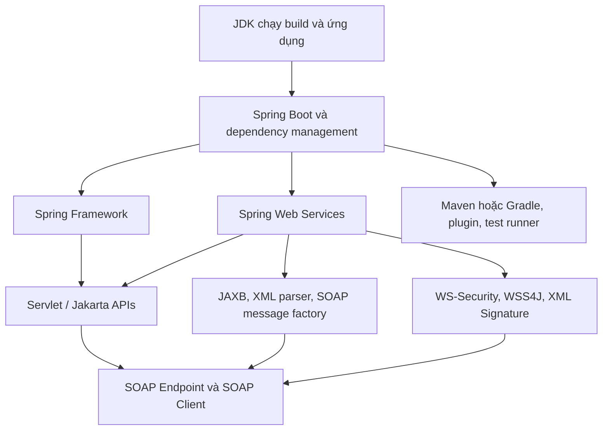
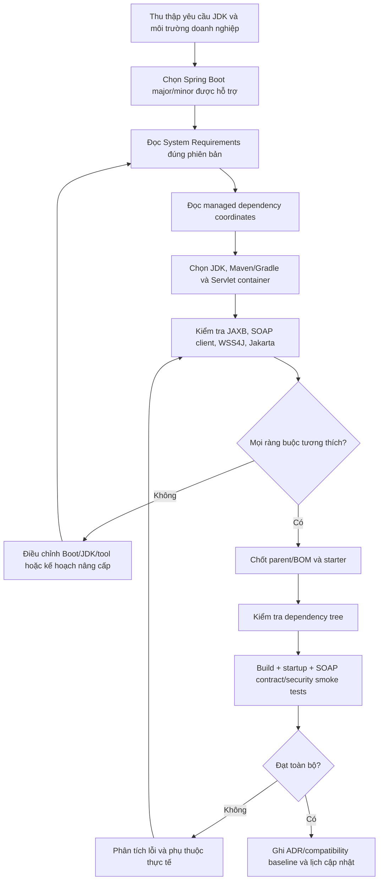

# Chọn bộ phiên bản JDK, Spring Framework, Spring Boot và Spring-WS tương thích

## Mục tiêu học tập

Trong chương **Khởi tạo dự án** của module **SPRING_WEB_SERVICES**, chúng ta cần chọn một bộ công nghệ đủ ổn định để xây dựng SOAP service theo hướng **contract-first**: thiết kế XSD/WSDL, ánh xạ JAXB, triển khai endpoint và SOAP client, xử lý SOAP Fault, interceptor, XML security, WS-Security, chứng chỉ và kiểm thử liên thông với hệ thống doanh nghiệp.

Sau bài học, bạn có thể:

1. Hiểu **bốn tầng phiên bản**: JDK, Spring Framework, Spring Boot, Spring Web Services (Spring-WS), cùng vai trò của Servlet/Jakarta EE, Maven/Gradle và thư viện bảo mật XML.
2. Tra **tài liệu System Requirements và dependency management** để chọn một bộ phiên bản được quản lý và thử nghiệm cùng nhau, thay vì ghép các bản phát hành theo suy đoán.
3. Phân biệt **Java tối thiểu**, Java dùng để chạy Maven/Gradle, Java dùng để biên dịch, Java chạy production và Java được thư viện hỗ trợ.
4. Khởi tạo một dự án Spring Boot với **starter Web Services** và BOM đúng nhánh, không vô tình trộn Spring Framework/Spring-WS từ hai thế hệ khác nhau.
5. Hiểu những thay đổi liên quan đến **Jakarta EE**, JAXB, Servlet container, WSS4J, SOAP message factory và SOAP client khi nâng cấp.
6. Chẩn đoán lỗi phụ thuộc bằng Maven/Gradle dependency tree, rồi kiểm thử một SOAP endpoint thực thay vì chỉ kết luận từ kết quả biên dịch.
7. Viết **quyết định chọn phiên bản** có lý do, ràng buộc, kiểm thử và kế hoạch cập nhật bản vá.

## 1. Vì sao chọn phiên bản là bước đầu của một dự án SOAP?

Một ứng dụng SOAP không chỉ sử dụng mỗi Spring Boot. Đường đi thường gồm:



Nếu một thành phần đòi API hoặc bytecode mà thành phần khác không cung cấp, ứng dụng có thể:

- **Không biên dịch**: `package jakarta.xml.bind does not exist`, `cannot find symbol`.
- **Biên dịch nhưng không khởi động**: `NoSuchMethodError`, `NoClassDefFoundError` hoặc `BeanCreationException`.
- **Khởi động nhưng lỗi khi nhận SOAP**: không tạo được `MessageDispatcherServlet`, không đọc được XSD/WSDL, JAXB marshal sai namespace.
- **Chỉ lỗi khi bật bảo mật**: WSS4J, parser XML, thư viện chữ ký hoặc chứng chỉ phụ thuộc phiên bản không tương thích.
- **Chạy được nhưng không được hỗ trợ vận hành**: Java/container quá cũ, thư viện đã ngừng nhận bản vá, cấu hình không khớp chính sách doanh nghiệp.

Vì vậy, chọn phiên bản là **quyết định kiến trúc và vận hành**, không chỉ là đổi một con số trong `pom.xml` hoặc `build.gradle`.

## 2. Nắm vai trò của từng tầng trước khi chọn

| Thành phần | Vai trò chính | Điều cần xác minh |
| --- | --- | --- |
| **JDK** | Runtime JVM, trình biên dịch Java, TLS/crypto provider, công cụ build. | Phiên bản tối thiểu/tối đa được hỗ trợ; JDK LTS tổ chức cho phép; khả năng chạy build và production. |
| **Spring Framework** | IoC/DI, web infrastructure, OXM, resource abstractions, exception handling, cơ sở cho Spring-WS. | Nhánh Framework nào được Spring Boot đã chọn quản lý; yêu cầu Java và Jakarta EE. |
| **Spring Boot** | Auto-configuration, starter, quản lý dependency (BOM), plugin build, web server, cấu hình. | Phiên bản ổn định có hỗ trợ; System Requirements; starter và các module được quản lý. |
| **Spring Web Services** | SOAP endpoints, `WebServiceTemplate`, WSDL exposure, payload mapping, SOAP Fault và interceptor. | Spring-WS được Boot BOM quản lý; compatibility với Spring Framework, Jakarta và SOAP stack. |
| **Servlet container** | Nhận HTTP và cung cấp servlet API cho Spring-WS SOAP/HTTP. | Servlet/Jakarta EE baseline, Tomcat/Jetty phù hợp; cấu hình reverse proxy/TLS. |
| **JAXB/Jakarta XML Bind** | Sinh class từ XSD, marshal/unmarshal XML từ/đến đối tượng Java. | Dùng `jakarta.xml.bind.*` đúng thế hệ; JAXB runtime/codegen có sẵn và cùng dòng. |
| **WS-Security / WSS4J** | Kiểm tra/gắn chữ ký, token, timestamp, encryption, chứng chỉ. | Version quản lý, thuật toán/chính sách, crypto provider, XML security dependencies. |
| **Maven/Gradle** | Giải quyết dependency, chạy Java compiler và test, đóng gói. | Phiên bản build tool và JDK chạy build tool có được hỗ trợ không. |

**Thứ tự ưu tiên thực tế:** chọn nhánh Spring Boot phù hợp yêu cầu dự án, để **BOM của Boot chọn Spring Framework, Spring-WS và phần lớn dependencies**, sau đó chọn JDK, build tool và cấu hình bảo mật có thể chạy được trên nhánh đó.

Không nên bắt đầu bằng “Spring Framework 7.1 + Spring-WS 4.1 chắc cũng được”, rồi tìm cách ép Spring Boot chạy theo; lựa chọn đó có thể vượt ngoài những tổ hợp đã được kiểm thử.

## 3. Bảng tham chiếu phiên bản có kiểm chứng

Các giá trị sau được đối chiếu với **tài liệu Spring Boot chính thức tại ngày 27/11/2026**. Chúng minh họa **hai nhánh có thật**; các bản vá mới và cửa sổ hỗ trợ có thể thay đổi sau ngày này.

| Tiêu chí | Nhánh Spring Boot 3.5.x | Nhánh Spring Boot 4.2.x |
| --- | --- | --- |
| Bản tài liệu/BOM được đối chiếu | **Spring Boot 3.5.16** | **Spring Boot 4.2.0** |
| Spring Framework đi kèm theo nhánh đã xem | **6.2.19** | **7.1.0** |
| Spring-WS do Boot quản lý | **4.1.4** | **5.1.0** |
| Java tối thiểu của Boot | **17** | **17** |
| Khoảng Java được Boot công bố tương thích | **17–25** | **17–27** |
| Servlet container nhúng phổ biến | **Tomcat 10.1**, Servlet 6.0 | **Tomcat 11.0**, Servlet 6.1 |
| Jakarta EE định hướng baseline | Thế hệ **Jakarta EE 10** của Spring 6/Boot 3 | Thế hệ **Jakarta EE 11** của Spring 7/Boot 4 |
| Maven được Boot hỗ trợ | **3.6.3+** | **3.6.3+** |
| Gradle được Boot hỗ trợ | **7.6.4+ thuộc nhánh 7.x**, hoặc **8.4+ thuộc nhánh 8.x** | **8.14+ thuộc nhánh 8.x**, hoặc **9.x** |
| Starter Web Services nên dùng | `spring-boot-starter-web-services` | `spring-boot-starter-webservices` |
| Tình huống nên cân nhắc | Hệ thống đang theo Spring 6 / Tomcat 10.1 hoặc cần lộ trình nâng cấp từng bước. | Dự án mới khi toàn bộ dependency và container sẵn sàng cho Spring 7 / Jakarta EE 11. |

**Chính xác về ý nghĩa của bảng:**

- **3.5.16/4.2.0** là **mốc tài liệu được đọc**, không phải lời hứa rằng chúng luôn là bản mới nhất.
- **6.2.19/7.1.0** và **4.1.4/5.1.0** là các phiên bản được công bố trong những BOM tương ứng. Khi thay Boot patch/minor, phải đọc lại bảng managed dependencies của **đúng bản Boot**.
- “Java tối thiểu 17” không có nghĩa tổ hợp **JDK bất kỳ mới hơn + Gradle bất kỳ cũ hơn** sẽ hoạt động. Build tool có **ma trận Java riêng**.
- “Tương thích đến Java 27” là phạm vi Boot công bố cho mốc tài liệu này; addon như XML security, thư viện SOAP client cũ hoặc thư viện do doanh nghiệp tự viết vẫn cần thử nghiệm.
- **Không ghép hai cột** bằng cách ép `spring-ws-core:4.1.4` vào Boot 4.2 hoặc Spring Framework 7 vào Boot 3.5 nếu không có bằng chứng và nhu cầu rõ ràng.

Nguồn dùng cho bảng:

- [Spring Boot 3.5 — System Requirements](https://docs.spring.io/spring-boot/3.5/system-requirements.html)
- [Spring Boot 3.5 — Managed Dependency Coordinates](https://docs.spring.io/spring-boot/3.5/appendix/dependency-versions/coordinates.html)
- [Spring Boot 4.2 — System Requirements](https://docs.spring.io/spring-boot/system-requirements.html)
- [Spring Boot 4.2 — Managed Dependency Coordinates](https://docs.spring.io/spring-boot/appendix/dependency-versions/coordinates.html)
- [Spring Boot — Build Systems và starter](https://docs.spring.io/spring-boot/reference/using/build-systems.html)

### 3.1. Ví dụ lựa chọn nhất quán

**Bộ A — phục vụ dự án duy trì Spring 6:**

```text
JDK phát triển / production: 21 (nằm trong phạm vi Boot 3.5 công bố)
Spring Boot:               3.5.x (chốt patch được hỗ trợ)
Spring Framework:          6.2.x (để Boot BOM chọn)
Spring Web Services:       4.1.x (để Boot BOM chọn)
Servlet container:         Tomcat 10.1 / Servlet 6.0
Build tool:                Maven đủ mức yêu cầu, hoặc Gradle được hỗ trợ
JAXB:                      jakarta.xml.bind.* (không phải javax.xml.bind.*)
```

**Bộ B — ứng dụng mới dựa trên Spring 7:**

```text
JDK phát triển / production: 21 hoặc 25 sau kiểm thử
Spring Boot:               4.2.x (chốt patch được hỗ trợ)
Spring Framework:          7.1.x (để Boot BOM chọn)
Spring Web Services:       5.1.x (để Boot BOM chọn)
Servlet container:         Tomcat 11 / Servlet 6.1
Build tool:                Maven đủ mức yêu cầu, hoặc Gradle phù hợp JDK
JAXB:                      jakarta.xml.bind.*; kiểm tra tool sinh code
```

Các ví dụ không có nghĩa JDK 21 luôn là lựa chọn tốt nhất. Lựa chọn phụ thuộc tiêu chuẩn doanh nghiệp, bản vá bảo mật, thời gian hỗ trợ, hình ảnh container, công cụ giám sát và đặc biệt là khả năng tương thích với **hệ thống SOAP đối tác**.

## 4. Quy tắc chọn bộ phiên bản theo điều kiện dự án

Trước khi mở Spring Initializr, trả lời các câu hỏi sau.

### 4.1. Dự án mới hay nâng cấp dự án cũ?

**Dự án mới** có thể ưu tiên một nhánh Boot mới còn được hỗ trợ nếu tất cả các dependency liên quan (JAXB codegen, SOAP library phía client, WSS4J, container triển khai, plugin build) đã tương thích. Với mốc tài liệu này, **Boot 4.2 + Spring Framework 7.1 + Spring-WS 5.1** là một bộ có quản lý dependency chính thức.

**Dự án đang hoạt động** cần đánh giá phạm vi thay đổi và chính sách hỗ trợ. Nếu hệ thống mới lên Spring Boot 3.5 và Servlet 6.0, việc nhảy ngay sang Boot 4.2 có thể kéo theo chuyển Servlet 6.1, cập nhật các API đã bị bỏ, rà soát Spring Security/WSS4J. Một bản nâng cấp có thể chia thành các chặng nhỏ, mỗi chặng có test SOAP contract và security.

### 4.2. JDK của tổ chức có giới hạn gì?

Nếu doanh nghiệp chỉ cho chạy **Java 11**, các nhánh **Spring Boot 3.5 và 4.2 không phù hợp** vì yêu cầu tối thiểu là Java 17. Hai hướng cần bàn:

1. Nâng Java runtime, toolchain và container để có thể sử dụng Spring hiện đại.
2. Nếu không thể nâng, phải xử lý như một ràng buộc hệ thống legacy, có kế hoạch vận hành/bảo mật riêng và xem xét vòng đời hỗ trợ của stack cũ. Không coi việc tự ép version về thấp là một giải pháp an toàn cho dự án mới.

Nếu doanh nghiệp cho Java 17/21/25, hãy chọn phiên bản **LTS đã được tổ chức chuẩn hóa**, xác định patch JDK và kiểm tra khả năng chạy trên tất cả môi trường. Java 21 và Java 25 là hai lựa chọn LTS thường được cân nhắc; không có yêu cầu mọi dự án phải chọn Java mới nhất chỉ vì Boot hỗ trợ.

### 4.3. Có yêu cầu về Servlet container và Jakarta EE không?

Spring Boot 4.2 theo tài liệu hiện tại dùng **Servlet 6.1** và các server tương ứng như Tomcat 11. Các ứng dụng deploy trên application server do doanh nghiệp quản lý phải xác minh server **thực sự cung cấp Servlet API phù hợp**. Không nên compile theo Servlet 6.1 rồi triển khai lên container chỉ hỗ trợ Servlet 6.0 và hy vọng mọi API đều có sẵn.

Spring Boot 3.5 đi với nhánh Spring 6 và Tomcat 10.1 phổ biến. Nếu đối tác đang sử dụng proxy, servlet filter hoặc thư viện chỉ tương thích container cũ, cần đưa tương thích runtime vào quyết định chọn nhánh.

### 4.4. Có thư viện bên thứ ba không nằm trong BOM?

Lập danh sách:

- JAXB generator và JAXB runtime.
- SOAP client library, WS-Addressing, SAAJ/MessageFactory tùy stack.
- WSS4J, Apache Santuario XML Security, provider crypto.
- HTTP transport/TLS client, Apache HttpClient nếu dùng.
- Plugin Maven/Gradle sinh class XSD/WSDL.
- Công cụ test SOAP: Spring-WS Test, SOAPUI, CXF client hoặc hệ thống test đối tác.
- Thư viện nội bộ có import `javax.*` hoặc phụ thuộc Spring 5/6.

Với từng dependency **không được Boot quản lý**, cần xem release notes, Java/Jakarta baseline, transitive dependencies, hỗ trợ version và phản hồi từ bài kiểm thử tích hợp. Đó là lý do phải chọn **cả bộ**, không chỉ chọn số lớn nhất của từng thư viện.

## 5. Quan hệ Boot BOM — Framework — Spring-WS

### 5.1. BOM là gì?

**BOM (Bill of Materials)** là danh sách phiên bản dependency được framework phát hành để các thư viện hoạt động theo một tập thống nhất. Trong ứng dụng Spring Boot, BOM quản lý các phiên bản phổ biến của:

- Spring Framework modules như `spring-core`, `spring-context`, `spring-webmvc`.
- Spring Web Services modules như `spring-ws-core`, `spring-ws-security` và `spring-ws-test`.
- Nhiều thư viện hỗ trợ khác như logging, JAXB/Jakarta, test, validation và runtime liên quan.

Maven parent `spring-boot-starter-parent` nhập cơ chế dependency management của Boot. Với Gradle, có thể dùng Spring Dependency Management Plugin hoặc Gradle native `platform` để áp BOM. Khi có BOM phù hợp, dependency được quản lý **không cần ghi số phiên bản từng artifact**.

Ví dụ khai báo hợp lý dưới Maven parent Boot:

```xml
<dependency>
    <groupId>org.springframework.boot</groupId>
    <artifactId>spring-boot-starter-webservices</artifactId>
</dependency>

<!-- Chỉ bổ sung nếu dự án cần xử lý WS-Security -->
<dependency>
    <groupId>org.springframework.ws</groupId>
    <artifactId>spring-ws-security</artifactId>
</dependency>
```

Trong ví dụ Boot 4.2, BOM tự quản lý `spring-ws-security` phiên bản cùng dòng `spring-ws-core`. Không cần khai báo `<version>5.1.0</version>` cho mỗi thư viện.

### 5.2. Quy tắc tránh phiên bản chồng chéo

**Được khuyến nghị:**

```text
Chọn Spring Boot 4.2.x
    -> Import BOM đúng bản Boot
        -> Dùng starter webservices của Boot 4
            -> Nếu cần, thêm spring-ws-security không khai báo version
                -> Kiểm tra resolved dependency tree
```

**Cần điều tra trước khi sử dụng:**

```xml
<!-- Ví dụ rủi ro: ép Framework 6 vào ứng dụng Boot 4.2 / Framework 7 -->
<dependency>
    <groupId>org.springframework</groupId>
    <artifactId>spring-context</artifactId>
    <version>6.2.19</version>
</dependency>
```

Hoặc:

```xml
<!-- Ví dụ rủi ro: ép Spring-WS 4.1 vào Boot 4.2 quản lý Spring-WS 5.1 -->
<dependency>
    <groupId>org.springframework.ws</groupId>
    <artifactId>spring-ws-core</artifactId>
    <version>4.1.4</version>
</dependency>
```

Bản thân Maven có thể **resolve** được các dependency như vậy nhưng tính đúng đắn của runtime không được bảo đảm. Không lấy “lệnh `mvn package` thành công” làm bằng chứng bộ dependency đã tương thích với SOAP, JAXB, security và Servlet container.

**Không nhất thiết mọi version phải trùng nhau về số.** Boot `4.2`, Spring Framework `7.1` và Spring-WS `5.1` là các project có **quy tắc đánh số khác nhau**. Câu hỏi đúng là “BOM/ma trận hỗ trợ phiên bản nào?”, không phải “sao không phải 4.2 cho cả ba?”.

## 6. JDK: phân biệt môi trường chạy build, biên dịch và production

Một dự án có thể gặp ít nhất **bốn giá trị Java**:

1. **Java của shell/IDE**: kết quả `java -version` trên máy lập trình.
2. **JDK đang chạy Maven hoặc Gradle**: kiểm tra `mvn -version` hoặc `./gradlew --version`. Nó có thể khác Java ở terminal nếu IDE/toolchain đặt riêng.
3. **JDK và release target dùng để biên dịch**: ví dụ biên dịch trên JDK 21 nhưng tạo bytecode và giới hạn API theo Java 17 bằng `--release 17`.
4. **JVM production**: phiên bản trong Docker image, VM hoặc application server thực sự khởi động ứng dụng.

**Tương thích là giao của tất cả điều kiện**: Boot, Spring-WS, plugin build, Gradle/Maven runtime, SOAP library và JVM production.

### 6.1. Kiểm tra môi trường

```bash
java -version
javac -version
mvn -version

# Nếu dùng Gradle Wrapper:
./gradlew --version
```

Trên Windows PowerShell, có thể chạy `.\gradlew.bat --version` hoặc `.\mvnw.cmd -version` nếu wrapper được tạo; cú pháp lệnh phù hợp với shell đang dùng.

### 6.2. Java toolchain không thay thế kiểm tra build-tool runtime

Giả sử chọn Java 25 cho ứng dụng, nhưng dùng **Gradle 8.14** chạy trên Java 25. Mặc dù Boot 4.2 hỗ trợ Gradle 8.14+ và hỗ trợ Java 25, **Gradle 8.14 không được liệt kê là có thể chạy trên Java 25** trong ma trận Gradle. Theo tài liệu Gradle hiện hành, chạy Gradle trên Java 25 cần **Gradle 9.1.0+**.

Cần xét đồng thời:

```text
Spring Boot ↔ phiên bản Gradle có hỗ trợ
Gradle       ↔ JDK dùng để chạy Gradle
Java plugin  ↔ JDK toolchain dùng để compile/test
Application  ↔ JDK dùng để chạy production
```

Ví dụ bộ nhất quán với Boot 4.2:

```text
Boot:                4.2.0
Gradle wrapper:      9.1+ (nếu muốn chạy Gradle trên JDK 25)
Gradle daemon JVM:   25
Java toolchain:      25
Production JVM:      25 (cùng patch level được quản lý)
```

Hoặc dùng Gradle 8.14 với **Gradle daemon chạy JDK 21**, Java toolchain 21 và JVM production 21. Quyết định cuối cùng cần theo ma trận Gradle và chính sách tổ chức; Gradle còn phân biệt **chạy build tool** với **biên dịch/test bằng toolchain**.

Nguồn: [Gradle — Compatibility Matrix](https://docs.gradle.org/current/userguide/compatibility.html).

### 6.3. Vì sao nên chốt JDK patch level?

Khác với Java major (17/21/25), số **patch** của JDK ảnh hưởng đến bản vá bảo mật, TLS, truststore, xử lý crypto và runtime. Trong tích hợp SOAP có WS-Security, XML Signature và chứng chỉ, cập nhật bản vá JDK là nhiệm vụ vận hành quan trọng.

Hãy ghi cả:

- Java major và distribution được phê duyệt (ví dụ Temurin hoặc distribution doanh nghiệp hỗ trợ).
- Patch level cụ thể hoặc chính sách patch theo đợt.
- JDK trong CI/build image, local development và production.
- Danh sách algorithm/TLS/chứng chỉ bị chính sách JDK từ chối, nếu có.
- Ngày đánh giá lại và kết quả kiểm thử khi thay patch.

Không đưa private key hoặc mật khẩu keystore vào tài liệu lựa chọn phiên bản.

## 7. Maven: tạo một bộ Spring Boot 4.2 nhất quán

Ví dụ cho **dự án mới** dùng Spring Boot **4.2.0**, Java **21**, Spring-WS **5.1** theo BOM:

```xml
<?xml version="1.0" encoding="UTF-8"?>
<project xmlns="http://maven.apache.org/POM/4.0.0"
         xmlns:xsi="http://www.w3.org/2001/XMLSchema-instance"
         xsi:schemaLocation="
             http://maven.apache.org/POM/4.0.0
             https://maven.apache.org/xsd/maven-4.0.0.xsd">
    <modelVersion>4.0.0</modelVersion>

    <parent>
        <groupId>org.springframework.boot</groupId>
        <artifactId>spring-boot-starter-parent</artifactId>
        <version>4.2.0</version>
        <relativePath/>
    </parent>

    <groupId>com.example</groupId>
    <artifactId>soap-order-service</artifactId>
    <version>0.0.1-SNAPSHOT</version>
    <name>soap-order-service</name>

    <properties>
        <java.version>21</java.version>
    </properties>

    <dependencies>
        <!-- Boot 4: starter cho Spring Web Services -->
        <dependency>
            <groupId>org.springframework.boot</groupId>
            <artifactId>spring-boot-starter-webservices</artifactId>
        </dependency>

        <!-- Bổ sung khi ứng dụng cần WS-Security/WSS4J -->
        <dependency>
            <groupId>org.springframework.ws</groupId>
            <artifactId>spring-ws-security</artifactId>
        </dependency>

        <dependency>
            <groupId>org.springframework.boot</groupId>
            <artifactId>spring-boot-starter-webservices-test</artifactId>
            <scope>test</scope>
        </dependency>
    </dependencies>

    <build>
        <plugins>
            <plugin>
                <groupId>org.springframework.boot</groupId>
                <artifactId>spring-boot-maven-plugin</artifactId>
            </plugin>
        </plugins>
    </build>
</project>
```

Ví dụ này minh họa **cách quản lý phiên bản**, không triển khai đầy đủ WSDL/XSD, JAXB generated classes, truststore hoặc chính sách xác minh WS-Security. Chỉ thêm `spring-ws-security` khi thật sự cần chức năng đó; một ứng dụng demo không dùng bảo mật thông điệp có thể bỏ dependency này.

Các điểm cần quan sát:

- `parent` quản lý dependency nên **không cần** khai báo `spring-framework` và `spring-ws-core` version bằng tay.
- Chọn **`spring-boot-starter-webservices`** trên Boot 4.2. Tên cũ `spring-boot-starter-web-services` vẫn có thể tồn tại dưới dạng tương thích nhưng được đánh dấu **deprecated**; ví dụ mới nên dùng tên được khuyến nghị.
- Java 21 nằm trong dải Boot 4.2 hỗ trợ. Nếu đổi sang Java 25, phải cập nhật CI, production JDK và build tool như đã phân tích.
- `spring-boot-starter-webservices-test` hỗ trợ nhóm thư viện test cho Spring Web Services ở Boot 4; còn yêu cầu thử nghiệm bảo mật thực tế phải có cấu hình/test data phù hợp.

Nếu doanh nghiệp dùng một Maven parent riêng (không kế thừa Boot parent), có thể dùng **`spring-boot-dependencies` BOM trong `dependencyManagement`** và cấu hình plugin riêng. Không được khai báo đồng thời các dependency management chồng nhau mà không hiểu thứ tự ưu tiên và chiến lược override.

### 7.1. Maven Wrapper và kết quả resolve

Từ thư mục dự án có Maven Wrapper:

```bash
./mvnw -version
./mvnw dependency:tree
./mvnw test
./mvnw package
```

Trong PowerShell trên Windows có thể dùng `.\mvnw.cmd` với các tham số tương tự. Kiểm tra cây dependency tìm:

- Có một tập phiên bản Spring Framework hợp lý cho Boot 4.2 (`7.1.x` của BOM).
- `spring-ws-core` và `spring-ws-security` cùng nhánh do Boot quản lý (`5.1.x` theo mốc).
- Không có `spring-context:6.x` hoặc `spring-ws-core:4.x` bị kéo vào do khai báo trực tiếp/cấu hình override.
- Servlet/Jakarta API và thư viện JAXB/WSS4J không bị lẫn thế hệ ngoài ý định.

Để thu hẹp cây dependency, Maven Dependency Plugin hỗ trợ tham số lọc, ví dụ:

```bash
./mvnw dependency:tree "-Dincludes=org.springframework.ws:*"
./mvnw dependency:tree "-Dincludes=org.springframework:*"
```

Chỉ đọc `dependency:tree` chưa đủ chứng minh mọi hành vi SOAP đúng, nhưng giúp phát hiện sớm nhiều xung đột classpath.

## 8. Gradle: dùng BOM và toolchain cùng bộ phiên bản

Đối với dự án chọn Spring Boot **4.2.0**, có thể dùng **Gradle Groovy DSL** và quản lý version qua Gradle native `platform`.

```groovy
plugins {
    id 'java'
    id 'org.springframework.boot' version '4.2.0'
}

group = 'com.example'
version = '0.0.1-SNAPSHOT'

java {
    toolchain {
        languageVersion = JavaLanguageVersion.of(21)
    }
}

repositories {
    mavenCentral()
}

dependencies {
    // Sử dụng BOM Boot cho cả runtime và test.
    implementation platform('org.springframework.boot:spring-boot-dependencies:4.2.0')
    testImplementation platform('org.springframework.boot:spring-boot-dependencies:4.2.0')

    implementation 'org.springframework.boot:spring-boot-starter-webservices'
    implementation 'org.springframework.ws:spring-ws-security'

    testImplementation 'org.springframework.boot:spring-boot-starter-webservices-test'
}

tasks.named('test') {
    useJUnitPlatform()
}
```

Đoạn trên chọn **một cách** quản lý dependency bằng Gradle native platform. Một cấu hình khác dùng **`io.spring.dependency-management` plugin** có thể nhập BOM từ Boot; khi đó không cần lặp lại `platform(...)` như ví dụ. Chọn một cách rõ ràng để dễ đọc cây phụ thuộc và tránh hai nguồn version kiểm soát cùng một artifact.

### 8.1. Lưu ý quan trọng với Gradle

- **Java toolchain 21** quyết định JDK dùng để biên dịch/test theo cấu hình, nhưng không nhất thiết là JVM chạy chính Gradle daemon.
- Build script giả định Gradle Wrapper thuộc một phiên bản Boot 4.2 hỗ trợ (Gradle 8.14+ hoặc 9.x), và JVM chạy Gradle cũng tương thích với release Gradle đó.
- Nếu nâng Java lên 25 và cho Gradle **chạy trên JDK 25**, hãy chọn Gradle **9.1+** theo ma trận Gradle; không chỉ đổi `JavaLanguageVersion.of(21)` sang `of(25)` rồi bỏ qua wrapper.
- Chỉ thêm starter/thư viện thật cần thiết; `spring-boot-starter-webservices` cung cấp tích hợp SOAP, không cần thêm một starter REST chỉ để dùng SOAP.
- Nếu quy trình công ty dùng BOM quản lý tập trung, phải kiểm tra nguồn BOM cuối cùng và cách Gradle chọn version khi có conflict.

### 8.2. Kiểm tra dependency với Gradle

```bash
./gradlew --version
./gradlew dependencies --configuration runtimeClasspath
./gradlew dependencyInsight --dependency spring-ws-core --configuration runtimeClasspath
./gradlew dependencyInsight --dependency spring-context --configuration runtimeClasspath
./gradlew test
```

Trong Windows PowerShell: `.\gradlew.bat`. Lệnh `dependencyInsight` giúp tìm vì sao một phiên bản được chọn và có dependency nào yêu cầu bản khác; rất hữu ích khi bảo trì dự án tích hợp nhiều SOAP client libraries.

## 9. Dự án Spring Boot 3.5 dùng starter nào?

Nếu chọn **Boot 3.5.x**, Starter Web Services được tài liệu nhánh đó gọi là **`spring-boot-starter-web-services`** (có dấu gạch nối giữa `web` và `services`). Ví dụ khai báo:

```xml
<parent>
    <groupId>org.springframework.boot</groupId>
    <artifactId>spring-boot-starter-parent</artifactId>
    <version>3.5.16</version>
    <relativePath/>
</parent>

<properties>
    <java.version>21</java.version>
</properties>

<dependencies>
    <dependency>
        <groupId>org.springframework.boot</groupId>
        <artifactId>spring-boot-starter-web-services</artifactId>
    </dependency>
</dependencies>
```

Đây là **đoạn trích** của `pom.xml`, không phải POM hoàn chỉnh đứng độc lập. Với Boot 3.5.16, dependency coordinates chính thức được đối chiếu cho `spring-ws-core`, `spring-ws-security` là **4.1.4**. Nếu cần, khai báo `spring-ws-security` không gắn version để BOM xử lý.

**Khi nâng cấp từ Boot 3.5 sang 4.2**, tên starter **được khuyến nghị** đổi từ `spring-boot-starter-web-services` sang `spring-boot-starter-webservices`. Đây là một thay đổi thư viện cấp build, độc lập với cấu trúc XML của WSDL/XSD, nhưng có thể khiến khởi tạo dự án lỗi nếu copy nhầm artifact cũ từ tài liệu ở nhánh khác.

Tham khảo: [Spring Boot 3.5 — Web Services](https://docs.spring.io/spring-boot/3.5/reference/io/webservices.html) và [Spring Boot hiện hành — Web Services](https://docs.spring.io/spring-boot/reference/io/webservices.html).

## 10. Jakarta EE và JAXB: điểm gãy thường gặp khi nâng cấp

### 10.1. Từ javax sang jakarta

Các hệ thống Java EE cũ thường có code:

```java
// Ví dụ trong dự án cũ
import javax.xml.bind.JAXBElement;
import javax.xml.bind.annotation.XmlRootElement;
import javax.servlet.http.HttpServletRequest;
```

Những hệ thống Spring Framework 6+/Boot 3+ dùng các API Jakarta tương ứng:

```java
import jakarta.xml.bind.JAXBElement;
import jakarta.xml.bind.annotation.XmlRootElement;
import jakarta.servlet.http.HttpServletRequest;
```

Đây là chuyển đổi namespace **API Java**, không có nghĩa namespace XML của các schema nghiệp vụ phải đổi từ `urn:example:orders:v1` thành thứ khác.

**Lỗi phổ biến:** file XSD không đổi nhưng lớp Java sinh ra từ XSD vẫn import `javax.xml.bind.annotation.*` vì công cụ codegen quá cũ. Khi đưa vào Boot 4, project có thể không biên dịch hoặc phát sinh mismatch runtime. Phải nâng plugin/codegen JAXB phù hợp với Jakarta, **sinh lại nguồn Java**, rồi kiểm tra XML namespace, element name và marshalling.

### 10.2. Java 17+ không còn JAXB như một phần mặc định của JDK

JAXB đã bị tách khỏi JDK trong các phiên bản Java hiện đại. Khi dùng Java 17/21/25, đừng giả định chỉ có JDK là đủ để tạo `JAXBContext`.

- **API JAXB** như `jakarta.xml.bind.JAXBContext` cần có ở classpath.
- **Runtime JAXB provider** phải thực thi marshalling/unmarshalling.
- **Code generation** (xjc hoặc Maven/Gradle plugin) là thành phần build riêng, có thể cần phiên bản tương thích Jakarta và JDK hiện tại.
- Starter/BOM có thể quản lý hoặc kéo một số dependencies; cần **kiểm tra dependency tree thực tế** trước khi tự thêm nhiều phiên bản.

Bài học này chưa xây dựng toàn bộ plugin sinh JAXB để không khóa vào một phiên bản codegen cụ thể. Khi triển khai, chọn plugin được duy trì tương thích với Java/Jakarta của nhánh Boot đã chốt và dùng integration tests để xác nhận class sinh ra đọc/ghi XML đúng XSD.

### 10.3. Spring Framework 7 và Jakarta EE 11

Spring Framework 7 / Boot 4 dùng baseline **Jakarta EE 11** và **Servlet 6.1** theo tài liệu release/migration. Điều này có thể ảnh hưởng:

- Servlet container khi deploy WAR.
- Filter và Servlet API do thư viện bên ngoài sử dụng.
- Bean Validation, JPA, JMS và các API Jakarta khác nếu dự án SOAP kết hợp các phần đó.
- Thư viện có phụ thuộc transitive vào Servlet/Jakarta thế hệ cũ.
- API bị deprecate/loại bỏ khi nâng major Spring.

Vì thế **không chỉ** nhìn version Spring-WS. Một SOAP endpoint chạy thành công trên local embedded Tomcat nhưng deploy WAR lên application server khác vẫn cần kiểm tra compatibility ở runtime đó.

## 11. SOAP, XML và WS-Security có thêm ràng buộc phiên bản nào?

Dù chọn đúng Boot BOM, các tính năng tích hợp doanh nghiệp vẫn cần kiểm chứng riêng.

### 11.1. XSD/WSDL không tự đổi khi nâng Spring

Nếu Spring-WS nâng từ 4.1 lên 5.1, XML Schema/WSDL đã được đối tác thỏa thuận **không nên tự đổi** chỉ vì thư viện Java đổi version. Hãy kiểm tra:

- WSDL public còn đúng namespace, `wsdl:portType`, `binding`, `service`, `soap:address`.
- Endpoint mapping còn khớp `@PayloadRoot(namespace, localPart)`.
- JAXB classes marshal/unmarshal cùng global element và kiểu dữ liệu.
- SOAP 1.1/1.2 message factory, `Content-Type` và SOAPAction phù hợp hợp đồng.
- SOAP Fault code, fault detail và status HTTP còn đúng thỏa thuận.

Một thay đổi dependency có thể ảnh hưởng đến **serialization XML** (thứ tự, namespace prefix, nil, thời gian) ngay cả khi Java method giữ nguyên. Cần kiểm thử bằng payload mẫu và client thực.

### 11.2. Security stack là hệ phụ thuộc riêng

Nếu dịch vụ dùng Spring-WS `Wss4jSecurityInterceptor` hoặc cơ chế tương ứng, hãy kiểm tra:

- Spring-WS Security module cùng nhánh với Spring-WS Core.
- Phiên bản WSS4J và thư viện XML Signature/XML Encryption được dependency management lựa chọn.
- JDK crypto provider và chính sách thuật toán; cấu hình chứng chỉ/keystore/truststore.
- Hỗ trợ xác minh và tạo **UsernameToken**, **Timestamp**, **Signature**, **Encryption** theo profile đối tác.
- Hành vi khi thiếu header bắt buộc, chứng chỉ không tin cậy, chữ ký sai hoặc timestamp hết hạn.
- Cơ chế parser an toàn chống XXE, external entity, entity expansion, signature wrapping và tải XML quá lớn.

Không dùng `mustUnderstand` như một phép kiểm tra bảo mật. Nó thể hiện nghĩa vụ xử lý SOAP Header; tính hợp lệ của chữ ký/token vẫn phải được xác minh bởi security stack đã cấu hình.

### 11.3. SOAP client library có thể là nút thắt nâng cấp

Bên server dùng Spring-WS 5.1 nhưng đối tác có thể dùng CXF, Axis, JAX-WS/Jakarta XML WS hoặc SDK riêng. **Hai phía không cần chạy cùng phiên bản thư viện Java**. Điều kiện là trao đổi **SOAP/WSDL/XSD/WS-Security** tương thích.

Phải kiểm thử đúng các trường hợp:

- WSDL import và XSD schema được tải bằng client generator.
- Request và response XML đúng QName, schema và SOAP version.
- Header bắt buộc, SOAPAction, WS-Addressing nếu có.
- TLS/mTLS, thuật toán ký, chứng chỉ và SOAP Fault.
- Payload lớn, timeout, retry/idempotency theo chính sách.

**Không giải quyết xung đột trong một ứng dụng** bằng cách cho cả hai major Spring-WS và nhiều version Spring Framework vào cùng classpath rồi mong classloader tự chọn đúng.

## 12. Spring-WS Boot auto-configuration: smoke test cơ bản

Mục tiêu của bước kiểm tra đầu tiên sau khi chốt bộ phiên bản là: **ứng dụng khởi động, WSDL/XSD công bố được và endpoint nhận/trả SOAP hợp đồng**. Cần thêm kiểm thử security sau khi xác minh nền tảng cơ bản.

### 12.1. Cấu trúc dự án đề xuất

```text
soap-order-service/
├─ pom.xml                       (hoặc build.gradle + settings.gradle)
├─ mvnw / mvnw.cmd                (nếu dùng Maven Wrapper)
├─ src/
│  ├─ main/
│  │  ├─ java/com/example/soap/
│  │  │  ├─ SoapApplication.java
│  │  │  ├─ config/WebServiceConfig.java
│  │  │  ├─ endpoint/OrderEndpoint.java
│  │  │  └─ ... (JAXB classes generated từ XSD)
│  │  └─ resources/
│  │     ├─ application.yml
│  │     ├─ xsd/orders.xsd
│  │     └─ wsdl/                 (nếu công bố WSDL tĩnh)
│  └─ test/
│     └─ java/.../OrderEndpointIntegrationTest.java
```

Ví dụ ứng dụng chính:

```java
package com.example.soap;

import org.springframework.boot.SpringApplication;
import org.springframework.boot.autoconfigure.SpringBootApplication;

@SpringBootApplication
public class SoapApplication {
    public static void main(String[] args) {
        SpringApplication.run(SoapApplication.class, args);
    }
}
```

Spring Boot có auto-configuration cho Spring Web Services khi starter tương ứng có mặt. Với Boot hiện hành, có thể cấu hình vị trí WSDL tĩnh bằng:

```yaml
spring:
  webservices:
    wsdl-locations: classpath:/wsdl
```

Tài liệu Spring Boot cũng mô tả tự đăng ký `SimpleWsdl11Definition` và `SimpleXsdSchema` cho các WSDL/XSD tương ứng. Đây là cơ chế **công bố tài liệu**; nếu bạn cần sinh WSDL từ XSD bằng `DefaultWsdl11Definition`, phải cấu hình bean/đường dẫn theo quy ước Spring-WS và kiểm thử thực tế.

**Lưu ý:** Chỉ có `SoapApplication` và `application.yml` ở trên chưa tạo endpoint nghiệp vụ. Một dự án đầy đủ vẫn phải viết XSD/WSDL, JAXB hoặc payload model, `@Endpoint`, schema validation, xử lý Fault và security. Mục tiêu của bước này là xác định starter và auto-configuration hoạt động trước khi thêm chức năng.

### 12.2. Bài smoke test cần chạy sau khi khởi tạo

```text
1. Build và unit tests chạy trong CI với JDK đã chốt.
2. Spring Boot khởi động không có lỗi classpath/bean/Servlet.
3. URL WSDL/XSD có thể truy cập theo cấu hình public.
4. SOAP client gửi request với payload QName đúng.
5. Endpoint trả response tương ứng, validate được bằng XSD.
6. Gửi payload sai schema: nhận lỗi được cấu hình.
7. Gửi yêu cầu thiếu WS-Security Header bắt buộc: bị từ chối.
8. Thử chứng chỉ/timestamp không hợp lệ: SOAP Fault bảo mật đúng.
9. Thử qua reverse proxy và TLS của môi trường triển khai.
10. Quan sát dependency tree trong artifact dùng cho production.
```

Không kết luận “hoàn toàn tương thích” chỉ vì dự án tạo xong bằng Spring Initializr. **Tương thích thực tế** là kết quả của build, startup, hợp đồng XML, SOAP transport và security integration tests cùng nhau.

## 13. Quy trình chuẩn để chọn bộ phiên bản trước khi bắt đầu coding



### 13.1. Mẫu ghi quyết định lựa chọn (ADR)

Một ghi chép ngắn có thể dùng trong dự án:

```markdown
# ADR: Baseline công nghệ SOAP Service

Ngày đánh giá: 2026-11-27
Phạm vi: SubmitOrder SOAP service, Java, Spring-WS, SOAP 1.1.

Quyết định:
- JDK: 21 LTS, patch do đội nền tảng quản lý.
- Spring Boot: 4.2.0 (sẽ cập nhật patch theo quy trình vận hành).
- Spring Framework: dùng phiên bản do Boot BOM quản lý (7.1.0 tại mốc này).
- Spring-WS: dùng phiên bản do Boot BOM quản lý (5.1.0 tại mốc này).
- Build: Maven Wrapper theo chuẩn nội bộ, Maven version đáp ứng Boot.
- Container: embedded Tomcat 11/Servlet 6.1.
- Starter: spring-boot-starter-webservices.
- Security: TLS/mTLS và WS-Security theo policy tích hợp; quản lý chứng chỉ riêng.
- Validation: XSD, SOAP Fault, interceptor, conformance tests qua endpoint thật.

Điều kiện triển khai:
- JAXB codegen tương thích Jakarta và JDK đã chọn.
- Không phát hiện Spring Framework/WS major lẫn nhau trong dependency tree.
- WSDL/XSD được đối tác kiểm thử và SOAP request/response/Fault tương thích.
- Gateway/SSL/certificates đã được kiểm tra ở môi trường gần production.
- Các CVE/bản vá liên quan được đánh giá trước release.

Khi thay đổi:
- Recheck official BOM + release notes + tool compatibility.
- Chạy lại contract, security và smoke tests.
```

Đoạn này là **mẫu tài liệu**, không phải file ADR thực tế được tạo trong module. Không nên copy nguyên bộ phiên bản nếu tổ chức chọn JDK/Boot khác hoặc thời điểm cài đặt đã có bản vá mới.

## 14. Nâng cấp Spring Boot 3.5 → 4.2: cần kiểm tra những gì?

Đây là **chuyển major** của Boot và Spring Framework, nên cần kế hoạch:

| Vùng thay đổi | Câu hỏi |
| --- | --- |
| **Java** | Java đang chạy local, CI, production có đúng phiên bản hỗ trợ? Có lệch giữa build và runtime không? |
| **Spring Framework** | Các API bị xóa/thay đổi trong Spring 7 có ảnh hưởng code và thư viện nội bộ không? |
| **Servlet/Jakarta** | Server đã hỗ trợ Servlet 6.1/Jakarta EE 11 chưa? Có dependency bám Servlet/Jakarta API đời trước không? |
| **Starter Web Services** | Có chuyển sang `spring-boot-starter-webservices` đúng tên mới? |
| **Spring-WS** | Cơ chế SOAP message factory, endpoint mapping, interceptors và client template có thay đổi tương thích API nào cần sửa không? |
| **JAXB/XSD** | Công cụ sinh class còn dùng `javax.xml.bind`? XML output có đổi tên namespace, kiểu hoặc format không? |
| **WS-Security** | WSS4J, chứng chỉ, chữ ký, timestamp, callback, algorithm support có đúng không? |
| **Build tool** | Wrapper Maven/Gradle, Java toolchain và plugin codegen hoạt động với JDK mới không? |
| **Contract** | WSDL public, XSD, SOAP Header, Fault, binding/Content-Type còn đáp ứng client cũ không? |
| **Vận hành** | TLS, reverse proxy, metrics/logging, request size, thread pools và container image có cần điều chỉnh? |

Các bước thực tế:

1. Nâng bản vá **trong nhánh 3.5.x hiện tại** và xử lý cảnh báo deprecation trước khi chuyển major.
2. Chốt baseline của các SOAP requests/responses/Fault và thu thập WSDL/XSD đang được đối tác sử dụng.
3. Chuyển Boot parent/plugin/BOM sang 4.x đã chọn; đổi tên starter nếu phù hợp.
4. Để BOM chọn lại Spring Framework và Spring-WS; bỏ override version không còn lý do.
5. Sửa API và dependency theo Jakarta EE 11/Servlet 6.1, nâng plugin JAXB.
6. Chạy dependency tree, build, startup; sau đó thử endpoint SOAP, WS-Security, chứng chỉ và tương thích client.
7. Triển khai trên môi trường gần production; nếu yêu cầu tương thích quá lớn, giữ endpoint/hợp đồng phiên bản cũ trong thời gian chuyển đổi.

Tham khảo tài liệu thay đổi chính thức: [Spring Boot 4.0 Migration Guide](https://github.com/spring-projects/spring-boot/wiki/Spring-Boot-4.0-Migration-Guide) và [Spring Framework 7.0 Release Notes](https://github.com/spring-projects/spring-framework/wiki/Spring-Framework-7.0-Release-Notes). Dù đã sử dụng Boot 4.2, vẫn cần hiểu các thay đổi **4.0** vì đây là ranh giới major mà ứng dụng 3.5 phải đi qua.

## 15. Chẩn đoán lỗi tương thích bằng triệu chứng

| Triệu chứng | Nguyên nhân khả dĩ | Cách kiểm tra |
| --- | --- | --- |
| `UnsupportedClassVersionError` | Chạy bytecode được biên dịch cho Java cao hơn JVM runtime. | `java -version`; version compiler/toolchain; Java trong container/CI. |
| `NoSuchMethodError` khi khởi động | Hai thư viện Spring hoặc thư viện bổ sung dùng API khác version. | Maven/Gradle dependency tree, conflict resolution, loại override lệch BOM. |
| `NoClassDefFoundError: javax/xml/bind/...` | Class/thư viện legacy vẫn dùng JAXB `javax`. | Import generated sources, plugin codegen, dependency tree JAXB. |
| `NoClassDefFoundError: jakarta/servlet/...` | Chạy nhầm servlet container/API hoặc thiếu runtime Servlet/Jakarta. | Container target, packaging WAR/JAR, Servlet version của server. |
| Không tạo được SOAP endpoint | Thiếu starter/auto-configuration, bean, servlet mapping hoặc package scan. | Startup logs, starter version, bean `@Endpoint`, namespace cấu hình. |
| WSDL đọc được nhưng client không gọi được | Sai URL `soap:address`, SOAP version, Content-Type, SOAPAction hoặc TLS. | So WSDL public và HTTP SOAP request thực; kiểm tra proxy. |
| JAXB marshal/unmarshal lỗi | Không có JAXB provider, generated code sai phiên bản hoặc namespace không khớp XSD. | JAXB runtime + codegen, mẫu XML thực, schema validation. |
| SOAP Fault khác mong đợi | Fault mapping, Spring-WS hoặc SOAP version không tương thích. | Wire-level SOAP, handler/interceptor và contract fault. |
| Chữ ký WS-Security bị từ chối | Crypto policy/chứng chỉ/provider, algorithm, ID reference hoặc canonicalization. | WSS4J config, truststore/keystore, valid signed parts, timestamp. |
| Gradle không chạy trên JDK mới | Gradle runtime chưa hỗ trợ Java đó, dù Boot có hỗ trợ. | `./gradlew --version` và Gradle Java compatibility matrix. |
| Lỗi khi deploy WAR nhưng local JAR chạy tốt | Container bên ngoài không đáp ứng Servlet/Jakarta baseline. | Version application server, Servlet API và runtime classpath. |

**Phương pháp điều tra:** bắt đầu từ lỗi đầu tiên có nguyên nhân cụ thể, xem dependency thật sau khi resolve, đối chiếu yêu cầu của **đúng phiên bản**, rồi chạy một phép thử tối thiểu lặp lại được. Không sửa bằng cách thêm ngẫu nhiên nhiều phiên bản `spring-core` hoặc `spring-ws-core` vào POM.

## 16. Những sai lầm thường gặp khi chọn phiên bản

### 16.1. “Java 17 tối thiểu thì chạy Java 27 trên mọi công cụ đều được”

Sai. Chưa chắc Gradle wrapper, JAXB generator, crypto provider hoặc thư viện SOAP đối tác tương thích với Java 27. Cần kiểm tra **từng tầng**, đặc biệt build tool runtime và phụ thuộc không do Boot quản lý.

### 16.2. “Spring Boot và Spring Framework nên cùng số major”

Sai. Spring Boot 4.2 được quản lý cùng Spring Framework 7.1; mỗi dự án có vòng đời và cách đánh số riêng. Hãy tin vào BOM và System Requirements hơn là so số phiên bản bằng mắt.

### 16.3. “Lấy Spring-WS mới nhất rồi thêm vào Boot cũ”

Có thể gây lệch API hoặc dependency transitive. Nếu cần version Spring-WS ngoài BOM, phải có lý do kỹ thuật, danh sách override, ma trận tương thích từ nguồn đáng tin và test đủ rộng; mặc định dùng version Boot quản lý.

### 16.4. “Kế thừa Boot parent nhưng vẫn chỉ định version cho mọi dependency”

Làm giảm giá trị của dependency management và tăng khả năng xung đột. Chỉ chỉ định version khi **không được BOM quản lý** hoặc có ngoại lệ có kiểm soát.

### 16.5. “Build pass nghĩa là SOAP và WS-Security pass”

Không. Xung đột JAXB namespace, SOAP version, namespace prefix, SOAP Fault, chữ ký hoặc chứng chỉ có thể chỉ xuất hiện lúc giao tiếp với client. Phải gửi thông điệp thực và kiểm tra cả lỗi.

### 16.6. “Cứ cập nhật Boot thì WSDL/XSD sẽ tốt hơn”

Không. Boot/Spring-WS là **implementation stack**. XSD/WSDL là **contract** đối tác đã thỏa thuận. Cập nhật framework không phải quyền tự ý thay payload/schema hay fault message; mọi thay đổi giao diện phải được quản lý phiên bản.

### 16.7. “Spring Initializr chọn dependency gì cũng giống nhau giữa 3.5 và 4.2”

Không. Các starter và module có thể đổi tên/tách nhỏ giữa major release. Ví dụ Web Services starter được khuyến nghị là `spring-boot-starter-web-services` ở 3.5 và `spring-boot-starter-webservices` ở 4.2. Đọc docs cho **nhánh đã chọn**, không copy POM cũ mà không kiểm tra.

## 17. Bài tập thực hành

### Bài 1 — Chọn một bộ tương thích

Doanh nghiệp chạy JDK 21, Servlet container Tomcat 11 và muốn khởi tạo SOAP service mới. Đội phát triển muốn dùng Spring Boot 4.2.0. Spring Framework và Spring-WS nào được Boot BOM quản lý ở mốc bài học?

**Đáp án:** Spring Framework **7.1.0**, Spring-WS **5.1.0** theo dependency coordinates của Boot 4.2.0. JDK 21 nằm trong phạm vi Java được Boot công bố. Kiểm tra Tomcat 11 đáp ứng Servlet 6.1 và các dependency WS-Security/JAXB khác trước khi chốt release.

### Bài 2 — Phát hiện xung đột

Một POM kế thừa `spring-boot-starter-parent:4.2.0` nhưng khai báo trực tiếp:

```xml
<dependency>
    <groupId>org.springframework.ws</groupId>
    <artifactId>spring-ws-core</artifactId>
    <version>4.1.4</version>
</dependency>
```

Có nên giữ không?

**Đáp án:** Không nên giữ như một lựa chọn mặc định. Boot 4.2.0 quản lý Spring-WS 5.1.0; ép 4.1.4 làm lệch bộ phụ thuộc và có thể gây lỗi với Framework 7/Jakarta. Hãy bỏ version override, dùng starter/BOM và chạy dependency tree; chỉ cân nhắc ngoại lệ sau khi xác minh hỗ trợ và test.

### Bài 3 — Java mới nhưng Gradle cũ

Dự án dùng Boot 4.2.0, muốn chạy cả build bằng JDK 25 và chọn Gradle 8.14. Có vấn đề gì?

**Đáp án:** Boot hỗ trợ JDK 25 và Gradle 8.14 là một version thuộc phạm vi build tool Boot cho phép, nhưng **Gradle 8.14 không được xác nhận chạy trên JDK 25**. Nếu Gradle daemon chạy JDK 25, chọn Gradle **9.1+** theo ma trận Gradle. Hoặc sử dụng JDK được Gradle 8.14 hỗ trợ để chạy build tool, cấu hình Java toolchain riêng khi phù hợp.

### Bài 4 — Lỗi JAXB sau nâng cấp

Từ Boot 2.x chuyển sang Boot 4.2, XSD vẫn đúng nhưng Java generated sources import `javax.xml.bind.annotation.XmlRootElement`. Nguyên nhân và hướng xử lý?

**Đáp án:** Công cụ sinh JAXB hoặc generated sources còn thuộc thế hệ API `javax`. Dự án Boot 4 dùng Jakarta. Cập nhật JAXB codegen/runtime tương thích Jakarta, sinh lại lớp và kiểm thử marshal/unmarshal với schema, thay vì thêm bừa một bộ JAXB cũ để tránh lỗi compile.

### Bài 5 — Client khác thư viện server

Server dùng Spring-WS 5.1, đối tác dùng SOAP client bằng Apache CXF phiên bản khác. Hai bên có bắt buộc phải dùng cùng version Java library không?

**Đáp án:** Không. Tính liên thông phụ thuộc **WSDL/XSD, SOAP version, SOAPAction, SOAP Headers, Fault, WS-Security và TLS** tương thích, không đòi cùng tên/version thư viện. Hai bên phải thử request/response/Fault thực và thống nhất security profile.

### Bài 6 — Chọn Maven starter đúng nhánh

Hãy điền tên starter Spring Web Services cho hai nhánh từ bảng:

```text
Spring Boot 3.5.x -> ______________________________
Spring Boot 4.2.x -> ______________________________
```

**Đáp án:** `spring-boot-starter-web-services` cho Boot 3.5.x; `spring-boot-starter-webservices` cho Boot 4.2.x. Tên cũ ở Boot 4 được đánh dấu deprecated, vì vậy dự án mới nên chọn tên hiện hành.

### Bài 7 — Tình huống triển khai production

Dự án biên dịch với JDK 21 nhưng triển khai Docker image Java 17, đặt Java release target 21. Tại sao có thể không khởi động dù cả Java 17 và 21 đều nằm trong dải Boot 4.2 hỗ trợ?

**Đáp án:** Bytecode Java 21 không chạy trên JVM Java 17. “Boot hỗ trợ Java 17–27” không có nghĩa class biên dịch cho Java 21 có thể chạy ngược trên Java 17. Cần thống nhất production JDK với target hoặc biên dịch với `--release 17` và đảm bảo mọi dependency hỗ trợ Java 17.

### Bài 8 — Chọn version khi có lỗ hổng bảo mật

Một thư viện XML Signature bị cảnh báo an ninh. Đội phát triển muốn thêm `<version>...` vào dependency ngay mà không kiểm tra Boot BOM. Nên làm gì?

**Đáp án gợi ý:** Xác minh advisory và các version bị ảnh hưởng, xem Boot BOM/WS-Security có bản vá quản lý mới không, ưu tiên nâng maintenance release được hỗ trợ. Nếu cần override khẩn cấp, ghi rõ lý do, phạm vi, tương thích với WSS4J/Spring-WS, chạy security tests (signature, token, timestamp, encryption) và lên lịch gỡ override khi BOM đã cập nhật.

## 18. Checklist lựa chọn phiên bản trước khi tạo dự án

- [ ] Đã ghi rõ target JDK trong **local, CI, build tool, container và production**, bao gồm patch policy.
- [ ] Đã chọn Spring Boot major/minor/patch còn được tổ chức chấp nhận; đọc **System Requirements của đúng nhánh**.
- [ ] Đã tra **managed dependency coordinates** để lấy đúng Framework và Spring-WS.
- [ ] Maven/Gradle và JDK dùng để chạy build tool tương thích; đã chọn wrapper version.
- [ ] Starter Web Services đúng nhánh Boot và không lẫn tên cũ theo thói quen.
- [ ] Không có override Spring Framework/Spring-WS major không có căn cứ trong POM/Gradle.
- [ ] Servlet container hỗ trợ đúng Servlet/Jakarta baseline của Boot.
- [ ] JAXB generated classes và runtime dùng API Jakarta tương thích.
- [ ] Thư viện SOAP client, WSS4J, XML security và crypto provider đã được rà soát.
- [ ] XSD/WSDL được quản lý như hợp đồng độc lập với implementation version.
- [ ] Build, startup, schema validation, SOAP request/response/Fault, interceptor và WS-Security tests có kết quả.
- [ ] Đã ghi quyết định chọn phiên bản, lý do, ngoại lệ, nguồn tài liệu và kế hoạch cập nhật patch.

## 19. Tài liệu chính thức để tự cập nhật bảng phiên bản

Vì Spring phát hành phiên bản mới thường xuyên, **luôn tra lại trước khi tạo dự án thật**. Các đường dẫn chính thức dưới đây giúp kiểm tra mà không phải ghi nhớ cứng các con số trong bài:

1. [Spring Boot — System Requirements](https://docs.spring.io/spring-boot/system-requirements.html) — Java, Spring Framework, Maven/Gradle, Servlet container được hỗ trợ trên nhánh hiện hành.
2. [Spring Boot — Managed Dependency Coordinates](https://docs.spring.io/spring-boot/appendix/dependency-versions/coordinates.html) — phiên bản thực sự được Boot quản lý, gồm `spring-ws-core` và `spring-ws-security`.
3. [Spring Boot 3.5 — System Requirements](https://docs.spring.io/spring-boot/3.5/system-requirements.html) — đối chiếu với dự án đang dùng thế hệ Spring 6.
4. [Spring Boot 3.5 — Managed Dependencies](https://docs.spring.io/spring-boot/3.5/appendix/dependency-versions/coordinates.html) — đối chiếu Spring-WS 4.1.x và các module liên quan.
5. [Spring Boot — Web Services](https://docs.spring.io/spring-boot/reference/io/webservices.html) — starter, auto-configuration, WSDL exposure, `WebServiceTemplate`.
6. [Spring Boot — Build Systems](https://docs.spring.io/spring-boot/reference/using/build-systems.html) — tên starter và thay đổi/deprecation qua các nhánh.
7. [Gradle — Compatibility Matrix](https://docs.gradle.org/current/userguide/compatibility.html) — Gradle nào có thể chạy trên JDK nào.
8. [Spring Framework 7.0 Release Notes](https://github.com/spring-projects/spring-framework/wiki/Spring-Framework-7.0-Release-Notes) — Java/Jakarta baseline và thay đổi khi nâng lên Spring 7.
9. [Spring Boot 4.0 Migration Guide](https://github.com/spring-projects/spring-boot/wiki/Spring-Boot-4.0-Migration-Guide) — thay đổi lớn khi đi từ Boot 3 lên Boot 4.
10. [Spring Web Services — Reference Documentation](https://docs.spring.io/spring-ws/reference/) — endpoint, WSDL, SOAP client, interceptor, WS-Security và các khái niệm đặc thù của Spring-WS.

Các ví dụ phiên bản trong bài được đối chiếu vào **27/11/2026**. Sau thời điểm này, hãy xác định phiên bản stable/maintenance đúng nhu cầu và kiểm tra lại dependency coordinates, thay vì giả định một dòng patch cũ luôn là dòng nên dùng.

## Ghi nhớ

**Chọn Spring Boot trước, để BOM của Boot quản lý Spring Framework và Spring-WS; sau đó xác nhận JDK, Maven/Gradle, Servlet/Jakarta, JAXB, SOAP client và WS-Security cùng tương thích.** Java tối thiểu không nói hết câu chuyện, và việc build thành công không bảo đảm trao đổi SOAP đúng hợp đồng.

Với Spring Web Services theo hướng **contract-first**, phiên bản framework phải được chọn sao cho **XSD/WSDL không bị phá vỡ**, endpoint/JAXB nhận đúng payload, SOAP client trao đổi đúng Envelope/Fault và interceptor bảo mật xác minh được chữ ký, chứng chỉ, timestamp. Định kỳ đối chiếu tài liệu chính thức, chạy dependency tree và kiểm thử tích hợp trên môi trường gần production là cách duy trì dịch vụ SOAP doanh nghiệp ổn định.

