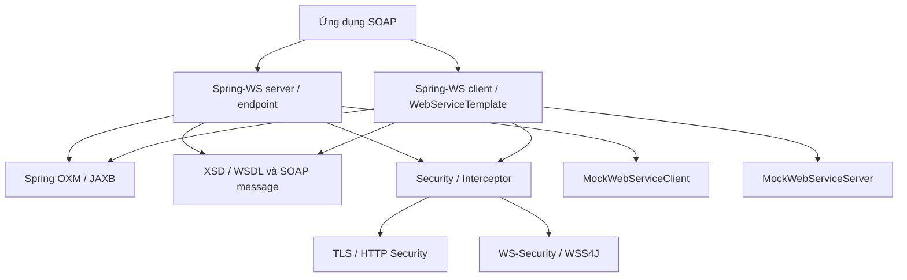

# Thành phần phụ thuộc cho máy chủ, máy khách, OXM, bảo mật và kiểm thử

Khi khởi tạo dự án **Spring Web Services (Spring-WS)**, một lỗi phổ biến là thêm đủ thư viện để chương trình biên dịch nhưng thiếu thành phần cần thiết khi chạy SOAP thật: SOAP message factory, JAXB runtime, WSDL generation, WS-Security hoặc công cụ kiểm thử. Ngược lại, việc thêm mọi starter cùng lúc khiến dependency tree phức tạp, phát sinh xung đột phiên bản và khó xác định thành phần nào đang chịu trách nhiệm cho hành vi của hệ thống.

Trong module **SPRING_WEB_SERVICES**, mục tiêu là xây dựng dịch vụ SOAP theo hướng **contract-first**: thiết kế XSD/WSDL, ánh xạ JAXB, viết endpoint và SOAP client, xử lý Fault, interceptor, XML security, WS-Security và chứng chỉ, rồi kiểm tra tương thích giữa các hệ thống doanh nghiệp. Vì vậy, chọn dependency phải bắt đầu từ **vai trò triển khai** và **hợp đồng tích hợp**, không chỉ từ một danh sách thư viện.

Bài này hướng dẫn lựa chọn các phụ thuộc cho **máy chủ**, **máy khách**, **OXM/JAXB**, **bảo mật** và **kiểm thử**, kèm cấu hình Maven/Gradle, ví dụ khởi tạo, các lỗi phụ thuộc thường gặp và cách kiểm chứng từng lớp. Những đoạn cấu hình tập trung vào hệ sinh thái **Spring Boot 3.x / Spring Framework 6 / Spring-WS 4.x / Java 17 trở lên** để minh họa quy tắc Jakarta. Khi làm trên nhánh phiên bản khác, phải xác nhận ma trận tương thích và API của phiên bản thực tế trước khi sao chép.

## 1. Mục tiêu học tập

Sau bài học, bạn có thể:

- Phân biệt các thư viện phục vụ Spring-WS server, SOAP client, OXM, JAXB và các phương tiện truyền tải.
- Biết lúc nào dùng `spring-boot-starter-web-services` và lúc nào dùng các module Spring-WS trực tiếp.
- Giải thích mối quan hệ giữa Spring-WS, Spring XML, Spring OXM, JAXB API/runtime, SAAJ và WSDL4J.
- Chọn đúng thư viện cho HTTP security, WS-Security, TLS/chứng chỉ và XML parsing an toàn.
- Thiết lập phụ thuộc test cho `MockWebServiceClient`, `MockWebServiceServer` và kiểm thử Spring Boot/JUnit.
- Dùng BOM/dependency management để tránh trộn sai phiên bản của Spring, Jakarta và Apache WSS4J.
- Kiểm chứng được luồng khởi động, WSDL/XSD được công bố, SOAP payload được marshal/unmarshal và lỗi được báo đúng hợp đồng.

## 2. Nhìn dependency theo các lớp trách nhiệm



Ở đây, hình là sơ đồ **trách nhiệm** chứ không phải biểu đồ truyền phụ thuộc Maven chính xác. Một starter thường kéo theo nhiều module; các thành phần có thể dùng chung Spring XML, message factory và những thư viện XML của Java.

| Nhóm | Thành phần thường dùng | Trách nhiệm chính |
|---|---|---|
| Máy chủ SOAP | `spring-boot-starter-web-services` hoặc `spring-ws-core` cùng cấu hình web cần thiết | Nhận SOAP request, định tuyến endpoint, xây dựng response/Fault. |
| Máy khách SOAP | `spring-ws-core`, `WebServiceTemplate` | Tạo/gửi SOAP request, nhận response, ánh xạ Fault. |
| OXM | `org.springframework:spring-oxm` | Cầu nối marshal/unmarshal object ↔ XML. |
| JAXB API/runtime | Jakarta XML Binding API, `org.glassfish.jaxb:jaxb-runtime` | Thực thi JAXB mapping, tạo/đọc XML từ lớp đã sinh từ XSD. |
| WSDL động | `wsdl4j:wsdl4j` khi dùng cơ chế cần WSDL4J | Hỗ trợ các tính năng tạo/xử lý WSDL 1.1. |
| WS-Security | `org.springframework.ws:spring-ws-security`, các module WSS4J tương thích | Chữ ký, mã hóa, UsernameToken, timestamp và chính sách SOAP-level. |
| HTTP access control | `spring-boot-starter-security` nếu cần Spring Security | Authentication, authorization, filter chain ở tầng HTTP. |
| Kiểm thử Spring-WS | `org.springframework.ws:spring-ws-test` | Mock SOAP client/server và matcher XML/Fault. |
| Kiểm thử Boot | `spring-boot-starter-test` | JUnit Jupiter, Spring Test, assertion, mock hỗ trợ. |
| Kiểm thử HTTP security | `org.springframework.security:spring-security-test` khi cần | Mô phỏng người dùng, kiểm thử SecurityFilterChain. |

Không nhất thiết thêm toàn bộ các dòng này vào mọi ứng dụng. Hãy xét từng nhóm theo **vai trò thực tế của module**. Ví dụ một chương trình chỉ đóng vai trò SOAP client không cần mở servlet HTTP; một dịch vụ chỉ dùng TLS không cần WS-Security; một module chỉ xác thực XSD độc lập có thể dùng JAXP của JDK mà không cần khởi động Spring-WS.

## 3. Chọn nền phiên bản: Java, Spring Boot, Spring-WS và Jakarta

Trước khi thêm dependency, phải chọn một **bộ phiên bản tương thích**. Với ví dụ sử dụng Spring Boot 3.x:

- Spring Boot 3.x đặt nền trên Spring Framework 6 và Java 17 trở lên.
- Với dòng Spring-WS 4.x tương thích Boot 3.x, các API Jakarta được sử dụng thay cho API Java EE cũ.
- JAXB annotation/runtime sử dụng namespace Java package `jakarta.xml.bind.*`; SOAP API tương ứng thuộc `jakarta.xml.soap.*`.
- Các lớp XML chuẩn thuộc JDK như `javax.xml.namespace.QName`, `javax.xml.parsers.DocumentBuilderFactory` và `javax.xml.validation.SchemaFactory` **vẫn giữ package `javax.xml`**; không đổi nhầm chúng thành `jakarta.xml`.
- Bắt đầu từ Java 11, JAXB không còn được đóng gói sẵn như một thành phần của JDK. Nếu ứng dụng cần JAXB, phải có API và một runtime thích hợp trong dependency graph.

Khi dùng phiên bản mới hơn hoặc cũ hơn, không trộn tuỳ tiện dòng `javax.xml.bind` của thời Java EE với dòng `jakarta.xml.bind` của Spring/Jakarta mới. Kiểu dữ liệu sinh từ XSD, marshaller, thư viện SOAP và annotation phải thuộc cùng hệ tương thích.

### Vì sao ưu tiên BOM/dependency management?

**Bill of Materials (BOM)** quản lý một tập phiên bản thư viện được kiểm thử chung. Trong Spring Boot, BOM `spring-boot-dependencies` thường đã quản lý nhiều phiên bản Spring, Spring-WS, Spring Security, JAXB và các phụ thuộc liên quan. Với Maven có thể dùng `spring-boot-starter-parent` hoặc import BOM; với Gradle có thể dùng cơ chế dependency management/BOM phù hợp.

Nếu dự án đã dùng BOM, không cần gắn `<version>` riêng cho mỗi dependency được BOM quản lý. Chỉ khai báo phiên bản khi BOM không quản lý artifact đó hoặc yêu cầu nâng cấp đã được kiểm chứng.

**Nguyên tắc:** kiểm tra phiên bản Spring-WS thực tế sau khi resolve dependencies. Đừng ép Spring-WS, JAXB, SAAJ hay WSS4J lên một phiên bản bất kỳ chỉ vì bản đó mới hơn; các API, transitives và cách khởi tạo message factory có thể khác giữa các thế hệ.

## 4. Máy chủ SOAP: Spring-WS starter và các thành phần runtime

Trong ứng dụng Spring Boot cung cấp SOAP endpoint qua HTTP, điểm bắt đầu thông thường là:

```xml
<dependency>
    <groupId>org.springframework.boot</groupId>
    <artifactId>spring-boot-starter-web-services</artifactId>
</dependency>
```

Starter gom các thành phần Spring-WS và hỗ trợ tích hợp web phù hợp với Spring Boot. Nó giúp giảm cấu hình thủ công, nhưng **không tự định nghĩa nghiệp vụ hoặc XSD/WSDL**. Dịch vụ vẫn cần endpoint, schema và quyết định cách công bố hợp đồng.

Các lớp thường gặp khi xây dựng server:

| Lớp / thành phần | Vai trò |
|---|---|
| `MessageDispatcherServlet` | Điểm nhận request SOAP qua servlet HTTP. |
| `@Endpoint` | Đánh dấu lớp xử lý các SOAP payload. |
| `@PayloadRoot` | Ánh xạ phương thức theo namespace URI và local name của phần tử đầu tiên trong SOAP Body. |
| `@RequestPayload` / `@ResponsePayload` | Nhận payload request và đưa payload response vào SOAP message. |
| `EndpointInterceptor` | Can thiệp vào luồng request/response/Fault theo cấu hình. |
| `PayloadValidatingInterceptor` | Kiểm tra payload dựa trên XSD. |
| `DefaultWsdl11Definition` | Có thể sinh WSDL 1.1 từ XSD và quy ước tên operation. |
| `SimpleWsdl11Definition` | Công bố một WSDL tĩnh do dự án quản lý. |

Có thể sử dụng `org.springframework.ws:spring-ws-core` trực tiếp khi ứng dụng không muốn dùng starter, chẳng hạn ứng dụng Spring truyền thống hoặc một thư viện chung. Khi đó phải tự thiết lập các phần web, transport/message factory và những phụ thuộc runtime cần thiết theo môi trường. Đối với một server Spring Boot thông thường, starter là lựa chọn gọn hơn.

### WSDL động và WSDL tĩnh cần phụ thuộc khác nhau

Nếu dùng `DefaultWsdl11Definition` để tạo WSDL 1.1 từ schema, hãy kiểm tra rằng **WSDL4J** có mặt theo yêu cầu của phiên bản đang chạy; artifact thường dùng là:

```xml
<dependency>
    <groupId>wsdl4j</groupId>
    <artifactId>wsdl4j</artifactId>
</dependency>
```

Trong một số bộ starter/BOM, thư viện có thể đã được kéo vào hoặc được quản lý phiên bản. Nên nhìn vào dependency tree trước khi thêm bản trực tiếp trùng lặp. Với `SimpleWsdl11Definition` và tệp WSDL tĩnh, nhu cầu thư viện để phân tích/sinh WSDL có thể khác. Không đưa WSDL4J vào chỉ vì thấy từ “WSDL” trong mô tả dự án.

Đối với contract phức tạp có nhiều `wsdl:fault`, tên binding/operation đặc thù, một WSDL tĩnh thường giúp nhóm kiểm soát chính xác giao diện đã ký với đối tác. Với hợp đồng nhỏ sinh từ quy ước `Request`/`Response`, WSDL động có thể tiết kiệm công soạn.

## 5. Máy khách SOAP: WebServiceTemplate và transport

Một ứng dụng **chỉ gửi SOAP request đến hệ thống khác** có thể dùng phần lõi Spring-WS:

```xml
<dependency>
    <groupId>org.springframework.ws</groupId>
    <artifactId>spring-ws-core</artifactId>
</dependency>
```

API trung tâm là `WebServiceTemplate`. Nó phối hợp tạo SOAP message, gọi transport, xử lý response/Fault và có thể dùng Spring OXM để đổi Java object sang payload XML.

```java
import org.springframework.ws.client.core.WebServiceTemplate;

public class OrderGateway {
    private final WebServiceTemplate template;

    public OrderGateway(WebServiceTemplate template) {
        this.template = template;
    }

    public Object getOrderStatus(Object request) {
        return template.marshalSendAndReceive(request);
    }
}
```

Đoạn mã chỉ minh họa cách dùng template: `marshalSendAndReceive` cần `Marshaller` và `Unmarshaller` được cấu hình, request phải là kiểu JAXB có thể marshal, cùng với URI đích (mặc định hoặc truyền vào mỗi lời gọi). Kiểu `Object` ở ví dụ cần thay bằng lớp contract cụ thể và xử lý kết quả theo đúng QName response thực tế.

Khi client dùng SOAP qua HTTP, cần xác định:

- **Endpoint URI**: địa chỉ đích thật; không nhầm với namespace URI của XSD.
- **SOAP version**: SOAP 1.1 hay SOAP 1.2 phải khớp binding; nó ảnh hưởng Envelope và content type.
- **Timeout**: thời gian chờ kết nối/đọc response của message sender phù hợp với SLA; không phụ thuộc duy nhất vào WSDL.
- **TLS**: truststore/keystore khi cần xác thực server hoặc mutual TLS.
- **SOAPAction/WS-Addressing**: chỉ gắn khi contract/binding yêu cầu, không suy từ tên Java method.
- **Fault resolver**: cách biến SOAP Fault thành lỗi phía client; không nhầm timeout/HTTP error với business result.

Nếu sử dụng bộ gửi HTTP riêng như Apache HttpComponents hoặc một transport JMS, phải bổ sung **module hỗ trợ transport** cùng thư viện transport tương thích với thế hệ Spring-WS; không đưa hai phiên bản HttpClient xung đột vào classpath. Với SOAP/HTTP đơn giản, bộ message sender mặc định phù hợp thường đã đủ cho bài khởi tạo.

Một **client-only module** không cần `MessageDispatcherServlet`, `@Endpoint`, embedded web server hay WSDL bean. Thêm các thành phần server vào một thư viện client chỉ làm tăng diện tích cấu hình và tác động bảo mật mà không cải thiện việc gửi SOAP.

## 6. OXM và JAXB: ánh xạ Java object ↔ XML theo XSD

**OXM (Object/XML Mapping)** là khái niệm ánh xạ dữ liệu giữa object và XML. Spring OXM cung cấp các interface như `Marshaller`, `Unmarshaller` cùng implementation `Jaxb2Marshaller`.

Một dự án dùng JAXB thường cần:

```xml
<dependency>
    <groupId>org.springframework</groupId>
    <artifactId>spring-oxm</artifactId>
</dependency>

<dependency>
    <groupId>org.glassfish.jaxb</groupId>
    <artifactId>jaxb-runtime</artifactId>
</dependency>
```

Nếu starter/stack đã mang các thư viện này vào dependency graph, khai báo trực tiếp có thể được bỏ bớt. Trong ví dụ Maven phía sau, chúng được nêu rõ để người học thấy ranh giới chức năng.

- **Spring OXM** cung cấp API tích hợp vào Spring; tự nó không phải toàn bộ JAXB implementation.
- **JAXB API** cung cấp annotation và interface, ví dụ `jakarta.xml.bind.annotation.XmlRootElement`.
- **JAXB runtime** thực hiện marshal/unmarshal; thiếu runtime có thể gây lỗi khởi tạo `JAXBContext` hoặc thiếu provider.
- **SAAJ** (SOAP with Attachments API for Java) phục vụ mô hình SOAP message/Envelope; đó là lớp khác với JAXB. Với Java hiện đại, nếu tách khỏi starter, phải xác nhận cả API/implementation SAAJ cần thiết có sẵn khi chạy.

Ví dụ cấu hình `Jaxb2Marshaller`:

```java
import org.springframework.context.annotation.Bean;
import org.springframework.context.annotation.Configuration;
import org.springframework.oxm.jaxb.Jaxb2Marshaller;

@Configuration
public class OrderXmlConfiguration {

    @Bean
    public Jaxb2Marshaller orderMarshaller() {
        Jaxb2Marshaller marshaller = new Jaxb2Marshaller();
        marshaller.setContextPath("org.example.orders.contract");
        return marshaller;
    }
}
```

Cách `setContextPath` cần package JAXB chứa thông tin JAXB context phù hợp, chẳng hạn `ObjectFactory` hoặc `jaxb.index`. Nếu mã contract không có cấu trúc đó, có thể dùng `setClassesToBeBound(...)` với các lớp JAXB được ánh xạ.

### Mã JAXB được sinh từ đâu?

Trong contract-first, **XSD là nguồn xác định cấu trúc XML**. Công cụ XJC hoặc plugin build tương thích với Jakarta sinh lớp Java, annotation JAXB và có thể sinh `ObjectFactory`/`JAXBElement<T>`.

```text
src/main/resources/xsd/orders.xsd
              |
              v
     XJC / JAXB build plugin
              |
              v
target/generated-sources/... hoặc build/generated/...
              |
              v
  JAXB classes + ObjectFactory
              |
              v
       Jaxb2Marshaller
              |
              v
    SOAP request / response
```

**XJC là công cụ phục vụ build**, khác với JAXB runtime dùng lúc ứng dụng chạy. Kể từ Java 11, không nên giả định có lệnh `xjc` sẵn trong JDK. Plugin sinh mã cần được chọn theo dòng JAXB/Jakarta, gắn vào giai đoạn generate-sources hoặc task tương ứng và đưa generated sources vào compile path.

Không chỉnh tay QName hoặc thứ tự phần tử trong lớp JAXB đã sinh rồi cho rằng contract sẽ tự cập nhật. Nếu XSD đổi namespace, `minOccurs`, thứ tự `xs:sequence` hoặc type, hãy sinh lại mã, kiểm tra thay đổi API và chạy contract tests.

### Phân biệt namespace JAXB với namespace SOAP

Payload XML dùng namespace do XSD định nghĩa, chẳng hạn:

```xml
<ord:GetOrderRequest
    xmlns:ord="https://example.org/contracts/order/v1">
    <ord:orderId>ORD-1024</ord:orderId>
</ord:GetOrderRequest>
```

SOAP Envelope có namespace riêng, ví dụ SOAP 1.1 là `http://schemas.xmlsoap.org/soap/envelope/`. JAXB mapping của payload phải khớp QName `{https://example.org/contracts/order/v1}GetOrderRequest`, không lấy namespace Envelope hay endpoint URL làm namespace nghiệp vụ.

## 7. Bảo mật: tách HTTP security, TLS và WS-Security

Có ba tầng liên quan nhưng giải quyết các vấn đề khác nhau:

| Tầng | Cơ chế | Thành phần / phụ thuộc |
|---|---|---|
| Kết nối | HTTPS, TLS, xác thực certificate server hoặc mTLS | Java TLS stack, cấu hình web server/client, truststore/keystore. |
| HTTP | Basic Authentication, OAuth2/resource server, phân quyền đường dẫn | Spring Security; có thể thêm starter/module OAuth2 tùy mô hình. |
| SOAP message | UsernameToken, Timestamp, XML Signature, XML Encryption | Spring-WS Security + WSS4J, SOAP interceptors và crypto configuration. |

### 7.1. Spring Security ở tầng HTTP

Với ứng dụng Spring Boot dùng HTTP authentication/authorization, một dependency thường dùng là:

```xml
<dependency>
    <groupId>org.springframework.boot</groupId>
    <artifactId>spring-boot-starter-security</artifactId>
</dependency>
```

Nó bổ sung các cơ chế bảo vệ HTTP endpoint, nhưng **không tự bật WS-Security trên SOAP Header**. Khi thêm Spring Security, cấu hình mặc định có thể thay đổi khả năng truy cập `/ws/*` hoặc đường dẫn công bố WSDL/XSD. Cần định nghĩa `SecurityFilterChain` và kiểm tra quyền truy cập của SOAP client thực tế; không mở toàn bộ WSDL hoặc endpoint công khai chỉ để test vượt qua lỗi 401/403.

### 7.2. WS-Security trên SOAP Header

Để kiểm tra và tạo token, chữ ký, timestamp hoặc mã hóa ở mức SOAP, module Spring-WS thường dùng:

```xml
<dependency>
    <groupId>org.springframework.ws</groupId>
    <artifactId>spring-ws-security</artifactId>
</dependency>
```

Spring-WS Security tích hợp với **Apache WSS4J** cho nhiều cơ chế WS-Security. Tùy phiên bản và chính sách, dự án cần các module WSS4J/crypto tương thích; trước khi tự thêm chúng, kiểm tra phụ thuộc bắc cầu và danh sách được bộ BOM quản lý.

Một kiến trúc sử dụng `Wss4jSecurityInterceptor` có thể cần:

- Quy tắc **validation actions**, chẳng hạn kiểm Timestamp, Signature hoặc UsernameToken.
- Quy tắc **securement actions** ở phía gửi, chẳng hạn ký hoặc mã hóa nội dung.
- Crypto/keystore/truststore để xác minh và tạo chữ ký; mật khẩu khóa phải lấy từ secret manager hoặc cấu hình bảo mật thích hợp.
- Callback handler khi cơ chế yêu cầu truy xuất mật khẩu hoặc đối chiếu danh tính.
- Chính sách clock skew, timestamp expiry, replay protection và algorithm tương thích với đối tác.

Chỉ thêm dependency không tự xác thực chữ ký hay tạo một `wsse:Security` hợp lệ. Bên gửi và bên nhận phải thống nhất **WS-SecurityPolicy nếu sử dụng**, thuật toán, chứng chỉ, tên alias, xử lý token và thứ tự interceptor. Một SOAP message hợp lệ theo XSD vẫn có thể bị từ chối vì chữ ký sai hoặc chứng chỉ không đáng tin.

### 7.3. TLS và chứng chỉ

Đối với HTTPS, certificate/trust thường được xử lý bởi **JSSE của JDK và HTTP transport**, không yêu cầu thêm một “SOAP TLS library” riêng. Một số trường hợp cần thư viện HTTP client chuyên biệt để điều khiển SSL context, pooling và timeout; khi đó chọn thư viện theo chính Spring-WS message sender được dùng.

Phân biệt:

- **Truststore**: các CA/chứng chỉ mà ứng dụng tin cậy khi xác minh đối tác.
- **Keystore**: nơi lưu private key và certificate của ứng dụng khi cần trình danh tính hoặc ký số.
- **mTLS**: hai phía xác thực chứng chỉ tại tầng TLS.
- **XML Signature/WS-Security**: ký ở tầng thông điệp SOAP, có thể tồn tại đồng thời với TLS.

Một certificate dùng cho TLS và một certificate dùng ký SOAP có thể được tách riêng theo chính sách vận hành. Không hard-code password keystore hoặc đưa private key vào mã nguồn và test fixture công khai.

### 7.4. XML parser security

XML có thể chứa cấu trúc gây tiêu hao tài nguyên hoặc cố gắng truy cập tài nguyên ngoài, chẳng hạn DTD/external entities. XSD validation đơn thuần không thay thế cấu hình parser an toàn.

Đặt giới hạn kích thước request, kiểm soát DTD/entity expansion, chặn truy cập schema/DTD ngoài nếu không có lý do cần thiết và dùng parser/schema do server kiểm soát. Ví dụ với JAXP:

```java
import javax.xml.XMLConstants;
import javax.xml.validation.SchemaFactory;

SchemaFactory factory = SchemaFactory.newInstance(
    XMLConstants.W3C_XML_SCHEMA_NS_URI
);

factory.setFeature(XMLConstants.FEATURE_SECURE_PROCESSING, true);
factory.setProperty(XMLConstants.ACCESS_EXTERNAL_DTD, "");
factory.setProperty(XMLConstants.ACCESS_EXTERNAL_SCHEMA, "");
```

Các thuộc tính có thể cần cấu hình thêm trên `Validator` hoặc các parser khác tùy code path. Nếu schema có `xs:import`, cần tài nguyên local/trusted resolver phù hợp; chặn toàn bộ external access mà không chuẩn bị import có thể làm schema không tải được. Việc áp dụng đầy đủ còn phụ thuộc implementation JAXP và cấu hình message factory.

## 8. Kiểm thử: chọn dependency theo đối tượng cần giả lập

### 8.1. Spring-WS test

Dependency chuyên dụng:

```xml
<dependency>
    <groupId>org.springframework.ws</groupId>
    <artifactId>spring-ws-test</artifactId>
    <scope>test</scope>
</dependency>
```

Nó cung cấp hai công cụ quan trọng:

| Công cụ | Thành phần dưới kiểm thử | Phía được mô phỏng |
|---|---|---|
| `MockWebServiceClient` | Endpoint Spring-WS trong ứng dụng | SOAP client gửi request vào endpoint. |
| `MockWebServiceServer` | `WebServiceTemplate` / SOAP client của ứng dụng | SOAP server bên ngoài. |

Dễ nhầm tên vì cả hai đều chứa “Client/Server”. Hãy nhớ: **MockWebServiceClient kiểm thử server của mình; MockWebServiceServer kiểm thử client của mình**.

Ví dụ ý tưởng kiểm thử endpoint:

```java
import static org.springframework.ws.test.server.RequestCreators.withPayload;
import static org.springframework.ws.test.server.ResponseMatchers.noFault;

import org.springframework.context.ApplicationContext;
import org.springframework.xml.transform.StringSource;
import org.springframework.ws.test.server.MockWebServiceClient;

// Trong một @SpringBootTest đã cấu hình endpoint và schema:
MockWebServiceClient client =
    MockWebServiceClient.createClient(applicationContext);

StringSource payload = new StringSource("""
    <ord:GetOrderRequest
        xmlns:ord="https://example.org/contracts/order/v1">
        <ord:orderId>ORD-1024</ord:orderId>
    </ord:GetOrderRequest>
    """);

client.sendRequest(withPayload(payload))
      .andExpect(noFault());
```

Biến `applicationContext` phải được inject từ Spring Test. Ví dụ giả định đã có endpoint phù hợp; matcher `noFault()` chưa đủ để khẳng định response đúng dữ liệu, nên test thực tế cần assert payload/XPath và tính tuân thủ XSD.

### 8.2. Spring Boot test

`spring-boot-starter-test` thường cung cấp nền tảng JUnit Jupiter, Spring Test và các thư viện assertion/mocking trong ứng dụng Boot:

```xml
<dependency>
    <groupId>org.springframework.boot</groupId>
    <artifactId>spring-boot-starter-test</artifactId>
    <scope>test</scope>
</dependency>
```

Các test phù hợp:

- **Unit test nghiệp vụ**: xác minh xử lý đơn hàng độc lập SOAP, không cần context nếu không sử dụng Spring integration.
- **Endpoint test**: dùng `MockWebServiceClient` gửi payload hợp lệ, không hợp lệ, sai namespace, thử SOAP Fault.
- **Client test**: dùng `MockWebServiceServer` assert XML request, giả lập SOAP response hoặc SOAP Fault.
- **Integration test**: khởi động servlet HTTP thật, kiểm chứng WSDL/XSD, endpoint URI, phiên bản SOAP, timeout, TLS.
- **Compatibility test**: sử dụng các “golden XML messages” và WSDL/XSD công bố để đảm bảo client đối tác vẫn đọc/ghi được.

Nếu dùng Spring Security ở tầng HTTP, thêm `org.springframework.security:spring-security-test` khi cần xác minh authentication/authorization. Test WS-Security hoặc mTLS thường phải kiểm tra SOAP Header, crypto config và chứng chỉ test; một test chỉ mock lớp nghiệp vụ không đủ để chứng minh chữ ký/timestamp đã được xác minh.

### 8.3. Phạm vi test và thư viện khác

JAXP trong JDK có thể kiểm tra XSD độc lập với Spring. XMLUnit có thể hỗ trợ so sánh XML có ý thức về namespace, còn Mockito hỗ trợ xác minh dependency nghiệp vụ không được gọi khi payload sai. Những thư viện này chỉ cần thêm khi nhóm test thực sự sử dụng; không cần thêm riêng một “SOAP test engine” để so chuỗi XML.

Hạn chế assert XML nguyên văn theo prefix hoặc thứ tự attribute nếu mục đích là đối chiếu **ngữ nghĩa namespace/QName**. Hai thông điệp dùng prefix khác nhưng cùng URI có thể tương đương theo hợp đồng.

## 9. Maven: dependency mẫu cho ứng dụng SOAP server kiêm client

Một dự án Spring Boot **đã cấu hình parent hoặc import BOM phù hợp** có thể khai báo bộ dependency tổng hợp sau. Các nhóm WS-Security, HTTP Security, WSDL4J được đánh dấu tùy chọn để không tạo ấn tượng rằng mọi module đều phải có chúng.

```xml
<dependencies>
    <!-- SOAP server (Spring Boot + Spring-WS) -->
    <dependency>
        <groupId>org.springframework.boot</groupId>
        <artifactId>spring-boot-starter-web-services</artifactId>
    </dependency>

    <!-- OXM / JAXB cho contract-first -->
    <dependency>
        <groupId>org.springframework</groupId>
        <artifactId>spring-oxm</artifactId>
    </dependency>
    <dependency>
        <groupId>org.glassfish.jaxb</groupId>
        <artifactId>jaxb-runtime</artifactId>
    </dependency>

    <!-- Tùy chọn: sinh WSDL từ XSD -->
    <dependency>
        <groupId>wsdl4j</groupId>
        <artifactId>wsdl4j</artifactId>
    </dependency>

    <!-- Tùy chọn: WS-Security -->
    <dependency>
        <groupId>org.springframework.ws</groupId>
        <artifactId>spring-ws-security</artifactId>
    </dependency>

    <!-- Tùy chọn: bảo vệ HTTP endpoint -->
    <dependency>
        <groupId>org.springframework.boot</groupId>
        <artifactId>spring-boot-starter-security</artifactId>
    </dependency>

    <!-- Kiểm thử -->
    <dependency>
        <groupId>org.springframework.boot</groupId>
        <artifactId>spring-boot-starter-test</artifactId>
        <scope>test</scope>
    </dependency>
    <dependency>
        <groupId>org.springframework.ws</groupId>
        <artifactId>spring-ws-test</artifactId>
        <scope>test</scope>
    </dependency>
</dependencies>
```

Đoạn này là **khối dependencies**, không phải `pom.xml` hoàn chỉnh. Nó giả định ứng dụng đã thiết lập plugin build và BOM Spring Boot phù hợp. Nếu BOM không quản lý phiên bản của một thư viện tùy chọn, Maven sẽ yêu cầu khai báo version; hãy chọn phiên bản tương thích và kiểm tra dependency tree. Không chọn bừa một phiên bản chỉ để Maven ngừng báo lỗi.

### Tại sao không thêm `spring-ws-core` trực tiếp trong mẫu này?

`spring-boot-starter-web-services` thường đã đưa các module Spring-WS cần thiết vào classpath. Khai báo `spring-ws-core` trực tiếp có thể hữu ích khi xây dựng thư viện độc lập hoặc cần thể hiện phụ thuộc trực tiếp theo chính sách tổ chức; nhưng với Boot starter, thường không cần khai báo trùng và càng không nên override version khác BOM.

### Nếu chỉ cần SOAP client

Có thể bắt đầu bằng bộ tối giản cho module có Spring dependency management:

```xml
<dependencies>
    <dependency>
        <groupId>org.springframework.ws</groupId>
        <artifactId>spring-ws-core</artifactId>
    </dependency>
    <dependency>
        <groupId>org.springframework</groupId>
        <artifactId>spring-oxm</artifactId>
    </dependency>
    <dependency>
        <groupId>org.glassfish.jaxb</groupId>
        <artifactId>jaxb-runtime</artifactId>
    </dependency>
    <dependency>
        <groupId>org.springframework.ws</groupId>
        <artifactId>spring-ws-test</artifactId>
        <scope>test</scope>
    </dependency>
</dependencies>
```

Tùy message factory và transport được chọn, một ứng dụng client độc lập có thể cần thêm Jakarta SOAP API/SAAJ implementation và HTTP transport dependencies. Kiểm tra cây dependency và thử tạo một SOAP message thực tế; không suy luận “có JAXB là đã có SAAJ”.

## 10. Gradle Kotlin DSL: biểu diễn dependency tương đương

Nếu dự án đã áp dụng plugin Spring Boot và cấu hình BOM/dependency management tương thích, phần `dependencies` trong `build.gradle.kts` có thể là:

```kotlin
dependencies {
    // Server SOAP
    implementation("org.springframework.boot:spring-boot-starter-web-services")

    // JAXB / OXM
    implementation("org.springframework:spring-oxm")
    runtimeOnly("org.glassfish.jaxb:jaxb-runtime")

    // Optional: WSDL động từ XSD
    implementation("wsdl4j:wsdl4j")

    // Optional: WS-Security và HTTP Security
    implementation("org.springframework.ws:spring-ws-security")
    implementation("org.springframework.boot:spring-boot-starter-security")

    // Tests
    testImplementation("org.springframework.boot:spring-boot-starter-test")
    testImplementation("org.springframework.ws:spring-ws-test")
}
```

Không copy cả Maven và Gradle vào cùng một dự án. Giữ đúng một build tool theo repository. Một phiên bản Gradle plugin/Spring Boot không tương thích với Java toolchain có thể gây lỗi ngay cả khi toàn bộ artifact có vẻ đúng.

Nếu xây dựng module client-only, có thể dùng `implementation("org.springframework.ws:spring-ws-core")` thay cho starter server và chỉ thêm module test/security thực sự cần. Với Gradle, `runtimeOnly` cho JAXB runtime phù hợp khi compile dùng API/mapping đã có; nếu module trực tiếp gọi các lớp implementation của JAXB thì phạm vi dependency có thể khác.

## 11. Một ví dụ khởi tạo Spring-WS server từ XSD

Giả sử có ứng dụng Boot và tệp `src/main/resources/xsd/orders.xsd` đã định nghĩa hai **global elements** `GetOrderRequest` và `GetOrderResponse`, đều thuộc namespace `https://example.org/contracts/order/v1`. Với `DefaultWsdl11Definition` và quy ước hậu tố `Request`/`Response`, WSDL có thể sinh operation `GetOrder`.

Cấu hình minh họa:

```java
import org.springframework.context.ApplicationContext;
import org.springframework.context.annotation.Bean;
import org.springframework.context.annotation.Configuration;
import org.springframework.core.io.ClassPathResource;
import org.springframework.boot.web.servlet.ServletRegistrationBean;
import org.springframework.ws.config.annotation.EnableWs;
import org.springframework.ws.transport.http.MessageDispatcherServlet;
import org.springframework.ws.wsdl.wsdl11.DefaultWsdl11Definition;
import org.springframework.xml.xsd.SimpleXsdSchema;
import org.springframework.xml.xsd.XsdSchema;

@EnableWs
@Configuration
public class SoapServerConfiguration {

    @Bean
    public ServletRegistrationBean<MessageDispatcherServlet>
            messageDispatcherServlet(ApplicationContext context) {
        MessageDispatcherServlet servlet =
            new MessageDispatcherServlet();
        servlet.setApplicationContext(context);
        servlet.setTransformWsdlLocations(true);
        return new ServletRegistrationBean<>(servlet, "/ws/*");
    }

    @Bean
    public XsdSchema ordersSchema() {
        return new SimpleXsdSchema(
            new ClassPathResource("xsd/orders.xsd")
        );
    }

    @Bean(name = "orders")
    public DefaultWsdl11Definition ordersWsdl(XsdSchema ordersSchema) {
        DefaultWsdl11Definition wsdl =
            new DefaultWsdl11Definition();
        wsdl.setPortTypeName("OrdersPort");
        wsdl.setLocationUri("/ws");
        wsdl.setTargetNamespace(
            "https://example.org/contracts/order/v1"
        );
        wsdl.setSchema(ordersSchema);
        return wsdl;
    }
}
```

Các điểm cần kiểm tra:

1. Bean `orders` thường được servlet công bố theo đường dẫn `/ws/orders.wsdl` trong cấu hình servlet này.
2. `setLocationUri("/ws")` mô tả SOAP service address; nó không phải URL tải WSDL.
3. Tệp XSD phải nằm trên classpath lúc ứng dụng chạy; sai vị trí sẽ khiến bean schema khởi tạo lỗi.
4. Nếu dùng WSDL generation, phải có các dependency cần thiết, trong đó có WSDL4J khi phiên bản Spring-WS yêu cầu.
5. Khi có reverse proxy, host, scheme và context path của `soap:address` có thể cần cấu hình/proxy header đúng. Phải truy cập WSDL từ URL công khai thật để xác nhận.
6. Khai báo bean WSDL không tự tạo `@Endpoint` hoặc business logic; nếu chưa có endpoint thì WSDL có thể hiển thị nhưng lời gọi SOAP vẫn không thực thi được.

Một ví dụ XSD đủ để hiểu quy ước sinh tên:

```xml
<?xml version="1.0" encoding="UTF-8"?>
<xs:schema xmlns:xs="http://www.w3.org/2001/XMLSchema"
           targetNamespace="https://example.org/contracts/order/v1"
           xmlns:tns="https://example.org/contracts/order/v1"
           elementFormDefault="qualified">

    <xs:element name="GetOrderRequest">
        <xs:complexType>
            <xs:sequence>
                <xs:element name="orderId" type="xs:string"/>
            </xs:sequence>
        </xs:complexType>
    </xs:element>

    <xs:element name="GetOrderResponse">
        <xs:complexType>
            <xs:sequence>
                <xs:element name="status" type="xs:string"/>
            </xs:sequence>
        </xs:complexType>
    </xs:element>
</xs:schema>
```

Trong triển khai thực, nên định nghĩa kiểu dữ liệu chặt hơn, error contract, quy tắc versioning và kiểm thử trước khi công bố cho đối tác. Ví dụ XSD ở đây chỉ minh họa **mối liên hệ giữa phụ thuộc runtime và publication**.

## 12. Cấu hình SOAP client cùng JAXB marshaller

Giả sử XSD đã được dùng để sinh các lớp Java JAXB trong package `org.example.orders.contract`. Một client với `WebServiceTemplate` có thể cấu hình như sau:

```java
import org.springframework.context.annotation.Bean;
import org.springframework.context.annotation.Configuration;
import org.springframework.oxm.jaxb.Jaxb2Marshaller;
import org.springframework.ws.client.core.WebServiceTemplate;

@Configuration
public class SoapClientConfiguration {

    @Bean
    public Jaxb2Marshaller jaxb2Marshaller() {
        Jaxb2Marshaller marshaller = new Jaxb2Marshaller();
        marshaller.setContextPath(
            "org.example.orders.contract"
        );
        return marshaller;
    }

    @Bean
    public WebServiceTemplate orderWebServiceTemplate(
            Jaxb2Marshaller jaxb2Marshaller) {

        WebServiceTemplate template =
            new WebServiceTemplate();
        template.setDefaultUri(
            "https://partner.example.org/ws/orders"
        );
        template.setMarshaller(jaxb2Marshaller);
        template.setUnmarshaller(jaxb2Marshaller);
        return template;
    }
}
```

Trong code dùng thật, hãy đưa URI và timeout ra cấu hình môi trường, thêm SOAPAction hoặc interceptor nếu contract yêu cầu, và quản lý TLS truststore/keystore ở tầng HTTP transport. Nếu generated code không có `@XmlRootElement` trên lớp root mà dùng `JAXBElement<T>`, client phải gửi kiểu JAXB mà marshaller hiểu; không ép cast tùy tiện kết quả.

Một kiểm tra khởi tạo có ích là **marshal một request JAXB sang XML và xác minh QName root**. Nếu lớp sinh mã dùng namespace sai, phải sửa contract/sinh lại JAXB trước khi gọi endpoint. Đây là lỗi xảy ra trước cả WS-Security hoặc kết nối mạng.

## 13. Chọn dependency bằng ma trận vai trò

Thay vì sao chép cả danh sách thư viện, hãy dùng bảng quyết định:

| Trường hợp | Tối thiểu thường cần | Chỉ thêm khi có yêu cầu |
|---|---|---|
| SOAP server Boot, nhận XML payload thô | `spring-boot-starter-web-services` | XSD/WSDL generation, OXM/JAXB, security. |
| SOAP server contract-first + JAXB | Starter, OXM, JAXB runtime | WSDL4J nếu sinh WSDL, WS-Security nếu ký/xác thực SOAP. |
| SOAP client độc lập dùng JAXB | Spring-WS core, OXM, JAXB runtime, SOAP/transport runtime | WSS4J, HTTP client chuyên biệt, mTLS theo binding. |
| Proxy/chuyển tiếp SOAP giữa hai hệ thống | Server + client, message/transport phù hợp | Transform XML, signature handling, auditing. |
| SOAP service chỉ bảo vệ qua HTTPS/mTLS | Server/client và TLS configuration | Spring Security nếu có HTTP auth; chưa cần WSS4J nếu policy không dùng WS-Security. |
| SOAP service có UsernameToken/Signature | Spring-WS Security/WSS4J và cấu hình crypto | Security test, replay protection, certificate validation. |
| Test endpoint Spring-WS | `spring-ws-test`, Spring Test/Boot test | HTTP integration, XMLUnit, test keystore khi cần. |
| Test client `WebServiceTemplate` | `spring-ws-test`, JUnit | Transport/TLS integration tests. |

**Trường hợp đa module:** thư viện `contract` có thể chứa XSD/WSDL hoặc generated JAXB classes; module `server` phụ thuộc contract và server stack; module `client` phụ thuộc contract và client stack; module `integration-test` phụ thuộc test libraries. Cách tổ chức này giúp các hệ thống chia sẻ contract mà không buộc thư viện contract kéo theo embedded servlet hay security filter chain.

Tuy nhiên, không dùng generated JAXB model làm **nguồn sự thật duy nhất**. Khi phát sinh bất đồng giữa XSD, WSDL và Java class, hợp đồng XML được phê duyệt vẫn phải là điểm chuẩn.

## 14. Kiểm tra dependency thực tế sau khi khởi tạo

Việc khai báo dependency thành công chưa chứng minh chương trình chạy đúng. Nên kiểm tra theo chuỗi từ build tới tích hợp:

### Kiểm tra build

1. **Dependency resolution:** Maven/Gradle không có xung đột phiên bản Spring Framework, Spring-WS, JAXB, Jakarta SOAP, WSS4J và XML parser.
2. **Mã JAXB sinh:** lớp được sinh từ XSD đúng package và annotation `jakarta.xml.bind.*` cho stack Jakarta; generated-sources đã được thêm vào compilation.
3. **Test runtime:** JUnit Jupiter được chạy; `spring-ws-test` nằm trong test classpath.
4. **Scope:** thư viện build-time như XJC không bị ép vào runtime nếu không cần; test library không vô tình được đóng gói vào ứng dụng production.

Lệnh tham khảo trong thư mục dự án (không áp dụng khi build tool khác):

```bash
mvn dependency:tree
mvn test
```

Với Gradle:

```bash
./gradlew dependencies --configuration runtimeClasspath
./gradlew test
```

Các lệnh chỉ là ví dụ thao tác mà người học có thể chạy trong môi trường của họ; phải chọn Maven **hoặc** Gradle phù hợp với dự án.

### Kiểm tra runtime

1. **Khởi động Boot server:** không gặp lỗi thiếu SOAP/JAXB provider hoặc WSDL4J.
2. **Công bố WSDL:** truy cập `/ws/orders.wsdl` (hoặc URL đã cấu hình), xác nhận HTTP success, `soap:address` và các XSD import khả dụng.
3. **SOAP request thành công:** gửi Envelope đúng SOAP version, namespace, QName; server phản hồi payload khớp XSD.
4. **Request không hợp lệ:** XSD validation hoặc endpoint policy từ chối đúng, không tạo tác động nghiệp vụ ngoài ý muốn.
5. **SOAP client:** marshal/unmarshal đúng và xử lý SOAP Fault theo contract.
6. **Security:** xác thực HTTP, TLS/mTLS, chữ ký SOAP, timestamp nếu được yêu cầu; kiểm tra trường hợp từ chối.
7. **Khả năng vận hành:** timeout, retry/idempotency, correlation ID và log được thiết lập đúng.

## 15. Các lỗi phụ thuộc điển hình và cách chẩn đoán

| Dấu hiệu | Khả năng nguyên nhân | Hướng kiểm tra |
|---|---|---|
| `ClassNotFoundException` / `NoClassDefFoundError` với JAXB | Thiếu API/runtime hoặc runtime khác hệ `javax`/`jakarta`. | Dependency tree, phiên bản Boot/Spring-WS, generated JAXB imports. |
| Không tạo được `JAXBContext` | JAXB provider/runtime thiếu hoặc context path không chứa metadata cần thiết. | JAXB runtime, `ObjectFactory`/`jaxb.index` hoặc `classesToBeBound`. |
| Lỗi SOAP message factory/provider | Thiếu SAAJ implementation hoặc API/provider không tương thích. | Stack SOAP/Jakarta và dependency của message factory. |
| Khởi tạo WSDL động thất bại | WSDL4J hoặc XSD/classpath không hợp lệ. | `DefaultWsdl11Definition`, WSDL4J, schema resource. |
| `/ws/orders.wsdl` trả 404 | Servlet mapping/bean name sai hoặc auto config bị vô hiệu. | `MessageDispatcherServlet`, URL, bean WSDL. |
| WSDL tải được nhưng client không sinh mã | XSD import không truy cập được, tên QName không khớp. | `schemaLocation`, `targetNamespace`, global elements. |
| SOAP được gửi nhưng không map endpoint | QName payload không khớp `@PayloadRoot`. | XML Body root, namespace URI, local part. |
| WS-Security không thực thi | Chưa thêm/cấu hình `Wss4jSecurityInterceptor` hoặc thiếu crypto/config. | Interceptor chain, policy, WS-Security dependencies. |
| HTTP 401/403 ngay cả khi SOAP body đúng | Spring Security filter chain chặn trước SOAP endpoint. | SecurityFilterChain, Basic/OAuth2/mTLS policy. |
| Lỗi PKIX / handshake TLS | Chưa tin CA/certificate hoặc cấu hình mTLS sai. | Truststore, keystore, thời hạn certificate, hostname. |
| SOAP 1.1/1.2 không tương thích | Message factory/binding/client chọn sai phiên bản. | Envelope namespace, HTTP content type, WSDL binding. |
| Test SOAP matcher không tìm thấy class | Thiếu `spring-ws-test` trong test scope. | `testImplementation` hoặc `<scope>test</scope>`. |
| Unit test chạy nhưng tích hợp hỏng | Chưa test servlet, transport, security hoặc XSD/WSDL công bố. | Tăng độ phủ integration test, đối chiếu SOAP wire. |
| Bản sửa dependency gây xung đột sau nâng cấp | Version override không tương thích BOM. | Xóa override không cần, kiểm tra dependency constraints và regression tests. |

Khi chẩn đoán lỗi, ghi rõ **artifact thiếu**, **phiên bản được resolve**, **lớp phát sinh exception** và **điểm thất bại** (build, khởi động hay runtime). Một thông báo kiểu “SOAP không hoạt động” không giúp tìm nguyên nhân nếu chưa biết lỗi xuất hiện trước hay sau khi tạo SOAP Envelope.

## 16. Bài thực hành: dựng cấu hình đúng với từng yêu cầu

Cho ba tình huống sau.

**Tình huống A — dịch vụ SOAP nội bộ:** Một Spring Boot service nhận `GetOrderRequest` và trả `GetOrderResponse` từ XSD đã phê duyệt. WSDL được sinh theo quy ước; không có yêu cầu WS-Security, endpoint chỉ nằm trong mạng riêng và giao tiếp qua HTTPS.

Một bộ lựa chọn hợp lý gồm `spring-boot-starter-web-services`, thư viện OXM/JAXB nếu endpoint nhận/trả Java object, WSDL4J nếu cần cho generation, Boot test và Spring-WS test. HTTPS dùng cấu hình TLS tương ứng. Không cần thêm `spring-ws-security` khi hợp đồng không có WS-Security.

**Tình huống B — SOAP client tích hợp đối tác:** Một module Java gọi WSDL có sẵn, dùng JAXB, client certificate mTLS và phải ký SOAP Body theo WS-Security.

Cần Spring-WS client, OXM/JAXB runtime, SOAP/HTTP transport, Spring-WS Security/WSS4J, cấu hình private key và truststore phù hợp. mTLS và SOAP signature là hai lớp phải cấu hình riêng; cần test cả lỗi certificate và lỗi chữ ký.

**Tình huống C — thư viện contract chia sẻ:** Nhóm muốn publish một artifact chứa XSD, WSDL và generated JAXB classes để các module sử dụng. Thư viện này không nhận request HTTP và không tự gửi SOAP.

Thư viện contract cần công cụ generate JAXB lúc build và các API mà generated classes tham chiếu. Không nhất thiết cần Spring-WS starter, embedded servlet, `MessageDispatcherServlet` hay HTTP Security trong artifact. Server và client phụ thuộc vào contract và tự thêm runtime dependencies theo vai trò của mình.

### Câu hỏi tự kiểm tra

1. Vì sao chỉ thêm `spring-oxm` có thể chưa đủ để marshal JAXB trên Java 17?
2. `spring-boot-starter-security` và `spring-ws-security` bảo vệ hai lớp nào khác nhau?
3. Khi một ứng dụng chỉ là SOAP client, vì sao không cần `MessageDispatcherServlet`?
4. Trong Gradle/Maven, tại sao cần kiểm tra BOM trước khi tự gắn version cho WSS4J hoặc JAXB?
5. `MockWebServiceClient` kiểm thử phía nào và `MockWebServiceServer` kiểm thử phía nào?
6. Tại sao một dịch vụ có thể công bố WSDL thành công nhưng vẫn thất bại khi client sinh mã?
7. Đổi Java từ 8 sang 17 và Spring sang thế hệ Jakarta có thể làm lộ những lỗi dependency nào?
8. Khi dùng TLS và WS-Security cùng lúc, truststore và private key phục vụ những bước xác thực nào?

**Gợi ý trả lời:** (1) Cần JAXB runtime/provider và mapping thích hợp; (2) HTTP filter và SOAP Header/message; (3) không phục vụ endpoint inbound; (4) bảo toàn tập phiên bản tương thích; (5) server của mình và client của mình; (6) XSD imports hoặc QName sai; (7) thiếu JAXB/SAAJ provider hoặc trộn `javax.xml.bind` với `jakarta.xml.bind`; (8) xác thực đường truyền và/hoặc tạo/xác minh chữ ký thông điệp theo policy.

## 17. Tổng kết

Khởi tạo Spring Web Services hiệu quả bắt đầu từ **vai trò của ứng dụng**. Server cần Spring-WS endpoint/transport; client cần `WebServiceTemplate` và message sender; ánh xạ Java/XML cần OXM cùng JAXB API/runtime; WSDL generation có thể cần WSDL4J; WS-Security cần Spring-WS Security/WSS4J; kiểm thử endpoint/client cần `spring-ws-test` cùng công cụ test của Spring Boot. HTTP Security, TLS và WS-Security bảo vệ các tầng khác nhau và phải được cấu hình theo hợp đồng.

Trong quy trình **contract-first**, hãy để XSD/WSDL quyết định QName, input/output, SOAP Fault và nghĩa nghiệp vụ trước khi chọn cách marshal, interceptor, bảo mật hoặc phương thức client. Sau khi khai báo dependency, cần kiểm tra phiên bản đã resolve, chạy được khởi tạo WSDL/XSD, gửi được SOAP message và xác minh security/compatibility ở cả hai phía. Một dependency list “đủ class” là khởi đầu; **một hệ thống SOAP tích hợp ổn định** còn cần đúng contract, cấu hình runtime và kiểm thử phản hồi lỗi.
