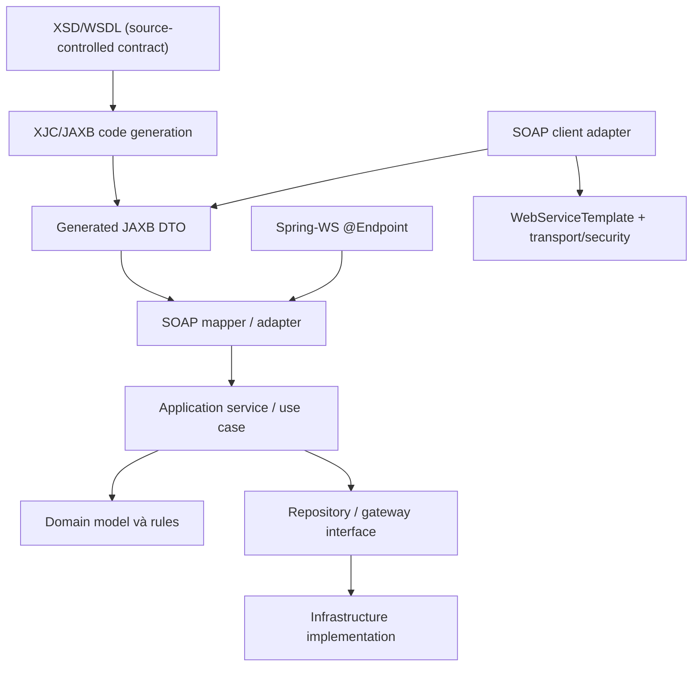
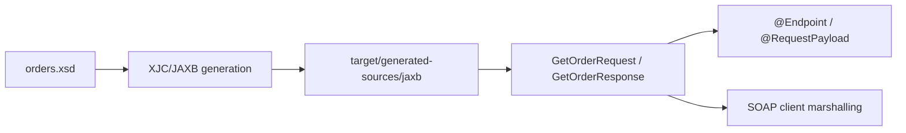
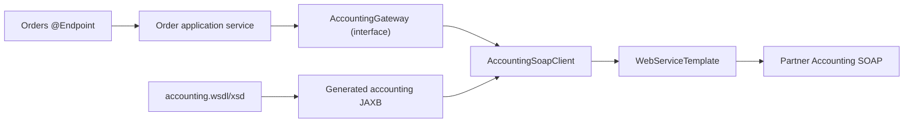
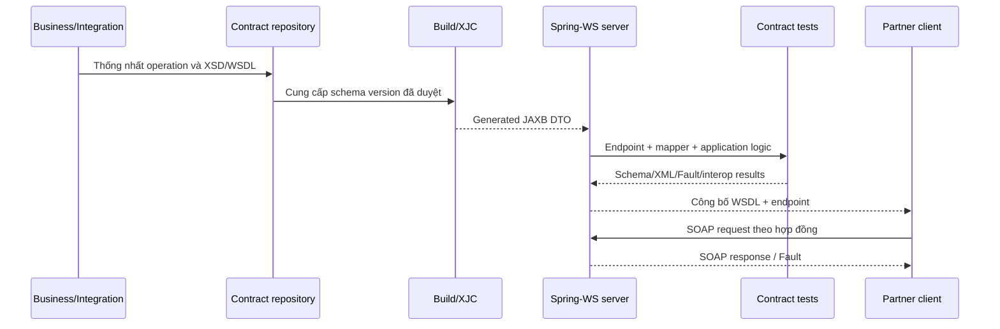

# Tổ chức thư mục hợp đồng, mã được sinh, endpoint, dịch vụ và client

## 1. Vì sao cấu trúc dự án là một phần của thiết kế SOAP contract-first?

Giả sử nhóm phát triển một dịch vụ tra cứu đơn hàng qua SOAP cho hệ thống ERP. Nhóm thống nhất XSD/WSDL với đối tác, dùng JAXB sinh class Java, tạo endpoint bằng Spring Web Services (Spring-WS), rồi viết SOAP client để gọi hệ thống kế toán. Khi dự án còn nhỏ, có thể đặt toàn bộ XSD, Java và cấu hình trong một thư mục. Nhưng nếu không phân biệt rõ **hợp đồng công khai**, **mã sinh tự động** và **logic ứng dụng**, chỉ một thay đổi trong schema cũng dễ khiến business service hoặc client bị sửa dây chuyền.

Một số tình huống thường xảy ra:

- Người phát triển sửa trực tiếp class JAXB đã sinh để thêm validation. Lần generate tiếp theo ghi đè thay đổi.
- Endpoint trả thẳng entity JPA; cách lưu trữ nội bộ bị lộ vào cấu trúc XML, khiến schema đổi theo database.
- Cùng một XSD được copy sang server và client nhưng mỗi bên chỉnh riêng; lỗi chỉ xuất hiện khi tích hợp.
- SOAP client được viết bên trong service nghiệp vụ với URL, thông tin chứng chỉ và retry hard-code; khó kiểm thử hoặc thay endpoint.
- Test chỉ gọi trực tiếp method Java, không kiểm tra namespace, XML payload, SOAP Fault hay WSDL thực tế.

Chương **Khởi tạo dự án** của module **SPRING_WEB_SERVICES** giải quyết những vấn đề đó từ đầu: tổ chức cấu trúc dự án để phát triển dịch vụ SOAP **contract-first**, quản lý XSD/WSDL, ánh xạ JAXB, tạo Spring-WS endpoint, triển khai SOAP client và chuẩn bị chỗ cho interceptor, XML security, WS-Security, chứng chỉ và kiểm thử tương thích.

**Sau bài này, người học có thể:**

1. Đề xuất cấu trúc thư mục dễ mở rộng cho một dự án Spring-WS.
2. Xác định file nào là nguồn hợp đồng, file nào được sinh từ hợp đồng, file nào là code nghiệp vụ.
3. Thiết lập luồng **XSD/WSDL → JAXB → endpoint/mapper → application service** mà không đưa generated class vào domain.
4. Tổ chức SOAP client, configuration và các thư mục test theo đúng trách nhiệm.
5. Xử lý vòng đời version, build, kiểm thử và bảo mật mà không tạo phụ thuộc ngược giữa các tầng.

## 2. Ba nhóm tạo tác phải phân biệt

Một dự án contract-first thường có ba nhóm thành phần, với vòng đời khác nhau:

| Nhóm | Ai tạo ra? | Có lưu trong source control? | Ai được sửa? |
|---|---|---|---|
| **Hợp đồng XSD/WSDL** | Nhóm tích hợp và bên tiêu thụ cùng thỏa thuận | **Có**, là nguồn sự thật của giao diện công khai | Thay đổi có review/version/contract tests |
| **Mã JAXB được sinh** | Công cụ XJC/JAXB từ schema và binding | Thường **không**; tạo lại trong thư mục build | Không sửa tay; thay schema hoặc binding customization |
| **Code ứng dụng** | Lập trình viên | **Có** | Endpoint, mapper, domain, application service, client adapter, cấu hình |

Quy tắc cơ bản: **mã sinh là sản phẩm của build**, không phải nơi định nghĩa nghiệp vụ. Nếu cần thay đổi cấu trúc XML, sửa XSD/WSDL và generate lại. Nếu cần thay đổi logic, sửa application service hoặc mapper. Nếu cần điều chỉnh kiểu Java sinh mã, cấu hình JAXB binding/version, không chỉnh từng file generated.

### 2.1. Sơ đồ phụ thuộc mong muốn



Mũi tên thể hiện quan hệ sử dụng trực tiếp hoặc chuỗi sinh mã, không phải bắt buộc mỗi ô là một module Maven riêng. Điều quan trọng: **domain không import generated JAXB class** và không phụ thuộc vào SOAP Envelope/WSDL.

## 3. Cấu trúc thư mục gợi ý cho một ứng dụng Spring-WS

Bắt đầu từ một ứng dụng Spring Boot đơn module thường đủ cho bài học và các dịch vụ vừa. Ví dụ dùng Maven, Java 17+ và stack Spring/JAXB kiểu Jakarta; phiên bản dependency cần lựa chọn đồng bộ theo Spring Boot được tổ chức sử dụng:

```text
partner-orders-soap/
├── pom.xml
├── mvnw
├── mvnw.cmd
├── .mvn/
│   └── wrapper/
├── src/
│   ├── main/
│   │   ├── java/com/example/orders/
│   │   │   ├── OrdersApplication.java
│   │   │   ├── config/
│   │   │   │   ├── SoapWebServiceConfiguration.java
│   │   │   │   └── SoapClientConfiguration.java
│   │   │   ├── soap/
│   │   │   │   ├── endpoint/
│   │   │   │   │   └── OrderEndpoint.java
│   │   │   │   ├── mapper/
│   │   │   │   │   └── OrderContractMapper.java
│   │   │   │   ├── fault/
│   │   │   │   │   └── OrderFaultResolver.java
│   │   │   │   └── client/
│   │   │   │       ├── AccountingSoapClient.java
│   │   │   │       └── AccountingContractMapper.java
│   │   │   ├── application/
│   │   │   │   ├── OrderQueryService.java
│   │   │   │   └── OrderCommandService.java
│   │   │   ├── domain/
│   │   │   │   ├── OrderSnapshot.java
│   │   │   │   └── OrderStatus.java
│   │   │   └── infrastructure/
│   │   │       └── OrderRepositoryAdapter.java
│   │   └── resources/
│   │       ├── application.yml
│   │       └── contracts/
│   │           ├── orders/
│   │           │   └── v1/
│   │           │       ├── orders.xsd
│   │           │       └── orders.wsdl      (nếu dùng WSDL tĩnh)
│   │           └── accounting/
│   │               └── v1/
│   │                   ├── accounting.wsdl
│   │                   └── accounting.xsd
│   └── test/
│       ├── java/com/example/orders/
│       │   ├── soap/endpoint/OrderEndpointTest.java
│       │   ├── soap/client/AccountingSoapClientTest.java
│       │   └── application/OrderQueryServiceTest.java
│       └── resources/soap/
│           ├── request/get-order-valid.xml
│           ├── request/get-order-invalid.xml
│           ├── response/get-order-valid.xml
│           └── fault/order-not-found.xml
└── target/
    ├── generated-sources/jaxb/
    │   ├── com/example/orders/soap/generated/orders/v1/
    │   └── com/example/orders/soap/generated/accounting/v1/
    ├── classes/
    └── ...
```

Các file có hậu tố `(nếu dùng WSDL tĩnh)` chỉ minh họa lựa chọn; không nhất thiết vừa lưu WSDL tĩnh vừa cho Spring-WS sinh WSDL động cho cùng một địa chỉ. Thư mục `target/` chỉ xuất hiện sau build và thông thường phải được bỏ qua trong Git.

### 3.1. Ý nghĩa của từng thư mục

| Thư mục | Nội dung và trách nhiệm | Tránh đặt |
|---|---|---|
| `resources/contracts/orders/v1/` | XSD/WSDL được quản lý như hợp đồng của dịch vụ công bố | Class Java, logic nghiệp vụ |
| `resources/contracts/accounting/v1/` | WSDL/XSD của bên ngoài mà SOAP client cần gọi | File tự ý sửa rồi coi là hợp đồng chính thức của đối tác |
| `target/generated-sources/jaxb/` | Java từ XJC/JAXB; build có thể xóa và tạo lại | Logic tự viết, annotation sửa tay |
| `soap/endpoint/` | Nhận request SOAP, gọi use case, trả payload hoặc Fault | SQL, giao dịch nghiệp vụ dài, policy kiểm toán rải rác |
| `soap/mapper/` | Chuyển JAXB DTO ↔ model application | HTTP call, repository, quyết định nghiệp vụ lớn |
| `application/` | Use case, transaction boundary, orchestration và chính sách nghiệp vụ | Tham chiếu trực tiếp SOAP Envelope/`WebServiceTemplate` |
| `domain/` | Khái niệm, quy tắc và trạng thái nghiệp vụ | Class JAXB generated, servlet, SOAP header |
| `soap/client/` | Adapter gọi SOAP hệ thống ngoài, ánh xạ request/response, xử lý Fault | URL hard-code và mật khẩu trong source |
| `config/` | Đăng ký Spring-WS endpoint, marshaller, HTTP message sender, security | Nghiệp vụ đơn hàng |
| `test/resources/soap/` | XML request/response/Fault đại diện cho hợp đồng | Snapshot tùy tiện không qua schema review |

**Tên package không phải quy định bắt buộc của Spring-WS.** Điều cần giữ ổn định là chiều phụ thuộc và trách nhiệm. Dự án nhỏ có thể đặt `endpoint` ngay dưới package gốc; dự án lớn có thể phân chia theo năng lực nghiệp vụ, ví dụ `orders`, `billing`, `shipping`, mỗi năng lực có các adapter riêng.

## 4. Hợp đồng là nguồn sự thật: đặt XSD và WSDL ở đâu?

Với **contract-first**, nên lưu XSD/WSDL trong `src/main/resources` hoặc module hợp đồng riêng để:

- Build có thể lấy schema tại một đường dẫn ổn định.
- Spring-WS có thể đọc XSD và công bố WSDL.
- Bộ kiểm thử có thể sử dụng đúng schema production.
- Git hiển thị sự thay đổi hợp đồng trong code review.
- Client của tổ chức khác có thể nhận đúng artifact đã được phê duyệt.

Ví dụ đơn giản cho `contracts/orders/v1/orders.xsd`:

```xml
<?xml version="1.0" encoding="UTF-8"?>
<xs:schema xmlns:xs="http://www.w3.org/2001/XMLSchema"
           xmlns:tns="https://schemas.example.org/orders/v1"
           targetNamespace="https://schemas.example.org/orders/v1"
           elementFormDefault="qualified">

  <xs:element name="GetOrderRequest">
    <xs:complexType>
      <xs:sequence>
        <xs:element name="orderId" type="xs:string"/>
      </xs:sequence>
    </xs:complexType>
  </xs:element>

  <xs:element name="GetOrderResponse">
    <xs:complexType>
      <xs:sequence>
        <xs:element name="orderId" type="xs:string"/>
        <xs:element name="status" type="xs:string"/>
      </xs:sequence>
    </xs:complexType>
  </xs:element>
</xs:schema>
```

XSD này định nghĩa hai **phần tử toàn cục** với local name phù hợp quy ước `Request`/`Response`. Spring-WS có thể dùng nó để tạo WSDL 1.1 cho operation `GetOrder` thông qua `DefaultWsdl11Definition`.

### 4.1. Namespace, version và package là ba khái niệm khác nhau

| Thành phần | Ví dụ | Vai trò |
|---|---|---|
| XML target namespace | `https://schemas.example.org/orders/v1` | Phân biệt QName trên dây; client/server dùng để định danh payload |
| WSDL service/port/binding | `OrdersPort`/`OrdersService` | Công bố các operation và phương thức giao tiếp |
| Java generated package | `com.example.orders.soap.generated.orders.v1` | Tổ chức mã Java ở phía build; có thể tùy chỉnh qua binding |
| Folder chứa XSD | `contracts/orders/v1/` | Quản lý artifact trong repository |

Namespace và tên phần tử công khai là **một phần của giao thức**. Đổi tên package Java hoặc di chuyển code ứng dụng thường không buộc đối tác sửa SOAP request; đổi namespace có thể khiến `@PayloadRoot`, JAXB và client cũ không nhận ra message.

Đừng suy diễn namespace mới chỉ vì đổi folder; phiên bản hợp đồng cần có quyết định và review riêng.

### 4.2. WSDL tĩnh hay WSDL được sinh?

Hai cách đều có thể nằm trong quy trình contract-first:

**Cách A — XSD làm đầu vào, Spring-WS sinh WSDL 1.1.** Phù hợp với dịch vụ document/literal tương đối đơn giản, sử dụng naming convention `GetOrderRequest`/`GetOrderResponse`. Cần kiểm tra WSDL cuối cùng: tên operation, binding, SOAPAction, port và URL công bố.

**Cách B — quản lý WSDL tĩnh được đối tác phê duyệt.** Phù hợp khi WSDL, binding, header, policy, fault và endpoint cần giữ chính xác theo thỏa thuận. Có thể công bố WSDL tĩnh bằng `SimpleWsdl11Definition` và dùng cùng XSD để sinh JAXB.

Không nên âm thầm thay một WSDL đã công bố bằng bản auto-generated có cấu trúc khác chỉ vì server Spring-WS vẫn khởi động bình thường. Chữ ký hợp đồng là những gì consumer thấy trên dây.

## 5. Mã JAXB được sinh đặt ở đâu và tạo thế nào?

JAXB là cầu nối giữa XML contract và object Java. Quy trình điển hình:



**Quy ước quan trọng:** định nghĩa package generated riêng, ví dụ `com.example.orders.soap.generated.orders.v1`. Tránh đặt vào `domain` hoặc cùng package với endpoint; sau này khi sinh schema v2 có thể giữ song song v1/v2.

### 5.1. Dependency nền tảng

Với Spring Boot sử dụng Spring-WS, `pom.xml` thường chứa starter:

```xml
<dependencies>
  <dependency>
    <groupId>org.springframework.boot</groupId>
    <artifactId>spring-boot-starter-web-services</artifactId>
  </dependency>

  <dependency>
    <groupId>org.springframework.ws</groupId>
    <artifactId>spring-ws-test</artifactId>
    <scope>test</scope>
  </dependency>
</dependencies>
```

Đây là phần dependency minh họa, không phải `pom.xml` hoàn chỉnh. Project phải cấu hình Spring Boot parent hoặc dependency management, JDK, plugin build và phiên bản Spring-WS/JAXB tương thích. Với stack hiện đại dựa trên Jakarta, generated code phải dùng JAXB API/runtime Jakarta tương ứng; không trộn `javax.xml.bind.*` cũ với `jakarta.xml.bind.*` mới.

### 5.2. Sinh lớp từ XSD trong pha build

Một lựa chọn là dùng plugin XJC/JAXB hỗ trợ Maven. Ví dụ cấu trúc cấu hình sau dùng **`org.jvnet.jaxb:jaxb-maven-plugin`** của hệ sinh thái JAXB RI; phiên bản plugin cụ thể cần khóa theo JDK và stack JAXB của dự án:

```xml
<plugin>
  <groupId>org.jvnet.jaxb</groupId>
  <artifactId>jaxb-maven-plugin</artifactId>
  <version>4.0.8</version>
  <executions>
    <execution>
      <id>generate-orders-v1</id>
      <goals>
        <goal>generate</goal>
      </goals>
      <configuration>
        <schemaDirectory>
          src/main/resources/contracts/orders/v1
        </schemaDirectory>
        <schemaIncludes>
          <include>orders.xsd</include>
        </schemaIncludes>
        <generatePackage>
          com.example.orders.soap.generated.orders.v1
        </generatePackage>
        <generateDirectory>
          target/generated-sources/jaxb
        </generateDirectory>
      </configuration>
    </execution>
  </executions>
</plugin>
```

Đoạn này minh họa cách **chỉ đường đến schema, package và output**, không đảm bảo tương thích với mọi phiên bản plugin hoặc yêu cầu build của tổ chức. Cần xác minh plugin/version, JAXB dependencies, thông số generation và thư mục source root mà plugin thực sự đăng ký trong build. Các công cụ XJC khác như Gradle plugin có tên property và cách tổ chức tương ứng riêng.

Với Maven, lệnh phổ biến là:

```bash
./mvnw clean generate-sources
./mvnw test
```

Trên Windows, dùng `mvnw.cmd` hoặc lệnh Maven mà môi trường dự án đã cấu hình. Không đặt generated Java trong `src/main/java` trừ khi tổ chức có quyết định rõ và quy trình chống sửa tay; cách phổ biến là sinh dưới `target/`, xóa được rồi tạo lại.

### 5.3. Đảm bảo build tái lập được

Để một máy CI sinh cùng model với máy lập trình viên:

1. Pin version JDK, Maven/Gradle wrapper, JAXB/XJC plugin và dependencies phù hợp.
2. Lưu XSD và binding file trong repository.
3. Không chỉnh generated classes trực tiếp sau khi sinh.
4. Đảm bảo build sạch có thể chạy `generate-sources` và `test` mà không cần file generated đã commit.
5. Kiểm soát schema import/include từ nguồn đã được phép; không để build tải XSD “latest” qua URL biến động.

Nếu công cụ sinh ra `JAXBElement<T>` thay cho class có `@XmlRootElement`, endpoint và SOAP client phải dùng `ObjectFactory`/adapter phù hợp. Đừng sửa class generated để “thêm” annotation bằng tay.

## 6. Endpoint: lớp chuyển ngữ SOAP sang lời gọi ứng dụng

Endpoint chịu trách nhiệm biên dịch payload công khai thành lời gọi use case. Nó nên nhỏ để các thay đổi về schema, SOAP version hoặc interceptor không làm nhiễm logic nghiệp vụ.

Ví dụ:

```java
package com.example.orders.soap.endpoint;

import com.example.orders.application.OrderQueryService;
import com.example.orders.soap.mapper.OrderContractMapper;
import com.example.orders.soap.generated.orders.v1.GetOrderRequest;
import com.example.orders.soap.generated.orders.v1.GetOrderResponse;
import org.springframework.ws.server.endpoint.annotation.Endpoint;
import org.springframework.ws.server.endpoint.annotation.PayloadRoot;
import org.springframework.ws.server.endpoint.annotation.RequestPayload;
import org.springframework.ws.server.endpoint.annotation.ResponsePayload;

@Endpoint
public class OrderEndpoint {
    private static final String NS =
            "https://schemas.example.org/orders/v1";

    private final OrderQueryService orderQueryService;
    private final OrderContractMapper mapper;

    public OrderEndpoint(
            OrderQueryService orderQueryService,
            OrderContractMapper mapper) {
        this.orderQueryService = orderQueryService;
        this.mapper = mapper;
    }

    @PayloadRoot(namespace = NS, localPart = "GetOrderRequest")
    @ResponsePayload
    public GetOrderResponse getOrder(
            @RequestPayload GetOrderRequest request) {

        var order = orderQueryService.findById(request.getOrderId());
        return mapper.toResponse(order);
    }
}
```

Với hợp đồng XSD minh họa ở trên, `@PayloadRoot` nhận diện phần tử `{https://schemas.example.org/orders/v1}GetOrderRequest`. Tên method Java `getOrder` không quyết định tên phần tử SOAP. Code giả định XJC đã sinh `GetOrderRequest` và `GetOrderResponse` theo schema, có getter/setter mong muốn.

Một endpoint nên làm rõ ba phần:

- **Nhận:** Spring-WS chọn method theo payload QName, hệ thống đã kiểm tra xác thực/validation theo cấu hình.
- **Điều phối:** chuyển dữ liệu XML thành input của application service, thực thi use case.
- **Trả:** mapper tạo JAXB response hoặc exception resolver tạo SOAP Fault theo hợp đồng.

Không đặt query SQL, retry HTTP dài, logic tính giá, hoặc đọc chứng chỉ trực tiếp trong `OrderEndpoint`.

### 6.1. Mapper tách hợp đồng khỏi domain

Giả sử application service trả model:

```java
package com.example.orders.domain;

public record OrderSnapshot(String id, String status) {
}
```

Mapper chuyển từ domain sang DTO sinh từ XSD:

```java
package com.example.orders.soap.mapper;

import com.example.orders.domain.OrderSnapshot;
import com.example.orders.soap.generated.orders.v1.GetOrderResponse;
import org.springframework.stereotype.Component;

@Component
public class OrderContractMapper {

    public GetOrderResponse toResponse(OrderSnapshot snapshot) {
        GetOrderResponse response = new GetOrderResponse();
        response.setOrderId(snapshot.id());
        response.setStatus(snapshot.status());
        return response;
    }
}
```

Endpoint cùng mapper phụ thuộc vào JAXB generated types, nhưng `OrderSnapshot` không biết `GetOrderResponse` tồn tại. Khi có XSD v2, ứng dụng có thể thêm mapper cho v2 mà giữ model domain chung.

### 6.2. Kiểm soát vòng đời request/response

Một operation `GetOrder` là query. Nhưng các command như `SubmitOrder` cần xử lý idempotency khi client timeout, phân quyền và ranh giới transaction. Logic đó thuộc application service/gateway với backing store thích hợp; không nên giải quyết bằng cách sửa generated DTO hoặc thêm state tạm thời vào endpoint singleton.

Việc tách tầng cũng giúp triển khai bảo vệ dữ liệu: endpoint có thể nhận payload nhưng application service phải kiểm tra caller có quyền đọc `orderId` đó. Một request XML đúng XSD chưa chứng minh người gọi có quyền.

## 7. Application service và domain: giữ business logic độc lập SOAP

`OrderQueryService` thuộc `application/`:

```java
package com.example.orders.application;

import com.example.orders.domain.OrderSnapshot;

public interface OrderQueryService {
    OrderSnapshot findById(String orderId);
}
```

Implementation có thể truy vấn repository hoặc gọi hệ thống khác; khi không tìm thấy đơn, nó phát exception nghiệp vụ được chuyển thành Fault ở biên SOAP:

```java
package com.example.orders.application;

import com.example.orders.domain.OrderSnapshot;
import org.springframework.stereotype.Service;

@Service
public class DefaultOrderQueryService implements OrderQueryService {
    private final OrderGateway gateway;

    public DefaultOrderQueryService(OrderGateway gateway) {
        this.gateway = gateway;
    }

    @Override
    public OrderSnapshot findById(String orderId) {
        return gateway.find(orderId)
                .orElseThrow(() -> new OrderNotFoundException(orderId));
    }
}
```

Trong ví dụ, `OrderGateway` là interface truy cập dữ liệu và `OrderNotFoundException` là exception nghiệp vụ do ứng dụng định nghĩa. Các lớp này chưa được trình bày đầy đủ, vì trọng tâm bài là **cấu trúc và chiều phụ thuộc**.

**Tại sao cần interface/gateway?** Application service có thể kiểm thử bằng giả lập gateway; thay DB bằng ERP hoặc queue không làm đổi SOAP contract. Repository adapter thuộc `infrastructure/` có thể dùng JPA, JDBC hoặc client hệ thống khác mà domain không cần biết chi tiết.

### 7.1. Đừng đưa exception Java thẳng ra hợp đồng

Consumer không hiểu `OrderNotFoundException` của Java. Spring-WS cần ánh xạ lỗi đó sang SOAP Fault có mã, reason và detail ổn định nếu hợp đồng quy định. Việc đổi tên exception Java không nên buộc đối tác cập nhật client.

Một bảng quy ước:

| Lỗi nội bộ | Kết quả SOAP mong muốn | Nơi xử lý |
|---|---|---|
| `OrderNotFoundException` | Fault nghiệp vụ `ORDER_NOT_FOUND` theo đặc tả | `soap/fault/` hoặc exception resolver |
| XML sai schema | Fault request không hợp lệ | Schema validation interceptor/resolver |
| Caller không có quyền | Fault authorization theo policy | Security layer và fault mapping |
| DB timeout | Fault server thích hợp; không lộ chi tiết DB | Application/infrastructure + resolver |

Trong Spring-WS có `SoapFaultMappingExceptionResolver` và các cách tùy biến `AbstractSoapFaultDefinitionExceptionResolver`. Đối với fault detail có kiểu và WSDL typed fault, phải thiết kế XSD/WSDL tương ứng; không chỉ ném exception Java rồi cho rằng client đã có hợp đồng lỗi.

## 8. Đăng ký Spring-WS và công bố WSDL

Đặt cấu hình lớp giao thức trong `config/` hoặc `soap/config/`, độc lập với nghiệp vụ.

Ví dụ cấu hình Spring-WS dùng XSD ở `resources/contracts/orders/v1/orders.xsd`:

```java
package com.example.orders.config;

import org.springframework.boot.web.servlet.ServletRegistrationBean;
import org.springframework.context.ApplicationContext;
import org.springframework.context.annotation.Bean;
import org.springframework.context.annotation.Configuration;
import org.springframework.core.io.ClassPathResource;
import org.springframework.ws.config.annotation.EnableWs;
import org.springframework.ws.transport.http.MessageDispatcherServlet;
import org.springframework.ws.wsdl.wsdl11.DefaultWsdl11Definition;
import org.springframework.xml.xsd.SimpleXsdSchema;
import org.springframework.xml.xsd.XsdSchema;

@EnableWs
@Configuration
public class SoapWebServiceConfiguration {

    @Bean
    public ServletRegistrationBean<MessageDispatcherServlet>
            messageDispatcherServlet(ApplicationContext context) {
        MessageDispatcherServlet servlet = new MessageDispatcherServlet();
        servlet.setApplicationContext(context);
        servlet.setTransformWsdlLocations(true);
        return new ServletRegistrationBean<>(servlet, "/ws/*");
    }

    @Bean
    public XsdSchema ordersV1Schema() {
        return new SimpleXsdSchema(
                new ClassPathResource("contracts/orders/v1/orders.xsd"));
    }

    @Bean(name = "ordersV1")
    public DefaultWsdl11Definition ordersV1Wsdl(XsdSchema ordersV1Schema) {
        DefaultWsdl11Definition wsdl = new DefaultWsdl11Definition();
        wsdl.setPortTypeName("OrdersPort");
        wsdl.setLocationUri("/ws");
        wsdl.setTargetNamespace(
                "https://schemas.example.org/orders/v1");
        wsdl.setSchema(ordersV1Schema);
        return wsdl;
    }
}
```

Khi ứng dụng lắng nghe tại root context path, cấu hình này thông thường công bố WSDL ở URL dạng `/ws/ordersV1.wsdl`. Endpoint của SOAP request là `/ws` (có thể khác theo reverse proxy và cấu hình môi trường). Thao tác `GetOrder` được suy ra từ tên phần tử `GetOrderRequest`/`GetOrderResponse` theo convention của WSDL generation.

**Chú ý với Spring Boot:** các phiên bản starter web services có auto-configuration riêng. Nếu cấu hình explicit servlet như ví dụ, kiểm tra tránh đăng ký **hai `MessageDispatcherServlet`** cho cùng đường dẫn. Dự án có thể lựa chọn dùng hoàn toàn auto-configuration của Boot hoặc đăng ký thủ công; không cần làm đồng thời cả hai khi không có lý do.

`setTransformWsdlLocations(true)` có thể chuyển địa chỉ trong WSDL theo request; với reverse proxy/API gateway, phải kiểm tra scheme HTTPS, host public và forwarded headers thực tế. WSDL công bố địa chỉ nội bộ dù SOAP endpoint vẫn chạy được sẽ làm client cấu hình sai.

### 8.1. Nhóm cấu hình theo trách nhiệm

| Bean/cấu hình | Vai trò |
|---|---|
| `MessageDispatcherServlet` | Đường vào SOAP qua HTTP |
| `XsdSchema` | Nạp schema để tạo WSDL hoặc phục vụ validation |
| `DefaultWsdl11Definition` / `SimpleWsdl11Definition` | Công bố WSDL sinh từ XSD hoặc WSDL tĩnh |
| `EndpointInterceptor` / `PayloadValidatingInterceptor` | Cross-cutting concern, validation |
| `SoapFaultMappingExceptionResolver` | Ánh xạ ngoại lệ sang Fault |
| `Wss4jSecurityInterceptor` | Chính sách WS-Security mức thông điệp khi hợp đồng yêu cầu |
| `WebServiceTemplate` + marshaller | Gọi SOAP bên ngoài ở client adapter |

Không nên gom toàn bộ vào một class config hàng nghìn dòng. Có thể tách `SoapEndpointConfiguration`, `SoapSecurityConfiguration` và `SoapClientConfiguration` khi số lượng hợp đồng, chứng chỉ hoặc endpoint tăng lên. Đồng thời đừng tạo quá nhiều lớp cấu hình chỉ để bọc một dòng code; mức độ tách dựa theo trách nhiệm thực tế.

## 9. Tổ chức SOAP client gọi hệ thống khác

Spring-WS hỗ trợ cả **server** và **client**. Một dịch vụ có thể vừa nhận SOAP từ ERP đối tác A, vừa gọi SOAP của ERP đối tác B. Nên tách:

- Hợp đồng do mình **công bố** (`orders/v1/orders.xsd`).
- Hợp đồng do đối tác **sở hữu**, mình chỉ tiêu thụ (`accounting/v1/accounting.wsdl`, XSD liên quan).
- Java JAXB generated packages theo từng hợp đồng.
- Adapter cho từng hệ thống bên ngoài, có mapper và cấu hình endpoint/security riêng.

Sơ đồ:



Application service chỉ biết `AccountingGateway`, một interface theo ngôn ngữ nội bộ. SOAP adapter triển khai interface đó bằng `WebServiceTemplate`. Nếu sau này đổi SOAP thành REST hoặc thay đối tác, application service không bị buộc sửa.

### 9.1. Ví dụ cấu hình marshaller và client template

```java
package com.example.orders.config;

import org.springframework.context.annotation.Bean;
import org.springframework.context.annotation.Configuration;
import org.springframework.oxm.jaxb.Jaxb2Marshaller;
import org.springframework.ws.client.core.WebServiceTemplate;

@Configuration
public class SoapClientConfiguration {

    @Bean
    public Jaxb2Marshaller accountingMarshaller() {
        Jaxb2Marshaller marshaller = new Jaxb2Marshaller();
        marshaller.setContextPath(
                "com.example.orders.soap.generated.accounting.v1");
        return marshaller;
    }

    @Bean
    public WebServiceTemplate accountingWebServiceTemplate(
            Jaxb2Marshaller accountingMarshaller) {
        WebServiceTemplate template = new WebServiceTemplate();
        template.setMarshaller(accountingMarshaller);
        template.setUnmarshaller(accountingMarshaller);
        // URI cần lấy từ cấu hình môi trường trong ứng dụng thực tế.
        template.setDefaultUri("https://accounting.example.org/ws");
        return template;
    }
}
```

Đây là **khung minh họa** cho JAXB client; endpoint URL là tên miền ví dụ và không phải dịch vụ có thật. Trong dự án thực, URL, timeout, truststore, credentials, SOAP version và policy WS-Security nên là cấu hình ngoại vi phù hợp. Nếu generated classes dùng `JAXBElement` cho root element, adapter phải tạo đúng phần tử bằng `ObjectFactory` trước khi `marshalSendAndReceive`.

### 9.2. Bố trí cấu hình môi trường

Ví dụ trong `application.yml`:

```yaml
app:
  soap:
    accounting:
      endpoint: https://accounting.example.org/ws
      connect-timeout: 3s
      read-timeout: 10s
```

Các giá trị timeout chỉ mang tính minh họa; phải chọn từ SLA thực tế và chính sách retry. File config có thể tham chiếu biến môi trường hoặc secret manager. Không commit password, private key hoặc nội dung keystore bí mật vào repository. Việc cấu hình property chưa đồng nghĩa timeout đã tự được áp vào `WebServiceTemplate`; cần binding qua `@ConfigurationProperties` hoặc cơ chế Spring tương ứng và message sender thực sự sử dụng chúng.

### 9.3. SOAPAction, fault và retry

Một số hợp đồng SOAP 1.1 yêu cầu SOAPAction cụ thể. Với `WebServiceTemplate`, có thể cung cấp `SoapActionCallback` cho lời gọi `marshalSendAndReceive` theo binding đã được phê duyệt. Không tự đoán SOAPAction từ tên method Java.

Client adapter cũng phải chuyển SOAP Fault và lỗi mạng thành các lỗi có ngữ nghĩa đối với ứng dụng. Phân biệt:

| Tình huống | Hướng xử lý client |
|---|---|
| SOAP response hợp lệ | Unmarshal JAXB, map sang model nội bộ |
| SOAP Fault nghiệp vụ | Đọc fault code/detail an toàn; map sang exception/result nghiệp vụ |
| SOAP Fault phía server | Xem có thể retry theo hợp đồng và loại operation không |
| Timeout sau command có side effect | Trạng thái có thể không xác định; dùng idempotency key/đối soát |
| Chữ ký/chứng chỉ không hợp lệ | Không retry vô hạn; cảnh báo cấu hình/bảo mật |

Đừng để application service biết chi tiết `SoapFaultClientException` nếu boundary đã có adapter chuyển lỗi sang loại nội bộ ổn định.

## 10. Chia module khi hợp đồng và client được tái sử dụng

Cấu trúc đơn module giúp bắt đầu nhanh. Khi nhiều dịch vụ tiêu thụ chung hợp đồng hoặc nhóm server/client có vòng đời triển khai độc lập, cân nhắc tách:

```text
partner-order-integration/
├── pom.xml                        (aggregator)
├── partner-order-contract/
│   ├── pom.xml
│   └── src/main/resources/
│       └── contracts/orders/v1/orders.xsd
├── partner-order-soap-server/
│   ├── pom.xml
│   └── src/main/java/.../
│       ├── soap/endpoint/
│       ├── soap/mapper/
│       ├── application/
│       └── domain/
└── partner-accounting-soap-client/
    ├── pom.xml
    └── src/main/java/.../
        ├── adapter/
        └── config/
```

Có hai chiến lược phát hành contract artifact:

1. **Chỉ chia sẻ XSD/WSDL:** mỗi consumer sinh JAXB theo toolchain của mình. Phù hợp với tích hợp đa ngôn ngữ; bản thân contract không phụ thuộc Java.
2. **Chia sẻ thêm Java generated binding artifact:** các ứng dụng Java dùng cùng version JAXB/model có thể tiêu thụ dependency đã sinh, nhưng phải kiểm soát tương thích Jakarta, runtime và versioning. Đối tác .NET không cần jar Java.

Quy tắc phụ thuộc gợi ý:

```text
SOAP server adapter ──> contract/bindings
SOAP client adapter ──> external contract/bindings
Application core  ──> domain
SOAP adapters      ──> application ports
Domain            ──> (không phụ thuộc JAXB/Spring-WS)
```

Không tách module chỉ vì dự án có một XSD và một endpoint; chi phí phiên bản dependency, CI và phát hành có thể tăng mà chưa tạo lợi ích. **Nhu cầu tái sử dụng, ownership và chu kỳ phát hành** mới là căn cứ chính.

## 11. Sinh mã từ nhiều schema và quản lý phiên bản

Một ứng dụng có thể phải gọi API SOAP `accounting/v1`, `shipping/v2` và công bố `orders/v1`. Nếu chạy XJC chung với một package:

- Các class có tên trùng như `GetStatusRequest` dễ va chạm.
- Tên type có thể bị ghi đè hoặc ánh xạ nhầm namespace.
- Khó xác định class nào thuộc WSDL nào khi đối tác nâng version.

Tổ chức đầu vào và package theo **hợp đồng + phiên bản**:

| Hợp đồng | Input chính | Generated package gợi ý |
|---|---|---|
| Orders v1 công bố | `contracts/orders/v1/orders.xsd` | `...generated.orders.v1` |
| Accounting v1 tiêu thụ | `contracts/accounting/v1/accounting.wsdl` và XSD đi kèm | `...generated.accounting.v1` |
| Shipping v2 tiêu thụ | `contracts/shipping/v2/shipping.wsdl` và XSD liên quan | `...generated.shipping.v2` |

Để tránh package bị trộn, cấu hình từng execution riêng, hoặc chia thành module contract riêng nếu plugin/build tool yêu cầu. Đảm bảo schema import/include được resolve đến artifact đáng tin cậy và build không phụ thuộc URL bất định.

**V1 và v2 có thể cùng chạy:** giữ cả hai package generated và endpoint mapping theo QName namespace khác nhau. Mapper v1/v2 chuyển về cùng application model nếu ngữ nghĩa nghiệp vụ cho phép. Việc xóa v1 chỉ nên thực hiện sau khi chính sách ngừng hỗ trợ và toàn bộ consumer đã được kiểm tra.

## 12. Kiểm thử theo lớp và nơi đặt test

Một thư mục `test` tốt phản ánh các mức cam kết cần xác minh:

| Loại kiểm thử | Đặt gần đâu? | Mục đích |
|---|---|---|
| XSD/WSDL contract validation | `src/test/resources/contracts` hoặc `src/test/java/.../contract` | Schema hợp lệ, QName, type, cardinality, WSDL nhất quán |
| JAXB marshal/unmarshal | `.../soap/mapper` | XML ↔ generated DTO, namespace, field, decimal/timezone chính xác |
| Endpoint integration | `.../soap/endpoint` | `@PayloadRoot` tìm đúng handler, response/Fault đúng SOAP |
| Application unit/integration | `.../application` | Quy tắc nghiệp vụ, quyền, transaction, idempotency độc lập SOAP |
| SOAP client contract | `.../soap/client` | Request gửi đúng XML/SOAPAction; response/Fault được hiểu đúng |
| Security/infrastructure | `.../soap/security` hoặc integration tests | WS-Security, chứng chỉ, XML parser an toàn, timeout, proxy |
| Interoperability | Bộ test giữa hệ thống/consumer | Client công nghệ khác đọc WSDL và thực sự gọi được service |

### 12.1. Golden XML: ví dụ tối thiểu

Trong `src/test/resources/soap/request/get-order-valid.xml`:

```xml
<ord:GetOrderRequest
    xmlns:ord="https://schemas.example.org/orders/v1">
  <ord:orderId>ORD-1001</ord:orderId>
</ord:GetOrderRequest>
```

Trong `src/test/resources/soap/response/get-order-valid.xml`:

```xml
<ord:GetOrderResponse
    xmlns:ord="https://schemas.example.org/orders/v1">
  <ord:orderId>ORD-1001</ord:orderId>
  <ord:status>PAID</ord:status>
</ord:GetOrderResponse>
```

Các mẫu trên là **payload fragment**, thích hợp cho các test bằng `MockWebServiceClient`; một SOAP client ngoài framework sẽ gửi/nhận trong `Envelope/Body` đầy đủ. Khi so sánh XML, kiểm tra namespace URI, local name, thứ tự XSD và giá trị; tiền tố `ord`/`ns2` có thể khác mà XML tương đương.

### 12.2. Spring-WS test ở đâu?

Với server, `MockWebServiceClient` có thể tạo client giả lập theo context Spring-WS, gửi request payload XML tới dispatcher và xác nhận response/Fault. Với outbound client, `MockWebServiceServer` gắn với `WebServiceTemplate` để kiểm tra request mà adapter phát ra rồi trả response XML mô phỏng.

Một số ca test phải có:

1. Request hợp lệ đúng namespace → endpoint chạy và trả response đúng schema.
2. Sai namespace/localPart → không được dispatch nhầm sang operation khác.
3. Thiếu `orderId` hoặc sai XSD → nhận Fault validation hoặc rejection theo thiết kế.
4. `OrderNotFoundException` → SOAP Fault có mã ổn định.
5. SOAP client gặp timeout → application xử lý kết quả không xác định đúng chính sách, không retry command mù quáng.
6. Client server qua reverse proxy → WSDL dùng địa chỉ public đúng.
7. Chứng chỉ/WS-Security không hợp lệ → bị từ chối trước khi tạo side effect.

Unit test endpoint chỉ bằng cách gọi `endpoint.getOrder(...)` có thể hữu ích để kiểm tra mapping nhưng không thay thế test thông điệp SOAP thực.

## 13. Chuẩn bị chỗ cho XML security, interceptor và chứng chỉ

Khi khởi tạo dự án, không cần triển khai mọi chính sách bảo mật ngay trong ví dụ học tập, nhưng **phải đặt ranh giới cấu hình đúng** để sau này thêm được:

```text
src/main/java/com/example/orders/
├── soap/
│   ├── endpoint/
│   ├── fault/
│   └── security/
│       ├── SoapSecurityConfiguration.java
│       └── SoapAuditInterceptor.java
└── config/
    ├── SoapWebServiceConfiguration.java
    └── SoapClientConfiguration.java
```

Các trách nhiệm cần phân biệt:

| Trách nhiệm | Thiết lập điển hình |
|---|---|
| XML parser security | Chặn DTD/external entities, XXE, giới hạn kích thước và độ sâu XML |
| Schema validation | Validate payload bằng XSD đáng tin cậy, thường qua interceptor |
| TLS/mTLS | Cấu hình HTTPS, certificate và truststore ở transport/server/client |
| WS-Security | UsernameToken, signature, encryption và timestamp theo policy, có thể qua `Wss4jSecurityInterceptor` |
| Authorization | Kiểm tra quyền actor/partner trên orderId trong application boundary |
| Logging/audit | Correlation ID, loại operation, thời gian xử lý, lỗi; che payload chứa bí mật |

Private key, password và tài liệu nhạy cảm không thuộc `resources/contracts/` hay generated sources. XSD/WSDL là hợp đồng cần quản lý nguồn; keystore bí mật phải được cấp phát qua secret manager hoặc môi trường vận hành được kiểm soát. Public certificate có thể được phân phối có chủ đích theo chính sách của tổ chức, nhưng không được đồng nhất public cert với private key.

**Bảo mật mức thông điệp và đường truyền là hai trách nhiệm khác nhau:** TLS bảo vệ kênh HTTP; WS-Security có thể bảo vệ các phần SOAP message theo yêu cầu khi thông điệp đi qua trung gian. Chọn cấu hình dựa vào policy thực của đối tác, không gắn interceptor rồi coi như đã đáp ứng mọi yêu cầu.

## 14. Các lỗi tổ chức dự án thường gặp

| Dấu hiệu | Nguyên nhân | Cách sửa |
|---|---|---|
| XSD nằm trong `target/` | Coi file được sinh là nguồn hợp đồng | Đưa XSD/WSDL nguồn vào `src/main/resources/contracts` hoặc module contract |
| Code nghiệp vụ sửa trực tiếp class JAXB generated | Không tách DTO contract và domain | Dùng mapper sang application/domain model |
| Client và server cùng dùng package `generated` không version | Schema khác nhau tạo class trùng tên | Package theo contract/version, tách execution hoặc module |
| Endpoint truy vấn repository và tính giá trực tiếp | Endpoint gánh nghiệp vụ | Chuyển sang application service, để endpoint chỉ điều phối |
| `WebServiceTemplate` xuất hiện trong domain | Phụ thuộc ngược vào giao thức | Tạo gateway interface + SOAP client adapter |
| HTTP URL và mật khẩu hard-code | Không tách cấu hình môi trường | Externalize endpoint, timeout, TLS/WS-Security secrets |
| File generated được commit rồi sửa tay | Build không tái lập, thay đổi bị ghi đè | Sinh mã trong build, pin plugin và schema |
| Mất tương thích sau khi đổi namespace XSD | QName là thành phần hợp đồng | Version hóa namespace và test consumer |
| Chỉ test method Java, chưa test SOAP | Thiếu kiểm tra XML/WSDL/dispatch | Dùng `MockWebServiceClient`/`MockWebServiceServer` và golden XML |
| WSDL công bố URL nội bộ | Proxy/forwarded headers cấu hình chưa đúng | Kiểm tra WSDL từ phía client bên ngoài |
| Một folder chứa cả schema công bố và schema do đối tác sở hữu | Không rõ ai được phép sửa | Phân tách `contracts/orders` và `contracts/accounting` |

## 15. Quy trình làm việc từ schema đến triển khai



Một quy trình triển khai có thể áp dụng:

1. **Chốt phạm vi nghiệp vụ** và danh sách operation SOAP trước khi tạo project code.
2. **Tạo folder contract theo service + version**; commit XSD và WSDL tĩnh khi có, kèm sample request/response/Fault.
3. **Chọn toolchain đồng bộ:** JDK, Spring Boot, Spring-WS, JAXB/XJC, Maven/Gradle wrapper.
4. **Cấu hình generate JAXB** vào thư mục build riêng, package rõ contract/version.
5. **Viết endpoint và mapper** cho từng operation; business logic thuộc application service.
6. **Đăng ký schema/WSDL và servlet** theo cách thống nhất với auto-configuration đang sử dụng.
7. **Viết SOAP client adapter** khi cần gọi hệ thống ngoài; giữ WSDL/XSD của đối tác theo đúng phiên bản và policy.
8. **Thêm schema validation, Fault mapping, XML security, transport security** và giới hạn tài nguyên theo yêu cầu.
9. **Kiểm thử từ JAXB tới SOAP end-to-end**, có golden XML và kiểm thử liên thông.
10. **Tự động hóa build sạch trong CI** và kiểm tra WSDL công bố từ môi trường giống production.

Khi bắt đầu bằng thư mục hợp đồng rõ ràng, mỗi lần schema thay đổi đều có điểm kiểm soát: review XSD/WSDL → generate lại DTO → mapper/endpoint/client cần thích nghi → chạy contract tests → thông báo phiên bản cho đối tác.

## 16. Khi nào nên thay đổi cấu trúc?

Không có một layout cố định đúng cho mọi dự án. Có thể dựa vào các dấu hiệu:

| Tình huống | Điều chỉnh phù hợp |
|---|---|
| Một SOAP service nhỏ, một schema, một team | Một module Spring Boot với package `soap/application/domain` đủ rõ |
| Nhiều SOAP operation cùng nghiệp vụ | Nhóm theo business capability, chia endpoint/mapper nếu cần |
| Một XSD dùng bởi nhiều ứng dụng Java | Tạo contract artifact/version hoặc publication pipeline riêng |
| Client .NET và Java đều sử dụng | Chia sẻ XSD/WSDL chuẩn, tránh biến generated Java jar thành nguồn hợp đồng duy nhất |
| Nhiều hệ thống ngoài với WSDL khác nhau | Tách contract input, generated package và client adapter theo partner/version |
| Cần giữ v1/v2 đồng thời | Giữ song song schema, generated binding, mapper và endpoint mapping theo QName |
| Có yêu cầu WS-Security/chứng chỉ phức tạp | Tách security configuration và secrets management theo endpoint/partner |

Các quyết định tách package hoặc module phải phục vụ **quản lý thay đổi, quyền sở hữu và kiểm thử**. Việc chia module quá sớm cũng tạo chi phí quản lý dependency và release.

## 17. Bài tập thực hành

### Bài tập 1 — Khởi tạo dự án

Tạo ứng dụng Spring Boot có cấu trúc `partner-orders-soap`. Thêm `orders.xsd` ở `src/main/resources/contracts/orders/v1/` và cấu hình công cụ JAXB sinh class vào `target/generated-sources/jaxb`. Đảm bảo:

- Chạy build sạch vẫn generate đầy đủ Java classes.
- Các file generated không bị sửa tay hoặc commit không chủ đích.
- Tên package generated có `orders.v1` để tránh va chạm với hợp đồng khác.
- Dự án có `OrderEndpoint`, `OrderContractMapper`, `OrderQueryService`, `OrderSnapshot` ở đúng tầng.

### Bài tập 2 — Thêm SOAP client

Giả định đối tác cung cấp `accounting.wsdl` và XSD liên quan. Tạo thư mục `contracts/accounting/v1/` và một execution sinh JAXB riêng. Viết `AccountingGateway` và `AccountingSoapClient` dùng `WebServiceTemplate`. Mô tả:

1. Vì sao package JAXB của accounting không nên trộn với orders.
2. Endpoint URI và timeout đặt ở đâu.
3. Cách ánh xạ SOAP Fault của đối tác sang lỗi nội bộ.
4. Cách đảm bảo application service không import `WebServiceTemplate`.

### Bài tập 3 — Tạo bộ kiểm thử hợp đồng

Viết test cho request `GetOrderRequest` đúng namespace, request sai namespace, thiếu `orderId` và đơn hàng không tồn tại. Dùng `MockWebServiceClient` để kiểm tra dispatch/response/Fault; dùng `MockWebServiceServer` nếu có outbound SOAP client. Chạy thêm một SOAP client độc lập truy cập WSDL để kiểm tra liên thông.

### Bài tập 4 — Nâng lên v2

Đối tác yêu cầu version mới có thêm thông tin vận chuyển. Hãy:

1. Tạo `contracts/orders/v2/` và namespace phiên bản mới được thống nhất.
2. Sinh JAXB package `orders.v2` song song với `orders.v1`.
3. Viết mapper/endpoint v2 nhưng giữ `OrderQueryService` và domain chung nếu semantics tương thích.
4. Kiểm tra consumer v1 vẫn gọi được trước thời điểm ngừng hỗ trợ.
5. Xác định cách công bố WSDL v1/v2, lịch deprecation và test các thay đổi breaking.

## 18. Checklist trước khi kết thúc khởi tạo

- [ ] Có XSD/WSDL nguồn theo hợp đồng và phiên bản, được lưu trong Git.
- [ ] Có toolchain JAXB/XJC pin version, build sạch sinh mã thành công.
- [ ] Generated Java ở thư mục build/package riêng, không chỉnh sửa bằng tay.
- [ ] Endpoint chỉ xử lý SOAP boundary và gọi application service.
- [ ] Mapper tách model JAXB khỏi domain.
- [ ] SOAP client là outbound adapter, endpoint/timeout/cert lấy từ cấu hình thích hợp.
- [ ] WSDL công bố đúng SOAP version, namespace, operation và URL mà đối tác cần.
- [ ] Có chỗ cấu hình XML validation, SOAP Fault, interceptor và security theo policy.
- [ ] Có golden XML và test server/client ở mức SOAP, không chỉ unit test method Java.
- [ ] Có quy trình versioning, CI và compatibility check khi contract thay đổi.

---

**Ghi nhớ:** Trong Spring Web Services theo hướng contract-first, **XSD/WSDL là hợp đồng được quản lý phiên bản**, **JAXB generated code là sản phẩm có thể tái tạo từ build**, còn **endpoint, mapper, application service, domain và SOAP client** là các lớp có trách nhiệm riêng. Tổ chức đúng ngay từ lúc khởi tạo giúp hợp đồng ổn định với đối tác, thay đổi kỹ thuật nội bộ dễ hơn, và tạo nền tảng rõ ràng cho SOAP Fault, interceptor, XML/WS-Security, chứng chỉ và kiểm thử tương thích ở các bước sau.
