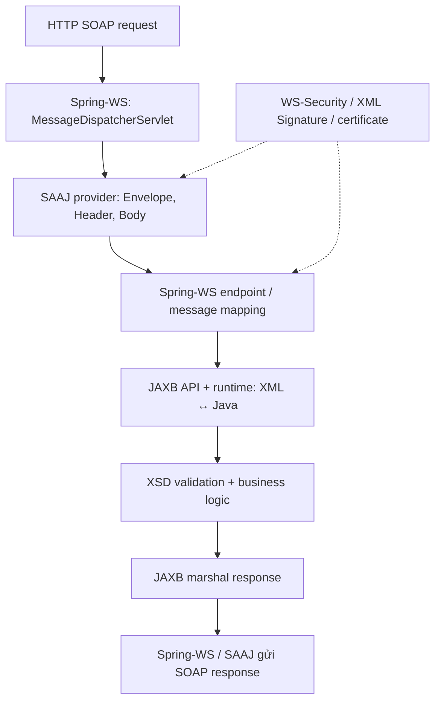
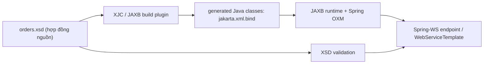
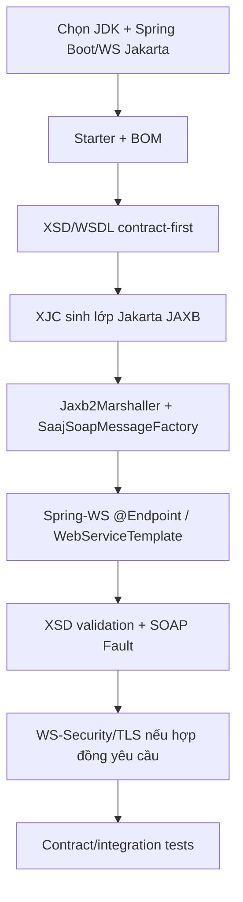

# Quản lý phụ thuộc SAAJ, JAXB và triển khai Jakarta XML cần thiết

Khởi tạo một dự án SOAP với Spring Web Services (Spring-WS) không chỉ là thêm một dependency “SOAP”. Một ứng dụng thường cần nhiều lớp thư viện khác nhau: **Spring-WS** nhận và gửi thông điệp SOAP, **SAAJ** cung cấp mô hình SOAP Envelope/Body/Header ở mức thông điệp, **JAXB** chuyển đổi giữa XML và đối tượng Java, còn **JAXP** phân tích và xác thực XML theo XSD. Mỗi lớp có thể gồm **API** và một **triển khai runtime** riêng. Nếu thiếu hoặc phối hợp sai phiên bản, dự án có thể biên dịch thành công nhưng thất bại ngay khi chạy.

Bài thuộc chương **Khởi tạo dự án** của module **SPRING_WEB_SERVICES**. Mục tiêu là dựng nền tảng phụ thuộc ổn định cho phát triển dịch vụ SOAP **contract-first**: thiết kế XSD/WSDL, sinh và ánh xạ JAXB, xây dựng endpoint cùng SOAP client, xử lý SOAP Fault, interceptor, XML security, WS-Security, chứng chỉ và kiểm thử tương thích với các hệ thống doanh nghiệp. Ví dụ ưu tiên dòng **Spring Framework 6 / Spring-WS 4 / Spring Boot 3** với **Jakarta XML** trên Java 17 trở lên; dự án sử dụng thế hệ khác phải lựa chọn dependency tương ứng, không chép nguyên phiên bản một cách máy móc.

## 1. Nhìn tổng thể các lớp công nghệ

Một yêu cầu SOAP document/literal điển hình đi qua các lớp sau:



Sơ đồ mô tả trách nhiệm, không quy định thứ tự tuyệt đối của mọi interceptor; xác thực schema, chữ ký và các xử lý bảo mật có thể chạy ở những điểm khác nhau theo cấu hình. Các thư viện thường gặp:

| Thành phần | Nhiệm vụ | API/package hoặc artifact điển hình |
| --- | --- | --- |
| Spring Web Services | SOAP server/client, dispatch endpoint, interceptor, message factory | `org.springframework.ws:spring-ws-core`, thường qua Spring Boot starter |
| SAAJ API | Tạo và truy cập SOAP Envelope, Header, Body, Attachment | `jakarta.xml.soap:jakarta.xml.soap-api`; package `jakarta.xml.soap` |
| SAAJ implementation | Thực sự tạo `SOAPMessage`, cung cấp provider/factory | `com.sun.xml.messaging.saaj:saaj-impl` |
| Jakarta XML Binding API (JAXB) | `JAXBContext`, `Marshaller`, `Unmarshaller`, annotation ánh xạ XML | `jakarta.xml.bind:jakarta.xml.bind-api`; package `jakarta.xml.bind` |
| JAXB runtime provider | Triển khai marshal/unmarshal, metadata và runtime model | `org.glassfish.jaxb:jaxb-runtime` |
| Jakarta Activation | Kiểu dữ liệu/handler cho content, attachment khi thư viện yêu cầu | `jakarta.activation:jakarta.activation-api` và provider tương thích nếu cần |
| JAXP / DOM / SAX / StAX | Parser, Transformer, XSD validation trong Java SE | `javax.xml.parsers`, `javax.xml.transform`, `javax.xml.validation`, `javax.xml.stream` |
| Spring XML Object Mapping | `Jaxb2Marshaller` để Spring-WS tích hợp JAXB | `org.springframework:spring-oxm` (thường đi qua starter) |
| WS-Security (tùy chọn) | Chữ ký, mã hóa, token và chính sách bảo mật message | `org.springframework.ws:spring-ws-security` cùng các thành phần WSS4J phù hợp |

**API khác implementation.** API quy định giao diện mà mã nguồn gọi; runtime provider chứa phần thực thi. Ví dụ có `jakarta.xml.bind.JAXBContext` trong compile classpath chưa chứng minh JVM đã có provider để tạo một `JAXBContext` lúc chạy. Tương tự, chỉ có `jakarta.xml.soap.MessageFactory` không có nghĩa `MessageFactory.newInstance()` sẽ tìm được SAAJ implementation.

Spring Boot starter có thể đã kéo một số thành phần trên bằng dependency bắc cầu (*transitive dependency*). Vì vậy bảng là **bản đồ trách nhiệm**, không phải danh sách bắt buộc phải khai báo lại toàn bộ trong mọi dự án.

## 2. Vì sao phải quản lý Java, Spring và Jakarta đồng bộ?

### 2.1. Java 8 khác Java 11 trở lên

Trong môi trường Java trước đây, nhiều API Java EE như JAXB hoặc SOAP with Attachments API được đóng gói cùng JDK. Từ **JDK 11**, các module Java EE/CORBA cũ, trong đó có JAXB và phần API SOAP liên quan, đã bị loại khỏi JDK. Một ứng dụng chuyển từ Java 8 lên Java 17 không thể mặc định tìm thấy `javax.xml.bind.JAXBContext` hay `javax.xml.soap.MessageFactory` chỉ bằng việc nâng JDK.

Điều đó không có nghĩa toàn bộ namespace `javax.xml.*` đã biến mất. Các API XML thuộc **Java SE**, như `javax.xml.parsers.DocumentBuilderFactory`, `javax.xml.transform.TransformerFactory` và `javax.xml.validation.SchemaFactory`, vẫn được hỗ trợ. Cần xem từng package thuộc nền tảng nào trước khi thay import.

### 2.2. Chuyển đổi `javax` sang `jakarta`

Hệ Jakarta EE mới chuyển tên package của nhiều API Java EE:

| Trước đây (thế hệ Java EE/JAXB 2.x) | Jakarta hiện đại | Ghi chú |
| --- | --- | --- |
| `javax.xml.bind.JAXBContext` | `jakarta.xml.bind.JAXBContext` | JAXB 3.x trở lên sử dụng namespace Jakarta |
| `javax.xml.bind.annotation.XmlRootElement` | `jakarta.xml.bind.annotation.XmlRootElement` | Lớp JAXB sinh từ XSD phải khớp runtime |
| `javax.xml.soap.SOAPMessage` | `jakarta.xml.soap.SOAPMessage` | SAAJ/Jakarta SOAP 2.x trở lên |
| `javax.activation.DataHandler` | `jakarta.activation.DataHandler` | Phụ thuộc liên quan nội dung/attachment |
| `javax.xml.validation.SchemaFactory` | **Vẫn là** `javax.xml.validation.SchemaFactory` | API thuộc Java SE; không đổi sang Jakarta |
| `javax.xml.namespace.QName` | **Vẫn là** `javax.xml.namespace.QName` | API thuộc Java SE |

Nên chọn **một hệ sinh thái nhất quán** theo framework đã dùng. Với Spring Boot 3 / Spring Framework 6 / Spring-WS 4, mã JAXB và SAAJ dùng các package `jakarta.xml.bind.*` và `jakarta.xml.soap.*`. Với một dự án Spring cũ dùng `javax.*`, việc thêm một API `jakarta.*` mới không tự chuyển toàn bộ các lớp và provider sang Jakarta.

Một dấu hiệu xung đột là lớp được sinh có `javax.xml.bind.annotation.XmlRootElement` nhưng `Jaxb2Marshaller` chạy trên hệ Jakarta, hoặc runtime báo không thấy implementation/provider phù hợp. **Hai annotation ở hai package không phải cùng kiểu** dù tên lớp giống nhau. Để chuyển hệ, cần đồng bộ framework, thư viện, generator và mã nguồn được sinh.

### 2.3. Ma trận quyết định trước khi khai báo dependency

| Dự án | Hướng chọn |
| --- | --- |
| Spring Boot 3.x + Spring Framework 6 + Spring-WS 4.x | Dùng các API và runtime Jakarta tương thích; Java 17 là nền tảng phổ biến |
| Spring Boot/Spring Framework thế hệ dùng `javax.*` | Giữ JAXB/SAAJ `javax` phù hợp nếu chưa có kế hoạch nâng cấp tổng thể |
| Dự án Spring Boot phiên bản mới hơn | Kiểm tra BOM, Java baseline, Spring-WS và các thành phần Jakarta do phiên bản Boot đó hỗ trợ |
| Client SOAP kết nối dịch vụ RPC/encoded cũ | Kiểm tra stack client có hỗ trợ binding; chỉ thêm SAAJ/JAXB không bảo đảm RPC/encoded tương thích |
| Ứng dụng chỉ cần XML thuần/XSD validation | Có thể chỉ cần JAXP; không nhất thiết cần toàn bộ Spring-WS/SAAJ |

**Không hard-code một tập số phiên bản “mới nhất” ở nhiều nơi.** Chọn phiên bản nền tảng Spring Boot và Java được dự án hỗ trợ, để BOM/dependency management điều phối phần lớn phiên bản, sau đó chỉ override có chủ đích khi có lý do và kiểm thử tương thích.

## 3. Bắt đầu từ Spring Boot starter

Với ứng dụng Spring Boot dùng Spring-WS, điểm khởi đầu thường là:

```text
org.springframework.boot:spring-boot-starter-web-services
```

Starter giúp tập hợp các dependency phổ biến để chạy SOAP server/client với Spring-WS. Tuy nhiên, **không suy luận mọi bản starter đều có đủ mọi API, provider, công cụ sinh JAXB hoặc WS-Security**. Cần kiểm tra dependency graph thực tế của dự án và xem thành phần nào được tải vào **runtime classpath**.

### 3.1. Gradle (Groovy DSL)

Ví dụ dưới giả định dự án **đã áp dụng Spring Boot plugin và dependency management/BOM** theo phiên bản nền tảng đã chọn:

```groovy
dependencies {
    implementation 'org.springframework.boot:spring-boot-starter-web-services'

    // Cần khi mã nguồn sử dụng trực tiếp Jakarta JAXB API/annotation.
    implementation 'jakarta.xml.bind:jakarta.xml.bind-api'

    // Runtime provider để JAXB marshal/unmarshal.
    runtimeOnly 'org.glassfish.jaxb:jaxb-runtime'

    // Cần khi dùng trực tiếp SAAJ API hoặc starter chưa cung cấp nó.
    implementation 'jakarta.xml.soap:jakarta.xml.soap-api'

    // Runtime provider cho SOAP MessageFactory.
    runtimeOnly 'com.sun.xml.messaging.saaj:saaj-impl'

    testImplementation 'org.springframework.boot:spring-boot-starter-test'
}
```

Các dòng bổ sung ngoài starter là **minh họa để chỉ rõ vai trò**, không nhất thiết phải giữ nguyên tất cả nếu đã có cùng phiên bản thích hợp qua dependency bắc cầu. Ví dụ `runtimeOnly` phù hợp khi mã ứng dụng không import trực tiếp lớp triển khai provider; thư viện triển khai chỉ cần ở runtime.

Các tọa độ không ghi version trong ví dụ chỉ dùng được khi **BOM đang quản lý phiên bản của chúng**. Nếu BOM không quản lý một artifact, Gradle sẽ cần version rõ ràng qua version catalog/constraint/dependency declaration của dự án. Không dùng một version không tương thích chỉ để hết lỗi resolve dependency.

Nếu chỉ viết một SOAP client bằng `WebServiceTemplate`, starter vẫn có thể phù hợp; không cần thêm JAX-WS client stack một cách mặc định.

### 3.2. Maven

Ví dụ tương đương cho dự án **đã dùng Spring Boot parent hoặc đã import Spring Boot BOM**:

```xml
<dependencies>
    <dependency>
        <groupId>org.springframework.boot</groupId>
        <artifactId>spring-boot-starter-web-services</artifactId>
    </dependency>

    <dependency>
        <groupId>jakarta.xml.bind</groupId>
        <artifactId>jakarta.xml.bind-api</artifactId>
    </dependency>
    <dependency>
        <groupId>org.glassfish.jaxb</groupId>
        <artifactId>jaxb-runtime</artifactId>
        <scope>runtime</scope>
    </dependency>

    <dependency>
        <groupId>jakarta.xml.soap</groupId>
        <artifactId>jakarta.xml.soap-api</artifactId>
    </dependency>
    <dependency>
        <groupId>com.sun.xml.messaging.saaj</groupId>
        <artifactId>saaj-impl</artifactId>
        <scope>runtime</scope>
    </dependency>

    <dependency>
        <groupId>org.springframework.boot</groupId>
        <artifactId>spring-boot-starter-test</artifactId>
        <scope>test</scope>
    </dependency>
</dependencies>
```

Đây là **đoạn dependency**, chưa phải `pom.xml` đầy đủ: project cần khai báo parent hoặc BOM và cấu hình Java/build plugin. Nếu dependency management không cung cấp phiên bản cho một artifact, Maven sẽ yêu cầu bổ sung `version` thích hợp trong quản lý phụ thuộc. Không vừa quản lý toàn bộ bằng BOM vừa gắn các version tùy tiện cho JAXB/SAAJ theo từng dependency.

### 3.3. Dependency scopes ảnh hưởng tới runtime

| Maven | Gradle thường tương ứng | Khi nào dùng |
| --- | --- | --- |
| `compile` (mặc định) | `implementation` | API được mã ứng dụng import, cần khi biên dịch và chạy |
| `runtime` | `runtimeOnly` | Provider implementation chỉ được phát hiện lúc chạy |
| `test` | `testImplementation` / `testRuntimeOnly` | Mock server, assertions, công cụ test |
| `provided` | `compileOnly` (tùy đóng gói) | Thư viện do container cung cấp; phải xác nhận runtime thật sự có |

Đặc biệt thận trọng với `provided` hoặc `compileOnly` cho SAAJ/JAXB trong ứng dụng chạy JDK 17: **JDK không tự cung cấp các Java EE provider cũ**. Nếu nhầm scope, `compile` vẫn có thể PASS nhưng gọi SOAP hay marshal XML khi chạy sẽ lỗi.

## 4. JAXB: API, runtime, annotation và công cụ sinh mã

### 4.1. JAXB thực hiện công việc gì?

Với hợp đồng XSD:

```xml
<xs:schema xmlns:xs="http://www.w3.org/2001/XMLSchema"
           targetNamespace="https://example.org/orders/v1"
           elementFormDefault="qualified">
    <xs:element name="PingRequest">
        <xs:complexType>
            <xs:sequence>
                <xs:element name="value" type="xs:string"/>
            </xs:sequence>
        </xs:complexType>
    </xs:element>
</xs:schema>
```

Lớp Java tương ứng có thể sinh từ XSD bằng công cụ JAXB/XJC hoặc được viết để minh họa:

```java
import jakarta.xml.bind.annotation.XmlAccessType;
import jakarta.xml.bind.annotation.XmlAccessorType;
import jakarta.xml.bind.annotation.XmlElement;
import jakarta.xml.bind.annotation.XmlRootElement;
import jakarta.xml.bind.annotation.XmlType;

@XmlRootElement(name = "PingRequest",
        namespace = "https://example.org/orders/v1")
@XmlAccessorType(XmlAccessType.FIELD)
@XmlType(propOrder = {"value"})
public class PingRequest {
    @XmlElement(name = "value",
            namespace = "https://example.org/orders/v1",
            required = true)
    private String value;

    public PingRequest() { }

    public PingRequest(String value) {
        this.value = value;
    }

    public String getValue() {
        return value;
    }

    public void setValue(String value) {
        this.value = value;
    }
}
```

Ví dụ dùng `@XmlRootElement`, `@XmlType` và `@XmlElement` từ **Jakarta JAXB** để tạo đúng QName và thứ tự trường. Trong sản phẩm contract-first, ưu tiên **XSD là nguồn sự thật**, sau đó sinh mã để giảm nguy cơ Java model và schema lệch nhau. Tên class, package và annotation thực tế phụ thuộc binding/generator đã chọn.

Chạy thử JAXB tại runtime:

```java
import jakarta.xml.bind.JAXBContext;
import jakarta.xml.bind.Marshaller;
import jakarta.xml.bind.Unmarshaller;

import java.io.StringReader;
import java.io.StringWriter;

public class JaxbSmoke {
    public static void main(String[] args) throws Exception {
        JAXBContext context = JAXBContext.newInstance(PingRequest.class);

        Marshaller marshaller = context.createMarshaller();
        marshaller.setProperty(Marshaller.JAXB_FORMATTED_OUTPUT, true);

        StringWriter output = new StringWriter();
        marshaller.marshal(new PingRequest("ready"), output);
        String xml = output.toString();
        System.out.println(xml);

        Unmarshaller unmarshaller = context.createUnmarshaller();
        PingRequest result = (PingRequest) unmarshaller.unmarshal(
                new StringReader(xml));
        System.out.println(result.getValue());
    }
}
```

Nếu chương trình compile được nhưng thất bại ở `JAXBContext.newInstance(...)` với thông báo không tìm thấy JAXB implementation/provider, hãy kiểm tra `jaxb-runtime` trong runtime classpath và các version Jakarta JAXB. Một lỗi do QName/annotation có thể chỉ xuất hiện khi marshal hoặc unmarshal chứ không xuất hiện lúc tạo context.

### 4.2. JAXB code generation là thành phần riêng

**JAXB runtime** và **XJC code generator** là hai vai trò khác nhau:

- `jaxb-runtime` cần khi ứng dụng đang chạy để chuyển đổi đối tượng/XML.
- XJC hoặc một Maven/Gradle JAXB plugin sinh mã nguồn Java từ XSD **trong build**.

Plugin sinh mã phải khớp hệ namespace với ứng dụng: XJC thế hệ JAXB 2.x thường sinh import `javax.xml.bind.*`; công cụ sinh mã Jakarta phù hợp phải tạo `jakarta.xml.bind.*`. Đừng thêm plugin JAXB 2.x vào dự án Spring Boot 3 rồi âm thầm dùng lớp generated `javax.*` với JAXB runtime Jakarta.

Quy trình contract-first điển hình:



Nên cấu hình generated sources trong build, không sửa trực tiếp mã được sinh; khi đổi schema, sinh lại và kiểm thử tính tương thích request/response. Version của plugin generator, API, runtime và Java baseline phải được kiểm tra như một nhóm.

### 4.3. Spring OXM: `Jaxb2Marshaller`

Spring-WS thường tích hợp JAXB qua `Jaxb2Marshaller` trong Spring OXM. Ví dụ:

```java
import org.springframework.context.annotation.Bean;
import org.springframework.context.annotation.Configuration;
import org.springframework.oxm.jaxb.Jaxb2Marshaller;
import org.springframework.ws.client.core.WebServiceTemplate;

@Configuration
public class SoapClientConfiguration {

    @Bean
    public Jaxb2Marshaller ordersMarshaller() {
        Jaxb2Marshaller marshaller = new Jaxb2Marshaller();
        marshaller.setClassesToBeBound(PingRequest.class);

        // Không cho phép DTD/thực thể ngoài trong unmarshal từ XML
        // không tin cậy; vẫn kiểm tra cấu hình parser thực tế.
        marshaller.setSupportDtd(false);
        marshaller.setProcessExternalEntities(false);
        return marshaller;
    }

    @Bean
    public WebServiceTemplate webServiceTemplate(
            Jaxb2Marshaller ordersMarshaller) {
        WebServiceTemplate template = new WebServiceTemplate();
        template.setMarshaller(ordersMarshaller);
        template.setUnmarshaller(ordersMarshaller);
        return template;
    }
}
```

`setClassesToBeBound` thuận tiện cho một số lớp có `@XmlRootElement`. Với mã generated từ schema lớn, có thể cấu hình `setContextPath` cho package chứa mô hình JAXB phù hợp (ví dụ có `ObjectFactory` hoặc `jaxb.index`). Chọn một cách tương ứng với tổ chức classes; đừng khai báo một package không tồn tại rồi kết luận provider thiếu.

**JAXB mapping khác XSD validation.** Khả năng marshal/unmarshal được một XML không chứng minh XML đó tuân thủ đầy đủ `minOccurs`, `xs:choice`, `xs:sequence` hoặc các facet của XSD. Cần bật validation tường minh tại biên SOAP hoặc trên marshaller/unmarshaller khi hợp đồng yêu cầu.

## 5. SAAJ: API và implementation cho SOAP Envelope

**SAAJ** (*SOAP with Attachments API for Java*) cung cấp các loại như `SOAPMessage`, `SOAPEnvelope`, `SOAPHeader`, `SOAPBody`, `SOAPPart` và `AttachmentPart`. SAAJ khác JAXB: JAXB ánh xạ dữ liệu ứng dụng thành XML, còn SAAJ thao tác với thông điệp SOAP hoàn chỉnh có Header và Body.

### 5.1. Kiểm tra provider bằng smoke test

```java
import jakarta.xml.soap.MessageFactory;
import jakarta.xml.soap.SOAPBody;
import jakarta.xml.soap.SOAPEnvelope;
import jakarta.xml.soap.SOAPMessage;
import jakarta.xml.soap.SOAPPart;

public class SaajSmoke {
    public static void main(String[] args) throws Exception {
        MessageFactory factory = MessageFactory.newInstance();
        SOAPMessage message = factory.createMessage();

        SOAPPart part = message.getSOAPPart();
        SOAPEnvelope envelope = part.getEnvelope();
        SOAPBody body = envelope.getBody();
        body.addBodyElement(envelope.createName("ping", "p",
                "https://example.org/orders/v1"))
            .addTextNode("ready");

        message.saveChanges();
        message.writeTo(System.out);
    }
}
```

Nếu chương trình thất bại **ngay tại `MessageFactory.newInstance()`**, khả năng thường gặp là không có SAAJ provider hoặc provider không tương thích với API đang dùng. Kiểm tra `jakarta.xml.soap-api` và `saaj-impl` ở runtime, đồng thời xem có vô tình kéo một implementation chỉ dành cho `javax.xml.soap` hay không.

Với SOAP 1.2, có thể yêu cầu protocol phù hợp:

```java
import jakarta.xml.soap.MessageFactory;
import jakarta.xml.soap.SOAPConstants;

MessageFactory soap12Factory =
        MessageFactory.newInstance(SOAPConstants.SOAP_1_2_PROTOCOL);
```

Điều này chỉ tạo message factory theo SOAP 1.2 nếu provider hỗ trợ. Muốn client/server giao tiếp thành công, **WSDL binding, SOAP Envelope namespace, HTTP Content-Type và policy** cũng phải khớp SOAP version. Không chỉ đổi factory rồi giữ nguyên message SOAP 1.1.

### 5.2. SAAJ trong Spring-WS

Spring-WS cung cấp `SaajSoapMessageFactory` để dùng SAAJ làm `WebServiceMessageFactory`. Nếu auto-configuration đã tạo factory phù hợp, không cần định nghĩa bean thứ hai. Khi cần điều khiển SOAP version tường minh:

```java
import org.springframework.context.annotation.Bean;
import org.springframework.context.annotation.Configuration;
import org.springframework.ws.soap.SoapVersion;
import org.springframework.ws.soap.saaj.SaajSoapMessageFactory;

@Configuration
public class SoapMessageConfiguration {
    @Bean
    public SaajSoapMessageFactory soapMessageFactory() {
        SaajSoapMessageFactory factory = new SaajSoapMessageFactory();
        factory.setSoapVersion(SoapVersion.SOAP_11);
        return factory;
    }
}
```

Ví dụ này minh họa cấu hình có chủ đích cho SOAP 1.1; việc Spring-WS dùng factory nào còn phụ thuộc ứng dụng và các bean hiện có. Khi sử dụng trong Spring, vòng đời bean sẽ gọi bước khởi tạo phù hợp theo contract của factory. Không đặt SOAP version khác với WSDL đã công bố.

### 5.3. Attachment, Activation và các triển khai liên quan

Khi gửi tài liệu đính kèm hoặc xử lý nội dung nhị phân, SAAJ có thể sử dụng Jakarta Activation. Một dependency có thể kéo `jakarta.activation-api` và implementation phù hợp theo dạng bắc cầu. Nếu chức năng attachment cần `DataHandler` hoặc provider nội dung, hãy kiểm tra cả runtime classpath; tùy framework có thể cần bổ sung implementation Jakarta Activation như một dependency runtime tương thích.

SOAP attachments truyền bằng MIME và các chuẩn liên quan, khác với việc chèn Base64 vào text của một phần tử XML. Trong WS-Security, phạm vi ký/mã hóa attachment là câu chuyện riêng; không giả định rằng ký SOAP Body sẽ tự bảo vệ mọi attachment.

## 6. Phân biệt SAAJ, JAXB, JAXP và JAX-WS để tránh phụ thuộc thừa

Các tên đều chứa “XML” hoặc “SOAP” nhưng phục vụ các tầng khác nhau:

| Công nghệ | Điều nó cung cấp | Có cần riêng trong Spring-WS? |
| --- | --- | --- |
| **SAAJ** | Mô hình và tạo SOAP message, header/body, attachment | Cần khi ứng dụng dùng SAAJ-based message factory; provider phải hiện diện |
| **JAXB/Jakarta XML Binding** | Marshal/unmarshal Java object ↔ XML | Cần khi chọn JAXB làm công cụ ánh xạ payload |
| **JAXP** | Parser DOM/SAX, Transformer, XSD validation | Nhiều API thuộc Java SE; dùng để xử lý XML/schema |
| **JAX-WS/Jakarta XML Web Services** | API lập trình web service theo mô hình JAX-WS như `@WebService` và proxy/stub | **Không bắt buộc** cho Spring-WS `@Endpoint` hoặc `WebServiceTemplate` |
| **WSS4J / Spring-WS security** | WS-Security header, signature, encryption, token | Chỉ thêm khi dùng WS-Security theo hợp đồng |

Spring-WS dùng `@Endpoint` và thường định tuyến theo `@PayloadRoot`; đây không phải cùng mô hình annotation với JAX-WS `@WebService`. Không thêm cả JAX-WS runtime, SOAP client generator và framework khác chỉ để giải quyết lỗi JAXB provider, bởi các thư viện này có thể mang transitive dependencies không cùng phiên bản.

## 7. Khởi tạo dịch vụ SOAP contract-first theo một luồng nhất quán

Giả sử cần dịch vụ `SubmitOrder` dựa trên XSD và WSDL document/literal. Cấu trúc làm việc có thể theo thứ tự:



### 7.1. Các bước thực hiện

1. **Chọn cặp framework và Java:** xác định Java baseline của Spring Boot và phiên bản Spring-WS được hỗ trợ. Với Boot 3/Spring-WS 4, chọn nguồn mã và thư viện Jakarta.
2. **Bật dependency management tập trung:** dùng Spring Boot parent/BOM hoặc version catalog phù hợp; thống nhất version compile, runtime và code generator.
3. **Thêm starter web services:** kiểm tra `spring-ws-core`, JAXB/SAAJ API/provider trong đồ thị runtime thay vì khai báo trùng theo suy đoán.
4. **Lưu XSD/WSDL làm nguồn hợp đồng:** khai báo `targetNamespace`, request/response elements, document/literal binding và địa chỉ endpoint thích hợp.
5. **Sinh JAXB class từ XSD:** bảo đảm code generator tạo `jakarta.xml.bind.*` đối với stack Jakarta.
6. **Cấu hình JAXB marshaller:** trỏ tới đúng lớp/package generated, kiểm tra QName và chính sách xử lý DTD/external entity.
7. **Cấu hình SAAJ factory nếu cần:** dùng SOAP version phù hợp WSDL; kiểm tra provider runtime.
8. **Triển khai endpoint và client:** dùng `@Endpoint`, `@PayloadRoot` và `WebServiceTemplate`; không tự đóng SOAP Envelope thủ công khi framework đã quản lý.
9. **Thêm XSD validation và Fault mapping:** kiểm tra payload sai hợp đồng và lỗi nghiệp vụ với SOAP Fault có chủ đích.
10. **Thêm bảo mật phù hợp:** TLS/chứng chỉ cho kết nối, WS-Security cho bảo vệ message nếu có yêu cầu; kiểm thử trust và signature độc lập.

Khi làm contract-first, việc chạy được starter **chưa đủ** để chứng minh WSDL/XSD và JAXB khớp nhau; nên xác minh payload qua round-trip, schema validation và test client/server thực tế.

### 7.2. Spring-WS endpoint tối giản

Với lớp `PingRequest` ở mục 4, một endpoint có thể nhận request theo QName:

```java
import org.springframework.ws.server.endpoint.annotation.Endpoint;
import org.springframework.ws.server.endpoint.annotation.PayloadRoot;
import org.springframework.ws.server.endpoint.annotation.RequestPayload;
import org.springframework.ws.server.endpoint.annotation.ResponsePayload;

@Endpoint
public class PingEndpoint {
    private static final String NS = "https://example.org/orders/v1";

    @PayloadRoot(namespace = NS, localPart = "PingRequest")
    @ResponsePayload
    public PingResponse ping(@RequestPayload PingRequest request) {
        PingResponse response = new PingResponse();
        response.setResult("ACK:" + request.getValue());
        return response;
    }
}
```

Ví dụ này **cần bổ sung** phần tử `PingResponse` vào XSD và sinh lớp `PingResponse` tương ứng nếu muốn chạy; `Jaxb2Marshaller` ở mục 4 cũng phải bind lớp response. Đây là ví dụ định tuyến endpoint, không phải toàn bộ một service độc lập. Cần có servlet mapping, WSDL công bố, schema và cấu hình marshaller phù hợp.

### 7.3. Khi nào cần một dependency WS-Security riêng?

Spring-WS core không tự xử lý mọi yêu cầu chữ ký hay encryption chỉ nhờ SAAJ/JAXB. Nếu hợp đồng yêu cầu WS-Security, cần mô-đun bảo mật Spring-WS và thư viện WSS4J tương thích (cùng keystore/truststore, cấu hình khóa và policy), ví dụ:

```groovy
dependencies {
    implementation 'org.springframework.ws:spring-ws-security'
}
```

Dòng này cũng giả định dependency management hoặc version catalog cung cấp version tương thích. Thêm module mới chỉ là điều kiện về thư viện; phải cấu hình interceptor, cryptographic provider, chứng chỉ, alias, chính sách chữ ký/mã hóa và kiểm thử thực tế. TLS bảo vệ kênh kết nối, còn WS-Security bảo vệ các phần của SOAP message ở tầng thông điệp; hai lớp có phạm vi khác nhau.

## 8. Chẩn đoán lỗi dependency ở lúc chạy

Một số lỗi thường xuất hiện khi khởi tạo:

| Triệu chứng / ví dụ thông điệp | Nguyên nhân có thể | Hướng kiểm tra |
| --- | --- | --- |
| `ClassNotFoundException: jakarta.xml.bind.JAXBContext` | Không có JAXB API Jakarta ở classpath phù hợp | Kiểm tra dependency API và cấu hình module/classpath |
| `JAXBException: Implementation of Jakarta XML Binding-API has not been found` | Có API nhưng không có runtime provider hoặc provider không được phát hiện | Kiểm tra `jaxb-runtime`, ServiceLoader, scope và version |
| `ClassNotFoundException: javax.xml.bind.JAXBContext` | Thư viện hoặc generated code còn dùng namespace cũ | Đồng bộ stack Jakarta hoặc giữ stack cũ nhất quán |
| `SOAPException: Unable to create SAAJ meta-factory` | SAAJ API không thấy provider, provider sai thế hệ hoặc classloader | Kiểm tra `saaj-impl` ở runtime và loại bỏ xung đột `javax/jakarta` |
| `NoClassDefFoundError: jakarta/activation/...` | Thiếu API/provider Activation cần cho dependency/attachment | Xem dependency tree và bổ sung triển khai tương thích |
| `NoSuchMethodError` / `LinkageError` trong JAXB/SAAJ | Phiên bản thư viện bắc cầu không tương thích | Kiểm tra version được chọn bởi Maven/Gradle, tránh override tùy tiện |
| `IllegalAnnotationsException` hoặc lỗi JAXB model | Class/annotation không phù hợp JAXB mapping | Xem annotation, `@XmlRootElement`, ctor mặc định và mã generated |
| Unmarshal nhận sai QName hoặc trả lỗi phần tử mong đợi | Namespace/XSD/WSDL hoặc lớp generated lệch phiên bản | So sánh targetNamespace, localPart, elementFormDefault, schema |
| Endpoint nhận được SOAP nhưng không xác thực được payload | Validation chưa bật hoặc đang dùng XSD sai | Kiểm tra `PayloadValidatingInterceptor` và nguồn XSD |
| SOAP Fault khi gửi SOAP 1.2 tới endpoint SOAP 1.1 | SOAP version và binding khác nhau | Kiểm tra MessageFactory, WSDL, Envelope và HTTP media type |

Tên thông điệp lỗi thực tế tùy phiên bản API/provider và thời điểm phát hiện lỗi. Chẩn đoán nên bắt đầu từ **exception cause cuối cùng** và đồ thị dependency đã resolve, không chỉ nhìn exception của Spring ở tầng trên.

### 8.1. Kiểm tra bằng Maven

```bash
mvn dependency:tree
```

Có thể lọc tọa độ cần xem:

```bash
mvn dependency:tree -Dincludes=jakarta.xml.bind:jakarta.xml.bind-api
mvn dependency:tree -Dincludes=org.glassfish.jaxb:jaxb-runtime
mvn dependency:tree -Dincludes=com.sun.xml.messaging.saaj:saaj-impl
```

Trên một số phiên bản Maven/dependency plugin, cú pháp lọc hoặc hiển thị các đường phụ thuộc có thể khác; xem `mvn dependency:tree` đầy đủ nếu kết quả lọc không cho thấy quan hệ cần tìm.

### 8.2. Kiểm tra bằng Gradle

```bash
./gradlew dependencies --configuration runtimeClasspath
./gradlew dependencyInsight --dependency jaxb-runtime --configuration runtimeClasspath
./gradlew dependencyInsight --dependency saaj-impl --configuration runtimeClasspath
```

Trên Windows, thay `./gradlew` bằng `gradlew.bat` hoặc `.\gradlew.bat` tùy shell. Cần xem **runtimeClasspath**, vì provider có thể tồn tại ở compileClasspath/testRuntimeClasspath nhưng không có khi chạy ứng dụng đóng gói.

Trong kết quả, xác định:

- Có **một phiên bản tương thích** của mỗi API/provider quan trọng, không bị chọn version ngoài dự kiến.
- Những thư viện dùng `javax.xml.bind` hay `javax.xml.soap` cũ có đi vào cùng classpath với Jakarta stack không.
- Provider có được đóng gói vào JAR/container thực chạy không; `runtimeOnly` và `runtime` không có tác dụng nếu khâu đóng gói loại bỏ chúng.
- Các dependency không cần thiết (ví dụ thêm cả hai SOAP stack để “chữa lỗi”) có làm kéo theo thư viện xung đột không.

### 8.3. Thử ngay một bước tối giản trước khi viết SOAP endpoint

Nên có ba bài kiểm tra độc lập:

1. **SAAJ smoke:** tạo `MessageFactory` và `SOAPMessage`; nếu không được, sửa provider/runtime trước.
2. **JAXB smoke:** tạo `JAXBContext`, marshal/unmarshal lớp `@XmlRootElement`; nếu không được, sửa JAXB API/provider/annotation.
3. **Spring-WS smoke:** khởi động context, gọi endpoint với payload SOAP hợp lệ; nếu không được, kiểm tra bean, servlet mapping, QName và validation.

Tách ba bước giúp nhanh chóng phân biệt lỗi **dependency**, lỗi **XML schema/binding** và lỗi **ứng dụng/endpoint**.

## 9. An toàn XML và tương thích không thể chỉ giải quyết bằng dependency

XML parser có thể gặp DTD, external entity, schema import/include hoặc nội dung không tin cậy. **XXE** xảy ra khi cấu hình parser cho phép giải quyết tài nguyên ngoài theo cách không an toàn. Khi xử lý XML do người dùng hoặc đối tác gửi:

- Dùng cấu hình parser/JAXB không cho phép DTD và external entity khi không có nhu cầu; kiểm tra hành vi của parser provider đang dùng.
- Áp dụng giới hạn kích thước message, số lượng phần tử, độ sâu XML và tài nguyên xử lý theo môi trường; validation không tự bảo vệ khỏi mọi payload tiêu thụ tài nguyên.
- Với XSD/WSDL nhập từ địa chỉ ngoài, kiểm soát nguồn và quyền truy cập tài nguyên schema. Cơ chế load schema ở build khác với xử lý payload không tin cậy ở runtime.
- Với WS-Security, kiểm tra chữ ký và vùng dữ liệu được ký theo cấu hình có thể chống các dạng tấn công sửa Body/Header; bản thân việc thêm WSS4J dependency không đủ.
- Với TLS và chứng chỉ, xác thực hostname, chain/truststore và tính hợp lệ của chứng chỉ; không vô hiệu hóa kiểm tra chứng chỉ để qua được test.

**Namespace của Java SE không đồng nghĩa với API cũ cần loại bỏ.** `javax.xml.validation.SchemaFactory` có thể được dùng để xác thực XSD trong một dự án Jakarta SOAP; điều quan trọng là cấu hình tính năng bảo mật và nguồn schema đúng.

Khả năng tương thích SOAP còn phụ thuộc WSDL binding (`document/literal`, `rpc/literal`), SOAP version, `SOAPAction`, QName, thứ tự phần tử, SOAP Fault, policy WS-Security, chứng chỉ và cách client mã hóa message. Không có tổ hợp dependency nào bảo đảm tương thích nếu các bên không cùng hợp đồng trên đường truyền.

## 10. Ma trận kiểm thử cho cấu hình phụ thuộc

| Ca kiểm thử | Kết quả mong đợi |
| --- | --- |
| Build với Java baseline đã chọn | Compile thành công, không lẫn import `javax`/`jakarta` ngoài dự kiến |
| Khởi tạo `jakarta.xml.soap.MessageFactory` | Provider SAAJ được tìm thấy và tạo SOAPMessage |
| Khởi tạo `jakarta.xml.bind.JAXBContext` | Provider JAXB được tìm thấy |
| Marshal `PingRequest` | XML có đúng QName namespace và element order |
| Unmarshal XML hợp lệ | Chuyển thành object, giá trị đầy đủ |
| Gửi XML vi phạm `xs:sequence` | XSD validation từ chối theo cấu hình |
| SOAP 1.1/1.2 theo WSDL | Envelope và Content-Type phù hợp phiên bản |
| Build một JAR/container triển khai | Runtime classpath thật có JAXB/SAAJ provider |
| Tạo client từ lớp JAXB generated | Không lỗi namespace hoặc API thế hệ khác |
| Client gọi endpoint Spring-WS | Request và response đúng wire format |
| Endpoint nhận request sai QName | Mapping/validation báo lỗi phù hợp |
| SOAP Fault | Client nhận được Fault theo SOAP version đang dùng |
| WSDL/XSD thay đổi phiên bản | Regenerate JAXB và contract test chứng minh tương thích |
| SOAP attachment nếu dùng | Provider MIME/Activation hoạt động, dữ liệu không lỗi |
| WS-Security nếu dùng | Ký/xác minh, mã hóa/giải mã, chứng chỉ và trust đúng |
| XML không tin cậy | Không giải quyết external entity ngoài chính sách cho phép |

Với Spring-WS có thể dùng `MockWebServiceClient` cho endpoint và `MockWebServiceServer` cho `WebServiceTemplate`, kết hợp validate XSD và smoke test trực tiếp với provider. Unit test dùng mock **không thay thế** test runtime thật trong image/container và kết nối SOAP với đối tác.

## 11. Các sai lầm phổ biến

**“Có `jakarta.xml.bind-api` là đã dùng được JAXB.”** Chưa chắc. API không chứa toàn bộ implementation; cần provider runtime phù hợp hoặc đã được starter bổ sung.

**“JDK 17 tự có SAAJ và JAXB như Java 8.”** Không. Các module Java EE cũ đã bị gỡ khỏi JDK từ Java 11; phải quản lý phụ thuộc đúng.

**“Thấy package `javax.xml.validation` là phải đổi thành `jakarta.xml.validation`.”** Sai. JAXP và XML validation thuộc Java SE vẫn sử dụng `javax.xml.*`.

**“Dùng cả JAXB `javax` và `jakarta` trong cùng generated model sẽ linh hoạt hơn.”** Thường gây bất tương thích API/annotation. Hãy đồng bộ framework, generator và runtime.

**“Dự án có SAAJ thì không cần JAXB.”** SAAJ quản lý cấu trúc SOAP; JAXB ánh xạ payload. Có thể xử lý XML bằng API khác, nhưng SAAJ không tự cung cấp mapping Java object của JAXB.

**“Dùng Spring-WS bắt buộc thêm JAX-WS runtime.”** Không. Spring-WS có mô hình endpoint và client riêng.

**“Cài `spring-ws-security` nghĩa là đã bật bảo mật.”** Chưa đủ. Cần interceptor, chính sách, khóa/chứng chỉ và kiểm thử chữ ký/mã hóa thực tế.

**“BOM sẽ luôn quản lý mọi thư viện thêm vào.”** Không đảm bảo. Kiểm tra resolved version; nếu một artifact ngoài BOM, khai báo version/constraint tương thích tại một nơi tập trung.

## 12. Tự kiểm tra

**Câu 1.** Một ứng dụng Spring Boot 3 trên Java 17 import `jakarta.xml.bind.JAXBContext` và biên dịch thành công, nhưng chạy báo không tìm thấy JAXB implementation. Bạn kiểm tra gì trước?

**Đáp án:** Kiểm tra `jaxb-runtime` trong runtime classpath và version API/provider, sau đó xác minh cách đóng gói JAR/container và ServiceLoader/provider. Không sửa XSD trước khi giải quyết lỗi provider.

**Câu 2.** Vì sao `javax.xml.parsers.DocumentBuilderFactory` vẫn xuất hiện trong ứng dụng Spring-WS dùng Jakarta?

**Đáp án:** Vì JAXP parser thuộc Java SE và giữ namespace `javax.xml.parsers`. Cuộc chuyển đổi Jakarta XML Binding/SOAP không đổi mọi Java XML package.

**Câu 3.** Lớp JAXB generated có import `javax.xml.bind.annotation.XmlType` nhưng runtime chỉ có Jakarta JAXB 4. Sửa như thế nào?

**Đáp án:** Chọn công cụ sinh mã JAXB/Jakarta phù hợp, sinh lại lớp từ XSD và dùng API/runtime Jakarta nhất quán. Không chỉ đổi một import bằng tay nếu generated code còn nhiều annotation và adapter khác.

**Câu 4.** Cùng một dự án dùng SAAJ để tạo Envelope và JAXB để marshal Body. Có phải thêm JAX-WS chỉ vì cả hai đều liên quan SOAP?

**Đáp án:** Không. Spring-WS + SAAJ/JAXB đủ cho mô hình endpoint và client đã chọn; JAX-WS chỉ cần nếu nghiệp vụ/công cụ triển khai dựa riêng vào mô hình JAX-WS.

**Câu 5.** Ứng dụng chạy được SOAP nhưng gửi request sai thứ tự phần tử vẫn không báo lỗi. Đây có chắc là thiếu JAXB provider?

**Đáp án:** Không. Nếu JAXB đã marshal/unmarshal được, nhiều khả năng cần kiểm tra **XSD validation** và bản schema đã cấu hình, vì unmarshal không bắt buộc xác thực đầy đủ mọi ràng buộc XSD.

**Câu 6.** Chỉ thêm `spring-ws-security` có bảo đảm thông điệp được ký và chứng chỉ được xác minh không?

**Đáp án:** Không. Phải cấu hình interceptor, key/trust material, chính sách ký, vị trí phần tử được ký và quy trình xác minh; sau đó kiểm thử các trường hợp chữ ký/chứng chỉ sai.

**Câu 7.** Một SOAP client hoạt động trong IDE nhưng lỗi `ClassNotFoundException` sau khi chạy JAR triển khai. Cần xem ở đâu?

**Đáp án:** Kiểm tra runtime scope, dependency graph và nội dung gói triển khai; provider có thể chỉ tồn tại trong IDE hoặc test classpath và bị thiếu khi đóng gói.

## Ghi nhớ

- **SAAJ, JAXB, JAXP và Spring-WS có trách nhiệm khác nhau**: SOAP message, XML/object mapping, XML parsing/validation và orchestration endpoint/client.
- **API không mặc định bao gồm runtime provider.** Kiểm tra riêng `jakarta.xml.soap-api` ↔ `saaj-impl` và `jakarta.xml.bind-api` ↔ `jaxb-runtime`.
- **Chọn nhất quán hệ `javax` hoặc `jakarta` theo phiên bản framework**; các package JAXP/Java SE như `javax.xml.validation` vẫn giữ nguyên.
- **BOM là điểm điều phối version**; kiểm tra dependency tree và runtime classpath, không suy đoán transitive dependencies của starter.
- **XJC sinh mã và JAXB runtime là hai giai đoạn riêng**. Mã generated, annotation, API và runtime phải cùng hệ.
- **Chạy smoke test provider trước, rồi mới test SOAP/XSD/WS-Security** để phân biệt lỗi dependency với lỗi hợp đồng và bảo mật.
