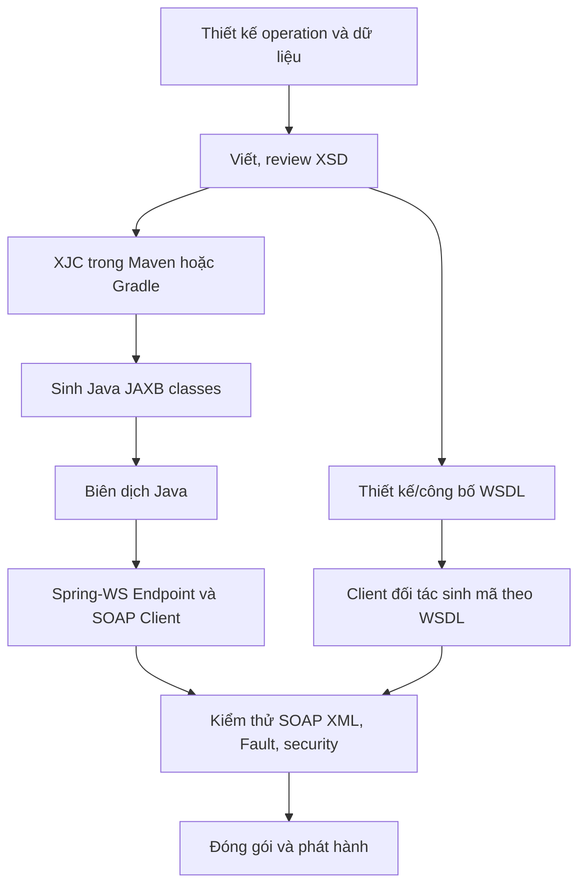
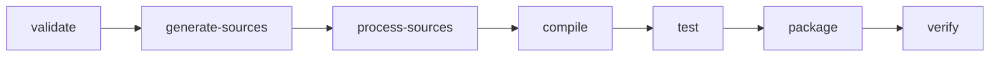
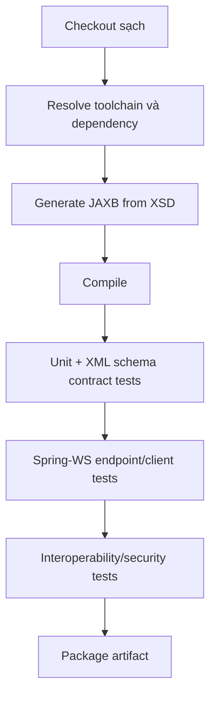

# Cấu hình Maven hoặc Gradle để sinh mã trong vòng đời build

## 1. Mục tiêu bài học

Trong một dịch vụ SOAP phát triển bằng **Spring Web Services (Spring-WS)** theo hướng **contract-first**, hợp đồng XML được định nghĩa bằng XSD/WSDL trước khi viết endpoint và client. Các lớp Java đại diện cho thông điệp SOAP được **sinh từ hợp đồng** thông qua JAXB/XJC, thay vì viết tay các DTO rồi để framework tự suy đoán XML.

Nếu một lập trình viên sinh mã trên máy cá nhân nhưng quá trình build trên CI không làm việc này, dự án có thể chỉ biên dịch được trên máy của người đó. Nếu các thành viên dùng XJC khác phiên bản, mã sinh có thể không đồng nhất; nếu đổi XSD nhưng quên sinh lại Java, ứng dụng có thể gửi/nhận thông điệp không đúng hợp đồng mới.

Bài học thuộc chương **Khởi tạo dự án** của module **SPRING_WEB_SERVICES**. Phạm vi chính là **cấu hình Maven hoặc Gradle để tự động sinh JAXB classes từ XSD trong vòng đời build**, tạo nền tảng cho thiết kế WSDL, ánh xạ JAXB, Spring-WS endpoint/SOAP client và kiểm thử tương thích liên hệ thống. Các yêu cầu SOAP Fault, interceptor, XML security, WS-Security và chứng chỉ được nhắc đến khi liên quan đến cấu hình build, dependency và kiểm tra hợp đồng.

Sau bài học, bạn có thể:

1. Giải thích vai trò của XSD, WSDL, XJC, JAXB API/runtime và thời điểm sinh mã trong Maven/Gradle.
2. Thiết lập dự án Java/Spring-WS theo hướng contract-first, tách nguồn XSD khỏi mã sinh và mã nghiệp vụ.
3. Cấu hình một ví dụ Maven dùng `jaxb2-maven-plugin` và một ví dụ Gradle dùng task `JavaExec` để gọi XJC.
4. Kết nối thư mục generated sources với compiler và xác nhận `clean build` hoạt động trên máy mới/CI.
5. Tránh lỗi trộn `javax.xml.bind` với `jakarta.xml.bind`, lẫn sinh từ XSD với sinh client từ WSDL, import schema và code generation không tái lập được.
6. Xây dựng kiểm thử phù hợp để xác minh XML sinh từ JAXB đáp ứng XSD/WSDL và được các SOAP client khác nhau hiểu đúng.

## 2. Sinh mã trong contract-first nằm ở đâu?

Một quy trình Spring-WS có thể được mô tả như sau:



Các công cụ có trách nhiệm khác nhau:

| Thành phần | Trách nhiệm | Phân biệt quan trọng |
| --- | --- | --- |
| **XSD** | Quy định QName, namespace, cấu trúc và kiểu dữ liệu XML. | Là nguồn định nghĩa payload, không phải lớp Java. |
| **WSDL** | Quy định operation, input/output, fault, SOAP binding và service address. | XJC chỉ đọc XSD; không tự biến XSD thành WSDL hoàn chỉnh. |
| **XJC** | Biên dịch XML Schema thành class, enum, `ObjectFactory`, annotation JAXB. | Đây là **build-time tool**, không phải thư viện HTTP/SOAP client. |
| **JAXB API** | Các annotation và API bind XML↔Java. | Với hệ Jakarta hiện đại, package là `jakarta.xml.bind.*`. |
| **JAXB runtime** | Thực hiện marshal/unmarshal khi ứng dụng chạy. | Sinh code thành công không tự cung cấp runtime. |
| **Spring-WS** | Nhận/gửi SOAP, định tuyến endpoint, tích hợp marshaller, interceptor, Fault. | Không tự bật schema validation, WS-Security hoặc chứng chỉ. |
| **Maven/Gradle** | Chạy XJC đúng pha/task, chuyển generated source vào compiler, đóng gói và kiểm thử. | Phải có dependency và đầu vào/đầu ra rõ ràng để build tái lập. |

**Không nên nhầm hai luồng sinh mã:**

- **XSD → JAXB Java classes:** XJC tạo các kiểu dữ liệu cho payload. Đây là nội dung chính của bài.
- **WSDL → service/client stubs:** `wsimport`, Apache CXF `wsdl2java` hoặc các công cụ của đối tác có thể đọc operation, binding và tạo proxy/client cùng model. Đây là một luồng khác, phụ thuộc stack và yêu cầu hợp đồng.

Trong một dự án Spring-WS contract-first, thông thường có thể dùng XJC để sinh payload classes, viết `@Endpoint` và `WebServiceTemplate` riêng. Nếu đối tác yêu cầu sinh proxy SOAP từ WSDL, cần lựa chọn công cụ WSDL phù hợp, không giả định XJC là `wsimport`.

## 3. Chọn nhất quán phiên bản Java, Spring-WS và JAXB

### 3.1. Phân biệt `javax` và `jakarta`

Một lỗi khởi tạo phổ biến là dùng class được sinh với annotation:

```java
import javax.xml.bind.annotation.XmlElement;
```

trong ứng dụng Spring-WS/Spring Framework hiện đại sử dụng:

```java
import jakarta.xml.bind.annotation.XmlElement;
```

Đây là **hai namespace API khác nhau**; thêm cả hai dependency có thể làm dự án biên dịch được ở vài nơi nhưng marshalling hoặc runtime không làm việc như dự kiến.

Với các dự án Spring Framework 6 / Spring-WS 4 / Spring Boot 3 (dùng Jakarta), nên chọn bộ XJC và JAXB API/runtime tạo ra `jakarta.xml.bind.*`. Với một hệ thống Spring-WS 3.x/Java EE cũ dùng `javax`, phải chọn bộ plugin, generator và runtime tương ứng thay vì sao chép nguyên cấu hình Jakarta.

JDK 11 trở lên không còn tích hợp sẵn module JAXB và công cụ `xjc`/`wsimport` như các JDK Java EE trước đó. Vì vậy, build cần khai báo công cụ sinh mã và thư viện runtime như các dependency có phiên bản rõ ràng.

### 3.2. Phiên bản trong ví dụ

Các ví dụ sau giả định **Java 17 và Jakarta JAXB**. Để minh họa một cấu hình tự chứa, bài dùng một số phiên bản dependency/plugin cụ thể; hãy coi chúng là **bộ ví dụ để kiểm chứng với BOM và môi trường dự án**, không phải khẳng định đây là bản mới nhất. Điều cần giữ cố định là khả năng tương thích của các thành phần:

| Nhóm | Vai trò trong ví dụ |
| --- | --- |
| `org.codehaus.mojo:jaxb2-maven-plugin:3.2.0` | Goal XJC trong Maven cho dự án Jakarta. |
| `org.glassfish.jaxb:jaxb-xjc:4.0.5` | Tool XJC dùng trong ví dụ Gradle. |
| `jakarta.xml.bind:jakarta.xml.bind-api:4.0.2` | JAXB API ở compile time. |
| `org.glassfish.jaxb:jaxb-runtime:4.0.5` | JAXB runtime để marshal/unmarshal. |

Khi dự án có Spring Boot BOM hoặc dependency management nội bộ, cần kiểm tra version thực sự được giải quyết, plugin compatibility và Java baseline. Không nâng plugin riêng lẻ chỉ vì phát hiện phiên bản mới nếu nó làm thay đổi namespace annotation hoặc hành vi codegen.

## 4. Chuẩn hóa cấu trúc dự án

Một dự án Spring-WS ví dụ:

```text
order-soap-service/
├── pom.xml                  # Maven (hoặc build.gradle)
├── src/
│   ├── main/
│   │   ├── java/
│   │   │   └── com/example/order/ws/
│   │   │       ├── OrderStatusEndpoint.java
│   │   │       └── OrderStatusService.java
│   │   └── resources/
│   │       ├── xsd/
│   │       │   └── order-v1.xsd
│   │       └── wsdl/
│   │           └── order-service.wsdl
│   └── test/
│       ├── java/
│       └── resources/soap/
│           ├── get-order-status-request.xml
│           └── get-order-status-response.xml
├── target/                   # Kết quả Maven, không commit
└── build/                    # Kết quả Gradle, không commit
```

Tùy công cụ build được chọn, mã sinh đặt trong một thư mục output duy nhất, ví dụ:

- Maven: `target/generated-sources/jaxb/...`.
- Gradle: `build/generated/sources/jaxb/java/main/...`.

Nguyên tắc:

1. **XSD/WSDL được review và version hóa** như mã nguồn hợp đồng.
2. **Generated sources ở thư mục build**, có thể tái tạo từ XSD và toolchain.
3. **Không chỉnh tay class JAXB được sinh**; khi cần thay đổi public contract, sửa XSD (hoặc binding file), rồi sinh lại.
4. **Không ghi generated Java vào `src/main/java`**: tránh file cũ tồn tại khi schema đổi và tránh commit code máy sinh lẫn với code nghiệp vụ.
5. Tách namespace XML công khai khỏi package Java. Package có thể là `com.example.order.contract` trong khi namespace là `urn:example:order:v1`.

Nếu dự án là multi-module, có thể tách schema + generated model vào một module chung và để service/client phụ thuộc artifact có version. Khi đó cần quản lý dependency tránh mỗi module tự sinh cùng các class theo cấu hình khác nhau.

## 5. Tạo XSD làm đầu vào sinh mã

Đặt file `src/main/resources/xsd/order-v1.xsd` với nội dung minh họa:

```xml
<?xml version="1.0" encoding="UTF-8"?>
<xs:schema
    xmlns:xs="http://www.w3.org/2001/XMLSchema"
    xmlns:ord="urn:example:order:v1"
    targetNamespace="urn:example:order:v1"
    elementFormDefault="qualified">

  <xs:simpleType name="OrderIdType">
    <xs:restriction base="xs:string">
      <xs:minLength value="1"/>
      <xs:maxLength value="40"/>
    </xs:restriction>
  </xs:simpleType>

  <xs:element name="GetOrderStatusRequest">
    <xs:complexType>
      <xs:sequence>
        <xs:element name="orderId" type="ord:OrderIdType"/>
      </xs:sequence>
    </xs:complexType>
  </xs:element>

  <xs:element name="GetOrderStatusResponse">
    <xs:complexType>
      <xs:sequence>
        <xs:element name="orderId" type="ord:OrderIdType"/>
        <xs:element name="status" type="xs:string"/>
        <xs:element name="updatedAt"
                    type="xs:dateTime"
                    minOccurs="0"/>
      </xs:sequence>
    </xs:complexType>
  </xs:element>
</xs:schema>
```

Schema có hai **global elements** thường được WSDL document/literal dùng làm request/response payload. `elementFormDefault="qualified"` yêu cầu các phần tử con thuộc namespace của hợp đồng. `updatedAt` tùy chọn, nên cần thống nhất chính sách timezone khi sử dụng.

Trong JAXB, XJC có thể tạo `GetOrderStatusRequest` và `GetOrderStatusResponse` có annotation XML, getter/setter, thông tin namespace, thứ tự phần tử cùng `ObjectFactory`. Tên class/hình dạng wrapper phụ thuộc phiên bản XJC và cấu trúc schema: khi dùng global element trỏ đến named complex type hoặc binding khác, codegen có thể sinh `JAXBElement<T>`. **Không viết mã ứng dụng phụ thuộc vào một hình dạng generated class khi chưa kiểm tra output.**

Ví dụ SOAP request phù hợp:

```xml
<soapenv:Envelope
    xmlns:soapenv="http://schemas.xmlsoap.org/soap/envelope/"
    xmlns:ord="urn:example:order:v1">
  <soapenv:Body>
    <ord:GetOrderStatusRequest>
      <ord:orderId>ORD-2026-0042</ord:orderId>
    </ord:GetOrderStatusRequest>
  </soapenv:Body>
</soapenv:Envelope>
```

Sự tương thích ở đây dựa trên **QName** (`{urn:example:order:v1}GetOrderStatusRequest`), không phải tên class Java hay prefix `ord`.

## 6. Maven: chạy XJC trong pha `generate-sources`

Maven có chuỗi pha build xác định. Khi chạy `mvn package` hoặc `mvn verify`, các pha trước đó bao gồm `generate-sources` sẽ được thực hiện:



Goal `jaxb2-maven-plugin:xjc` có thể sinh Java từ XSD trước khi Java compiler chạy. Plugin cũng cần đăng ký thư mục generated sources vào compile source roots; không chỉ tạo file trên ổ đĩa.

### 6.1. Ví dụ `pom.xml`

Đây là phần cấu hình chính của một dự án Maven Java/Jakarta. Ví dụ giả định dependency Spring-WS/Boot phù hợp đã được khai báo ở phần khác của POM hoặc quản lý bởi parent/BOM.

```xml
<project xmlns="http://maven.apache.org/POM/4.0.0"
         xmlns:xsi="http://www.w3.org/2001/XMLSchema-instance"
         xsi:schemaLocation="
           http://maven.apache.org/POM/4.0.0
           https://maven.apache.org/xsd/maven-4.0.0.xsd">
  <modelVersion>4.0.0</modelVersion>

  <groupId>com.example</groupId>
  <artifactId>order-soap-service</artifactId>
  <version>1.0.0</version>

  <properties>
    <maven.compiler.release>17</maven.compiler.release>
    <project.build.sourceEncoding>UTF-8</project.build.sourceEncoding>
    <jakarta.jaxb.api.version>4.0.2</jakarta.jaxb.api.version>
    <jaxb.runtime.version>4.0.5</jaxb.runtime.version>
  </properties>

  <dependencies>
    <dependency>
      <groupId>jakarta.xml.bind</groupId>
      <artifactId>jakarta.xml.bind-api</artifactId>
      <version>${jakarta.jaxb.api.version}</version>
    </dependency>
    <dependency>
      <groupId>org.glassfish.jaxb</groupId>
      <artifactId>jaxb-runtime</artifactId>
      <version>${jaxb.runtime.version}</version>
      <scope>runtime</scope>
    </dependency>

    <!-- Trong dự án thực tế, bổ sung Spring-WS/Boot starter
         và các dependency nghiệp vụ được quản lý thống nhất. -->
  </dependencies>

  <build>
    <plugins>
      <plugin>
        <groupId>org.codehaus.mojo</groupId>
        <artifactId>jaxb2-maven-plugin</artifactId>
        <version>3.2.0</version>

        <executions>
          <execution>
            <id>generate-order-jaxb</id>
            <phase>generate-sources</phase>
            <goals>
              <goal>xjc</goal>
            </goals>
          </execution>
        </executions>

        <configuration>
          <sources>
            <source>src/main/resources/xsd/order-v1.xsd</source>
          </sources>
          <packageName>com.example.order.contract</packageName>
          <outputDirectory>${project.build.directory}/generated-sources/jaxb</outputDirectory>
          <encoding>UTF-8</encoding>
        </configuration>
      </plugin>
    </plugins>
  </build>
</project>
```

Giải thích:

| Khối | Vai trò |
| --- | --- |
| `<sources>` | Chỉ định file XSD đầu vào. Những XSD được `xs:include`/`xs:import` phải có thể resolve. |
| `<phase>generate-sources</phase>` | Chạy sinh mã trước biên dịch Java. |
| `<goal>xjc</goal>` | Gọi XJC, không phải công cụ sinh WSDL từ Java. |
| `<packageName>` | Chọn Java package cho mã sinh trong ví dụ một namespace. |
| `<outputDirectory>` | Đặt output trong `target` để `clean` loại bỏ generated files. |
| `jakarta.xml.bind-api` | Cung cấp annotation và API dùng lúc compile. |
| `jaxb-runtime` | Cung cấp triển khai JAXB khi marshal/unmarshal ở runtime. |

Với nhiều namespace XSD, ép tất cả vào cùng một `packageName` có thể gây đụng tên class. Khi đó hãy dùng binding file `.xjb` để ánh xạ package theo từng namespace, hoặc tổ chức nhiều execution/module với output độc lập; cần giữ đúng version binding tương ứng JAXB runtime/tool.

### 6.2. Thử build Maven

Các lệnh kiểm tra thường dùng:

```bash
mvn clean generate-sources
mvn clean compile
mvn clean verify
```

Kiểm tra đầu ra dự kiến:

```text
target/
└── generated-sources/
    └── jaxb/
        └── com/example/order/contract/
            ├── GetOrderStatusRequest.java
            ├── GetOrderStatusResponse.java
            ├── ObjectFactory.java
            └── package-info.java
```

Danh sách file chính xác tùy schema/tooling. Khi `mvn clean compile` hoạt động từ repository chưa có generated Java, vòng đời build đã chứa bước sinh mã cần thiết. Khi `mvn clean verify` thành công trên CI, có thể kiểm tra thêm marshalling và contract tests.

Không nên cần chạy một lệnh XJC thủ công trước `mvn compile`. Nếu thiếu class chỉ vì chưa “Generate Sources” trên IDE, cấu hình build chưa tái lập hoặc IDE chưa import source root đúng cách.

## 7. Gradle: tạo task XJC và nối vào task graph

Gradle hoạt động bằng **task graph**, không dùng cùng tên pha với Maven. Để sinh JAXB trước biên dịch:

1. Khai báo configuration chứa XJC tool riêng với runtime của ứng dụng.
2. Tạo task `JavaExec` gọi XJC bằng classpath tool.
3. Khai báo file XSD đầu vào và thư mục Java output.
4. Thêm generated directory vào `sourceSets.main.java`.
5. Cho `compileJava` phụ thuộc task sinh mã.

### 7.1. Ví dụ `build.gradle` dùng Groovy DSL

Ví dụ sau giả định dự án sử dụng Gradle hỗ trợ Java toolchain, có plugin `java` và Java 17. Nếu dự án sử dụng Kotlin DSL (`build.gradle.kts`), cú pháp sẽ khác.

```groovy
plugins {
    id 'java'
}

java {
    toolchain {
        languageVersion = JavaLanguageVersion.of(17)
    }
}

repositories {
    mavenCentral()
}

configurations {
    xjc
}

dependencies {
    // Tool dùng lúc build, tách khỏi classpath ứng dụng.
    xjc 'org.glassfish.jaxb:jaxb-xjc:4.0.5'

    // API và runtime JAXB của ứng dụng Jakarta.
    implementation 'jakarta.xml.bind:jakarta.xml.bind-api:4.0.2'
    runtimeOnly 'org.glassfish.jaxb:jaxb-runtime:4.0.5'

    // Bổ sung dependency Spring-WS và test của dự án thực tế.
}

def generatedJaxbDir =
        layout.buildDirectory.dir('generated/sources/jaxb/java/main')
def orderSchema = file('src/main/resources/xsd/order-v1.xsd')

tasks.register('generateJaxb', JavaExec) {
    group = 'code generation'
    description = 'Generate Jakarta JAXB classes from XSD'

    classpath = configurations.xjc
    mainClass = 'com.sun.tools.xjc.XJCFacade'

    // Theo dõi cả schema được include/import trong cùng thư mục.
    inputs.files(fileTree('src/main/resources/xsd') {
        include '**/*.xsd'
        include '**/*.xjb'
    })
    outputs.dir(generatedJaxbDir)

    // Chỉ xóa output thuộc riêng task này khi task thực thi.
    doFirst {
        delete(generatedJaxbDir.get().asFile)
        generatedJaxbDir.get().asFile.mkdirs()
    }

    args '-d', generatedJaxbDir.get().asFile.absolutePath,
         '-p', 'com.example.order.contract',
         '-encoding', 'UTF-8',
         orderSchema.absolutePath
}

sourceSets {
    main {
        java {
            srcDir generatedJaxbDir
        }
    }
}

tasks.named('compileJava') {
    dependsOn tasks.named('generateJaxb')
}
```

**Lưu ý về phạm vi ví dụ:** `com.sun.tools.xjc.XJCFacade` là entry point của bộ công cụ XJC được khai báo; kiểm tra lại khi thay phiên bản XJC. Ví dụ tập trung vào sinh mã, chưa bao gồm plugin Spring Boot/Spring-WS và cấu hình publish artifact của dự án.

Các khai báo quyết định:

| Cấu hình | Ý nghĩa |
| --- | --- |
| `configurations.xjc` | Tách build-time XJC khỏi dependency runtime. |
| `inputs.files(...)` | Cho Gradle biết XSD và binding files nào làm thay đổi kết quả. |
| `outputs.dir(...)` | Cho Gradle biết output task sở hữu để xác định up-to-date. |
| `JavaExec`/`mainClass` | Thực thi XJC bằng classpath có version. |
| `sourceSets.main.java.srcDir` | Đưa generated Java vào compile source set. |
| `compileJava.dependsOn(generateJaxb)` | Bảo đảm task sinh mã chạy trước compiler. |

Câu lệnh `delete(generatedJaxbDir...)` nằm trong task và chỉ nhắm **thư mục build do chính task sở hữu**. Nó giúp tránh class Java cũ tiếp tục tồn tại khi một element/type bị xóa hoặc đổi tên trong XSD. Không bao giờ dùng logic xóa rộng hơn thư mục output dành riêng cho XJC.

Với project có nhiều task sinh mã, mỗi task phải có output riêng; không cho hai task đồng thời ghi cùng một directory. Đối với build lớn, nên cân nhắc plugin XJC chuyên dụng có hỗ trợ Gradle incremental/cache thay vì tự duy trì `JavaExec` phức tạp.

### 7.2. Chạy và kiểm tra Gradle

```bash
./gradlew clean generateJaxb
./gradlew clean compileJava
./gradlew clean build
```

Trên Windows, có thể chạy wrapper tương ứng:

```powershell
.\gradlew.bat clean build
```

Thư mục Java được kỳ vọng:

```text
build/
└── generated/
    └── sources/
        └── jaxb/
            └── java/
                └── main/
                    └── com/example/order/contract/
                        ├── GetOrderStatusRequest.java
                        ├── GetOrderStatusResponse.java
                        ├── ObjectFactory.java
                        └── package-info.java
```

Không cần commit mã này. Khi `./gradlew clean build` hoạt động trên máy/CI sạch, task graph đã đủ để tái tạo mã JAXB. Nếu Gradle báo task up-to-date sau khi XSD đổi, hãy kiểm tra `inputs`: XSD được import ở ngoài cây được khai báo có thể chưa được theo dõi.

### 7.3. Gradle và tính tái lập

Khi thêm XSD từ thư mục khác hoặc dùng binding file `.xjb`:

- Bổ sung chúng vào `inputs.files` và bảo đảm XJC nhận được qua schema import hoặc tham số `-b`.
- Không dùng đường dẫn tuyệt đối tới thư mục máy cá nhân.
- Cố định phiên bản XJC, JVM/toolchain và các plugin liên quan.
- Xác nhận `outputs.dir` chỉ chứa output của task này.
- Bổ sung test đối chiếu XML thực; Gradle up-to-date chỉ nói rằng inputs/outputs không đổi theo cấu hình đã khai báo, không chứng minh payload đúng contract.

## 8. Maven và Gradle: hai cách nối cùng một luồng

| Vấn đề | Maven | Gradle |
| --- | --- | --- |
| Điểm kích hoạt | Goal `xjc` gắn với `generate-sources`. | Task `generateJaxb` được `compileJava` phụ thuộc. |
| Khai báo XSD đầu vào | `<sources>`. | `inputs.files(...)` + tham số XJC. |
| Thư mục đầu ra | `target/generated-sources/jaxb`. | `build/generated/sources/jaxb/java/main`. |
| Nối vào compiler | Plugin thường đăng ký compile source root. | Thêm `srcDir` vào Java source set. |
| Tách dependency tool | Maven plugin có tool classpath riêng. | Configuration `xjc` riêng. |
| Clean build | `mvn clean verify`. | `./gradlew clean build`. |
| Khi schema đổi | Plugin sinh lại khi goal chạy theo cấu hình. | Inputs/outputs giúp Gradle đánh giá task up-to-date. |
| Khả năng mở rộng | Execution, binding files, nhiều module. | Nhiều task/source set hoặc plugin chuyên dụng. |

Không có yêu cầu phải chọn cả hai trong cùng một dự án. Chọn công cụ build chính của repository và dùng nó làm nguồn chuẩn để CI, IDE và các thành viên tái tạo generated code.

## 9. WSDL được xử lý ở đâu trong quá trình build?

XJC chỉ tạo model JAXB từ XSD. WSDL mô tả các operation, SOAPAction, binding, Fault và endpoint address. Có một số mô hình triển khai:

### 9.1. WSDL tĩnh theo hợp đồng đã ký

Đối tác cung cấp hoặc hai bên thống nhất một WSDL phiên bản hóa. Đặt WSDL cùng XSD dưới resources, phân phối đầy đủ các `xs:import`/`wsdl:import` và kiểm thử để không có sai khác giữa code và contract.

Phù hợp khi cần giữ nguyên operation, fault và chính sách binding mà không phụ thuộc vào quy tắc tự sinh.

### 9.2. Spring-WS công bố WSDL từ XSD

Spring-WS hỗ trợ kiểu cấu hình như `DefaultWsdl11Definition` để tạo WSDL 1.1 dựa vào XSD và quy tắc đặt tên. Ví dụ khái niệm:

```java
@Bean(name = "orders")
public DefaultWsdl11Definition ordersWsdl(XsdSchema orderSchema) {
    DefaultWsdl11Definition wsdl = new DefaultWsdl11Definition();
    wsdl.setPortTypeName("OrdersPort");
    wsdl.setLocationUri("/ws");
    wsdl.setTargetNamespace("urn:example:order:v1");
    wsdl.setSchema(orderSchema);
    return wsdl;
}
```

Cần thêm bean `XsdSchema` và cấu hình Spring-WS phù hợp trước khi chạy. Đây là ví dụ rút gọn cho cách công bố WSDL, **không phải bước XJC trong Maven/Gradle**.

Các tên operation được suy ra từ các convention mà `DefaultWsdl11Definition` hỗ trợ; nếu yêu cầu hợp đồng có typed Fault, SOAPAction hoặc binding đặc biệt, phải kiểm tra WSDL sinh ra có đáp ứng hay không. Đừng mặc định sơ đồ XSD đủ tạo ra mọi thành phần WSDL đúng yêu cầu đối tác.

### 9.3. Sinh client Java từ WSDL là bài toán khác

Nếu muốn tạo client proxy từ WSDL, hãy đánh giá `wsimport` hoặc plugin CXF `wsdl2java` tương ứng với Jakarta/Java và SOAP stack đang sử dụng. Kết quả có thể bao gồm operation stubs, service interfaces và model JAXB. Không nên vừa dùng XJC, vừa dùng công cụ WSDL-to-Java để sinh **trùng cùng bộ model class** trong một package/output directory mà chưa có chiến lược loại bỏ trùng lặp.

## 10. Kết nối JAXB classes với Spring-WS endpoint và client

### 10.1. Endpoint dùng QName từ XSD

Ví dụ endpoint theo phần tử gốc `GetOrderStatusRequest`:

```java
@Endpoint
public class OrderStatusEndpoint {

    private static final String NS = "urn:example:order:v1";
    private final OrderStatusService service;

    public OrderStatusEndpoint(OrderStatusService service) {
        this.service = service;
    }

    @PayloadRoot(namespace = NS,
                 localPart = "GetOrderStatusRequest")
    @ResponsePayload
    public GetOrderStatusResponse getStatus(
            @RequestPayload GetOrderStatusRequest request) {

        OrderStatus result = service.lookup(request.getOrderId());

        GetOrderStatusResponse response = new GetOrderStatusResponse();
        response.setOrderId(result.orderId());
        response.setStatus(result.status());
        return response;
    }
}
```

Ví dụ này giả định XJC sinh các lớp có thể dùng trực tiếp cho phần tử toàn cục như schema mẫu, `OrderStatusService` và `OrderStatus` là model ứng dụng giả định. Nếu XJC sinh `JAXBElement<T>`, chữ ký endpoint và mã tạo response phải dùng wrapper tương ứng; hãy kiểm tra `ObjectFactory` được sinh trong project.

Spring-WS cần cấu hình marshaller/unmarshaller để ánh xạ JAXB, chẳng hạn `Jaxb2Marshaller` phù hợp phiên bản Spring Framework/Jakarta của ứng dụng. Tầng nghiệp vụ nên độc lập với JAXB generated model; một mapper giữa domain và contract giúp giữ ổn định public XML khi sửa backend.

### 10.2. Client gửi payload bằng `WebServiceTemplate`

Luồng khái niệm:

```java
Jaxb2Marshaller marshaller = new Jaxb2Marshaller();
marshaller.setContextPath("com.example.order.contract");
// Thiết lập/khởi tạo marshaller theo Spring context thực tế.

WebServiceTemplate template = new WebServiceTemplate(marshaller);

GetOrderStatusRequest request = new GetOrderStatusRequest();
request.setOrderId("ORD-2026-0042");

Object result = template.marshalSendAndReceive(
        "https://partner.example.invalid/ws",
        request,
        new SoapActionCallback("urn:GetOrderStatus"));
```

Đây là **minh họa kiến trúc client**, không phải đoạn runnable hoàn chỉnh. Trong ứng dụng thực tế, nên khai báo `Jaxb2Marshaller` và `WebServiceTemplate` làm bean, cấu hình transport, timeout, TLS/mTLS nếu có, security interceptor, error handling và SOAPAction theo WSDL. Các version Spring có cách khởi tạo/constructor phù hợp riêng; ví dụ trên không thay thế cấu hình bean đầy đủ.

Cần xác minh object được marshal có root QName đúng. Nếu lớp sinh không có `@XmlRootElement`, phải tạo `JAXBElement` bằng `ObjectFactory`. Thành công khi code Java biên dịch **không đảm bảo** request XML khớp WSDL.

## 11. Binding files khi cần điều chỉnh mã sinh

XJC cho phép dùng JAXB external binding file `.xjb` để điều chỉnh package, tên class/property hoặc quy tắc bind mà vẫn giữ XSD public contract.

Tình huống thường gặp:

- Nhiều namespace XSD tạo class cùng tên và gây xung đột package.
- Cần tên Java khác tên XML nhưng QName công khai phải giữ nguyên.
- Muốn quy chuẩn mapping cho date/time hoặc kiểu riêng, với adapter được quản lý kiểm thử.
- Một schema của đối tác không được phép sửa nhưng cần mapping Java phù hợp dự án.

Trong JAXB Jakarta, cú pháp namespace/version của binding file khác một số cấu hình JAXB `javax` cũ. Không sao chép một `.xjb` của JAXB 2.x vào XJC 4.x rồi cho rằng chắc chắn tương thích.

Các nguyên tắc:

1. Lưu `.xjb` cùng hợp đồng hoặc thư mục build config có version control.
2. Khai báo binding file như input của task/goal XJC và chắc chắn XJC thực sự sử dụng nó.
3. Giữ tên XML public không đổi nếu chỉ cần điều chỉnh Java model.
4. Nếu thay phiên bản XJC, chạy lại codegen và kiểm tra diff của generated model, JAXB annotations và XML round-trip.
5. Chỉ dùng custom adapter khi thật sự cần; quá nhiều adapter tăng rủi ro client hiểu khác hợp đồng.

## 12. Multi-module và nhiều schema

Với hệ thống doanh nghiệp lớn, thường có XSD theo namespace/domain:

```text
contract-model/
  src/main/resources/xsd/
    common-v1.xsd
    payment-v1.xsd
    customer-v1.xsd
soap-service/
  (depends on contract-model)
soap-client/
  (depends on contract-model)
```

Một hướng triển khai là build module `contract-model` trước để sinh và đóng gói JAXB classes thành artifact versioned. Service và client Java sử dụng dependency đó; đối tác ngôn ngữ khác sử dụng XSD/WSDL tương đương.

Cần chú ý:

- Không để hai module tự sinh cùng class vào cùng package nhưng phiên bản schema khác nhau trên classpath.
- Quản lý các file `xs:import` bằng URI namespace, `schemaLocation` và artifact distribution đáng tin cậy.
- Tách output theo namespace/task nếu cần thay vì dùng ép `-p` cho mọi schema.
- Gắn version của artifact Java model với version XSD/WSDL và quy định breaking change.
- Tổ chức test contract độc lập để kiểm tra XML payload ở cả service và client.

## 13. Kiểm thử sinh mã và kiểm thử hợp đồng là hai lớp khác nhau

Sau khi bảo đảm build tự sinh Java, phải kiểm tra các lớp đó tạo/đọc XML đúng hợp đồng.

| Lớp kiểm tra | Mục đích | Ví dụ |
| --- | --- | --- |
| Clean build | Không phụ thuộc generated code có sẵn ở máy lập trình viên. | `mvn clean verify` hoặc `./gradlew clean build` từ checkout sạch. |
| Build-time generated code | Có class, package, annotations Jakarta đúng. | Kiểm tra `target/...` hoặc `build/generated/...`. |
| Schema validation | XML JAXB được tạo khớp XSD. | Round-trip request/response với validator. |
| Endpoint test | Spring-WS map đúng `@PayloadRoot` và trả đúng SOAP body. | Gửi XML request mẫu, so QName và nội dung response. |
| SOAP Fault test | Fault code/detail đúng hợp đồng. | Lỗi validation, lỗi nghiệp vụ, lỗi backend. |
| Client interoperability | Stack đối tác đọc WSDL và XML thực. | Client Java/.NET/Zeep thử payload biên. |
| Security/policy test | WS-Security và TLS/mTLS tương thích. | Chữ ký, chứng chỉ, timestamp, replay theo policy. |

### 13.1. Ví dụ ca validation bắt buộc

Đối với `order-v1.xsd`, tạo bộ XML gồm:

1. Request hợp lệ với `orderId` là `ORD-2026-0042`.
2. Request thiếu `orderId` → sai schema.
3. Request có phần tử con `orderId` không thuộc namespace hợp đồng → sai QName.
4. Response thiếu `status` → sai schema.
5. Response đặt `updatedAt` trước `status` → sai `xs:sequence`.
6. Response có `updatedAt` là giá trị `xs:dateTime` không hợp lệ → sai kiểu.
7. SOAP envelope sai phiên bản so với binding WSDL → bị từ chối theo chính sách SOAP.
8. Client nhận status chưa biết → hành vi fallback theo hợp đồng, không crash.

Bước validation có thể dùng `PayloadValidatingInterceptor` trong Spring-WS hoặc validator riêng trong test. Dù cách nào, nên test trên **XML thật** sau marshal/unmarshal. Một object Java đúng giá trị chưa chắc sinh QName hoặc thứ tự phần tử đúng.

### 13.2. Kiểm tra hợp đồng từ pipeline

CI có thể gồm các job/steps theo thứ tự:



Trong thực tế, Maven/Gradle sẽ thực hiện nhiều bước tự động trong một lệnh `verify`/`build` nếu task/goal/test được gắn đúng lifecycle. CI không nên có bước thủ công sinh code ngoài hệ thống build chính.

## 14. Các lỗi cấu hình thường gặp và hướng khắc phục

| Triệu chứng | Nguyên nhân nên kiểm tra | Cách xử lý |
| --- | --- | --- |
| `package jakarta.xml.bind.annotation does not exist` | Thiếu JAXB API hoặc dependency đúng scope. | Bổ sung `jakarta.xml.bind-api` tương thích. |
| `package javax.xml.bind.annotation does not exist` | Codegen phát annotation `javax` trong ứng dụng Jakarta. | Đồng bộ phiên bản XJC/plugin và Jakarta runtime; không trộn hai API. |
| `ClassNotFoundException` liên quan JAXB lúc chạy | Có API nhưng thiếu JAXB runtime, hoặc dependency bị loại bởi packaging. | Kiểm tra runtime classpath và `jaxb-runtime`. |
| `cannot find symbol GetOrderStatusRequest` | Sinh mã chưa chạy, sai package, source root chưa được đăng ký. | Kiểm tra lifecycle/task graph, output và source set. |
| `xjc` chạy từ IDE nhưng CI không chạy | IDE action không thuộc build chính. | Gắn goal/task vào `generate-sources`/`compileJava.dependsOn`. |
| Build thành công dù XSD bị xóa type | Class Java generated cũ còn trong output. | Sinh vào thư mục build riêng, clean output của task; kiểm tra clean build. |
| XJC báo không resolve `xs:import` | Sai schemaLocation hoặc thiếu file phụ thuộc. | Phân phối đủ schema, dùng đường dẫn tương đối/catalog, theo dõi inputs. |
| Hai class cùng QName hoặc cùng Java name | Nhiều schema/package mapping đụng nhau. | Dùng `.xjb` package mapping hoặc tách module/task. |
| SOAP payload không định tuyến vào endpoint | QName root không khớp `@PayloadRoot` hoặc JAXB wrapper sai. | So XML thực, namespace, ObjectFactory và XSD. |
| SOAP client lỗi dù Java compile | WSDL binding/SOAPAction/security không khớp. | Kiểm tra SOAP version, Fault, SOAPAction, header, chứng chỉ. |
| Gradle luôn chạy lại XJC | Inputs/outputs không ổn định, task bị đánh dấu không incremental. | Kiểm tra paths, output ownership, version tool và task configuration. |
| Gradle bỏ qua XJC khi import đổi | File import không nằm trong `inputs`. | Đưa tất cả schema/binding phụ thuộc vào inputs hoặc dùng plugin quản lý graph. |

### 14.1. Vì sao không sửa lỗi bằng cách commit generated sources?

Commit generated sources có thể tạm làm IDE/CI không lỗi vì thiếu class, nhưng che giấu việc build chưa quản lý đầy đủ quá trình sinh mã. Nó cũng tạo nguy cơ XSD và Java model lệch nhau.

Trường hợp một tổ chức **chủ đích** kiểm soát generated sources trong VCS vì quy trình phát hành đặc thù, phải có CI đối chiếu kết quả tái sinh, version generator và quy tắc cập nhật nghiêm ngặt. Với phần lớn dự án Spring-WS thông thường, sinh mã tự động vào `target`/`build` là cách dễ kiểm soát hơn.

## 15. Tính tái lập và an toàn trong build

Sinh mã là một phần của chuỗi cung ứng phần mềm. Một cấu hình ổn định nên:

- **Pin phiên bản** của XJC/plugin, Java toolchain, JAXB API/runtime; sử dụng dependency lock/BOM khi hệ thống cần.
- Sử dụng **Maven Wrapper/Gradle Wrapper** nếu dự án cung cấp, để local và CI dùng cùng phiên bản công cụ build.
- Tránh tải XSD từ URL không tin cậy lúc build; package các hợp đồng ngoài hoặc sử dụng kho artifact có xác thực.
- Kiểm soát XML external entities, DTD và schema import khi xử lý tài liệu từ bên ngoài.
- Không ghi generated code ra ngoài thư mục được task sở hữu.
- Chạy clean build định kỳ và kiểm tra source output không chứa file cũ.
- Không để credential/chứng chỉ riêng tư trong XSD/WSDL, generated sources hay commit; keystore được quản lý riêng và cấu hình qua môi trường an toàn.
- Nếu có WS-Security, kiểm thử chữ ký, certificate trust, timestamp và chính sách tương thích theo cấu hình runtime.
- Phân biệt rõ phát hành **contract artifact** (XSD/WSDL), **generated Java model** và **service implementation** vì chúng có vòng đời khác nhau.

Với CI sử dụng cache, đầu vào cache phải xét version generator, binding file, schema import, JVM liên quan và các tùy chọn codegen. Một cache chỉ dựa trên thời gian sửa file XSD chính có thể tái sử dụng mã lỗi thời khi XSD import hoặc plugin đổi.

## 16. Quy trình mẫu từ checkout mới đến SOAP endpoint chạy được

1. **Đặt XSD/WSDL vào source control**: xác nhận target namespace, global request/response elements, SOAP version và các imports.
2. **Chọn một hệ build**: Maven hoặc Gradle; đồng bộ Java/Jakarta và phụ thuộc Spring-WS.
3. **Khai báo XJC trong build**: Maven `generate-sources` hoặc Gradle `generateJaxb` + `compileJava.dependsOn`.
4. **Sinh generated sources vào output của build**: kiểm tra package, class, ObjectFactory và annotation.
5. **Compile endpoint và SOAP client**: sử dụng JAXB model được sinh, tránh codegen trùng lặp.
6. **Bật và test schema validation/Fault**: request/response XML, QName, thứ tự, kiểu dữ liệu và lỗi hợp đồng.
7. **Kiểm tra security/interop nếu có**: XML parser, WS-Security, TLS/mTLS, chứng chỉ, SOAPAction và binding đối tác.
8. **Chạy clean build trên CI**: không cần bước thao tác bằng tay hay generated Java đã commit.
9. **Phát hành artifact có version**: service và XSD/WSDL dùng cùng contract version; có kế hoạch nâng cấp client.

## 17. Bài tập tự thực hành

### Bài tập 1: xác nhận Maven lifecycle

Tạo một dự án Maven với `order-v1.xsd` và `jaxb2-maven-plugin`. Chạy `mvn clean compile` từ checkout chưa có Java generated. Xác nhận source classes nằm trong `target/generated-sources/jaxb` và được compiler nhận. Xóa một phần tử trong XSD, chạy clean build và kiểm tra class/property tương ứng không còn.

### Bài tập 2: nối Gradle task graph

Cấu hình `generateJaxb` bằng `JavaExec`, thêm `inputs`/`outputs` và `sourceSets`. Chạy `./gradlew clean build`, rồi chạy lại `./gradlew build` khi không đổi XSD. Quan sát task up-to-date; sửa file XSD import và kiểm tra generator có được chạy lại không.

### Bài tập 3: thử tương thích Jakarta/JAXB

Kiểm tra các import annotation trong generated classes. Nếu dự án mục tiêu dùng Spring-WS Jakarta, xác nhận chúng thuộc `jakarta.xml.bind.annotation`. Thử marshal request và validate với XSD, sau đó thử client SOAP của công nghệ khác.

### Bài tập 4: mô phỏng sai lệch hợp đồng

Cố ý thay namespace của `GetOrderStatusRequest` trong XML mà không đổi XSD; kiểm tra endpoint/validator từ chối theo cách đã công bố. Sau đó thay XSD để thêm trường required; giải thích vì sao client cũ có thể bị phá vỡ và lập kế hoạch version hóa.

### Bài tập 5: phân biệt XJC và WSDL-to-Java

Dùng XJC chỉ với XSD và liệt kê kiểu Java sinh ra. So sánh với một công cụ WSDL-to-Java phù hợp Java/Jakarta chạy trên WSDL có operation, binding và fault. Xác định những class/stub nào chỉ xuất hiện ở bước WSDL-to-Java và cách tránh sinh model trùng lặp.

## 18. Checklist triển khai

- [ ] XSD/WSDL là nguồn hợp đồng đã review, có version và import resolve được.
- [ ] Build chọn đúng Jakarta/`javax` theo Spring-WS và phiên bản Java.
- [ ] XJC có phiên bản được pin, chạy tự động trong Maven/Gradle.
- [ ] Generated Java nằm trong `target`/`build`, không bị chỉnh tay.
- [ ] Thư mục generated sources được compiler nhận đúng cách.
- [ ] Gradle inputs gồm schema import/binding files; các task có output độc lập.
- [ ] Maven `clean compile` hoặc Gradle `clean build` hoạt động khi chưa có generated sources.
- [ ] JAXB API/runtime và Spring-WS phụ thuộc được quản lý nhất quán.
- [ ] Spring-WS endpoint và SOAP client marshal/unmarshal đúng QName/payload.
- [ ] Schema validation, SOAP Fault, SOAPAction và binding được kiểm thử bằng XML thật.
- [ ] Security, interceptor, WS-Security và chứng chỉ được kiểm tra nếu hợp đồng yêu cầu.
- [ ] CI tái tạo mã và kiểm thử contract không cần bước sinh mã thủ công.
- [ ] Có quy tắc nâng version schema/toolchain và kiểm thử client cũ.

## 19. Kết luận

Cấu hình Maven hoặc Gradle để sinh JAXB code trong vòng đời build là một bước quan trọng của **khởi tạo dự án Spring Web Services theo hướng contract-first**. Maven dùng pha `generate-sources` và goal XJC; Gradle dùng task code generation được nối vào `compileJava`. Cả hai đều cần khai báo nguồn XSD, dependency tool, output generated sources và Java source root sao cho một clean build từ repository mới có thể tái tạo mã giống nhau.

Một pipeline tốt còn phải giữ XSD/WSDL và Java model đồng bộ, chọn chính xác `jakarta` hay `javax`, quản lý phiên bản generator và xác minh SOAP XML thực qua endpoint/client. Nhờ đó, bước sinh mã phục vụ hợp đồng doanh nghiệp ổn định, dễ kiểm thử tương thích và an toàn khi triển khai, thay vì trở thành một thao tác riêng trên máy của từng lập trình viên.
