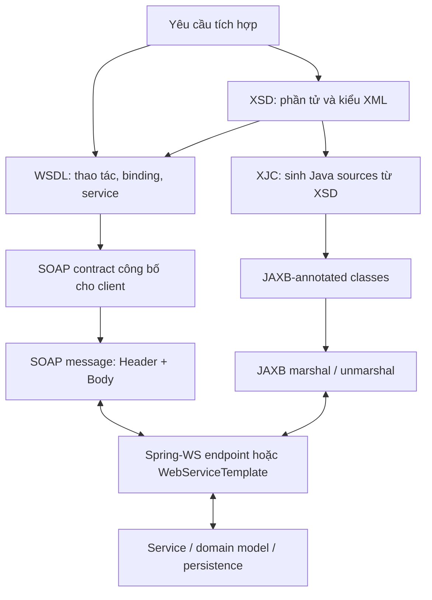
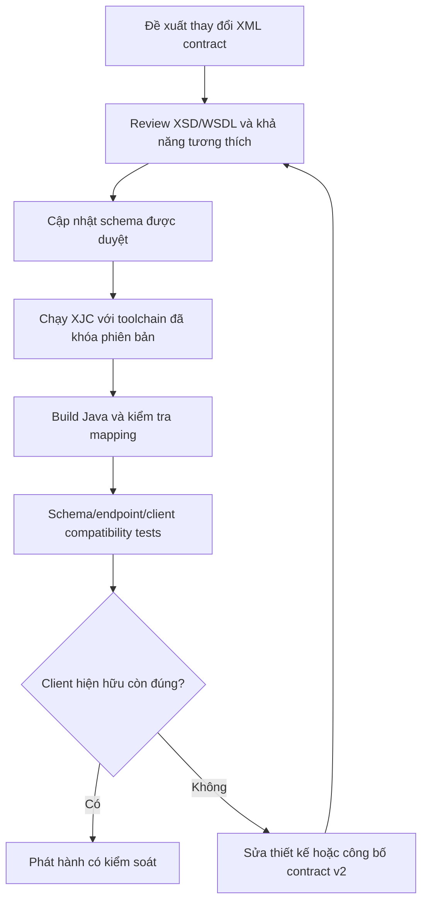

# Vai trò của JAXB và công cụ XJC trong thiết kế contract-first

## 1. Đặt JAXB và XJC vào đúng vị trí trong Spring Web Services

Khi phát triển SOAP service với **Spring Web Services (Spring-WS)** theo hướng **contract-first**, nhóm tích hợp thống nhất cấu trúc XML trước khi xây dựng mã Java. **XML Schema (XSD)** định nghĩa tên phần tử, namespace, kiểu dữ liệu và các ràng buộc; **WSDL** mô tả thao tác, thông điệp và cách truy cập dịch vụ. Ứng dụng sau đó cần chuyển đổi giữa XML trao đổi trên đường truyền và đối tượng Java phục vụ endpoint hoặc SOAP client.

Hai công nghệ đảm nhận hai công việc liên quan nhưng **khác nhau**:

- **JAXB (Java Architecture for XML Binding; hiện thuộc hệ Jakarta XML Binding)** là cơ chế **ánh xạ Java object ↔ XML**. Ở runtime, marshaller tạo XML từ object, còn unmarshaller đọc XML thành object. JAXB dùng metadata, annotation hoặc các cấu hình binding thích hợp.
- **XJC (XML-to-Java Compiler)** là **công cụ sinh mã Java từ XSD**. Nó chuyển một phần định nghĩa schema thành các lớp, enum, factory và annotation JAXB để giảm công việc viết mã ánh xạ thủ công.

XJC không phải SOAP server, không tự gửi HTTP request, không tạo SOAP Envelope, không xử lý SOAP Fault và cũng không phải bộ máy chuyển đổi XML tại runtime. **XJC chạy ở bước sinh mã; JAXB chạy khi ứng dụng marshal/unmarshal.**

### 1.1. Mục tiêu học tập

Sau bài này, bạn có thể:

1. Vẽ được luồng **XSD → XJC → JAXB classes → Spring-WS endpoint/client** và giải thích WSDL nằm ở đâu.
2. Phân biệt công việc của XJC lúc build với JAXB lúc chạy.
3. Nhận ra các class sinh thường gặp như `GetOrderRequest`, `GetOrderResponse`, enum, `ObjectFactory` và `package-info.java`.
4. Giải thích ảnh hưởng của namespace, global element, named complex type, `JAXBElement`, `minOccurs`, `nillable`, enumeration và kiểu ngày/tiền.
5. Tổ chức bước generate mã có thể tái lập, tránh sửa file sinh và tránh nhầm API `javax.xml.bind` với `jakarta.xml.bind`.
6. Áp dụng JAXB ở ranh giới của Spring-WS trong khi vẫn kiểm tra schema, bảo mật, SOAP Fault và khả năng tương thích hợp đồng.

### 1.2. Luồng tổng thể



Một cách tóm tắt quan hệ:

| Thành phần | Đầu vào | Đầu ra / trách nhiệm | Thời điểm |
| --- | --- | --- | --- |
| **XSD** | Yêu cầu nghiệp vụ, quy tắc XML | Các phần tử, kiểu, namespace và ràng buộc của payload | Thiết kế hợp đồng |
| **WSDL** | Giao diện dịch vụ và XSD | Mô tả operation, message, binding, port/address | Thiết kế và công bố hợp đồng |
| **XJC** | Một hoặc nhiều XSD, tùy chọn binding customization | Mã Java đã gắn JAXB metadata | Generate-sources/build |
| **JAXB runtime** | Java objects hoặc XML cùng binding metadata | Marshal/unmarshal XML và Java objects | Khi ứng dụng chạy |
| **Spring-WS** | SOAP messages và cấu hình endpoint/client | Định tuyến, xử lý và gửi/nhận SOAP | Khi ứng dụng chạy |

**Lưu ý:** XJC có thể được gọi trực tiếp trên XSD, trong khi một công cụ kiểu **JAX-WS `wsimport`** thường xuất phát từ WSDL và có thể tạo thêm client artifacts. Đây là các công cụ khác nhau. Trong mô hình Spring-WS contract-first, không cần viết một interface JAX-WS chỉ để có các lớp JAXB cho payload.

## 2. Bắt đầu từ XML contract, không phải từ Java entity

Giả sử dịch vụ SOAP `GetOrder` có yêu cầu nhận mã đơn hàng và phản hồi trạng thái cùng tổng tiền. Namespace công khai là `https://example.com/orders/v1`.

File ví dụ `src/main/resources/xsd/orders.xsd`:

```xml
<?xml version="1.0" encoding="UTF-8"?>
<xs:schema xmlns:xs="http://www.w3.org/2001/XMLSchema"
           xmlns:ord="https://example.com/orders/v1"
           targetNamespace="https://example.com/orders/v1"
           elementFormDefault="qualified">

    <xs:simpleType name="OrderIdType">
        <xs:restriction base="xs:string">
            <xs:minLength value="1"/>
            <xs:maxLength value="40"/>
        </xs:restriction>
    </xs:simpleType>

    <xs:simpleType name="PublicOrderStatusType">
        <xs:restriction base="xs:string">
            <xs:enumeration value="PENDING"/>
            <xs:enumeration value="CONFIRMED"/>
            <xs:enumeration value="SHIPPED"/>
            <xs:enumeration value="CANCELLED"/>
        </xs:restriction>
    </xs:simpleType>

    <xs:simpleType name="MoneyType">
        <xs:restriction base="xs:decimal">
            <xs:minInclusive value="0"/>
            <xs:fractionDigits value="2"/>
        </xs:restriction>
    </xs:simpleType>

    <xs:element name="GetOrderRequest">
        <xs:complexType>
            <xs:sequence>
                <xs:element name="orderId" type="ord:OrderIdType"/>
            </xs:sequence>
        </xs:complexType>
    </xs:element>

    <xs:element name="GetOrderResponse">
        <xs:complexType>
            <xs:sequence>
                <xs:element name="orderId" type="ord:OrderIdType"/>
                <xs:element name="status" type="ord:PublicOrderStatusType"/>
                <xs:element name="totalAmount" type="ord:MoneyType"/>
                <xs:element name="updatedAt"
                            type="xs:dateTime"
                            minOccurs="0"/>
            </xs:sequence>
        </xs:complexType>
    </xs:element>
</xs:schema>
```

Những lựa chọn có ý nghĩa với client:

- **`targetNamespace`** định danh QName của các kiểu/phần tử toàn cục; thay URI có thể khiến client cũ không nhận ra thông điệp.
- **`elementFormDefault="qualified"`** yêu cầu phần tử cục bộ như `orderId` mang namespace nghiệp vụ.
- **`xs:sequence`** ràng buộc thứ tự của các phần tử.
- **`minOccurs="0"`** cho `updatedAt` nghĩa là phần tử có thể vắng mặt; không đồng nghĩa phần tử có thể chứa `xsi:nil="true"` nếu không có `nillable="true"`.
- **`PublicOrderStatusType`** có tập giá trị đóng; bổ sung enum value có thể làm client JAXB sinh từ schema cũ gặp lỗi.
- **`MoneyType`** có ràng buộc hai chữ số thập phân trong schema minh họa; điều đó không thay thế luật làm tròn, thuế hoặc xác định đơn vị tiền tệ trong nghiệp vụ.

Ở giai đoạn này chưa cần biết dữ liệu đang nằm trong bảng `orders` hay domain object nào. Hợp đồng mô tả những gì hai hệ thống **cam kết trao đổi**; mô hình JPA và mô hình nghiệp vụ có thể được ánh xạ riêng.

## 3. XJC chuyển XSD thành mã Java như thế nào?

### 3.1. Bước generate sources

XJC đọc XSD, giải quyết các định nghĩa kiểu, phần tử, namespace và tùy biến binding; sau đó tạo mã Java mang thông tin JAXB. Một quy trình khái niệm:

```text
src/main/resources/xsd/orders.xsd
                   │
                   ▼
             XJC (build-time)
                   │
                   ▼
target/generated-sources/jaxb/
  com/example/orders/contract/
      GetOrderRequest.java
      GetOrderResponse.java
      PublicOrderStatusType.java
      ObjectFactory.java
      package-info.java
                   │
                   ▼
          Java compile + ứng dụng
```

Đây là **tên file minh họa**: số lượng và tên lớp có thể khác nhau tùy XJC version, kiểu XSD, binding file và cấu hình package. Chẳng hạn XJC có thể tạo thêm lớp cho named complex type hoặc ánh xạ global element bằng `JAXBElement` trong `ObjectFactory`.

Nếu sử dụng bản phân phối XJC có lệnh `xjc` trong `PATH`, ví dụ gọi trực tiếp:

```bash
# Chuẩn bị thư mục đầu ra trước khi gọi XJC.
mkdir -p target/generated-sources/jaxb

xjc -d target/generated-sources/jaxb \
    -p com.example.orders.contract \
    src/main/resources/xsd/orders.xsd
```

Đường dẫn trên phù hợp môi trường shell kiểu Unix; trên Windows có thể dùng công cụ tạo thư mục tương ứng hoặc cấu hình plugin build để tránh phụ thuộc shell. Cú pháp chi tiết và lựa chọn option có thể khác theo bản XJC được dùng. `-d` xác định nơi tạo source, `-p` đặt package Java; việc ép tất cả schema vào một package có thể gây xung đột khi nhiều namespace có tên trùng.

**JDK hiện đại không cung cấp XJC như lệnh tích hợp sẵn.** Đặc biệt, từ Java 11, các module Java EE/JAXB từng đi kèm JDK đã bị loại bỏ; cần đưa công cụ XJC và API/runtime JAXB phù hợp vào dependency hoặc cấu hình build riêng.

### 3.2. Maven hoặc Gradle nên quản lý bước sinh mã

Đối với dự án nhiều người làm, gọi `xjc` thủ công không phải quy trình bền vững. Nên cấu hình plugin/task tương thích với phiên bản JAXB trong Maven hoặc Gradle để:

1. Khai báo rõ vị trí các file XSD và file binding customization nếu có.
2. Chốt phiên bản công cụ XJC, dependency của XJC, API/runtime JAXB và Java target.
3. Chọn một thư mục **generated sources** riêng, ví dụ `target/generated-sources/jaxb` hoặc `build/generated/sources/xjc`.
4. Chạy ở giai đoạn trước compile (ví dụ `generate-sources` của Maven hoặc task được nối vào `compileJava` của Gradle).
5. Đăng ký generated directory vào Java source set và để mã ứng dụng import các lớp mới sinh.
6. Xử lý nhiều namespace, nhiều XSD import/include và các collision tên class theo thiết kế hợp đồng.
7. Khi schema không hợp lệ hoặc sinh mã thất bại, **làm build thất bại** thay vì dùng lại source cũ và che giấu lỗi.

Ví dụ quy trình của một dự án Maven đã cấu hình plugin generate ở phase phù hợp:

```bash
mvn generate-sources
mvn test
```

Không có plugin thì `mvn generate-sources` **không tự chạy XJC**. Maven/Gradle plugin thực tế có nhiều họ và phiên bản khác nhau; thông số cấu hình phải theo plugin đã chọn, tránh sao chép kết hợp XML của hai plugin không tương thích. Với hệ Jakarta hiện đại, chọn một XJC hỗ trợ annotation `jakarta.xml.bind.*` nếu ứng dụng sử dụng hệ API đó.

### 3.3. XJC không phải JAXB runtime

Sau khi XJC sinh lớp và Java compiler biên dịch, ứng dụng cần **JAXB runtime** để marshaling/unmarshaling XML. Chỉ đưa code generator vào build không đồng nghĩa đã có runtime provider. Ngược lại, chỉ thêm runtime JAXB không tự động sinh các lớp từ XSD.

| Thiếu thành phần | Triệu chứng điển hình |
| --- | --- |
| Thiếu hoặc không chạy XJC | Không có `GetOrderRequest`/`GetOrderResponse`, lỗi import hoặc class not found khi compile. |
| Dùng XJC sai thế hệ API | Mã sinh import `javax.xml.bind.annotation.*` trong khi ứng dụng cần `jakarta.xml.bind.annotation.*`, hoặc ngược lại. |
| Thiếu JAXB runtime implementation | Tạo JAXB context/marshaller thất bại khi chạy dù đã compile được với API. |
| Generated sources chưa đăng ký vào source set | File Java có trên đĩa nhưng compiler không nhìn thấy. |
| XSD import/schemaLocation sai | XJC không giải quyết được kiểu hoặc namespace tham chiếu. |

## 4. Đọc mã XJC sinh: class, annotation, factory và namespace

### 4.1. Request/response Java biểu diễn XML, không biểu diễn domain entity

Với schema trên, XJC thường có thể sinh class `GetOrderRequest` có thuộc tính `orderId`, class `GetOrderResponse` có `orderId`, `status`, `totalAmount`, `updatedAt`, và enum tương ứng.

Một **hình dạng rút gọn** của class sinh có thể như sau (các annotation cụ thể tùy schema/toolchain):

```java
import jakarta.xml.bind.annotation.XmlAccessType;
import jakarta.xml.bind.annotation.XmlAccessorType;
import jakarta.xml.bind.annotation.XmlElement;
import jakarta.xml.bind.annotation.XmlRootElement;
import jakarta.xml.bind.annotation.XmlType;
import java.math.BigDecimal;
import javax.xml.datatype.XMLGregorianCalendar;

@XmlAccessorType(XmlAccessType.FIELD)
@XmlType(name = "", propOrder = {
    "orderId", "status", "totalAmount", "updatedAt"
})
@XmlRootElement(name = "GetOrderResponse")
public class GetOrderResponse {
    @XmlElement(required = true)
    protected String orderId;

    @XmlElement(required = true)
    protected PublicOrderStatusType status;

    @XmlElement(required = true)
    protected BigDecimal totalAmount;

    protected XMLGregorianCalendar updatedAt;

    // Getter và setter do XJC tạo; không viết tay ở đây.
}
```

Class trên **chỉ minh họa** vai trò annotation; đừng sao chép nó đè lên class thật do XJC sinh. Namespace của class thường được định nghĩa ở `package-info.java` hoặc annotation tùy lựa chọn công cụ; annotation và kiểu có thể khác khi schema/tùy biến thay đổi.

| Thành phần Java | Ý nghĩa JAXB |
| --- | --- |
| `@XmlRootElement` | Cho phép dùng class làm root XML element trong các trường hợp tương ứng. |
| `@XmlType(propOrder=...)` | Thể hiện thứ tự của các phần tử trong kiểu XML. |
| `@XmlElement` | Mô tả phần tử XML ứng với field/property, có thể mang tên, namespace và metadata khác. |
| `@XmlAccessorType` | Chọn cách JAXB truy cập field/property khi binding. |
| `@XmlSchema` trong `package-info.java` | Gắn package Java với XML namespace và quy tắc phần tử qualified. |
| Enum gắn `@XmlEnum`/`@XmlEnumValue` | Ánh xạ giá trị enumeration XSD ↔ enum Java. |

`@XmlElement(required=true)` diễn đạt metadata binding, **không đảm bảo mọi lần unmarshal đều bật và thực thi đầy đủ XSD validation**. Tương tự, việc có enum Java không thay thế kiểm soát schema và nghiệp vụ của toàn bộ XML.

### 4.2. Mapping kiểu dữ liệu thông dụng

| Kiểu XSD | Kiểu Java JAXB thường gặp | Điểm cần lưu ý |
| --- | --- | --- |
| `xs:string` | `String` | `minLength`, `maxLength`, pattern vẫn cần validation nếu bắt buộc thực thi. |
| `xs:int`, `xs:long` | `int`/`Integer`, `long`/`Long` tùy tính bắt buộc | `minOccurs=0` có thể ảnh hưởng kiểu wrapper/null. |
| `xs:boolean` | `boolean`/`Boolean` | Cần phân biệt giá trị mặc định Java với phần tử vắng mặt. |
| `xs:decimal` | `BigDecimal` | Tránh chuyển tiền sang `double` gây sai số. |
| `xs:date`, `xs:dateTime` | `XMLGregorianCalendar` mặc định trong nhiều binding | Cần quy tắc timezone và chuyển đổi sang `LocalDate`/`Instant` nội bộ. |
| `xs:base64Binary` | `byte[]` và có thể kiểu khác khi tùy biến | Cần giới hạn kích thước payload và xem xét MTOM khi phù hợp. |
| `xs:enumeration` | Enum Java hoặc dạng binding khác | Thêm giá trị enum mới có thể ảnh hưởng client đã sinh code. |
| `maxOccurs>1` hoặc `unbounded` | `List<T>` | Getter của list sinh đôi khi trả danh sách live, không có setter. |

**Lưu ý về package:** dù dùng **Jakarta XML Binding 3/4** với annotation `jakarta.xml.bind.annotation.*`, kiểu `XMLGregorianCalendar` vẫn thuộc **`javax.xml.datatype`** trong JDK. Không suy luận rằng mọi package có tiền tố `javax` đều phải đổi thành `jakarta`.

### 4.3. ObjectFactory và JAXBElement

`ObjectFactory` thường được XJC sinh để cung cấp phương thức tạo instance và/hoặc factory tạo `JAXBElement<T>` có QName xác định:

```java
// Minh họa ý tưởng; signature thực tế tùy XSD và XJC.
private static final QName GET_ORDER_RESPONSE_QNAME =
    new QName("https://example.com/orders/v1", "GetOrderResponse");

public JAXBElement<GetOrderResponseType> createGetOrderResponse(
        GetOrderResponseType value) {
    return new JAXBElement<>(
        GET_ORDER_RESPONSE_QNAME, GetOrderResponseType.class, null, value);
}
```

Tại sao cần `JAXBElement`? Vì **XML global element** và **XML complex type** không phải cùng khái niệm. Một named complex type có thể được nhiều global element dùng lại; riêng Java class biểu diễn type chưa chắc mang thông tin **tên phần tử gốc**. `JAXBElement` bọc giá trị Java cùng QName element để marshaller biết tạo element nào. Với global element dùng anonymous complex type như ví dụ, XJC thường có thể sinh class có `@XmlRootElement` trực tiếp.

Nếu runtime báo lỗi “unable to marshal ... missing `@XmlRootElement`”, hãy kiểm tra cấu trúc XSD/binding và factory sinh, **không tự thêm annotation lên mã sinh**. Trong trường hợp phù hợp, marshal một `JAXBElement` do `ObjectFactory` cung cấp hoặc điều chỉnh binding theo quyết định hợp đồng.

### 4.4. package-info.java và QName

Một package metadata điển hình:

```java
@jakarta.xml.bind.annotation.XmlSchema(
    namespace = "https://example.com/orders/v1",
    elementFormDefault = jakarta.xml.bind.annotation.XmlNsForm.QUALIFIED
)
package com.example.orders.contract;
```

XML QName được quyết định bằng **namespace URI + local name**. Client gửi `<o:GetOrderRequest>` hay `<ord:GetOrderRequest>` vẫn là cùng QName nếu cả hai prefix trỏ tới `https://example.com/orders/v1`. Đổi tên package Java không nên làm thay đổi XML công khai; tuy nhiên cấu hình XJC không đúng có thể vô tình tạo namespace/binding khác, vì vậy cần kiểm tra XML đầu ra thực tế.

## 5. Marshalling và unmarshalling diễn ra ở runtime

Sau khi có JAXB classes, ứng dụng sử dụng JAXB runtime:

- **Marshal:** Java object → phần tử XML theo metadata JAXB.
- **Unmarshal:** XML → Java object (hoặc `JAXBElement<T>` tùy kiểu phần tử/binding).

Ví dụ sử dụng API Jakarta XML Binding để marshal **payload**:

```java
import jakarta.xml.bind.JAXBContext;
import jakarta.xml.bind.Marshaller;
import java.math.BigDecimal;

GetOrderResponse response = new GetOrderResponse();
response.setOrderId("ORD-2026-001");
response.setStatus(PublicOrderStatusType.CONFIRMED);
response.setTotalAmount(new BigDecimal("129.50"));

JAXBContext context = JAXBContext.newInstance(GetOrderResponse.class);
Marshaller marshaller = context.createMarshaller();
marshaller.setProperty(Marshaller.JAXB_FORMATTED_OUTPUT, Boolean.TRUE);
marshaller.marshal(response, System.out);
```

Ví dụ giả định class `GetOrderResponse` sinh có `@XmlRootElement` và các setter/enum như XSD minh họa. Nếu generated type dùng `JAXBElement` làm root thì cần marshal wrapper do `ObjectFactory` sinh thay vì dùng trực tiếp object.

XML payload dự kiến có cấu trúc tương tự:

```xml
<GetOrderResponse xmlns="https://example.com/orders/v1">
    <orderId>ORD-2026-001</orderId>
    <status>CONFIRMED</status>
    <totalAmount>129.50</totalAmount>
</GetOrderResponse>
```

**JAXB không tạo SOAP Envelope trong ví dụ trên.** XML vừa sinh mới là phần tử payload; **Spring-WS/SOAP message factory** đảm nhiệm việc đặt payload vào `SOAP Body` và xử lý phần khác của thông điệp SOAP.

### 5.1. Unmarshal không có nghĩa XML đã được xác thực theo XSD

Ví dụ tối giản:

```java
import jakarta.xml.bind.JAXBContext;
import jakarta.xml.bind.Unmarshaller;
import java.io.StringReader;

String xml = """
    <GetOrderRequest xmlns="https://example.com/orders/v1">
      <orderId>ORD-2026-001</orderId>
    </GetOrderRequest>
    """;

JAXBContext context = JAXBContext.newInstance(GetOrderRequest.class);
Unmarshaller unmarshaller = context.createUnmarshaller();
GetOrderRequest request = (GetOrderRequest)
    unmarshaller.unmarshal(new StringReader(xml));
```

Ví dụ này dùng Java text block, giả định request class có `@XmlRootElement`. Tùy binding, kết quả có thể là `JAXBElement<?>`, khi đó cần lấy `getValue()` và kiểm tra kiểu chính xác.

Điểm mấu chốt: XML chỉ cần **parse/unmarshal thành công** không có nghĩa mọi ràng buộc `minLength`, `fractionDigits`, `pattern`, `xs:sequence`, quyền truy cập hoặc trạng thái nghiệp vụ đã được kiểm tra. Muốn validate theo XSD cần cấu hình và chạy bộ xác thực tương ứng; JAXB có cơ chế gắn `Schema` cho unmarshaller/marshaller, còn Spring-WS có thể dùng interceptor validation cho payload.

### 5.2. Trạng thái thiếu, null và nil không giống nhau

`minOccurs="0"` cho phép một element không xuất hiện; `nillable="true"` cho phép một element xuất hiện với `xsi:nil="true"`. Hai cơ chế có thể mang ý nghĩa khác nhau trong SOAP:

```xml
<!-- Không có updatedAt: phần tử vắng mặt. -->
<ord:GetOrderResponse xmlns:ord="https://example.com/orders/v1">
    <ord:orderId>ORD-2026-001</ord:orderId>
    <ord:status>CONFIRMED</ord:status>
    <ord:totalAmount>129.50</ord:totalAmount>
</ord:GetOrderResponse>
```

Trong trường hợp cần phân biệt nhiều trạng thái, XJC có thể sinh `JAXBElement` hoặc metadata khác để giữ sự khác biệt giữa vắng mặt, nil và có giá trị. Không giả định một field `null` Java luôn diễn đạt đầy đủ mọi trường hợp của hợp đồng XML; phải xem schema và mã sinh thực tế.

### 5.3. List được sinh có thể là danh sách live

Với `maxOccurs="unbounded"`, JAXB thường sinh một getter như:

```java
// Ví dụ hình dạng getter sinh (không phải mã cần sửa).
public List<OrderItemType> getItems() {
    if (items == null) {
        items = new ArrayList<>();
    }
    return this.items;
}
```

Có thể không có `setItems(...)`; muốn thêm phần tử, caller dùng `getItems().add(item)`. Đây là **mutable live list**, không nên chia sẻ giữa các request/thread và không nên xem là một immutable domain aggregate.

## 6. Sử dụng lớp JAXB trong Spring-WS endpoint

Spring-WS tập trung vào thông điệp. Endpoint có thể nhận kiểu JAXB được sinh từ XSD và trả về kiểu JAXB khi cấu hình JAXB/endpoint adapter phù hợp:

```java
import org.springframework.ws.server.endpoint.annotation.Endpoint;
import org.springframework.ws.server.endpoint.annotation.PayloadRoot;
import org.springframework.ws.server.endpoint.annotation.RequestPayload;
import org.springframework.ws.server.endpoint.annotation.ResponsePayload;

@Endpoint
public class OrderEndpoint {
    private static final String NS = "https://example.com/orders/v1";
    private final OrderQueryService queryService;
    private final OrderContractMapper mapper;

    public OrderEndpoint(
            OrderQueryService queryService,
            OrderContractMapper mapper) {
        this.queryService = queryService;
        this.mapper = mapper;
    }

    @PayloadRoot(namespace = NS, localPart = "GetOrderRequest")
    @ResponsePayload
    public GetOrderResponse getOrder(
            @RequestPayload GetOrderRequest request) {
        OrderSummary summary = queryService.findById(request.getOrderId());
        return mapper.toGetOrderResponse(summary);
    }
}
```

`OrderQueryService`, `OrderSummary` và `OrderContractMapper` là thành phần nghiệp vụ/adapter do dự án tự triển khai. Chúng không được XJC sinh. Ví dụ chưa bao gồm đăng ký Spring-WS servlet, exception resolver, cơ chế ủy quyền, persistence hay đủ dependency runtime.

Tác dụng của các annotation:

- `@Endpoint` đánh dấu bean xử lý thông điệp của Spring-WS.
- `@PayloadRoot(namespace=..., localPart=...)` định tuyến theo **QName của phần tử gốc trong SOAP Body**, không theo tên class Java.
- `@RequestPayload` yêu cầu đọc payload thành tham số; việc hỗ trợ kiểu JAXB phụ thuộc cấu hình adapter/binding.
- `@ResponsePayload` cho biết giá trị trả về cần được chuyển thành payload SOAP.

Một SOAP request có thể như sau:

```xml
<soap:Envelope
    xmlns:soap="http://schemas.xmlsoap.org/soap/envelope/"
    xmlns:ord="https://example.com/orders/v1">
    <soap:Body>
        <ord:GetOrderRequest>
            <ord:orderId>ORD-2026-001</ord:orderId>
        </ord:GetOrderRequest>
    </soap:Body>
</soap:Envelope>
```

Spring-WS chọn endpoint bằng QName `{https://example.com/orders/v1}GetOrderRequest`, xử lý phần Body bằng binding thích hợp rồi phát phản hồi SOAP. SOAP Header dành cho những metadata như định tuyến, truy vết, WS-Security; **XJC sinh lớp của payload XSD không tự triển khai logic xử lý Header**.

### 6.1. WSDL vẫn được quản trị độc lập

Spring-WS có thể tạo WSDL 1.1 từ XSD thông qua `DefaultWsdl11Definition`; ví dụ cấu hình ý tưởng:

```java
import org.springframework.context.annotation.Bean;
import org.springframework.context.annotation.Configuration;
import org.springframework.core.io.ClassPathResource;
import org.springframework.ws.config.annotation.EnableWs;
import org.springframework.ws.wsdl.wsdl11.DefaultWsdl11Definition;
import org.springframework.xml.xsd.SimpleXsdSchema;
import org.springframework.xml.xsd.XsdSchema;

@Configuration
@EnableWs
public class OrderWsConfig {
    @Bean
    public XsdSchema orderSchema() {
        return new SimpleXsdSchema(
            new ClassPathResource("xsd/orders.xsd"));
    }

    @Bean(name = "orders")
    public DefaultWsdl11Definition orderWsdl(XsdSchema orderSchema) {
        var wsdl = new DefaultWsdl11Definition();
        wsdl.setPortTypeName("OrdersPort");
        wsdl.setTargetNamespace("https://example.com/orders/v1");
        wsdl.setLocationUri("/ws");
        wsdl.setSchema(orderSchema);
        return wsdl;
    }
}
```

Ví dụ cần cấu hình `MessageDispatcherServlet` với mapping phù hợp (thường là `/ws/*`), dependency và runtime Spring-WS đúng phiên bản mới hoạt động đầy đủ. `DefaultWsdl11Definition` có thể suy ra operation dựa trên quy ước hậu tố `Request`/`Response`, nhưng **không sinh Java classes và không phải công cụ XJC**. Với hợp đồng WSDL đã chốt cho đối tác, công bố WSDL tĩnh hoặc kiểm tra chặt chẽ WSDL sinh ra là lựa chọn cần xem xét để tránh drift sau khi nâng cấp thư viện.

## 7. JAXB ở phía SOAP client với WebServiceTemplate

Ở phía gọi, Spring-WS `WebServiceTemplate` hỗ trợ trao đổi SOAP message và có thể sử dụng một `Jaxb2Marshaller` để chuyển payload Java thành XML và chuyển XML response thành object.

```java
import org.springframework.oxm.jaxb.Jaxb2Marshaller;
import org.springframework.ws.client.core.WebServiceTemplate;

Jaxb2Marshaller oxm = new Jaxb2Marshaller();
oxm.setContextPath("com.example.orders.contract");
oxm.afterPropertiesSet();

WebServiceTemplate template = new WebServiceTemplate();
template.setMarshaller(oxm);
template.setUnmarshaller(oxm);

GetOrderRequest request = new GetOrderRequest();
request.setOrderId("ORD-2026-001");

GetOrderResponse response = (GetOrderResponse)
    template.marshalSendAndReceive(
        "https://api.example.com/ws", request);
```

Đoạn code minh họa giả định lớp request/response có root JAXB phù hợp và đã được sinh trong `com.example.orders.contract`. Khi XJC tạo `JAXBElement` cho root, phải chuyển đúng kiểu mà marshaller/unmarshaller hỗ trợ. Ở ứng dụng thật cần cấu hình HTTP transport, TLS/chứng chỉ, timeout, SOAPAction khi binding đòi hỏi, SOAP Fault resolver và WS-Security nếu hợp đồng yêu cầu.

### 7.1. Runtime mapping và hợp đồng phải được ghép đúng

Một client có thể compile thành công nhưng vẫn lỗi tại runtime nếu:

- Mã JAXB được sinh từ XSD khác phiên bản với WSDL do server công bố.
- Namespace của request/response không khớp QName mà Spring-WS endpoint mong đợi.
- Các kiểu JAXB thuộc hệ `javax` nhưng runtime lại kỳ vọng `jakarta`, hoặc ngược lại.
- WSDL có SOAPAction, endpoint URL, SOAP version hoặc Header bắt buộc khác cấu hình client.
- JAXB context không nhận biết toàn bộ package/lớp cần marshal/unmarshal.

Đó là lý do phía client nên quản trị **bản WSDL/XSD cụ thể đã dùng để generate**, thay vì luôn sinh từ URL WSDL mới nhất của server vào mỗi lần build không kiểm soát.

### 7.2. Tách JAXB contract model khỏi domain của client

Lớp `GetOrderResponse` được sinh mang cấu trúc XML và annotation JAXB. Nó không nên trở thành loại dữ liệu nghiệp vụ trung tâm của toàn ứng dụng. Hãy tạo một adapter chuyển dữ liệu:

```text
SOAP XML
   ↓
JAXB GetOrderResponse (wire/contract model)
   ↓
OrderIntegrationMapper
   ↓
OrderView hoặc mô hình domain của ứng dụng gọi
```

Nhờ đó, khi đối tác thêm một trường tùy chọn hoặc phát hành namespace v2, chỉ connector và mapper cần thích ứng nếu ngữ nghĩa của ứng dụng vẫn giữ nguyên. Mô hình lưu trữ hoặc domain không nên chứa annotation JAXB chỉ để phục vụ một API bên ngoài.

## 8. javax.xml.bind và jakarta.xml.bind: ranh giới tương thích

Một lỗi phổ biến khi kết hợp Spring-WS/JAXB là dùng công cụ sinh mã theo một thế hệ API nhưng ứng dụng dùng thế hệ khác.

| Môi trường | API thường gặp | Điều cần kiểm tra |
| --- | --- | --- |
| Dự án JAXB 2.x hoặc nền Java EE cũ | `javax.xml.bind.*`, `javax.xml.bind.annotation.*` | Tương thích runtime JAXB 2.x và Spring/framework đang dùng. |
| Dự án Jakarta XML Binding 3.x/4.x, thường gặp với Spring Framework 6 / Spring Boot 3 trở lên | `jakarta.xml.bind.*`, `jakarta.xml.bind.annotation.*` | Chọn XJC, API, runtime cùng hệ Jakarta và đúng phiên bản được hỗ trợ. |
| Kiểu XML date/time của JDK | `javax.xml.datatype.XMLGregorianCalendar` | Package này vẫn là `javax.xml.datatype`; không tự ý sửa thành `jakarta`. |
| JAXB provider/runtime | Thư viện triển khai được đưa vào runtime classpath | Chỉ có API chưa đủ để tạo và vận hành JAXB context ở nhiều môi trường. |

Ví dụ hai kiểu import **không thể thay thế tùy ý**:

```java
// Thế hệ JAXB cũ:
import javax.xml.bind.JAXBContext;
import javax.xml.bind.annotation.XmlRootElement;
```

```java
// Hệ Jakarta mới:
import jakarta.xml.bind.JAXBContext;
import jakarta.xml.bind.annotation.XmlRootElement;
```

Không sửa text `javax` thành `jakarta` trong toàn bộ thư mục generated sources để “chữa” lỗi build. Hãy chọn lại **bản XJC tương thích**, chạy sinh mã từ XSD được duyệt và kiểm tra dependency tree. Việc trộn API/implementation khác thế hệ có thể gây compile error, lỗi thiếu class, JAXB context failure hoặc lỗi method/annotation không tương thích.

Ngoài namespace Java, cần thống nhất phiên bản Java, plugin Maven/Gradle, JAXB provider, Spring-WS/Spring Framework và API XML; không kết luận phiên bản của runtime chỉ dựa trên việc tên class giống nhau.

## 9. XJC giúp giữ hợp đồng, nhưng không đảm bảo chất lượng hợp đồng

### 9.1. Mã sinh là kết quả của XSD, không phải nguồn sự thật

Với contract-first, **XSD/WSDL được quản trị** mới là nguồn sự thật của wire format. Mã JAXB chỉ là **một biểu diễn Java** của hợp đồng đó. Nếu nhóm sửa trực tiếp `GetOrderResponse.java` do XJC sinh, lần generate tiếp theo có thể ghi đè thay đổi và gây lệch với XSD.

Trách nhiệm nên được phân như sau:

| Lớp | Ai thay đổi? | Ví dụ |
| --- | --- | --- |
| XSD/WSDL | Nhóm quản trị hợp đồng, có thẩm định bên tích hợp | Thêm `estimatedDelivery` và quyết định `minOccurs=0`. |
| Generated JAXB source | XJC/plugin sinh lại theo cùng schema | `GetOrderResponse` có field mới sau khi generate. |
| Mapper/adapter | Nhóm phát triển ứng dụng | Chuyển `XMLGregorianCalendar` thành `Instant` theo quy tắc UTC. |
| Domain/application service | Nhóm nghiệp vụ | Quy tắc xác định thời gian giao hàng hoặc kiểm tra quyền. |
| Persistence entity | Nhóm lưu trữ | Thay bảng/cột hoặc query mà không đổi XML công khai. |

Đặc biệt, không trả trực tiếp JPA `@Entity` bằng JAXB vì dễ lộ thông tin nội bộ, vòng quan hệ, lazy loading và ảnh hưởng contract khi thay schema database.

### 9.2. Binding customization khi cách ánh xạ mặc định không phù hợp

XJC hỗ trợ **binding customization** để kiểm soát một số cách ánh xạ schema sang Java, ví dụ package/class naming, xử lý trùng tên hoặc chuyển đổi kiểu phù hợp khả năng của toolchain. Tệp binding thường được quản trị cạnh XSD và đưa vào bước generate; không nên sửa code đầu ra.

Tuy nhiên:

- Không dùng customization để âm thầm biến đổi cấu trúc XML công khai nếu đối tác đã ký hợp đồng.
- Những chuyển đổi có nghiệp vụ, như timezone, trạng thái thanh toán, tiền tệ, thường thích hợp trong mapper/domain hơn là gắn vào class JAXB sinh.
- Cú pháp, namespace của binding file và plugin extension phải khớp bản JAXB/XJC đang dùng. Các ví dụ JAXB 2.x cũ có thể không áp dụng nguyên vẹn cho XJC Jakarta mới.

### 9.3. XJC không thay thế review schema

Nếu XSD dùng `xs:string` cho mọi trường, XJC vẫn sinh Java classes; điều đó không bảo đảm các trường đã có độ dài, pattern, trạng thái hợp lệ hoặc ngữ nghĩa rõ ràng. Chất lượng XSD phụ thuộc quyết định thiết kế:

- Xác định global elements và namespace rõ ràng.
- Dùng kiểu dữ liệu phù hợp thay vì mọi giá trị là `String`.
- Quy định cardinality `minOccurs`/`maxOccurs`, `nillable` và thứ tự `xs:sequence`.
- Đặt các ràng buộc dữ liệu mà schema có thể kiểm tra, nhưng biết chỗ cần validation nghiệp vụ.
- Định nghĩa cách phát hành phiên bản và xử lý client cũ khi thêm trường hoặc enum.
- Có kế hoạch SOAP Fault và bảo mật, không giới hạn tài liệu ở kiểu Java.

## 10. Tính tương thích: schema thay đổi thì mã JAXB sẽ ra sao?

| Thay đổi XSD | XJC có thể thay đổi gì? | Nguy cơ đối với client |
| --- | --- | --- |
| Thêm phần tử tùy chọn `minOccurs=0` | Thêm field/getter/setter hoặc metadata. | XML response mới vẫn có thể làm client sinh mã cũ không tương thích; cần thử thực tế. |
| Thêm phần tử bắt buộc | Mã sinh có field mới với metadata bắt buộc. | Client cũ gửi thiếu field có thể bị từ chối khi validate. |
| Đổi namespace hoặc tên global element | QName, annotation, factory và cách tìm root thay đổi. | Endpoint mapping hoặc client unmarshal có thể không nhận XML. |
| Đổi thứ tự `xs:sequence` | `propOrder`/mapping có thể thay đổi. | Validator XSD hoặc client cũ có thể từ chối thứ tự mới. |
| Thêm giá trị `xs:enumeration` | Enum Java mới có hằng tương ứng. | Client cũ không biết giá trị mới; có thể lỗi binding hoặc xử lý sai. |
| Đổi `xs:decimal` sang `xs:double` | Java `BigDecimal` có thể thành `double`/`Double`. | Nguy cơ mất độ chính xác và thay đổi wire format/semantics. |
| Đổi `minOccurs` hoặc `nillable` | Khả năng dùng wrapper/null/`JAXBElement` có thể khác. | Mất phân biệt vắng mặt/nil, lỗi binding hoặc thay đổi ý nghĩa cập nhật. |

**Tương thích ngược không chỉ là mã mới compile được.** Đối tác có thể đang dùng mã JAXB/.NET đã sinh từ một bản XSD được phát hành trước đó. Khi thay đổi hợp đồng, cần kiểm thử client cũ bằng XML mới, validate các fixture XML cũ bằng schema mới và xác minh nghiệp vụ khi một trường tùy chọn vắng mặt.

### 10.1. Quy trình quản trị để tránh contract drift



Để tránh tái sinh bất ngờ, cần version hóa XSD/WSDL, công bố những artifact đã ký duyệt, khóa cấu hình toolchain và so sánh XML đầu ra trong CI. Đừng sinh lại client từ WSDL động của server mới nhất trong mọi build mà không kiểm soát vì biến đổi server có thể âm thầm đổi kiểu client.

## 11. Kiểm thử XJC, JAXB và Spring-WS theo từng lớp

Một bộ kiểm thử đầy đủ cho công việc contract-first nên bao gồm:

| Loại kiểm thử | Câu hỏi | Ví dụ |
| --- | --- | --- |
| **XSD compilation / code generation** | XJC đọc mọi `include`/`import` và sinh mã không lỗi? | Chạy task generate trên clean build, kiểm tra generated sources được compile. |
| **Marshalling** | Java object tạo đúng namespace, element và thứ tự? | Marshal `GetOrderResponse`, validate XML theo `orders.xsd`. |
| **Unmarshalling** | XML chuẩn tạo đúng object và kiểu dữ liệu? | Unmarshal request với `orderId`, enum, decimal/date. |
| **Schema validation negative cases** | Trường thiếu, sai enum, sai độ dài hoặc sai thứ tự có bị từ chối? | `orderId=""`, `status=UNKNOWN`, `totalAmount=-1`. |
| **Spring-WS endpoint** | `@PayloadRoot` có khớp QName XML và trả đúng payload? | `MockWebServiceClient` với SOAP request thực. |
| **SOAP client** | `WebServiceTemplate` gửi/nhận đúng WSDL, SOAPAction, SOAP version? | Kiểm thử request/response với server thật hoặc mock tương thích. |
| **Compatibility** | Client cũ có đọc được phản hồi sau đổi XSD/XJC? | Client sinh từ schema đã phát hành và các XML fixtures cũ/mới. |
| **SOAP Fault** | Lỗi schema, không tìm thấy đơn và lỗi server có được biểu diễn đúng? | Kiểm tra mã Fault, reason và detail công khai. |
| **Security** | Parser/JAXB, WS-Security, chứng chỉ, quyền truy cập có bảo vệ đúng dữ liệu? | Thiếu chữ ký, token sai, principal sai quyền, XML quá lớn hoặc external entity. |

### 11.1. Ví dụ bài kiểm thử vòng đi/về (round-trip)

Ý tưởng của một test nhỏ:

```text
Tạo GetOrderResponse:
  orderId = "ORD-2026-001"
  status = CONFIRMED
  totalAmount = 129.50
        ↓ JAXB marshal
Kiểm tra XML QName, namespace, thứ tự, giá trị
        ↓ XSD validate
        ↓ JAXB unmarshal
So sánh các giá trị business còn giữ nguyên
```

Round-trip giúp phát hiện lỗi mapping, nhưng **không thay thế kiểm thử với client khác nền tảng**. Hai chiều dùng cùng một runtime JAXB đôi khi che giấu lỗi tương thích mà một client .NET hoặc client được sinh từ WSDL cũ sẽ gặp.

### 11.2. Test lỗi phải phân biệt schema và nghiệp vụ

Nếu `orderId` rỗng, schema có thể từ chối khi validation được bật. Nếu `orderId` đúng dạng nhưng đơn không tồn tại, đó là vấn đề nghiệp vụ. Nếu SOAP Envelope sai namespace hoặc một Header bắt buộc không được hiểu, đó có thể là lỗi giao thức.

Spring-WS có cơ chế xử lý exception thành SOAP Fault, nhưng **XJC không sinh ra quy tắc Fault nghiệp vụ từ schema payload đơn giản**. Cần công bố mã lỗi, reason/detail theo hợp đồng và không tiết lộ stack trace/SQL/thông tin bí mật trong phản hồi.

### 11.3. Mã sinh không có nghĩa parser đã an toàn

Khi xử lý XML không tin cậy, phải cấu hình XML parser/schema resolver tránh XXE, truy cập tài nguyên ngoài và quá tải. Với SOAP có WS-Security, cần xác minh chữ ký trên đúng node được ứng dụng sử dụng, quản lý certificate trust và quyền gọi. JAXB chỉ ánh xạ phần dữ liệu có metadata; sự hiện diện của annotation JAXB hoặc XSD **không tự xác thực người gửi**.

SOAP Header có thể chứa WS-Security token, timestamp, chữ ký; các thành phần đó cần interceptor/security stack phù hợp. `@RequestPayload` với một class JAXB không tự đọc và xác thực Header.

## 12. Lỗi thường gặp và cách chẩn đoán

| Dấu hiệu | Nguyên nhân có thể | Hướng xử lý |
| --- | --- | --- |
| `xjc: command not found` | JDK hiện tại không kèm XJC hoặc công cụ chưa được cài/cấu hình. | Cấu hình XJC riêng qua Maven/Gradle hoặc bản phân phối tương thích. |
| Java compile báo thiếu `javax.xml.bind.annotation` | Mã sinh theo JAXB 2.x nhưng runtime/build dùng Jakarta hoặc thiếu API cũ. | Chọn đúng XJC/API/runtime theo Spring stack; regenerate. |
| Lỗi thiếu `jakarta.xml.bind` | Dự án dùng Jakarta binding nhưng thiếu dependency API/runtime hoặc sai classpath. | Khai báo các thành phần phù hợp và kiểm tra dependency tree. |
| JAXB context không tạo được | Thiếu provider, trộn hai thế hệ API, sai package hoặc class binding. | Kiểm tra provider, versions, `contextPath` và mã sinh. |
| Marshal báo không có `@XmlRootElement` | Java type đại diện complex type, chưa chắc là global element. | Dùng `ObjectFactory`/`JAXBElement` đúng QName hoặc binding hợp lệ. |
| `@PayloadRoot` không khớp | Namespace URI hoặc local name của Body khác với mapping endpoint. | Kiểm tra SOAP XML thực tế, QName, cấu hình endpoint và WSDL. |
| XML đọc được nhưng sai XSD | Chưa bật schema validation hoặc schema không đúng bản. | Cấu hình `PayloadValidatingInterceptor`/Schema ở JAXB hoặc validator phù hợp. |
| Unknown enum value trên client | Server trả giá trị mới không có trong enum XSD cũ. | Phân tích tương thích, phiên bản hóa hợp đồng/mapping và thử client cũ. |
| Giá trị ngày giờ lệch | Mapping `XMLGregorianCalendar` ↔ `Instant`/`LocalDateTime` thiếu quy ước timezone. | Định rõ UTC/offset và test các trường hợp biên. |
| Trả trực tiếp JPA entity | Wire model phụ thuộc persistence, có thể lộ field, lazy proxy hoặc vòng tham chiếu. | Tách JAXB contract type và mapper ứng dụng. |

## 13. Bài tập thực hành

Giả sử nhóm đang mở rộng `GetOrderResponse` để trả thêm mã tiền tệ `currency` ba ký tự viết hoa, nhưng không muốn thay đổi cách nội bộ lưu trữ.

Yêu cầu thực hành:

1. Bổ sung vào XSD một kiểu `CurrencyCodeType` với pattern ba chữ cái `[A-Z]{3}`; thêm phần tử `currency` vào response ở vị trí đã thống nhất, xác định có bắt buộc hay không.
2. Chạy XJC lại qua build, quan sát field, getter/setter và annotation mới ở `GetOrderResponse`.
3. Cập nhật `OrderContractMapper` để ánh xạ tiền tệ từ mô hình ứng dụng sang kiểu JAXB; không thay trực tiếp generated code.
4. Marshal một response chứa `USD`, kiểm tra namespace, thứ tự và validate XML bằng XSD mới.
5. Thử giá trị `usd` và chuỗi dài bốn ký tự để chắc chắn schema validation bắt được lỗi khi được bật.
6. Thử client đã sinh từ XSD phiên bản trước; ghi lại việc nó nhận hay từ chối response có `currency`, rồi quyết định có cần contract v2 hay không.
7. Xác minh không làm lộ trường persistence như `internalRiskScore` và không thay đổi SOAP Fault/bảo mật ngoài phạm vi đã thỏa thuận.

**Tiêu chí hoàn thành:** Source được sinh lại có thể tái lập từ XSD; mã ứng dụng không sửa generated classes; XML response đạt validation; client cũ được đánh giá bằng thực nghiệm; quyền truy cập và dữ liệu công khai được giữ rõ ràng.

## 14. Câu hỏi tự kiểm tra

1. XJC và JAXB runtime khác nhau ở **thời điểm chạy**, đầu vào và trách nhiệm nào?
2. Vì sao trong contract-first phải xem XSD/WSDL là nguồn sự thật, dù Java classes được sinh ra có đầy đủ annotation?
3. `GetOrderResponse` Java có nhất thiết luôn có `@XmlRootElement` không? Khi nào cần `JAXBElement`?
4. Mục đích của `ObjectFactory` và `package-info.java` trong mã JAXB sinh là gì?
5. JAXB unmarshal thành công đã chứng minh `minLength` hoặc `fractionDigits` được kiểm tra chưa? Vì sao?
6. Vì sao `XMLGregorianCalendar` vẫn ở `javax.xml.datatype` khi JAXB annotations là `jakarta.xml.bind`?
7. Nếu Spring-WS endpoint không khớp `@PayloadRoot`, bạn nên kiểm tra QName nào trong SOAP message?
8. Thêm một enum value mới vào XSD và sinh lại Java class có chắc chắn tương thích với client cũ không?
9. Vì sao không nên trả trực tiếp JPA entity từ endpoint SOAP dù JAXB có thể marshal entity đó?
10. Những tầng kiểm thử nào cần vượt qua trước khi phát hành schema mới cho đối tác Java/.NET?

**Ghi nhớ:** **XJC** biến **XSD đã được thẩm định** thành các lớp Java có metadata binding; **JAXB runtime** marshal/unmarshal các lớp đó với XML; **Spring-WS** định tuyến và trao đổi SOAP message. Ba vai trò kết nối với nhau nhưng không thay thế nhau. Khi quản lý công cụ sinh mã, namespace, schema validation, mapping domain, SOAP Fault, WS-Security, chứng chỉ và bộ thử tương thích như những phần của một hợp đồng công khai, nhóm có thể phát triển dịch vụ SOAP ổn định ngay cả khi mã Java và cơ sở dữ liệu nội bộ thay đổi.
