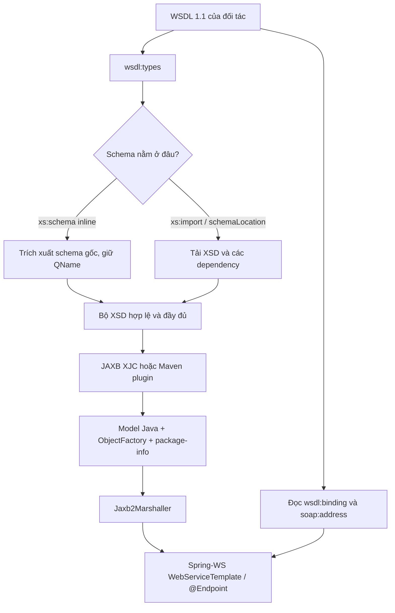
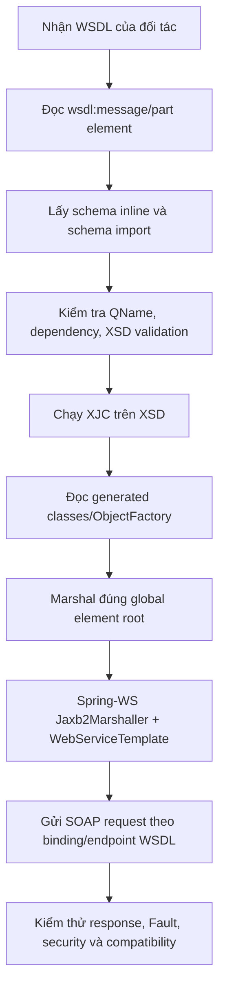

# Lấy mô hình dữ liệu từ phần schema trong WSDL

## 1. Bối cảnh: WSDL mô tả dịch vụ, XSD mô tả dữ liệu, JAXB tạo mô hình Java

Trong một dự án **Spring Web Services (Spring-WS)** theo hướng **contract-first**, bên cung cấp công bố WSDL cho các đối tác. Bên tiêu thụ cần xây dựng request SOAP, đọc response và chuyển các phần tử XML nghiệp vụ thành đối tượng Java. Nếu viết toàn bộ lớp Java bằng tay, nhóm phát triển dễ nhầm tên phần tử, namespace, tính bắt buộc hoặc thứ tự các trường so với contract.

Giải pháp thông dụng là **sinh mô hình JAXB từ XML Schema (XSD)** mà WSDL chứa hoặc tham chiếu. Công cụ JAXB schema compiler, thường gọi là **XJC**, đọc các định nghĩa `xs:element`, `xs:complexType`, `xs:simpleType` và tạo mã Java có annotation phục vụ *marshalling* (Java → XML) và *unmarshalling* (XML → Java).

**Phân biệt ba việc:**

1. **Đọc WSDL** để biết operation, các message, binding SOAP và URL endpoint.
2. **Lấy schema từ `wsdl:types`** rồi biên dịch **XSD** thành JAXB model.
3. **Dùng model trong Spring-WS** với `Jaxb2Marshaller` và `WebServiceTemplate` hoặc với một `@Endpoint`.

XJC tập trung vào **mô hình dữ liệu XML**. Nó không tự biến các operation trong WSDL thành một SOAP client có logic gửi HTTP, SOAPAction, authentication, timeout hoặc xử lý SOAP Fault. Một số công cụ WSDL-to-Java khác có thể sinh cả client stub, nhưng đó là một workflow khác.

Trong module `SPRING_WEB_SERVICES`, kiến thức này kết nối trực tiếp việc thiết kế XSD/WSDL, ánh xạ JAXB và xây SOAP endpoint/client; việc xử lý SOAP Fault, interceptor, XML security, WS-Security, chứng chỉ và kiểm thử tương thích đều cần dựa trên đúng QName và cấu trúc thông điệp.

### Kết quả mong đợi sau bài học

- Xác định được XSD **inline** hoặc **được import** từ `wsdl:types`.
- Phân biệt phần tử XML toàn cục với kiểu có tên và phần Java tương ứng.
- Biết cách trích xuất/chuẩn bị schema, giải quyết `xs:import`/`xs:include` để chạy XJC.
- Nhận diện `ObjectFactory`, `JAXBElement`, `package-info.java`, `@XmlElement` và `@XmlType`.
- Biết đưa JAXB model được sinh vào `Jaxb2Marshaller`/`WebServiceTemplate`.
- Kiểm tra XML marshal/unmarshal đối chiếu với XSD và WSDL, kể cả namespace và lỗi phiên bản.

## 2. Mô hình luồng từ WSDL đến đối tượng Java



WSDL có **nhiều lớp thông tin**:

| Vị trí | Chức năng | Có trực tiếp quyết định JAXB model không? |
| --- | --- | --- |
| `wsdl:types` / `xs:schema` | Định nghĩa phần tử, kiểu, thuộc tính, ràng buộc | **Có**, nguồn quan trọng của XJC |
| `wsdl:message` / `wsdl:part` | Tham chiếu tên phần tử hoặc kiểu dữ liệu dùng trong message | Dùng để biết **root** nào được operation sử dụng |
| `wsdl:portType` / `wsdl:operation` | Tên operation và input/output/fault logic | Không trực tiếp tạo các trường của Java data class qua XJC |
| `wsdl:binding` | SOAP version, transport, style/use, SOAPAction | Phục vụ cấu hình SOAP client/endpoint, không phải quy tắc XSD |
| `wsdl:service` / `soap:address` | Địa chỉ dịch vụ | Không quyết định model Java |

Ví dụ, một `GetOrderRequestType` có `orderId` là do XSD định nghĩa. Tên operation `GetOrder` và địa chỉ `https://.../ws` không làm XJC thêm các field Java.

## 3. Ví dụ WSDL 1.1 chứa XSD ngay trong `wsdl:types`

Giả sử dịch vụ đơn hàng có thao tác `GetOrder`. Bên tích hợp nhận một WSDL tự chứa như sau (địa chỉ `localhost` chỉ dùng cho môi trường minh họa).

```xml
<?xml version="1.0" encoding="UTF-8"?>
<wsdl:definitions
    xmlns:wsdl="http://schemas.xmlsoap.org/wsdl/"
    xmlns:xs="http://www.w3.org/2001/XMLSchema"
    xmlns:soap="http://schemas.xmlsoap.org/wsdl/soap/"
    xmlns:tns="urn:example:orders:v1"
    name="OrdersService"
    targetNamespace="urn:example:orders:v1">

    <wsdl:types>
        <xs:schema
            targetNamespace="urn:example:orders:v1"
            elementFormDefault="qualified"
            xmlns:tns="urn:example:orders:v1">

            <xs:simpleType name="OrderStatusType">
                <xs:restriction base="xs:string">
                    <xs:enumeration value="CREATED"/>
                    <xs:enumeration value="SHIPPED"/>
                    <xs:enumeration value="CANCELLED"/>
                </xs:restriction>
            </xs:simpleType>

            <xs:complexType name="GetOrderRequestType">
                <xs:sequence>
                    <xs:element name="orderId" type="xs:string"/>
                </xs:sequence>
            </xs:complexType>

            <xs:complexType name="GetOrderResponseType">
                <xs:sequence>
                    <xs:element name="orderId" type="xs:string"/>
                    <xs:element name="status" type="tns:OrderStatusType"/>
                </xs:sequence>
            </xs:complexType>

            <xs:element name="GetOrderRequest"
                        type="tns:GetOrderRequestType"/>
            <xs:element name="GetOrderResponse"
                        type="tns:GetOrderResponseType"/>
        </xs:schema>
    </wsdl:types>

    <wsdl:message name="GetOrderInput">
        <wsdl:part name="parameters"
                   element="tns:GetOrderRequest"/>
    </wsdl:message>
    <wsdl:message name="GetOrderOutput">
        <wsdl:part name="parameters"
                   element="tns:GetOrderResponse"/>
    </wsdl:message>

    <wsdl:portType name="OrdersPortType">
        <wsdl:operation name="GetOrder">
            <wsdl:input message="tns:GetOrderInput"/>
            <wsdl:output message="tns:GetOrderOutput"/>
        </wsdl:operation>
    </wsdl:portType>

    <wsdl:binding name="OrdersSoap11Binding"
                  type="tns:OrdersPortType">
        <soap:binding
            style="document"
            transport="http://schemas.xmlsoap.org/soap/http"/>
        <wsdl:operation name="GetOrder">
            <soap:operation
                soapAction="urn:example:orders:v1:GetOrder"/>
            <wsdl:input>
                <soap:body use="literal"/>
            </wsdl:input>
            <wsdl:output>
                <soap:body use="literal"/>
            </wsdl:output>
        </wsdl:operation>
    </wsdl:binding>

    <wsdl:service name="OrdersService">
        <wsdl:port name="OrdersSoap11Port"
                   binding="tns:OrdersSoap11Binding">
            <soap:address location="http://localhost:8080/ws"/>
        </wsdl:port>
    </wsdl:service>
</wsdl:definitions>
```

### 3.1. Cần đọc những phần nào để tạo model?

Trong đoạn WSDL, nơi chứa định nghĩa kiểu dữ liệu chính là:

```xml
<wsdl:types>
    <xs:schema targetNamespace="urn:example:orders:v1"
               elementFormDefault="qualified">
        <!-- xs:simpleType, xs:complexType, xs:element -->
    </xs:schema>
</wsdl:types>
```

Vùng `wsdl:types` có thể chứa **nhiều** `xs:schema` thuộc các namespace khác nhau. Chỉ nhìn thấy một `wsdl:definitions` không có nghĩa chỉ có một schema.

Trong phần schema này:

- `OrderStatusType` là **kiểu đơn có tên**; có thể tạo một Java enum theo binding mặc định.
- `GetOrderRequestType` và `GetOrderResponseType` là **kiểu phức có tên**; XJC có thể tạo Java classes với các field tương ứng.
- `GetOrderRequest` và `GetOrderResponse` là **phần tử toàn cục**, gắn tên XML root với kiểu đã khai báo.

Ở phần `wsdl:part element="tns:GetOrderRequest"`, WSDL cho biết input operation sử dụng **phần tử** `{urn:example:orders:v1}GetOrderRequest`. Nó không trỏ tới `GetOrderRequestType`. Thông tin này rất quan trọng khi marshal root bằng JAXB.

### 3.2. XSD là schema, còn `wsdl:types` chỉ là vùng chứa

Không thể đưa toàn bộ tệp WSDL ở trên vào lệnh XJC như một XSD thông thường và kỳ vọng nó là schema độc lập: phần tử gốc của WSDL là `wsdl:definitions`, trong khi tệp XSD thông thường cần có `xs:schema` làm root.

Có hai hướng kỹ thuật:

1. **Khuyến nghị cho contract-first với Spring-WS**: lấy các `xs:schema`, giữ đầy đủ khai báo namespace và phụ thuộc, lưu thành các tệp XSD rồi chạy JAXB XJC.
2. **Công cụ hỗ trợ WSDL**: dùng tính năng WSDL-input của một số compiler/plugin, nếu phiên bản công cụ đang dùng hỗ trợ và đã được kiểm thử. Khi đó công cụ vẫn lấy dữ liệu thực tế từ schema trong WSDL. Các option dành cho WSDL không phải option mặc định có mặt ở mọi phân phối XJC.

Bài này tập trung vào đường đi **WSDL → XSD → JAXB**, vì nó giúp nhìn rõ contract và tránh phụ thuộc không cần thiết vào công cụ sinh SOAP proxy.

## 4. Tách inline schema thành file XSD có thể biên dịch

Giả sử lưu schema lấy từ `wsdl:types` vào `src/main/resources/xsd/orders.xsd`:

```xml
<?xml version="1.0" encoding="UTF-8"?>
<xs:schema
    xmlns:xs="http://www.w3.org/2001/XMLSchema"
    xmlns:tns="urn:example:orders:v1"
    targetNamespace="urn:example:orders:v1"
    elementFormDefault="qualified">

    <xs:simpleType name="OrderStatusType">
        <xs:restriction base="xs:string">
            <xs:enumeration value="CREATED"/>
            <xs:enumeration value="SHIPPED"/>
            <xs:enumeration value="CANCELLED"/>
        </xs:restriction>
    </xs:simpleType>

    <xs:complexType name="GetOrderRequestType">
        <xs:sequence>
            <xs:element name="orderId" type="xs:string"/>
        </xs:sequence>
    </xs:complexType>

    <xs:complexType name="GetOrderResponseType">
        <xs:sequence>
            <xs:element name="orderId" type="xs:string"/>
            <xs:element name="status" type="tns:OrderStatusType"/>
        </xs:sequence>
    </xs:complexType>

    <xs:element name="GetOrderRequest"
                type="tns:GetOrderRequestType"/>
    <xs:element name="GetOrderResponse"
                type="tns:GetOrderResponseType"/>
</xs:schema>
```

**Đây là một file XSD độc lập hợp lệ** tương ứng với schema inline trước đó. Nếu XJC chạy thành công trên file này, những lớp Java sinh ra có thể mô tả dữ liệu trao đổi cho `GetOrder`.

### 4.1. Những thứ phải giữ nguyên khi trích xuất

| Thuộc tính/khai báo | Vì sao không được tùy ý đổi? |
| --- | --- |
| `targetNamespace` | Quyết định namespace của các global elements/types |
| `xmlns:...` được dùng trong `type`/`ref`/`base` | Giúp giải quyết QName tham chiếu chính xác |
| `elementFormDefault`, `attributeFormDefault` | Quyết định namespace của phần tử/thuộc tính cục bộ |
| `minOccurs`, `maxOccurs`, `nillable` | Quy tắc xuất hiện và cách biểu diễn nil |
| `xs:sequence`, `xs:choice`, `xs:all` | Quy tắc cấu trúc/thứ tự và lựa chọn dữ liệu |
| `xs:restriction` / `xs:extension` | Giới hạn giá trị hoặc mở rộng kiểu |
| `xs:import`, `xs:include`, `schemaLocation` | Phụ thuộc giữa các schema cần được giải quyết |

Đặc biệt, **namespace prefix có thể được khai báo ở `wsdl:definitions` mà không được viết lại ngay tại `xs:schema`**. Khi tách schema thành tài liệu XML riêng, phải bổ sung những khai báo `xmlns:...` cần thiết trên schema gốc. Ví dụ phần schema dùng `type="tns:OrderStatusType"` nhưng quên `xmlns:tns` sẽ khiến QName tham chiếu không còn giải quyết được.

**Không tự đổi `targetNamespace` cho khớp package Java.** Namespace XML là một phần của contract, còn tên Java package có thể được tùy chỉnh bằng JAXB binding hoặc option của compiler.

### 4.2. Tại sao không copy riêng các `xs:complexType`?

Nếu chỉ copy:

```xml
<xs:complexType name="GetOrderRequestType">
    <xs:sequence>
        <xs:element name="orderId" type="xs:string"/>
    </xs:sequence>
</xs:complexType>
```

mà bỏ:

```xml
<xs:element name="GetOrderRequest"
            type="tns:GetOrderRequestType"/>
```

thì schema vẫn mô tả **kiểu**, nhưng đã mất khai báo **phần tử root** mà WSDL dùng. Khi marshal Java object, có thể không còn `ObjectFactory` factory method hoặc `JAXBElement` tương ứng với QName root. Spring-WS SOAP client sẽ khó tạo đúng `GetOrderRequest` trên wire.

Không được coi một type tên `GetOrderRequestType` tự động đại diện cho XML element tên `GetOrderRequest`: đó là hai QName khác nhau.

## 5. WSDL tham chiếu XSD ngoài: cần truy vết dependency

Không phải WSDL nào cũng chứa một schema tự đủ. Một WSDL có thể nhúng một schema nhỏ dùng `xs:import` để tham chiếu XSD ngoài:

```xml
<wsdl:types>
    <xs:schema xmlns:xs="http://www.w3.org/2001/XMLSchema">
        <xs:import namespace="urn:example:orders:v1"
                   schemaLocation="xsd/orders.xsd"/>
    </xs:schema>
</wsdl:types>
```

Nếu WSDL được tải tại:

```text
https://api.example.org/ws/orders.wsdl
```

thì một client/tool có thể giải quyết đường dẫn tương đối `xsd/orders.xsd` từ vị trí tài liệu WSDL, thành địa chỉ dạng:

```text
https://api.example.org/ws/xsd/orders.xsd
```

URL này chỉ là **ví dụ**; thực tế phụ thuộc `schemaLocation` và khả năng truy cập/cấu hình resolver của bộ xử lý. Nếu chuyển WSDL/XSD về thư mục local, phải bảo đảm các đường dẫn tương đối vẫn đúng.

### 5.1. Ví dụ nhiều namespace

Giả sử một schema đơn hàng tham chiếu kiểu `AddressType` từ schema chung:

```xml
<xs:schema
    xmlns:xs="http://www.w3.org/2001/XMLSchema"
    xmlns:tns="urn:example:orders:v1"
    xmlns:common="urn:example:common:v1"
    targetNamespace="urn:example:orders:v1"
    elementFormDefault="qualified">

    <xs:import namespace="urn:example:common:v1"
               schemaLocation="common.xsd"/>

    <xs:complexType name="ShippingType">
        <xs:sequence>
            <xs:element name="address" type="common:AddressType"/>
        </xs:sequence>
    </xs:complexType>
</xs:schema>
```

`xs:import` có ý nghĩa khi tham chiếu component từ namespace **khác**. Còn `xs:include` thường ghép tài liệu schema thuộc **cùng namespace** (có thêm trường hợp schema không `targetNamespace` theo quy tắc chameleon).

Nếu chạy XJC với `orders.xsd` mà thiếu `common.xsd`, bạn có thể nhận lỗi không tìm thấy kiểu `common:AddressType`. Đó là lỗi **giải quyết XSD dependency**, chưa phải lỗi JAXB class hay SOAP client.

### 5.2. Checklist cho tập schema đầu vào

1. Xác định tất cả `xs:schema` bên trong `wsdl:types`, kể cả trường hợp có nhiều namespace.
2. Theo dõi `xs:import`, `xs:include`, và khi cần các tham chiếu schema trong tập tài liệu.
3. Lưu/đóng gói tất cả XSD cần thiết, duy trì đúng `targetNamespace` và `schemaLocation`.
4. Đảm bảo mỗi global component có QName hợp lệ, không xung đột định nghĩa ngoài chủ đích.
5. Kiểm tra WSDL `wsdl:part` thực sự tham chiếu phần tử nào; không sinh model chỉ từ một XSD phụ mà bỏ các request/response element.
6. Khi truy cập hệ thống bên ngoài, chỉ dùng nguồn schema đáng tin cậy; ưu tiên bộ tài liệu versioned/lưu nội bộ hoặc XML catalog/resolver được kiểm soát.

Trong tích hợp doanh nghiệp, không nên để build mỗi lần phụ thuộc mạng Internet hoặc URL của đối tác đang hoạt động. Tập WSDL/XSD được kiểm soát phiên bản giúp reproducible build và giảm rủi ro nguồn schema thay đổi ngoài quy trình.

## 6. Công cụ phù hợp để sinh JAXB model

### 6.1. XJC, `wsimport` và công cụ WSDL-to-Java khác nhau ra sao?

| Công cụ/nhóm công cụ | Nguồn đầu vào điển hình | Kết quả chính | Khi nào phù hợp |
| --- | --- | --- | --- |
| **JAXB XJC** | XSD (`.xsd`) | Java classes, enum, `ObjectFactory`, annotation JAXB | Muốn dữ liệu Java từ XML Schema để dùng với Spring-WS |
| **JAXB Maven/Gradle plugin** | XSD được chỉ định trong build | Sinh JAXB model tự động mỗi build theo cấu hình | Muốn mã sinh nhất quán, quản lý version |
| **JAX-WS `wsimport`** / WSDL-to-Java | WSDL | Có thể sinh service/port proxy, binding và JAXB types | Muốn client stub theo mô hình JAX-WS; khác cơ chế `WebServiceTemplate` của Spring-WS |
| **Apache CXF `wsdl2java`** hoặc tương đương | WSDL | Service interfaces/client-related classes và data types tùy flags | Khi chọn stack CXF/JAX-WS hoặc tích hợp hỗ trợ chúng |

Đặc biệt, **Spring Web Services không đồng nhất với JAX-WS**. Ứng dụng Spring-WS thường dùng `@Endpoint`, `@PayloadRoot` và `WebServiceTemplate`; nó không cần service-interface proxy từ `wsimport` chỉ để marshal request.

Một số bản XJC có chế độ đọc WSDL riêng, có thể là tính năng experimental. Tuy nhiên, với mục tiêu học cách lấy **model từ schema**, cách dễ kiểm soát nhất là tách hoặc đóng gói XSD đúng rồi chạy XJC trên tập XSD đó.

### 6.2. Phiên bản JAXB: `javax` và `jakarta`

Các project cũ có thể có:

```java
import javax.xml.bind.JAXBElement;
import javax.xml.bind.annotation.XmlElement;
```

Các project mới dựa trên Jakarta XML Binding thường sử dụng:

```java
import jakarta.xml.bind.JAXBElement;
import jakarta.xml.bind.annotation.XmlElement;
```

Hai namespace Java API này **không thể hoán đổi đơn thuần bằng cách đổi import trong một vài file**. Cần lựa chọn **XJC/plugin, JAXB API, JAXB runtime, phiên bản Spring-WS/Spring Framework và JVM** tương thích nhau. Nếu project chạy Java 11 trở lên, không giả định JAXB/XJC còn được JDK cung cấp sẵn; thông thường phải khai báo công cụ và dependency riêng trong build.

Quy tắc XML/XSD (QName, phần tử toàn cục, `minOccurs`, thứ tự `xs:sequence`) không đổi chỉ vì mã Java dùng `javax` hay `jakarta`.

### 6.3. Ví dụ dùng XJC CLI

Khi đã cài/chuẩn bị một XJC distribution tương thích và có file `orders.xsd` như mục 4:

```bash
# Tạo thư mục đích bằng công cụ của môi trường trước.
mkdir -p target/generated-sources/jaxb

# Chạy XJC từ bộ công cụ JAXB đã được cài.
xjc -d target/generated-sources/jaxb \
    -p org.example.orders.contract \
    src/main/resources/xsd/orders.xsd
```

Ví dụ lệnh dùng cú pháp shell Unix. Trên Windows, tên executable và cách tạo thư mục có thể khác theo distribution; `xjc` không nhất thiết nằm trên `PATH`. Tham số `-d` trỏ thư mục đích; nhiều bản XJC yêu cầu thư mục đó đã tồn tại. Tham số `-p` ép package cho schema đang biên dịch, phù hợp ví dụ một namespace; nếu tập schema có nhiều namespace, hãy cân nhắc để compiler tạo package mapping hoặc dùng **binding file** riêng để tránh dồn các kiểu của namespace khác nhau vào một package.

Trong build thật, nên **sinh mã ở generated-sources** và đánh dấu thư mục này là nguồn Java của build (plugin thường hỗ trợ). Không nên sửa trực tiếp các lớp được sinh: lần generate tiếp theo sẽ ghi lại chúng.

### 6.4. Tự động hóa trong Maven/Gradle

Với Maven, các JAXB plugin phổ biến cung cấp cấu hình như:

```text
schemaDirectory / sources:  thư mục hoặc danh sách XSD
bindingDirectory:            file .xjb nếu cần tùy biến tên/package
generateDirectory:           target/generated-sources/...
episode/output:              metadata liên quan khi tách module (tùy công cụ)
```

**Tên option, groupId, artifactId và phiên bản plugin phụ thuộc plugin đã chọn.** Không có một cú pháp Maven XJC duy nhất được hỗ trợ bởi mọi plugin JAXB. Trước khi đưa cấu hình vào `pom.xml`, kiểm tra tài liệu của đúng plugin/phiên bản và API `jakarta`/`javax` mà dự án sử dụng.

Điều nên bảo đảm ở CI:

- Sinh mã từ cùng **bộ XSD đã version** cho mỗi build.
- Bắt lỗi nếu import/include không được resolve hoặc schema không hợp lệ.
- Giữ phiên bản công cụ xác định, tránh sinh mã khác nhau do cập nhật ngầm.
- Không tạo ra các lớp JAXB trùng tên/package gây xung đột.
- Biên dịch generated sources và chạy kiểm thử marshal/unmarshal có ý nghĩa với WSDL/XSD.

## 7. Đọc các Java classes JAXB được XJC sinh ra

Kết quả cụ thể phụ thuộc bản XJC, tùy biến binding và cách schema được thiết kế. Với XSD `orders.xsd` ở mục 4, một cấu trúc **dự kiến** có thể là:

```text
target/generated-sources/jaxb/
└── org/example/orders/contract/
    ├── GetOrderRequestType.java
    ├── GetOrderResponseType.java
    ├── OrderStatusType.java
    ├── ObjectFactory.java
    └── package-info.java
```

Đây là ví dụ điển hình để đọc hiểu, **không phải cam kết tên/lượng file y hệt ở mọi phiên bản XJC**. Một số schema hoặc binding tùy biến có thể dẫn tới tên khác và cách biểu diễn phần tử root khác.

### 7.1. `package-info.java`: ánh xạ namespace XML của package

Một file được sinh có thể mang annotation tương tự:

```java
@jakarta.xml.bind.annotation.XmlSchema(
    namespace = "urn:example:orders:v1",
    elementFormDefault =
        jakarta.xml.bind.annotation.XmlNsForm.QUALIFIED
)
package org.example.orders.contract;
```

`@XmlSchema` khai báo quy tắc namespace mặc định cho các element JAXB của package. Trong XML instance, phần tử:

```xml
<GetOrderRequest xmlns="urn:example:orders:v1">
    <orderId>ORD-100</orderId>
</GetOrderRequest>
```

có hai QName:

```text
{urn:example:orders:v1}GetOrderRequest
{urn:example:orders:v1}orderId
```

Prefix có thể khác nhau trong XML được marshal, nhưng **namespace URI và local name phải đúng**. Đừng kiểm thử contract bằng cách yêu cầu JAXB luôn viết prefix `tns` hoặc luôn dùng namespace mặc định.

### 7.2. `GetOrderRequestType.java`: Java class cho kiểu phức

Ví dụ hình thức annotation JAXB mà XJC có thể tạo:

```java
import jakarta.xml.bind.annotation.XmlAccessType;
import jakarta.xml.bind.annotation.XmlAccessorType;
import jakarta.xml.bind.annotation.XmlElement;
import jakarta.xml.bind.annotation.XmlType;

@XmlAccessorType(XmlAccessType.FIELD)
@XmlType(name = "GetOrderRequestType", propOrder = {
    "orderId"
})
public class GetOrderRequestType {

    @XmlElement(required = true)
    protected String orderId;

    public String getOrderId() {
        return orderId;
    }

    public void setOrderId(String value) {
        this.orderId = value;
    }
}
```

Từ schema:

```xml
<xs:complexType name="GetOrderRequestType">
    <xs:sequence>
        <xs:element name="orderId" type="xs:string"/>
    </xs:sequence>
</xs:complexType>
```

XJC tạo field kiểu `String`; `@XmlType(propOrder = ...)` phản ánh thứ tự trong `xs:sequence`. `required = true` thể hiện metadata binding tương ứng ràng buộc phần tử, nhưng **không có nghĩa setter Java tự động từ chối mọi giá trị `null`**. Nếu muốn thực thi đầy đủ ràng buộc XSD lúc marshal/unmarshal, cần cấu hình schema validation hoặc kiểm soát dữ liệu nghiệp vụ thích hợp.

### 7.3. `OrderStatusType.java`: enum từ `xs:restriction`

Kiểu đơn có enumeration:

```xml
<xs:simpleType name="OrderStatusType">
    <xs:restriction base="xs:string">
        <xs:enumeration value="CREATED"/>
        <xs:enumeration value="SHIPPED"/>
        <xs:enumeration value="CANCELLED"/>
    </xs:restriction>
</xs:simpleType>
```

có thể được ánh xạ thành:

```java
@jakarta.xml.bind.annotation.XmlType(name = "OrderStatusType")
@jakarta.xml.bind.annotation.XmlEnum
public enum OrderStatusType {
    CREATED, SHIPPED, CANCELLED;
}
```

Với binding mặc định phù hợp, giá trị `CREATED` trong XML ánh xạ thành `OrderStatusType.CREATED`. Nếu contract bổ sung một giá trị enumeration mới, Java enum của client cũ có thể không biết giá trị đó. Đây là vấn đề **tương thích dữ liệu**, dù SOAP message vẫn được truyền tải thành công.

### 7.4. `ObjectFactory` và `JAXBElement`: giữ QName của global element

Điểm dễ nhầm: `GetOrderRequestType` là một **kiểu có tên**, còn `GetOrderRequest` là một **phần tử toàn cục** dùng kiểu đó. JAXB cần biết **tên phần tử root** khi marshal.

XJC có thể tạo `ObjectFactory` với khai báo dạng:

```java
import jakarta.xml.bind.JAXBElement;
import jakarta.xml.bind.annotation.XmlElementDecl;
import jakarta.xml.bind.annotation.XmlRegistry;
import javax.xml.namespace.QName;

@XmlRegistry
public class ObjectFactory {

    private static final QName _GetOrderRequest_QNAME =
        new QName("urn:example:orders:v1", "GetOrderRequest");

    private static final QName _GetOrderResponse_QNAME =
        new QName("urn:example:orders:v1", "GetOrderResponse");

    public GetOrderRequestType createGetOrderRequestType() {
        return new GetOrderRequestType();
    }

    public GetOrderResponseType createGetOrderResponseType() {
        return new GetOrderResponseType();
    }

    @XmlElementDecl(
        namespace = "urn:example:orders:v1",
        name = "GetOrderRequest"
    )
    public JAXBElement<GetOrderRequestType> createGetOrderRequest(
            GetOrderRequestType value) {
        return new JAXBElement<>(
            _GetOrderRequest_QNAME,
            GetOrderRequestType.class,
            null,
            value
        );
    }

    @XmlElementDecl(
        namespace = "urn:example:orders:v1",
        name = "GetOrderResponse"
    )
    public JAXBElement<GetOrderResponseType> createGetOrderResponse(
            GetOrderResponseType value) {
        return new JAXBElement<>(
            _GetOrderResponse_QNAME,
            GetOrderResponseType.class,
            null,
            value
        );
    }
}
```

Đây là **mã rút gọn để minh họa cơ chế**; ObjectFactory thật có thể có nhiều factory methods/annotation khác tùy XJC. Có trường hợp phần tử toàn cục được biểu diễn bằng class mang `@XmlRootElement` nên không cần tự bọc `JAXBElement`. Đọc **mã thực tế được sinh** để quyết định.

Lưu ý khác biệt phiên bản: trong một dự án dùng Jakarta Binding, import `JAXBElement` ở package `jakarta.xml.bind` nhưng `QName` vẫn thuộc `javax.xml.namespace.QName` của Java XML API. Hai tên `javax` ở đây không đại diện cùng một API JAXB.

**Tại sao `JAXBElement` quan trọng?**

- Nó mang **QName của element**, ví dụ `{urn:example:orders:v1}GetOrderRequest`.
- Nó gắn QName với giá trị Java thuộc kiểu `GetOrderRequestType`.
- Nó cho phép cùng một Java type được marshal dưới nhiều element names nếu XSD khai báo nhiều global elements dùng type đó.

Không nên đổi root QName thành `GetOrderRequestType` chỉ vì đó là tên Java class.

### 7.5. Một QName type có thể khác QName phần tử

| Trong XSD | Tên XML/Java tương ứng | Ý nghĩa |
| --- | --- | --- |
| `xs:complexType name="GetOrderRequestType"` | `GetOrderRequestType` | Tên **type** và Java class |
| `xs:element name="GetOrderRequest" type="tns:GetOrderRequestType"` | `GetOrderRequest` | Tên **phần tử root** mà WSDL tham chiếu |
| `wsdl:part element="tns:GetOrderRequest"` | `{urn:example:orders:v1}GetOrderRequest` | Root của input message |
| `@PayloadRoot(localPart="GetOrderRequest", namespace="urn:example:orders:v1")` | Cùng QName root | Spring-WS dùng để tìm endpoint |

Nếu trong code chỉ có `GetOrderRequestType` mà không thấy `@XmlRootElement`, hãy kiểm tra `ObjectFactory` trước khi tự sửa class được sinh.

## 8. Tự marshal và unmarshal để xác minh model

Đây là phép kiểm chứng quan trọng trước khi dùng model trong SOAP client. Hãy kiểm tra **XML mà JAXB tạo ra** có QName và cấu trúc đúng với XSD, thay vì chỉ nhìn object Java.

### 8.1. Marshal request thành XML

Giả sử model được sinh như mục 7 và classpath đã có API/runtime Jakarta XML Binding tương thích:

```java
import jakarta.xml.bind.JAXBContext;
import jakarta.xml.bind.JAXBElement;
import jakarta.xml.bind.Marshaller;
import org.example.orders.contract.GetOrderRequestType;
import org.example.orders.contract.ObjectFactory;

public class MarshalRequestExample {

    public static void main(String[] args) throws Exception {
        GetOrderRequestType request = new GetOrderRequestType();
        request.setOrderId("ORD-100");

        ObjectFactory factory = new ObjectFactory();
        JAXBElement<GetOrderRequestType> root =
            factory.createGetOrderRequest(request);

        JAXBContext context =
            JAXBContext.newInstance("org.example.orders.contract");
        Marshaller marshaller = context.createMarshaller();
        marshaller.setProperty(
            Marshaller.JAXB_FORMATTED_OUTPUT, Boolean.TRUE
        );

        marshaller.marshal(root, System.out);
    }
}
```

Một output hợp lệ có thể là:

```xml
<?xml version="1.0" encoding="UTF-8" standalone="yes"?>
<ns2:GetOrderRequest xmlns:ns2="urn:example:orders:v1">
    <ns2:orderId>ORD-100</ns2:orderId>
</ns2:GetOrderRequest>
```

Đừng coi prefix `ns2` hoặc thứ tự namespace declarations là một yêu cầu cố định. Kết quả dưới đây cũng có cùng expanded names:

```xml
<GetOrderRequest xmlns="urn:example:orders:v1">
    <orderId>ORD-100</orderId>
</GetOrderRequest>
```

Cả hai cùng biểu diễn:

```text
{urn:example:orders:v1}GetOrderRequest
{urn:example:orders:v1}orderId
```

### 8.2. Unmarshal response

Response XML minh họa:

```xml
<GetOrderResponse xmlns="urn:example:orders:v1">
    <orderId>ORD-100</orderId>
    <status>CREATED</status>
</GetOrderResponse>
```

Ví dụ đọc từ một chuỗi XML tin cậy bằng cùng `JAXBContext`:

```java
import jakarta.xml.bind.JAXBContext;
import jakarta.xml.bind.JAXBElement;
import jakarta.xml.bind.Unmarshaller;
import java.io.StringReader;
import javax.xml.namespace.QName;
import org.example.orders.contract.GetOrderResponseType;

public class UnmarshalResponseExample {

    public static void main(String[] args) throws Exception {
        String xml = """
            <GetOrderResponse xmlns="urn:example:orders:v1">
                <orderId>ORD-100</orderId>
                <status>CREATED</status>
            </GetOrderResponse>
            """;

        JAXBContext context =
            JAXBContext.newInstance("org.example.orders.contract");
        Unmarshaller unmarshaller = context.createUnmarshaller();

        JAXBElement<?> element = (JAXBElement<?>)
            unmarshaller.unmarshal(new StringReader(xml));

        QName expected = new QName(
            "urn:example:orders:v1", "GetOrderResponse"
        );
        if (!expected.equals(element.getName())) {
            throw new IllegalArgumentException(
                "Unexpected response root: " + element.getName()
            );
        }

        GetOrderResponseType response =
            (GetOrderResponseType) element.getValue();

        System.out.println(response.getOrderId());
        System.out.println(response.getStatus());
    }
}
```

Ví dụ yêu cầu Java hỗ trợ *text block* và mapping kiểu `JAXBElement` như mã minh họa. Khi compiler sinh lớp có `@XmlRootElement` và JAXB trả đối tượng root trực tiếp, cách xử lý kết quả có thể khác. Nếu sử dụng dữ liệu XML **không tin cậy**, cần cấu hình XML parser/schema validation và biện pháp chống XXE/DTD/entity expansion thích hợp theo thư viện; ví dụ ngắn trên chỉ làm rõ ánh xạ QName.

### 8.3. Schema validation không tự động đầy đủ khi marshal/unmarshal

JAXB annotation chứa thông tin cấu trúc, nhưng chỉ có `@XmlElement(required=true)` không đồng nghĩa tất cả quy tắc XSD được kiểm tra ở runtime.

Có thể chủ động gắn `Schema` vào marshaller/unmarshaller:

```java
import jakarta.xml.bind.JAXBContext;
import jakarta.xml.bind.Marshaller;
import jakarta.xml.bind.Unmarshaller;
import java.io.File;
import javax.xml.XMLConstants;
import javax.xml.validation.Schema;
import javax.xml.validation.SchemaFactory;

JAXBContext context =
    JAXBContext.newInstance("org.example.orders.contract");

SchemaFactory schemaFactory = SchemaFactory.newInstance(
    XMLConstants.W3C_XML_SCHEMA_NS_URI
);
Schema schema = schemaFactory.newSchema(
    new File("src/main/resources/xsd/orders.xsd")
);

Marshaller marshaller = context.createMarshaller();
marshaller.setSchema(schema);

Unmarshaller unmarshaller = context.createUnmarshaller();
unmarshaller.setSchema(schema);
```

Đây là **đoạn cấu hình minh họa**, không phải một class Java hoàn chỉnh. Trong ứng dụng thật, nên nạp schema từ classpath/tập tài nguyên đã version thay vì đường dẫn working directory, giải quyết import/include có kiểm soát và cấu hình secure XML processing. Validation giúp phát hiện thiếu trường, sai thứ tự, enumeration sai hoặc sai namespace.

## 9. Đưa mô hình JAXB vào Spring-WS SOAP client

### 9.1. `Jaxb2Marshaller` dùng các lớp đã được sinh

Spring Framework cung cấp `Jaxb2Marshaller` để đổi Java objects và XML thông qua JAXB. Với package từ ví dụ:

```java
import org.springframework.context.annotation.Bean;
import org.springframework.context.annotation.Configuration;
import org.springframework.oxm.jaxb.Jaxb2Marshaller;
import org.springframework.ws.client.core.WebServiceTemplate;

@Configuration
public class OrdersSoapClientConfig {

    @Bean
    public Jaxb2Marshaller ordersMarshaller() {
        Jaxb2Marshaller marshaller = new Jaxb2Marshaller();
        marshaller.setContextPath("org.example.orders.contract");
        return marshaller;
    }

    @Bean
    public WebServiceTemplate ordersWebServiceTemplate(
            Jaxb2Marshaller ordersMarshaller) {
        WebServiceTemplate template = new WebServiceTemplate();
        template.setMarshaller(ordersMarshaller);
        template.setUnmarshaller(ordersMarshaller);
        return template;
    }
}
```

`setContextPath` cần một package có JAXB metadata phù hợp (ví dụ `ObjectFactory`). Có dự án chọn `setClassesToBeBound` hoặc `setPackagesToScan` theo quy tắc của Spring; cách phù hợp phụ thuộc model generated và phiên bản thư viện.

Đây mới là phần **XML binding**. Trong production, còn cần cấu hình HTTP message sender, connection/read timeout, HTTPS/mTLS, authentication, SOAP version và chính sách xử lý SOAP Fault theo môi trường.

### 9.2. Client gọi `GetOrder` với root từ `ObjectFactory`

Với `WebServiceTemplate` đã cấu hình JAXB như trên:

```java
import jakarta.xml.bind.JAXBElement;
import javax.xml.namespace.QName;
import org.example.orders.contract.GetOrderRequestType;
import org.example.orders.contract.GetOrderResponseType;
import org.example.orders.contract.ObjectFactory;
import org.springframework.ws.client.core.WebServiceTemplate;
import org.springframework.ws.soap.client.core.SoapActionCallback;

public class OrdersSoapClient {

    private static final String NS = "urn:example:orders:v1";

    private final WebServiceTemplate webServiceTemplate;
    private final ObjectFactory objectFactory = new ObjectFactory();

    public OrdersSoapClient(WebServiceTemplate webServiceTemplate) {
        this.webServiceTemplate = webServiceTemplate;
    }

    public GetOrderResponseType getOrder(String orderId) {
        GetOrderRequestType request = new GetOrderRequestType();
        request.setOrderId(orderId);

        JAXBElement<GetOrderRequestType> root =
            objectFactory.createGetOrderRequest(request);

        Object raw = webServiceTemplate.marshalSendAndReceive(
            "https://api.example.org/ws",
            root,
            new SoapActionCallback("urn:example:orders:v1:GetOrder")
        );

        if (!(raw instanceof JAXBElement<?> element)) {
            throw new IllegalStateException(
                "Unexpected JAXB response representation"
            );
        }

        QName expected = new QName(NS, "GetOrderResponse");
        if (!expected.equals(element.getName())
                || !(element.getValue() instanceof GetOrderResponseType)) {
            throw new IllegalStateException(
                "Unexpected SOAP response payload: " + element.getName()
            );
        }

        return (GetOrderResponseType) element.getValue();
    }
}
```

Mã trên minh họa **một kiểu output JAXB** (global elements được wrap bằng `JAXBElement`) và yêu cầu Java hỗ trợ pattern matching cho `instanceof`. Nếu model generated có `@XmlRootElement` hoặc marshaller trả object theo dạng khác, cần điều chỉnh. Trước hết đọc output thực tế và xác nhận root QName.

**SOAPAction ở ví dụ này lấy từ WSDL mẫu ở mục 3**, vốn khai báo SOAP 1.1 binding. Với WSDL của đối tác, phải đọc `soap:operation/@soapAction` và kiểm tra SOAP version; không tự suy action từ tên Java method. HTTP endpoint URL ở đây cũng chỉ là giá trị minh họa, không phải URL có thể gọi sẵn.

### 9.3. Model JAXB không tự bao gồm SOAP Envelope

Trong trường hợp dùng `WebServiceTemplate` với `Jaxb2Marshaller`:

```text
GetOrderRequestType (Java)
        |
ObjectFactory.createGetOrderRequest(...)
        |
JAXB marshal -> <GetOrderRequest ...>...</GetOrderRequest>
        |
Spring-WS WebServiceMessageFactory thêm SOAP Envelope/Body
        |
HTTP sender chuyển SOAP message tới endpoint
```

JAXB model ở đây tương ứng **payload**, không có trách nhiệm tự tạo `soap:Envelope`, `soap:Header`, HTTP `SOAPAction` hoặc `Content-Type`.

Đừng đưa Java class `GetOrderRequestType` làm giả định cho toàn bộ SOAP request. Nó chỉ đại diện dữ liệu XML ở **một phần** thông điệp theo contract.

## 10. Liên hệ phía server: `@PayloadRoot` và JAXB-generated model

Cùng mô hình có thể được dùng cho Spring-WS server:

```java
import jakarta.xml.bind.JAXBElement;
import org.example.orders.contract.GetOrderRequestType;
import org.example.orders.contract.GetOrderResponseType;
import org.example.orders.contract.ObjectFactory;
import org.springframework.ws.server.endpoint.annotation.Endpoint;
import org.springframework.ws.server.endpoint.annotation.PayloadRoot;
import org.springframework.ws.server.endpoint.annotation.RequestPayload;
import org.springframework.ws.server.endpoint.annotation.ResponsePayload;

@Endpoint
public class OrdersEndpoint {

    private static final String NS = "urn:example:orders:v1";

    private final OrderService orderService;
    private final ObjectFactory factory = new ObjectFactory();

    public OrdersEndpoint(OrderService orderService) {
        this.orderService = orderService;
    }

    @PayloadRoot(namespace = NS, localPart = "GetOrderRequest")
    @ResponsePayload
    public JAXBElement<GetOrderResponseType> getOrder(
            @RequestPayload JAXBElement<GetOrderRequestType> root) {

        GetOrderRequestType request = root.getValue();
        GetOrderResponseType response =
            orderService.findOrder(request.getOrderId());

        return factory.createGetOrderResponse(response);
    }
}
```

Đây là **mẫu về ý tưởng ánh xạ**, cần service nghiệp vụ `OrderService`, lớp generated và endpoint adapter/marshaller phù hợp để chạy thực tế. Ở các binding khác, method có thể nhận/trả trực tiếp lớp có `@XmlRootElement`.

Chìa khóa dispatch:

```java
@PayloadRoot(
    namespace = "urn:example:orders:v1",
    localPart = "GetOrderRequest"
)
```

phải tương ứng với phần tử gốc trong SOAP Body:

```text
{urn:example:orders:v1}GetOrderRequest
```

Tên method `getOrder` hay tên class `GetOrderRequestType` không quyết định QName payload. Đó cũng là lý do cần mang theo khai báo **global element** từ XSD khi sinh JAXB.

## 11. Trường hợp khó khi schema và model không tương ứng một-một

### 11.1. `minOccurs="0"` và `nillable="true"` khác nhau

Trong XSD:

```xml
<xs:element name="comment" type="xs:string" minOccurs="0"/>
```

phần tử `comment` có thể **vắng mặt**. Còn nếu:

```xml
<xs:element name="comment" type="xs:string"
            minOccurs="0" nillable="true"/>
```

thì một instance còn có thể biểu diễn giá trị nil:

```xml
<comment
    xmlns="urn:example:orders:v1"
    xmlns:xsi="http://www.w3.org/2001/XMLSchema-instance"
    xsi:nil="true"/>
```

Trong JAXB, tùy binding, hai trạng thái *vắng mặt* và *hiện diện nhưng nil* có thể cần `JAXBElement` hoặc metadata bổ sung để phân biệt. Đừng suy rằng Java `null` luôn biểu diễn chính xác cả hai tình huống. Cần kiểm tra mã sinh và kết quả marshal cụ thể.

### 11.2. `maxOccurs="unbounded"` thường dẫn tới `List<T>`

```xml
<xs:element name="line" type="tns:OrderLineType"
            minOccurs="0" maxOccurs="unbounded"/>
```

Trong JAXB, field tương ứng thường có dạng `List<OrderLineType>`. Một số XJC-generated classes dùng **live list getter**:

```java
public List<OrderLineType> getLine() {
    if (line == null) {
        line = new ArrayList<>();
    }
    return this.line;
}
```

Không có `setLine(...)` trong pattern này. Khi muốn thêm dòng hàng:

```java
request.getLine().add(newLine);
```

Tùy schema/compiler, số lượng field và phương thức khác nhau; hãy dùng kiểu được sinh thực tế, không viết tay các setter giả định.

### 11.3. `xs:choice`, type derivation và substitution groups

Các XSD dùng `xs:choice`, `xs:extension`/`xs:restriction`, substitution groups hoặc `xsi:type` có thể tạo model khác trực giác: property đa hình, `JAXBElement<?>` hoặc danh sách nhiều loại phần tử. Với contract phức tạp:

- Đọc annotation `@XmlElements`/`@XmlElementRefs`/`@XmlSeeAlso` nếu được sinh.
- Kiểm tra runtime có hỗ trợ đúng các derived types hay không.
- Kiểm thử từng nhánh `choice` và biến thể message mà đối tác thực sự gửi.
- Không ép kiểu một property thành lớp cụ thể khi XSD cho phép nhiều biến thể.

### 11.4. XSD datatype không phải lúc nào cũng là `String`

| XSD datatype | Ánh xạ JAXB thường gặp | Lưu ý |
| --- | --- | --- |
| `xs:string` | `String` | Vẫn có thể bị giới hạn bằng pattern/length |
| `xs:int` | `int` hoặc `Integer` | Tùy tính bắt buộc/nil và binding |
| `xs:integer` / `xs:positiveInteger` | `BigInteger` | Giữ miền số nguyên lớn |
| `xs:decimal` | `BigDecimal` | Phù hợp dữ liệu thập phân chính xác |
| `xs:date` / `xs:dateTime` | `XMLGregorianCalendar` hoặc loại Java tùy binding | Cần chú ý múi giờ và lexical form |
| `xs:base64Binary` | `byte[]` hoặc kiểu liên quan attachment tùy binding | Không đồng nghĩa tự có MTOM |
| Enumeration `xs:restriction` | Enum hoặc một dạng mapping khác | Tùy tên giá trị và cấu hình XJC |

Sự khác nhau này là đặc điểm **mô hình dữ liệu từ schema**, không phải lựa chọn ngẫu nhiên của SOAP transport.

### 11.5. SOAP Fault và WS-Security nằm ngoài phần lớn model nghiệp vụ

- Nếu schema công bố các phần tử `FaultDetail`, XJC có thể tạo classes mô tả **dữ liệu detail**. Nhưng nó không tự tạo đầy đủ quy tắc SOAP Fault, exception resolver hoặc HTTP status.
- SOAP Header `wsse:Security` theo WS-Security được xử lý bởi các thư viện/interceptor bảo mật, **không** được tạo ra chỉ bằng việc sinh `GetOrderRequestType` từ XSD nghiệp vụ.
- XML Signature dựa trên các QName, thuộc tính ID, canonicalization và nội dung thực tế; đổi namespace, tên phần tử hoặc serialize sai contract có thể làm thông điệp không tương thích hoặc chữ ký không hợp lệ.
- Chứng chỉ TLS/mTLS, keystore/truststore và xác thực HTTP là cấu hình truyền tải/bảo mật riêng, không được suy từ Java data classes.

Vì vậy, thành công của XJC mới chứng tỏ đã có một **mô hình JAXB khả dụng về mặt cấu trúc**. Nó chưa chứng minh toàn bộ tích hợp SOAP vận hành đúng.

## 12. Những lỗi thường gặp khi lấy model từ schema trong WSDL

| Triệu chứng | Nguyên nhân có thể | Cách xử lý |
| --- | --- | --- |
| XJC báo file không phải schema hợp lệ | Đưa cả `wsdl:definitions` vào như một file XSD | Trích `xs:schema` thành XSD hợp lệ hoặc dùng WSDL input mode của công cụ thực sự hỗ trợ |
| Không tìm thấy `tns:OrderStatusType` | Prefix `tns` không được khai báo trong XSD tách ra hoặc namespace sai | Giữ `xmlns:tns` và `targetNamespace`, kiểm tra `type`/`ref` |
| Không tìm thấy `common:AddressType` | Thiếu `xs:import`, `common.xsd` hoặc `schemaLocation` sai | Giải quyết đầy đủ tập schema phụ thuộc |
| XJC báo component/type trùng | Hai XSD cùng khai báo global component cùng QName, hoặc sinh lại cùng class | Loại bỏ xung đột contract và cấu hình generate phù hợp |
| XJC chỉ sinh class type, không thấy root factory | Bỏ qua global `xs:element` hoặc type/element được ánh xạ khác kỳ vọng | Kiểm tra XSD, `ObjectFactory` và `@XmlRootElement` |
| JAXB báo class không biết cách marshal làm root | Đối tượng không có root element binding | Dùng `JAXBElement` từ `ObjectFactory` hoặc class có `@XmlRootElement` |
| JAXB báo unexpected element | URI/local name của root XML khác contract | So `QName` đầy đủ, không chỉ tên `GetOrderRequest` |
| `Jaxb2Marshaller` không biết package | Context path sai hoặc không có JAXB metadata/runtime tương thích | Kiểm tra package generated, `ObjectFactory`, dependencies |
| Lỗi `ClassNotFoundException` / API mismatch | Dùng generated Jakarta JAXB với runtime `javax` hoặc ngược lại | Chọn bộ JAXB API/runtime/XJC và Spring-WS tương thích |
| XJC tạo kiểu `BigInteger`, code giả định `int` | Schema dùng `xs:integer`/`xs:positiveInteger` | Dùng kiểu Java do binding tạo, không ép theo trực giác |
| Element con marshal sai namespace | Bỏ `elementFormDefault` hoặc config `@XmlSchema` không khớp | So expanded name của từng element với XSD |
| Response parse được nhưng sai giá trị enum | Contract đối tác dùng enumeration khác phiên bản | Diff XSD, kiểm thử compatibility và cập nhật model theo version |
| SOAP request vào server nhưng không tới method | `@PayloadRoot` sai QName, dù generated type đúng | So WSDL part, XML payload root và annotation |
| SOAP request bị lỗi HTTP/WS-Security | Lỗi binding/transport/bảo mật ngoài JAXB | Kiểm tra SOAP version, HTTP headers, TLS, WS-Security/interceptor |

### 12.1. Một lỗi rất phổ biến: dùng tên kiểu làm tên root

Schema khai báo:

```xml
<xs:complexType name="GetOrderRequestType">...</xs:complexType>
<xs:element name="GetOrderRequest"
            type="tns:GetOrderRequestType"/>
```

Nếu code tự tạo XML:

```xml
<GetOrderRequestType xmlns="urn:example:orders:v1">
    <orderId>ORD-100</orderId>
</GetOrderRequestType>
```

thì tên root là `{urn:example:orders:v1}GetOrderRequestType`, **không khớp** `{urn:example:orders:v1}GetOrderRequest` mà WSDL yêu cầu. Dữ liệu bên trong có thể hoàn toàn đúng nhưng request vẫn sai contract.

Giải pháp là marshal đúng element declaration, qua `ObjectFactory.createGetOrderRequest(...)` hoặc binding root tương ứng.

### 12.2. Khác biệt SOAP 1.1 và SOAP 1.2 không do JAXB quyết định

Một model `GetOrderRequestType` có thể được sử dụng với cấu hình SOAP khác nhau nếu contract hỗ trợ. Nhưng SOAP 1.1 dùng namespace Envelope `http://schemas.xmlsoap.org/soap/envelope/` và media type HTTP thường là `text/xml`; SOAP 1.2 dùng namespace `http://www.w3.org/2003/05/soap-envelope` và media type `application/soap+xml`.

JAXB chỉ marshal **payload**. Vì vậy, nếu service trả lỗi *version mismatch* hoặc HTTP `415 Unsupported Media Type`, không nên sửa generated Java class ngay. Hãy kiểm tra message factory, transport binding, `Content-Type` và WSDL.

## 13. Kiểm thử tính đúng đắn của dữ liệu JAXB

### 13.1. Bốn phép kiểm tra thiết yếu

| Phép kiểm tra | Thao tác | Kỳ vọng |
| --- | --- | --- |
| Marshal request | Tạo `GetOrderRequestType`, bọc đúng root và marshal | XML root QName `{urn:example:orders:v1}GetOrderRequest` |
| XSD validation | Validate XML được marshal với tập schema gốc | Đúng namespace, thứ tự, dữ liệu và ràng buộc |
| Unmarshal response | Đọc một `GetOrderResponse` hợp lệ | Tạo đúng Java type và giá trị `OrderStatusType` |
| Round-trip | Marshal → unmarshal cùng dữ liệu | Bảo toàn giá trị/ý nghĩa XML trong phạm vi JAXB mapping |

Round-trip thành công **không đủ** để kết luận tương thích nếu cả phía marshal và unmarshal đang dùng cùng một schema sai. Cần so với **XSD/WSDL gốc do đối tác công bố**, không chỉ kiểm thử hai lần với cùng generated code.

### 13.2. So XML bằng namespace, không bằng prefix

Hai đoạn:

```xml
<GetOrderRequest xmlns="urn:example:orders:v1">
    <orderId>ORD-100</orderId>
</GetOrderRequest>
```

và:

```xml
<ord:GetOrderRequest xmlns:ord="urn:example:orders:v1">
    <ord:orderId>ORD-100</ord:orderId>
</ord:GetOrderRequest>
```

có QName của root/con giống nhau. Một kiểm thử chỉ so chuỗi raw XML sẽ dễ thất bại vì prefix và khoảng trắng thay đổi. Khi kiểm tra contract nên dùng namespace-aware XML parser, QName, XPath có `NamespaceContext` hoặc schema validation.

Ngược lại, XML:

```xml
<GetOrderRequest>
    <orderId>ORD-100</orderId>
</GetOrderRequest>
```

**không tương đương**: hai element trên không có namespace, trong khi contract yêu cầu `urn:example:orders:v1`.

### 13.3. Ví dụ các trường hợp dữ liệu cần test

Với schema ở mục 4:

| Dữ liệu | Kết quả kỳ vọng |
| --- | --- |
| Request có `orderId` khác rỗng | Hợp lệ theo `xs:string` (schema hiện không giới hạn độ dài hoặc non-blank) |
| Request thiếu `orderId` | Không hợp lệ khi validate XSD |
| Response có `status=CREATED` | Hợp lệ |
| Response có `status=PENDING` | Không hợp lệ vì ngoài enumeration |
| Response có `status=created` | Không hợp lệ vì enumeration phân biệt hoa/thường |
| Response đổi thứ tự `status` trước `orderId` | Không hợp lệ vì `xs:sequence` |
| Root là `GetOrderResponse` với namespace sai | Không hợp lệ so với global element của contract |

**Lưu ý:** `xs:string` **không mặc định cấm chuỗi rỗng**. Nếu nghiệp vụ yêu cầu mã đơn hàng phải có định dạng, cần thêm `xs:pattern`, `xs:minLength` hoặc kiểm tra nghiệp vụ phù hợp; không kết luận XSD mẫu tự cấm `<orderId></orderId>`.

### 13.4. Test contract từ WSDL public

Khi đối tác gửi URL WSDL như:

```text
https://partner.example.org/services/orders?wsdl
```

hãy xác định contract tại URL đó và tập schema phụ thuộc, sau đó:

1. Lưu snapshot WSDL/XSD ở phiên bản đã thống nhất.
2. Sinh JAXB model từ chính bộ XSD này.
3. Marshal test request và xác nhận **`wsdl:part/@element`** đang được sử dụng làm root.
4. Validate XML theo XSD nguồn.
5. Dùng `WebServiceTemplate` gọi một môi trường test của đối tác (nếu có); kiểm tra SOAPAction, response QName và SOAP Fault.
6. Chạy lại khi WSDL/XSD đối tác thay đổi hoặc nâng cấp JAXB compiler/runtime.

Nếu có WS-Security hoặc chứng chỉ, kết quả test còn phụ thuộc **SOAP Header, token/chữ ký, TLS và chính sách xác thực**, không chỉ JAXB. Không nên ghi toàn bộ SOAP payload chứa dữ liệu nhạy cảm, token hoặc private key vào logs khi chẩn đoán.

## 14. Chiến lược quản lý schema và mã sinh trong dự án doanh nghiệp

### 14.1. Không chỉnh sửa generated sources

Giả sử compiler sinh file:

```text
target/generated-sources/jaxb/org/example/orders/contract/GetOrderRequestType.java
```

Nếu muốn đổi tên Java package hoặc ánh xạ loại dữ liệu, hãy thay **cấu hình XJC/JAXB binding file**, hoặc chỉnh contract có quy trình review nếu được phép. Sửa trực tiếp `GetOrderRequestType.java` sẽ bị mất khi generate lại.

Nếu cần thêm method nghiệp vụ, nên tạo adapter/wrapper class hoặc service ứng dụng nằm ngoài generated package.

### 14.2. Không đồng nhất namespace với package Java

QName XML:

```text
{urn:example:orders:v1}GetOrderRequest
```

là một phần hợp đồng công khai. Java package:

```text
org.example.orders.contract
```

là quyết định tổ chức mã của client. Bạn có thể dùng binding hoặc option phù hợp để điều chỉnh package mà vẫn giữ nguyên XML namespace. Điều cần kiểm chứng sau khi điều chỉnh là XML marshal **vẫn khớp** WSDL/XSD.

### 14.3. Versioning khi đối tác thay XSD

| Thay đổi của đối tác | Ảnh hưởng có thể tới JAXB model/client |
| --- | --- |
| Thêm phần tử tùy chọn `minOccurs="0"` | Generated class có thêm property; client cũ có thể bỏ qua/không nhận ra trường tùy runtime |
| Thêm phần tử bắt buộc | Request cũ không đủ trường để validate |
| Thêm giá trị enumeration | Enum của client cũ có thể không biểu diễn giá trị mới |
| Đổi tên global element | `ObjectFactory`/QName root và `@PayloadRoot` phải thay theo |
| Đổi `targetNamespace` | QName contract đổi; có thể cần client/endpoint phiên bản mới |
| Thay `xs:sequence` thành `xs:choice` | API và kiểu property Java có thể thay đáng kể |
| Đổi `xs:string` thành `xs:dateTime` | Kiểu Java property và cách parse/format có thể thay |
| Thay vị trí XSD import/schemaLocation | Build có thể lỗi nếu đường dẫn/resolver chưa cập nhật |

Đối với client doanh nghiệp, hợp đồng gồm **XSD + WSDL operation/binding + quy tắc bảo mật + phiên bản**. Chỉ regenerate lớp Java không có nghĩa đã xử lý hết các thay đổi tương thích.

### 14.4. Ranh giới an toàn khi xử lý XML đầu vào

WSDL/XSD/XML từ đối tác là đầu vào ngoài hệ thống. Trong pipeline build và runtime:

- Chỉ sử dụng WSDL/XSD từ nguồn được tin cậy, lưu phiên bản hoặc checksum theo chính sách nhóm.
- Hạn chế hoặc kiểm soát việc parser tự truy cập external DTD/schema/URL; áp dụng secure XML processing/allowlist/catalog phù hợp.
- Tránh bật xử lý DTD/external entities chỉ để “cho parse được” khi chưa đánh giá rủi ro.
- Kiểm soát giới hạn kích thước thông điệp và tài nguyên parser để tránh nội dung XML quá lớn/phức tạp.
- Khi xử lý SOAP có chữ ký, dùng cơ chế WS-Security chuẩn đã được kiểm thử và quản lý trust đúng cách.

Đây là các yêu cầu vận hành bổ trợ cho JAXB; chúng không thể được suy ra chỉ từ annotation của generated classes.

## 15. Quy trình chuẩn: từ WSDL của đối tác tới Spring-WS client



Thực hiện lần lượt:

1. **Xác nhận WSDL đúng phiên bản**: đọc `targetNamespace`, `wsdl:portType`, operation, `wsdl:binding`, `soap:address` và các input/output part.
2. **Xác định global elements**: ví dụ input `tns:GetOrderRequest`, output `tns:GetOrderResponse`. Đừng nhầm chúng với tên type hoặc Java method.
3. **Thu thập schema**: lấy mọi `xs:schema` ở `wsdl:types` và các XSD `include/import`; giữ nguyên namespace và đường dẫn phụ thuộc.
4. **Kiểm tra XSD độc lập**: xác nhận schema có thể resolve mọi component; khi tách inline schema, bảo đảm `xmlns:...` cần thiết được giữ lại.
5. **Sinh JAXB model** bằng bộ XJC/plugin phù hợp với `jakarta`/`javax` và Java stack.
6. **Đọc kết quả sinh mã**: xác nhận `ObjectFactory`, `JAXBElement`/`@XmlRootElement`, package namespace và kiểu property.
7. **Tự marshal/unmarshal**: tạo request bằng generated model, kiểm tra QName của root và validate theo XSD; test response mẫu.
8. **Cấu hình Spring-WS**: `Jaxb2Marshaller`, `WebServiceTemplate`, HTTP transport, SOAP version, SOAPAction và bảo mật theo WSDL/thoả thuận.
9. **Kiểm thử tích hợp**: SOAP request/response, schema validation, SOAP Fault, TLS/WS-Security, retry/timeout và client compatibility.
10. **Quản lý vòng đời**: snapshot contract, pin tool versions, regenerate khi XSD thay đổi và kiểm tra semantic diff trước phát hành.

Điểm then chốt là **dữ liệu Java được tạo từ XSD**, còn việc **gọi operation SOAP** phải dựa trên cả WSDL binding, địa chỉ triển khai và cấu hình Spring-WS.

## 16. Bài luyện tập có đáp án

### Bài 1. Phân biệt nguồn sinh dữ liệu

Cho đoạn WSDL:

```xml
<wsdl:message name="GetStockInput">
    <wsdl:part name="parameters" element="tns:GetStockRequest"/>
</wsdl:message>
```

Và schema có:

```xml
<xs:complexType name="GetStockRequestType">
    <xs:sequence>
        <xs:element name="sku" type="xs:string"/>
    </xs:sequence>
</xs:complexType>
<xs:element name="GetStockRequest"
            type="tns:GetStockRequestType"/>
```

**Câu hỏi:** XJC tạo class dữ liệu `GetStockRequestType` dựa vào khai báo nào? QName root cho SOAP request được xác định ở đâu?

**Đáp án:** Class dữ liệu được suy từ `xs:complexType name="GetStockRequestType"`. QName của phần tử root được xác định bởi `xs:element name="GetStockRequest"` trong namespace của schema. `wsdl:part element="tns:GetStockRequest"` công bố root nào được dùng trong operation.

### Bài 2. Tại sao schema trích ra không biên dịch được?

Trong WSDL, `xmlns:tns="urn:example:orders:v1"` chỉ khai báo ở `wsdl:definitions`. Người viết copy phần:

```xml
<xs:schema
    xmlns:xs="http://www.w3.org/2001/XMLSchema"
    targetNamespace="urn:example:orders:v1">
    <xs:element name="GetOrderRequest"
                type="tns:GetOrderRequestType"/>
</xs:schema>
```

vào file `orders.xsd` nhưng XJC báo prefix `tns` chưa được khai báo.

**Đáp án:** Khai báo `xmlns:tns` của tài liệu WSDL cha không đi theo khi tách file. Cần thêm `xmlns:tns="urn:example:orders:v1"` vào `xs:schema` độc lập, đồng thời bảo đảm `GetOrderRequestType` có khai báo trong schema/tập schema liên quan.

### Bài 3. Khi nào cần `ObjectFactory`?

XJC sinh `GetOrderRequestType` không có `@XmlRootElement`, nhưng `ObjectFactory` có:

```java
@XmlElementDecl(
    namespace = "urn:example:orders:v1",
    name = "GetOrderRequest"
)
public JAXBElement<GetOrderRequestType> createGetOrderRequest(
        GetOrderRequestType value) { /* ... */ }
```

**Câu hỏi:** Gửi trực tiếp `new GetOrderRequestType()` làm root có an toàn không?

**Đáp án:** Không nên giả định như vậy. Dùng factory method `createGetOrderRequest(value)` để tạo `JAXBElement` mang root QName đúng. Nếu runtime JAXB không thấy root element binding, marshal trực tiếp class type có thể thất bại hoặc không tạo đúng phần tử WSDL mong đợi.

### Bài 4. XSD import bị thiếu

`orders.xsd` có:

```xml
<xs:import namespace="urn:example:common:v1"
           schemaLocation="common.xsd"/>
<xs:element name="address" type="common:AddressType"/>
```

Nhưng trong thư mục mới chỉ có `orders.xsd`.

**Đáp án:** Cần thu thập/đóng gói `common.xsd` đúng namespace và cấu hình `schemaLocation` hoặc resolver tương ứng. Đồng thời khai báo `xmlns:common="urn:example:common:v1"`. Không thể tạo chính xác model chỉ từ `orders.xsd` nếu XJC không giải quyết được type tham chiếu.

### Bài 5. Unmarshal được rồi nhưng SOAP endpoint không khớp

Spring endpoint:

```java
@PayloadRoot(
    namespace = "urn:example:orders:v1",
    localPart = "GetOrderRequest"
)
```

Client gửi:

```xml
<GetOrderRequest>
    <orderId>ORD-100</orderId>
</GetOrderRequest>
```

**Đáp án:** Trong XML này, root có **namespace rỗng**, còn Spring-WS chờ `{urn:example:orders:v1}GetOrderRequest`. Cần marshal đúng root QName và namespace theo contract, ví dụ dùng `ObjectFactory` và package JAXB binding đã sinh. Chỉ giống local name là chưa đủ.

### Bài 6. Java enum có xử lý được giá trị mới không?

Client cũ sinh enum `OrderStatusType` chỉ có `CREATED`, `SHIPPED`, `CANCELLED`. Đối tác sửa XSD và gửi `status=RETURNED`.

**Đáp án:** Client cũ có thể gặp lỗi unmarshalling hoặc không biểu diễn được giá trị mới, tùy JAXB runtime/binding. Cần kiểm tra thay đổi XSD, đánh giá breaking change, regenerate model với contract mới khi phù hợp và kiểm thử tương thích. Thành công ở HTTP không bảo đảm payload chuyển thành Java object thành công.

### Bài 7. Chọn công cụ sinh mã

Một dự án Spring-WS chỉ muốn gọi SOAP bằng `WebServiceTemplate` và cần Java classes cho `GetOrderRequest`/`GetOrderResponse`.

**Đáp án:** JAXB XJC (hoặc plugin tương ứng) đọc XSD là lựa chọn trực tiếp cho **data model**. `wsimport`/WSDL-to-Java có thể tạo thêm JAX-WS proxy/interface, nhưng Spring-WS không cần chúng chỉ để marshal payload. Vẫn phải đọc WSDL để thiết lập SOAP version, action, endpoint và fault handling.

### Bài 8. Kiểm thử generated model đã đủ chưa?

Một nhóm chạy marshal rồi unmarshal lại bằng cùng model và nhận đối tượng có giá trị như cũ. Họ tuyên bố tích hợp SOAP chắc chắn tương thích với đối tác.

**Đáp án:** Chưa đủ. Cần validate XML theo **XSD của đối tác**, đối chiếu root QName với `wsdl:part element`, thử SOAP request/response thật với binding và SOAPAction đúng, kiểm tra Fault/bảo mật, và thử trên phiên bản client/server tương ứng. Round-trip nội bộ có thể cùng sử dụng một ánh xạ sai contract.

## 17. Những điểm cần ghi nhớ

- `wsdl:types` chứa hoặc tham chiếu XSD; **XSD mới là nguồn trực tiếp sinh dữ liệu JAXB**.
- Trong WSDL document/literal, `wsdl:part/@element` thường trỏ tới **global element QName**; đừng nhầm element name với named type.
- Nếu tách inline XSD ra file riêng, phải giữ namespace, khai báo prefix, `elementFormDefault`/`attributeFormDefault`, ràng buộc dữ liệu và đầy đủ `xs:import`/`xs:include`.
- XJC tạo **Java model** như class, enum, `ObjectFactory` và JAXB annotations; nó **không tự tạo một Spring-WS SOAP client hoàn chỉnh**.
- `JAXBElement` hoặc `@XmlRootElement` cung cấp thông tin về **tên phần tử root**. Chỉ có Java class cho named complex type có thể chưa đủ để marshal root hợp đồng.
- `Jaxb2Marshaller` đưa model vào Spring-WS; `WebServiceTemplate` và transport/message factory xử lý SOAP Envelope, HTTP binding và lời gọi service.
- Cần chọn công cụ/API/runtime JAXB tương thích giữa **`javax.xml.bind` và `jakarta.xml.bind`**; khác biệt package Java không làm thay đổi QName XML.
- Kiểm thử tốt phải xác minh **QName + schema + WSDL binding + runtime**. Việc sinh mã và round-trip thành công chưa đủ để chứng minh tích hợp doanh nghiệp ổn định.

### Tài liệu tham khảo

- [W3C — Web Services Description Language (WSDL) 1.1](https://www.w3.org/TR/2001/NOTE-wsdl-20010315).
- [W3C — XML Schema Part 1: Structures](https://www.w3.org/TR/xmlschema-1/).
- [W3C — XML Schema Part 2: Datatypes](https://www.w3.org/TR/xmlschema-2/).
- [Eclipse JAXB Reference Implementation](https://eclipse-ee4j.github.io/jaxb-ri/).
- [Jakarta XML Binding Specification](https://jakarta.ee/specifications/xml-binding/).
- [Spring Web Services — Reference Documentation](https://docs.spring.io/spring-ws/docs/current/reference/html/).
