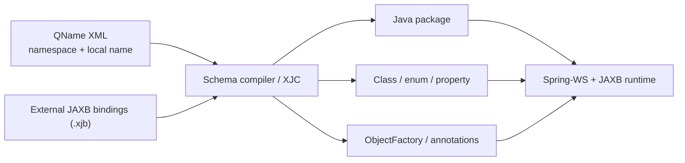
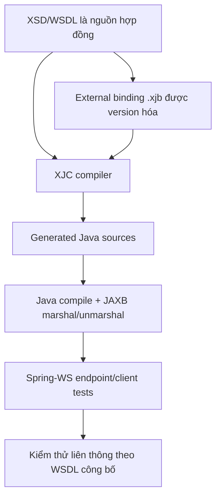

# Binding tùy chỉnh, tên package và xử lý xung đột tên

Trong hệ thống SOAP theo hướng **contract-first**, XSD và WSDL là hợp đồng giữa các ứng dụng, còn lớp Java được sinh bởi JAXB/XJC là một cách biểu diễn hợp đồng đó trong chương trình. Khi sử dụng Spring Web Services (Spring-WS), các lớp JAXB thường được dùng để nhận payload trong endpoint và tạo request/response từ SOAP client thông qua `Jaxb2Marshaller`. Tuy nhiên, quy tắc đặt tên mặc định của trình sinh mã có thể tạo ra package khó quản lý, tên class thiếu ý nghĩa hoặc hai thành phần XML khác nhau lại thành cùng một định danh Java.

Bài học thuộc chương **Sinh mã JAXB**, tập trung vào ba kỹ năng gắn liền với nhau: **tùy chỉnh binding JAXB**, **quy hoạch package từ namespace XSD**, và **chẩn đoán, giải quyết xung đột tên** khi sinh mã. Những kỹ năng này giúp giữ nguyên hợp đồng XSD/WSDL đã thống nhất, đồng thời tạo mô hình Java đủ rõ ràng, có thể tái sinh ổn định, hỗ trợ endpoint, SOAP client, interceptor, SOAP Fault và các yêu cầu tích hợp doanh nghiệp.

## 1. Tại sao cần tùy chỉnh binding khi đã có XSD?

XSD có mục đích mô tả cấu trúc XML. Java lại có các quy tắc định danh và tổ chức mã khác. Ví dụ XML có thể dùng tên `order-id`, trong khi Java thường đặt property là `orderId`. Hai namespace XML có thể đều định nghĩa `Status`, trong khi hai class `Status` không thể cùng tồn tại trong **một package** Java.

Một số trường hợp cần binding tùy chỉnh:

| Tình huống | Khả năng sinh mã mặc định | Ý định tùy chỉnh |
| --- | --- | --- |
| Namespace `https://example.com/orders/v1` | Package được suy từ URI theo quy tắc công cụ | Chốt package `com.acme.orders.soap.v1` |
| Hai XSD đều có kiểu `Status` | Hai class `Status` ở hai package, hoặc va chạm nếu ép chung package | Tách package hoặc đổi một class thành `OrderState` |
| `OrderRecord` trong XSD | Class Java `OrderRecord` | Đặt tên Java `OrderPayload` theo quy ước dự án |
| Hai element `order-id` và `orderId` | Có thể bị chuẩn hóa thành cùng property `orderId` | Đổi một Java property bằng binding cụ thể |
| Enum có giá trị chứa dấu gạch hoặc ký tự đặc biệt | XJC chuyển thành tên hằng Java hợp lệ | Đổi tên hằng bằng binding, giữ nguyên lexical XML value |
| Package thay đổi do generator hoặc namespace | Import và cấu hình JAXBContext có thể đổi | Cố định package trong source control và kiểm thử sinh mã |

**Nguyên tắc contract-first:** tùy chỉnh **cách ánh xạ sang Java**, không tự ý thay đổi tên XML hay namespace mà các đối tác đã ký kết. Việc sửa trực tiếp mã JAXB được sinh cũng không bền vững: lần chạy XJC tiếp theo sẽ tạo lại file và có thể xóa thay đổi đó.

## 2. Những khái niệm và công cụ cần phân biệt

| Khái niệm | Vai trò |
| --- | --- |
| **XSD** | Nguồn hợp đồng cho kiểu, phần tử, thuộc tính, namespace, `minOccurs`, `nillable` |
| **XJC** (*XML-to-Java Compiler*) | Công cụ biên dịch schema XML thành các lớp và annotation JAXB |
| **JAXB binding customization** | Các chỉ thị điều chỉnh mapping XML → Java, có thể viết trực tiếp trong XSD hoặc trong tệp ngoài `.xjb` |
| **JAXB runtime** | Marshal object Java thành XML và unmarshal XML thành object theo binding |
| **`ObjectFactory`** | Lớp sinh mã thường chứa phương thức tạo các đối tượng và `JAXBElement` tương ứng |
| **`package-info.java`** | Thường chứa `@XmlSchema` để gắn Java package với XML namespace |
| **Spring-WS `Jaxb2Marshaller`** | Adapter dựa trên JAXB để chuyển đổi payload XML và các đối tượng Java |

**XJC không phải validator nghiệp vụ.** XJC cần biên dịch được XSD để sinh lớp, nhưng việc tạo được class chưa chứng minh mọi request SOAP đều hợp lệ hay đáp ứng điều kiện nghiệp vụ. Schema validation, xử lý SOAP Fault và kiểm tra WS-Security vẫn là các bước riêng của ứng dụng.

### Jakarta JAXB so với JAXB cũ

Trong các dự án hiện đại, thường gặp **Jakarta XML Binding 3.x/4.x**, sử dụng API/annotation `jakarta.xml.bind.*`; tài liệu cũ có thể dùng JAXB 2.x với `javax.xml.bind.*`. Chúng cũng có **namespace trong tệp binding khác nhau**:

| Nhánh công cụ | Binding namespace thường dùng | Kiểu Java annotation/API |
| --- | --- | --- |
| JAXB 2.x (thế hệ Java EE) | `http://java.sun.com/xml/ns/jaxb` với phiên bản binding phù hợp như `2.1` | `javax.xml.bind.*` |
| Jakarta XML Binding 3.x/4.x | `https://jakarta.ee/xml/ns/jaxb` với `version="3.0"` | `jakarta.xml.bind.*` |

Ví dụ của bài học sử dụng **cú pháp binding Jakarta** và dự kiến công cụ XJC tương thích. Không trộn một plugin JAXB 2.x với tệp binding Jakarta 3.0 rồi kỳ vọng generator tự chuyển đổi. Phiên bản XJC, JAXB runtime và thư viện Spring-WS cần được chọn phù hợp trong cùng dự án.

## 3. Cơ chế ánh xạ tên mặc định và nơi phát sinh va chạm

Khi đọc XSD, trình sinh mã cần ánh xạ:



Định danh XML của kiểu `Status` thuộc namespace đơn hàng là `{https://example.com/orders/v1}Status`; định danh XML của kiểu `Status` thuộc namespace chung là `{https://example.com/common/v1}Status`. Đây là **hai kiểu XML khác nhau**, dù trùng local name.

XJC thường ánh xạ mỗi namespace XSD tới một Java package; việc chuyển namespace URI thành package mặc định tùy quy tắc/phiên bản compiler. Nếu vô tình ép cả hai namespace vào `com.acme.soap.model`, chúng có thể tạo ra hai class `Status` trong cùng package, khiến XJC báo lỗi collision hoặc không thể biên dịch Java.

Tên property cũng có thể va chạm khi hai tên XML khác nhau được chuẩn hóa thành cùng camelCase. XSD hợp lệ về cú pháp không bảo đảm sơ đồ tên Java sau khi chuyển đổi sẽ không bị trùng.

Một lỗi đáng chú ý khác là **collision trong `ObjectFactory`**: tên element hoặc type sau chuẩn hóa có thể tạo các phương thức factory trùng chữ ký, ngay cả khi chưa nhìn thấy hai file `.java` có cùng tên. Do đó, khi sửa lỗi, phải xem cả **package, class, property, enum và factory method**.

## 4. Ví dụ xuyên suốt: hai XSD có kiểu `Status` trùng tên

Ta có một SOAP service trả trạng thái đơn hàng và thông tin khách hàng. Hợp đồng dùng hai namespace:

- `https://example.com/orders/v1`: các kiểu và phần tử nghiệp vụ đơn hàng.
- `https://example.com/common/v1`: kiểu dùng chung, ví dụ khách hàng.

Giả sử cây nguồn:

```text
contracts/
├── common.xsd
├── orders.xsd
└── bindings.xjb
```

### 4.1. `common.xsd`: namespace chung

```xml
<?xml version="1.0" encoding="UTF-8"?>
<xs:schema xmlns:xs="http://www.w3.org/2001/XMLSchema"
           xmlns:com="https://example.com/common/v1"
           targetNamespace="https://example.com/common/v1"
           elementFormDefault="qualified">

    <xs:simpleType name="Status">
        <xs:restriction base="xs:string">
            <xs:enumeration value="ACTIVE"/>
            <xs:enumeration value="SUSPENDED"/>
        </xs:restriction>
    </xs:simpleType>

    <xs:complexType name="Customer">
        <xs:sequence>
            <xs:element name="customerId" type="xs:string"/>
            <xs:element name="status" type="com:Status"/>
        </xs:sequence>
    </xs:complexType>
</xs:schema>
```

### 4.2. `orders.xsd`: namespace nghiệp vụ

```xml
<?xml version="1.0" encoding="UTF-8"?>
<xs:schema xmlns:xs="http://www.w3.org/2001/XMLSchema"
           xmlns:ord="https://example.com/orders/v1"
           xmlns:com="https://example.com/common/v1"
           targetNamespace="https://example.com/orders/v1"
           elementFormDefault="qualified">

    <xs:import namespace="https://example.com/common/v1"
               schemaLocation="common.xsd"/>

    <xs:simpleType name="Status">
        <xs:restriction base="xs:string">
            <xs:enumeration value="NEW"/>
            <xs:enumeration value="PAID"/>
        </xs:restriction>
    </xs:simpleType>

    <xs:complexType name="OrderRecord">
        <xs:sequence>
            <xs:element name="orderId" type="xs:positiveInteger"/>
            <xs:element name="status" type="ord:Status"/>
            <xs:element name="customer" type="com:Customer"/>
        </xs:sequence>
    </xs:complexType>

    <xs:element name="GetOrderResponse" type="ord:OrderRecord"/>
</xs:schema>
```

Ở đây `orders.xsd` dùng `xs:import` để thấy kiểu `com:Customer`. Hai kiểu `Status` đều hợp lệ vì có **namespace khác nhau**. Sơ đồ XML trên cũng hợp lệ: phần tử `GetOrderResponse` là phần tử của namespace `orders/v1`, trong khi bên trong `customer` có kiểu complex type được định nghĩa ở namespace `common/v1`.

Một response payload hợp lệ theo hợp đồng có hình dạng:

```xml
<ord:GetOrderResponse
    xmlns:ord="https://example.com/orders/v1"
    xmlns:com="https://example.com/common/v1">
    <ord:orderId>42</ord:orderId>
    <ord:status>PAID</ord:status>
    <ord:customer>
        <com:customerId>C102</com:customerId>
        <com:status>ACTIVE</com:status>
    </ord:customer>
</ord:GetOrderResponse>
```

**Chú ý:** `ord:customer` là phần tử *được khai báo trong* `OrderRecord` thuộc namespace đơn hàng; các phần tử **con** `com:customerId` và `com:status` là khai báo bên trong `Customer` ở namespace chung. Điều này cần được giữ nguyên khi tùy chỉnh class và package Java.

## 5. External binding `.xjb`: đặt package và đổi tên class/enum

Thay vì chèn thông tin Java vào XSD nghiệp vụ dùng chung với đối tác, ta tạo tệp **external binding**. Nó tham chiếu chính xác đến các nút XSD cần tùy chỉnh mà không thay đổi nội dung hợp đồng XML.

Ví dụ đầy đủ `contracts/bindings.xjb` dành cho **Jakarta JAXB/XJC 3.x/4.x**:

```xml
<?xml version="1.0" encoding="UTF-8"?>
<jaxb:bindings
    xmlns:jaxb="https://jakarta.ee/xml/ns/jaxb"
    xmlns:xs="http://www.w3.org/2001/XMLSchema"
    version="3.0">

    <!-- Package và tên Java riêng cho namespace đơn hàng -->
    <jaxb:bindings schemaLocation="orders.xsd" node="/xs:schema">
        <jaxb:schemaBindings>
            <jaxb:package name="com.acme.orders.soap.v1"/>
        </jaxb:schemaBindings>

        <jaxb:bindings node="//xs:complexType[@name='OrderRecord']">
            <jaxb:class name="OrderPayload"/>
        </jaxb:bindings>

        <jaxb:bindings node="//xs:simpleType[@name='Status']">
            <jaxb:typesafeEnumClass name="OrderState"/>
        </jaxb:bindings>
    </jaxb:bindings>

    <!-- Namespace chung ánh xạ sang package riêng -->
    <jaxb:bindings schemaLocation="common.xsd" node="/xs:schema">
        <jaxb:schemaBindings>
            <jaxb:package name="com.acme.common.soap.v1"/>
        </jaxb:schemaBindings>
    </jaxb:bindings>
</jaxb:bindings>
```

Tệp này sử dụng các customization chuẩn:

1. **`jaxb:bindings` gốc** khai báo namespace Jakarta JAXB và phiên bản binding.
2. **`schemaLocation`** trỏ đến XSD tương ứng. Do các tệp cùng ở thư mục `contracts/`, giá trị `orders.xsd` và `common.xsd` là các đường dẫn tương đối phù hợp; với cấu trúc khác cần sửa đúng base URI.
3. **`node="/xs:schema"`** chọn nút schema gốc trong từng tài liệu. Prefix `xs` trong XPath được liên kết với namespace XML Schema.
4. **`jaxb:schemaBindings/jaxb:package`** chốt Java package cho các kiểu sinh ra từ từng schema.
5. **`jaxb:class`** đặt tên class Java cho kiểu phức `OrderRecord` thành `OrderPayload`, trong khi tên XML `OrderRecord` trong XSD vẫn giữ nguyên.
6. **`jaxb:typesafeEnumClass`** đổi tên enum Java sinh từ kiểu `Status` của namespace đơn hàng thành `OrderState`; kiểu `com:Status` thuộc namespace chung không bị đổi theo.

Sau khi sinh mã, ta kỳ vọng có những kiểu Java mang ý nghĩa tương đương:

```text
com.acme.orders.soap.v1.OrderPayload
com.acme.orders.soap.v1.OrderState
com.acme.common.soap.v1.Customer
com.acme.common.soap.v1.Status
```

Đây là **tên dự kiến** theo binding. Đầu ra cụ thể (kể cả `ObjectFactory`, `package-info.java`, `@XmlRootElement` và `JAXBElement`) phụ thuộc phiên bản XJC và đặc điểm của khai báo element/type. Không nên giả định cứ có phần tử global `GetOrderResponse` là class `OrderPayload` nhất định có annotation `@XmlRootElement(name="GetOrderResponse")`; trường hợp này có thể cần `ObjectFactory` tạo một `JAXBElement<OrderPayload>`.

### Cách gọi XJC và những điều phải chuẩn bị

Một quy trình CLI tham khảo, khi đã cài đúng XJC và tạo thư mục đầu ra:

```bash
mkdir -p target/generated-sources/jaxb
xjc -d target/generated-sources/jaxb \
    -b contracts/bindings.xjb \
    contracts/orders.xsd
```

Đây là **lệnh minh họa để người học chạy trong môi trường thích hợp**; không phải lệnh đã được thực thi trong bài. XJC sẽ đọc schema entrypoint `orders.xsd`, lần theo `common.xsd` và áp dụng customization. Trong Maven/Gradle có thể dùng plugin JAXB/XJC tương ứng, truyền đường dẫn file XSD và binding, đồng thời thêm generated sources vào giai đoạn compile. Tránh pin một plugin hoặc option theo tài liệu cũ nếu chưa xác nhận nó tương thích với Jakarta JAXB và JDK đang dùng.

**Không ép tất cả namespace về cùng một package bằng tùy chọn `-p`** khi đang muốn tách package theo binding. Với JAXB RI XJC, option `-p` chỉ định package đích chung và có thể ghi đè package customization trong binding; việc này dễ gây trở lại lỗi class `Status` trùng tên.

## 6. Cơ chế binding ở nhiều phạm vi và thứ tự ưu tiên

XJC có thể nhận customization ở nhiều cấp. Cần hiểu **vị trí của customization** và những ràng buộc của từng phạm vi:

| Phạm vi | Ví dụ | Ứng dụng |
| --- | --- | --- |
| Toàn bộ lần biên dịch / global | `jaxb:globalBindings` | Điều chỉnh một số quy tắc sinh mã chung |
| Schema | `jaxb:schemaBindings` với `jaxb:package` | Quy định package cho namespace/schema |
| Kiểu phức / element | `jaxb:class` | Chọn tên class Java |
| Phần tử/thuộc tính cục bộ | `jaxb:property` | Đổi tên property để có ý nghĩa hoặc tránh collision |
| Enum type | `jaxb:typesafeEnumClass` | Đổi tên enum Java |
| Enum value cụ thể | `jaxb:typesafeEnumMember` | Đổi tên một hằng Java, giữ giá trị XML |

Không phải customization nào cũng đặt được tại mọi node. Ví dụ `jaxb:package` là customization ở mức schema, trong khi `jaxb:property` gắn với khai báo property tương ứng. Đặt đúng XPath nhưng sai **loại node được hỗ trợ** vẫn có thể làm binding bị từ chối.

Nếu XJC thông báo customization không được sử dụng hoặc XPath không tìm thấy node, đừng giải quyết bằng cách vô hiệu hóa validation. Cần kiểm tra `schemaLocation` có đúng tài liệu compiler đang dùng không, namespace `xs` đúng không và cú pháp XPath có chọn **đúng một khai báo mong muốn** hay không.

Có thể chèn customization trực tiếp vào XSD thông qua `xs:annotation/xs:appinfo`, nhưng khi hợp đồng được chia sẻ cho nhiều hệ thống và có thể sinh client .NET, lựa chọn **tệp `.xjb` bên ngoài** thường giúp tách quyết định Java khỏi hợp đồng đa nền tảng. Đổi lại, pipeline phải quản lý phiên bản XSD và binding cùng nhau.

## 7. Đổi tên property để xử lý xung đột trong cùng một kiểu

Một trường hợp rất thực tế là hai phần tử XML có tên khác nhau nhưng chuyển sang cùng Java property:

```xml
<xs:complexType name="LegacyOrder">
    <xs:sequence>
        <xs:element name="order-id" type="xs:string"/>
        <xs:element name="orderId" type="xs:string"/>
    </xs:sequence>
</xs:complexType>
```

Hai tên XML `order-id` và `orderId` không trùng QName, nên về mặt XSD chúng có thể cùng tồn tại. Tuy nhiên, tùy quy tắc chuẩn hóa, XJC có thể cố đặt cả hai thành property `orderId`, gây **property collision**.

Giả sử đoạn trên được thêm vào `contracts/orders.xsd`, có thể đặt binding trên **một element cụ thể**, ví dụ đổi property Java của `order-id`:

```xml
<!-- Đặt đoạn này bên trong jaxb:bindings của orders.xsd -->
<jaxb:bindings
    node="//xs:complexType[@name='LegacyOrder']
            /xs:sequence/xs:element[@name='order-id']">
    <jaxb:property name="legacyOrderId"/>
</jaxb:bindings>
```

Đoạn XPath trong ví dụ được xuống dòng để dễ đọc; nó chọn phần tử cục bộ `order-id` bên trong `LegacyOrder`. Khi viết file thực tế, có thể đặt XPath một dòng và kiểm tra XJC nhận đúng nút. Nếu `LegacyOrder` chưa tồn tại trong schema đầu vào, binding **sẽ không áp dụng được**; đoạn trên là ví dụ mở rộng, không được thêm nguyên vẹn vào tệp `bindings.xjb` ở phần 5 khi schema vẫn giữ nguyên.

Kết quả mong đợi là có hai property Java `legacyOrderId` và `orderId`, trong khi XML vẫn nhận:

```xml
<ord:LegacyOrder xmlns:ord="https://example.com/orders/v1">
    <ord:order-id>LEG-42</ord:order-id>
    <ord:orderId>NEW-42</ord:orderId>
</ord:LegacyOrder>
```

Ví dụ XML minh họa hai phần tử trong kiểu `LegacyOrder`; để thành tài liệu XML độc lập có thể validate, schema còn phải khai báo một global element tương ứng. Sau khi sinh mã, cần kiểm tra các annotation `@XmlElement(name="order-id")` và `@XmlElement(name="orderId")` (hoặc metadata tương đương), rồi marshal và unmarshal để xác nhận **XML name giữ nguyên**.

### Xung đột tên với từ khóa Java

XSD có thể dùng local name như `class`, `default` hoặc `switch`. Chúng có ý nghĩa khác trong Java. XJC có quy tắc chuyển thành định danh hợp lệ, nhưng không nên giả định đầu ra sẽ giống nhau ở mọi phiên bản. Nếu tên sinh ra khó hiểu hoặc trùng một tên đã được sử dụng, có thể dùng `jaxb:property` đặt tên rõ ràng, ví dụ `customerClass`.

**Không nên “giải quyết” collision bằng cách đổi tên element XML đã công bố** chỉ vì Java không chấp nhận identifier đó. Đổi tên XML làm thay QName và có thể phá SOAP client hiện hữu.

## 8. Xử lý collision của enum và các kiểu cùng tên

### 8.1. Hai enum có cùng tên `Status`

Trong ví dụ chính, `ord:Status` và `com:Status` là hai kiểu XSD độc lập. Ta có hai biện pháp:

1. **Tách Java package theo namespace**: `com.acme.orders.soap.v1` và `com.acme.common.soap.v1`.
2. **Đặt tên có ngữ nghĩa hơn**: `OrderState` cho enum đơn hàng; giữ `Status` cho kiểu chung hoặc đổi thành `CustomerState` nếu có yêu cầu rõ ràng.

Thông thường, **tách package theo namespace là nền tảng**, đổi tên chỉ khi cải thiện cách đọc code. Đổi một class không xử lý được nguyên nhân nếu công cụ vẫn ép nhiều namespace vào cùng package và phát sinh thêm xung đột khác.

### 8.2. Hai giá trị enum khác XML nhưng giống tên Java sau chuẩn hóa

Giả sử schema có enum gồm `in-progress` và `IN_PROGRESS`. Hai lexical value là khác nhau trong XML, nhưng XJC có thể chuẩn hóa chúng thành cùng tên hằng Java tùy quy tắc. Có thể thêm customization vào **enumeration cụ thể**:

```xml
<!-- Minh họa đặt bên trong binding của schema chứa JobState -->
<jaxb:bindings node="//xs:simpleType[@name='JobState']
                     /xs:restriction/xs:enumeration[@value='in-progress']">
    <jaxb:typesafeEnumMember name="IN_PROGRESS_LEGACY"/>
</jaxb:bindings>
```

Với `JobState` và giá trị đó thực sự tồn tại, khi marshal, hằng `IN_PROGRESS_LEGACY` vẫn phải ánh xạ về **lexical value XML `in-progress`**, không được biến thành `IN_PROGRESS_LEGACY` trên wire. Việc `typesafeEnumMember` được hỗ trợ và hằng sinh ra cụ thể cần được xác nhận bằng XJC đúng phiên bản. Trong Jakarta JAXB, annotation `@XmlEnumValue` thường thể hiện giá trị XML của mỗi hằng.

Nếu một kiểu XSD dùng pattern hoặc union quá phức tạp và compiler không sinh enum như mong đợi, phải xem xét **đặc điểm của kiểu đó** trước khi thêm customization nhắm vào `xs:enumeration`.

## 9. Xung đột giữa class, global element và `ObjectFactory`

Một schema có thể khai báo kiểu và phần tử cùng local name:

```xml
<xs:complexType name="Order">
    <xs:sequence>
        <xs:element name="orderId" type="xs:string"/>
    </xs:sequence>
</xs:complexType>

<xs:element name="Order" type="tns:Order"/>
```

Giả sử `tns` trỏ tới target namespace của schema này. **Tên của một global element và một global complex type có thể trùng nhau trong XSD**, vì chúng thuộc các nhóm thành phần schema khác nhau. Nhưng trong Java, việc sinh class, `JAXBElement`, ObjectFactory hoặc factory method liên quan có thể gặp xung đột tùy cách binding và XJC xử lý.

Không có một thủ thuật rename duy nhất chữa được mọi lỗi. Cần đọc **thông báo chi tiết của XJC** để biết collision ở đâu:

| Phạm vi lỗi | Dấu hiệu | Hướng xử lý |
| --- | --- | --- |
| Hai Java class cùng tên/package | Compiler báo trùng class hoặc XJC báo collision | Tách package hoặc `jaxb:class` trên đúng type/element |
| Hai Java property cùng tên | XJC báo property collision trong một complex type | `jaxb:property` trên phần tử/thuộc tính cục bộ cụ thể |
| Factory methods cùng tên/chữ ký | XJC nhắc `ObjectFactory` hoặc signature collision | Xem QName và customizations liên quan; dùng customization tương ứng thay vì sửa `ObjectFactory.java` |
| Enum member trùng định danh Java | Báo lỗi ở phần enum generation | `jaxb:typesafeEnumMember` |
| Java identifier không hợp lệ | Lỗi từ keyword/cú pháp/package | Đổi tên Java qua binding hoặc sửa package quy hoạch |

Nếu schema dùng `xs:element ref="tns:Order"`, `xs:complexType name="Order"` hoặc nhiều `choice`/substitution group phức tạp, cần phân biệt **component được tham chiếu** và **component tạo property**. Một XPath `//xs:element[@name='Order']` chọn global element nhưng không nhất thiết chọn phần tử cục bộ đang tạo property collision.

Một số bản XJC hỗ trợ extension như `xjc:superClass`, plugin đổi tên property hay `-XautoNameResolution` khi được cài riêng. **Đó là khả năng đặc thù implementation/plugin, không phải giải pháp JAXB chuẩn có thể mặc định dùng**. Đối với thư viện hợp đồng dài hạn, ưu tiên package rõ ràng và standard binding theo node hơn là phụ thuộc option tự đổi tên khó kiểm soát.

## 10. Kiểm tra đường dẫn và XPath trong binding file

Một file `.xjb` hợp lệ cú pháp XML vẫn có thể thất bại khi XJC xử lý. Các nguyên nhân chính:

**Sai `schemaLocation`:** path trong external binding không trỏ đến cùng schema được compiler nạp. Ví dụ binding ở `contracts/bindings/bindings.xjb` nhưng khai báo `schemaLocation="orders.xsd"` trong khi XSD nằm ở `contracts/orders.xsd`. Trường hợp đó cần location như `../orders.xsd`, với base URI thích hợp.

**Sai XPath:** chọn tên type không tồn tại, chọn global element thay vì local element, hoặc chọn nhiều node khi compiler mong một đích tùy chỉnh duy nhất. Ví dụ:

```xml
<jaxb:bindings node="//xs:complexType[@name='OrderRecord']">
    <jaxb:class name="OrderPayload"/>
</jaxb:bindings>
```

Nếu schema đã đổi `OrderRecord` thành `PurchaseOrder`, node không còn tồn tại. Đây là lỗi cần sửa ở **binding file**, không phải lý do đổi schema đang được các đối tác sử dụng trở về tên cũ.

**Sai namespace của tài liệu binding:** `http://java.sun.com/xml/ns/jaxb` thuộc thế hệ JAXB 2, còn `https://jakarta.ee/xml/ns/jaxb` dành cho Jakarta JAXB 3/4. Nếu parser không hiểu namespace/version, các khai báo có thể bị từ chối hoặc báo lỗi unexpected element.

**XSD import không tải được:** nếu `orders.xsd` import `common.xsd` nhưng đường dẫn bị thiếu sau build, XJC sẽ không nhìn thấy type `com:Customer`. Khi đó lỗi “type not found” có thể xuất hiện cùng lỗi binding. Hãy sửa đồ thị XSD và `schemaLocation` trước khi sửa tên class.

### Cách chẩn đoán theo thứ tự

1. Biên dịch XSD độc lập để chứng minh các `include/import`, namespace và QName hợp lệ.
2. Chạy XJC **không có `.xjb`** (trong một thư mục đầu ra tạm) để xem tên mặc định và xác định lỗi gốc có sẵn hay phát sinh do customization.
3. Chạy XJC **có `.xjb`**, dùng cùng phiên bản/compiler và lưu log lỗi có đủ tên schema, dòng, cột và XPath.
4. Kiểm tra package, class, property, enum và `ObjectFactory` được sinh ra; không chỉ tìm file class trùng tên.
5. Dùng marshal/unmarshal mẫu XML để kiểm tra QName, thứ tự phần tử và giá trị enum thực tế không đổi.
6. Tích hợp generated sources vào build Spring-WS rồi thử endpoint/client với chính WSDL/XSD đã công bố.

Lỗi như “XPath evaluation results in empty target node” thường cho thấy binding chọn sai tài liệu/nút; “unable to honor this customization” thường cho thấy vị trí tùy chỉnh không được hỗ trợ hoặc bị xung đột. Câu chữ cụ thể tùy XJC và plugin.

## 11. Package mapping và tác động đến Spring-WS

Chốt package trong binding chỉ ảnh hưởng đến **mã Java**; XML namespace vẫn được xác định bởi các QName của XSD/WSDL. Các lớp được sinh thường có `package-info.java` với annotation `@XmlSchema` ánh xạ namespace và quy định qualified/unqualified cho các element.

Ví dụ về **cấu trúc kỳ vọng** của một phần `package-info.java` trong Jakarta JAXB:

```java
@jakarta.xml.bind.annotation.XmlSchema(
    namespace = "https://example.com/orders/v1",
    elementFormDefault =
        jakarta.xml.bind.annotation.XmlNsForm.QUALIFIED
)
package com.acme.orders.soap.v1;
```

Đây là minh họa nội dung do XJC có thể tạo; không nên tự chỉnh sửa file được sinh để thay QName. Khi kiểm tra sau build, so sánh annotation với `targetNamespace` và `elementFormDefault` thực tế trong XSD.

### Cấu hình JAXB trong ứng dụng Spring-WS

Với các package đã quy hoạch, có thể cấu hình `Jaxb2Marshaller` để nó biết các lớp tương ứng:

```java
import org.springframework.context.annotation.Bean;
import org.springframework.context.annotation.Configuration;
import org.springframework.oxm.jaxb.Jaxb2Marshaller;

@Configuration
public class SoapMarshallingConfig {
    @Bean
    public Jaxb2Marshaller ordersMarshaller() {
        Jaxb2Marshaller m = new Jaxb2Marshaller();
        m.setContextPaths(
            "com.acme.orders.soap.v1",
            "com.acme.common.soap.v1"
        );
        return m;
    }
}
```

Ví dụ giả định mỗi package JAXB có thông tin context như `ObjectFactory` được sinh phù hợp. `Jaxb2Marshaller` cũng có thể được cấu hình dựa trên các class cụ thể tùy đặc điểm dự án. Cần dùng **API Jakarta hoặc javax tương thích với Spring đang triển khai**; việc đặt package đúng không tự xử lý được mismatch giữa JAXB 2 và Jakarta JAXB 4.

Khi endpoint dùng `@PayloadRoot(namespace="https://example.com/orders/v1", localPart="GetOrderRequest")`, Spring-WS chọn handler theo **QName của SOAP Body payload** chứ không theo Java package của class JAXB. Việc đổi `OrderRecord` thành `OrderPayload` không làm đổi QName XML nếu binding được áp dụng đúng.

Một lưu ý thực tế: một global element như `GetOrderResponse` có thể được marshal dưới dạng `JAXBElement<OrderPayload>` tạo qua `ObjectFactory`, thay vì marshal thẳng `OrderPayload`, tùy cách XJC sinh annotation. Khi nhận lỗi “missing `@XmlRootElement`” hoặc “unable to marshal type ... as an element”, hãy kiểm tra factory method và declaration của global element trước khi thay XSD.

### Không làm lẫn transport, schema và security

- **`Jaxb2Marshaller`** chuyển object ↔ XML theo binding; nó không tự chọn endpoint HTTP hoặc bảo đảm truy cập WSDL.
- **XSD validation** cần được cấu hình rõ, ví dụ interceptor phù hợp ở Spring-WS; JAXB unmarshal không mặc nhiên validate toàn bộ XSD.
- **SOAP Fault** do Spring-WS và logic xử lý lỗi quy định; rename Java class không thay thế thiết kế fault type/element trong XSD.
- **WS-Security** xử lý chữ ký XML, chứng chỉ, mã hóa, timestamp/token theo chính sách; đổi Java package không làm thay đổi chính sách bảo mật của SOAP message.

## 12. Quản lý binding trong Maven/Gradle và pipeline tái sinh

Mọi quyết định tùy chỉnh phải **có khả năng tái tạo** trên máy lập trình viên, CI và khi nâng cấp công cụ. Một quy trình điển hình:



Trong Maven/Gradle cần xác nhận:

1. **Đầu vào ổn định:** khai báo chính xác schema entrypoint, tệp `.xjb`, các XSD import/include và catalog/resolver nếu có.
2. **Phiên bản đồng bộ:** dùng XJC, JAXB runtime và các thư viện Spring tương thích; tránh kết hợp compiler Jakarta với runtime `javax.xml.bind` cũ.
3. **Đường dẫn generated sources riêng:** ví dụ `target/generated-sources/jaxb` hoặc `build/generated/sources/jaxb`; không sửa trực tiếp nội dung tại đây.
4. **Build tái tạo được:** chạy lại XJC cho cùng XSD + binding phải sinh kết quả tương đương; không dựa vào chỉnh sửa thủ công trên máy cá nhân.
5. **Thêm generated sources vào compile:** package/class mới phải được ứng dụng sử dụng; source cũ của cùng schema không được tồn tại song song gây duplicate class.
6. **Kiểm tra schema nguồn:** các XSD import/include phải phân giải từ đúng base URI, kể cả khi build chạy trong Docker hoặc trên Windows/Linux.
7. **Kiểm thử contract:** marshal/unmarshal XML mẫu, validate XSD, thử Spring-WS endpoint/client và sinh client độc lập từ WSDL công bố khi có đối tác khác nền tảng.

**Không nên commit thay đổi trong generated Java rồi bỏ qua binding.** Nếu repository có quy định commit generated sources, mỗi thay đổi tên Java phải xuất phát từ XSD hoặc `.xjb` và được sinh lại bằng build chính thức. Điều đó giúp tránh một môi trường sinh `OrderPayload` còn môi trường khác vẫn dùng `OrderRecord`.

### Khi đổi namespace hoặc version hợp đồng

Nếu XSD chuyển namespace từ `.../orders/v1` sang `.../orders/v2`, hợp đồng SOAP có thể đang thay đổi theo phiên bản. Java package thường nên phản ánh chiến lược versioning, ví dụ `com.acme.orders.soap.v2`, nếu phải hỗ trợ đồng thời v1 và v2.

Đừng chỉ đổi package thành v2 trong binding mà vẫn dùng namespace v1 rồi hiểu rằng đã nâng phiên bản SOAP contract. Ngược lại, nếu schema đã đổi namespace, việc giữ một package Java cũ có thể tạo nhầm lẫn; cần kiểm tra cả QName, `@XmlSchema`, JAXBContext, Spring-WS `@PayloadRoot`, endpoint và WSDL.

## 13. Ma trận lỗi thường gặp và cách giải quyết

| Triệu chứng | Nguyên nhân khả dĩ | Hướng kiểm tra/sửa |
| --- | --- | --- |
| Hai class `Status` cùng package | Hai namespace bị ép vào một package | Tạo `jaxb:package` riêng cho mỗi namespace; tránh `-p` chung |
| XJC báo property `orderId` trùng | `order-id` và `orderId` chuẩn hóa giống nhau | Gắn `jaxb:property` cho đúng local element |
| Sinh enum thất bại do tên hằng trùng | Nhiều lexical enum value quy về một Java identifier | Tùy chỉnh `jaxb:typesafeEnumMember` trên từng enumeration |
| `ObjectFactory` có phương thức trùng | Nhiều global element/type gây factory name collision | Xem QName và customizations tại các global declaration; đổi tên Java có chọn lọc |
| Không tìm thấy kiểu `com:Customer` | XSD import hoặc `schemaLocation` hỏng | Biên dịch XSD và sửa resolver/import trước |
| Binding báo không chọn được node | XPath sai namespace/tên node hoặc location sai | Kiểm tra `xs` prefix, node path và source XSD thực tế |
| Compiler bỏ qua/từ chối binding | Namespace/version của JAXB binding không khớp | Đồng bộ JAXB 2.x hoặc Jakarta 3.x/4.x |
| Class sinh ra ở package không mong muốn | Dùng `-p`, binding không được nạp hoặc cấu hình plugin ghi đè | Đọc dòng lệnh XJC và kiểm tra `package-info.java` |
| Java project thấy cả class cũ và mới | Generated sources cũ chưa được loại khỏi source roots | Bảo đảm build chỉ sử dụng đúng output của lần generation tương ứng |
| Marshal báo thiếu root element | Type class không được sinh với `@XmlRootElement` | Dùng `ObjectFactory`/`JAXBElement` tương ứng với global element |
| Namespace XML đổi sau khi rename class | Binding/annotation bị chỉnh sai hoặc schema bị sửa | So `@XmlSchema`, `@XmlElement`, XSD và XML mẫu |
| Runtime `NoClassDefFoundError: javax/xml/bind/... ` | Trộn API JAXB `javax` và `jakarta`/thiếu dependency | Kiểm tra cây dependency và phiên bản Spring/JAXB |
| Client đối tác vẫn thấy tên XML cũ | Chỉ rename Java, hợp đồng XML không đổi | Đây là hành vi đúng; nếu muốn đổi hợp đồng phải version XSD/WSDL |

Đối với log XJC, nên lưu **thông báo lỗi đầu tiên có vị trí tài liệu/nút schema**, rồi sửa nguyên nhân gốc. Một import bị hỏng có thể gây hàng loạt báo lỗi class/property tiếp theo; thay tên class lúc này chỉ che giấu vấn đề.

## 14. Kiểm thử: tên Java đổi nhưng XML trên wire phải giữ nguyên

Một binding tùy chỉnh được xem là thành công khi có thể chứng minh cả **mã Java** lẫn **hợp đồng XML** đúng.

| Ca | Kiểm tra | Kết quả mong đợi |
| --- | --- | --- |
| B01 | XJC sinh code với `bindings.xjb` | Không có lỗi schema/binding/collision |
| B02 | Kiểm tra package đơn hàng | `com.acme.orders.soap.v1` |
| B03 | Kiểm tra package chung | `com.acme.common.soap.v1` |
| B04 | Kiểm tra kiểu `OrderRecord` | Class Java được đặt tên `OrderPayload` |
| B05 | Kiểm tra kiểu `ord:Status` | Enum Java được đặt tên `OrderState` |
| B06 | Kiểm tra kiểu `com:Status` | Vẫn có enum `Status` trong package chung |
| B07 | Marshal `GetOrderResponse` | Root QName và phần tử con giống hợp đồng XSD |
| B08 | Unmarshal XML mẫu phần 4 | Giá trị đơn hàng/khách hàng đọc đúng |
| B09 | Kiểm tra `order-id` và `orderId` với schema mở rộng | Hai property riêng, XML names vẫn chính xác |
| B10 | Kiểm tra enum có `in-progress` | Java constant tùy chỉnh vẫn marshal thành lexical value cũ |
| B11 | Sinh lại XJC từ đầu trong CI | Không cần chỉnh sửa generated source |
| B12 | Đổi tạm một XPath thành tên không có trong XSD | Build báo lỗi binding, không silently dùng mapping sai |
| B13 | Dùng Spring-WS `Jaxb2Marshaller` với package đã sinh | Có thể marshal/unmarshal theo cấu hình tương ứng |
| B14 | Validate XML mẫu theo XSD | Schema và instance hợp lệ |
| B15 | Đọc WSDL công bố và thử client độc lập | QName trên wire tương thích với đối tác |

Nếu viết kiểm thử đơn vị Java, hãy đặc biệt xác minh **namespace URI + local name** của root và những element quan trọng. So sánh hai chuỗi XML nguyên văn có thể thất bại chỉ vì tiền tố namespace khác nhau, dù QName và cấu trúc tương đương. Nên dùng XML-aware comparison hoặc validation theo schema.

Đừng chỉ kiểm tra tên file generated `.java`: một class có thể đúng tên nhưng annotation `@XmlType` hoặc `@XmlElement` lại không khớp vì binding chọn sai component. Kiểm tra cả XML marshal/unmarshal mới phát hiện được những lệch này.

## 15. Bài tập thực hành và lời giải định hướng

**Bối cảnh:** Đối tác cung cấp hai schema:

- `https://example.com/invoice/v1` có complex type `Document`, cùng hai local element `item-id` và `itemId`.
- `https://example.com/common/v1` có complex type `Document`.

Nếu dùng package `com.acme.soap` cho cả hai schema, XJC báo class `Document` trùng. Sau khi tách package, XJC tiếp tục báo property `itemId` trùng trong `Document` của schema hóa đơn.

**Yêu cầu:** thiết kế binding để không đổi QName XML nhưng có mã Java rõ nghĩa.

**Định hướng xử lý:**

1. Chọn package riêng cho namespace hóa đơn, ví dụ `com.acme.invoice.soap.v1`, và package `com.acme.common.soap.v1` cho namespace chung.
2. Tùy chỉnh complex type `Document` của schema hóa đơn thành `InvoiceDocument` nếu cần phân biệt rõ ở tầng Java.
3. Tùy chỉnh **local element `item-id`** để property Java là `legacyItemId`; giữ `itemId` cho trường mới.
4. Xóa `-p com.acme.soap` khỏi cấu hình XJC nếu nó đang ép hai namespace vào cùng một package.
5. Sinh lại từ XSD + binding; kiểm tra cả `ObjectFactory`, `package-info.java`, annotation và XML marshal/unmarshal.
6. Đối chiếu payload gửi qua Spring-WS với XSD/WSDL đối tác: `item-id` và `itemId` phải giữ nguyên trên wire.

Nếu cách đổi tên trong Java chỉ chạy ở máy của một thành viên nhưng lỗi vẫn xuất hiện ở CI, cần so phiên bản XJC/JAXB, đường dẫn `.xjb`, cách đưa generated sources vào build và cấu hình catalog cho các XSD import.

## 16. Checklist trước khi chốt cấu hình JAXB generation

1. **XSD và WSDL là nguồn hợp đồng thống nhất**; các tùy chỉnh chỉ thay đổi mô hình Java khi không có yêu cầu version hợp đồng.
2. **Chốt phiên bản JAXB/XJC** và chọn namespace/cú pháp `.xjb` đúng với Jakarta hoặc JAXB 2.x đang dùng.
3. **Mỗi namespace có chiến lược package rõ ràng**; cân nhắc versioning khi phải hỗ trợ đồng thời nhiều thế hệ contract.
4. **Đúng schema entrypoint và tham chiếu**, bao gồm `include/import`, `schemaLocation` của `.xjb`, XML Catalog hoặc resolver nếu có.
5. **Các XPath chỉ đến đúng component**; customization chuẩn được đặt ở đúng phạm vi schema/type/property/enum.
6. **Xử lý collision dựa trên phạm vi thực tế**: class, property, enum, factory method; không sửa file generated.
7. **Không dùng `-p` chung vô tình ghi đè package customization**; kiểm tra đầy đủ option được plugin truyền cho XJC.
8. **Generated source được tái tạo trong CI** và Java compile thành công không có mã cũ trùng lặp.
9. **Marshal/unmarshal và validate XSD trên XML mẫu**; xác nhận QName, giá trị enum và thứ tự element.
10. **Spring-WS `Jaxb2Marshaller`, endpoint, SOAP client, fault handling và WS-Security** tiếp tục làm việc với chính hợp đồng đã công bố.
11. **Nâng cấp JAXB/Spring/XJC có regression test**, nhất là khi chuyển từ `javax.xml.bind` sang `jakarta.xml.bind`.

**Kết luận:** Tên package và class Java là quyết định triển khai, còn QName và cấu trúc XML trong XSD/WSDL là hợp đồng tích hợp. External binding giúp điều chỉnh lớp JAXB mà vẫn giữ nguyên SOAP message. Khi phân biệt đúng xung đột package, class, property, enum và `ObjectFactory`, rồi kiểm tra lại generated sources và XML trên wire, nhóm phát triển có thể sinh mã JAXB lặp lại ổn định cho cả Spring-WS endpoint và SOAP client.
