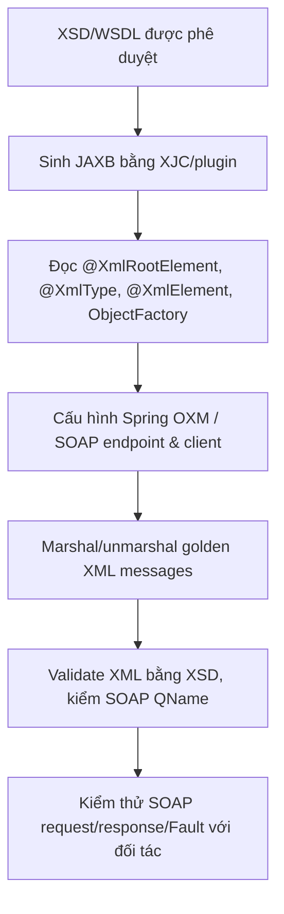

# XmlRootElement, XmlType, XmlElement và mô tả cấu trúc XML

Trong **Spring Web Services (Spring-WS)**, SOAP client và endpoint trao đổi XML theo hợp đồng XSD/WSDL. Khi ứng dụng viết bằng Java, **JAXB (Jakarta XML Binding)** giúp ánh xạ cấu trúc đó sang object để lập trình viên không phải tự nối chuỗi XML. Các annotation `@XmlRootElement`, `@XmlType` và `@XmlElement` rất giống nhau về tên nhưng mô tả **ba khái niệm khác nhau**: một **phần tử gốc**, một **kiểu XML**, và một **phần tử con** được ánh xạ vào thuộc tính Java.

Đối với module **SPRING_WEB_SERVICES**, hiểu ba annotation này là điều kiện để làm **contract-first**: bắt đầu bằng XSD/WSDL, sinh mã JAXB, dùng `Jaxb2Marshaller` trong Spring OXM, nhận/gửi SOAP payload qua `@PayloadRoot` và `WebServiceTemplate`, rồi kiểm tra tương thích. Một annotation sai namespace hoặc sai thứ tự phần tử có thể khiến SOAP request không được định tuyến, JAXB báo `unexpected element` hoặc đối tác từ chối thông điệp dù dữ liệu nghiệp vụ có vẻ đúng.

Bài học giải thích mối liên hệ giữa XSD và các annotation, vì sao có lúc một lớp JAXB có `@XmlRootElement` và có lúc phải dùng `JAXBElement<T>`, cách phân biệt cấu trúc XML với ràng buộc validation, cùng quy trình kiểm tra kết quả sinh mã trong ứng dụng Spring-WS.

## 1. Mục tiêu học tập

Sau bài này, bạn có thể:

- Phân biệt **global element**, **complex type**, **local element** và tên đầy đủ **QName** trong XSD.
- Giải thích nhiệm vụ của `@XmlRootElement`, `@XmlType`, `@XmlElement` và những annotation hỗ trợ như `@XmlSchema`, `@XmlAccessorType`, `@XmlAttribute`.
- Đọc `propOrder` để dự đoán thứ tự phần tử XML khi marshal và nhận diện sai khác với `xs:sequence`.
- Xác định khi nào JAXB sử dụng lớp Java như root, khi nào phải dùng `ObjectFactory` và `JAXBElement`.
- Giải thích ảnh hưởng của `minOccurs`, `nillable`, kiểu dữ liệu và namespace đến Java binding.
- Cấu hình JAXB trong Spring OXM và đối chiếu SOAP payload với QName trong XSD/WSDL.
- Viết kiểm thử marshal/unmarshal và XSD validation để phát hiện sai cấu trúc.

## 2. Ba lớp khái niệm: element, type, property

Hãy bắt đầu bằng ví dụ tối giản:

```xml
<ord:SubmitOrderRequest
    xmlns:ord="https://example.org/contracts/order/v1">
    <ord:requestId>REQ-1001</ord:requestId>
    <ord:quantity>2</ord:quantity>
</ord:SubmitOrderRequest>
```

Một người đọc XML nhìn thấy phần tử gốc `SubmitOrderRequest`, hai phần tử con `requestId` và `quantity`. XSD còn có thể gán các phần tử ấy cho những **kiểu dữ liệu** cụ thể. JAXB cần giữ được cả cấu trúc cây phần tử lẫn kiểu của từng giá trị.

| Cấp mô tả | Trong XSD | Trong Java/JAXB thường gặp | Ví dụ |
|---|---|---|---|
| **Global element** | `xs:element` khai báo trực tiếp dưới `xs:schema` | `@XmlRootElement` trên lớp hoặc `@XmlElementDecl`/`JAXBElement` | `SubmitOrderRequest` |
| **Complex type** | `xs:complexType` | `@XmlType` trên lớp Java | Kiểu chứa `requestId`, `quantity` |
| **Local element** | `xs:element` nằm trong nội dung một type | `@XmlElement` trên field/property | `requestId` |
| **Attribute** | `xs:attribute` | `@XmlAttribute` | `source="portal"` |
| **Namespace** | `targetNamespace`, `elementFormDefault`, `form` | `@XmlSchema`, `namespace` trong annotation | `https://example.org/contracts/order/v1` |

**Điểm mấu chốt:** tên của **phần tử** và tên của **kiểu** có thể khác nhau. Một kiểu XSD được dùng làm nội dung cho nhiều phần tử gốc khác nhau. `@XmlType` mô tả kiểu; một mình nó không tạo được danh tính của mọi root element có thể sử dụng kiểu đó.

Tên mở rộng (expanded name) của XML element là cặp **namespace URI + local name**, thường được viết:

```text
{https://example.org/contracts/order/v1}SubmitOrderRequest
```

Prefix `ord` chỉ là bí danh của URI trong tài liệu XML; thay `ord` bằng `x` nhưng giữ nguyên URI sẽ không đổi QName.

## 3. XSD mẫu xuyên suốt: yêu cầu và kết quả tạo đơn hàng

Xét `order-v1.xsd` dùng cho dịch vụ SOAP theo hướng contract-first:

```xml
<?xml version="1.0" encoding="UTF-8"?>
<xs:schema
    xmlns:xs="http://www.w3.org/2001/XMLSchema"
    xmlns:ord="https://example.org/contracts/order/v1"
    targetNamespace="https://example.org/contracts/order/v1"
    elementFormDefault="qualified"
    attributeFormDefault="unqualified">

    <!-- Global element có anonymous complex type -->
    <xs:element name="SubmitOrderRequest">
        <xs:complexType>
            <xs:sequence>
                <xs:element name="requestId" type="xs:string"/>
                <xs:element name="quantity"
                            type="xs:positiveInteger"/>
                <xs:element name="memo" type="xs:string"
                            minOccurs="0"/>
            </xs:sequence>
            <xs:attribute name="source"
                          type="xs:string"
                          use="optional"/>
        </xs:complexType>
    </xs:element>

    <!-- Một named complex type dùng lại được -->
    <xs:complexType name="OrderResultType">
        <xs:sequence>
            <xs:element name="orderId" type="xs:string"/>
            <xs:element name="accepted" type="xs:boolean"/>
        </xs:sequence>
    </xs:complexType>

    <!-- Global element tham chiếu đến named type -->
    <xs:element name="SubmitOrderResponse"
                type="ord:OrderResultType"/>
</xs:schema>
```

Nhìn vào schema có hai kiểu tổ chức:

1. `SubmitOrderRequest` là **global element** khai báo trực tiếp một **anonymous complex type**: kiểu không có `name` riêng trong schema. JAXB generator thường tạo lớp tương ứng với root element này và có thể gắn `@XmlRootElement` lên lớp.
2. `OrderResultType` là **named complex type**. `SubmitOrderResponse` là một global element có **tên riêng** nhưng dùng kiểu `OrderResultType`. JAXB generator thường sinh lớp `OrderResultType` ánh xạ kiểu và `ObjectFactory` để tạo `JAXBElement<OrderResultType>` mang tên root `SubmitOrderResponse`.

Các dạng sinh cụ thể có thể khác theo phiên bản XJC và binding customization; hãy đọc mã đã sinh thay vì mặc định mọi global element đều trở thành một lớp `@XmlRootElement`.

Trong payload:

- `requestId` phải có mặt trước `quantity` vì `xs:sequence`.
- `quantity` phải là số nguyên dương theo XSD; khi sinh JAXB thường được ánh xạ sang `BigInteger`.
- `memo` là phần tử tùy chọn vì `minOccurs="0"`.
- `source` là **thuộc tính XML**, không phải phần tử con; với `attributeFormDefault="unqualified"` nó không có namespace khi viết không prefix.
- Các phần tử con như `requestId` thuộc namespace của schema nhờ `elementFormDefault="qualified"`.

Ví dụ XML hợp lệ của yêu cầu:

```xml
<ord:SubmitOrderRequest
    xmlns:ord="https://example.org/contracts/order/v1"
    source="portal">
    <ord:requestId>REQ-1001</ord:requestId>
    <ord:quantity>2</ord:quantity>
    <ord:memo>Deliver before noon</ord:memo>
</ord:SubmitOrderRequest>
```

## 4. `@XmlRootElement`: tên phần tử gốc khi marshal một object

Annotation `@XmlRootElement` khai báo tên XML element dùng làm root cho một đối tượng JAXB có lớp được gắn annotation.

Ví dụ **mã minh họa** tương ứng với global element `SubmitOrderRequest`; cách XJC đặt tên field, getter và annotation thực tế có thể khác:

```java
package org.example.order.contract;

import java.math.BigInteger;
import jakarta.xml.bind.annotation.XmlAccessType;
import jakarta.xml.bind.annotation.XmlAccessorType;
import jakarta.xml.bind.annotation.XmlAttribute;
import jakarta.xml.bind.annotation.XmlElement;
import jakarta.xml.bind.annotation.XmlRootElement;
import jakarta.xml.bind.annotation.XmlSchemaType;
import jakarta.xml.bind.annotation.XmlType;

@XmlAccessorType(XmlAccessType.FIELD)
@XmlType(name = "", propOrder = {
    "requestId",
    "quantity",
    "memo"
})
@XmlRootElement(name = "SubmitOrderRequest")
public class SubmitOrderRequest {

    @XmlElement(required = true)
    protected String requestId;

    @XmlElement(required = true)
    @XmlSchemaType(name = "positiveInteger")
    protected BigInteger quantity;

    protected String memo;

    @XmlAttribute(name = "source")
    protected String source;

    // Getter/setter được lược bớt để tập trung vào annotation.
}
```

Ở đây:

- `@XmlRootElement(name = "SubmitOrderRequest")` xác định **local name** của XML root khi marshal lớp này trực tiếp.
- Namespace của root được xác định từ `namespace` khai báo ở annotation hoặc từ cấu hình namespace của package như `@XmlSchema`. Trong ví dụ, package sẽ được cấu hình ở mục tiếp theo.
- `@XmlType(name = "")` biểu đạt một **anonymous XML type**, phù hợp kiểu XSD không có tên riêng bên trong global element.
- JAXB có thể marshal trực tiếp một instance `SubmitOrderRequest` vì đã biết tên root.

Có thể ghi rõ namespace trong `@XmlRootElement`:

```java
@XmlRootElement(
    name = "SubmitOrderRequest",
    namespace = "https://example.org/contracts/order/v1"
)
```

Tuy nhiên, trong mã sinh từ XSD, nhiều thuộc tính namespace được kế thừa từ package-level `@XmlSchema` để tránh lặp chuỗi URI ở mỗi field. Không nên sửa annotation trong thư mục generated sources chỉ để “chỉnh” namespace; hãy sửa schema hoặc binding configuration và sinh lại mã.

### Không có `@XmlRootElement` thì sao?

Một lớp có `@XmlType` nhưng không có `@XmlRootElement` vẫn có thể đại diện cho **kiểu dữ liệu XML hợp lệ**. Tuy nhiên, khi marshal object đó như root mà không cung cấp tên phần tử qua cách khác, JAXB thường không biết dùng QName nào và có thể báo lỗi kiểu:

```text
unable to marshal type "...OrderResultType" as an element
because it is missing an @XmlRootElement annotation
```

Giải pháp đúng trong trường hợp global element tham chiếu tới named type là dùng `JAXBElement<T>`/`ObjectFactory` do XJC sinh ra, không tự thêm `@XmlRootElement` tùy tiện làm thay đổi mô hình contract.

## 5. `@XmlSchema`: cấu hình namespace mặc định cho package

XSD định nghĩa namespace và quy tắc qualified/unqualified. Trong JAXB, một phần thông tin tương ứng có thể được khai báo trong `package-info.java`:

```java
@jakarta.xml.bind.annotation.XmlSchema(
    namespace = "https://example.org/contracts/order/v1",
    elementFormDefault =
        jakarta.xml.bind.annotation.XmlNsForm.QUALIFIED,
    attributeFormDefault =
        jakarta.xml.bind.annotation.XmlNsForm.UNQUALIFIED
)
package org.example.order.contract;
```

Với package này:

- Phần tử root `SubmitOrderRequest` có thể lấy namespace nghiệp vụ thông qua `@XmlRootElement` với giá trị `namespace` mặc định phù hợp.
- Các field `@XmlElement` không ghi `namespace` có thể được ánh xạ vào namespace nghiệp vụ khi package quy định qualified.
- Thuộc tính `source` dùng `@XmlAttribute` không prefix và không namespace.
- Prefix XML cụ thể (`ord`, `ns2` hoặc default namespace) có thể được marshaller tự chọn; **prefix không tham gia định danh QName**.

Lưu ý chi tiết: `@XmlSchema` áp dụng theo **package Java**, không tự áp dụng cho mọi package trong một project. Nếu generated code trải qua nhiều package hoặc schema import nhiều namespace, cần đối chiếu từng `package-info.java` và `@XmlElement(namespace=...)`.

Không nhầm namespace nghiệp vụ với:

- Namespace SOAP Envelope 1.1: `http://schemas.xmlsoap.org/soap/envelope/`.
- Namespace SOAP Envelope 1.2: `http://www.w3.org/2003/05/soap-envelope`.
- HTTP endpoint URL, chẳng hạn `https://api.example.org/ws`.

Các giá trị này có thể đều là URI nhưng làm những việc khác nhau trong hệ thống.

## 6. `@XmlType`: hình dạng XML type và thứ tự phần tử

`@XmlType` mô tả một Java class tương ứng với XML Schema type. Hai thuộc tính rất đáng chú ý:

- `name`: tên XML type. `name=""` biểu đạt anonymous type; `name="OrderResultType"` biểu đạt named type có QName riêng.
- `propOrder`: thứ tự các **element-valued Java properties** trong nội dung XML, đặc biệt khi XSD dùng `xs:sequence`. Thuộc tính XML như `source` không nằm trong `propOrder`.

Ví dụ named type từ XSD:

```java
package org.example.order.contract;

import jakarta.xml.bind.annotation.XmlAccessType;
import jakarta.xml.bind.annotation.XmlAccessorType;
import jakarta.xml.bind.annotation.XmlElement;
import jakarta.xml.bind.annotation.XmlType;

@XmlAccessorType(XmlAccessType.FIELD)
@XmlType(name = "OrderResultType", propOrder = {
    "orderId",
    "accepted"
})
public class OrderResultType {

    @XmlElement(required = true)
    protected String orderId;

    protected boolean accepted;

    // Getter/setter do JAXB generator sinh được lược bỏ.
}
```

Dạng XML hợp lệ cho một element dùng kiểu này:

```xml
<ord:SubmitOrderResponse
    xmlns:ord="https://example.org/contracts/order/v1">
    <ord:orderId>ORD-9001</ord:orderId>
    <ord:accepted>true</ord:accepted>
</ord:SubmitOrderResponse>
```

Mặc dù class tên `OrderResultType`, phần tử gốc trong thông điệp là `SubmitOrderResponse` vì **global element declaration** của XSD đặt tên như vậy.

### `propOrder` hoạt động ra sao?

Giả sử XML Schema có:

```xml
<xs:sequence>
    <xs:element name="requestId" type="xs:string"/>
    <xs:element name="quantity" type="xs:positiveInteger"/>
    <xs:element name="memo" type="xs:string" minOccurs="0"/>
</xs:sequence>
```

`propOrder={"requestId", "quantity", "memo"}` phản ánh đúng thứ tự cấu trúc. Nếu đổi thành `{"quantity", "requestId", "memo"}`, JAXB có thể xuất XML khác thứ tự schema. XML vẫn well-formed nhưng có thể **không hợp lệ khi validate XSD**.

Tên trong `propOrder` là **tên property Java**, không phải QName XML và cũng không nhất thiết bằng local name trong XML nếu `@XmlElement(name=...)` đổi tên.

Có hai lỗi cần chú ý:

1. Khi dùng `@XmlAccessorType(XmlAccessType.FIELD)`, `propOrder` phải nhất quán với các field được JAXB coi là XML element; liệt kê sai tên hoặc thiếu property có thể gây lỗi khởi tạo JAXB context.
2. `@XmlAttribute` được tuần tự hóa thành attribute XML; thứ tự attribute không mang cùng ý nghĩa với thứ tự `xs:sequence` và không liệt kê trong `propOrder`.

**Không nên dùng `@XmlType` để tự “sửa” thứ tự XSD**. Với contract-first, sửa schema gốc trước, sinh lại JAXB rồi kiểm tra các bản XML mẫu.

## 7. `@XmlElement`: tên, namespace và ràng buộc phần tử con

`@XmlElement` ánh xạ một field hoặc property Java thành **XML child element**.

Ví dụ:

```java
@XmlElement(
    name = "requestId",
    namespace = "https://example.org/contracts/order/v1",
    required = true
)
protected String requestId;
```

Các thuộc tính thường gặp:

| Thuộc tính | Mục đích | Điều cần lưu ý |
|---|---|---|
| `name` | Tên cục bộ của element XML. | Có thể khác tên field Java. |
| `namespace` | Namespace URI của element. | Thường được suy từ `@XmlSchema`; prefix không phải một phần của giá trị. |
| `required` | Gợi ý element bắt buộc cho schema/binding. | **Không phải phép validate mọi giá trị null** khi marshal. |
| `nillable` | Cho phép biểu diễn `xsi:nil="true"`. | Không đồng nghĩa với `minOccurs="0"`; việc phân biệt absent/nil phụ thuộc binding. |
| `defaultValue` | Giá trị mặc định gắn với XML schema element. | Không tương đương với việc khởi tạo mặc định mọi Java field. |
| `type` | Chỉ định Java type được JAXB dùng trong một số trường hợp. | Không thay thế quy tắc XML type trong XSD hợp đồng. |

### `required=true` có buộc Java runtime từ chối null?

Không nên dựa vào annotation này như bộ kiểm tra schema hoàn chỉnh. Trong nhiều trường hợp, JAXB marshaller vẫn tạo XML thiếu phần tử bắt buộc nếu Java field null và không bật XSD validation. Khi cần bắt lỗi trước khi gửi SOAP, hãy **cấu hình schema validation** hoặc kiểm tra giá trị nghiệp vụ rõ ràng.

Ví dụ:

```java
@XmlElement(required = true)
protected String requestId;
```

Nếu `requestId == null`, một implementation có thể không ghi phần tử. Khi đó XML thiếu `requestId` và vi phạm `minOccurs="1"` của XSD. Đừng kết luận rằng có `required=true` nghĩa là object luôn hợp lệ.

### `minOccurs=0`, phần tử rỗng và `xsi:nil` khác nhau

Xem ba trạng thái:

```xml
<!-- 1. Không có element: có thể hợp lệ nếu minOccurs=0 -->
<ord:SubmitOrderRequest ...>
    <ord:requestId>REQ-1</ord:requestId>
    <ord:quantity>1</ord:quantity>
</ord:SubmitOrderRequest>
```

```xml
<!-- 2. Element hiện diện với nội dung rỗng -->
<ord:memo xmlns:ord="https://example.org/contracts/order/v1"/>
```

```xml
<!-- 3. Element khai báo nil (chỉ hợp lệ khi nillable=true) -->
<ord:memo xmlns:ord="https://example.org/contracts/order/v1"
          xmlns:xsi="http://www.w3.org/2001/XMLSchema-instance"
          xsi:nil="true"/>
```

Trong XSD ví dụ, `memo minOccurs=0` nhưng không khai báo `nillable=true`, vì vậy có thể **bỏ hẳn `memo`** hoặc truyền một chuỗi rỗng; nhưng không được dùng `xsi:nil="true"` nếu vẫn giữ nillable mặc định false.

Khi XSD có **cả `minOccurs=0` và `nillable=true`**, cần phân biệt “không gửi element” với “có element nhưng nil”. Binding JAXB có thể dùng `JAXBElement<T>` trong một số tình huống để biểu diễn riêng những trạng thái này. Mã sinh cụ thể phụ thuộc schema và phiên bản công cụ.

### Kiểu Java không tự thể hiện toàn bộ giới hạn XSD

`xs:positiveInteger` có thể sinh thành `BigInteger`; nhưng `new BigInteger("-3")` vẫn là giá trị Java hợp lệ. XSD validator mới xác nhận rằng giá trị này không được phép xuất hiện trong tài liệu XML theo hợp đồng.

Tương tự, `@XmlElement(required=true)` không đảm bảo `xs:pattern`, `xs:maxLength`, `xs:enumeration` hoặc kiểm tra domain như “mã đơn hàng phải tồn tại”. Đó là những tầng kiểm tra khác nhau.

## 8. Các annotation hỗ trợ để tránh đọc sai cây XML

Ba annotation chính thường xuất hiện cùng các annotation sau:

| Annotation | Vai trò | Ví dụ |
|---|---|---|
| `@XmlAccessorType` | Chọn truy cập field/getter/setter khi JAXB phân tích Java class. | `XmlAccessType.FIELD`. |
| `@XmlAttribute` | Ánh xạ Java property thành XML attribute, không thành child element. | `source="portal"`. |
| `@XmlSchemaType` | Ghi rõ XML Schema built-in type phù hợp trong một số ánh xạ. | `positiveInteger` cho `BigInteger`. |
| `@XmlTransient` | Loại một property khỏi XML mapping. | Field dùng tính toán nội bộ. |
| `@XmlElementWrapper` | Tạo element chứa một collection theo mô hình code-first/thủ công. | `<lines><line>...</line></lines>`. |
| `@XmlElementRef` | Ánh xạ tham chiếu đến global element có QName được khai báo. | Collection có global element refs. |
| `@XmlElements` | Mô tả nhiều lựa chọn tên element cho một property. | Nội dung tương ứng `xs:choice`. |
| `@XmlEnum` / `@XmlEnumValue` | Ánh xạ XSD enumeration. | `NEW`, `SHIPPED`. |

### `@XmlAccessorType` và lỗi marshal hai lần

Giả sử class có field `requestId` và getter `getRequestId()`. Nếu không nhất quán access strategy và annotation, JAXB có thể nhìn thấy hai property hoặc gặp lỗi trùng tên property.

```java
@XmlAccessorType(XmlAccessType.FIELD)
public class Example {
    @XmlElement
    private String requestId;

    public String getRequestId() {
        return requestId;
    }
}
```

Với `FIELD`, JAXB bind field và getter thường chỉ phục vụ API Java. Trong mã handwritten, có thể dùng `PROPERTY` để bind getter/setter thay vì field, nhưng phải tránh đặt annotation trên cả hai phía theo cách tạo hai mappings.

### `@XmlAttribute` không tuân theo default namespace của element

Ví dụ `source`:

```xml
<ord:SubmitOrderRequest
    xmlns:ord="https://example.org/contracts/order/v1"
    source="portal">
    ...
</ord:SubmitOrderRequest>
```

`source` là attribute **không namespace** theo XSD minh họa. Việc root có prefix `ord` không làm cho `source` tự thuộc namespace `ord`. Nếu một attribute phải có namespace, cần mapping namespace có hiệu lực và thường sử dụng prefix trong XML.

### Collection wrapper: phân biệt cấu trúc code-first với XSD đã có

Nếu contract có:

```xml
<ord:lines>
    <ord:line>
        <ord:sku>BOOK-1</ord:sku>
    </ord:line>
    <ord:line>
        <ord:sku>PEN-2</ord:sku>
    </ord:line>
</ord:lines>
```

một ánh xạ viết tay **có thể** dùng:

```java
@XmlElementWrapper(name = "lines")
@XmlElement(name = "line")
private java.util.List<OrderLine> lines;
```

Tuy nhiên, XJC sinh từ XSD có thể chọn **lớp wrapper `Lines`** với danh sách `line` thay vì dùng `@XmlElementWrapper`. Hãy coi mã sinh là sản phẩm của contract và binding compiler; đừng tùy tiện thay thành annotation khác nếu chưa so XML marshal với schema.

## 9. Named type và global element: khi cần `JAXBElement`/`ObjectFactory`

Quay lại hai khai báo trong `order-v1.xsd`:

```xml
<xs:complexType name="OrderResultType">
    <xs:sequence>
        <xs:element name="orderId" type="xs:string"/>
        <xs:element name="accepted" type="xs:boolean"/>
    </xs:sequence>
</xs:complexType>

<xs:element name="SubmitOrderResponse"
            type="ord:OrderResultType"/>
```

`OrderResultType` mô tả **nội dung kiểu XML**. `SubmitOrderResponse` định nghĩa **tên global element** mang nội dung đó.

Tách biệt hai khái niệm này rất quan trọng vì cùng một named type có thể được sử dụng bởi nhiều global elements. Nếu mỗi type được tự động coi là một root cố định, JAXB không còn biết khi nào phải xuất phần tử `SubmitOrderResponse` hay một phần tử khác dùng cùng type.

Trong trường hợp này, một lớp sinh mã thường có:

```java
@XmlAccessorType(XmlAccessType.FIELD)
@XmlType(name = "OrderResultType", propOrder = {
    "orderId",
    "accepted"
})
public class OrderResultType {
    @XmlElement(required = true)
    protected String orderId;
    protected boolean accepted;

    // Getter/setter được lược bớt.
}
```

Và `ObjectFactory` tạo wrapper có QName của global element:

```java
package org.example.order.contract;

import javax.xml.namespace.QName;
import jakarta.xml.bind.JAXBElement;
import jakarta.xml.bind.annotation.XmlElementDecl;
import jakarta.xml.bind.annotation.XmlRegistry;

@XmlRegistry
public class ObjectFactory {

    private static final String NS =
        "https://example.org/contracts/order/v1";

    private static final QName RESPONSE_QNAME =
        new QName(NS, "SubmitOrderResponse");

    @XmlElementDecl(
        namespace = "https://example.org/contracts/order/v1",
        name = "SubmitOrderResponse"
    )
    public JAXBElement<OrderResultType> createSubmitOrderResponse(
            OrderResultType value) {
        return new JAXBElement<>(
            RESPONSE_QNAME, OrderResultType.class, null, value);
    }
}
```

Đây là **ví dụ rút gọn** chỉ giữ một factory method để giải thích mapping. `ObjectFactory` thật do XJC sinh có thể có thêm các phương thức khởi tạo lớp khác và annotation tương ứng. Dùng factory do công cụ sinh cung cấp, tránh tự sao chép code một cách không cần thiết.

Sử dụng:

```java
OrderResultType result = new OrderResultType();
result.setOrderId("ORD-9001");
result.setAccepted(true);

ObjectFactory factory = new ObjectFactory();
JAXBElement<OrderResultType> response =
    factory.createSubmitOrderResponse(result);
```

`response.getName()` trả QName `{https://example.org/contracts/order/v1}SubmitOrderResponse`. `response.getValue()` trả object `OrderResultType`.

**Quan trọng:** `JAXBElement` cung cấp tên phần tử gốc qua QName; `@XmlType` vẫn mô tả kiểu bên trong. Không thêm `@XmlRootElement(name="SubmitOrderResponse")` lên `OrderResultType` chỉ để tránh dùng `JAXBElement` nếu một type dùng cho nhiều element hoặc nếu việc này lệch contract.

Lớp `javax.xml.namespace.QName` thuộc JDK và vẫn sử dụng package `javax.xml.namespace` ngay cả trong stack JAXB Jakarta.

## 10. Marshal và unmarshal thực tế bằng Jakarta JAXB

Để minh họa trực tiếp quá trình chuyển object ↔ XML, giả sử các class và factory từ mục trước đã được sinh đầy đủ, có getter/setter. Ví dụ với Java 17 và Jakarta JAXB:

```java
import java.math.BigInteger;
import jakarta.xml.bind.JAXBContext;
import jakarta.xml.bind.JAXBElement;
import jakarta.xml.bind.Marshaller;
import jakarta.xml.bind.Unmarshaller;

import org.example.order.contract.ObjectFactory;
import org.example.order.contract.OrderResultType;
import org.example.order.contract.SubmitOrderRequest;

// JAXBContext nhận biết các lớp/factory thuộc hợp đồng.
JAXBContext context = JAXBContext.newInstance(
    SubmitOrderRequest.class,
    OrderResultType.class,
    ObjectFactory.class
);

SubmitOrderRequest request = new SubmitOrderRequest();
request.setRequestId("REQ-1001");
request.setQuantity(BigInteger.valueOf(2));
request.setSource("portal");

Marshaller marshaller = context.createMarshaller();
marshaller.setProperty(Marshaller.JAXB_FORMATTED_OUTPUT, true);

// Đã có @XmlRootElement: có thể marshal request trực tiếp.
marshaller.marshal(request, System.out);

// Với response named type: bao bằng JAXBElement có QName global element.
OrderResultType result = new OrderResultType();
result.setOrderId("ORD-9001");
result.setAccepted(true);

JAXBElement<OrderResultType> response =
    new ObjectFactory().createSubmitOrderResponse(result);

marshaller.marshal(response, System.out);
```

Đoạn mã đặt trong ngữ cảnh chương trình có xử lý `JAXBException`; lớp Java được sinh từ XSD cần được đưa vào classpath cùng JAXB runtime. Mục đích là minh họa ranh giới giữa **object type** và **element name**, không phải một chương trình standalone đã chứa `main`.

Unmarshal có thể đọc XML thành object từ root đã khai báo; ví dụ:

```java
import java.io.StringReader;
import jakarta.xml.bind.JAXBElement;
import jakarta.xml.bind.Unmarshaller;
import javax.xml.transform.stream.StreamSource;

// Giả sử "xml" chứa đúng SubmitOrderResponse theo XSD.
Unmarshaller unmarshaller = context.createUnmarshaller();

JAXBElement<OrderResultType> parsed =
    unmarshaller.unmarshal(
        new StreamSource(new StringReader(xml)),
        OrderResultType.class
    );

System.out.println(parsed.getName());
System.out.println(parsed.getValue().getOrderId());
```

Overload `unmarshal(Source, Class<T>)` trả về `JAXBElement<T>`, nên ta luôn có thể kiểm tra QName. Nếu dùng `unmarshal(Source)` không khai báo kiểu, kiểu object trả về phụ thuộc mapping root, ví dụ class có `@XmlRootElement` hoặc `JAXBElement` từ `@XmlElementDecl`.

Không dùng kết quả unmarshal chỉ để cast sang class Java rồi mặc định QName là đúng. Trong tích hợp SOAP, QName sai có thể khiến endpoint mapping hoặc schema validator từ chối thông điệp trước khi tới code nghiệp vụ.

### Bật XSD validation nếu cần bảo đảm contract

JAXB có thể marshal/unmarshal mà **không tự kiểm tra mọi ràng buộc XSD**. Muốn phát hiện thiếu `requestId`, `quantity=-1` hoặc sai `xs:sequence`, có thể cung cấp `Schema` cho `Marshaller`/`Unmarshaller`:

```java
import javax.xml.XMLConstants;
import javax.xml.validation.Schema;
import javax.xml.validation.SchemaFactory;

SchemaFactory schemaFactory = SchemaFactory.newInstance(
    XMLConstants.W3C_XML_SCHEMA_NS_URI
);

Schema schema = schemaFactory.newSchema(
    new java.io.File("src/main/resources/xsd/order-v1.xsd")
);

marshaller.setSchema(schema);
unmarshaller.setSchema(schema);
```

Khi xử lý XML không đáng tin, phải đồng thời áp dụng **cấu hình parser an toàn**: hạn chế DTD/external entities, kiểm soát truy cập tới schema ngoài, giới hạn kích thước thông điệp và dùng schema nguồn tin cậy. Code minh họa trên tập trung vào gắn schema; nó không thay thế cấu hình chống XXE, entity expansion và WS-Security.

## 11. Dùng trong Spring OXM và Spring Web Services

Spring OXM cung cấp `Jaxb2Marshaller`, một adapter triển khai cả `Marshaller` và `Unmarshaller`. Nó có thể được dùng bởi SOAP server và client.

Ví dụ cấu hình một bean:

```java
import org.springframework.context.annotation.Bean;
import org.springframework.context.annotation.Configuration;
import org.springframework.oxm.jaxb.Jaxb2Marshaller;

@Configuration
public class XmlBindingConfiguration {

    @Bean
    public Jaxb2Marshaller orderMarshaller() {
        Jaxb2Marshaller marshaller = new Jaxb2Marshaller();
        marshaller.setContextPath("org.example.order.contract");
        return marshaller;
    }
}
```

`setContextPath` phù hợp khi package chứa cấu trúc JAXB context do XJC sinh (ví dụ `ObjectFactory` hoặc `jaxb.index`). Nếu package không có metadata cần thiết, sử dụng `setClassesToBeBound(...)` và kiểm tra root element declarations tương ứng. Với stack mới, generated JAXB classes và runtime phải thuộc hệ Jakarta tương thích.

### SOAP endpoint nhận request và tạo response

Giả sử WSDL 1.1 dùng `SubmitOrderRequest` làm input và `SubmitOrderResponse` làm output; các `wsdl:part` tham chiếu đến đúng **global element** trong XSD:

```xml
<wsdl:message name="SubmitOrderInput"
    xmlns:wsdl="http://schemas.xmlsoap.org/wsdl/"
    xmlns:ord="https://example.org/contracts/order/v1">
    <wsdl:part name="parameters" element="ord:SubmitOrderRequest"/>
</wsdl:message>

<wsdl:message name="SubmitOrderOutput"
    xmlns:wsdl="http://schemas.xmlsoap.org/wsdl/"
    xmlns:ord="https://example.org/contracts/order/v1">
    <wsdl:part name="parameters" element="ord:SubmitOrderResponse"/>
</wsdl:message>
```

Trong Spring-WS, `@PayloadRoot` thường định tuyến theo QName của **phần tử gốc trong SOAP Body**, không theo tên class Java hay tên complex type:

```java
import jakarta.xml.bind.JAXBElement;
import org.springframework.ws.server.endpoint.annotation.Endpoint;
import org.springframework.ws.server.endpoint.annotation.PayloadRoot;
import org.springframework.ws.server.endpoint.annotation.RequestPayload;
import org.springframework.ws.server.endpoint.annotation.ResponsePayload;

@Endpoint
public class OrderEndpoint {

    private static final String NS =
        "https://example.org/contracts/order/v1";

    private final ObjectFactory factory = new ObjectFactory();

    @PayloadRoot(namespace = NS, localPart = "SubmitOrderRequest")
    @ResponsePayload
    public JAXBElement<OrderResultType> submit(
            @RequestPayload SubmitOrderRequest request) {

        OrderResultType result = new OrderResultType();
        result.setOrderId("ORD-9001");
        result.setAccepted(true);

        return factory.createSubmitOrderResponse(result);
    }
}
```

Ví dụ rút gọn chưa có import các lớp contract, xác thực hay service nghiệp vụ. Nó giả định cấu hình JAXB endpoint adapter/`Jaxb2Marshaller` đã hỗ trợ các kiểu đó. Trong triển khai thật, xử lý transaction/idempotency và SOAP Fault cần được thực hiện theo hợp đồng. Ý nghĩa chính là: **request** có root nhờ `@XmlRootElement`; **response** là `JAXBElement<OrderResultType>` mang QName `SubmitOrderResponse`.

### SOAP client gửi và nhận object JAXB

Với client Spring-WS, `WebServiceTemplate` có thể dùng cùng marshaller/unmarshaller:

```java
import org.springframework.ws.client.core.WebServiceTemplate;
import org.springframework.oxm.jaxb.Jaxb2Marshaller;

WebServiceTemplate template = new WebServiceTemplate();
template.setDefaultUri("https://partner.example.org/ws/orders");
template.setMarshaller(orderMarshaller);
template.setUnmarshaller(orderMarshaller);

SubmitOrderRequest request = new SubmitOrderRequest();
request.setRequestId("REQ-1001");
request.setQuantity(java.math.BigInteger.valueOf(2));

Object rawResponse = template.marshalSendAndReceive(request);
```

Biến `orderMarshaller` là bean `Jaxb2Marshaller` ở trên. Kiểu `rawResponse` phụ thuộc cách JAXB ánh xạ phần tử output và loại unmarshalling được cấu hình; trong ví dụ có global element gắn với named type, kết quả thường là `JAXBElement<OrderResultType>`. Hãy kiểm tra QName và type trước khi ép kiểu.

Endpoint URI, SOAP version, SOAPAction, chứng chỉ TLS, WS-Security và timeout được cấu hình ở các tầng khác nhau. Các JAXB annotation chỉ mô tả **XML payload**, không tự cấu hình HTTP, SOAP Envelope hay chữ ký số.

## 12. Khi XML khác kỳ vọng: nhận diện lỗi từ annotation

| Hiện tượng | Nguyên nhân thường gặp | Hướng kiểm tra |
|---|---|---|
| `unable to marshal ... missing @XmlRootElement` | Class là named type, chưa có root element wrapper. | Dùng `ObjectFactory`/`JAXBElement` theo global element trong XSD. |
| `unexpected element (uri:..., local:...)` | QName root thực tế khác mapping hoặc package namespace sai. | So `@XmlRootElement`/`@XmlElementDecl`, `@XmlSchema` với XSD và SOAP Body. |
| Payload có prefix khác mẫu XML | JAXB được phép chọn prefix khác nhưng cùng namespace. | Kiểm tra QName, tránh so raw XML theo prefix. |
| Phần tử con không có namespace | Package thiếu/khác `@XmlSchema` hoặc khai báo `@XmlElement(namespace)` sai. | Kiểm tra `elementFormDefault` và tên mở rộng của child. |
| XSD từ chối sai thứ tự | `propOrder` không trùng `xs:sequence` hoặc object mapping đã sửa tay. | So thứ tự trong XSD và mã sinh; regenerate. |
| XML thiếu phần tử bắt buộc | Java field null, JAXB không validate đầy đủ. | Kiểm tra `required`, dữ liệu đầu vào và bật XSD validation. |
| Java primitive không biểu diễn được “vắng mặt” | `minOccurs=0` nhưng binding dùng primitive hoặc mapping chưa phù hợp. | Kiểm tra nullable wrapper type hoặc binding customization. |
| `xsi:nil` không hợp lệ | Dùng nil với element không nillable. | So `nillable`, `minOccurs` và mapping của `JAXBElement`. |
| Attribute xuất thành child element | Dùng `@XmlElement` thay cho `@XmlAttribute`. | Kiểm tra định nghĩa `xs:attribute`. |
| JAXB context báo duplicate property | Field và getter cùng được bind sai cách. | Kiểm tra `@XmlAccessorType` và vị trí annotation. |
| Client/endpoint chạy nhưng schema đối tác từ chối | Generated JAXB dựa trên schema cũ hoặc runtime không bật validation. | So XSD/WSDL phiên bản phát hành, tái sinh mã và chạy contract tests. |
| `ClassNotFoundException`/`NoClassDefFoundError` liên quan JAXB | Runtime/API thiếu hoặc trộn `javax.xml.bind` và `jakarta.xml.bind`. | Kiểm tra dependency tree theo phiên bản Java/Spring. |

### Không nhầm cấu trúc XML với SOAP Fault

`@XmlRootElement` và `@XmlElement` có thể mô tả **payload nghiệp vụ** hoặc một **element trong Fault detail**, nhưng SOAP Fault có cấu trúc protocol riêng. Ví dụ SOAP 1.1:

```xml
<soap:Body xmlns:soap="http://schemas.xmlsoap.org/soap/envelope/">
    <soap:Fault>
        <faultcode>soap:Client</faultcode>
        <faultstring>Order request is invalid</faultstring>
        <detail>
            <ord:ValidationFault
                xmlns:ord="https://example.org/contracts/order/v1">
                <ord:code>INVALID_ORDER</ord:code>
            </ord:ValidationFault>
        </detail>
    </soap:Fault>
</soap:Body>
```

Element `ord:ValidationFault` có thể được JAXB ánh xạ theo XSD, nhưng **khai báo một lớp JAXB không làm Spring-WS tự phát sinh Fault detail như contract**. Cần cấu hình xử lý ngoại lệ/interceptor/Fault resolver và kiểm thử bản SOAP Fault thực tế.

Tương tự, XSD hợp lệ không chứng minh chữ ký WS-Security, Timestamp hay chứng chỉ đáng tin. Các kiểm soát bảo mật là lớp kiểm tra bổ sung.

## 13. Contract-first: sinh lại mã khi XSD thay đổi

Một quy trình đúng cho dịch vụ tích hợp:



Đối với Spring Boot 3.x/Spring-WS 4.x và các stack Jakarta hiện đại, mã sinh JAXB thường dùng `jakarta.xml.bind.annotation.*`. Với hệ cũ, code có thể dùng `javax.xml.bind.annotation.*`. Không trộn hai hệ API và runtime tùy tiện. Riêng các gói XML chuẩn của JDK như `javax.xml.namespace.QName`, `javax.xml.validation.SchemaFactory` vẫn giữ tên `javax.xml`.

Các thay đổi XSD cần đặc biệt chú ý:

- **Đổi `targetNamespace`:** QName root và phần tử con có thể đổi; annotation/package mapping phải sinh lại.
- **Đổi tên global element:** `@XmlRootElement` hoặc `@XmlElementDecl`/`ObjectFactory` phải phản ánh tên mới.
- **Đổi named type:** `@XmlType(name=...)` và kiểu Java tương ứng có thể đổi; không giả định giữ nguyên API.
- **Đảo `xs:sequence`:** ảnh hưởng `propOrder` và thông điệp trên wire.
- **Thêm field `minOccurs=1`:** client cũ thiếu field có thể không tương thích.
- **Thêm field `minOccurs=0`:** thường dễ bảo toàn request cũ, nhưng vẫn phải test consumer/client cũ đọc dữ liệu mới.
- **Đổi `nillable`/enum/pattern:** ảnh hưởng nội dung được chấp nhận, có thể thay đổi Java binding và validation.

Tuyệt đối không coi thư mục generated sources là chỗ sửa hợp đồng lâu dài. Khi cần đổi package, quy tắc đặt tên hoặc một dạng mapping, hãy dùng **JAXB binding customization** (nếu hợp lệ với generator) hoặc sửa XSD, rồi sinh mã ổn định trong build.

## 14. Kiểm thử JAXB: đúng QName, đúng thứ tự, đúng schema

Một bộ kiểm thử tốt không chỉ gọi `marshal` và kiểm tra không ném exception. Nên kiểm tra chính xác những gì hợp đồng công bố.

| Ca | Đầu vào | Điều cần xác nhận |
|---|---|---|
| P01 | `SubmitOrderRequest` đủ dữ liệu | Root có QName `{https://example.org/contracts/order/v1}SubmitOrderRequest`. |
| P02 | `requestId` và `quantity` hợp lệ | Thứ tự child element đúng `xs:sequence` và giá trị serialize đúng. |
| P03 | `memo=null` | Element tùy chọn vắng mặt theo mapping/XSD. |
| P04 | `source="portal"` | XML attribute `source`, không biến thành child `<source>`. |
| P05 | Response dùng `ObjectFactory` | QName root là `SubmitOrderResponse`, type bên trong `OrderResultType`. |
| P06 | Prefix `ord` đổi thành `x` nhưng URI giữ nguyên | Unmarshal/validation vẫn chấp nhận như cùng QName. |
| N01 | `quantity=-1` | XSD validation từ chối `xs:positiveInteger`. |
| N02 | XML thiếu `requestId` | XSD validation từ chối phần tử bắt buộc. |
| N03 | XML đảo `quantity` trước `requestId` | XSD validation từ chối sai `xs:sequence`. |
| N04 | Payload dùng namespace `.../order/v2` | Không khớp global element QName của `v1`. |
| N05 | `memo xsi:nil="true"` với XSD hiện tại | XSD validation từ chối vì `nillable` mặc định false. |
| N06 | Marshal trực tiếp một `OrderResultType` không root wrapper | JAXB có thể báo thiếu `@XmlRootElement`; dùng `JAXBElement`. |

### Kiểm tra schema độc lập

Ví dụ Java minh họa một cách bật kiểm tra XSD với Jakarta JAXB:

```java
import javax.xml.XMLConstants;
import javax.xml.validation.Schema;
import javax.xml.validation.SchemaFactory;
import jakarta.xml.bind.JAXBContext;
import jakarta.xml.bind.Marshaller;

SchemaFactory schemaFactory = SchemaFactory.newInstance(
    XMLConstants.W3C_XML_SCHEMA_NS_URI
);

Schema schema = schemaFactory.newSchema(
    new java.io.File("src/main/resources/xsd/order-v1.xsd")
);

JAXBContext context =
    JAXBContext.newInstance(SubmitOrderRequest.class);

Marshaller marshaller = context.createMarshaller();
marshaller.setSchema(schema);
marshaller.marshal(request, System.out);
```

Đây là phần lõi của test; trong ứng dụng thật cần import đúng lớp contract, khởi tạo `request` và xử lý ngoại lệ. XSD ở đây là tệp **do dự án kiểm soát**, không lấy schema do bên gửi XML tùy ý chỉ định. Với XML không tin cậy, hãy harden parser và hạn chế truy cập DTD/schema bên ngoài, kể cả khi bật validation.

### Kiểm thử ở cấp Spring-WS

Kết hợp các lớp kiểm tra:

1. **JAXB unit test:** so QName và cấu trúc XML marshal/unmarshal.
2. **XSD validation test:** xác minh dữ liệu hợp lệ/không hợp lệ theo schema, không phụ thuộc việc marshaller có tự kiểm tra hay không.
3. **Endpoint test:** dùng `MockWebServiceClient` gửi SOAP payload thật, xác nhận `@PayloadRoot` và response/Fault.
4. **Client test:** dùng `MockWebServiceServer` kiểm XML request gửi qua `WebServiceTemplate` và khả năng unmarshal SOAP response/Fault.
5. **Transport/security test:** thử HTTP/TLS/WS-Security và chứng chỉ, vì JAXB annotations không bao quát các lớp này.
6. **Compatibility test:** dùng WSDL/XSD và golden messages công bố cho đối tác; tránh assert prefix XML cụ thể vì prefix có thể đổi mà QName không đổi.

Một cách assert XML hợp lý là dùng XML parser namespace-aware/XPath hoặc công cụ so sánh XML có nhận thức namespace; không nên so chuỗi nguyên vẹn chỉ vì JAXB đã thay `ord` bằng `ns2`.

## 15. Bài thực hành đọc annotation và dự đoán XML

Cho lớp:

```java
@XmlAccessorType(XmlAccessType.FIELD)
@XmlType(name = "PaymentType", propOrder = {
    "transactionId",
    "amount"
})
public class PaymentType {

    @XmlElement(name = "transactionId", required = true)
    protected String transactionId;

    @XmlElement(name = "amount", required = true)
    protected java.math.BigDecimal amount;
}
```

Và factory:

```java
@XmlElementDecl(namespace = "urn:example:payment",
                name = "SubmitPayment")
public JAXBElement<PaymentType> createSubmitPayment(
        PaymentType value) {
    return new JAXBElement<>(
        new javax.xml.namespace.QName(
            "urn:example:payment", "SubmitPayment"),
        PaymentType.class, null, value);
}
```

Giả sử các phần tử con `transactionId` và `amount` cũng được ánh xạ vào namespace `urn:example:payment` bởi cấu hình package-level tương ứng.

**Hãy xác định:**

1. `PaymentType` là XML type hay XML root element?
2. Khi marshal object `PaymentType` trực tiếp, tại sao có thể thiếu QName root?
3. Khi marshal `createSubmitPayment(payment)`, tên phần tử gốc là gì?
4. Nếu đảo `amount` lên trước `transactionId` trong `propOrder` trong khi XSD yêu cầu thứ tự ban đầu, nguy cơ gì xảy ra?
5. `@XmlElement(required=true)` có đủ bảo đảm Java field `amount` không bao giờ null không?
6. Nếu prefix đổi từ `p` sang `pay` nhưng cùng URI, hai XML có khác QName không?

**Đáp án tham khảo:**

1. `PaymentType` ánh xạ một **named XML type**; lớp chưa khai báo `@XmlRootElement`.
2. Cần global element name riêng để marshal như root; `JAXBElement` mang thông tin đó.
3. QName root là `{urn:example:payment}SubmitPayment`.
4. XML có thể đảo thứ tự con và bị XSD validator từ chối.
5. Không. Cần validation/kiểm tra dữ liệu; annotation không bảo đảm mọi ràng buộc runtime.
6. Không khác QName nếu namespace URI và local name giữ nguyên.

## 16. Tổng kết

`@XmlRootElement` mô tả **tên phần tử gốc**, `@XmlType` mô tả **XML schema type và thứ tự các property phần tử**, còn `@XmlElement` ánh xạ **field/property thành phần tử con**. Chúng thường được phối hợp với `@XmlSchema` cho namespace, `@XmlAccessorType` cho chiến lược bind field/property, `@XmlAttribute` cho thuộc tính và `JAXBElement`/`ObjectFactory` khi một named type được dùng bởi global element có QName riêng.

Trong Spring Web Services theo hướng **contract-first**, hãy đọc XSD trước, sinh JAXB bằng công cụ tương thích, kiểm tra QName/`propOrder` trong mã sinh rồi mới dùng `Jaxb2Marshaller`, `@PayloadRoot` và SOAP client. Các annotation giúp ánh xạ cấu trúc XML nhưng không tự thay thế XSD validation, xử lý SOAP Fault, XML security, WS-Security hay kiểm thử tương thích. Một hệ thống tích hợp ổn định cần cả mapping đúng, contract được công bố rõ ràng và kiểm thử trên SOAP message thực tế.
