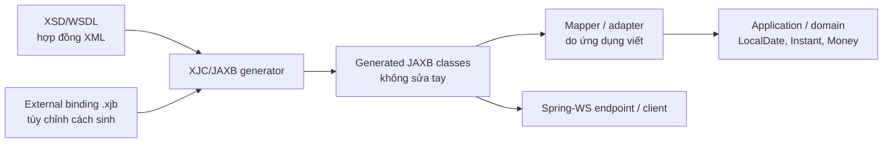
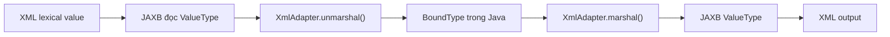
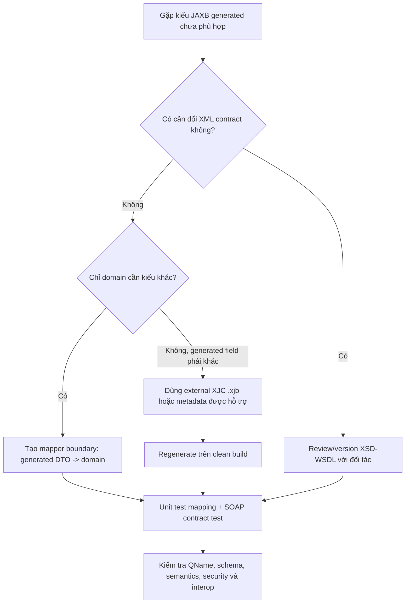

# Điều chỉnh ánh xạ bằng adapter mà không sửa trực tiếp mã được sinh

## 1. Bài toán: XSD đúng nhưng kiểu Java được sinh chưa phù hợp

Trong một dự án **Spring Web Services (Spring-WS)** theo hướng **contract-first**, nhóm tích hợp chốt cấu trúc XML bằng XSD/WSDL trước. Công cụ JAXB/XJC sinh các lớp Java từ hợp đồng đó. Cách làm này giúp client và server tuân cùng kiểu dữ liệu, namespace và thứ tự phần tử; tuy nhiên **kiểu Java do công cụ sinh ra chưa chắc là kiểu phù hợp nhất với ứng dụng**.

Ví dụ dịch vụ SOAP trả lịch sử giao dịch:

- Hợp đồng công bố `businessDate` kiểu `xs:date`, nhưng ứng dụng muốn dùng `java.time.LocalDate`.
- Hợp đồng công bố `processedAt` kiểu `xs:dateTime`, nhưng domain cần `Instant` để so sánh thời điểm.
- Hợp đồng công bố `amount` kiểu `xs:decimal`, nhưng domain muốn một value object `Money` mang cả số tiền và đơn vị tiền tệ.
- Một đối tác yêu cầu mã được chuẩn hóa hoặc trường tùy chọn phải được phân biệt rõ với giá trị rỗng.

XJC thường ánh xạ `xs:date` và `xs:dateTime` thành `XMLGregorianCalendar`, `xs:decimal` thành `BigDecimal`. Giải pháp dễ nghĩ tới là mở file `GetPaymentResponse.java` trong thư mục `target/generated-sources/jaxb` và thay field hoặc thêm annotation `@XmlJavaTypeAdapter`. Cách đó gây hỏng quy trình: mỗi lần build sạch hoặc regenerate JAXB, những thay đổi thủ công có thể biến mất.

**Mục tiêu của bài học:** sử dụng **JAXB `XmlAdapter`**, **binding customization đặt ngoài file sinh**, hoặc **mapper/adapter ở biên SOAP** để điều chỉnh cách ứng dụng dùng dữ liệu, đồng thời giữ XSD/WSDL là nguồn sự thật. Đây là một kỹ năng thiết yếu của module **SPRING_WEB_SERVICES**, từ endpoint và SOAP client đến xử lý SOAP Fault, XML security, WS-Security và kiểm thử tương thích.

Sau bài này, người học có thể:

1. Giải thích chiều chuyển đổi của `XmlAdapter<ValueType, BoundType>` và phạm vi tác dụng của `@XmlJavaTypeAdapter`.
2. Chọn giữa mapper tách biệt và JAXB adapter, theo yêu cầu ảnh hưởng tới DTO được sinh.
3. Dùng file binding `.xjb` ở ngoài XSD để yêu cầu XJC sinh ánh xạ tùy chỉnh, không sửa generated Java.
4. Triển khai và kiểm thử cách chuyển `XMLGregorianCalendar` ↔ `LocalDate`/`Instant` mà không áp dụng timezone ngầm định.
5. Cấu hình Spring-WS sử dụng mã JAXB được sinh và kiểm tra sự tương thích khi XSD hoặc toolchain thay đổi.

## 2. Phân biệt bốn nơi có thể thay đổi ánh xạ



| Vị trí | Thay đổi điều gì? | Ưu điểm | Giới hạn |
|---|---|---|---|
| **XSD/WSDL** | Kiểu và cấu trúc **trên dây**: QName, thứ tự, miền giá trị | Nguồn hợp đồng rõ ràng, client đa ngôn ngữ cùng hiểu | Sửa có thể là breaking change; phải thỏa thuận với đối tác |
| **External JAXB binding (`.xjb`)** | Kiểu và adapter **Java mà XJC sinh ra** | Không sửa XSD hay generated Java; có thể tái tạo trong build | Phụ thuộc JAXB/XJC provider, phiên bản và scope customization |
| **`XmlAdapter` trên class do mình duy trì** | Cách JAXB marshal/unmarshal một property hoặc type đã được gắn adapter | Đổi representation Java mà giữ XML tương ứng | Annotation trên class tự viết không tự áp dụng cho property của class generated |
| **Mapper/adapter tại SOAP boundary** | Chuyển generated DTO sang input/output domain | Cách ly logic nghiệp vụ khỏi JAXB; ít phụ thuộc compiler | Cần viết mã chuyển đổi và test rõ ràng |

Hai tầng thường phối hợp hiệu quả: **XJC sinh DTO theo hợp đồng**, sau đó **mapper chuyển DTO sang model nghiệp vụ**. Khi cần ngay trong generated DTO có type đặc biệt, nhóm có thể bổ sung **external binding** để XJC sinh mã tương ứng.

**Nguyên tắc sở hữu:** XSD/WSDL có quy trình review hợp đồng; `.xjb`, `XmlAdapter` và mapper là code cấu hình chuyển đổi do ứng dụng sở hữu; `target/generated-sources` chỉ là sản phẩm của build.

## 3. Ví dụ XSD xuyên suốt

Giả sử một service SOAP tên `PaymentService` có request và response:

```xml
<?xml version="1.0" encoding="UTF-8"?>
<xs:schema
    xmlns:xs="http://www.w3.org/2001/XMLSchema"
    xmlns:tns="urn:example:payments:v1"
    targetNamespace="urn:example:payments:v1"
    elementFormDefault="qualified">

  <xs:element name="GetPaymentRequest">
    <xs:complexType>
      <xs:sequence>
        <xs:element name="paymentId" type="xs:string"/>
      </xs:sequence>
    </xs:complexType>
  </xs:element>

  <xs:element name="GetPaymentResponse">
    <xs:complexType>
      <xs:sequence>
        <xs:element name="paymentId" type="xs:string"/>
        <xs:element name="businessDate" type="xs:date"/>
        <xs:element name="processedAt" type="xs:dateTime"/>
        <xs:element name="amount" type="xs:decimal"/>
        <xs:element name="currency" type="xs:string"/>
      </xs:sequence>
    </xs:complexType>
  </xs:element>
</xs:schema>
```

Response SOAP 1.1 ví dụ:

```xml
<soap:Envelope xmlns:soap="http://schemas.xmlsoap.org/soap/envelope/"
               xmlns:p="urn:example:payments:v1">
  <soap:Body>
    <p:GetPaymentResponse>
      <p:paymentId>PAY-1001</p:paymentId>
      <p:businessDate>2026-11-27</p:businessDate>
      <p:processedAt>2026-11-27T09:30:00+07:00</p:processedAt>
      <p:amount>149.50</p:amount>
      <p:currency>USD</p:currency>
    </p:GetPaymentResponse>
  </soap:Body>
</soap:Envelope>
```

Giả sử XJC được cấu hình sinh classes tại `target/generated-sources/jaxb`, package `com.example.payment.soap.generated.v1`. Một dạng API thường gặp của response là:

```java
// MINH HỌA chữ ký getter thường gặp, KHÔNG PHẢI FILE ĐỂ CHỈNH SỬA.
public class GetPaymentResponse {
    public String getPaymentId() { /* generated */ return null; }
    public javax.xml.datatype.XMLGregorianCalendar getBusinessDate() {
        /* generated */ return null;
    }
    public javax.xml.datatype.XMLGregorianCalendar getProcessedAt() {
        /* generated */ return null;
    }
    public java.math.BigDecimal getAmount() {
        /* generated */ return null;
    }
    public String getCurrency() { /* generated */ return null; }
}
```

Tên method, cách dùng `JAXBElement`, primitive/wrapper và annotation thực tế phụ thuộc công cụ sinh, XML element/root và cấu hình binding. Đây là sơ đồ API để nhận diện vấn đề; **không copy đoạn minh họa trên làm generated source**.

## 4. JAXB `XmlAdapter` hoạt động như thế nào?

JAXB cung cấp lớp trừu tượng:

```java
package jakarta.xml.bind.annotation.adapters;

public abstract class XmlAdapter<ValueType, BoundType> {
    public abstract BoundType unmarshal(ValueType value) throws Exception;
    public abstract ValueType marshal(BoundType value) throws Exception;
}
```

Trong đó:

- **`ValueType`:** dạng trung gian JAXB biết cách đưa vào/đọc từ XML, chẳng hạn `String`, `BigDecimal` hoặc một bean JAXB.
- **`BoundType`:** kiểu Java mà code muốn sử dụng, chẳng hạn `LocalDate`, `Instant`, `Money`.
- **`unmarshal(ValueType)`:** đi từ giá trị XML/JAXB sang kiểu Java mong muốn.
- **`marshal(BoundType)`:** đi từ kiểu Java mong muốn sang giá trị JAXB có thể xuất ra XML.



Một lỗi phổ biến là đảo vai trò hai tham số generic. Với `XmlAdapter<String, LocalDate>`, `String` là dạng JAXB thấy trên XML; `LocalDate` là kiểu Java. Phương thức `unmarshal(String)` trả `LocalDate`, còn `marshal(LocalDate)` trả `String`.

**Điều kiện áp dụng:** chỉ định nghĩa class kế thừa `XmlAdapter` **chưa đủ** để JAXB tự dùng nó. Adapter cần được gắn vào kiểu/property phù hợp qua annotation, binding customization, hoặc cơ chế cấu hình được JAXB runtime/provider hỗ trợ. Điều này đặc biệt quan trọng khi các class đích được XJC sinh lại ở mỗi build.

## 5. Ví dụ 1: adapter cho `LocalDate` trên lớp JAXB do mình viết

Nếu một model JAXB **do ứng dụng tự duy trì** (không phải class generated), ta có thể gắn `@XmlJavaTypeAdapter` trực tiếp vào field.

### 5.1. Adapter xử lý ngày lịch

```java
package com.example.payment.soap.binding;

import java.time.LocalDate;
import java.time.format.DateTimeFormatter;
import jakarta.xml.bind.annotation.adapters.XmlAdapter;

public final class LocalDateXmlAdapter
        extends XmlAdapter<String, LocalDate> {

    @Override
    public LocalDate unmarshal(String value) {
        if (value == null) {
            return null;
        }
        return LocalDate.parse(value, DateTimeFormatter.ISO_LOCAL_DATE);
    }

    @Override
    public String marshal(LocalDate value) {
        if (value == null) {
            return null;
        }
        return value.format(DateTimeFormatter.ISO_LOCAL_DATE);
    }
}
```

Ở ví dụ này, ngày hợp đồng được quy ước ở dạng `yyyy-MM-dd` **không mang offset**. Kiểu nền `xs:date` theo XML Schema còn có thể chấp nhận một số lexical form mang offset. Nếu hợp đồng thật sự cho phép các dạng đó, adapter phải xử lý toàn bộ dạng được phép hoặc schema/validation phải giới hạn dữ liệu cho đúng quy ước; đừng cho phép XSD nhận một giá trị mà parser Java lại âm thầm diễn giải sai.

### 5.2. Annotation trên kiểu do ứng dụng kiểm soát

```java
package com.example.payment.soap.custom;

import com.example.payment.soap.binding.LocalDateXmlAdapter;
import java.time.LocalDate;
import jakarta.xml.bind.annotation.XmlAccessType;
import jakarta.xml.bind.annotation.XmlAccessorType;
import jakarta.xml.bind.annotation.XmlElement;
import jakarta.xml.bind.annotation.adapters.XmlJavaTypeAdapter;

@XmlAccessorType(XmlAccessType.FIELD)
public class PaymentDateInfo {

    @XmlElement(name = "businessDate",
                namespace = "urn:example:payments:v1")
    @XmlJavaTypeAdapter(LocalDateXmlAdapter.class)
    private LocalDate businessDate;

    public LocalDate getBusinessDate() {
        return businessDate;
    }

    public void setBusinessDate(LocalDate businessDate) {
        this.businessDate = businessDate;
    }
}
```

Đây là một **bean minh họa viết tay**, phù hợp khi ta kiểm soát model JAXB. Class này chưa phải root element độc lập; nó chỉ có thể được JAXB marshal trong context/quan hệ kiểu phù hợp. Không thay một cách tùy tiện `GetPaymentResponse` do XJC sinh bằng class này trong SOAP endpoint: SOAP payload QName và XSD/WSDL vẫn phải nhất quán.

Đặc biệt, nếu thêm annotation trên `PaymentDateInfo` **nhưng `GetPaymentResponse` generated vẫn có field kiểu `XMLGregorianCalendar`**, JAXB sẽ không tự đổi cách xử lý field generated. Phải chọn rõ **mapper tại boundary** hoặc **customization trong lúc generate** ở các phần tiếp theo.

## 6. Ví dụ 2: adapter cho `Instant` và quy tắc timezone

Một thời điểm giao dịch phải được xác định duy nhất trên timeline. `xs:dateTime` tự nó có thể thiếu offset theo XSD 1.0, vì vậy hợp đồng nghiệp vụ cần quy định **timestamp bắt buộc có offset hoặc `Z`**. Có thể kiểm tra thêm bằng XSD restriction và validation, không chỉ phụ thuộc vào Java parse.

```java
package com.example.payment.soap.binding;

import java.time.Instant;
import java.time.OffsetDateTime;
import java.time.format.DateTimeFormatter;
import jakarta.xml.bind.annotation.adapters.XmlAdapter;

public final class InstantXmlAdapter
        extends XmlAdapter<String, Instant> {

    @Override
    public Instant unmarshal(String value) {
        if (value == null) {
            return null;
        }
        // Thiếu offset sẽ bị từ chối, không lấy timezone mặc định của JVM.
        return OffsetDateTime.parse(
                value, DateTimeFormatter.ISO_OFFSET_DATE_TIME).toInstant();
    }

    @Override
    public String marshal(Instant value) {
        return value == null
                ? null
                : DateTimeFormatter.ISO_INSTANT.format(value);
    }
}
```

Ví dụ:

```text
2026-11-27T09:30:00+07:00 -> 2026-11-27T02:30:00Z
2026-11-27T02:30:00Z      -> 2026-11-27T02:30:00Z
2026-11-27T09:30:00       -> lỗi: thiếu offset
```

Adapter cố ý **chuẩn hóa về UTC khi marshal**. Hai biểu diễn đầu cùng một `Instant`, nhưng XML đầu ra không giữ offset `+07:00` ban đầu. Nếu hợp đồng bắt buộc giữ offset mà client gửi, hãy chọn kiểu Java có thông tin đó như `OffsetDateTime` hoặc lưu metadata riêng.

**Các giới hạn cần ghi rõ:** XML Schema hỗ trợ một số trường hợp năm và thời gian mà `java.time` hoặc formatter thông dụng có thể xử lý khác (chẳng hạn lịch sử năm, leap second, phân số giây cực dài). Hợp đồng doanh nghiệp nên xác định miền năm/precision/timezone được hỗ trợ và kiểm thử những trường hợp biên. Đừng biến parse exception thành giá trị ngày “hôm nay”.

## 7. Khi không được sửa generated Java: dùng mapper ở SOAP boundary

Đây thường là **phương án đơn giản và ổn định nhất** cho các dịch vụ contract-first: để XJC tạo `XMLGregorianCalendar`/`BigDecimal` đúng như schema, rồi ánh xạ chúng sang Java domain trong một class ứng dụng tự viết.

### 7.1. Domain model độc lập JAXB

```java
package com.example.payment.domain;

import java.math.BigDecimal;
import java.time.Instant;
import java.time.LocalDate;

public record PaymentSnapshot(
        String paymentId,
        LocalDate businessDate,
        Instant processedAt,
        BigDecimal amount,
        String currency) {
}
```

`PaymentSnapshot` không import package JAXB, Spring-WS hoặc `XMLGregorianCalendar`. Domain có thể dùng nó qua REST, queue hoặc business service khác mà không buộc biết hợp đồng SOAP.

### 7.2. Mapper xử lý `XMLGregorianCalendar` tường minh

```java
package com.example.payment.soap.mapper;

import java.time.Instant;
import java.time.LocalDate;
import java.time.OffsetDateTime;
import javax.xml.datatype.DatatypeConstants;
import javax.xml.datatype.DatatypeConfigurationException;
import javax.xml.datatype.DatatypeFactory;
import javax.xml.datatype.XMLGregorianCalendar;

public final class PaymentXmlValues {
    private PaymentXmlValues() {}

    public static LocalDate toLocalDate(XMLGregorianCalendar xml) {
        if (xml == null) {
            throw new IllegalArgumentException("businessDate is required");
        }
        // Giữ nguyên ngày lịch trong XML; không chuyển qua timezone JVM.
        return LocalDate.of(xml.getYear(), xml.getMonth(), xml.getDay());
    }

    public static Instant toInstant(XMLGregorianCalendar xml) {
        if (xml == null
                || xml.getTimezone() == DatatypeConstants.FIELD_UNDEFINED) {
            throw new IllegalArgumentException(
                    "processedAt requires an explicit UTC offset");
        }
        return OffsetDateTime.parse(xml.toXMLFormat()).toInstant();
    }

    public static XMLGregorianCalendar fromLocalDate(LocalDate value)
            throws DatatypeConfigurationException {
        return DatatypeFactory.newInstance().newXMLGregorianCalendarDate(
                value.getYear(),
                value.getMonthValue(),
                value.getDayOfMonth(),
                DatatypeConstants.FIELD_UNDEFINED);
    }

    public static XMLGregorianCalendar fromInstant(Instant value)
            throws DatatypeConfigurationException {
        return DatatypeFactory.newInstance()
                .newXMLGregorianCalendar(value.toString());
    }
}
```

Trong stack Jakarta JAXB mới, `XMLGregorianCalendar` và `DatatypeFactory` **vẫn thuộc package `javax.xml.datatype` của Java**, trong khi annotation và JAXB runtime dùng `jakarta.xml.bind.*`. Không kết luận rằng import `javax.xml.datatype` là lỗi trộn JAXB cũ/mới.

Ví dụ giả định timestamp thuộc miền `OffsetDateTime` của ứng dụng. Khi nhận năm hoặc lexical form quá đặc biệt, phép parse có thể ném exception; server phải chuyển thành lỗi hợp đồng phù hợp và không làm rò stack trace.

### 7.3. Mapper từ domain sang response JAXB

```java
package com.example.payment.soap.mapper;

import com.example.payment.domain.PaymentSnapshot;
import com.example.payment.soap.generated.v1.GetPaymentResponse;
import javax.xml.datatype.DatatypeConfigurationException;
import org.springframework.stereotype.Component;

@Component
public class PaymentContractMapper {

    public GetPaymentResponse toResponse(PaymentSnapshot source) {
        GetPaymentResponse response = new GetPaymentResponse();
        response.setPaymentId(source.paymentId());
        response.setAmount(source.amount());
        response.setCurrency(source.currency());

        try {
            response.setBusinessDate(
                    PaymentXmlValues.fromLocalDate(source.businessDate()));
            response.setProcessedAt(
                    PaymentXmlValues.fromInstant(source.processedAt()));
        } catch (DatatypeConfigurationException error) {
            throw new IllegalStateException(
                    "JAXB XML datatype factory unavailable", error);
        }
        return response;
    }
}
```

Ở ví dụ này, JAXB generated response vẫn giữ field `XMLGregorianCalendar`. **Không cần annotation `@XmlJavaTypeAdapter` trên generated file**. Khi schema v2 ra đời, ứng dụng có thể tạo `PaymentContractMapperV2` mà giữ `PaymentSnapshot` và logic nghiệp vụ nếu semantics tương thích.

Đối với phía nhận response từ đối tác, mapper ngược lại gọi `toLocalDate`/`toInstant` và chuyển `GetPaymentResponse` thành `PaymentSnapshot`. Nên áp dụng các ràng buộc về `amount`, `currency` và quyền truy cập tại tầng thích hợp; mapper không thay thế schema validation.

### 7.4. Khi nào chọn mapper thay vì JAXB adapter?

Chọn mapper khi:

- Đội dự án muốn domain độc lập hoàn toàn khỏi schema/namespace/annotation.
- Có nhiều version XSD/WSDL cần ánh xạ vào một model nghiệp vụ chung.
- Chuyển đổi có quy tắc nghiệp vụ, ví dụ ghép `amount` + `currency` thành `Money` và kiểm tra chính sách tiền tệ.
- Chỉ vài field cần điều chỉnh; lợi ích đổi tất cả generated types không bù chi phí cấu hình XJC.
- Cần kiểm thử logic chuyển đổi riêng, kể cả khi JAXB plugin/vendor thay đổi.

Mapper cũng là một loại **adapter kiến trúc**, nhưng **khác** class `XmlAdapter` của JAXB. Dùng đúng thuật ngữ sẽ giúp đọc code và debug thuận lợi.

## 8. Khi cần generated property có kiểu khác: external binding `.xjb`

Nếu một dự án Java có nhiều điểm đọc `xs:dateTime` và muốn **ngay trong generated DTO đã là `Instant`**, có thể yêu cầu XJC tùy chỉnh ánh xạ bằng **binding file** nằm ngoài XSD. Điều này khác với sửa file JAXB Java sau khi sinh.

Ví dụ bố trí:

```text
src/main/resources/contracts/payments/v1/payments.xsd
src/main/jaxb/payments-bindings.xjb
src/main/java/com/example/payment/soap/binding/
  InstantLexical.java
target/generated-sources/jaxb/
  .../GetPaymentResponse.java       (do XJC tạo)
```

### 8.1. Tạo hàm parse/print để XJC sử dụng

Hàm parse nhận chuỗi lexical và trả kiểu Java; hàm print làm ngược lại:

```java
package com.example.payment.soap.binding;

import java.time.Instant;
import java.time.OffsetDateTime;
import java.time.format.DateTimeFormatter;

public final class InstantLexical {
    private InstantLexical() {}

    public static Instant parse(String xmlValue) {
        return OffsetDateTime.parse(
                xmlValue, DateTimeFormatter.ISO_OFFSET_DATE_TIME).toInstant();
    }

    public static String print(Instant value) {
        return DateTimeFormatter.ISO_INSTANT.format(value);
    }
}
```

Đây là một cặp hàm thuần, có thể kiểm thử độc lập. Chúng yêu cầu offset trong input và xuất UTC ở output. `xs:dateTime` không bắt buộc có timezone theo XSD 1.0, nên nếu muốn đây là luật chung, cần đảm bảo schema/validation và tài liệu hợp đồng cũng thống nhất.

### 8.2. Tạo binding file bên ngoài

Một ví dụ **global binding theo namespace Jakarta JAXB 3.x/4.x**:

```xml
<?xml version="1.0" encoding="UTF-8"?>
<jaxb:bindings
    xmlns:jaxb="https://jakarta.ee/xml/ns/jaxb"
    xmlns:xs="http://www.w3.org/2001/XMLSchema"
    version="3.0">

  <jaxb:globalBindings>
    <jaxb:javaType
        name="java.time.Instant"
        xmlType="xs:dateTime"
        parseMethod="com.example.payment.soap.binding.InstantLexical.parse"
        printMethod="com.example.payment.soap.binding.InstantLexical.print"/>
  </jaxb:globalBindings>
</jaxb:bindings>
```

Ý nghĩa:

- `name` là kiểu Java mong muốn trong mã được sinh.
- `xmlType` chọn loại XML Schema cần tùy chỉnh.
- `parseMethod` và `printMethod` là các phương thức static do ứng dụng duy trì.
- `globalBindings` có **phạm vi rộng** đối với các schema trong lần XJC invocation; tất cả `xs:dateTime` liên quan có thể bị ảnh hưởng. Chỉ dùng khi ý nghĩa mọi field áp dụng đều tương thích với `Instant`.

**Lưu ý tương thích:** cú pháp binding, namespace, phiên bản và cách generator hỗ trợ `javaType` chịu ảnh hưởng của XJC/JAXB đang dùng. JAXB 2.x cũ sử dụng namespace binding khác. Hãy dùng tài liệu của XJC/provider cụ thể, khóa version toolchain, kiểm tra generated result trong build sạch và xác minh runtime có converter/adapter thực sự được gọi. Không trộn tùy tiện file `.xjb` Jakarta với XJC JAXB 2.x cũ.

Trong một số XJC provider, kết quả sử dụng một adapter trung gian được **sinh tự động** để gọi `InstantLexical.parse/print`. Tên và hình dạng lớp bridge không phải phần hợp đồng SOAP; đừng phụ thuộc vào tên `Adapter1` hay import trực tiếp những lớp bridge đó vào domain.

### 8.3. Không mở rộng global binding hơn phạm vi nghiệp vụ

Nếu schema có hai field:

- `processedAt`: thời điểm sự kiện, phải có offset; muốn `Instant`.
- `localAppointmentTime`: giờ địa phương tương lai, chưa có offset; chưa thể suy ra một `Instant`.

Áp dụng global `xs:dateTime -> Instant` cho cả hai là **sai về semantics**. Khi đó nên:

1. Dùng **mapper ở boundary** để chỉ chuyển `processedAt`.
2. Hoặc dùng **binding customization ở phạm vi schema node/type cụ thể**, nếu XJC/provider và schema cho phép.
3. Hoặc tách rõ hai kiểu XSD và quy tắc timezone nếu thực sự thuộc hai khái niệm hợp đồng khác nhau.

Một rule parse/print áp dụng được cho *mọi* field cùng kiểu XSD về mặt kỹ thuật **không có nghĩa** mọi field có cùng ý nghĩa nghiệp vụ.

### 8.4. Kết nối `.xjb` với pha generate của build

Tùy Maven/Gradle plugin, cần cấu hình ba đầu vào:

| Đầu vào | Ví dụ |
|---|---|
| Schema source | `src/main/resources/contracts/payments/v1/payments.xsd` |
| External binding | `src/main/jaxb/payments-bindings.xjb` |
| Generated output | `target/generated-sources/jaxb` hoặc `build/generated/sources/jaxb` |

Một số Maven plugin dùng các property tương tự `schemaDirectory`, `schemaIncludes`, `bindingDirectory`, `bindingIncludes` và `generateDirectory`. Tên property và quy tắc cấu hình **không thống nhất giữa mọi XJC plugin**, vì vậy không copy cấu hình của plugin khác mà chưa đối chiếu tài liệu phiên bản đang chọn.

Quy trình kiểm tra sau khi cấu hình:

1. Chạy pha generate-sources trên build sạch.
2. Xác minh class generated có property type như mong muốn và không gây lỗi compile.
3. Xác minh generated code có kết nối với parse/print converter ở cả chiều marshal/unmarshal.
4. Kiểm tra XSD/WSDL đã công bố **không bị thay đổi** chỉ vì đổi binding Java.
5. Chạy round-trip và interoperability test với client SOAP khác công nghệ.

Nếu nhiều schema cần các rule khác nhau, tách execution/package hoặc build module cho mỗi hợp đồng. Tránh một global binding tình cờ làm đổi field của WSDL đối tác khác.

## 9. `Jaxb2Marshaller#setAdapters` có tác dụng đến đâu?

Spring-WS thường sử dụng `Jaxb2Marshaller` để chuyển request/response giữa XML và JAXB object.

```java
import org.springframework.context.annotation.Bean;
import org.springframework.context.annotation.Configuration;
import org.springframework.core.io.ClassPathResource;
import org.springframework.oxm.jaxb.Jaxb2Marshaller;

@Configuration
public class PaymentJaxbConfiguration {

    @Bean
    public Jaxb2Marshaller paymentMarshaller() {
        Jaxb2Marshaller marshaller = new Jaxb2Marshaller();
        marshaller.setContextPath(
                "com.example.payment.soap.generated.v1");
        marshaller.setSchema(
                new ClassPathResource(
                    "contracts/payments/v1/payments.xsd"));
        return marshaller;
    }
}
```

Ví dụ trên sử dụng `Jaxb2Marshaller` để marshal/unmarshal generated classes và yêu cầu validation theo schema tương ứng trong quá trình xử lý qua marshaller. Tùy luồng Spring-WS, có thể dùng thêm `PayloadValidatingInterceptor` để kiểm tra payload ngay ở server boundary.

Một số phiên bản `Jaxb2Marshaller` cung cấp `setAdapters(...)` để đăng ký các **adapter instance** cho JAXB marshaller/unmarshaller. Tuy nhiên:

**Đăng ký instance không đồng nghĩa tự động gắn adapter vào mọi property generated.** JAXB cần metadata/binding xác định property nào sử dụng adapter. Nếu XJC sinh property `XMLGregorianCalendar` và không hề có metadata yêu cầu `InstantXmlAdapter`, chỉ gọi `setAdapters(new InstantXmlAdapter())` thường **không biến getter thành `Instant`**.

Hãy phân biệt:

- **Binding metadata:** khai báo *chỗ nào* dùng adapter, qua annotation trong class do mình kiểm soát hoặc metadata do XJC tạo từ customization.
- **Adapter instance configuration:** tùy chọn cung cấp *đối tượng adapter* cho runtime khi binding đó đã có hiệu lực.

Điều này giải thích vì sao thêm bean `XmlAdapter` trong Spring context không làm tất cả generated JAXB DTO tự chuyển sang `java.time`.

## 10. Kết hợp JAXB với Spring-WS endpoint và SOAP client

### 10.1. Endpoint nên dùng mapper hay generated type?

Ví dụ một endpoint nhận request JAXB và trả response JAXB, còn business service làm việc với `PaymentSnapshot`:

```java
package com.example.payment.soap.endpoint;

import com.example.payment.application.PaymentQueryService;
import com.example.payment.soap.generated.v1.GetPaymentRequest;
import com.example.payment.soap.generated.v1.GetPaymentResponse;
import com.example.payment.soap.mapper.PaymentContractMapper;
import org.springframework.ws.server.endpoint.annotation.Endpoint;
import org.springframework.ws.server.endpoint.annotation.PayloadRoot;
import org.springframework.ws.server.endpoint.annotation.RequestPayload;
import org.springframework.ws.server.endpoint.annotation.ResponsePayload;

@Endpoint
public class PaymentEndpoint {
    private static final String NS = "urn:example:payments:v1";

    private final PaymentQueryService queryService;
    private final PaymentContractMapper mapper;

    public PaymentEndpoint(
            PaymentQueryService queryService,
            PaymentContractMapper mapper) {
        this.queryService = queryService;
        this.mapper = mapper;
    }

    @PayloadRoot(namespace = NS, localPart = "GetPaymentRequest")
    @ResponsePayload
    public GetPaymentResponse getPayment(
            @RequestPayload GetPaymentRequest request) {
        var payment = queryService.findById(request.getPaymentId());
        return mapper.toResponse(payment);
    }
}
```

`PaymentQueryService` là application service do dự án triển khai; code trên minh họa ranh giới, không phải chương trình độc lập đầy đủ. Khi XJC tạo `JAXBElement<T>` thay vì phần tử root có `@XmlRootElement`, cần điều chỉnh chữ ký/`ObjectFactory` và cấu hình adapter/endpoint cho phù hợp với **mã thực tế được sinh ra**.

Một lợi ích quan trọng: endpoint giữ đúng `@PayloadRoot` của hợp đồng XML, trong khi mapper điều chỉnh các kiểu Java bên trong. Đổi tên class adapter hoặc logic parse `LocalDate` không được làm thay đổi QName của payload.

### 10.2. Phía client dùng cùng nguyên tắc

Giả sử một SOAP client gửi `GetPaymentRequest` đến hệ thống ERP:

```java
import com.example.payment.soap.generated.v1.GetPaymentRequest;
import com.example.payment.soap.generated.v1.GetPaymentResponse;
import org.springframework.ws.client.core.WebServiceTemplate;

public final class PaymentSoapClient {
    private final WebServiceTemplate template;
    private final PaymentContractMapper mapper;

    public PaymentSoapClient(
            WebServiceTemplate template,
            PaymentContractMapper mapper) {
        this.template = template;
        this.mapper = mapper;
    }

    public PaymentSnapshot getPayment(String paymentId) {
        GetPaymentRequest request = new GetPaymentRequest();
        request.setPaymentId(paymentId);

        GetPaymentResponse response = (GetPaymentResponse)
                template.marshalSendAndReceive(request);
        return mapper.toDomain(response);
    }
}
```

Đoạn code giả định có `PaymentContractMapper#toDomain` và generated root classes phù hợp. Với các XJC binding khác, code có thể cần tạo `JAXBElement` và unwrap response. SOAP client phải cấu hình đúng endpoint, SOAPAction (khi binding yêu cầu), timeout, truststore và WS-Security; những việc này thuộc client adapter/config, không thuộc `XmlAdapter` xử lý ngày giờ.

**Lựa chọn chung:** với endpoint và client cùng dựa trên một XSD/WSDL, hãy giữ rule chuyển đổi tại một nơi có thể kiểm thử. Nếu có hai hệ thống đối tác với yêu cầu timestamp khác nhau, không nên dùng một global adapter cố gắng đoán timezone theo địa chỉ service.

## 11. Khi nào adapter cần một bean XML phức hợp?

`XmlAdapter` không chỉ giới hạn `String ↔ LocalDate`. `ValueType` có thể là một class JAXB có `@XmlValue`, `@XmlAttribute` và các phần tử con. Ví dụ miền nghiệp vụ có value object `Money(amount, currency)`, còn XML biểu diễn:

```xml
<p:total currency="USD"
         xmlns:p="urn:example:payments:v1">149.50</p:total>
```

Ta có thể thiết kế:

```java
import java.math.BigDecimal;
import jakarta.xml.bind.annotation.XmlAttribute;
import jakarta.xml.bind.annotation.XmlValue;

public class XmlMoneyValue {
    @XmlValue
    public BigDecimal amount;

    @XmlAttribute(name = "currency", required = true)
    public String currency;
}
```

Và adapter:

```java
import java.math.BigDecimal;
import jakarta.xml.bind.annotation.adapters.XmlAdapter;

public final class MoneyXmlAdapter
        extends XmlAdapter<XmlMoneyValue, Money> {

    @Override
    public Money unmarshal(XmlMoneyValue xml) {
        if (xml == null) {
            return null;
        }
        return new Money(xml.amount, xml.currency);
    }

    @Override
    public XmlMoneyValue marshal(Money money) {
        if (money == null) {
            return null;
        }
        XmlMoneyValue xml = new XmlMoneyValue();
        xml.amount = money.amount();
        xml.currency = money.currency();
        return xml;
    }
}

// Domain value object do ứng dụng sở hữu.
record Money(BigDecimal amount, String currency) {
    Money {
        if (amount == null || currency == null) {
            throw new IllegalArgumentException("Missing amount or currency");
        }
    }
}
```

Đây là **minh họa cho một kiểu XML phức hợp khác** so với `GetPaymentResponse` ở phần 3 (phần đó có `amount` và `currency` là hai phần tử riêng). Muốn dùng cấu trúc `<total currency="...">` phải có XSD tương ứng và binding thật; không thể chỉ viết adapter rồi mong XML đã công bố tự đổi hình dạng.

Trong thực tế, nếu hợp đồng đã tách `amount` và `currency` thành hai sibling elements, một **mapper sang `Money`** thường tự nhiên hơn adapter cho từng field vì adapter property riêng lẻ không tự động nhận được context của field bên cạnh.

## 12. Thiết kế null, default, validation và lỗi chuyển đổi

Adapter tốt cần quy định rõ những tình huống đặc biệt:

| Tình huống | Câu hỏi cần xử lý |
|---|---|
| XML không có phần tử (`minOccurs=0`) | Domain dùng `null`, `Optional` hay mô hình trạng thái khác? |
| XML có `xsi:nil="true"` | JAXB generated property là `null` hay `JAXBElement`? Có phân biệt vắng mặt/nil không? |
| Chuỗi rỗng hoặc khoảng trắng | Hợp đồng có chấp nhận không? Có nên trim hay từ chối? |
| Decimal `149.50` và `149.5` | Domain so giá trị hay bảo toàn cách format? |
| Timestamp không offset | Có được suy từ timezone nghiệp vụ hay phải Fault? |
| Giá trị vượt phạm vi Java | Có dùng `intValueExact()` và giới hạn trong XSD không? |
| Adapter throw exception | Lỗi được map thành SOAP Fault nào? Có lộ stack trace không? |

### 12.1. Không tự tạo giá trị thay thế cho dữ liệu sai

Ví dụ sau là một anti-pattern:

```java
// KHÔNG NÊN: dữ liệu sai lại biến thành thời điểm hiện tại.
public Instant unmarshal(String text) {
    try {
        return OffsetDateTime.parse(text).toInstant();
    } catch (Exception ignored) {
        return Instant.now();
    }
}
```

Nó che mất lỗi tương thích và làm dữ liệu thanh toán/kiểm toán sai âm thầm. Một timestamp sai phải được xử lý như **lỗi đầu vào**; việc chuyển exception thành SOAP Fault do tầng biên phù hợp chịu trách nhiệm.

### 12.2. Tách ba loại kiểm tra

| Kiểm tra | Ví dụ | Nơi thường thực hiện |
|---|---|---|
| **XSD validation** | `amount` hợp lệ với `xs:decimal`; `processedAt` đúng pattern có offset | `PayloadValidatingInterceptor` hoặc JAXB/Schema validator được cấu hình |
| **Conversion validation** | Chuỗi dateTime chuyển được thành `Instant`; ngày không vượt Java range | `XmlAdapter` hoặc mapper |
| **Business/authorization validation** | Đối tác có quyền tra cứu `paymentId`; tiền tệ nằm trong chính sách; request ID không trùng | Application service và security layer |

JAXB code generation không tự bảo đảm XSD validation được bật ở runtime. Một số JAXB unmarshaller có thể nhận giá trị XML mà không kiểm mọi facet nếu không gắn `Schema`. Vì vậy không dùng việc “unmarshal thành công” để kết luận request đúng hợp đồng.

### 12.3. SOAP Fault phải ổn định

Khi một adapter ném `DateTimeParseException`, không nên đưa nguyên tên exception/stack trace vào SOAP Fault. Spring-WS có thể sử dụng exception resolver như `SoapFaultMappingExceptionResolver` để chuyển lỗi thành mã và reason phù hợp. Nếu hợp đồng yêu cầu detail có type, hãy thiết kế XSD/WSDL cho fault detail và kiểm thử bằng client thực.

SOAP 1.1 và SOAP 1.2 có cấu trúc Fault khác nhau. Mapping lỗi ở endpoint phải dựa trên phiên bản và policy đã thống nhất, không tự ghép XML Fault bằng chuỗi trong adapter.

## 13. Bảo mật XML và WS-Security không thuộc trách nhiệm của adapter

`XmlAdapter` chuyển đổi **giá trị**. Nó không thay thế:

- Chặn DTD, XXE và external entities từ XML parser.
- Giới hạn kích thước message, độ sâu XML, timeout và tài nguyên xử lý.
- XSD validation trên dữ liệu không tin cậy.
- TLS/mTLS, kiểm tra chứng chỉ server/client và quản lý truststore.
- WS-Security signature, timestamp, UsernameToken và chống replay theo policy.
- Kiểm tra người gọi được phép truy cập giao dịch hoặc tài khoản nào.

Trong Spring-WS, các trách nhiệm này phân bổ cho message factory/parser configuration, `EndpointInterceptor`, `PayloadValidatingInterceptor`, `Wss4jSecurityInterceptor`, transport security và application service.

**Phân biệt timestamp:** `processedAt` của nghiệp vụ không đồng nghĩa `wsu:Timestamp` trong SOAP Header phục vụ chính sách WS-Security. Adapter dùng `Instant` không tự xác minh chữ ký XML hay thời hạn của security token. Cũng không nên đọc dữ liệu bí mật từ SOAP Header trong một adapter chỉ để parse ngày, vì làm mờ boundary và khó kiểm thử.

Nếu phía client dùng `WebServiceTemplate` để gửi SOAP có chữ ký, việc thay đổi lexical representation trong quá trình marshal phải được thực hiện **trước** khi ký thông điệp và tuân theo pipeline WS-Security đã cấu hình. Không chỉnh sửa body sau khi ký vì có thể làm chữ ký không còn hợp lệ.

## 14. Kiểm thử adapter và khả năng tương thích

Adapter có vẻ nhỏ nhưng lỗi thường xuất hiện ở các ca biên: null, offset, precision, timezone, phiên bản JAXB hoặc schema.

### 14.1. Unit test round-trip cho adapter ngày giờ

```java
import static org.junit.jupiter.api.Assertions.*;
import java.time.Instant;
import java.time.LocalDate;
import org.junit.jupiter.api.Test;

class XmlAdaptersTest {

    @Test
    void localDateRoundTrip() throws Exception {
        LocalDateXmlAdapter adapter = new LocalDateXmlAdapter();
        LocalDate day = LocalDate.of(2026, 11, 27);

        assertEquals("2026-11-27", adapter.marshal(day));
        assertEquals(day, adapter.unmarshal("2026-11-27"));
    }

    @Test
    void instantNormalizesOffsetToUtc() throws Exception {
        InstantXmlAdapter adapter = new InstantXmlAdapter();

        Instant instant = adapter.unmarshal(
                "2026-11-27T09:30:00+07:00");
        assertEquals(
                Instant.parse("2026-11-27T02:30:00Z"), instant);
        assertEquals("2026-11-27T02:30:00Z",
                adapter.marshal(instant));
    }

    @Test
    void timestampWithoutOffsetIsRejected() {
        InstantXmlAdapter adapter = new InstantXmlAdapter();

        assertThrows(
                java.time.format.DateTimeParseException.class,
                () -> adapter.unmarshal("2026-11-27T09:30:00"));
    }

    @Test
    void nullIsHandledExplicitly() throws Exception {
        LocalDateXmlAdapter adapter = new LocalDateXmlAdapter();
        assertNull(adapter.unmarshal(null));
        assertNull(adapter.marshal(null));
    }
}
```

Đây là test cho **class adapter tự viết**. Chúng không chứng minh rằng JAXB đã được cấu hình dùng adapter trên generated property; phải thêm test ở mức JAXB/marshaller và SOAP.

### 14.2. Test đúng binding sau khi XJC sinh mã

Khi dùng `.xjb`:

1. Build sạch từ XSD + binding, không copy generated files cũ.
2. Kiểm tra property type thực tế trong generated Java (`Instant` hay `XMLGregorianCalendar`).
3. Dùng JAXB marshal/unmarshal từ một XML mẫu đúng namespace và XSD.
4. Khẳng định parse/print được gọi và giá trị round-trip giữ đúng **nghĩa**; không đòi XML output giữ nguyên prefix hay offset nếu contract cho phép biểu diễn tương đương.
5. Chạy lại test khi tăng version XJC/JAXB, Spring Boot hoặc XSD.

Một test chỉ kiểm tra `InstantLexical.parse` pass **không đủ**: nếu `.xjb` không được build plugin nhận, generated class vẫn giữ type mặc định và converter sẽ không bao giờ được gọi.

### 14.3. Test Spring-WS và client đối tác

| Test | Điều cần xác minh |
|---|---|
| JAXB marshalling/unmarshalling | XML được sinh đúng QName, order theo schema, lexical value hợp lệ |
| `MockWebServiceClient` | `@PayloadRoot` nhận đúng SOAP payload; response và Fault đúng hợp đồng |
| `MockWebServiceServer` | Outbound client gửi đúng request, SOAPAction và xử lý response/Fault |
| XML schema validation | Sai date, thiếu offset theo custom rule, decimal sai range bị từ chối |
| Không hợp lệ về bảo mật | Payload có XXE/external entity hoặc WS-Security signature sai không được xử lý nghiệp vụ |
| Đối tác Java/.NET | Client sinh từ WSDL đọc được XML và không phụ thuộc package Java nội bộ |
| Phiên bản JAXB | Build sạch sau đổi provider/plugin vẫn sinh được DTO và round-trip đúng |

### 14.4. Golden XML nên bao gồm những giá trị nào?

- `2026-11-27`: ngày lịch tiêu chuẩn.
- `2026-11-27T09:30:00+07:00` và `2026-11-27T02:30:00Z`: cùng instant với offset khác nhau.
- `2026-11-27T09:30:00`: thiếu offset, phải bị từ chối nếu contract yêu cầu.
- `149.50` và `149.5`: cùng giá trị decimal nhưng khác scale/format.
- `149.501`: vượt precision minh họa khi contract quy định tối đa hai chữ số phần thập phân.
- Missing/nil optional field: xác minh không bị ngầm biến thành `0` hoặc ngày hiện tại.
- Namespace khác hoặc field sai thứ tự: xác minh JAXB/schema/endpoint không chấp nhận nhầm.

## 15. Những sai lầm thường gặp

| Hiện tượng | Nguyên nhân | Cách xử lý |
|---|---|---|
| Annotation adapter biến mất sau build | Đã sửa class ở `target/generated-sources` | Chuyển logic sang mapper hoặc external `.xjb` rồi regenerate |
| Tạo bean `InstantXmlAdapter` nhưng getter vẫn là `XMLGregorianCalendar` | Chưa có binding metadata gắn adapter | Gắn trên class mình sở hữu hoặc cấu hình XJC binding đúng phạm vi |
| `unmarshal` nhận nhầm kiểu/`marshal` trả nhầm kiểu | Đảo thứ tự `ValueType`/`BoundType` | Với `XmlAdapter<String, Instant>`, unmarshalling đi `String -> Instant` |
| Thời điểm bị lệch khi chạy ở server khác timezone | Dùng `ZoneId.systemDefault()` cho XML thiếu offset | Yêu cầu offset/`Z` trong hợp đồng, parse có kiểm soát |
| Business date đổi ngày sau khi chuyển UTC | Dùng `Instant` cho `xs:date` | Dùng `LocalDate` giữ nghĩa ngày lịch |
| JAXB class không đổi dù đã thêm `.xjb` | Build plugin không nạp binding hoặc dùng sai namespace/version | Kiểm tra config XJC, output clean build và generated property |
| Global binding làm hỏng field giờ hẹn | Map mọi `xs:dateTime` sang `Instant` dù semantics khác | Thu hẹp binding scope hoặc dùng domain mapper |
| Có XSD nhưng dữ liệu sai vẫn được unmarshal | Schema validation chưa bật | Cấu hình `Schema` hoặc validation interceptor và test negative |
| Phần tử optional bị biến thành “giá trị mặc định” | Adapter tự điền khi `null` | Thiết kế rõ absent/nil/default trong XSD và application |
| XmlAdapter gộp `amount` và `currency` không được | Hai field là sibling, adapter của một property không nhận field kia | Dùng mapper ở mức response/domain hoặc thay schema theo version |
| Client cũ đọc sai XML sau đổi binding | Adapter đổi lexical format hoặc ngữ nghĩa | Contract test với golden XML và consumer thực tế |
| Exception của parser lộ ra SOAP Fault | Thiếu fault resolver/sanitization | Ánh xạ thành mã lỗi ổn định, che chi tiết nội bộ |

## 16. Quy trình áp dụng vào một dự án thật



Thực hiện theo thứ tự:

1. **Giữ XSD/WSDL làm chuẩn.** Xác nhận field đó là ngày lịch, instant, amount hay mã định danh. Kiểm tra requirement của consumer.
2. **Xem generated output thực tế.** Xác định type, `JAXBElement`, namespace và chỗ annotation đang nằm; không sửa file sinh.
3. **Ưu tiên mapper nếu chỉ domain cần kiểu khác.** Tách contract DTO khỏi business rules và dễ version hóa.
4. **Dùng `XmlAdapter` khi JAXB model do mình kiểm soát.** Viết cả `marshal` và `unmarshal`, định nghĩa null và lexical format.
5. **Dùng external `.xjb` khi muốn đổi type ngay lúc XJC generate.** Pin toolchain, kiểm soát global/local scope, đảm bảo converter nằm trên classpath phù hợp.
6. **Cấu hình JAXB/ Spring-WS và validation.** Không nhầm registered adapter instance với metadata gắn adapter; không bỏ schema validation.
7. **Chạy kiểm thử round-trip, negative, SOAP và interop.** Bao gồm offset, kiểu tiền, thiếu field, SOAP Fault và XSD/WSDL version.
8. **Quản lý thay đổi.** Nếu phải sửa QName/kiểu XML công khai, coi đó là thay đổi hợp đồng cần đánh giá tương thích với client cũ.

## 17. Bài tập thực hành

### Bài tập 1 — Viết và kiểm thử `LocalDateXmlAdapter`

Với field `businessDate` kiểu `xs:date`:

1. Viết adapter `XmlAdapter<String, LocalDate>`.
2. Quy định input chỉ dùng `yyyy-MM-dd`; từ chối chuỗi không đúng định dạng.
3. Test các ngày hợp lệ, ngày không tồn tại, null và năm nhuận.
4. Giải thích vì sao không nên gọi `atStartOfDay(ZoneId.systemDefault())` chỉ để đổi `xs:date` thành `Instant`.

### Bài tập 2 — Refactor không sửa generated code

Giả sử XJC sinh `GetPaymentResponse#getProcessedAt()` trả `XMLGregorianCalendar`. Hãy tạo `PaymentSnapshot` có field `Instant` và một mapper, dùng `PaymentXmlValues.toInstant`. Kiểm thử:

- Response `2026-11-27T09:30:00+07:00` chuyển thành `2026-11-27T02:30:00Z`.
- Response thiếu timezone bị từ chối theo quy tắc nghiệp vụ.
- Sau khi xóa toàn bộ `target/generated-sources` và regenerate, mapper vẫn compile mà không cần vá generated Java.

### Bài tập 3 — Binding ngoài file nguồn

Tạo `payments-bindings.xjb` để map `xs:dateTime` thành `Instant`, nối parse/print methods và cấu hình XJC nạp binding. Sau khi generate:

1. Kiểm tra type generated đã đổi đúng chưa.
2. Test marshal/unmarshal ở cả hai chiều.
3. Thêm một field `xs:dateTime` diễn tả lịch tương lai không offset, rồi phân tích vì sao global binding không còn phù hợp.
4. Đề xuất cách dùng mapper hoặc customization hẹp hơn để giải quyết.

### Bài tập 4 — Tích hợp Spring-WS

Triển khai operation `GetPayment` theo XSD ở phần 3. Viết:

- `@Endpoint` nhận `GetPaymentRequest` và trả `GetPaymentResponse`.
- Application service trả `PaymentSnapshot`.
- Mapper sinh JAXB response mà không sửa generated classes.
- `MockWebServiceClient` kiểm tra response XML đúng namespace, `processedAt` UTC và số tiền không sai precision.
- Test SOAP Fault khi timestamp sai hoặc request thiếu quyền; kiểm tra XML security/WS-Security theo policy giả định.

### Bài tập 5 — Nâng phiên bản hợp đồng

Đối tác đổi field `processedAt` thành hai field `processedAt` và `sourceTimeZone`. Hãy trả lời:

1. Chỉ sửa `XmlAdapter` có đủ để triển khai thay đổi hợp đồng không?
2. Việc thêm field mới vào XSD có thể ảnh hưởng client sinh mã cũ thế nào?
3. Cách tổ chức generated packages v1/v2 và mapper riêng để giữ business model ổn định?
4. Những golden XML nào cần bổ sung để kiểm tra JAXB, SOAP Fault và khả năng tương thích?

## 18. Ghi nhớ

- **Không sửa trực tiếp mã được XJC/JAXB sinh.** Mọi thay đổi thủ công trong `target/generated-sources` có thể mất ở build tiếp theo.
- **`XmlAdapter<ValueType, BoundType>` là quy tắc chuyển đổi hai chiều**; nó cần metadata/binding chỉ rõ chỗ áp dụng, không tự chạy chỉ vì class tồn tại.
- **Mapper ở SOAP boundary** thường là cách dễ kiểm soát nhất để chuyển `XMLGregorianCalendar`, `BigDecimal` và DTO JAXB sang `LocalDate`, `Instant`, `Money` của ứng dụng.
- **External `.xjb`** là cách tùy chỉnh quá trình XJC sinh mã khi thật sự cần thay kiểu property trong generated DTO; luôn kiểm tra phạm vi và kết quả sinh mã.
- **XSD/WSDL là hợp đồng dữ liệu trên dây.** Adapter và mapper chỉ điều chỉnh Java representation trong phạm vi ngữ nghĩa đã thống nhất.
- **Round-trip, schema validation, SOAP Fault, XML security, WS-Security và interoperability test** phải được kiểm tra riêng; convert Java thành công chưa đủ chứng minh tích hợp an toàn và tương thích.

Khi có ranh giới rõ giữa hợp đồng, mã sinh và mô hình ứng dụng, Spring Web Services có thể nâng cấp JAXB hoặc thay đổi logic nội bộ mà vẫn duy trì một SOAP interface ổn định với hệ thống doanh nghiệp khác.
