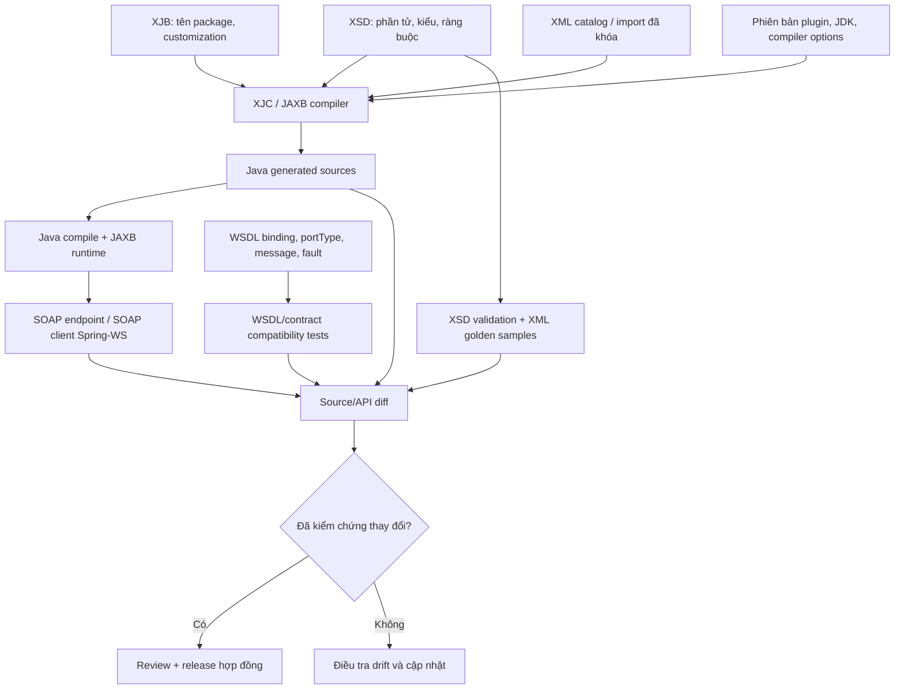
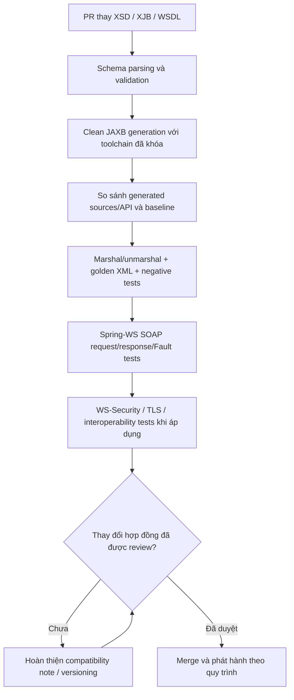

# Tái sinh mã có thể lặp lại và kiểm tra thay đổi hợp đồng

## Mục tiêu học tập

Trong chương **Sinh mã JAXB** của module **SPRING_WEB_SERVICES**, bài học này giải quyết một vấn đề thường xuất hiện trong dự án SOAP theo hướng **contract-first**: từ cùng bộ **XSD/WSDL** đã thống nhất, làm thế nào để tất cả lập trình viên, CI và môi trường phát hành sinh ra **mã JAXB tương đương và có thể kiểm chứng**, đồng thời phát hiện khi hợp đồng XML thay đổi gây ảnh hưởng tới client hoặc endpoint?

Sau bài học, bạn có thể:

1. Phân biệt **nguồn hợp đồng** (XSD/WSDL), **binding customization** (XJB), **mã Java sinh bởi XJC**, **runtime JAXB** và hợp đồng thực sự truyền trên SOAP wire.
2. Thiết lập quy trình XJC có thể lặp lại bằng cách cố định JDK, phiên bản plugin, các đầu vào schema/binding, XML catalog, encoding và thư mục output.
3. Cấu hình ví dụ Maven sinh JAXB từ XSD, giải thích khi nào nên dùng Gradle và cách quản lý mã sinh trong kho mã nguồn.
4. Phát hiện **generation drift** (mã sinh không nhất quán) và **contract drift** (XSD/WSDL thay đổi) bằng so sánh bản sinh, kiểm thử schema, marshalling/unmarshalling và kiểm thử SOAP thực.
5. Phân loại các thay đổi **tương thích**, **có điều kiện** và **phá vỡ** đối với Java API, XML payload, SOAP Body, SOAP Header hoặc WSDL binding.
6. Xử lý những lỗi phổ biến: JAXB `javax`/`jakarta`, namespace QName sai, lớp sinh cũ, schema import không ổn định, trùng tên Java và thiếu JAXB provider.
7. Thiết kế quy trình review, versioning, kiểm thử tương thích và phát hành hợp đồng cho hệ thống doanh nghiệp có WS-Security, chứng chỉ và SOAP Fault.

## 1. “Sinh lại được” và “không đổi hợp đồng” là hai mục tiêu khác nhau

JAXB (**Jakarta XML Binding**) giúp chuyển **XML ⇄ Java object**. Trong hướng **contract-first**, **XSD là nguồn định nghĩa dữ liệu**, còn công cụ XJC đọc schema và sinh ra các lớp Java, `ObjectFactory`, `package-info.java` cùng những annotation JAXB liên quan.

Giả sử hai người dùng cùng file `orders-v1.xsd`:

- Máy A chạy JDK 21, XJC thuộc dòng JAXB 4, binding package cố định.
- Máy B chạy XJC cũ thuộc dòng `javax.xml.bind` hoặc một plugin có quy tắc đặt tên khác.

Cả hai đều có thể sinh Java, nhưng **mã Java không tương thích nhau**, thậm chí có thể gây lỗi biên dịch hoặc sai namespace XML.

### 1.1. Ba loại thay đổi cần theo dõi

| Loại | Đối tượng thay đổi | Dấu hiệu |
| --- | --- | --- |
| **Input/contract drift** | XSD, WSDL, XJB, schema imports, security policy hoặc quy ước SOAP | Element/type/QName, min/max, SOAPAction, fault, binding, namespace thay đổi. |
| **Generation drift** | Mã Java sinh từ **cùng** input nhưng khác compiler/plugin, JDK, locale, thứ tự file, timestamp hoặc cấu hình | Hai lần build tạo ra file Java khác nhau dù không đổi XSD/XJB. |
| **Runtime/behavior drift** | Java code và schema tưởng như giữ nguyên nhưng marshalling, validation, security, SOAP client hoặc endpoint xử lý khác | XML trên wire đổi, JAXB mapping đổi, lỗi SOAP Fault hoặc hành vi WS-Security khác. |

**Tái sinh mã có thể lặp lại** là bảo đảm: với **cùng đầu vào và môi trường/toolchain đã khóa**, quá trình sinh mã tạo ra tập output nhất quán có thể so sánh được. Đây là điều kiện để review hiệu quả nhưng **không chứng minh** rằng thay đổi contract là tương thích.

Ví dụ:

- XSD đổi `xs:maxLength` từ 30 sang 20; XJC có thể vẫn sinh một trường `String` giống hệt. **Mã Java không đổi**, nhưng client có thể gửi 25 ký tự và bị schema validation từ chối.
- XJB đổi Java package từ `com.example.orders.v1` sang `com.example.orders.generated.v1`; XML QName có thể giữ nguyên nhưng **Java source API thay đổi** và code đang import package cũ sẽ lỗi.
- Thay đổi namespace của phần tử SOAP Body có thể làm Spring-WS `@PayloadRoot` không khớp, ngay cả khi tên lớp Java vẫn giống.

Vì thế, cần kiểm tra cả **mã sinh**, **ngữ nghĩa XSD/WSDL** và **thông điệp SOAP thực tế**.

## 2. Chuỗi đầu vào của quy trình contract-first



Trong ứng dụng **Spring Web Services**:

- **XSD** xác định XML hợp lệ của request, response và fault detail.
- **WSDL 1.1** nối `types → message → portType → binding → service`, định nghĩa SOAP operation, binding và endpoint.
- **XJC** sinh Java từ các schema và binding; nó không thay thế việc kiểm tra `SOAPAction`, HTTP binding hoặc policy trong WSDL.
- **JAXB runtime** marshal/unmarshal XML khi được cấu hình trong SOAP client hoặc Spring-WS endpoint.
- **Interceptor** có thể kiểm tra schema, SOAP Header hoặc WS-Security. JAXB đọc được XML **không đồng nghĩa** chữ ký, chứng chỉ, timestamp, phân quyền hay tất cả XSD facet đã được xác minh.

Điểm cốt lõi: mã sinh là **kết quả dẫn xuất** từ contract và cấu hình sinh mã; không nên coi lớp Java sinh ra là nguồn hợp đồng duy nhất.

## 3. Cấu trúc dự án dành cho quá trình sinh mã ổn định

Một cấu trúc Maven/Spring-WS ví dụ:

```text
order-soap-service/
├── pom.xml
├── .mvn/
│   └── wrapper/                  # Maven Wrapper đã được tổ chức phê duyệt
├── mvnw
├── mvnw.cmd
├── src/
│   ├── main/
│   │   ├── xsd/
│   │   │   ├── orders-v1.xsd     # XSD nguồn, được version hóa
│   │   │   └── common-v1.xsd     # Nếu schema import/include dùng local file
│   │   ├── xjb/
│   │   │   └── bindings.xjb      # Quy tắc JAXB binding, được version hóa
│   │   ├── catalog/
│   │   │   └── catalog.xml       # Khi cần phân giải import offline
│   │   ├── resources/
│   │   │   ├── wsdl/orders.wsdl  # Nếu công bố WSDL tĩnh
│   │   │   └── application.yml
│   │   └── java/
│   │       └── com/example/orders/
│   │           ├── OrderApplication.java
│   │           └── OrderEndpoint.java
│   └── test/
│       ├── resources/contract/
│       │   ├── request-valid.xml
│       │   ├── request-invalid.xml
│       │   └── response-valid.xml
│       └── java/...
└── target/
    └── generated-sources/jaxb/   # XJC tạo lại, không sửa thủ công
```

Các thư mục `src/main/xsd`, `src/main/xjb` và `src/test/resources/contract` là **đầu vào đã quản lý phiên bản**. `target/generated-sources/jaxb` là **output của build** và thông thường được bỏ qua trong Git. Trong dự án Gradle, output tương đương thường đặt dưới `build/generated/...`.

Lợi ích của cấu trúc này:

1. Có thể biết chính xác file nào là **contract nguồn** và file nào là **sản phẩm của compiler**.
2. Xóa `target/` không làm mất schema hay binding.
3. CI có thể chạy từ checkout sạch để xác nhận build không dựa vào file `.java` đã sinh từ lần trước.
4. Thư mục output riêng cho từng bộ schema tránh lần sinh mã này xóa mã của bộ schema khác.
5. Đường dẫn schema/import và các file kiểm thử có thể được phân giải offline, giảm phụ thuộc vào website bên ngoài.

**Không chỉnh sửa trực tiếp** file Java được sinh dưới `target/generated-sources`. Nếu cần thay tên package/class, dùng **XJB**, thay đổi **XSD** có kiểm soát hoặc viết adapter/layer nghiệp vụ riêng.

## 4. Ví dụ đầu vào: XSD contract đơn hàng

Ta xây dựng hợp đồng có hai global elements `SubmitOrderRequest` và `SubmitOrderResponse` thuộc namespace `urn:example:orders:v1`. Ví dụ XSD độc lập sau minh họa đúng các ràng buộc để tạo kiểm thử:

**`src/main/xsd/orders-v1.xsd`**

```xml
<?xml version="1.0" encoding="UTF-8"?>
<xs:schema
    xmlns:xs="http://www.w3.org/2001/XMLSchema"
    xmlns:tns="urn:example:orders:v1"
    targetNamespace="urn:example:orders:v1"
    elementFormDefault="qualified">

    <xs:simpleType name="OrderIdType">
        <xs:restriction base="xs:string">
            <xs:pattern value="ORD-[0-9]{6}"/>
        </xs:restriction>
    </xs:simpleType>

    <xs:element name="SubmitOrderRequest">
        <xs:complexType>
            <xs:sequence>
                <xs:element name="orderId" type="tns:OrderIdType"/>
                <xs:element name="amount" type="xs:decimal"/>
            </xs:sequence>
        </xs:complexType>
    </xs:element>

    <xs:element name="SubmitOrderResponse">
        <xs:complexType>
            <xs:sequence>
                <xs:element name="accepted" type="xs:boolean"/>
            </xs:sequence>
        </xs:complexType>
    </xs:element>

</xs:schema>
```

Một request XML theo XSD:

```xml
<ord:SubmitOrderRequest xmlns:ord="urn:example:orders:v1">
    <ord:orderId>ORD-000042</ord:orderId>
    <ord:amount>125.50</ord:amount>
</ord:SubmitOrderRequest>
```

Nếu đổi `orderId` thành `ORD-42`, XML vẫn **well-formed** nhưng **không valid theo XSD** vì không khớp pattern. Điều quan trọng là JAXB có thể biểu diễn `orderId` dưới dạng `String` dù XSD có pattern; Java setter nhận một chuỗi **không bảo đảm** nó khớp pattern. Muốn enforce cần cấu hình **schema validation** hoặc kiểm tra nghiệp vụ tương ứng.

### 4.1. Vì sao dùng global element?

Ở cấp SOAP Body, Spring-WS thường định tuyến endpoint theo **QName của payload root** (ví dụ annotation `@PayloadRoot(namespace=..., localPart="SubmitOrderRequest")`). Các global elements trong XSD xác định chính xác tên và namespace của payload.

Trong các hợp đồng khác, XJC có thể sinh global element dưới dạng factory method trả về `JAXBElement<T>` thay vì một class có `@XmlRootElement`. **Không đoán theo tên file XSD**; sau khi sinh mã, kiểm tra `ObjectFactory`, annotation và kiểu kết quả để quyết định cách marshal/unmarshal.

## 5. XJB: giữ quy tắc ánh xạ Java ổn định

**External binding file (`.xjb`)** cho phép điều chỉnh ánh xạ Java mà không phải sửa schema nghiệp vụ. Ví dụ, XSD có namespace cố định nhưng ta muốn package Java rõ ràng và ổn định:

**`src/main/xjb/bindings.xjb`** dành cho công cụ JAXB thuộc thế hệ **Jakarta XML Binding 3/4**:

```xml
<?xml version="1.0" encoding="UTF-8"?>
<jaxb:bindings
    xmlns:jaxb="https://jakarta.ee/xml/ns/jaxb"
    xmlns:xs="http://www.w3.org/2001/XMLSchema"
    version="3.0">

    <jaxb:bindings
        schemaLocation="../xsd/orders-v1.xsd"
        node="/xs:schema">

        <jaxb:schemaBindings>
            <jaxb:package name="com.example.orders.contract.v1"/>
        </jaxb:schemaBindings>
    </jaxb:bindings>

</jaxb:bindings>
```

Trong ví dụ:

- `schemaLocation` được tính **tương đối từ file XJB** và trỏ tới XSD đã version hóa.
- `node="/xs:schema"` chọn root schema mà customization áp dụng.
- `jaxb:package` đặt package cho Java generated sources.
- Namespace `https://jakarta.ee/xml/ns/jaxb` khác namespace customization của JAXB thế hệ cũ thuộc `java.sun.com`/`javax`. Không copy XJB cũ sang JAXB 4 mà không chuyển và kiểm tra.

Việc ấn định package mang lại ổn định cho mã Java đang import `com.example.orders.contract.v1.*`. Nhưng **package Java không phải namespace XML**. Đổi package có thể phá vỡ Java API của ứng dụng trong khi XML `urn:example:orders:v1` giữ nguyên.

**Nên dùng một nguồn xác định package rõ ràng.** Nếu vừa đặt package trong XJB, vừa truyền tham số XJC `-p` hoặc plugin `<packageName>...`, một cấu hình có thể ghi đè cấu hình khác. Cần chọn một quy ước và ghi lại trong build.

## 6. Maven: khóa công cụ XJC và tái sinh mã ở generate-sources

Ví dụ bên dưới dành cho một dự án có Maven parent/BOM Spring Boot và Java/Jakarta phù hợp. Ta sử dụng **MojoHaus JAXB-2 Maven Plugin 4.2.0**, có goal `xjc`; plugin hỗ trợ các tùy chọn `sources`, `xjbSources`, `outputDirectory`, `encoding`, `noGeneratedHeaderComments` và `clearOutputDir`.

**Đoạn cấu hình đặt trong `<build><plugins>` của `pom.xml`:**

```xml
<plugin>
    <groupId>org.codehaus.mojo</groupId>
    <artifactId>jaxb2-maven-plugin</artifactId>
    <version>4.2.0</version>

    <executions>
        <execution>
            <id>generate-order-contract</id>
            <goals>
                <goal>xjc</goal>
            </goals>
        </execution>
    </executions>

    <configuration>
        <!-- Chỉ định rõ XSD nguồn (không để quét nhầm file khác). -->
        <sources>
            <source>${project.basedir}/src/main/xsd/orders-v1.xsd</source>
        </sources>

        <!-- Quy tắc package Java được version hóa. -->
        <xjbSources>
            <xjbSource>${project.basedir}/src/main/xjb/bindings.xjb</xjbSource>
        </xjbSources>

        <!-- Thư mục dành riêng cho output từ schema này. -->
        <outputDirectory>${project.build.directory}/generated-sources/jaxb</outputDirectory>

        <!-- Giảm sai khác phụ thuộc máy và thời điểm chạy. -->
        <encoding>UTF-8</encoding>
        <locale>en,US</locale>
        <noGeneratedHeaderComments>true</noGeneratedHeaderComments>
        <clearOutputDir>true</clearOutputDir>
        <failOnNoSchemas>true</failOnNoSchemas>
    </configuration>
</plugin>
```

**Vì sao cấu hình như vậy?**

| Thành phần | Mục đích trong reproducible build |
| --- | --- |
| `<version>4.2.0</version>` | Khóa chính xác **plugin sinh mã**; nếu thay compiler, review như một thay đổi build riêng. |
| `<sources>` | Xác định XSD gốc, tránh việc thêm file vào folder rồi vô tình trở thành entry point mới. |
| `<xjbSources>` | Bảo đảm XJB là input chính thức của XJC. |
| `<outputDirectory>` | Mã sinh nằm trong thư mục build riêng, không trộn với lớp Java viết tay. |
| `<encoding>UTF-8</encoding>` | Giảm khác biệt về mã hóa file nguồn sinh trên các máy. |
| `<locale>en,US</locale>` | Tránh thông điệp/chú thích chịu ảnh hưởng locale khác nhau; kiểm tra output thực tế. |
| `<noGeneratedHeaderComments>true</...>` | Loại bỏ dòng comment header có thể chứa timestamp khiến diff nhiễu. |
| `<clearOutputDir>true</...>` | Loại bỏ class cũ không còn sinh sau khi XSD thay đổi. |
| `<failOnNoSchemas>true</...>` | Làm build báo lỗi khi không tìm thấy XSD thay vì vô tình tạo output rỗng. |

**Lưu ý:** `clearOutputDir=true` chỉ an toàn nếu thư mục output **thuộc riêng execution đó**. Nếu nhiều execution cùng sinh vào một thư mục, execution sau có thể xóa class của execution trước. Tách output hoặc tổ chức việc biên dịch schema cho phù hợp.

Goal `xjc` được gắn vào giai đoạn `generate-sources`. Plugin có cơ chế thêm thư mục sinh vào source roots của Maven nên không cần copy file Java từ `target/` vào `src/main/java`.

Nguồn cấu hình: [MojoHaus JAXB-2 Maven Plugin 4.2.0 — xjc goal](https://www.mojohaus.org/jaxb2-maven-plugin/xjc-mojo.html). Phiên bản trong bài là ví dụ **đã chốt**, không có nghĩa mọi dự án phải dùng đúng plugin đó; khi chuyển phiên bản cần xác minh tính tương thích với Java/JAXB runtime của ứng dụng.

### 6.1. Plugin XJC và JAXB runtime là hai phần khác nhau

Plugin sinh mã chạy **trong quá trình build**. JAXB runtime chạy **khi ứng dụng xử lý XML**. Hai phần này có thể chịu quy tắc version management khác nhau:

- Maven plugin được khóa ở `<build><plugins>`.
- API `jakarta.xml.bind` và JAXB provider/runtime được đưa vào dependency của ứng dụng theo BOM/nhánh Spring Boot hoặc cấu hình chủ động.
- Không giả định “plugin 4.2.0” có nghĩa “JAXB API 4.2.0”; số phiên bản thuộc các dự án khác nhau.
- Với Spring Boot 3+/4 và Spring-WS thuộc thế hệ Jakarta, hãy bảo đảm generated classes import `jakarta.xml.bind.annotation.*`, không còn `javax.xml.bind.annotation.*`.

Nếu build ra class nhưng runtime báo không có `JAXBContext` provider, cần điều tra **runtime classpath**; không giải quyết bằng cách thêm bừa nhiều phiên bản JAXB API/provider lên cùng classpath.

### 6.2. Các lệnh kiểm tra quá trình sinh mã

Từ thư mục dự án, giả sử Maven Wrapper đã có sẵn:

```bash
# Kiểm tra JDK thực sự đang chạy Maven
./mvnw -version

# Xóa build output cũ rồi chạy XJC
./mvnw -B -ntp clean generate-sources

# Biên dịch và chạy các bài kiểm tra
./mvnw -B -ntp test

# Xem vì sao runtime chọn một phiên bản JAXB
./mvnw dependency:tree "-Dincludes=jakarta.xml.bind:*,org.glassfish.jaxb:*"
```

Trên Windows có thể dùng `.\mvnw.cmd` trong PowerShell thay vì `./mvnw`. Không lấy việc thư mục output **đã tồn tại từ build trước** làm bằng chứng XJC chạy thành công: luôn thực hiện **clean generation từ checkout sạch** ít nhất trong CI.

## 7. Gradle: đảm bảo cùng các yếu tố đầu vào

Nếu dự án dùng Gradle, quy tắc tương tự:

- Cố định phiên bản **Gradle Wrapper**, JVM chạy Gradle và **Java toolchain**.
- Chọn XJC plugin hoặc nhiệm vụ `JavaExec` có compiler version cụ thể.
- Cố định schema, binding, XML catalog, encoding và output directory.
- Nối task `generateJaxb` vào `compileJava`, để mã sinh xuất hiện trước khi biên dịch.
- Xóa output stale khi tái sinh; không để task khác cùng ghi vào folder đó.
- Khai báo input/output của task để Gradle nhận diện thay đổi và chỉ cache khi output đã được kiểm chứng ổn định.
- Tạo một CI job chạy lại generation trong môi trường cố định, kiểm tra output và contract tests.

**Khung nhiệm vụ Gradle mang tính minh họa** (cần cấu hình classpath XJC, plugin/version và vị trí XJB chính xác trước khi chạy):

```groovy
// Pseudocode minh họa trách nhiệm Gradle task.
tasks.register('generateJaxb') {
    inputs.files(fileTree('src/main/xsd'))
    inputs.files(fileTree('src/main/xjb'))
    outputs.dir(layout.buildDirectory.dir('generated/sources/jaxb'))

    doLast {
        // Gọi XJC version đã khóa, với args cố định:
        // -encoding UTF-8 -no-header -b bindings.xjb orders-v1.xsd
        // Output vào build/generated/sources/jaxb.
        // Thực thi thật phải cấu hình JavaExec và XJC classpath.
    }
}
tasks.named('compileJava') {
    dependsOn tasks.named('generateJaxb')
}
```

**Không coi khung này là build script hoàn chỉnh:** `doLast` hiện chỉ có chú thích và chưa sinh Java. Mục đích là chỉ ra các dependency của task. Trong dự án thật, phải dùng XJC plugin hoặc JavaExec đã được khóa phiên bản và gắn thư mục output vào Java source set.

Khi bật Gradle build cache, nhớ rằng **cache hit không chứng minh** output mới được tái sinh từ XSD hiện tại nếu inputs không được khai báo đầy đủ. Ít nhất một job CI phải thử **clean generation không dựa vào cache** khi sửa contract hoặc công cụ.

## 8. Những yếu tố gây sai khác giữa hai lần sinh mã

| Yếu tố | Dấu hiệu sai khác | Cách kiểm soát |
| --- | --- | --- |
| **Phiên bản XJC/plugin** | Tên method, annotation, comment, thứ tự mã hoặc Java import đổi. | Khóa plugin và dependency sinh mã; review mọi nâng cấp. |
| **JDK** | Khác behavior của compiler/plugin, encoding hoặc API có sẵn. | Dùng toolchain/CI image cố định, ghi major và patch policy. |
| **Locale/encoding** | Chú thích và file Java sinh chứa nội dung khác. | UTF-8, locale ổn định, kiểm tra output. |
| **Timestamp trong comment** | File Java khác theo thời gian, không thay ngữ nghĩa. | Tắt header comment chứa thời gian, tránh chèn generated-at tùy ý. |
| **Schema import qua mạng** | Nội dung remote XSD thay đổi hoặc network không truy cập được. | Vendor/lock schema và XML catalog offline, kiểm tra checksum. |
| **Thứ tự/chọn XSD** | Chạy vào file thừa, bị name collision hoặc class bị ghi đè. | Chỉ định rõ schema root và danh sách import/binding. |
| **XJB customization** | Package, class, property name hoặc adapter đổi. | Commit XJB, coi thay đổi XJB là thay đổi Java API cần review. |
| **Dữ liệu cũ trong output** | Class bị xóa khỏi XSD vẫn còn trên disk sau regeneration. | Clean output riêng cho execution, clean CI build. |
| **Path tuyệt đối của máy** | Comment/metadata chứa đường dẫn không giống nhau. | Dùng đường dẫn tương đối, tránh tool option chèn local path. |
| **Plugin mở rộng của XJC** | Builder, equals/hashCode, inheritance hoặc annotation phụ sinh khác. | Khóa phiên bản và option của mọi XJC extension, test API. |
| **Chính sách newline** | Linux LF và Windows CRLF tạo diff không liên quan. | Quy ước text encoding/line endings của repo, so sánh phù hợp. |
| **Dependency resolution không khóa** | Một dependency transitive được nâng mà build file không đổi. | BOM, lock/version policy, kiểm tra resolved dependency tree. |

**Reproducibility không đồng nghĩa byte-for-byte reproducible JAR.** Bài này kiểm soát chủ yếu **generated Java sources**. Muốn JAR/WAR hoàn toàn tái lập còn phải khóa plugin đóng gói, timestamp archive, resource filtering, metadata build và toàn bộ dependencies.

### 8.1. XSD import và XML catalog

Ví dụ schema có khai báo import:

```xml
<xs:import
    namespace="urn:example:common:v1"
    schemaLocation="https://schemas.example.com/common/v1/common-v1.xsd"/>
```

Nếu compiler tải file từ URL mỗi lần, việc build phụ thuộc vào mạng và khả năng server từ xa thay đổi nội dung. Đối với một hợp đồng doanh nghiệp quan trọng, nên lưu **bản XSD được chấp thuận** trong nguồn dự án hoặc dependency artifact đã khóa và cấu hình **XML catalog** ánh xạ URI tới bản đó.

Một XML catalog theo chuẩn OASIS có thể trông như:

```xml
<?xml version="1.0" encoding="UTF-8"?>
<catalog
    xmlns="urn:oasis:names:tc:entity:xmlns:xml:catalog"
    prefer="system">
    <uri
        name="https://schemas.example.com/common/v1/common-v1.xsd"
        uri="../xsd/common-v1.xsd"/>
</catalog>
```

Nếu file này nằm ở `src/main/catalog/catalog.xml`, đường dẫn `../xsd/common-v1.xsd` là một ví dụ phân giải cục bộ. Với MojoHaus plugin có thể thêm:

```xml
<catalog>${project.basedir}/src/main/catalog/catalog.xml</catalog>
```

vào `<configuration>`. Đường dẫn và quy tắc resolver phải được kiểm thử với bộ schema thực tế. Đừng coi catalog chỉ là tối ưu hiệu năng: nó giúp ngăn **hợp đồng remote đổi bất ngờ** và giảm rủi ro tải tài liệu ngoài không kiểm soát trong build.

### 8.2. Không bật external entities tùy tiện

XJC và JAXB chạy trên XML, vì vậy có rủi ro liên quan DTD và **XXE** khi xử lý schema/binding không tin cậy. Không bật `externalEntityProcessing=true` hay cho phép mọi URL tùy ý chỉ để “làm cho build chạy được”. Trước hết kiểm tra import, XML catalog và quyền truy cập schema đáng tin cậy. Các XML parser hoặc WSDL/XSD validator ở runtime cũng phải được cấu hình theo chính sách an toàn của hệ thống.

## 9. Chứng minh tính lặp lại: clean generation và so sánh

Có hai chiến lược thường dùng.

### 9.1. Không commit mã JAXB sinh ra (khuyến nghị phổ biến)

**Commit** XSD, WSDL, XJB, catalog, plugin/build configuration, wrapper, dữ liệu kiểm thử và quyết định contract. **Không commit** `target/generated-sources/jaxb`; CI luôn sinh Java trong quá trình build.

Ưu điểm:

- Hạn chế file Java khổng lồ làm nhiễu PR.
- Nguồn dữ liệu contract có một bản chính thức.
- Bắt buộc build thực sự tái sinh thay vì dựa vào class cũ.

Nhược điểm:

- Không có `git diff` trực tiếp giữa hai bản generated sources trong PR.
- Cần **CI job** chụp snapshot output và so sánh nếu muốn kiểm tra tính deterministic ở cấp file.
- Muốn so sánh API Java giữa baseline và PR cần sinh cả hai phiên bản hoặc tạo báo cáo API diff.

**Ví dụ CI trên Linux** để kiểm tra hai lần sinh ra cùng output, giả sử các toolchain đã khóa:

```bash
# Thực hiện trong checkout hợp đồng sạch, có Maven Wrapper.
./mvnw -B -ntp clean generate-sources

# Chụp bản sinh thứ nhất vào thư mục tạm của job.
mkdir -p build-check/first
cp -R target/generated-sources/jaxb/. build-check/first/

# Sinh lại từ đầu.
./mvnw -B -ntp clean generate-sources

# Lệnh này thoát khác 0 nếu có bất kỳ khác biệt file/thư mục.
diff -ru build-check/first target/generated-sources/jaxb

# Chạy contract tests và tests tích hợp hiện có.
./mvnw -B -ntp test
```

`build-check/` là thư mục làm việc tạm, cần được bỏ qua trong Git hoặc đặt trong khu vực scratch của CI. Đoạn lệnh minh họa trên **không được chạy trong bước viết bài này**; CI thật cần cấu hình JDK, Maven Wrapper, cache và cleanup theo môi trường.

Nếu hai lần generation giống nhau, bạn chứng minh **độ lặp lại trong cùng môi trường CI đó**. Muốn chứng minh giữa Windows/Linux, JDK patch khác nhau hoặc hai CI image khác nhau, cần chạy **cùng input trên những môi trường ấy và so sánh**. Tính xác định chưa tự động mở rộng sang mọi hệ điều hành.

### 9.2. Commit generated Java sources trong trường hợp đặc thù

Một số nhóm phát hành **client SDK** hoặc phải cung cấp source Java cho hệ thống không chạy được XJC. Khi đó có thể commit generated sources trong **thư mục quản lý rõ ràng**, ví dụ `src/generated/java`, và cấu hình build dùng thư mục đó.

Trong CI:

1. Tạo lại toàn bộ generated sources vào **đúng thư mục đã commit**, hoặc tạo ở thư mục tạm rồi đồng bộ có kiểm soát.
2. So sánh với những file đã commit; không chỉ nhìn diff của schema.
3. Nếu có khác biệt, CI báo lỗi để PR cập nhật generated code cùng XSD/XJB.
4. Cấm sửa tay generated code; mọi thay đổi phải quay về nguồn hợp đồng hoặc binding.

Ví dụ bước kiểm tra khi script dự án **đã tái sinh đúng vào `src/generated/java`**:

```bash
git diff --exit-code -- src/generated/java
```

**Không áp dụng lệnh này vào `target/generated-sources/jaxb` khi thư mục đó bị `.gitignore` và không được Git track.** Nếu file không được theo dõi, `git diff --exit-code` có thể trả thành công dù mã đã thay đổi. Hãy dùng snapshot/diff giữa output hoặc đặt build output vào vùng generated sources được commit theo chiến lược đã chọn.

### 9.3. Kiểm tra thay đổi giữa hai commit

So sánh **đầu vào hợp đồng** trước:

```bash
# BASE là commit nhánh gốc được CI xác định rõ.
git diff --name-status BASE..HEAD -- \
  src/main/xsd src/main/xjb src/main/catalog src/main/resources/wsdl
```

Sau đó tái sinh JAXB từ **BASE** và **HEAD** trong cùng toolchain để so sánh generated API. Cần nhớ: thay đổi XSD mà generated Java **không đổi** vẫn có thể là thay đổi contract, và thay đổi generated Java không nhất thiết làm XML trên wire khác.

## 10. Kiểm tra thay đổi hợp đồng: không dừng ở diff file Java

Một pipeline đủ tin cậy cần kiểm tra ít nhất **bốn lớp**.

| Lớp | Kiểm tra | Câu hỏi được trả lời |
| --- | --- | --- |
| **Nguồn hợp đồng** | Git diff XSD/XJB/WSDL và import, schema parsing/validation | Tên phần tử, namespace, ràng buộc, WSDL operation hoặc fault có đổi không? |
| **Mã Java sinh** | Regenerate, diff classes/annotations/methods, Java compile hoặc API checker | Client/endpoint Java có cần đổi code không? |
| **XML wire format** | Marshal/unmarshal, XSD validation, golden XML, QName assertions | Request/response XML có còn được đối tác chấp nhận không? |
| **Tích hợp SOAP** | Spring-WS endpoint/client, WSDL, SOAPAction, header, security, SOAP Fault | Một client thực có gọi được và nhận đúng hành vi không? |

### 10.1. So sánh XSD là bước bắt buộc

**XJC không phản ánh mọi constraint vào Java API.** Ví dụ:

```xml
<!-- Baseline: tối đa 40 ký tự -->
<xs:maxLength value="40"/>

<!-- Bản đề xuất: tối đa 20 ký tự -->
<xs:maxLength value="20"/>
```

Java getter vẫn có thể là `String getCustomerName()` ở cả hai bản. Một test chỉ so sánh `.java` sẽ bỏ sót việc client cũ gửi 30 ký tự nay trở nên **không hợp lệ**.

Tương tự, thay:

```xml
<xs:element name="quantity" type="xs:int"/>
```

thành:

```xml
<xs:element name="quantity" type="xs:long"/>
```

có thể đổi Java property từ `int`/`Integer` sang `long`/`Long`, đồng thời thay đổi tập giá trị trên wire. Đây là **thay đổi cả Java API lẫn hợp đồng dữ liệu**, và client cũ có thể không xử lý được giá trị mới lớn hơn miền `xs:int`.

### 10.2. Phân loại tác động theo chiều giao tiếp

| Thay đổi XSD/WSDL | Tác động tiềm năng | Cách kiểm tra |
| --- | --- | --- |
| Thêm phần tử **tùy chọn** `minOccurs="0"` ở request | Server mới thường đọc được request cũ; server cũ có thể từ chối request mới có phần tử lạ nếu validation nghiêm ngặt. | Test **client cũ → server mới** và **client mới → server cũ**. |
| Thêm phần tử tùy chọn ở response | Client cũ validate XSD cũ có thể từ chối response có phần tử lạ. | Test **server mới → client cũ** và schema validation. |
| Đổi phần tử từ tùy chọn sang bắt buộc | Request/response cũ thiếu phần tử có thể không còn valid. | Golden messages không có phần tử, test ở cả hai phía. |
| Tăng `maxLength` hoặc tăng `maxOccurs` | Có thể cho phép thêm dữ liệu, nhưng client/hạ tầng cũ có thể từ chối giá trị/số lượng mới. | Schema validation của client cũ, giới hạn message size. |
| Giảm `maxLength`, `maxOccurs` hoặc thu hẹp enumeration | Dữ liệu hợp lệ trước đây có thể bị từ chối; thường là **breaking change**. | Test dữ liệu ranh giới của phiên bản cũ. |
| Đổi kiểu `xs:int` → `xs:long` | Miền giá trị mở rộng nhưng generated Java API có thể đổi, client cũ có thể không xử lý được giá trị lớn. | Diff Java API, schema và golden cases. |
| Đổi `xs:sequence` hoặc thứ tự phần tử | Có thể khiến payload theo thứ tự cũ không hợp lệ. | Test XML đã ghi nhận từ client đối tác. |
| Đổi `targetNamespace` hoặc tên root element | Đổi QName của SOAP payload; dễ phá vỡ endpoint mapping. | Kiểm tra `@PayloadRoot`, WSDL, SOAP client thực. |
| Đổi tên operation, `soapAction` hoặc binding WSDL | XJC sinh từ XSD có thể **không phát hiện**. | WSDL diff, SOAPAction, integration tests. |
| Đổi Java package trong XJB | Có thể phá Java API nhưng XML QName giữ nguyên. | Generated source/API diff và compile client. |
| Thêm SOAP Header/WS-Security bắt buộc | Client cũ có thể không gửi hoặc không ký đúng header. | Security policy tests, SOAP Fault và compatibility. |
| Đổi fault detail element/namespace | Client có thể parse sai SOAP Fault nghiệp vụ. | Test fault wire format và WSDL fault. |

**Không gắn nhãn “backward compatible” một cách tuyệt đối** chỉ dựa vào loại thay đổi. Cần xác định *ai gửi*, *ai nhận*, *schema nào được dùng để validate*, và có chuyển tiếp qua gateway/WS-Security hay không.

### 10.3. XSD API diff ≠ SOAP contract diff

Nếu input của XJC chỉ là `orders-v1.xsd`, thay `soap:address` hoặc `soapAction` trong WSDL sẽ **không làm lớp JAXB đổi**. Nhưng client có thể vẫn gửi tới địa chỉ sai hoặc bị binding từ chối.

Đối với Spring-WS **contract-first**, tối thiểu phải version hóa và so sánh cùng:

- `*.xsd`, `*.xjb`, XML catalog và các XSD import.
- `*.wsdl` nếu hợp đồng có file WSDL viết tay, cùng `types/message/portType/binding/service`.
- Security policy và quy ước SOAP Header (`mustUnderstand`, `actor/role`), chữ ký và chứng chỉ khi được dùng.
- Những constraint ngoài XSD/WSDL: message size, timeout, TLS/mTLS, giới hạn payload và quy ước SOAP Fault.

## 11. Kiểm thử XML trước và sau tái sinh mã

### 11.1. Golden XML mẫu

Định nghĩa bộ dữ liệu mà tất cả bên liên quan thống nhất. Với ví dụ `orders-v1.xsd`:

**`src/test/resources/contract/request-valid.xml`**

```xml
<ord:SubmitOrderRequest xmlns:ord="urn:example:orders:v1">
    <ord:orderId>ORD-000042</ord:orderId>
    <ord:amount>125.50</ord:amount>
</ord:SubmitOrderRequest>
```

**`src/test/resources/contract/request-invalid.xml`**

```xml
<ord:SubmitOrderRequest xmlns:ord="urn:example:orders:v1">
    <ord:orderId>ORD-42</ord:orderId>
    <ord:amount>125.50</ord:amount>
</ord:SubmitOrderRequest>
```

Nên có thêm golden cases cho phần tử tùy chọn, `xsi:nil`, namespace, Unicode, số thập phân, thời điểm, danh sách rỗng/tối đa và SOAP Fault. Với XML, tránh khẳng định hai bản tin khác tiền tố hoặc khoảng trắng là hai contract khác nhau nếu **QName và giá trị ngữ nghĩa** giống nhau.

### 11.2. Kiểm tra schema với công cụ độc lập

Trong môi trường có `xmllint`:

```bash
xmllint --noout --schema src/main/xsd/orders-v1.xsd \
  src/test/resources/contract/request-valid.xml

# Dự kiến báo lỗi schema vì orderId sai pattern:
xmllint --noout --schema src/main/xsd/orders-v1.xsd \
  src/test/resources/contract/request-invalid.xml
```

Đây là kiểm thử **payload XML**, không phải toàn SOAP Envelope. Khi có SOAP Envelope hoàn chỉnh, cần trích payload hoặc dùng công cụ hiểu SOAP để validate ở mức phù hợp.

### 11.3. Kiểm tra marshalling/unmarshalling cùng XSD

Giả sử XJC đã sinh lớp `SubmitOrderRequest` (với XSD global element có anonymous complex type như ví dụ) và cung cấp JAXB root mapping phù hợp. Một JUnit test có thể xác minh dữ liệu được chuyển qua lại:

```java
import static org.junit.jupiter.api.Assertions.assertEquals;

import java.io.File;
import java.io.StringReader;
import java.io.StringWriter;
import java.math.BigDecimal;
import jakarta.xml.bind.JAXBContext;
import jakarta.xml.bind.Marshaller;
import jakarta.xml.bind.Unmarshaller;
import javax.xml.XMLConstants;
import javax.xml.validation.Schema;
import javax.xml.validation.SchemaFactory;
import org.junit.jupiter.api.Test;
import com.example.orders.contract.v1.SubmitOrderRequest;

class JaxbContractTest {

    @Test
    void marshalAndUnmarshalWithSchema() throws Exception {
        Schema schema = SchemaFactory
                .newInstance(XMLConstants.W3C_XML_SCHEMA_NS_URI)
                .newSchema(new File("src/main/xsd/orders-v1.xsd"));

        SubmitOrderRequest request = new SubmitOrderRequest();
        request.setOrderId("ORD-000042");
        request.setAmount(new BigDecimal("125.50"));

        JAXBContext context = JAXBContext.newInstance(
                SubmitOrderRequest.class);

        Marshaller marshaller = context.createMarshaller();
        marshaller.setSchema(schema);

        StringWriter xml = new StringWriter();
        marshaller.marshal(request, xml);

        Unmarshaller unmarshaller = context.createUnmarshaller();
        unmarshaller.setSchema(schema);

        SubmitOrderRequest parsed = (SubmitOrderRequest)
                unmarshaller.unmarshal(new StringReader(xml.toString()));

        assertEquals("ORD-000042", parsed.getOrderId());
        assertEquals(new BigDecimal("125.50"), parsed.getAmount());
    }
}
```

**Điều kiện để ví dụ chạy:**

- Đã có generated classes và JAXB runtime tương thích Jakarta trong test classpath.
- XJC sinh `SubmitOrderRequest` là root JAXB element phù hợp; nếu XJC sinh `JAXBElement<T>` qua `ObjectFactory`, phải dùng factory và xử lý giá trị wrapper tương ứng.
- File `orders-v1.xsd` tồn tại ở đường dẫn test sử dụng; với project nhiều module nên dùng classpath resource hoặc đường dẫn được cấu hình rõ ràng.
- `SchemaFactory` cần nhận schema **đáng tin cậy** và được cấu hình bảo mật nếu có import ngoài. Không dùng trực tiếp XSD không tin cậy để kích hoạt tải tài nguyên tùy ý.

Điểm chính là gọi **`setSchema(schema)`** ở marshaller/unmarshaller để **thực thi validation**. Nếu chỉ tạo `JAXBContext` và unmarshal thành công, một số ràng buộc `xs:pattern`/`maxLength` có thể chưa được kiểm tra.

### 11.4. Kiểm tra lỗi âm và mapping QName

Thêm các bài kiểm tra:

- `ORD-000042` hợp lệ; `ORD-42` phải bị schema validation từ chối.
- Request thiếu `orderId` phải không valid theo XSD.
- Request có namespace khác `urn:example:orders:v1` phải không được nhận như payload cùng QName.
- Marshal ra XML có global root `SubmitOrderRequest` đúng namespace, không chỉ khẳng định Java class có tên `SubmitOrderRequest`.
- Nếu có `xsi:nil` và các trường `minOccurs=0`, test rõ **vắng mặt**, **rỗng**, **nil** theo XSD.
- Với `xs:decimal`, kiểm tra dữ liệu và quy tắc nghiệp vụ bằng `BigDecimal`; đừng mặc định so sánh chuỗi XML biểu diễn thập phân là tiêu chí duy nhất.

## 12. Kiểm tra hợp đồng SOAP qua Spring Web Services

Mã JAXB sinh ra chỉ là một lớp của tích hợp. Một endpoint ví dụ:

```java
import org.springframework.ws.server.endpoint.annotation.Endpoint;
import org.springframework.ws.server.endpoint.annotation.PayloadRoot;
import org.springframework.ws.server.endpoint.annotation.RequestPayload;
import org.springframework.ws.server.endpoint.annotation.ResponsePayload;

import com.example.orders.contract.v1.SubmitOrderRequest;
import com.example.orders.contract.v1.SubmitOrderResponse;

@Endpoint
public class OrderEndpoint {
    private static final String NS = "urn:example:orders:v1";

    @PayloadRoot(namespace = NS, localPart = "SubmitOrderRequest")
    @ResponsePayload
    public SubmitOrderResponse submit(
            @RequestPayload SubmitOrderRequest request) {

        // Gọi nghiệp vụ, authorization, idempotency tại tầng phù hợp.
        SubmitOrderResponse response = new SubmitOrderResponse();
        response.setAccepted(true);
        return response;
    }
}
```

Ví dụ giả định JAXB adapter/marshaller và cấu hình Spring-WS endpoint đã sẵn sàng; đó **không phải dự án Spring Boot độc lập có thể chạy chỉ bằng class trên**.

Cần kiểm tra thực tế:

1. **WSDL/XSD:** client tạo request từ hợp đồng nào, namespace nào, schema nào?
2. **SOAP Body QName:** `@PayloadRoot` có match `{urn:example:orders:v1}SubmitOrderRequest` không?
3. **JAXB:** request/response classes có đúng package/annotations và schema không?
4. **Validation:** nếu service yêu cầu hợp đồng chặt chẽ, phải bật payload XSD validation; JAXB không tự thay thế tất cả schema rules.
5. **SOAP Fault:** request invalid, lỗi nghiệp vụ, thiếu SOAP Header bắt buộc có phản hồi đúng version/binding và fault detail không?
6. **WS-Security:** token, chữ ký, timestamp, chứng chỉ và signed parts có được xác minh như policy không?
7. **SOAP client:** kiểm thử qua HTTP/TLS, kể cả SOAPAction (nếu dùng SOAP 1.1) và các interceptor/cấu hình client thực.

### 12.1. Vì sao không nên chỉ test method Java?

Một unit test gọi trực tiếp `new OrderEndpoint().submit(request)` sẽ bỏ qua:

- Bước parse XML và xác thực namespace.
- JAXB marshal/unmarshal theo XSD.
- SOAP Envelope/Header/Body, `mustUnderstand`, `actor/role`.
- HTTP Content-Type, SOAPAction, endpoint routing.
- Interceptor XML security, WS-Security, chứng chỉ, timestamp.
- SOAP Fault, fault detail và thông điệp thực tế đi qua client/gateway.

Vì vậy, cần có **contract-level/integration tests** bằng Spring-WS test support, SOAP client thực hoặc công cụ đối tác. Bài học “tái sinh mã có thể lặp lại” hoàn tất khi cả **generated source** lẫn **wire behavior** đều được kiểm tra, không chỉ khi source compile.

## 13. Kiểm soát tương thích khi hợp đồng thay đổi

Giả sử đối tác đề nghị thêm trường `customerReference` tùy chọn ở cuối `SubmitOrderRequest`:

```xml
<xs:element name="customerReference"
            type="xs:string"
            minOccurs="0"/>
```

Ta cần thực hiện **một thay đổi có kiểm soát**:

1. **Xác nhận yêu cầu:** Ai gửi trường mới? Client cũ hay server cũ có thể gặp thông điệp mới không? Có cần ràng buộc length/pattern?
2. **Sửa XSD nguồn:** Giữ đúng namespace và vị trí trong `xs:sequence`. Nếu schema có versioning policy, thực hiện theo policy đó.
3. **Tái sinh JAXB:** Dùng **cùng compiler/toolchain đã khóa**, không chỉnh tay lớp Java. Quan sát getter/setter mới.
4. **So sánh Java API:** Getter/setter thay đổi có làm source/binary compatibility của SDK ảnh hưởng không?
5. **So sánh schema:** Client cũ có chấp nhận request có phần tử mới không? Nếu client mới bỏ trống thì server cũ thường vẫn có thể nhận request cũ.
6. **Kiểm tra XSD và golden XML:** Test request cũ (không có trường) và request mới (có trường).
7. **Kiểm tra SOAP runtime:** Endpoint Spring-WS có còn map đúng QName, WSDL được công bố có đúng `types`, SOAP client có tương thích không?
8. **Review và phát hành:** Ghi rõ thay đổi, tác động theo chiều giao tiếp, kế hoạch triển khai và fallback nếu client/server không nâng cùng lúc.

**Nhãn “optional” không tự bảo đảm backward compatibility hai chiều.** Server mới thường nhận request cũ thiếu phần tử, nhưng server cũ dùng XSD cũ có thể từ chối request mới chứa phần tử chưa biết.

### 13.1. Đổi schema khi nào cần version mới?

Cân nhắc tăng **version namespace/WSDL/endpoint** khi:

- Đổi tên hoặc namespace của global element trong SOAP Body.
- Loại bỏ/đổi phần tử bắt buộc làm client cũ không còn hợp lệ.
- Thu hẹp kiểu, miền giá trị, enumeration hoặc số lượng phần tử.
- Thay đổi SOAP binding, SOAPAction, fault detail hoặc security policy theo hướng client cũ không hỗ trợ.
- Thay đổi không thể rollout an toàn bằng giải pháp tương thích hay giai đoạn chuyển đổi.

Không bắt buộc mọi thay đổi đều phải thay namespace, nhưng phải có **chính sách versioning nhất quán** và conformance tests. Một số dự án dùng endpoint mới cho v2; số khác duy trì đồng thời hai XSD/portType trong thời gian chuyển tiếp.

## 14. Quản lý generated code trong kiến trúc nhiều module

Trong hệ thống lớn, schema có thể chia thành:

```text
common-contract/
  common-v1.xsd
  -> com.example.common.contract.v1.*

order-contract/
  orders-v1.xsd (import common-v1.xsd)
  -> com.example.orders.contract.v1.*

order-service/
  Spring-WS @Endpoint, JAXB runtime, WS-Security

order-client/
  WebServiceTemplate hoặc SOAP client khác
```

Nếu cả `common-contract` và `order-contract` sinh lại **cùng global types** trong các package khác nhau, có thể gây trùng model hoặc làm SOAP marshalling/serialization khó quản lý. Cần thống nhất:

- Mỗi schema/package/module nào là **chủ sở hữu**.
- Module nào được phép tạo Java classes từ schema nào.
- Có dùng **JAXB episode file** để ràng buộc downstream XJC với classes đã sinh ở module upstream hay không.
- Dependencies và episode được version hóa theo cùng hợp đồng như thế nào.
- XSD import được phân giải theo artifact nội bộ hoặc catalog offline ra sao.

**Episode file** hỗ trợ XJC dùng lại mappings của những schema đã xử lý ở module trước, giúp tránh sinh lại không cần thiết. Tuy nhiên, episode cũng là input cần khóa phiên bản và kiểm thử; một episode từ schema cũ có thể khiến generated code mới tham chiếu sai classes.

Với hệ thống nhỏ, đừng dùng nhiều module/episode nếu chưa cần. Cấu trúc đơn giản với một XSD root và một execution XJC dễ tái lập và review hơn.

## 15. Bảo vệ chuỗi cung ứng của quy trình sinh mã

XJC thường chạy trong CI với quyền đọc mã nguồn, dependency cache và đôi khi biến môi trường của build. Vì vậy, tính lặp lại còn liên quan đến bảo mật:

- Chỉ dùng XSD/XJB/WSDL từ nguồn được chấp thuận. Chúng là **đầu vào công cụ**, không phải văn bản vô hại bất kể nội dung.
- Chặn hoặc kiểm soát XML imports ngoài qua XML catalog và allowlist, tránh tải tùy ý.
- Không bật external entity resolution một cách thiếu kiểm soát; đặt giới hạn parser theo công cụ.
- Khóa plugin version, các XJC extensions và dependency repositories; không dùng version range hoặc snapshot plugin trôi tự do trong release build.
- Không log mật khẩu repository, token, khóa riêng hoặc keystore khi debug generation.
- Chạy CI với quyền tối thiểu; kiểm soát source artifact được tải từ kho dependency.
- Kiểm thử generated code và contract trước khi release artifact cho SOAP client.

Các biện pháp này **không thay thế** WS-Security của SOAP message. Chúng bảo vệ **quá trình build**; WS-Security/TLS/chứng chỉ bảo vệ **giao tiếp lúc chạy**.

## 16. Chẩn đoán lỗi thường gặp khi tái sinh JAXB

| Triệu chứng | Nguyên nhân có thể | Cách xử lý |
| --- | --- | --- |
| `No schemas found` hoặc build sinh 0 class | Sai `sources`, file không tồn tại, exclude pattern. | Kiểm tra đúng đường dẫn XSD và bật `failOnNoSchemas`. |
| `Unable to parse input schema` | XSD không well-formed/valid, import thiếu hoặc namespace sai. | Xác thực XSD riêng, kiểm tra catalog, QName và schemaLocation. |
| `Cannot resolve the name ... to a(n) 'type definition'` | Thiếu import hoặc dùng sai namespace cho kiểu. | Kiểm tra `xs:import`/`xs:include` và định danh global type. |
| `Two declarations cause a collision in the ObjectFactory` | XSD hoặc binding gây trùng tên Java. | Rà soát schema/package/binding; không bật auto-name-resolution rồi bỏ qua review. |
| Generated Java còn `javax.xml.bind` | XJC hoặc XJB thuộc thế hệ cũ. | Chọn generator tương thích Jakarta, cập nhật XJB và tái sinh sạch. |
| Không tìm thấy `jakarta.xml.bind` khi compile | Thiếu JAXB API phù hợp ở compile classpath hoặc dùng sai BOM. | Kiểm tra dependency management và generated imports. |
| `JAXBException: Implementation of Jakarta XML Binding-API has not been found` | Có API nhưng thiếu runtime provider. | Kiểm tra JAXB runtime implementation trong runtime classpath. |
| `unexpected element (uri:..., local:...)` | Sai payload QName, class sinh cũ, mapping root hoặc namespace package. | So sánh XML thực với XSD/WSDL; kiểm tra `@XmlRootElement`/`ObjectFactory`. |
| Một class cũ vẫn còn dù XSD đã xóa element | Output directory không được clean, hoặc nhiều execution trộn output. | Clean generation và tách output directories. |
| Source diff có timestamp nhưng schema không đổi | XJC phát sinh generated-at header. | Bật `noGeneratedHeaderComments`, khóa toolchain, kiểm tra lại. |
| Trên máy khác package Java đổi | XJB không được đưa vào task, có override `packageName`, hoặc plugin khác version. | Version hóa XJB và so sánh actual command-line options. |
| CI chạy xanh dù XSD đổi phá hợp đồng | Chỉ test biên dịch/generated source, thiếu schema/compatibility tests. | Thêm XSD validation, golden XML, test client cũ và WSDL. |
| SOAP endpoint không match `@PayloadRoot` | XML namespace hoặc local name thay đổi sau regeneration. | So sánh QName payload và annotation endpoint. |
| SOAP client báo lỗi SOAPAction/Fault | WSDL binding/fault thay đổi nhưng XJC từ XSD không phát hiện. | Diff WSDL và thử SOAP request/Fault qua HTTP. |

**Cách điều tra có hệ thống:** trước tiên xác nhận commit XSD/XJB/WSDL và toolchain, kiểm tra đường dẫn input/import, tái sinh sạch, so sánh output, sau đó chuyển sang runtime JAXB/SOAP logs. Không sửa generated Java bằng tay để che dấu nguyên nhân.

## 17. Quy trình CI đề xuất cho một thay đổi contract

Một pull request sửa XSD hoặc cấu hình sinh mã nên đi qua các cổng:



Trường hợp CI phát hiện:

- **Generation không lặp lại:** lỗi ở plugin/toolchain/input/config hoặc dữ liệu thời gian; xử lý trước khi đánh giá compatibility.
- **XSD đổi, generated Java không đổi:** vẫn cần review XSD và data validation; không đánh dấu “không thay đổi hợp đồng”.
- **Generated Java đổi, XSD không đổi:** kiểm tra XJB/plugin/JDK/dependency và xem có breaking Java API hay không.
- **Cả schema và Java đều đổi:** kiểm tra compatibility theo chiều client/server, SOAP wire và release plan.
- **WSDL hoặc security policy đổi:** thêm kiểm thử SOAP operation/binding/header/fault ngay cả khi JAXB không đổi.

Ghi báo cáo PR ngắn gọn: **đầu vào đã đổi**, **Java API bị tác động**, **XML/WSDL wire có thay đổi gì**, **client nào bị ảnh hưởng**, **tests đã chạy** và **quyết định versioning**.

## 18. Bài tập thực hành và đáp án

### Bài 1 — Phân biệt hai loại drift

Hai lần XJC trên **cùng commit** tạo ra `ObjectFactory.java` khác nhau chỉ ở comment có ngày giờ sinh. Đây là drift gì? Chỉ cần sửa XSD không?

**Đáp án:** Đây là **generation drift** do output chứa timestamp, không phải thay đổi ngữ nghĩa XSD. Khóa cấu hình compiler, bật tùy chọn bỏ header timestamp như `noGeneratedHeaderComments` và tái sinh sạch. Không cần sửa hợp đồng XSD chỉ để hết nhiễu diff.

### Bài 2 — XSD đổi mà Java không đổi

Thay `<xs:maxLength value="40"/>` bằng `<xs:maxLength value="20"/>` cho một field `xs:string` nhưng generated class vẫn có property `String`. Có thể merge vì “code không thay đổi” không?

**Đáp án:** Không thể kết luận như vậy. Contract đã **thu hẹp** dữ liệu hợp lệ; client cũ gửi chuỗi 21–40 ký tự có thể bị XSD validation từ chối. Phải đánh giá breaking change, golden cases và chính sách versioning.

### Bài 3 — XJB thay đổi Java API

Một thành viên đổi `jaxb:package` từ `com.example.orders.contract.v1` sang `com.example.orders.model.v1` nhưng giữ nguyên `targetNamespace` và XSD. Tác động chính?

**Đáp án:** Generated Java package/imports đổi, có thể phá source/binary compatibility của các module Java đang sử dụng. XML namespace không tự đổi chỉ vì package Java đổi. Cần compile client code, test wire payload và review như một thay đổi Java API.

### Bài 4 — Cache che giấu mã sinh cũ

CI dùng Gradle task `generateJaxb` nhưng quên khai báo `bindings.xjb` là input; đổi XJB mà CI lấy output từ cache. Nguyên nhân?

**Đáp án:** Task dependency inputs chưa đầy đủ. Build cache có thể coi lần build mới như cũ dù mapping Java cần đổi. Phải khai báo tất cả inputs (XSD, XJB, catalog, toolchain/options), rồi kiểm tra clean regeneration có kiểm soát.

### Bài 5 — Schema optional có chắc an toàn?

Server mới thêm phần tử request `customerReference minOccurs="0"`. Client cũ không gửi field này, nhưng client mới có gửi. Có thể nói hoàn toàn tương thích hai chiều không?

**Đáp án:** Không. Server mới thường có thể nhận request cũ vì field là tùy chọn; **server cũ validate XSD cũ** có thể từ chối request mới có field lạ. Phải kiểm tra cả hai chiều và lên kế hoạch rollout.

### Bài 6 — Generated code đúng nhưng SOAP client lỗi

XJC sinh đúng lớp `SubmitOrderRequest` từ XSD, nhưng client gửi SOAPAction cũ và gặp lỗi định tuyến sau khi WSDL cập nhật. Vì sao kiểm tra generated code không phát hiện?

**Đáp án:** SOAPAction thuộc **WSDL binding/transport**, không phải XSD model. XJC từ XSD không biết thay đổi SOAPAction. Cần diff WSDL, gửi SOAP request thật và kiểm thử định tuyến Spring-WS/gateway.

### Bài 7 — Generated class không có `@XmlRootElement`

Client tạo instance của một generated type và gọi `marshaller.marshal(instance, writer)` nhưng bị lỗi vì kiểu này không được biết là root element. Có nên thêm annotation vào generated code bằng tay?

**Đáp án:** Không. Kiểm tra xem schema dùng global element với named type, và `ObjectFactory` có method tạo `JAXBElement<T>` tương ứng không. Marshal wrapper do `ObjectFactory` tạo hoặc điều chỉnh schema/binding hợp lệ; tránh sửa tay output.

### Bài 8 — Import schema từ Internet

Build hôm qua chạy được, hôm nay cùng commit thất bại vì `common-v1.xsd` trên Internet đổi tên đường dẫn. Làm sao tránh?

**Đáp án:** Lưu schema được chấp thuận cùng version trong nguồn/artifact, cấu hình XML catalog offline và khóa dependency/checksum. Build nên không phụ thuộc vào việc tải nội dung remote có thể thay đổi.

## 19. Checklist trước khi chấp nhận thay đổi hợp đồng

- [ ] XSD, WSDL, XJB, XML catalog và imported schemas đều có nguồn/version rõ ràng.
- [ ] JDK, Maven/Gradle Wrapper, XJC plugin và XJC extensions được khóa hoặc quản lý bằng chính sách version xác định.
- [ ] Generated source đi vào thư mục riêng; không chỉnh sửa trực tiếp mã XJC sinh.
- [ ] Clean generation xóa được class stale; không có hai execution cùng xóa output của nhau.
- [ ] Encoding, locale, timestamp header và line endings được kiểm soát đủ để so sánh output.
- [ ] Tái sinh cùng input trong môi trường CI chuẩn cho kết quả ổn định hoặc có giải thích cụ thể cho khác biệt.
- [ ] Java compile và JAXB runtime thuộc cùng thế hệ `jakarta.xml.bind`/`javax.xml.bind` theo stack đã chọn.
- [ ] Schema validation được bật trong tests và/hoặc runtime nếu hợp đồng yêu cầu, không chỉ dựa vào unmarshal thành công.
- [ ] Đã xem diff XSD/WSDL **riêng** với diff generated Java.
- [ ] Đã kiểm tra các thay đổi ranh giới, `minOccurs/maxOccurs`, enumeration, namespace và thứ tự phần tử.
- [ ] Đã có golden XML cũ/mới, negative tests, SOAP request/response và Fault tests.
- [ ] Đã đánh giá backward/forward compatibility theo **chiều giao tiếp** và khả năng validation của client/server cũ.
- [ ] Nếu dùng WS-Security: kiểm tra header, signed parts, chứng chỉ, timestamp, lỗi xác minh và XML security.
- [ ] PR nêu rõ contract impact, generated API impact và versioning/rollout strategy.
- [ ] Chỉ phát hành khi conformance tests và review hợp đồng đạt yêu cầu.

## 20. Tài liệu tham khảo

Các nguồn để đối chiếu cấu hình và khái niệm khi thực thi trong dự án thật:

1. [MojoHaus JAXB-2 Maven Plugin — XJC goal](https://www.mojohaus.org/jaxb2-maven-plugin/xjc-mojo.html) — tham số `sources`, `xjbSources`, `clearOutputDir`, `noGeneratedHeaderComments`, `catalog`.
2. [MojoHaus JAXB-2 Maven Plugin — Basic XJC Examples](https://www.mojohaus.org/jaxb2-maven-plugin/Documentation/v2.3.1/example_xjc_basic.html) — ví dụ nguồn schema, binding và output; kiểm tra lại phiên bản nếu tham khảo đường dẫn tài liệu cũ.
3. [Jakarta XML Binding 4.0 Specification](https://jakarta.ee/specifications/xml-binding/4.0/) — định nghĩa mapping XML và Java.
4. [Jakarta XML Binding API — XmlSchema](https://jakarta.ee/specifications/xml-binding/4.0/apidocs/jakarta.xml.bind/jakarta/xml/bind/annotation/xmlschema) — mapping Java package với namespace XML.
5. [Spring Web Services Reference](https://docs.spring.io/spring-ws/reference/) — `WebServiceTemplate`, SOAP endpoints, payload mapping, interceptor và WS-Security.
6. [Spring Boot Reference — Web Services](https://docs.spring.io/spring-boot/reference/io/webservices.html) — starter và WSDL/XSD publication trên nhánh Boot đang sử dụng.
7. [W3C XML Schema Part 1](https://www.w3.org/TR/xmlschema-1/) và [W3C XML Schema Part 2](https://www.w3.org/TR/xmlschema-2/) — cấu trúc schema và facet kiểu dữ liệu.

Tài liệu và version XJC trong bài là ví dụ được kiểm tra tại **27/11/2026**. Khi dự án dùng phiên bản khác, hãy đối chiếu khả năng hỗ trợ Java, Jakarta và các tham số plugin theo đúng bản đã chọn.

## Ghi nhớ

**Tái sinh JAXB có thể lặp lại** bắt đầu bằng việc quản lý **XSD/XJB/imports** như nguồn hợp đồng, khóa phiên bản công cụ và JDK, sinh vào thư mục build riêng, làm sạch output và so sánh kết quả từ cùng đầu vào.

**Kiểm tra thay đổi hợp đồng** đòi nhiều hơn việc diff generated Java: phải xem **XSD/WSDL**, kiểm tra XML schema, so sánh Java API, chạy marshal/unmarshal và kiểm thử SOAP thật với **Spring Web Services**, gồm payload QName, SOAP Fault, interceptor và chính sách WS-Security khi có. Chỉ khi cả **build xác định** lẫn **giao tiếp tương thích** đều được chứng minh, việc cập nhật JAXB mới an toàn cho tích hợp doanh nghiệp.

