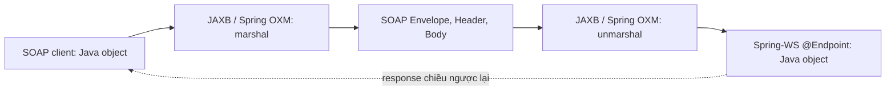
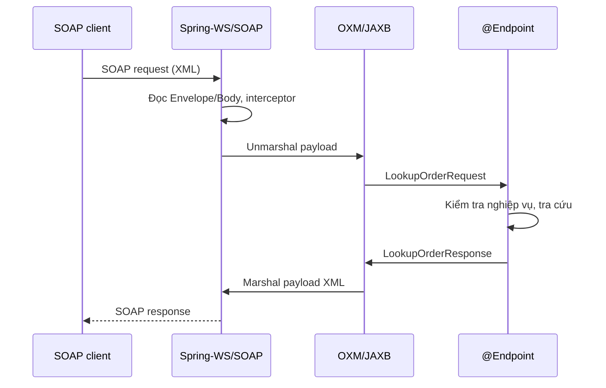

# Marshalling, unmarshalling và vai trò của Spring OXM

Một dịch vụ SOAP thường trao đổi **XML**, còn mã nghiệp vụ Java muốn làm việc với các đối tượng có kiểu rõ ràng như `LookupOrderRequest`, `LookupOrderResponse` hoặc `BigDecimal`. **Marshalling** chuyển đối tượng Java thành XML; **unmarshalling** đọc XML và tạo lại đối tượng Java. Đây là cầu nối giữa hợp đồng dữ liệu trên đường truyền và mô hình xử lý trong ứng dụng.

Trong module **SPRING_WEB_SERVICES**, thuộc chương **Marshalling và OXM**, hai thao tác này giữ vai trò trung tâm khi xây dựng dịch vụ SOAP theo hướng **contract-first** bằng Spring Web Services (Spring-WS). XSD/WSDL định nghĩa thông điệp, JAXB cung cấp ánh xạ Java–XML, Spring OXM cung cấp giao diện thống nhất cho việc chuyển đổi, còn endpoint và SOAP client phối hợp gửi/nhận payload. Để tích hợp hệ thống doanh nghiệp ổn định, cần hiểu thêm schema validation, SOAP Fault, interceptor, XML security, WS-Security, chứng chỉ và kiểm thử tương thích.

Các ví dụ dùng Java với API **Jakarta XML Binding** và Spring Framework/Spring-WS thuộc thế hệ Jakarta. Mã `javax.xml.bind.*` của dự án cũ thuộc một hệ API khác; phải chọn phiên bản Java, Spring và thư viện JAXB nhất quán.

## 1. Marshalling và unmarshalling là gì?

**Marshalling** là quá trình biểu diễn một đối tượng Java thành dữ liệu XML theo quy tắc ánh xạ:

```text
LookupOrderRequest { orderId = "ORD-1001" }
                │
                │ marshal
                ▼
<o:LookupOrderRequest xmlns:o="https://example.org/orders/v1">
    <o:orderId>ORD-1001</o:orderId>
</o:LookupOrderRequest>
```

**Unmarshalling** là chiều ngược lại:

```text
<o:LookupOrderResponse xmlns:o="https://example.org/orders/v1">
    <o:orderId>ORD-1001</o:orderId>
    <o:status>CONFIRMED</o:status>
    <o:total>125000.00</o:total>
</o:LookupOrderResponse>
                │
                │ unmarshal
                ▼
LookupOrderResponse {
    orderId = "ORD-1001",
    status = "CONFIRMED",
    total = BigDecimal("125000.00")
}
```

Hai chiều cần sử dụng **cùng hợp đồng XML**: QName, thứ tự phần tử, kiểu dữ liệu, số lần xuất hiện và quy tắc namespace. Không thể chỉ dựa vào tên field Java trùng với tên thẻ XML rồi giả định mọi thông điệp sẽ tương thích.

### 1.1. Phân biệt các tầng trong SOAP



**JAXB thường ánh xạ payload XML nghiệp vụ**, chẳng hạn phần tử `LookupOrderRequest` bên trong SOAP Body. Spring-WS và message factory (thường dùng SAAJ trong cấu hình tương ứng) xử lý SOAP Envelope, Header, Body, SOAP version và transport. Một `Jaxb2Marshaller` **không tự tạo toàn bộ SOAP Envelope**, không tự gửi HTTP và không tự xác minh WS-Security.

| Khái niệm | Đầu vào | Đầu ra | Trách nhiệm |
| --- | --- | --- | --- |
| Marshalling | Java object | XML dưới dạng `Result` hoặc tương đương | Viết dữ liệu đối tượng ra XML |
| Unmarshalling | XML dưới dạng `Source` hoặc tương đương | Java object / đôi khi `JAXBElement<?>` | Đọc XML thành mô hình Java |
| XSD validation | XML + schema | Hợp lệ hoặc danh sách lỗi | Kiểm tra cấu trúc và kiểu theo hợp đồng |
| SOAP message processing | SOAP Envelope | Header/Body/Fault và message context | Xử lý giao thức SOAP |
| Endpoint business logic | Đối tượng nghiệp vụ | Kết quả hoặc lỗi nghiệp vụ | Thực thi hành vi của dịch vụ |
| WS-Security | SOAP message + khóa/chính sách | Kết quả xác minh, ký hoặc mã hóa | Bảo vệ thông điệp theo policy |

Marshalling **không đồng nghĩa serialization Java mặc định** như `ObjectOutputStream`. XML là định dạng trao đổi dựa trên schema, namespace và QName, cho phép các hệ thống ngoài Java xử lý. Marshalling cũng không có nghĩa là một quá trình HTTP request; có thể gọi marshaller trực tiếp trong unit test.

## 2. Hợp đồng XSD là điểm xuất phát của contract-first

Giả sử cần tra cứu đơn hàng theo mã. XSD khai báo hai phần tử toàn cục, một cho request và một cho response:

```xml
<?xml version="1.0" encoding="UTF-8"?>
<xs:schema xmlns:xs="http://www.w3.org/2001/XMLSchema"
           targetNamespace="https://example.org/orders/v1"
           xmlns:tns="https://example.org/orders/v1"
           elementFormDefault="qualified">

    <xs:element name="LookupOrderRequest">
        <xs:complexType>
            <xs:sequence>
                <xs:element name="orderId" type="xs:string"/>
            </xs:sequence>
        </xs:complexType>
    </xs:element>

    <xs:element name="LookupOrderResponse">
        <xs:complexType>
            <xs:sequence>
                <xs:element name="orderId" type="xs:string"/>
                <xs:element name="status" type="xs:string"/>
                <xs:element name="total" type="xs:decimal"/>
            </xs:sequence>
        </xs:complexType>
    </xs:element>
</xs:schema>
```

Các điểm cần chú ý:

1. Hai **root element** có QName lần lượt là `{https://example.org/orders/v1}LookupOrderRequest` và `{https://example.org/orders/v1}LookupOrderResponse`.
2. `elementFormDefault="qualified"` yêu cầu các phần tử con được khai báo cục bộ nằm trong namespace đích; `<orderId>` không có namespace không tự động tương đương `<o:orderId>`.
3. `xs:sequence` ràng buộc thứ tự: response phải có `orderId`, `status` rồi `total`.
4. `xs:decimal` ánh xạ tự nhiên sang `java.math.BigDecimal`, thích hợp hơn số dấu phẩy động nhị phân khi biểu diễn số tiền theo hợp đồng.
5. Đây là **hợp đồng cấu trúc**, chưa kiểm tra đơn hàng tồn tại hay trạng thái được phép; các ràng buộc nghiệp vụ cần được xử lý riêng hoặc biểu diễn bổ sung trong schema khi khả thi.

Trong WSDL **document/literal**, `wsdl:message/wsdl:part` có thể tham chiếu hai global elements này. JAXB model và Spring-WS endpoint/client phải tương ứng với phiên bản XSD đang công bố.

## 3. JAXB ánh xạ Java object và XML như thế nào?

**Jakarta XML Binding (JAXB)** định nghĩa annotation, context và các thao tác marshal/unmarshal. JAXB runtime provider thực thi những thao tác đó. Trong ứng dụng thực tế, lớp Java thường được **sinh từ XSD bằng công cụ tương thích Jakarta JAXB**; các lớp viết tay dưới đây nhằm giúp nhìn rõ ánh xạ.

### 3.1. Lớp request

```java
import jakarta.xml.bind.annotation.XmlAccessType;
import jakarta.xml.bind.annotation.XmlAccessorType;
import jakarta.xml.bind.annotation.XmlElement;
import jakarta.xml.bind.annotation.XmlRootElement;
import jakarta.xml.bind.annotation.XmlType;

@XmlRootElement(
        name = "LookupOrderRequest",
        namespace = "https://example.org/orders/v1")
@XmlAccessorType(XmlAccessType.FIELD)
@XmlType(propOrder = {"orderId"})
public class LookupOrderRequest {

    @XmlElement(
            name = "orderId",
            namespace = "https://example.org/orders/v1",
            required = true)
    private String orderId;

    public LookupOrderRequest() {
        // JAXB cần khởi tạo được lớp khi unmarshal.
    }

    public LookupOrderRequest(String orderId) {
        this.orderId = orderId;
    }

    public String getOrderId() {
        return orderId;
    }

    public void setOrderId(String orderId) {
        this.orderId = orderId;
    }
}
```

### 3.2. Lớp response

```java
import java.math.BigDecimal;
import jakarta.xml.bind.annotation.XmlAccessType;
import jakarta.xml.bind.annotation.XmlAccessorType;
import jakarta.xml.bind.annotation.XmlElement;
import jakarta.xml.bind.annotation.XmlRootElement;
import jakarta.xml.bind.annotation.XmlType;

@XmlRootElement(
        name = "LookupOrderResponse",
        namespace = "https://example.org/orders/v1")
@XmlAccessorType(XmlAccessType.FIELD)
@XmlType(propOrder = {"orderId", "status", "total"})
public class LookupOrderResponse {

    @XmlElement(namespace = "https://example.org/orders/v1",
                required = true)
    private String orderId;

    @XmlElement(namespace = "https://example.org/orders/v1",
                required = true)
    private String status;

    @XmlElement(namespace = "https://example.org/orders/v1",
                required = true)
    private BigDecimal total;

    public LookupOrderResponse() { }

    public String getOrderId() { return orderId; }
    public void setOrderId(String orderId) { this.orderId = orderId; }

    public String getStatus() { return status; }
    public void setStatus(String status) { this.status = status; }

    public BigDecimal getTotal() { return total; }
    public void setTotal(BigDecimal total) { this.total = total; }
}
```

Trong hai ví dụ, mỗi lớp cần nằm ở **file Java riêng** và dùng các dependency Jakarta JAXB phù hợp. Chúng là mô hình minh họa tương ứng XSD; khi làm contract-first chính thức, nên ưu tiên **sinh mã từ XSD** và dùng các lớp đã sinh.

### 3.3. Ý nghĩa của annotation

| Annotation | Ý nghĩa |
| --- | --- |
| `@XmlRootElement` | Xác định QName phần tử gốc mà JAXB có thể marshal trực tiếp |
| `@XmlAccessorType(XmlAccessType.FIELD)` | Ánh xạ field trực tiếp, tránh phụ thuộc suy luận từ getter/setter |
| `@XmlType(propOrder = {...})` | Quy định thứ tự các trường được xuất ra XML |
| `@XmlElement(name, namespace)` | Điều khiển tên và namespace của phần tử con |
| `@XmlElement(required = true)` | Thông tin ánh xạ/schema; **không thay thế XSD validation** |
| `@XmlAttribute` | Ánh xạ một thuộc tính XML thay vì phần tử con |
| `@XmlValue` | Ánh xạ giá trị văn bản đơn giản theo kiểu hỗ trợ |
| `@XmlJavaTypeAdapter` | Chuyển đổi kiểu Java đặc biệt bằng adapter |

**Không dựa vào `required = true` để bảo đảm đầu vào luôn có giá trị.** Một unmarshaller không bật schema validation có thể vẫn tạo object với field null trong một số trường hợp thiếu element. Phải kiểm tra hợp đồng và nghiệp vụ ở lớp phù hợp.

## 4. Spring OXM giải quyết bài toán gì?

**OXM** là viết tắt của *Object/XML Mapping*. Thay vì ứng dụng phụ thuộc trực tiếp vào từng API marshal/unmarshal của một thư viện XML, Spring đưa ra các **giao diện** chung:

```java
// Hai giao diện ở mức khái niệm (chỉ minh họa chữ ký chính).
public interface Marshaller {
    boolean supports(Class<?> clazz);
    void marshal(Object graph, javax.xml.transform.Result result);
}

public interface Unmarshaller {
    boolean supports(Class<?> clazz);
    Object unmarshal(javax.xml.transform.Source source);
}
```

Đây là **bản lược giản**, không sao chép đầy đủ khai báo throws, generic hay chi tiết API. Các giao diện thực tế nằm trong `org.springframework.oxm.Marshaller` và `org.springframework.oxm.Unmarshaller`. `Source` và `Result` thuộc **JAXP/Java SE** (`javax.xml.transform.*`), vì vậy vẫn có namespace `javax` ngay cả trong ứng dụng dùng Jakarta JAXB.

Spring OXM giúp:

- Chuẩn hóa cách mã ứng dụng gọi việc chuyển đổi thông qua `Source`/`Result`, bất kể cơ chế ánh xạ cụ thể.
- Tích hợp marshaller vào Spring IoC container, nhận cấu hình qua bean và tái sử dụng trong endpoint/client.
- Gom trách nhiệm tạo JAXB context, quản lý mapping và xử lý lỗi chuyển đổi vào một component.
- Giảm việc lặp mã khởi tạo `JAXBContext` và marshaller ở từng service/client.
- Cho phép các thành phần Spring-WS tương tác với contract dữ liệu qua abstraction OXM khi adapter/message processor tương ứng được cấu hình.

**Spring OXM không thay thế JAXB runtime.** `Jaxb2Marshaller` là lớp triển khai giao diện Spring OXM bằng JAXB; vẫn cần `jakarta.xml.bind-api` và provider runtime phù hợp trong ứng dụng Jakarta.

### 4.1. `Jaxb2Marshaller` đóng cả hai vai trò

Spring cung cấp `org.springframework.oxm.jaxb.Jaxb2Marshaller`, một component thực hiện cả:

```text
Spring OXM Marshaller
          ▲
          │
    Jaxb2Marshaller ───→ JAXBContext / JAXB runtime
          │
          ▼
Spring OXM Unmarshaller
```

**Chú ý phân biệt tên:** `org.springframework.oxm.Marshaller` là interface Spring, còn `jakarta.xml.bind.Marshaller` là API JAXB cấp thấp. `Jaxb2Marshaller` sử dụng JAXB bên dưới nhưng exposes giao diện Spring OXM cho ứng dụng.

## 5. Cấu hình `Jaxb2Marshaller` trong Spring

Ví dụ cấu hình hai lớp của mục 3:

```java
import org.springframework.context.annotation.Bean;
import org.springframework.context.annotation.Configuration;
import org.springframework.oxm.jaxb.Jaxb2Marshaller;

@Configuration
public class OxmConfiguration {

    @Bean
    public Jaxb2Marshaller ordersMarshaller() {
        Jaxb2Marshaller marshaller = new Jaxb2Marshaller();
        marshaller.setClassesToBeBound(
                LookupOrderRequest.class,
                LookupOrderResponse.class);

        // Không cần DTD hay external entities cho payload nghiệp vụ.
        marshaller.setSupportDtd(false);
        marshaller.setProcessExternalEntities(false);
        return marshaller;
    }
}
```

`setClassesToBeBound(...)` phù hợp khi biết rõ danh sách class JAXB. Sau khi được Spring quản lý, bean sẽ được khởi tạo theo vòng đời của container; không cần tự gọi `afterPropertiesSet()` trong ứng dụng thông thường.

Với dự án có nhiều lớp được sinh từ XSD, có thể thay bằng một trong những cách:

```java
marshaller.setContextPath("org.example.orders.schema");
// Hoặc tùy tổ chức các lớp:
marshaller.setPackagesToScan("org.example.orders.schema");
```

**Chọn một chiến lược cấu hình context thích hợp**:

| Cách | Phù hợp khi | Điều cần kiểm tra |
| --- | --- | --- |
| `setClassesToBeBound(...)` | Ít lớp, muốn kiểm soát rõ class | Bao gồm tất cả kiểu root/request/response cần chuyển đổi |
| `setContextPath(...)` | Package JAXB generated theo quy ước | Có `ObjectFactory` hoặc `jaxb.index` và metadata đúng để tạo JAXB context |
| `setPackagesToScan(...)` | Muốn quét annotation JAXB trong các package | Chi phí/quy tắc scanning và các class cần thiết thực sự được tìm thấy |

Các phương pháp là lựa chọn **theo cách tổ chức model**. Tránh cấu hình một context path của bản XSD cũ rồi tự sửa tên package Java nhưng không sinh lại model.

### 5.1. Thực hiện marshal và unmarshal trực tiếp

Ví dụ sau gọi Spring OXM mà **không cần HTTP/SOAP Envelope**, thuận tiện cho smoke test:

```java
import java.io.StringReader;
import java.io.StringWriter;
import javax.xml.transform.stream.StreamResult;
import javax.xml.transform.stream.StreamSource;
import org.springframework.oxm.jaxb.Jaxb2Marshaller;

public final class OrderXmlMapping {
    private final Jaxb2Marshaller marshaller;

    public OrderXmlMapping(Jaxb2Marshaller marshaller) {
        this.marshaller = marshaller;
    }

    public String toXml(LookupOrderRequest request) {
        StringWriter xml = new StringWriter();
        marshaller.marshal(request, new StreamResult(xml));
        return xml.toString();
    }

    public LookupOrderRequest fromXml(String xml) {
        Object value = marshaller.unmarshal(
                new StreamSource(new StringReader(xml)));
        return (LookupOrderRequest) value;
    }
}
```

Với hai class có `@XmlRootElement` như trên, unmarshal trực tiếp có thể trả đối tượng tương ứng. Với một số schema generated khác, kết quả có thể là **`JAXBElement<T>`**; hãy kiểm tra loại root object thay vì ép kiểu vô điều kiện. Nếu dùng constructor `new Jaxb2Marshaller()` ngoài Spring IoC, cần thiết lập mapping và gọi vòng đời khởi tạo thích hợp trước khi dùng.

### 5.2. Đối chiếu kết quả XML với hợp đồng

Gọi:

```java
new LookupOrderRequest("ORD-1001")
```

với cấu hình trên sẽ tạo XML có cấu trúc tương đương:

```xml
<?xml version="1.0" encoding="UTF-8" standalone="yes"?>
<ns2:LookupOrderRequest xmlns:ns2="https://example.org/orders/v1">
    <ns2:orderId>ORD-1001</ns2:orderId>
</ns2:LookupOrderRequest>
```

Chi tiết **prefix `ns2`, khai báo XML và pretty-print** tùy JAXB provider và cấu hình output. Prefix `ns2` không có ý nghĩa nghiệp vụ; QName gồm **namespace URI + local name**. Test nên so sánh cấu trúc XML và namespace, không coi khác prefix là lỗi.

Nếu request thiếu namespace trên `orderId` hoặc đổi thứ tự phần tử con, XML có thể parse được nhưng vi phạm XSD ở mục 2. Không dùng so sánh chuỗi XML byte-for-byte làm thước đo duy nhất của tính tương thích.

## 6. Tích hợp Spring OXM với SOAP client

`WebServiceTemplate` của Spring-WS có thể sử dụng một marshaller/unmarshaller để chuyển giữa object và SOAP payload.

### 6.1. Bean `WebServiceTemplate`

```java
import org.springframework.context.annotation.Bean;
import org.springframework.context.annotation.Configuration;
import org.springframework.oxm.jaxb.Jaxb2Marshaller;
import org.springframework.ws.client.core.WebServiceTemplate;

@Configuration
public class SoapClientConfiguration {

    @Bean
    public WebServiceTemplate ordersWebServiceTemplate(
            Jaxb2Marshaller ordersMarshaller) {
        WebServiceTemplate template = new WebServiceTemplate();
        template.setMarshaller(ordersMarshaller);
        template.setUnmarshaller(ordersMarshaller);
        return template;
    }
}
```

Trong runtime cần có **message factory** phù hợp SOAP version (thường là SAAJ-based nếu chọn SAAJ) và các dependency cần thiết. Spring-WS chịu trách nhiệm xây dựng/gửi SOAP message; `Jaxb2Marshaller` chỉ xử lý payload Java–XML.

### 6.2. Gửi object và nhận response object

```java
import org.springframework.ws.client.core.WebServiceTemplate;
import org.springframework.ws.soap.client.core.SoapActionCallback;

public class OrdersSoapClient {
    private final WebServiceTemplate template;
    private final String endpointUri;

    public OrdersSoapClient(WebServiceTemplate template,
                            String endpointUri) {
        this.template = template;
        this.endpointUri = endpointUri;
    }

    public LookupOrderResponse lookup(String orderId) {
        LookupOrderRequest request = new LookupOrderRequest(orderId);

        Object raw = template.marshalSendAndReceive(
                endpointUri,
                request,
                new SoapActionCallback(
                        "https://example.org/orders/v1/LookupOrder"));

        return (LookupOrderResponse) raw;
    }
}
```

`endpointUri` phải lấy từ cấu hình môi trường hoặc cơ chế cấu hình được chọn. Giá trị `SOAPAction` ở ví dụ là **giả định hợp đồng SOAP 1.1**; ứng dụng thật phải đọc `soap:operation soapAction` trong WSDL và sử dụng đúng. SOAPAction khác với URL endpoint và không tự quyết định JAXB mapping.

Một lời gọi hợp lệ có thể tạo SOAP 1.1 request:

```xml
<soapenv:Envelope
    xmlns:soapenv="http://schemas.xmlsoap.org/soap/envelope/"
    xmlns:o="https://example.org/orders/v1">
    <soapenv:Header/>
    <soapenv:Body>
        <o:LookupOrderRequest>
            <o:orderId>ORD-1001</o:orderId>
        </o:LookupOrderRequest>
    </soapenv:Body>
</soapenv:Envelope>
```

Nếu cần thêm WS-Security token, chữ ký hoặc header nghiệp vụ, phải dùng callback/interceptor/message processing phù hợp của Spring-WS và kiểm tra chính sách tương tác. **Marshaller không tự thêm SOAP Header bảo mật** chỉ vì lớp request có annotation JAXB.

## 7. Tích hợp unmarshalling và marshalling tại endpoint

Với SOAP service nhận `LookupOrderRequest`, endpoint có thể nhận object trực tiếp và trả về một object response:

```java
import java.math.BigDecimal;
import org.springframework.ws.server.endpoint.annotation.Endpoint;
import org.springframework.ws.server.endpoint.annotation.PayloadRoot;
import org.springframework.ws.server.endpoint.annotation.RequestPayload;
import org.springframework.ws.server.endpoint.annotation.ResponsePayload;

@Endpoint
public class OrdersEndpoint {
    private static final String NS = "https://example.org/orders/v1";

    @PayloadRoot(namespace = NS, localPart = "LookupOrderRequest")
    @ResponsePayload
    public LookupOrderResponse lookup(
            @RequestPayload LookupOrderRequest request) {

        LookupOrderResponse response = new LookupOrderResponse();
        response.setOrderId(request.getOrderId());
        response.setStatus("CONFIRMED");
        response.setTotal(new BigDecimal("125000.00"));
        return response;
    }
}
```

Đây là ví dụ endpoint cho mô hình JAXB có `@XmlRootElement`. Spring-WS chọn endpoint bằng **QName phần tử root payload** thông qua `@PayloadRoot`. Sau đó argument resolver/endpoint adapter tương ứng thực hiện chuyển đổi request và response. Cấu hình xử lý JAXB/Marshalling của endpoint phụ thuộc phiên bản Spring-WS và loại tham số; việc tạo một bean `Jaxb2Marshaller` cho client **không tự bảo đảm** mọi phương thức server sẽ được adapter đó sử dụng.

Nếu endpoint dùng kiểu do JAXB sinh không có `@XmlRootElement` hoặc yêu cầu cách ánh xạ đặc biệt, cần cấu hình **endpoint adapter/method processor** hỗ trợ dạng payload đó, hoặc dùng `JAXBElement<?>`/wrapper theo hợp đồng. Không nên đổi QName của XSD hoặc tự viết lại SOAP Body chỉ để tránh cấu hình chuyển đổi.

### 7.1. Luồng xử lý đầy đủ



Sơ đồ chỉ thể hiện luồng phổ biến. Schema validation, WS-Security verification, authorization, exception resolver và interceptor có thể được cấu hình ở những giai đoạn khác nhau. Dữ liệu của `@Endpoint` phải được kiểm tra theo logic nghiệp vụ ngay cả khi JAXB tạo đối tượng thành công.

### 7.2. Khi nào dùng XML thô thay cho object?

Spring-WS cũng hỗ trợ các kiểu xử lý XML như DOM/JDOM/SAX/StAX tùy endpoint adapter và cấu hình. Một endpoint cần đọc nội dung rất linh hoạt, xử lý tài liệu có mixed content phức tạp hoặc giữ một số cấu trúc XML khó ánh xạ có thể sử dụng XML representation thay vì POJO JAXB.

Chọn XML thô không có nghĩa bỏ hợp đồng XSD. Ngược lại, POJO JAXB không có nghĩa mọi XML tùy ý đều ánh xạ thành công. Hãy chọn biểu diễn phù hợp dữ liệu và yêu cầu xử lý.

## 8. JAXB root element, `JAXBElement` và các lỗi ánh xạ thường gặp

### 8.1. Vì sao có khi cần `JAXBElement<T>`?

Khi sinh mã từ XSD, một kiểu phức hợp được dùng bởi **nhiều global elements**, hoặc một số kiểu schema khác, có thể tạo ra class Java **không có `@XmlRootElement`**. Công cụ JAXB có thể cung cấp `ObjectFactory` với các method `@XmlElementDecl` để tạo `JAXBElement<T>` mang thông tin **QName và giá trị**:

```java
// Minh họa ý tưởng, QName phải khớp XSD thực tế.
QName name = new QName(
        "https://example.org/orders/v1",
        "LookupOrderRequest");
JAXBElement<LookupOrderRequest> root =
        new JAXBElement<>(
                name, LookupOrderRequest.class, request);
```

Đoạn mã giả định biến `request` và import `QName`, `JAXBElement` đã có. Trong mã generated chính thức, hãy **dùng `ObjectFactory`** khi có để bảo đảm đúng QName, scope và cấu trúc schema. Không bịa một root name dựa trên tên lớp nếu WSDL/XSD công bố tên khác.

Với `@XmlRootElement` như mục 3, JAXB có thể marshal trực tiếp instance. Với `JAXBElement<T>`, một số API Spring OXM sẽ trả object wrapper thay vì giá trị `T`; test cần phản ánh đúng contract của JAXB và cấu hình hỗ trợ JAXBElement.

### 8.2. Các tình huống cần xử lý riêng

| Trường hợp | Ý nghĩa và rủi ro |
| --- | --- |
| Namespace sai | QName khác hợp đồng, Spring-WS có thể không tìm được `@PayloadRoot` hoặc validation thất bại |
| `@XmlType(propOrder)` không khớp XSD | Thứ tự XML được marshal sai; client/server có schema chặt sẽ từ chối |
| `@XmlRootElement` thiếu | Marshal trực tiếp có thể lỗi “missing root element”; dùng `ObjectFactory`/`JAXBElement` thích hợp |
| `List<T>` từ `maxOccurs>1` | JAXB giữ danh sách phần tử; thứ tự trong list có thể là thứ tự trên wire |
| Element optional `minOccurs=0` | Có thể vắng mặt; không tự đồng nhất với element hiện diện nhưng rỗng |
| `nillable=true` và `xsi:nil=true` | Đánh dấu nil theo schema; khác với việc lược bỏ element |
| `@XmlJavaTypeAdapter` | Có thể thay đổi cách biểu diễn ngày giờ, ID hoặc kiểu tùy chỉnh; cần round-trip test |
| Kiểu số `xs:decimal` | Dùng `BigDecimal` để giữ giá trị thập phân có độ chính xác cần thiết |
| Mixed content | Văn bản và phần tử đan xen có thứ tự; có thể cần `@XmlMixed` và danh sách nội dung nhiều kiểu |
| Unknown element/version | Client cũ có thể không xử lý trường mới; phải kiểm thử tương thích phiên bản |

**Lưu ý:** trong XML, thứ tự thuộc tính không có ý nghĩa, nhưng thứ tự phần tử con có thể bị ràng buộc bởi `xs:sequence`. Prefix namespace có thể thay đổi mà QName vẫn giữ nguyên nếu URI không đổi.

## 9. Marshalling không thay thế XSD validation

Đây là một ranh giới quan trọng trong thiết kế Spring-WS:

- **JAXB mapping:** XML có thể chuyển thành Java object không?
- **XSD validation:** XML có tuân thủ chính xác kiểu, thứ tự, occurrence, facet, namespace của schema không?
- **Business validation:** mã đơn hàng có tồn tại, người gọi có quyền xem đơn hàng, trạng thái có hợp lệ không?
- **Security validation:** SOAP signature, token, chứng chỉ, timestamp và dữ liệu đã ký có đúng policy không?

Ví dụ XSD ở mục 2 quy định `orderId` bắt buộc. Nếu dữ liệu thiếu thẻ `orderId`, unmarshaller trong một số cấu hình vẫn có thể tạo request với `orderId == null`. Vì vậy endpoint nên có validation chính thức và kiểm tra nghiệp vụ cần thiết.

### 9.1. Xác thực schema bằng Spring-WS interceptor

Spring-WS cung cấp `PayloadValidatingInterceptor` để xác thực payload theo XSD. Một ví dụ bean:

```java
import org.springframework.context.annotation.Bean;
import org.springframework.core.io.ClassPathResource;
import org.springframework.xml.xsd.SimpleXsdSchema;
import org.springframework.xml.xsd.XsdSchema;
import org.springframework.ws.soap.server.endpoint.interceptor.PayloadValidatingInterceptor;

@Bean
public XsdSchema ordersSchema() {
    return new SimpleXsdSchema(
            new ClassPathResource("xsd/orders.xsd"));
}

@Bean
public PayloadValidatingInterceptor ordersValidatingInterceptor(
        XsdSchema ordersSchema) {
    PayloadValidatingInterceptor interceptor =
            new PayloadValidatingInterceptor();
    interceptor.setXsdSchema(ordersSchema);
    interceptor.setValidateRequest(true);
    interceptor.setValidateResponse(true);
    return interceptor;
}
```

Đoạn mã là các method bean cần đặt trong class `@Configuration`. **Bean interceptor phải được đăng ký** trong chuỗi interceptor của Spring-WS (chẳng hạn qua `WsConfigurer#addInterceptors`) và schema phải có sẵn trong classpath. Chỉ khai báo method bean không chắc bảo đảm validation được gọi ở mọi cấu hình.

### 9.2. Có thể cấu hình schema ở marshaller

`Jaxb2Marshaller` cũng có hỗ trợ cấu hình schema cho hoạt động JAXB:

```java
marshaller.setSchema(
        new ClassPathResource("xsd/orders.xsd"));
```

Đây là một **lựa chọn bổ sung hoặc thay thế ở vị trí khác**, không tự đồng nghĩa với interceptor request/response tại biên SOAP. Khi cần bảo đảm mọi thông điệp từ bên ngoài tuân thủ hợp đồng, cần xác định chính xác vị trí validation, cách xử lý lỗi và phạm vi request/response. Tránh bật nhiều lượt validate tốn chi phí không cần thiết mà không hiểu mục đích của từng lớp.

### 9.3. SOAP Fault khi chuyển đổi thất bại

Các lỗi có thể đến từ nhiều tầng:

| Nơi phát sinh | Ví dụ | Hướng xử lý |
| --- | --- | --- |
| XML parser/message factory | XML không well-formed, SOAP version sai | Trả lỗi giao thức phù hợp, ghi log có kiểm soát |
| Schema validation | Phần tử sai thứ tự/namespace/kiểu | Phản hồi lỗi request hợp đồng, ánh xạ SOAP Fault thích hợp |
| JAXB unmarshal | Không tạo được root object, không ánh xạ được kiểu | Kiểm tra schema, JAXB context và error mapping |
| Endpoint nghiệp vụ | Không tìm thấy order, không có quyền | Ánh xạ lỗi nghiệp vụ thành Fault/message theo hợp đồng |
| JAXB marshal response | Đối tượng response sai annotation hoặc thiếu type | Điều tra cấu hình và lỗi phía server |
| WS-Security | Signature, token hoặc chứng chỉ không hợp lệ | Từ chối theo security policy, không lộ thông tin nhạy cảm |

Với SOAP client, Spring-WS có thể ném `SoapFaultClientException` khi nhận SOAP Fault, còn lỗi marshal/unmarshal có thể nổi lên dưới các exception ánh xạ XML. **Không bắt tất cả exception rồi coi là lỗi nghiệp vụ**; cần phân loại lỗi transport, hợp đồng, ánh xạ, bảo mật và nghiệp vụ.

## 10. Hiệu năng, vòng đời và tính an toàn luồng

### 10.1. Tái sử dụng JAXB context, không khởi tạo cho mỗi request

Tạo `JAXBContext` có thể tốn chi phí quét annotation và xây dựng metadata. Một cách cấu hình hợp lý là khai báo **một bean `Jaxb2Marshaller` theo ứng dụng/context** để Spring quản lý và tái sử dụng.

Tuy nhiên cần phân biệt:

- **`JAXBContext`** được thiết kế để dùng lại và chia sẻ khi phù hợp.
- **`jakarta.xml.bind.Marshaller` và `Unmarshaller` cấp thấp** không nên tự chia sẻ một instance đang mutable giữa các request đồng thời; tạo riêng hoặc quản lý theo chiến lược thread-safe.
- **`Jaxb2Marshaller`** trong ứng dụng Spring được thiết kế để dùng qua bean chung theo các phương thức marshal/unmarshal; vẫn cần tuân thủ cấu hình và vòng đời của component.

Không tạo `new Jaxb2Marshaller()`, gọi thiết lập context rồi marshal trong mỗi request chỉ để tránh inject bean; cách đó tốn chi phí và dễ gây sai cấu hình.

### 10.2. Bộ nhớ, streaming và payload lớn

Marshalling/unmarshalling có thể dùng `StreamSource`/`StreamResult` và các dạng `Source`/`Result` khác, nhưng việc chọn stream source **không bảo đảm toàn bộ pipeline SOAP sẽ xử lý streaming từ đầu đến cuối**. SOAP message factory, interceptor, signature verification hoặc JAXB có thể cần giữ cấu trúc trong bộ nhớ.

Với payload lớn:

1. Giới hạn kích thước SOAP message, độ sâu XML và số lượng phần tử.
2. Kiểm tra cách message factory và parser dùng bộ nhớ.
3. Cân nhắc SOAP attachments/MTOM hoặc cơ chế truyền dữ liệu phù hợp nếu hợp đồng yêu cầu nhị phân.
4. Kiểm thử throughput và bộ nhớ với dữ liệu đại diện thực tế.
5. Theo dõi logging: tránh ghi toàn bộ XML chứa thông tin nhạy cảm, token hoặc dữ liệu lớn.

Spring OXM giúp chuẩn hóa cách ánh xạ nhưng không tự giải quyết mọi chi phí transport, DOM tree, attachment hoặc canonicalization cho chữ ký XML.

## 11. XML security và WS-Security trong luồng OXM

Một XML không tin cậy có thể chứa DTD, external entity hoặc cấu trúc gây tiêu tốn tài nguyên. Khi unmarshalling dữ liệu từ bên ngoài:

- Giữ cấu hình `setSupportDtd(false)` và `setProcessExternalEntities(false)` khi ứng dụng không cần xử lý DTD/external entity.
- Với parser và schema factory riêng, kiểm tra cài đặt bảo mật tương ứng; không dựa duy nhất vào một tùy chọn của marshaller để bảo vệ toàn bộ pipeline.
- Kiểm soát schema import/include, kích thước payload và parser limits.
- Với SOAP service, kiểm tra interceptor/transport trước khi sử dụng dữ liệu chưa tin cậy để thực hiện nghiệp vụ.

**WS-Security** như chữ ký số, encryption, timestamp, token và chứng chỉ hoạt động ở mức SOAP message. Một thông điệp có thể **marshal đúng JAXB nhưng sai chữ ký**; một thông điệp có chữ ký hợp lệ vẫn có thể **sai XSD hoặc sai nghiệp vụ**. Cần cấu hình interceptor bảo mật theo chính sách đã thỏa thuận, kiểm tra certificate trust và phạm vi phần tử đã ký.

Nếu thay đổi XML sau khi ký (thêm/bớt phần tử, đổi thứ tự nội dung đã ký, thay đổi giá trị), chữ ký có thể không xác minh được. XML canonicalization chuẩn hóa một số khác biệt biểu diễn nhưng không cho phép tùy tiện đổi cấu trúc. Do đó không “sửa” payload đã ký bằng cách unmarshalling rồi marshalling lại trước khi xác minh bảo mật và các bước xử lý được ủy quyền.

## 12. Kiểm thử marshalling và unmarshalling

Một bài kiểm thử tốt không chỉ khẳng định `marshal()` và `unmarshal()` không ném exception; nó xác minh **QName, dữ liệu, cấu trúc, schema và tương thích**.

### 12.1. Unit test round-trip bằng Spring OXM

```java
import java.io.StringReader;
import java.io.StringWriter;
import javax.xml.transform.stream.StreamResult;
import javax.xml.transform.stream.StreamSource;
import org.junit.jupiter.api.Test;
import org.springframework.oxm.jaxb.Jaxb2Marshaller;
import static org.junit.jupiter.api.Assertions.*;

class OrderMarshallingTest {

    @Test
    void canRoundTripRequest() throws Exception {
        Jaxb2Marshaller oxm = new Jaxb2Marshaller();
        oxm.setClassesToBeBound(
                LookupOrderRequest.class,
                LookupOrderResponse.class);
        oxm.setSupportDtd(false);
        oxm.setProcessExternalEntities(false);
        oxm.afterPropertiesSet();

        StringWriter writer = new StringWriter();
        oxm.marshal(new LookupOrderRequest("ORD-1001"),
                    new StreamResult(writer));

        String xml = writer.toString();
        assertTrue(xml.contains("LookupOrderRequest"));
        assertTrue(xml.contains("ORD-1001"));

        Object raw = oxm.unmarshal(
                new StreamSource(new StringReader(xml)));
        LookupOrderRequest result = (LookupOrderRequest) raw;
        assertEquals("ORD-1001", result.getOrderId());
    }
}
```

Test trên là **smoke/round-trip test** cho mapping đã dùng. Cả marshaller và unmarshaller có thể cùng mắc một sai lệch schema nên test này **chưa chứng minh XML đúng XSD**. Cần bổ sung schema validator hoặc XML assertions chính xác cho QName, namespace và thứ tự.

### 12.2. Ma trận test cần có

| Ca kiểm thử | Điều cần xác minh |
| --- | --- |
| Marshal request hợp lệ | Root QName, namespace, trường bắt buộc và thứ tự XML đúng XSD |
| Unmarshal request hợp lệ | Object đúng kiểu, dữ liệu được chuyển đủ |
| Marshal rồi unmarshal | Round-trip giữ giá trị và các phần tử lặp có thứ tự |
| XML sai namespace URI | Schema validation hoặc mapping phát hiện theo cấu hình |
| XML sai thứ tự `xs:sequence` | XSD validator từ chối |
| Thiếu trường `minOccurs=1` | Validator từ chối; không dựa duy nhất vào Java annotation |
| Element vắng, rỗng, `xsi:nil` | Phân biệt đúng theo contract và mapping |
| Kiểu thập phân | `xs:decimal` ↔ `BigDecimal` không mất độ chính xác cần thiết |
| Root kiểu `JAXBElement<T>` | Xử lý đúng wrapper và QName, không ép kiểu sai |
| Unknown element khi hợp đồng đổi version | Phát hiện tương thích thực tế với JAXB client cũ |
| SOAP endpoint thành công | `MockWebServiceClient` trả response đúng payload |
| SOAP client gửi request | `MockWebServiceServer` kiểm tra XML do `WebServiceTemplate` tạo |
| Schema validation thất bại | SOAP Fault/exception phù hợp với cấu hình |
| Provider JAXB/SAAJ thiếu | Smoke test runtime phát hiện trước khi deploy |
| WS-Security nếu có | Chữ ký, certificate, timestamp và nội dung đã ký đúng policy |
| XML có external entity | Không truy cập tài nguyên ngoài theo chính sách bảo mật |

### 12.3. Contract test giữa các phiên bản

Khi XSD/WSDL thay đổi, sinh lại JAXB classes và kiểm thử cả hai chiều: **client cũ → server mới** và **client mới → server cũ** nếu hệ thống cần hỗ trợ đồng thời. Thêm phần tử optional có thể giữ request cũ hợp lệ với XSD mới, nhưng client dùng XSD/model cũ có thể không nhận response mới chứa phần tử chưa biết.

Không thay đổi annotation `@XmlType(propOrder)` hoặc namespace bằng tay như một “bản vá” cục bộ khi hợp đồng chính thức khác. Thay đổi hợp đồng nguồn, version phù hợp rồi tái sinh/kiểm thử.

## 13. Chẩn đoán theo vị trí lỗi

| Triệu chứng | Kiểm tra trước |
| --- | --- |
| `JAXBContext` báo không có provider | `jakarta.xml.bind-api` và `jaxb-runtime` trong runtime classpath |
| Lớp generated dùng `javax.xml.bind` nhưng Spring dùng Jakarta | Phiên bản XJC, Spring/Java và JAXB API/runtime |
| `MarshalException`: không marshal được class root | `@XmlRootElement` hoặc `ObjectFactory`/`JAXBElement` |
| XML có root đúng tên nhưng endpoint không match | Namespace URI của payload và `@PayloadRoot` |
| Unmarshal trả `JAXBElement<?>` | Cách sinh lớp và khai báo global element; unwrap đúng kiểu |
| XML có thứ tự khác XSD | `@XmlType(propOrder)`, list mapping và phiên bản generated model |
| Mã đọc được object nhưng validation báo lỗi | Schema đã cấu hình, `minOccurs`, `choice`, QName và facet |
| SOAP client nhận Fault dù marshal thành công | Binding SOAP, server validation, auth/WS-Security và lỗi nghiệp vụ |
| Không tìm thấy SAAJ implementation | `jakarta.xml.soap-api` và provider tương thích ở runtime |
| Test local chạy nhưng production lỗi | Runtime dependency, classloader, cấu hình và dữ liệu thực |

Tách **lỗi tạo message**, **lỗi mapping**, **lỗi XSD**, **lỗi SOAP protocol**, **lỗi bảo mật** và **lỗi nghiệp vụ** để tránh sửa nhầm tầng. Log nên ghi mã tương quan/request ID và thông tin cấu trúc cần thiết mà không làm lộ dữ liệu nhạy cảm.

## 14. Bài tập tự kiểm tra

**Câu 1.** `Jaxb2Marshaller` có tự gửi SOAP request không?

**Đáp án:** Không. Nó marshal/unmarshal Java–XML thông qua Spring OXM/JAXB. `WebServiceTemplate` và các thành phần SOAP message/transport chịu trách nhiệm gửi và nhận SOAP.

**Câu 2.** Tại sao một request JAXB unmarshalling thành công vẫn có thể bị `PayloadValidatingInterceptor` từ chối?

**Đáp án:** JAXB unmarshal không mặc nhiên validate đầy đủ XSD. XML có thể sai thứ tự, thiếu field bắt buộc, sai facet hoặc namespace nhưng vẫn tạo được object trong một số cấu hình.

**Câu 3.** Hai payload chỉ khác prefix `ns1` và `ns2` nhưng dùng cùng namespace URI, cùng local name và cấu trúc có tương đương về QName không?

**Đáp án:** Có. Prefix chỉ là bí danh; tên mở rộng dựa trên URI và local name. Còn các ràng buộc khác của XML/XSD vẫn phải được thỏa mãn.

**Câu 4.** Vì sao JAXB-generated class đôi khi không có `@XmlRootElement`?

**Đáp án:** Do cách XSD tách global element và complex type hoặc sử dụng cùng type cho nhiều elements. `ObjectFactory` và `JAXBElement<T>` có thể giữ thông tin QName để marshal đúng phần tử gốc.

**Câu 5.** Có nên dùng một `jakarta.xml.bind.Marshaller` mutable duy nhất cho hàng trăm thread không?

**Đáp án:** Không nên chia sẻ instance cấp thấp giữa các thread mà không có cơ chế an toàn phù hợp. Tái sử dụng context và dùng bean `Jaxb2Marshaller` qua cơ chế Spring là lựa chọn thông dụng.

**Câu 6.** Đổi XSD của `total` từ `xs:decimal` thành `xs:string` nhưng giữ Java model cũ có rủi ro gì?

**Đáp án:** JAXB mapping và wire contract có thể lệch nhau. Cần đánh giá tương thích, sinh lại lớp khi cần, kiểm thử dữ liệu thực và các client đang dùng.

**Câu 7.** Một SOAP request có chữ ký WS-Security hợp lệ có thể bỏ schema validation không?

**Đáp án:** Không. Chữ ký bảo vệ tính toàn vẹn/xác thực theo policy; schema validation xác nhận cấu trúc XML. Hai kiểm tra có mục đích riêng.

**Câu 8.** Nếu marshaller đã hoạt động trong unit test, vì sao vẫn cần kiểm thử với `WebServiceTemplate`?

**Đáp án:** Unit test chỉ xác nhận chuyển đổi Java–XML. Kiểm thử client thực cần xác nhận SOAP Envelope, SOAP version, Body payload, headers, SOAPAction, transport và response/Fault theo hợp đồng.

## Ghi nhớ

- **Marshalling:** Java object → XML; **unmarshalling:** XML → Java object. Cả hai phải dựa trên cùng XSD/WSDL contract.
- **Spring OXM** chuẩn hóa API object/XML mapping; **`Jaxb2Marshaller`** kết nối giao diện Spring với JAXB runtime. Nó xử lý payload XML, không thay thế SOAP transport hoặc WS-Security.
- **QName, namespace, thứ tự phần tử, optional/nil và JAXBElement** là những chi tiết ánh xạ có ảnh hưởng đến tương thích.
- **Mapping thành công không đồng nghĩa XSD-valid hoặc business-valid.** Cấu hình validation và kiểm thử SOAP Fault/WS-Security độc lập với JAXB.
- **Tái sử dụng bean/context, kiểm tra runtime provider và bảo vệ parser** giúp hệ thống ổn định và an toàn.
- **Contract-first là kiểm thử từ XSD/WSDL đến JAXB, endpoint, SOAP client và message thực tế**, đặc biệt khi thay đổi phiên bản hoặc tích hợp nhiều nền tảng.
