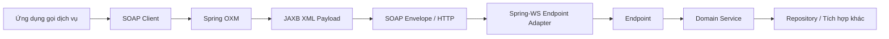
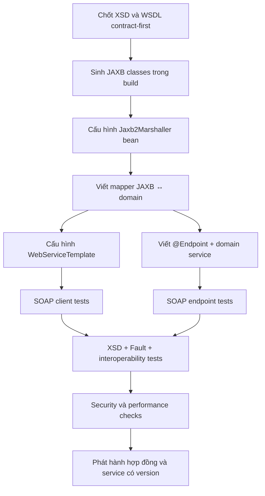

# Marshaller, Unmarshaller và tách cơ chế ánh xạ khỏi client, endpoint

## 1. Tại sao cần một lớp OXM riêng?

Khi phát triển SOAP service bằng **Spring Web Services (Spring-WS)** theo hướng **contract-first**, hợp đồng XSD/WSDL quy định XML mà các hệ thống được phép gửi và nhận. Trong ứng dụng Java, dữ liệu nghiệp vụ lại tồn tại dưới dạng object. Để nối hai thế giới này, ứng dụng cần cơ chế ánh xạ giữa **Java object** và **XML payload**.

Hai thao tác cốt lõi là:

- **Marshalling**: chuyển object Java thành XML.
- **Unmarshalling**: đọc XML và tạo object Java.

Ví dụ, một client cần gửi yêu cầu tra cứu vận đơn. Client biết gửi đến endpoint nào và muốn nhận kết quả gì; nó không nên phải tự viết mã tạo `JAXBContext`, mở `XMLStreamWriter`, duyệt từng phần tử XML hay quyết định namespace. Tương tự, một Spring-WS endpoint nên tập trung vào xử lý yêu cầu, phân quyền và nghiệp vụ, thay vì chứa logic parse XML thủ công.

Spring Framework cung cấp lớp trừu tượng **OXM (Object/XML Mapping)** thông qua hai giao diện `Marshaller` và `Unmarshaller`. Một triển khai phổ biến là `Jaxb2Marshaller`, tích hợp JAXB với Spring. Nhờ đó, client/endpoint có thể phụ thuộc vào **hợp đồng Java và luồng nghiệp vụ**, còn cấu hình chuyển đổi XML nằm ở một nơi và có thể kiểm thử độc lập.

Bài học nằm trong chương **Marshalling và OXM** thuộc module **SPRING_WEB_SERVICES**, liên hệ trực tiếp với thiết kế XSD/WSDL, JAXB, SOAP endpoint/client, SOAP Fault, interceptor, XML security, WS-Security, chứng chỉ và kiểm thử tương thích khi tích hợp hệ thống doanh nghiệp.

### Mục tiêu

Sau bài này, bạn có thể:

1. Phân biệt Spring OXM `Marshaller`/`Unmarshaller` với JAXB API và cơ chế gửi nhận SOAP của Spring-WS.
2. Cấu hình một `Jaxb2Marshaller` dùng lại cho XML payload dựa trên XSD.
3. Dùng `WebServiceTemplate` để tách SOAP transport khỏi chuyển đổi Java/XML.
4. Xây dựng `@Endpoint` và tầng domain mapper mà không đưa XML serialization vào logic nghiệp vụ.
5. Xử lý các tình huống `JAXBElement`, QName, namespace, giá trị optional/null, schema validation và SOAP Fault.
6. Kiểm thử round-trip OXM, SOAP message và khả năng tương thích với client bên ngoài.

## 2. Phân biệt các trách nhiệm trong một dịch vụ SOAP

Một yêu cầu SOAP thường đi qua các lớp:



Sơ đồ là mô hình trách nhiệm, không mô tả từng lệnh nội bộ của framework. Trong runtime, OXM có thể được gọi ở phía client trước khi ghi payload vào SOAP Body và ở phía server khi chuyển payload cho method handler.

| Thành phần | Việc nó chịu trách nhiệm | Việc không nên giao cho nó |
| --- | --- | --- |
| **XSD** | Định nghĩa kiểu, namespace, thứ tự, số lần xuất hiện, trường bắt buộc. | Giao tiếp HTTP và xử lý database. |
| **WSDL** | Mô tả operation, message, binding, SOAPAction và Fault. | Thay thế logic nghiệp vụ. |
| **JAXB model** | Biểu diễn dữ liệu theo hợp đồng XML bằng class/annotation. | Chứa quy tắc nghiệp vụ, retry và xác thực. |
| **Spring OXM** | Chuyển Java object ↔ XML `Source`/`Result`. | Tự tạo kết nối HTTP, SOAP header hoặc quản lý giao dịch. |
| **WebServiceTemplate** | Điều phối SOAP request/response phía client, kết hợp marshaller, transport, callback và xử lý Fault. | Tự quyết định quy tắc nghiệp vụ hoặc mapping domain. |
| **Endpoint** | Nhận request đã được framework giải mã, gọi service và trả response. | Tự tạo `JAXBContext` mỗi lần gọi và tự ghép chuỗi XML. |
| **Domain mapper** | Chuyển giữa JAXB contract object và domain object. | Phát sinh SOAP Envelope hoặc phụ thuộc URL endpoint. |
| **Interceptor/security** | Validation, logging phù hợp, WS-Security và xử lý chung nếu được cấu hình. | Thay thế phân quyền nghiệp vụ. |

Ranh giới quan trọng: **SOAP Envelope, Header và Fault không đồng nhất với payload XML được JAXB marshal**. `Jaxb2Marshaller` thường chuyển đổi phần nội dung nghiệp vụ, còn Spring-WS quản lý cấu trúc SOAP và các callback/interceptor liên quan.

## 3. Spring OXM khác gì JAXB trực tiếp?

Trong Spring Framework, hai giao diện chính là:

```java
import javax.xml.transform.Result;
import javax.xml.transform.Source;

import org.springframework.oxm.Marshaller;
import org.springframework.oxm.Unmarshaller;
```

Các phương thức quan trọng của giao diện Spring OXM có dạng:

```java
void marshal(Object graph, Result result) throws XmlMappingException;

Object unmarshal(Source source) throws XmlMappingException;
```

`Marshaller` và `Unmarshaller` còn có cơ chế kiểm tra kiểu có được hỗ trợ hay không, ví dụ `supports(Class<?>)`. `Source` và `Result` thuộc API JAXP (`javax.xml.transform`), vẫn được sử dụng trong ứng dụng Jakarta hiện đại. Đừng suy luận rằng mọi package bắt đầu bằng `javax` đều phải chuyển thành `jakarta`.

**Lưu ý phân biệt:**

| Khái niệm | Package/API | Nhiệm vụ |
| --- | --- | --- |
| Spring OXM `Marshaller` | `org.springframework.oxm.Marshaller` | Giao diện framework để Java object → XML `Result`. |
| Spring OXM `Unmarshaller` | `org.springframework.oxm.Unmarshaller` | Giao diện framework để XML `Source` → Java object. |
| Jakarta JAXB `Marshaller` | `jakarta.xml.bind.Marshaller` | API JAXB nền tảng cho marshalling. |
| Jakarta JAXB `Unmarshaller` | `jakarta.xml.bind.Unmarshaller` | API JAXB nền tảng cho unmarshalling. |
| `Jaxb2Marshaller` | `org.springframework.oxm.jaxb.Jaxb2Marshaller` | Adapter Spring OXM sử dụng JAXB để thực hiện hai chiều. |

Tên `Jaxb2Marshaller` là tên lịch sử của class Spring; khi dùng với một bộ Spring/Jakarta phù hợp, nó có thể làm việc cùng JAXB thuộc namespace `jakarta.xml.bind`. **Không trộn** JAXB generator sinh annotation `javax.xml.bind.annotation` với runtime và Spring Framework thế hệ Jakarta nếu không có giải pháp tương thích được kiểm chứng.

### 3.1. Tại sao lại tách giao diện khỏi triển khai?

Ở mức thiết kế, code gọi chỉ cần biết **có một dịch vụ chuyển object thành XML**. Cấu hình có thể chọn JAXB theo tiêu chuẩn, thêm schema validation, adapter hoặc hỗ trợ một bộ class khác mà không phải rải các lệnh khởi tạo JAXB khắp client.

Tuy nhiên, không nên hứa rằng đổi từ JAXB sang một thư viện bất kỳ sẽ hoàn toàn không ảnh hưởng. Object model, annotation, `JAXBElement` và XSD contract vẫn có những yêu cầu đặc thù. Giá trị thực tế của OXM là **tập trung cấu hình, tạo điểm kiểm thử và giảm phụ thuộc của client/endpoint vào cơ chế serialization**, chứ không loại bỏ mọi khác biệt giữa các công nghệ XML.

## 4. Ví dụ xuyên suốt: tra cứu trạng thái vận đơn

Giả sử một doanh nghiệp có SOAP operation `GetShipmentStatus`. Hợp đồng:

- Namespace: `urn:example:shipment:v1`.
- Request: `shipmentId` bắt buộc.
- Response: `shipmentId`, `status` bắt buộc và `updatedAt` tùy chọn.
- Dịch vụ dùng SOAP 1.1 document/literal; WSDL công bố operation, SOAPAction và endpoint.
- XSD là nguồn chuẩn để sinh JAXB classes.

### 4.1. XSD đầu vào

Đặt schema ví dụ ở `src/main/resources/xsd/shipment-v1.xsd`:

```xml
<?xml version="1.0" encoding="UTF-8"?>
<xs:schema
    xmlns:xs="http://www.w3.org/2001/XMLSchema"
    xmlns:tns="urn:example:shipment:v1"
    targetNamespace="urn:example:shipment:v1"
    elementFormDefault="qualified">

  <xs:simpleType name="ShipmentIdType">
    <xs:restriction base="xs:string">
      <xs:minLength value="1"/>
      <xs:maxLength value="40"/>
    </xs:restriction>
  </xs:simpleType>

  <xs:element name="GetShipmentStatusRequest">
    <xs:complexType>
      <xs:sequence>
        <xs:element name="shipmentId"
                    type="tns:ShipmentIdType"/>
      </xs:sequence>
    </xs:complexType>
  </xs:element>

  <xs:element name="GetShipmentStatusResponse">
    <xs:complexType>
      <xs:sequence>
        <xs:element name="shipmentId"
                    type="tns:ShipmentIdType"/>
        <xs:element name="status"
                    type="xs:string"/>
        <xs:element name="updatedAt"
                    type="xs:dateTime"
                    minOccurs="0"/>
      </xs:sequence>
    </xs:complexType>
  </xs:element>
</xs:schema>
```

Schema quy định tên phần tử, namespace và thứ tự; Spring OXM sử dụng JAXB classes đã sinh để thể hiện cấu trúc đó. Kết quả XJC phụ thuộc cấu trúc XSD và phiên bản generator. Với global element dùng anonymous complex type như ví dụ, thông thường có class JAXB tương ứng và root element annotation; với global element tham chiếu named type hoặc binding tùy chỉnh, bạn có thể nhận `JAXBElement<T>` thông qua `ObjectFactory`.

### 4.2. SOAP request và response minh họa

Request:

```xml
<soapenv:Envelope
    xmlns:soapenv="http://schemas.xmlsoap.org/soap/envelope/"
    xmlns:sh="urn:example:shipment:v1">
  <soapenv:Header/>
  <soapenv:Body>
    <sh:GetShipmentStatusRequest>
      <sh:shipmentId>SHP-2026-0042</sh:shipmentId>
    </sh:GetShipmentStatusRequest>
  </soapenv:Body>
</soapenv:Envelope>
```

Response:

```xml
<soapenv:Envelope
    xmlns:soapenv="http://schemas.xmlsoap.org/soap/envelope/"
    xmlns:sh="urn:example:shipment:v1">
  <soapenv:Body>
    <sh:GetShipmentStatusResponse>
      <sh:shipmentId>SHP-2026-0042</sh:shipmentId>
      <sh:status>IN_TRANSIT</sh:status>
      <sh:updatedAt>2026-11-27T02:00:00Z</sh:updatedAt>
    </sh:GetShipmentStatusResponse>
  </soapenv:Body>
</soapenv:Envelope>
```

Chính **phần tử gốc trong SOAP Body** là đối tượng thường được marshal/unmarshal. OXM không tự tạo hoặc kiểm soát `soapenv:Envelope` và `soapenv:Header`. WSDL phải thống nhất QName của payload và SOAP binding; prefix `sh` có thể đổi mà nghĩa XML không đổi nếu namespace URI giữ nguyên.

## 5. Cấu hình `Jaxb2Marshaller` một lần trong Spring

Ví dụ giả định dự án dùng Spring Framework 6/Spring-WS 4 hoặc một tổ hợp Jakarta tương thích, Java 17+, và XJC đã sinh model vào package `com.example.shipment.contract` từ XSD ở mục 4.

```java
import org.springframework.context.annotation.Bean;
import org.springframework.context.annotation.Configuration;
import org.springframework.oxm.jaxb.Jaxb2Marshaller;

@Configuration
public class ShipmentOxmConfiguration {

    @Bean
    public Jaxb2Marshaller shipmentJaxbMarshaller() {
        Jaxb2Marshaller marshaller = new Jaxb2Marshaller();
        marshaller.setContextPath("com.example.shipment.contract");
        return marshaller;
    }
}
```

Điểm cần hiểu:

- `setContextPath` chỉ định package JAXB chứa metadata cần thiết để tạo `JAXBContext`, ví dụ `ObjectFactory` hoặc thông tin liên quan.
- Có thể cấu hình bằng `setClassesToBeBound(...)` hoặc `setPackagesToScan(...)` trong trường hợp phù hợp. Không cần dùng đồng thời mọi cách.
- Khi là Spring bean, vòng đời khởi tạo của framework sẽ chuẩn bị cấu hình; không cần tạo lại `Jaxb2Marshaller` cho từng request.
- Spring OXM bean có thể dùng cho **cả marshalling lẫn unmarshalling**, vì `Jaxb2Marshaller` thực thi hai giao diện.
- Dùng đúng JAXB API/runtime và codegen tương ứng với Spring/Java baseline; với ứng dụng Jakarta, generated classes phải dùng `jakarta.xml.bind.annotation.*`.

### 5.1. Dependency ở mức ý tưởng

Một tổ hợp phụ thuộc hợp lệ cần có:

| Nhóm | Ví dụ artifact hoặc thành phần |
| --- | --- |
| Spring OXM/Spring-WS | Spring Framework OXM và Spring Web Services tương thích. |
| JAXB API | `jakarta.xml.bind:jakarta.xml.bind-api` với dự án Jakarta. |
| JAXB runtime | `org.glassfish.jaxb:jaxb-runtime` hoặc runtime tương thích. |
| Build-time XJC | Công cụ sinh code từ XSD được gắn vào Maven/Gradle build. |
| Spring-WS test | Các hỗ trợ mock client/server và XML payload test nếu sử dụng. |

Phiên bản chính xác nên do dependency management/BOM của dự án xác định. Không thay đổi một mình XJC hoặc JAXB runtime nếu điều đó làm generated annotation, JAXB context và Spring-WS không còn đồng bộ.

### 5.2. Khi cần hỗ trợ nhiều hợp đồng

Một ứng dụng có thể tiêu thụ hai namespace khác nhau, ví dụ `urn:example:shipment:v1` và `urn:partner:billing:v2`. Có thể tạo hai bean OXM riêng với `@Qualifier` hoặc những cách định danh khác, để tránh vô tình serialize một model bằng context không hỗ trợ nó.

Không nên đưa mọi generated class từ nhiều đối tác vào một package nếu chúng có tên trùng hoặc chính sách XML khác nhau. Tầng transport/client có thể chọn đúng marshaller theo từng service, còn tầng nghiệp vụ không cần biết những chi tiết đó.

## 6. Dùng giao diện OXM trực tiếp khi cần làm việc với XML

Với nhiệm vụ không gắn với SOAP transport, có thể dùng Spring OXM thuần:

```java
import java.io.StringReader;
import java.io.StringWriter;
import javax.xml.transform.stream.StreamResult;
import javax.xml.transform.stream.StreamSource;

import org.springframework.oxm.Marshaller;
import org.springframework.oxm.Unmarshaller;

public final class XmlContractCodec {
    private final Marshaller marshaller;
    private final Unmarshaller unmarshaller;

    public XmlContractCodec(Marshaller marshaller,
                            Unmarshaller unmarshaller) {
        this.marshaller = marshaller;
        this.unmarshaller = unmarshaller;
    }

    public String encode(Object contractObject) {
        StringWriter writer = new StringWriter();
        marshaller.marshal(contractObject, new StreamResult(writer));
        return writer.toString();
    }

    public Object decode(String xml) {
        return unmarshaller.unmarshal(
                new StreamSource(new StringReader(xml)));
    }
}
```

Đây là lớp ví dụ để làm rõ **tách cơ chế ánh xạ**. Với phần mềm thực tế, cần giới hạn kích thước input, chỉ nhận XML từ nguồn hợp lệ, bảo vệ parser và xử lý `XmlMappingException`. Không sử dụng mẫu đọc XML không giới hạn kích thước từ dữ liệu thiếu tin cậy.

Ưu điểm của một adapter như `XmlContractCodec` là các thành phần khác chỉ nhận nhiệm vụ “encode/decode theo contract”. Dù vậy, trong SOAP client chuẩn nên để `WebServiceTemplate` trực tiếp gọi `Marshaller` và `Unmarshaller`; không bắt buộc tự phát minh thêm một lớp codec nếu không có nhu cầu nghiệp vụ hoặc kiểm thử riêng.

### 6.1. `Source` và `Result` là gì?

- `StreamSource` và `StreamResult` hỗ trợ luồng ký tự/byte qua JAXP.
- `DOMSource` và `DOMResult` làm việc với cây XML trong bộ nhớ.
- Các biến thể JAXP khác phù hợp cho tình huống đặc biệt.

Việc chọn nguồn/đích ảnh hưởng bộ nhớ, khả năng streaming và cách dữ liệu được phân tích. SOAP payload có thể nhỏ nhưng rất nhiều request; dùng DOM cho mọi thông điệp lớn có thể làm tăng cấp phát. Chỉ thay đổi cơ chế XML sau khi có benchmark và đã xác minh các giới hạn bảo mật.

### 6.2. Xử lý object trả về từ `unmarshal`

`Unmarshaller.unmarshal(Source)` trả `Object`. Với JAXB, object có thể là:

- Một generated class mang `@XmlRootElement`.
- `JAXBElement<T>` bọc giá trị nếu schema/root type cần wrapper.
- Một kiểu model khác tùy binding hoặc configuration.

Không nên ép kiểu mù:

```java
GetShipmentStatusResponse response =
        (GetShipmentStatusResponse) unmarshaller.unmarshal(source);
```

nếu chưa biết hình dạng JAXB root. Cách đọc có kiểm soát:

```java
Object value = unmarshaller.unmarshal(source);
if (value instanceof jakarta.xml.bind.JAXBElement<?> element) {
    value = element.getValue();
}
if (!(value instanceof GetShipmentStatusResponse response)) {
    throw new IllegalArgumentException(
            "Unexpected XML contract root type");
}
```

Ví dụ dùng Java 17 pattern matching; phần xử lý lỗi cụ thể nên được đặt tại boundary và không làm lộ dữ liệu nhạy cảm của request.

## 7. Cấu hình `WebServiceTemplate`: client không cần tự marshal XML

`WebServiceTemplate` điều phối phần SOAP transport, message factory, request callback, fault/error handling và hai chiều OXM.

```java
import org.springframework.context.annotation.Bean;
import org.springframework.context.annotation.Configuration;
import org.springframework.oxm.Marshaller;
import org.springframework.oxm.Unmarshaller;
import org.springframework.ws.client.core.WebServiceTemplate;

@Configuration
public class ShipmentClientConfiguration {

    @Bean
    public WebServiceTemplate shipmentWebServiceTemplate(
            Marshaller shipmentJaxbMarshaller,
            Unmarshaller shipmentJaxbUnmarshaller) {

        WebServiceTemplate template = new WebServiceTemplate();
        template.setDefaultUri(
                "https://partner.example.invalid/soap/shipments");
        template.setMarshaller(shipmentJaxbMarshaller);
        template.setUnmarshaller(shipmentJaxbUnmarshaller);
        return template;
    }
}
```

Với một bean `Jaxb2Marshaller` duy nhất triển khai cả hai giao diện, thường có thể dùng một đối tượng cho hai tham số. Tuy nhiên, nếu trong Spring context có nhiều `Marshaller`/`Unmarshaller` bean, cần dùng `@Qualifier("shipmentJaxbMarshaller")` hoặc bean name cụ thể để tránh ambiguity.

Địa chỉ `example.invalid` chỉ để minh họa. Trong thực tế, URI endpoint, timeout, connection management, TLS/mTLS, proxy và secrets nên nằm trong cấu hình theo môi trường. SOAPAction phải phù hợp WSDL nếu binding yêu cầu.

### 7.1. Client chỉ xử lý contract và nghiệp vụ

```java
import org.springframework.ws.client.core.WebServiceTemplate;
import org.springframework.ws.soap.client.core.SoapActionCallback;

public final class ShipmentSoapClient {
    private final WebServiceTemplate template;
    private final ShipmentContractMapper mapper;

    public ShipmentSoapClient(WebServiceTemplate template,
                              ShipmentContractMapper mapper) {
        this.template = template;
        this.mapper = mapper;
    }

    public ShipmentStatus findStatus(String shipmentId) {
        GetShipmentStatusRequest request = mapper.toRequest(shipmentId);

        Object payload = template.marshalSendAndReceive(
                request,
                new SoapActionCallback(
                        "urn:example:shipment:v1/GetShipmentStatus"));

        GetShipmentStatusResponse response =
                mapper.requireResponse(payload);
        return mapper.toDomain(response);
    }
}
```

`GetShipmentStatusRequest`/`Response` là generated JAXB classes từ XSD; `ShipmentContractMapper` và `ShipmentStatus` sẽ được định nghĩa ở mục 9. Tùy hình dạng generated model, `mapper.toRequest` có thể phải trả `JAXBElement<GetShipmentStatusRequest>` thay vì trực tiếp class. Khi đó đổi kiểu trả về của adapter và giữ nguyên cách `WebServiceTemplate` nhận payload.

Không có `JAXBContext.newInstance` hoặc XML parser trong client; client chỉ:

1. Chuyển tham số nghiệp vụ thành contract request.
2. Gửi và nhận bằng `WebServiceTemplate` đã cấu hình OXM.
3. Kiểm tra response rồi chuyển thành domain value.

Điều này cho phép thay đổi cấu hình JAXB/schema/transport mà không rải serialization code trong các method nghiệp vụ.

### 7.2. Cấu hình SOAP header và security ở đâu?

`marshalSendAndReceive` chủ yếu marshal **payload**. Các SOAP header, SOAPAction, thông tin trace hoặc WS-Security nằm ở những cơ chế khác như `WebServiceMessageCallback`, `ClientInterceptor`, transport và security interceptor.

Chẳng hạn, `SoapActionCallback` điều chỉnh SOAPAction trong ví dụ; nó không thay thế việc cấu hình WS-Security. Nếu đối tác yêu cầu XML Signature, timestamp hoặc token, cần thiết lập interceptor/stack bảo mật tương thích (chẳng hạn WSS4J) và kiểm thử thông điệp SOAP được ký thật.

Không đặt mật khẩu, private key hoặc cấu hình trust store ngay trong JAXB request DTO nếu hợp đồng không quy định chúng là dữ liệu nghiệp vụ.

## 8. Spring-WS endpoint: giữ phương thức nghiệp vụ gọn

Một endpoint có thể nhận và trả object được JAXB ánh xạ:

```java
import org.springframework.ws.server.endpoint.annotation.Endpoint;
import org.springframework.ws.server.endpoint.annotation.PayloadRoot;
import org.springframework.ws.server.endpoint.annotation.RequestPayload;
import org.springframework.ws.server.endpoint.annotation.ResponsePayload;

@Endpoint
public class ShipmentStatusEndpoint {
    private static final String NAMESPACE =
            "urn:example:shipment:v1";

    private final ShipmentQueryService queryService;
    private final ShipmentContractMapper mapper;

    public ShipmentStatusEndpoint(ShipmentQueryService queryService,
                                  ShipmentContractMapper mapper) {
        this.queryService = queryService;
        this.mapper = mapper;
    }

    @PayloadRoot(
        namespace = NAMESPACE,
        localPart = "GetShipmentStatusRequest")
    @ResponsePayload
    public GetShipmentStatusResponse getStatus(
            @RequestPayload GetShipmentStatusRequest request) {

        ShipmentStatus status =
                queryService.findStatus(request.getShipmentId());

        return mapper.toResponse(status);
    }
}
```

Trong cấu hình Spring-WS hỗ trợ JAXB annotation model, endpoint adapter có thể chuyển SOAP Body thành tham số Java phù hợp. Nếu project sử dụng kiểu JAXB khác hoặc muốn điều khiển OXM rõ ràng, cần cấu hình method argument/return value processor hỗ trợ marshalling, chẳng hạn `MarshallingPayloadMethodProcessor`, theo phiên bản Spring-WS đang dùng. **Không nên giả định chỉ khai báo bean `Jaxb2Marshaller` là mọi endpoint adapter sẽ tự động dùng bean đó.**

Những điều endpoint trên cố ý không làm:

- Không tự parse SOAP Envelope, header hay chuỗi XML.
- Không gọi `JAXBContext.newInstance` theo request.
- Không tự mở kết nối HTTP đến client.
- Không ném database entity trực tiếp ra SOAP response.
- Không quyết định logic WS-Security trong mapper.

Khi service yêu cầu SOAP Fault có `detail` theo WSDL, endpoint/resolver cần ánh xạ lỗi thành Fault đúng contract; đó là ranh giới xử lý lỗi, không phải trách nhiệm của marshaller thông thường.

### 8.1. Trường hợp dùng `Source` thay vì JAXB object

Spring-WS cũng hỗ trợ mô hình endpoint nhận/trả XML `Source` để các ứng dụng thao tác XML trực tiếp:

```java
@PayloadRoot(
    namespace = "urn:example:shipment:v1",
    localPart = "GetShipmentStatusRequest")
@ResponsePayload
public Source getStatus(@RequestPayload Source requestXml) {
    return xmlEndpointAdapter.handle(requestXml);
}
```

`xmlEndpointAdapter` là thành phần ứng dụng giả định chịu trách nhiệm chuyển `Source` → contract Java/domain → response `Source` qua OXM. Mẫu này có ích khi cần kiểm soát mapping đặc biệt hoặc xử lý XML thô, nhưng thường tăng lượng code. Với contract-first và JAXB model rõ ràng, endpoint nhận/trả typed object thường đơn giản và dễ kiểm thử hơn.

## 9. Tách domain model khỏi JAXB contract model

Dù cấu hình OXM đã nằm ngoài client, các JAXB class vẫn là **mô hình ở ranh giới tích hợp**, không nên thay thế domain model.

Ví dụ domain:

```java
public record ShipmentStatus(String shipmentId, String state) {
}
```

Mapper giữa contract và domain:

```java
import jakarta.xml.bind.JAXBElement;

public final class ShipmentContractMapper {

    public GetShipmentStatusRequest toRequest(String shipmentId) {
        GetShipmentStatusRequest request =
                new GetShipmentStatusRequest();
        request.setShipmentId(shipmentId);
        return request;
    }

    public ShipmentStatus toDomain(
            GetShipmentStatusResponse response) {
        return new ShipmentStatus(
                response.getShipmentId(),
                response.getStatus());
    }

    public GetShipmentStatusResponse toResponse(
            ShipmentStatus status) {
        GetShipmentStatusResponse response =
                new GetShipmentStatusResponse();
        response.setShipmentId(status.shipmentId());
        response.setStatus(status.state());
        return response;
    }

    public GetShipmentStatusResponse requireResponse(Object value) {
        if (value instanceof JAXBElement<?> element) {
            value = element.getValue();
        }
        if (!(value instanceof GetShipmentStatusResponse response)) {
            throw new IllegalStateException(
                    "Unexpected response contract type");
        }
        return response;
    }
}
```

Ví dụ này giả định XJC tạo generated class có no-arg constructor, setter và root element trực tiếp như schema minh họa. Nếu generator sinh cấu trúc khác, mapper là nơi điều chỉnh để tạo `JAXBElement` thông qua `ObjectFactory` hoặc map tên thuộc tính khác. Phần mã client/domain có thể giữ nguyên giao diện.

### 9.1. Tại sao không trả luôn JAXB class từ domain service?

Nếu domain service trả thẳng `GetShipmentStatusResponse`, thay đổi XSD có thể lan vào nhiều lớp xử lý nghiệp vụ. Ngược lại, với `ShipmentStatus` độc lập, việc:

- Đổi tên `status` thành `stateCode` trong domain;
- Thêm một thuộc tính XML tùy chọn;
- Thay JAXB toolchain;
- Đổi WSDL namespace khi tạo version mới;

chủ yếu ảnh hưởng **adapter/mapper ranh giới**, không buộc toàn bộ service phụ thuộc vào annotation JAXB.

Trong dự án rất nhỏ, domain và JAXB DTO có thể trông giống nhau. Vẫn nên phân biệt trách nhiệm để quá trình mở rộng không kéo theo coupling khó sửa.

## 10. `@XmlRootElement`, `JAXBElement` và QName

### 10.1. Tình huống có `@XmlRootElement`

Một generated class có annotation đại diện phần tử gốc:

```java
@XmlRootElement(
    name = "GetShipmentStatusRequest",
    namespace = "urn:example:shipment:v1")
public class GetShipmentStatusRequest {
    // Generated JAXB fields, getters, setters...
}
```

thường có thể truyền trực tiếp vào `Marshaller.marshal(...)` hoặc `WebServiceTemplate.marshalSendAndReceive(...)`.

### 10.2. Tình huống không có `@XmlRootElement`

Nếu `GetShipmentStatusRequest` chỉ là named complex type, XJC có thể tạo factory method trả một `JAXBElement` với QName chuẩn:

```java
ObjectFactory factory = new ObjectFactory();
GetShipmentStatusRequest value = new GetShipmentStatusRequest();
value.setShipmentId("SHP-2026-0042");

JAXBElement<GetShipmentStatusRequest> root =
        factory.createGetShipmentStatusRequest(value);

// Marshal 'root', không chỉ marshal 'value'.
```

Method của `ObjectFactory` phụ thuộc schema thực tế và có thể khác ví dụ. Không tự ghép QName sai namespace hoặc dùng tên phần tử chỉ dựa trên Java class name.

### 10.3. Những kiểu dữ liệu dễ gây khác biệt

| Quy tắc XSD | Rủi ro Java/XML | Cách xác minh |
| --- | --- | --- |
| `minOccurs="0"` | Có thể không tạo phần tử, nhưng không đồng nghĩa nil. | Marshal object và kiểm tra XML. |
| `nillable="true"` | `xsi:nil="true"` khác phần tử vắng mặt. | Test absent/nil/present trên cả client và server. |
| `xs:sequence` | XML cần đúng thứ tự; object field order không quyết định hợp đồng. | Schema validation sau marshal. |
| `xs:dateTime` | Có thể không có timezone; mapping thành kiểu Java tùy XJC. | Quy định UTC/offset và test. |
| `xs:decimal` | Thường dùng `BigDecimal`; khác `double`. | Kiểm tra scale và giá trị biên. |
| `xs:enumeration` | Java enum sinh cứng, có thể không nhận giá trị mới. | Versioning và unknown-value policy. |
| `xs:choice` | Một nhánh được phép; codegen có thể có property đặc biệt. | Test hai chiều với các nhánh. |
| `xs:any` | Có thể giữ DOM hoặc extension object. | Test client thật và schema policy. |

**Marshaller không tự giải quyết mọi vấn đề tương thích.** Nó chỉ thực hiện mapping dựa trên schema, annotation, binding và runtime. Các quy tắc nghiệp vụ hoặc thay đổi contract cần được thiết kế và kiểm chứng riêng.

## 11. Schema validation: đặt ở lớp nào?

Marshalling thành công **không bảo đảm dữ liệu hợp lệ về mặt hợp đồng nghiệp vụ**. Một số constraint XSD có thể không được kiểm tra nếu không bật validation tương ứng. Ví dụ `shipmentId` dài hơn `maxLength` có thể được đưa vào JAXB object mà code không tự báo lỗi ngay khi gọi setter.

Có thể kiểm soát ở nhiều điểm:

1. **Trong mapper/domain**: kiểm tra dữ liệu đầu vào của nghiệp vụ như ID không rỗng, quyền thao tác, trạng thái hợp lệ.
2. **Trong JAXB/OXM**: nếu cấu hình `Jaxb2Marshaller` với XSD schema và validation event handling phù hợp, có thể kiểm tra XML trong quá trình marshal/unmarshal.
3. **Trong Spring-WS interceptor**: dùng payload validation interceptor ở client/server nếu chính sách yêu cầu.
4. **Trong contract tests**: validate XML request/response thực tế với đúng bản XSD được phát hành.
5. **Trong đối tác**: thử đọc/ghi XML bằng stack khác nhau để xác minh khả năng tương tác.

Ví dụ cấu hình schema cho OXM:

```java
import org.springframework.core.io.ClassPathResource;
import org.springframework.oxm.jaxb.Jaxb2Marshaller;

@Bean
public Jaxb2Marshaller shipmentJaxbMarshaller() {
    Jaxb2Marshaller marshaller = new Jaxb2Marshaller();
    marshaller.setContextPath("com.example.shipment.contract");
    marshaller.setSchema(
        new ClassPathResource("xsd/shipment-v1.xsd"));
    return marshaller;
}
```

Nếu dùng ví dụ này, nó **thay thế** bean đơn giản ở mục 5, không khai báo thêm một bean trùng tên. Cần bảo đảm XSD và mọi schema import nằm trong classpath hoặc được resolve an toàn. Validation có chi phí CPU và có thể thay đổi cách xử lý dữ liệu không hợp lệ, nên phải thống nhất với contract của endpoint/client.

### 11.1. Validation không thay thế phân quyền

Một SOAP request có XML hợp lệ theo XSD vẫn có thể cố tra cứu vận đơn thuộc tài khoản khác. Quy tắc authorization phải đặt ở tầng bảo mật/nghiệp vụ. Một tài liệu có chữ ký WS-Security hợp lệ cũng không đương nhiên được quyền xem mọi `shipmentId`.

### 11.2. Không ghi log XML nhạy cảm một cách mặc định

Logging toàn bộ SOAP payload có thể chứa dữ liệu khách hàng, token hoặc thông tin kinh doanh. Nên log correlation ID, operation, mã kết quả và những trường đã được phép; mask hoặc loại bỏ nội dung nhạy cảm. Bật debug XML ở môi trường production phải có thời hạn và chính sách lưu giữ rõ.

## 12. SOAP Fault không phải kết quả của unmarshalling thông thường

`Unmarshaller` chịu trách nhiệm đọc XML theo kiểu đã cấu hình. Với SOAP Fault, `WebServiceTemplate` thường nhận biết cấu trúc Fault và dùng fault resolver để xử lý; nó không đơn giản trả `GetShipmentStatusResponse` có trạng thái `ERROR` trong mọi tình huống.

Ví dụ phía client:

```java
try {
    ShipmentStatus result = shipmentSoapClient.findStatus(
            "SHP-2026-0042");
    useStatus(result);
} catch (SoapFaultClientException ex) {
    // Đọc SOAP fault code/reason/detail theo hợp đồng.
    handleSoapFault(ex);
} catch (WebServiceIOException ex) {
    // Timeout/kết nối/TLS: có thể chưa nhận SOAP response.
    handleTransportFailure(ex);
}
```

Các hàm `useStatus`, `handleSoapFault`, `handleTransportFailure` là hàm giả định của ứng dụng; `SoapFaultClientException` và `WebServiceIOException` thuộc Spring-WS client API ở những phiên bản tương ứng. Runtime có thể sử dụng resolver/transport exception khác theo cấu hình, nên kiểm thử ngoại lệ thực tế của stack.

Cần phân biệt:

- **Response nghiệp vụ**: request được xử lý, có thể trả kết quả được chấp nhận hoặc từ chối theo model trong XSD.
- **SOAP Fault**: thông điệp lỗi ở cấp SOAP; typed `detail` có thể mang thông tin theo WSDL `fault`.
- **Không có SOAP response**: timeout, TLS handshake failure, connection reset; không được tự suy luận operation đã thất bại về nghiệp vụ.

Với operation có tác dụng phụ như `CreateShipment`, retry sau timeout phải dựa trên request ID/idempotency và quy trình tra cứu trạng thái; bản thân OXM không tạo bảo đảm exactly-once.

## 13. Interceptor, WS-Security và XML security nằm ngoài lớp ánh xạ

Có nhiều mục tiêu bảo mật khác nhau:

| Vấn đề | Tầng xử lý chính |
| --- | --- |
| Parse XML an toàn, chống external entities/entity expansion | XML parser/JAXB configuration và giới hạn payload. |
| SOAP message validation | OXM schema validation hoặc Spring-WS interceptor. |
| TLS/mTLS, chứng chỉ server/client | Transport/TLS configuration, trust/key management. |
| XML Signature, Encryption, Timestamp, token | WS-Security interceptor/stack như WSS4J khi được cấu hình. |
| Phân quyền thao tác trên một vận đơn | Authentication/authorization và domain service. |
| Truy vết/lưu log an toàn | Middleware/interceptor và chính sách dữ liệu. |

`Jaxb2Marshaller` không thay thế `Wss4jSecurityInterceptor`, không ký SOAP Header và không quản trị certificate trust. Ngược lại, interceptor WS-Security không quyết định cách JAXB ánh xạ `xs:decimal`, `xs:dateTime` hay `JAXBElement`.

Khi dùng XML Signature, tránh tự ý parse rồi serialize lại thông điệp đã ký ở những điểm không được thiết kế, vì canonicalization và phần tử được tham chiếu trong chữ ký có thể bị ảnh hưởng. Với XML từ nguồn không tin cậy, không bật DTD/external entity resolution nếu không cần; cấu hình parser/schema loader an toàn và đặt giới hạn kích thước, độ sâu XML phù hợp.

## 14. Hiệu năng và vòng đời của OXM

Tạo `JAXBContext` hoặc sinh class mới cho từng SOAP request là chi phí không cần thiết. Trong Spring, nên cấu hình `Jaxb2Marshaller` thành bean dùng chung, khởi tạo một lần và để framework quản lý lifecycle.

Các yếu tố cần quan sát:

- **Số request/giây** và p95/p99 latency trước/sau khi bật schema validation.
- **CPU** tiêu tốn cho marshal/unmarshal, tạo DOM hoặc parse XML.
- **Bộ nhớ/GC** khi payload lớn, danh sách nhiều phần tử và object graph phức tạp.
- **Chữ ký/mã hóa XML** nếu WS-Security được bật.
- **Kết nối HTTP** và backend latency, vì nhiều trường hợp thời gian truy cập dịch vụ phụ thuộc lớn hơn OXM overhead.

JAXB `Marshaller` và `Unmarshaller` cấp thấp thường không phải đối tượng chia sẻ tùy tiện giữa nhiều thread. Spring `Jaxb2Marshaller` được thiết kế làm adapter bean tái sử dụng theo cấu hình; tránh tự cache một instance JAXB thấp cấp rồi dùng đồng thời cho mọi request nếu chưa bảo đảm thread safety.

Không đưa ra kết luận “OXM chậm hơn tự parse XML” khi chưa benchmark cùng payload, cùng validation/security và cùng điều kiện hệ thống.

## 15. Kiểm thử lớp OXM riêng biệt với client và endpoint

Một chiến lược kiểm thử rõ ràng có ba tầng:

### 15.1. Test round-trip JAXB/OXM

Mục tiêu: Java request → XML → Java request, kiểm tra QName, namespace và trường dữ liệu.

Ví dụ code khung:

```java
GetShipmentStatusRequest original =
        new GetShipmentStatusRequest();
original.setShipmentId("SHP-2026-0042");

StringWriter writer = new StringWriter();
marshaller.marshal(original, new StreamResult(writer));

String xml = writer.toString();
Object decoded = unmarshaller.unmarshal(
        new StreamSource(new StringReader(xml)));

if (decoded instanceof JAXBElement<?> wrapper) {
    decoded = wrapper.getValue();
}
GetShipmentStatusRequest restored =
        (GetShipmentStatusRequest) decoded;

assertEquals("SHP-2026-0042", restored.getShipmentId());
```

Đoạn này cần đặt trong test class đã inject `Marshaller`/`Unmarshaller` và import assertions phù hợp. Không chỉ assert object round-trip; cần thêm XSD validation và kiểm tra QName của root. Hai phía cùng dùng một mapping sai vẫn có thể round-trip thành công, trong khi client đối tác không đọc được XML đó.

### 15.2. Test `WebServiceTemplate` mà không gọi mạng thật

Spring-WS cung cấp `MockWebServiceServer` để mô phỏng SOAP server cho template. Kiểu test:

```java
MockWebServiceServer server =
        MockWebServiceServer.createServer(webServiceTemplate);

server.expect(payload(new StringSource(expectedRequestXml)))
      .andRespond(withPayload(
          new StringSource(responsePayloadXml)));

ShipmentStatus result =
        shipmentSoapClient.findStatus("SHP-2026-0042");

assertEquals("IN_TRANSIT", result.state());
server.verify();
```

Đây là phác thảo test, giả định `expectedRequestXml` và `responsePayloadXml` chứa **payload XML** theo XSD, các static imports tương ứng đến từ Spring-WS test support. Cần cấu hình đúng `WebServiceTemplate` dùng chung giữa client và mock, đồng thời test SOAPAction/Fault/headers theo contract nếu bắt buộc.

### 15.3. Test endpoint bằng SOAP XML

`MockWebServiceClient` có thể gửi payload XML tới Spring-WS application context và xác minh response. Các ca cần thiết:

| Ca kiểm thử | Mục tiêu |
| --- | --- |
| Request đúng QName, ID hợp lệ | Endpoint nhận đúng method và unmarshalling đúng. |
| Response đúng XSD | JAXB tạo thứ tự và namespace đúng hợp đồng. |
| Request thiếu trường bắt buộc | Validation xử lý đúng; không vào domain nghiệp vụ nếu bị chặn ở ranh giới. |
| Root namespace sai | Không định tuyến nhầm endpoint. |
| Optional `updatedAt` absent/present | Client và server hiểu cùng ngữ nghĩa. |
| `JAXBElement` root | Mapper/client xử lý wrapper đúng. |
| SOAP Fault có typed detail | Client nhận và đọc lỗi theo WSDL, không ép kiểu thành response thường. |
| Timeout/HTTP/TLS failure | Client phân biệt lỗi transport với SOAP Fault. |
| WS-Security sai chữ ký/timestamp | Interceptor từ chối theo policy, không lộ bí mật. |
| Client Java và .NET đọc cùng XML | Xác minh khả năng tương tác ngoài cùng một JVM. |

### 15.4. Kiểm thử phải dùng thông điệp thật

Ở mức doanh nghiệp, hãy lưu bộ request/response XML mẫu, cả payload hợp lệ và không hợp lệ, đúng WSDL/XSD đã ký kết. Với Java/JAXB, .NET hoặc SOAP client nền tảng khác, kiểm tra cả marshal, unmarshal, SOAP binding, Fault, SOAPAction và security policy. Việc sinh Java class thành công chỉ mới là một phần của tương thích.

## 16. Những lỗi thường gặp

| Triệu chứng | Nguyên nhân khả dĩ | Cách kiểm tra/khắc phục |
| --- | --- | --- |
| `MarshalException`: không marshal được root | Class không có `@XmlRootElement` hoặc context không nhận biết root. | Kiểm tra generated `ObjectFactory`; dùng `JAXBElement` đúng QName. |
| `UnmarshalException`: unexpected element | Sai namespace, QName, root element hoặc context package. | So root QName XML với XSD và `setContextPath`. |
| Có class nhưng XML không đúng thứ tự | Annotation/order/codegen không khớp schema. | Validate XML với XSD và kiểm tra `@XmlType(propOrder)` trong generated code. |
| `ClassNotFoundException` hoặc không thấy JAXB API | Thiếu JAXB runtime/API, sai scope, trộn `javax`/`jakarta`. | Kiểm tra dependency tree, Java baseline và annotation package. |
| Client gửi `<value/>` thay vì bỏ trường | Optional/null/empty mapping khác ý nghĩa dự kiến. | So XSD `minOccurs`, `nillable` và XML marshal thực. |
| SOAP Fault bị ép kiểu response | Client không phân biệt response, Fault và transport failure. | Kiểm tra `FaultMessageResolver` và nhánh xử lý ngoại lệ. |
| SOAP header mất sau khi marshal | Nhầm payload JAXB với Envelope/Header. | Dùng callback/interceptor phù hợp, không đưa header kỹ thuật vào DTO nghiệp vụ. |
| XML hợp lệ theo JAXB nhưng đối tác từ chối | XSD validation chưa bật hoặc WSDL/SOAP binding khác. | Validate payload, so SOAP version/Action, chạy test đối tác. |
| Có bean OXM nhưng endpoint không chuyển typed request | Endpoint adapter chưa có processor phù hợp hoặc model không có JAXB metadata cần thiết. | Kiểm tra cấu hình method argument/return value processors và generated class. |
| Độ trễ/GC tăng mạnh | Payload lớn, DOM, schema validation, XML signature hoặc tạo JAXBContext nhiều lần. | Đo profiler, reuse cấu hình, điều chỉnh payload và tài nguyên. |
| Lỗi XXE/entity expansion | XML parser/loader cho phép external entity/DTD thiếu kiểm soát. | Hạn chế entity resolution, dùng parser an toàn và giới hạn kích thước. |

## 17. Quy trình triển khai gợi ý



Trong dự án thực tế:

1. **Định nghĩa XSD/WSDL** và thống nhất SOAP 1.1/1.2, namespace, operation, Fault, security policy.
2. **Gắn XJC vào build** để generated JAXB model được tái tạo từ hợp đồng mỗi lần clean build.
3. **Tạo OXM bean** có context đúng, thêm schema validation nếu chính sách yêu cầu.
4. **Tạo domain mapper** cho dữ liệu/giá trị nghiệp vụ; không để domain phụ thuộc JAXB.
5. **Cấu hình SOAP client** bằng `WebServiceTemplate` với marshaller/unmarshaller, URI, SOAPAction, transport và các interceptor cần thiết.
6. **Xây dựng endpoint** và xác minh adapter nhận/đọc typed payload phù hợp.
7. **Kiểm thử XML round-trip, schema, SOAP Fault, network failure và security** bằng thông điệp thực.
8. **Thử tương thích với client đối tác** được sinh từ WSDL; đặc biệt test QName, optional/null, thời gian, enum và chữ ký.
9. **Quản lý version** của contract, JAXB codegen, runtime và cấu hình chứng chỉ theo chu kỳ vận hành.

## 18. Bài tập thực hành

### Bài tập 1 — Dùng Spring OXM độc lập

Tạo `Jaxb2Marshaller` từ XSD ví dụ và chạy thử `XmlContractCodec`. Marshal `GetShipmentStatusRequest` thành XML, kiểm tra QName và namespace, sau đó unmarshal ngược lại. Thêm một request thiếu `shipmentId` và thử bật schema validation để quan sát lỗi.

### Bài tập 2 — Tách transport khỏi mapping

Từ ví dụ `ShipmentSoapClient`, chuyển mọi thao tác tạo `GetShipmentStatusRequest`/đọc `GetShipmentStatusResponse` vào `ShipmentContractMapper`. Xác minh client chỉ còn gọi mapper và `WebServiceTemplate`. Viết unit test cho mapper, dùng một test riêng cho SOAP payload.

### Bài tập 3 — `JAXBElement` và root QName

Thay thiết kế XSD để global element tham chiếu named complex type, sinh lại JAXB. Kiểm tra model có `@XmlRootElement` hay cần `ObjectFactory`. Sửa duy nhất tầng adapter để client marshal đúng QName và so sánh XML sau thay đổi.

### Bài tập 4 — Fault không phải response

Mô phỏng một SOAP Fault có `detail` và một timeout không nhận được SOAP response. Viết hai nhánh xử lý riêng: Fault đọc mã theo hợp đồng, timeout tuân thủ retry/idempotency. Giải thích vì sao không thể gọi `Unmarshaller.unmarshal` lên toàn bộ SOAP Envelope rồi ép về `GetShipmentStatusResponse`.

### Bài tập 5 — Kiểm thử liên nền tảng và security

Sinh một client .NET (hoặc một SOAP stack khác) từ WSDL tương ứng. Thử gửi request có prefix khác nhưng cùng namespace, kiểm tra optional `updatedAt`, Fault và SOAPAction. Nếu tích hợp yêu cầu WS-Security, kiểm thử thông điệp thật đã ký bằng chứng chỉ phù hợp và trường hợp timestamp/chữ ký không hợp lệ.

## 19. Checklist trước khi bàn giao

- [ ] XSD/WSDL là hợp đồng chuẩn, có version và quy tắc namespace nhất quán.
- [ ] JAXB generated classes được sinh đúng phiên bản Jakarta/`javax` và không chỉnh tay.
- [ ] `Jaxb2Marshaller` được cấu hình tập trung, không tạo mới trên mỗi request.
- [ ] OXM xử lý XML payload, SOAP Envelope/Header/transport được giao đúng lớp.
- [ ] Client dùng `WebServiceTemplate` với marshaller/unmarshaller đã chọn và SOAPAction đúng hợp đồng.
- [ ] Endpoint dùng handler/adapter hỗ trợ JAXB object hoặc adapter OXM được cấu hình rõ.
- [ ] Domain model không phụ thuộc trực tiếp generated JAXB model.
- [ ] `JAXBElement`, QName, `@XmlRootElement`, `minOccurs` và `nillable` được kiểm thử.
- [ ] Schema validation không bị giả định bật tự động; có bộ XML contract tests.
- [ ] SOAP Fault, từ chối nghiệp vụ và timeout/mất kết nối được xử lý riêng.
- [ ] XML parser, WS-Security, TLS/mTLS và chứng chỉ được cấu hình/kiểm thử theo policy.
- [ ] Đã thử marshal/unmarshal và SOAP thực bằng ít nhất một client bên ngoài stack Java khi hợp đồng yêu cầu.
- [ ] Có theo dõi lỗi/độ trễ mà không ghi dữ liệu nhạy cảm vào log.

## 20. Tổng kết

**Marshaller** chuyển Java object thành XML và **Unmarshaller** làm chiều ngược lại; Spring OXM cung cấp hai giao diện để tách nhiệm vụ này khỏi SOAP client và endpoint. `Jaxb2Marshaller` kết nối các giao diện OXM với generated JAXB classes từ XSD, còn `WebServiceTemplate` và Spring-WS endpoint adapter chịu trách nhiệm gửi/nhận SOAP, chuyển payload và phối hợp handler.

Với hướng **contract-first**, thiết kế bền vững gồm các ranh giới rõ: **XSD/WSDL → JAXB contract model → OXM → client/endpoint → domain service**. Việc phân biệt payload với Envelope/Fault, tách domain mapper, kiểm soát version Jakarta/JAXB và kiểm thử XML thực giúp hệ thống Spring Web Services tích hợp ổn định, kể cả khi cần schema validation, interceptor, WS-Security và chứng chỉ trong môi trường doanh nghiệp.
