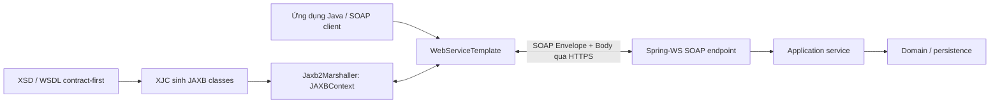
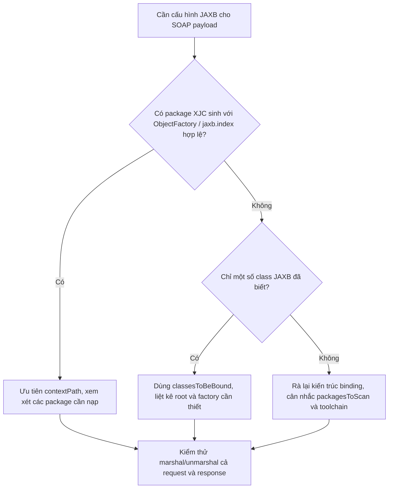
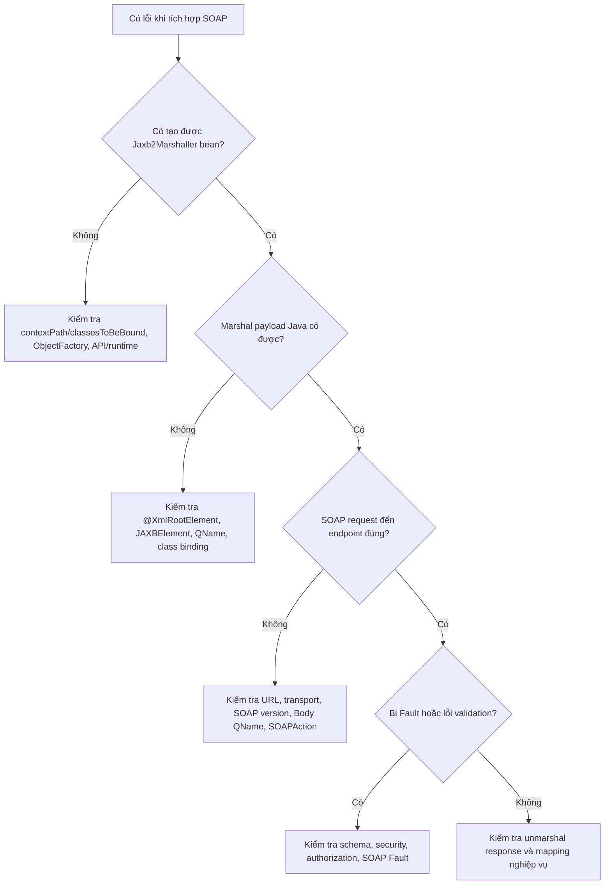

# Cấu hình Jaxb2Marshaller bằng context path hoặc lớp được liên kết

## 1. Bài toán: Spring-WS cần biết những lớp Java nào đại diện cho XML

Trong hệ thống tích hợp SOAP theo hướng **contract-first**, XSD quy định cấu trúc dữ liệu trên đường truyền, WSDL quy định các thao tác và SOAP binding, còn XJC có thể sinh lớp Java từ các kiểu và phần tử XSD. Khi gửi hoặc nhận dữ liệu, ứng dụng **Spring Web Services (Spring-WS)** cần cơ chế chuyển đổi giữa đối tượng Java và XML. Cơ chế đó gọi là **marshalling** và **unmarshalling**.

**`Jaxb2Marshaller`** thuộc Spring OXM (Object/XML Mapping) là một thành phần giúp ứng dụng dùng **JAXB/Jakarta XML Binding** theo hai hướng:

- **Marshaller:** chuyển Java object thành XML.
- **Unmarshaller:** đọc XML thành Java object hoặc `JAXBElement<?>` tùy mô hình binding.

Một cấu hình `Jaxb2Marshaller` phải xác định được **tập kiểu Java được JAXB quản lý** để tạo `JAXBContext`. Hai cách phổ biến chính là:

1. **`setContextPath("...")`:** chọn một hoặc nhiều **package JAXB** có thông tin binding phù hợp, thường là package mã XJC sinh với `ObjectFactory`.
2. **`setClassesToBeBound(Class<?>...)`:** liệt kê **tường minh những lớp Java** cần đưa vào JAXB context.

Spring OXM còn hỗ trợ **`setPackagesToScan(...)`** để quét package tìm lớp JAXB được chú thích; đây là lựa chọn bổ sung, không phải trọng tâm của bài này.

### 1.1. Mục tiêu học tập

Sau bài học trong chương **Marshalling và OXM** của module `SPRING_WEB_SERVICES`, bạn sẽ:

1. Giải thích chức năng của `Jaxb2Marshaller`, `JAXBContext` và mối quan hệ với XSD/WSDL.
2. Cấu hình đúng `contextPath` hoặc `classesToBeBound` trong Spring, biết khi nào dùng từng cách.
3. Hiểu yêu cầu package chứa `ObjectFactory`/`jaxb.index`, cách xử lý nhiều JAXB package và giới hạn của class root không có `@XmlRootElement`.
4. Gắn marshaller vào `WebServiceTemplate` để gọi SOAP client; phân biệt điều đó với cấu hình endpoint phía server.
5. Kiểm tra XML namespace, schema validation, khả năng tương thích `javax`/`jakarta`, sự cố JAXB và bảo mật.
6. Thiết kế bộ thử marshal/unmarshal, SOAP Fault, WS-Security và contract compatibility phù hợp.

## 2. Vị trí của Jaxb2Marshaller trong kiến trúc SOAP

Một luồng xử lý điển hình cho dịch vụ tra cứu đơn hàng:



| Tầng | Trách nhiệm | Không đảm nhận |
| --- | --- | --- |
| **XSD** | Tên phần tử XML, namespace, kiểu và ràng buộc. | Không xác thực danh tính hoặc tự thi hành nghiệp vụ. |
| **WSDL** | Mô tả operation, message, binding, endpoint. | Không sinh mã JAXB tại runtime. |
| **XJC** | Sinh Java sources và JAXB annotations từ XSD lúc build. | Không thực hiện SOAP request hoặc marshalling trong lúc chạy. |
| **`JAXBContext`** | Lưu metadata JAXB của tập kiểu được liên kết; tạo marshaller/unmarshaller JAXB. | Không thay thế SOAP dispatcher hoặc application service. |
| **`Jaxb2Marshaller`** | Cung cấp Spring OXM `Marshaller` và `Unmarshaller` dựa trên JAXB. | Không tự thêm SOAP Header, định tuyến operation hay xác thực WS-Security. |
| **`WebServiceTemplate`** | Gửi/nhận SOAP message và phối hợp marshaller, transport, callback, Fault handling. | Không tự quyết định nội dung hợp đồng nghiệp vụ. |

**Phạm vi quan trọng:** `Jaxb2Marshaller` chủ yếu biến đổi **payload XML**. Khi sử dụng qua `WebServiceTemplate`, Spring-WS chịu trách nhiệm SOAP Envelope/Body; HTTP/HTTPS, SOAP Header, SOAP Fault và các chính sách WS-Security được xử lý bằng các thành phần thích hợp khác.

## 3. Ví dụ hợp đồng XSD dùng xuyên suốt

Giả sử file `src/main/resources/xsd/orders.xsd` chứa hai global elements:

```xml
<?xml version="1.0" encoding="UTF-8"?>
<xs:schema xmlns:xs="http://www.w3.org/2001/XMLSchema"
           xmlns:ord="https://example.com/orders/v1"
           targetNamespace="https://example.com/orders/v1"
           elementFormDefault="qualified">

    <xs:simpleType name="OrderStatusType">
        <xs:restriction base="xs:string">
            <xs:enumeration value="PENDING"/>
            <xs:enumeration value="CONFIRMED"/>
            <xs:enumeration value="CANCELLED"/>
        </xs:restriction>
    </xs:simpleType>

    <xs:element name="GetOrderRequest">
        <xs:complexType>
            <xs:sequence>
                <xs:element name="orderId" type="xs:string"/>
            </xs:sequence>
        </xs:complexType>
    </xs:element>

    <xs:element name="GetOrderResponse">
        <xs:complexType>
            <xs:sequence>
                <xs:element name="orderId" type="xs:string"/>
                <xs:element name="status" type="ord:OrderStatusType"/>
                <xs:element name="totalAmount" type="xs:decimal"/>
            </xs:sequence>
        </xs:complexType>
    </xs:element>
</xs:schema>
```

Ví dụ XSD đã cố ý đơn giản để tập trung vào **cấu hình binding**; hợp đồng thật cần thêm ràng buộc ID, định nghĩa tiền tệ, lỗi nghiệp vụ, request validation và các quy tắc versioning.

Giả sử XJC được cấu hình sinh Java vào package `com.example.orders.contract.v1`:

```text
src/main/resources/xsd/orders.xsd
       │
       └── XJC (build-time)
             └── target/generated-sources/jaxb/
                   └── com/example/orders/contract/v1/
                         ├── GetOrderRequest.java
                         ├── GetOrderResponse.java
                         ├── OrderStatusType.java
                         ├── ObjectFactory.java
                         └── package-info.java
```

Các tên và số lượng file là **minh họa**; XJC có thể tạo kiểu khác tùy thiết kế XSD, custom binding và phiên bản công cụ. Ví dụ trên dùng **global elements với anonymous complex types**, nên có thể sinh class root JAXB với `@XmlRootElement`, rất tiện cho minh họa `WebServiceTemplate`.

### 3.1. package-info.java mang namespace

Trong package mã sinh thường có metadata tương tự:

```java
@jakarta.xml.bind.annotation.XmlSchema(
    namespace = "https://example.com/orders/v1",
    elementFormDefault = jakarta.xml.bind.annotation.XmlNsForm.QUALIFIED
)
package com.example.orders.contract.v1;
```

QName XML được xác định bằng **namespace URI + local name**. `<ord:GetOrderRequest>` và `<o:GetOrderRequest>` có thể cùng QName nếu `ord` và `o` trỏ đến cùng URI. Tên package `com.example.orders.contract.v1` là cấu trúc Java, **không phải namespace XML**.

### 3.2. ObjectFactory và sự khác biệt giữa element với type

XJC thường sinh `ObjectFactory` để tạo instance và/hoặc các `JAXBElement` mang QName. Một **complex type** được nhiều global elements sử dụng không đồng nghĩa mỗi Java class đại diện type đều có một root XML duy nhất.

```java
// Minh họa vai trò của JAXBElement, không sao chép đè mã XJC sinh.
QName name = new QName(
    "https://example.com/orders/v1", "GetOrderResponse");

JAXBElement<GetOrderResponseType> root =
    new JAXBElement<>(name, GetOrderResponseType.class, responseValue);
```

Nếu class có `@XmlRootElement` tương ứng, có thể marshal trực tiếp object. Nếu class **không có** `@XmlRootElement`, thường cần root `JAXBElement` do `ObjectFactory` cung cấp hoặc cấu hình binding phù hợp.

## 4. Cách 1: cấu hình bằng setContextPath

`contextPath` là chuỗi tên package cho `JAXBContext` tìm và sử dụng thông tin binding, **không phải đường dẫn tới file XSD** và cũng không phải tên file `ObjectFactory.java`.

### 4.1. Cấu hình Spring Bean

```java
import org.springframework.context.annotation.Bean;
import org.springframework.context.annotation.Configuration;
import org.springframework.oxm.jaxb.Jaxb2Marshaller;

@Configuration
public class SoapXmlBindingConfig {

    @Bean
    public Jaxb2Marshaller orderMarshaller() {
        Jaxb2Marshaller marshaller = new Jaxb2Marshaller();
        marshaller.setContextPath("com.example.orders.contract.v1");
        return marshaller;
    }
}
```

Khi Spring khởi tạo bean, `Jaxb2Marshaller` thực hiện vòng đời khởi tạo phù hợp và tạo `JAXBContext` (trừ trường hợp dùng cấu hình khởi tạo lười). Vì vậy trong một `@Bean` do Spring quản lý như ví dụ, **không cần tự gọi `afterPropertiesSet()`**.

Ở chế độ này, JAXB tìm thông tin nhận diện package, phổ biến là `ObjectFactory.class` được XJC sinh; một package cũng có thể có `jaxb.index` thích hợp theo quy tắc JAXB provider. **Chỉ đặt vài class có annotation vào một package chưa chắc đã đủ để dùng context path** nếu package không có metadata/định danh cần thiết.

### 4.2. Khi nào context path phù hợp?

Đây thường là lựa chọn tự nhiên khi:

- Dự án **contract-first**, XJC đã sinh cả package JAXB hoàn chỉnh từ XSD/WSDL.
- Schema có nhiều global elements và nhiều class dùng chung kiểu.
- Muốn toàn bộ tập binding trong package được JAXB nhận biết mà không phải liệt kê từng class.
- Thư mục mã sinh có `ObjectFactory`/metadata đầy đủ và được đưa vào compiled classpath.

Chẳng hạn khi XSD bổ sung một global element mới, bản XJC sinh lại có thể cập nhật `ObjectFactory` trong package; cấu hình `contextPath` không phải sửa danh sách class ở Java config nếu mọi thứ vẫn nằm trong package cũ và không xung đột.

### 4.3. Context path gồm nhiều package

JAXB cho phép context path có các package phân tách bằng dấu hai chấm (`:`):

```java
marshaller.setContextPath(
    "com.example.orders.contract.v1:" +
    "com.example.shared.contract.v1"
);
```

Kịch bản này hữu ích khi XJC sinh nhiều package từ các namespace khác nhau, ví dụ schema đơn hàng tham chiếu schema kiểu dữ liệu chung. Mỗi package trong context path cần hỗ trợ cơ chế khởi tạo bằng JAXB context path, và các binding cùng context không được xung đột QName hoặc định nghĩa XML theo cách provider không xử lý được.

**Lưu ý:** không dùng dấu chấm phẩy để phân tách package, không đặt tên thư mục tài nguyên `src/main/resources/xsd` vào đây, và không nhầm `contextPath` với thuộc tính `@ComponentScan` của Spring.

### 4.4. Những lỗi thường gặp với context path

Ví dụ:

```java
marshaller.setContextPath("com.example.orders.contract");
```

nhưng các class XJC thực tế nằm trong `com.example.orders.contract.v1`. Khi khởi tạo `JAXBContext` có thể gặp lỗi tìm package hoặc factory; sửa bằng cách dùng **đúng Java package** đã compile.

Nếu package không chứa `ObjectFactory.class` hoặc `jaxb.index` hợp lệ, provider có thể báo lỗi tương tự:

```text
"<package> doesn't contain ObjectFactory.class or jaxb.index"
```

Cần kiểm tra **compiled classpath**, không chỉ nhìn thấy file `ObjectFactory.java` trong thư mục generated sources. Nếu package chỉ có một vài class JAXB viết tay mà không có package discovery thích hợp, chế độ **`classesToBeBound`** thường đơn giản hơn.

## 5. Cách 2: cấu hình bằng setClassesToBeBound

Thay vì yêu cầu JAXB tìm toàn bộ package, bạn có thể **liệt kê tường minh các class** cần JAXB context biết đến.

### 5.1. Cấu hình Spring Bean

```java
import org.springframework.context.annotation.Bean;
import org.springframework.context.annotation.Configuration;
import org.springframework.oxm.jaxb.Jaxb2Marshaller;
import com.example.orders.contract.v1.GetOrderRequest;
import com.example.orders.contract.v1.GetOrderResponse;
import com.example.orders.contract.v1.ObjectFactory;

@Configuration
public class SoapXmlBindingConfig {

    @Bean
    public Jaxb2Marshaller orderMarshaller() {
        Jaxb2Marshaller marshaller = new Jaxb2Marshaller();
        marshaller.setClassesToBeBound(
            GetOrderRequest.class,
            GetOrderResponse.class,
            ObjectFactory.class
        );
        return marshaller;
    }
}
```

Đây là **phương án thay thế** cho ví dụ `setContextPath` ở mục 4, không phải bean thứ hai cần khai báo cùng tên trong cùng một cấu hình. `ObjectFactory` được đưa vào danh sách khi muốn JAXB context biết thêm khai báo global element/factory của package XJC sinh; một số schema với `@XmlRootElement` trực tiếp có thể dùng tập class tối giản hơn.

### 5.2. Khi nào liệt kê class tốt hơn?

- Ứng dụng chỉ có vài DTO JAXB và không cần đưa cả package vào context.
- Đối tượng XML binding được viết và quản lý thủ công, không có `ObjectFactory` hoặc `jaxb.index`.
- Muốn **tập class rõ ràng**, dễ nhận biết trong code review.
- Dự án có nhiều package nhỏ hoặc cần kết hợp các loại binding nhưng không thể dễ dàng tổ chức context path chuẩn.
- Muốn lỗi thiếu class hoặc thay đổi package bộc lộ trực tiếp trong Java compile/build.

Đổi lại, nếu XSD được cập nhật và có **global element mới** nhưng cấu hình không bổ sung class/factory phù hợp, JAXB context có thể không nhận biết root mới. Danh sách class cũng không phải cách bảo đảm mọi kiểu XML trong hệ thống đều được hỗ trợ; cần kiểm thử thao tác được công bố.

### 5.3. Phạm vi kiểu được JAXB context biết đến

Không nhất thiết phải liệt kê bằng tay **mọi class con**: provider JAXB có thể khám phá các kiểu được tham chiếu qua field/property của root đã đưa vào context. Tuy nhiên, **không nên giả định nó tự quét mọi class trong package**, và các global elements chỉ được công bố qua `ObjectFactory` cần được đăng ký thích hợp.

Một lựa chọn không đầy đủ như:

```java
marshaller.setClassesToBeBound(GetOrderRequest.class);
```

không bảo đảm marshaller nhận biết đúng `GetOrderResponse` khi client cần unmarshal phản hồi. Hãy đưa vào context **những root và factory cần thiết của cả hai chiều trao đổi**, rồi kiểm tra bằng test thực tế.

### 5.4. ClassesToBeBound và package scanning khác nhau

`setPackagesToScan(...)` yêu cầu Spring tìm các lớp có JAXB annotations trong package được chỉ định. Nó không phải `setContextPath(...)`:

```java
// Phương án thứ ba, chỉ để so sánh:
marshaller.setPackagesToScan("com.example.orders.contract.v1");
```

Quét classpath có chi phí khởi tạo và quy tắc nhận diện riêng. Với XJC contract-first cung cấp `ObjectFactory` hoàn chỉnh, `contextPath` thường dễ hiểu; với tập class cố định nhỏ, `classesToBeBound` dễ kiểm soát. **Không kết hợp các chế độ khám phá kiểu vào cùng một bean**: chọn một chiến lược nhất quán.

## 6. So sánh và lựa chọn nhanh

| Tiêu chí | `setContextPath(...)` | `setClassesToBeBound(...)` |
| --- | --- | --- |
| Cách chỉ định | Tên package JAXB, có thể nhiều package ngăn bằng `:`. | Danh sách `Class<?>` tường minh. |
| Phù hợp nhất | Package **XJC sinh đầy đủ** với `ObjectFactory`/`jaxb.index`. | Một số DTO JAXB cụ thể, mô hình nhỏ hoặc Java binding viết tay. |
| Phụ thuộc discovery | JAXB context path yêu cầu package binding/discovery thích hợp. | Không cần package discovery như context path, nhưng cần class/factory được liệt kê đúng. |
| Khi thêm global element | Có thể đã được đưa vào thông qua `ObjectFactory` tái sinh trong package. | Có thể phải thêm class/factory nếu chưa thuộc tập được context quản lý. |
| Dễ kiểm soát phạm vi | Theo package; đôi khi bao gồm nhiều kiểu hơn cần dùng. | Tường minh theo root/class và các kiểu được tham chiếu. |
| Dễ gặp lỗi | Sai package, thiếu factory/index, package không ở classpath. | Thiếu root class, thiếu factory, danh sách không theo kịp contract. |
| Nhiều namespace | Nhiều package trong context path nếu hợp lệ. | Các class từ nhiều package nếu binding không xung đột. |
| Điều **không** làm | Không tự validate schema hoặc xác thực SOAP Header. | Cũng không tự validate schema hoặc xác thực SOAP Header. |

Một quy tắc ra quyết định:



**Quan trọng:** cách cấu hình chỉ giúp khởi tạo JAXB context. Nó **không quyết định một XML request có hợp lệ về nghiệp vụ**, cũng không thay thế WSDL/XSD, SOAP binding hay security policy.

## 7. Đưa Jaxb2Marshaller vào WebServiceTemplate phía SOAP client

Khi gọi SOAP service, `WebServiceTemplate` có thể dùng cùng một `Jaxb2Marshaller` cho cả chiều đi và chiều về. Đối tượng client tạo Java request, marshaller biến nó thành XML payload, Spring-WS gửi SOAP message qua transport được cấu hình; chiều nhận làm ngược lại.

### 7.1. Cấu hình Bean cho SOAP client

Ví dụ hoàn chỉnh ở mức **cấu hình OXM/client**, giả sử `orderMarshaller()` được khai báo bằng **một trong hai cách** ở mục 4 hoặc 5:

```java
import org.springframework.context.annotation.Bean;
import org.springframework.context.annotation.Configuration;
import org.springframework.oxm.jaxb.Jaxb2Marshaller;
import org.springframework.ws.client.core.WebServiceTemplate;

@Configuration
public class OrderSoapClientConfig {

    @Bean
    public WebServiceTemplate orderWebServiceTemplate(
            Jaxb2Marshaller orderMarshaller) {
        WebServiceTemplate template = new WebServiceTemplate();
        template.setMarshaller(orderMarshaller);
        template.setUnmarshaller(orderMarshaller);
        return template;
    }
}
```

Ở đây:

- `setMarshaller` cấu hình chiều **Java request → XML payload**.
- `setUnmarshaller` cấu hình chiều **XML response → Java object**.
- Dùng cùng `Jaxb2Marshaller` là hợp lý khi request/response thuộc cùng một tập JAXB binding.
- Có thể dùng hai marshaller khác nhau nếu client thật sự trao đổi với những contract/binding tách biệt, nhưng cần xác định chính xác trách nhiệm của từng cấu hình.

Mặc định ở ví dụ trên chưa thiết lập timeout, message sender cụ thể, chứng chỉ TLS/mTLS, SOAPAction, interceptor WS-Security, xác thực hoặc custom SOAP Fault resolver. Đó là những phần phải bổ sung theo yêu cầu tích hợp.

### 7.2. Gọi operation bằng payload JAXB

```java
import org.springframework.stereotype.Component;
import org.springframework.ws.client.core.WebServiceTemplate;
import org.springframework.ws.soap.client.core.SoapActionCallback;

@Component
public class OrderSoapGateway {
    private final WebServiceTemplate template;

    public OrderSoapGateway(WebServiceTemplate orderWebServiceTemplate) {
        this.template = orderWebServiceTemplate;
    }

    public GetOrderResponse findOrder(String orderId) {
        GetOrderRequest request = new GetOrderRequest();
        request.setOrderId(orderId);

        Object value = template.marshalSendAndReceive(
            "https://api.example.com/ws",
            request,
            new SoapActionCallback("https://example.com/orders/GetOrder")
        );

        return (GetOrderResponse) value;
    }
}
```

`GetOrderRequest` và `GetOrderResponse` ở đây là các lớp XJC sinh có `@XmlRootElement` tương ứng theo schema minh họa. `SoapActionCallback` được thêm **chỉ như ví dụ** cho tích hợp SOAP 1.1 yêu cầu giá trị `SOAPAction`; phải lấy **giá trị thực từ WSDL/binding của đối tác**, không suy ra từ tên phương thức Java. Nếu WSDL không yêu cầu SOAPAction hoặc dùng SOAP 1.2, cấu hình có thể khác.

**Cẩn thận với cast:** nếu JAXB binding của response sử dụng `JAXBElement<GetOrderResponseType>`, giá trị trả về có thể là wrapper đó chứ không phải `GetOrderResponse`. Khi đó cần gọi `getValue()` theo kiểu và QName đã xác minh, không ép kiểu mù quáng.

### 7.3. Dữ liệu XML thực tế là gì?

Request payload được marshal có dạng:

```xml
<ord:GetOrderRequest xmlns:ord="https://example.com/orders/v1">
    <ord:orderId>ORD-2026-001</ord:orderId>
</ord:GetOrderRequest>
```

Spring-WS đặt payload vào SOAP 1.1 message khi dùng SOAP 1.1:

```xml
<soap:Envelope
    xmlns:soap="http://schemas.xmlsoap.org/soap/envelope/"
    xmlns:ord="https://example.com/orders/v1">
    <soap:Body>
        <ord:GetOrderRequest>
            <ord:orderId>ORD-2026-001</ord:orderId>
        </ord:GetOrderRequest>
    </soap:Body>
</soap:Envelope>
```

**Jaxb2Marshaller không tự xây dựng Envelope** khi bạn gọi trực tiếp `marshal(object, Result)`. Khi đi qua `WebServiceTemplate`, Spring-WS phối hợp SOAP message factory, HTTP transport và marshaller để tạo message hoàn chỉnh.

## 8. Ở phía Spring-WS server, marshaller được sử dụng ra sao?

Một endpoint SOAP nhận phần tử gốc của `Body` và trả về phần tử phản hồi:

```java
import org.springframework.ws.server.endpoint.annotation.Endpoint;
import org.springframework.ws.server.endpoint.annotation.PayloadRoot;
import org.springframework.ws.server.endpoint.annotation.RequestPayload;
import org.springframework.ws.server.endpoint.annotation.ResponsePayload;

@Endpoint
public class OrderEndpoint {
    private static final String NS = "https://example.com/orders/v1";
    private final OrderService orderService;
    private final OrderContractMapper mapper;

    public OrderEndpoint(OrderService orderService,
                         OrderContractMapper mapper) {
        this.orderService = orderService;
        this.mapper = mapper;
    }

    @PayloadRoot(namespace = NS, localPart = "GetOrderRequest")
    @ResponsePayload
    public GetOrderResponse getOrder(
            @RequestPayload GetOrderRequest request) {
        OrderSummary result = orderService.findOrder(request.getOrderId());
        return mapper.toContractResponse(result);
    }
}
```

`OrderService`, `OrderSummary` và `OrderContractMapper` là các thành phần **ứng dụng tự xây dựng**, không được XJC hay Spring-WS tự sinh. Ví dụ này cũng chưa trình bày cấu hình endpoint adapter, `MessageDispatcherServlet`, WSDL, authorization hoặc exception resolver.

Spring-WS có những phương thức xử lý tham số/giá trị trả về JAXB cho `@RequestPayload`/`@ResponsePayload` tùy loại JAXB root và adapter đã được đăng ký. **Không được mặc định rằng chỉ cần khai báo một bean `Jaxb2Marshaller` thì mọi endpoint server sẽ tự chuyển sang dùng đúng bean đó.** Các bộ xử lý JAXB dựa trên annotation có thể thực hiện chuyển đổi riêng; khi muốn dùng chính cấu hình Spring OXM ở endpoint adapter, hãy cấu hình và kiểm thử bộ xử lý thích hợp, ví dụ `MarshallingPayloadMethodProcessor` nếu phù hợp với phiên bản Spring-WS.

Điều quan trọng ở tầng server là **QName của payload root**: `{https://example.com/orders/v1}GetOrderRequest`. `setContextPath` là package Java; nó **không phải cơ chế định tuyến SOAP operation**. Tên package JAXB có thể đổi mà QName trên đường truyền vẫn giữ nguyên nếu binding và contract được bảo toàn.

### 8.1. Tách contract model với domain/persistence

JAXB `GetOrderRequest` và `GetOrderResponse` là mô hình XML biên; không nên đưa annotation JPA vào class XJC sinh, hoặc trả thẳng `OrderEntity` ra SOAP chỉ vì JAXB có thể marshal. Mapper cho phép:

```text
SOAP request XML
    → JAXB GetOrderRequest
    → Application command / query
    → Domain service, authorization, repository
    → Application result
    → Contract mapper
    → JAXB GetOrderResponse
    → SOAP response XML
```

Nhờ phân tách, thay đổi tên cột/bảng, trạng thái nội bộ hoặc cách tổ chức code không cần làm thay đổi hợp đồng XML công khai.

## 9. JAXBElement, @XmlRootElement và khả năng hỗ trợ root

Một vấn đề đặc thù của JAXB là phân biệt **Java type** và **global XML element**. Hai XSD có cùng payload nghiệp vụ nhưng tổ chức type khác nhau có thể khiến XJC sinh class có `@XmlRootElement` hoặc sinh type không có root, kèm factory tạo `JAXBElement`.

### 9.1. Class có @XmlRootElement

Ví dụ một class đã có:

```java
@jakarta.xml.bind.annotation.XmlRootElement(
    name = "GetOrderRequest",
    namespace = "https://example.com/orders/v1"
)
public class GetOrderRequest {
    // JAXB fields...
}
```

Bạn có thể marshal trực tiếp `new GetOrderRequest()` khi JAXB context biết đến class này. Schema với global element chứa anonymous complex type thường dẫn đến hình dạng thuận tiện như trên, nhưng **không nên giả định mọi XSD sẽ sinh giống nhau**.

### 9.2. Type không có root cần JAXBElement

Nếu kiểu Java `GetOrderRequestType` tương ứng với **named complex type**, còn global XML element `GetOrderRequest` được khai báo riêng, có thể cần:

```java
// Minh họa giả định ObjectFactory sinh phương thức sau.
ObjectFactory factory = new ObjectFactory();
GetOrderRequestType value = new GetOrderRequestType();
value.setOrderId("ORD-2026-001");

JAXBElement<GetOrderRequestType> root =
    factory.createGetOrderRequest(value);

Object result = template.marshalSendAndReceive(
    "https://api.example.com/ws", root
);
```

Với những kiểu wrapper như `JAXBElement<?>`, trong một số tích hợp cần cấu hình `Jaxb2Marshaller.setSupportJaxbElementClass(true)` để phương thức kiểm tra kiểu được hỗ trợ (`supports`) chấp nhận `JAXBElement`. Tùy cách gọi, adapter và phiên bản, việc hỗ trợ wrapper cần được kiểm thử thực tế.

**Không nhầm hai vấn đề:**

- Đưa `ObjectFactory.class` vào JAXB context giúp đăng ký những khai báo element/binding cần thiết.
- Bật hỗ trợ `JAXBElement.class` ở `Jaxb2Marshaller` ảnh hưởng đến logic xác định các kiểu mà Spring OXM nhận hỗ trợ; nó **không tự sinh ra JAXBElement** hay gắn root QName khi đối tượng Java thiếu thông tin đó.

Nếu gặp lỗi `unable to marshal type ... missing @XmlRootElement`, hãy kiểm tra XSD và mã XJC sinh, dùng `ObjectFactory`/`JAXBElement` hợp lệ hoặc xem xét lại binding. **Không nên sửa tay class sinh từ XSD để chữa lỗi** vì lần generate kế tiếp sẽ ghi đè.

### 9.3. Root được nhận diện bằng QName, không phải prefix

Khi debug một vấn đề unmarshalling, cần so sánh:

```text
XML thực tế:
  {https://example.com/orders/v1}GetOrderResponse

JAXB binding dự kiến:
  {https://example.com/orders/v1}GetOrderResponse
```

Hai QName phải khớp. Prefix như `ord`, `o`, `ns2` không có ý nghĩa định danh khi URI giống nhau. Ngược lại, đổi `https://example.com/orders/v1` thành `.../v2` có thể phá vỡ binding/endpoint dù local name không đổi.

## 10. Validation và các tùy chọn bổ sung của Jaxb2Marshaller

### 10.1. Bật kiểm tra XSD có chủ đích

JAXB có thể unmarshal XML mà **không kiểm tra đầy đủ ràng buộc XSD** nếu ứng dụng chưa cấu hình validation. Với `Jaxb2Marshaller`, một cách bật xác thực schema cho mô hình đơn giản là:

```java
import org.springframework.core.io.ClassPathResource;
import org.springframework.oxm.jaxb.Jaxb2Marshaller;

Jaxb2Marshaller marshaller = new Jaxb2Marshaller();
marshaller.setContextPath("com.example.orders.contract.v1");
marshaller.setSchema(new ClassPathResource("xsd/orders.xsd"));
```

Khi marshaller này được Spring quản lý như bean và khởi tạo thành công, schema có thể được dùng để validate trong quá trình marshal/unmarshal qua thành phần OXM này. Nếu schema có `xs:include`/`xs:import`, cần cấu hình độ phân giải và các tài nguyên liên quan cho đúng, thay vì cho phép truy cập tài nguyên bên ngoài tùy ý.

Phía server Spring-WS cũng có thể dùng `PayloadValidatingInterceptor` cho payload. **Hai cách này là các điểm tích hợp khác nhau**; quyết định bật một hay cả hai phải dựa trên pipeline thực tế, tính nhất quán lỗi và chi phí validate. Không nên tự suy luận có validation chỉ vì XSD tồn tại trong thư mục resources.

### 10.2. Phân biệt binding metadata với validation

| Điều nhìn thấy | Có đủ để kết luận XML hợp lệ theo XSD không? | Vì sao? |
| --- | --- | --- |
| Class sinh có `@XmlElement(required=true)` | **Không** | Đây là metadata binding, không phải bằng chứng validator đang chạy. |
| `Jaxb2Marshaller` tạo `JAXBContext` thành công | **Không** | Nó chỉ xác nhận tập JAXB binding được thiết lập. |
| `Unmarshaller.unmarshal(...)` không ném lỗi | **Chưa đủ** | Một số ràng buộc schema chỉ được kiểm tra khi schema validation được bật. |
| Request có `orderId` đúng kiểu string | **Chưa đủ** | Tính tồn tại, phân quyền và trạng thái nghiệp vụ do ứng dụng kiểm tra. |
| Payload validate thành công với XSD | **Chưa đủ cho bảo mật** | XSD không xác thực người gửi, chứng chỉ hoặc chữ ký WS-Security. |

Các ngoại lệ validation/schema cần được ánh xạ sang kết quả hoặc SOAP Fault phù hợp với hợp đồng. Không gửi nguyên stack trace, chi tiết JDBC, đường dẫn nội bộ hoặc thông tin nhạy cảm vào SOAP Fault `detail`.

### 10.3. Một số cấu hình OXM hữu ích

`Jaxb2Marshaller` hỗ trợ các tùy chọn JAXB khác; ví dụ định dạng XML cho mục đích phát triển:

```java
import jakarta.xml.bind.Marshaller;
import java.util.Map;

marshaller.setMarshallerProperties(
    Map.of(Marshaller.JAXB_FORMATTED_OUTPUT, Boolean.TRUE)
);
```

Không nên bật pretty-print theo thói quen trên dữ liệu được ký số ở vị trí có thể thay đổi nội dung sau khi ký: XML Signature có quy tắc canonicalization và phạm vi node được ký, mọi biến đổi cần đúng chính sách chữ ký. Trước khi bật tính năng như MTOM, adapters, custom listeners hoặc custom schema resolver, hãy đánh giá tương thích của hệ thống tích hợp và kiểm thử với SOAP message thật.

Đối với dữ liệu lớn và bảo mật, cần quản lý **XML parser**, loại nguồn XML, tài nguyên được phép tham chiếu, dung lượng input và khả năng tiêu thụ bộ nhớ. Không bật xử lý DTD/external entities chỉ để làm cho một input không tin cậy “đọc được”; bảo vệ XXE và các hình thức quá tải XML là trách nhiệm riêng.

### 10.4. Vòng đời và thread-safety

`JAXBContext` thường được tạo tốn chi phí và được tái sử dụng. Spring quản lý `Jaxb2Marshaller` như bean singleton giúp dùng cấu hình chung; thành phần này tạo/sử dụng các đối tượng marshaller/unmarshaller JAXB theo cách phù hợp ở mỗi lần xử lý. **Không chia sẻ tùy ý cùng một đối tượng JAXB `Marshaller` hoặc `Unmarshaller` thô giữa nhiều thread** khi provider không cam kết thread-safe.

Nếu tự tạo `Jaxb2Marshaller` ngoài Spring container, phải hoàn tất vòng đời khởi tạo trước khi dùng, ví dụ gọi `afterPropertiesSet()` trong một phép thử thủ công. Trong `@Bean` được Spring quản lý, container đảm trách phần khởi tạo này.

## 11. javax.xml.bind và jakarta.xml.bind: chọn đúng thế hệ

Một cấu hình `contextPath` có thể trông đúng nhưng runtime JAXB vẫn thất bại nếu mã XJC sinh và Spring stack dùng các thế hệ API khác nhau:

| Thế hệ hệ sinh thái | Import thường gặp | Điều cần chú ý |
| --- | --- | --- |
| JAXB 2.x / Java EE trước đây | `javax.xml.bind.*`, `javax.xml.bind.annotation.*` | Chọn JAXB API/runtime và Spring/framework tương thích. |
| Jakarta XML Binding 3.x/4.x | `jakarta.xml.bind.*`, `jakarta.xml.bind.annotation.*` | Thường đi cùng Spring Framework 6 / Spring Boot 3 trở lên; chọn XJC Jakarta tương ứng. |
| XML datatype trong JDK | `javax.xml.datatype.XMLGregorianCalendar` | Vẫn có package `javax.xml.datatype`; không phải mọi `javax.*` đều đổi thành Jakarta. |

Từ Java 11, các thành phần JAXB/Java EE từng tích hợp trong JDK đã bị loại bỏ. Dự án cần khai báo dependency thích hợp cho **API**, **runtime provider** và công cụ **XJC build-time** nếu sinh mã từ XSD. Chỉ có class Java được compile không chứng minh JAXB provider đã có mặt lúc chạy.

Ví dụ một lớp XJC sinh import `javax.xml.bind.annotation.XmlRootElement` nhưng dự án Spring 6/Jakarta kỳ vọng `jakarta.xml.bind.annotation.XmlRootElement`. Đừng thay chuỗi text bằng tay trong generated sources; hãy dùng **XJC phiên bản đúng**, sinh lại mã từ XSD và kiểm tra classpath/khai báo dependency.

**Với contextPath:** kiểm tra `ObjectFactory.class` và `package-info.class` trong package sinh ra thực tế dùng cùng hệ annotation với JAXB runtime. **Với classesToBeBound:** kiểm tra các `Class<?>` đưa vào context thực sự là class của đúng thế hệ binding, không phải class trùng tên nằm ở package/version khác.

## 12. Các lỗi cấu hình thường gặp và cách chẩn đoán

Khi một SOAP request thất bại, không nên lập tức sửa XSD hoặc đổi `@PayloadRoot`. Hãy xác định **lỗi xảy ra ở bước nào**: khởi tạo JAXB context, marshal request, gửi SOAP transport, nhận SOAP Fault, unmarshal response hay xử lý nghiệp vụ.

| Triệu chứng | Nguyên nhân có thể | Kiểm tra và xử lý |
| --- | --- | --- |
| JAXB báo package không chứa `ObjectFactory.class` hoặc `jaxb.index` | `contextPath` sai, package chỉ có class viết tay, hoặc generated classes chưa compile. | Kiểm tra tên package, classpath, `ObjectFactory`/index; cân nhắc `setClassesToBeBound` nếu chỉ có DTO nhỏ. |
| Không tìm thấy lớp ở runtime | Generated sources không được đưa vào Java source set hoặc artifact JAR thiếu class. | Kiểm tra bước XJC/build, packaging, phiên bản dependency và classpath runtime. |
| `IllegalAnnotationsException` hoặc lỗi xung đột JAXB type | Mã bind không hợp lệ, hai class/QName xung đột, hoặc customization không tương thích. | Xem class được liệt kê, nhiều package, global elements, annotations và XSD. |
| Báo kiểu không có `@XmlRootElement` khi marshal | Đang marshal Java complex type như root mà chưa có QName element. | Dùng `JAXBElement` do `ObjectFactory` sinh, hoặc sửa thiết kế binding từ XSD. |
| `UnmarshallingFailureException`: unexpected element | QName XML không khớp root được context biết đến. | So sánh **namespace URI + local name** của XML với XSD và JAXB metadata. |
| `ClassCastException` sau `marshalSendAndReceive` | Response thực tế là `JAXBElement` hoặc kiểu JAXB khác với cast mong đợi. | Quan sát kiểu thực, dùng `getValue()` sau kiểm tra QName/type nếu cần. |
| Bean khởi tạo thành công nhưng response mới không đọc được | `classesToBeBound` thiếu root/factory mới, hoặc XSD/client lệch version. | Kiểm tra các classes được đăng ký, regenerate đúng hợp đồng và thử XML response thực tế. |
| Java lỗi `javax.xml.bind.*` hoặc `jakarta.xml.bind.*` | Trộn XJC/API/runtime không cùng hệ hoặc thiếu dependency. | Kiểm tra Spring/JAXB version và sinh lại mã bằng toolchain tương thích. |
| Runtime không có JAXB provider | Chỉ thêm JAXB API mà thiếu implementation. | Bổ sung runtime implementation đúng phiên bản và kiểm tra startup. |
| Schema validation không bắt được giá trị sai | Chưa cấu hình schema vào đúng pipeline OXM/interceptor. | Kiểm tra `setSchema`, `PayloadValidatingInterceptor` và đường đi thực tế của request. |
| Lỗi `No endpoint mapping found` | QName Body không khớp `@PayloadRoot` hoặc cấu hình mapping server. | Kiểm tra SOAP Body root, namespace và bean endpoint; không nhầm với `contextPath`. |
| SOAP Fault bảo mật khi JAXB hoạt động bình thường | Token/chữ ký, timestamp, chứng chỉ hoặc quyền truy cập không hợp lệ. | Debug security layer và hợp đồng; không chữa bằng cách nới XML binding. |

### 12.1. Cách phân tách nguyên nhân theo thời điểm



Sơ đồ là một **checklist**; trong thực tế lỗi có thể xuất hiện ở nhiều tầng đồng thời. Ví dụ sai QName vừa có thể dẫn đến unmarshal failure ở client vừa có thể khiến server không định tuyến được endpoint.

### 12.2. Multi-package và nhiều hợp đồng

Một dự án có thể vừa gọi `OrdersService v1`, vừa gọi `BillingService v2`. Không nên mặc định nhét mọi class JAXB của các phiên bản vào một `JAXBContext` duy nhất:

- Có thể tồn tại global elements hoặc tên kiểu dẫn tới xung đột binding.
- Thay đổi một schema có thể khiến startup của một client không liên quan thất bại.
- Một context quá lớn làm phạm vi truy vết và quản lý tương thích khó rõ ràng.

Khi các contract **độc lập**, có thể tạo **marshaller riêng cho từng contract** và inject đúng bean vào `WebServiceTemplate` tương ứng:

```java
@Bean(name = "ordersV1Marshaller")
public Jaxb2Marshaller ordersV1Marshaller() {
    Jaxb2Marshaller m = new Jaxb2Marshaller();
    m.setContextPath("com.example.orders.contract.v1");
    return m;
}

@Bean(name = "billingV2Marshaller")
public Jaxb2Marshaller billingV2Marshaller() {
    Jaxb2Marshaller m = new Jaxb2Marshaller();
    m.setContextPath("com.example.billing.contract.v2");
    return m;
}
```

Ví dụ là **các bean cấu hình minh họa**, giả định có import Spring/JAXB tương ứng. Khi cùng ứng dụng có nhiều bean kiểu `Jaxb2Marshaller`, injection chỉ theo kiểu có thể trở nên mơ hồ; dùng `@Qualifier` hoặc bean name rõ ràng để chọn đúng marshaller cho từng SOAP client. Nếu các schema thật sự chia sẻ kiểu, cần thiết kế và thử nghiệm cách tổ chức context phù hợp.

## 13. Kiểm thử độc lập Jaxb2Marshaller trước khi gọi SOAP

Kiểm thử OXM riêng giúp xác định vấn đề nằm ở Java/XML binding hay transport/SOAP. Đây là bước đặc biệt hữu ích khi lựa chọn giữa `contextPath` và `classesToBeBound`.

### 13.1. Thử marshal và unmarshal với context path

Một test đơn giản có thể tự khởi tạo marshaller ngoài Spring container. Khi làm vậy, cần gọi `afterPropertiesSet()` để hoàn tất khởi tạo như vòng đời bean:

```java
import java.io.StringReader;
import java.io.StringWriter;
import javax.xml.transform.stream.StreamResult;
import javax.xml.transform.stream.StreamSource;
import org.springframework.oxm.jaxb.Jaxb2Marshaller;

public class OrderBindingSmokeTest {
    public void roundTrip() throws Exception {
        Jaxb2Marshaller binding = new Jaxb2Marshaller();
        binding.setContextPath("com.example.orders.contract.v1");
        binding.afterPropertiesSet();

        GetOrderRequest request = new GetOrderRequest();
        request.setOrderId("ORD-2026-001");

        StringWriter xml = new StringWriter();
        binding.marshal(request, new StreamResult(xml));

        Object decoded = binding.unmarshal(
            new StreamSource(new StringReader(xml.toString()))
        );

        GetOrderRequest restored = (GetOrderRequest) decoded;
        if (!"ORD-2026-001".equals(restored.getOrderId())) {
            throw new AssertionError("Order ID không được giữ nguyên");
        }
    }
}
```

Đoạn code minh họa giả định `GetOrderRequest` có `@XmlRootElement`. Với schema khác, kết quả có thể là `JAXBElement<?>` và test phải giải mã root đúng kiểu. Trong test thật dùng JUnit `assertEquals` cùng test setup rõ ràng; đoạn trên minh họa tối thiểu ý tưởng **round-trip**.

Muốn thử cấu hình theo class, thay phần khởi tạo bằng:

```java
Jaxb2Marshaller binding = new Jaxb2Marshaller();
binding.setClassesToBeBound(
    GetOrderRequest.class,
    GetOrderResponse.class,
    ObjectFactory.class
);
binding.afterPropertiesSet();
```

**So sánh quan trọng:** nếu cả hai cấu hình cùng marshal ra XML có QName và nội dung tương đương, lựa chọn cấu hình chủ yếu là quyết định quản lý tập class JAXB, không phải quyết định thay đổi giao thức SOAP.

### 13.2. Không chỉ kiểm tra object round-trip

Round-trip dùng cùng một JAXB runtime ở cả hai chiều có thể **che giấu lỗi tương thích**. Cần kiểm tra XML một cách độc lập:

1. Marshal request và xác nhận **namespace URI** của root, local name và thứ tự các trường đúng XSD.
2. Validate XML bằng XSD được công bố; thử cả dữ liệu âm tính như enum lạ hoặc thiếu trường bắt buộc.
3. Unmarshal **fixture XML do đối tác phát hành**, không chỉ XML do JAXB của ta vừa tạo.
4. Thử XML có prefix khác nhưng QName giữ nguyên.
5. Thử phần tử optional vắng mặt, `xsi:nil` nếu hợp đồng cho phép, các giá trị `BigDecimal` và date/time ở biên.
6. Với schema có root named type, thử `JAXBElement` và factory tương ứng.

Nếu dùng XML parser trong test để kiểm tra namespace, cũng phải cấu hình namespace-aware và các chế độ parser an toàn. Đừng biến dữ liệu XML không tin cậy thành một test/helper parser bật external entities không cần thiết.

### 13.3. Tích hợp SOAP client/server

Sau khi OXM unit test đạt, mới kiểm tra SOAP integration:

| Phép thử | Mục tiêu |
| --- | --- |
| **`MockWebServiceClient`** trên server | Đảm bảo endpoint chọn đúng `@PayloadRoot` và tạo payload phản hồi hợp lệ. |
| **`MockWebServiceServer`** hoặc mock transport cho client | Đảm bảo `WebServiceTemplate` gửi payload đúng, xử lý response và SOAP Fault. |
| **Schema validation trên request/response** | Xác nhận XML đúng phiên bản XSD và quy tắc bắt buộc. |
| **Client từ WSDL cũ** | Đảm bảo thay đổi schema/XJC không phá vỡ client đã phát hành. |
| **Fault handling** | Kiểm tra phản hồi khi XML không hợp lệ, nghiệp vụ từ chối hoặc server lỗi. |
| **WS-Security/TLS** | Kiểm tra chữ ký, token, timestamp, trust store, chứng chỉ, quyền truy cập theo cấu hình thực tế. |

Với hợp đồng SOAP 1.1, kiểm tra cả HTTP `Content-Type`, giá trị `SOAPAction` khi cần và SOAP Envelope đúng namespace `http://schemas.xmlsoap.org/soap/envelope/`. Với SOAP 1.2, namespace và HTTP binding khác. `Jaxb2Marshaller` chủ yếu xử lý payload; không nên sửa cấu hình JAXB để che lỗi SOAP version hoặc HTTP transport.

### 13.4. Kiểm thử khác biệt giữa hai chiến lược

Một bảng test tối thiểu:

| Tình huống | `contextPath` | `classesToBeBound` |
| --- | --- | --- |
| Package XJC có `ObjectFactory` hợp lệ | Khởi tạo JAXB context được. | Khởi tạo được khi class/factory cần thiết được liệt kê đúng. |
| Package chỉ có một class `@XmlRootElement` viết tay, không factory/index | Có thể lỗi package discovery. | Thường phù hợp khi liệt kê chính class đó. |
| Thêm global element mới trong XSD và regenerate | Có thể được nhận biết qua `ObjectFactory` mới trong package. | Cần xác minh và cập nhật danh sách nếu root/factory mới chưa được đăng ký. |
| Đổi tên Java package mã sinh | Phải cập nhật chuỗi context path. | Các import/Class references được compiler kiểm tra; có thể phải sửa cấu hình. |
| Dùng namespace XML khác nhưng giữ nguyên Java package | Phải kiểm tra metadata và XML output. | Cũng phải kiểm tra metadata và XML output. |
| Trộn JAXB `javax`/`jakarta` | Không phải giải pháp; cần toolchain tương thích. | Cũng không phải giải pháp; cần toolchain tương thích. |

## 14. Tình huống thực tế: chọn chiến lược cho ba dự án

### Tình huống A — Dịch vụ nội bộ XJC sinh nhiều class

Nhóm quản lý `orders.xsd` và `common.xsd`, XJC sinh package `com.example.orders.contract.v1` cùng `ObjectFactory`. Hệ thống có khoảng vài chục kiểu request/response.

**Lựa chọn hợp lý:** bắt đầu với `setContextPath("com.example.orders.contract.v1")`; nếu XJC tách thêm package cho schema chung thì bổ sung context path tương ứng, kiểm tra xung đột và chạy bộ test. Cách này tránh việc phải bảo trì danh sách rất dài các class đã sinh.

### Tình huống B — Adapter nhỏ chỉ có hai class JAXB viết tay

Một hệ thống chỉ cần `PingRequest` và `PingResponse` có `@XmlRootElement`, được quản lý thủ công, không có `ObjectFactory`/`jaxb.index`.

**Lựa chọn hợp lý:** `setClassesToBeBound(PingRequest.class, PingResponse.class)`. Dễ review và không cần tạo package discovery chỉ để dùng context path.

### Tình huống C — Nhiều WSDL/phiên bản cùng tồn tại

Ứng dụng gọi `Orders v1` và `Orders v2` trong giai đoạn chuyển đổi. Hai bộ XSD có QName, enum và lỗi khác nhau.

**Lựa chọn hợp lý:** tách `ordersV1Marshaller` và `ordersV2Marshaller`, mỗi bean đăng ký đúng package/class tương ứng, cấu hình cho từng `WebServiceTemplate` bằng qualifier; có mapper chuyển mỗi wire model sang domain model ổn định. Không trộn ngẫu nhiên hai thế hệ vào một context để “dùng chung cho tiện”.

## 15. Checklist triển khai production

- [ ] **XSD/WSDL công khai** là nguồn sự thật của thông điệp; JAXB classes được sinh/cấu hình tương thích hợp đồng.
- [ ] Đã chọn **một** chế độ kiểu JAXB cho mỗi `Jaxb2Marshaller`: `contextPath`, `classesToBeBound` hoặc package scan khi cần.
- [ ] Nếu dùng `contextPath`, package chính xác và có `ObjectFactory`/`jaxb.index` phù hợp trên **runtime classpath**.
- [ ] Nếu dùng `classesToBeBound`, các root class và factory/global elements cần thiết đều được JAXB context biết đến.
- [ ] Đã kiểm tra sự khác nhau giữa `@XmlRootElement` và `JAXBElement`, cũng như các response có thể trả wrapper.
- [ ] Thế hệ `javax.xml.bind` hoặc `jakarta.xml.bind` phù hợp XJC, runtime JAXB và Spring stack đang sử dụng.
- [ ] `WebServiceTemplate` có marshaller/unmarshaller phù hợp, cấu hình transport, timeout, SOAP version, SOAPAction, TLS/chứng chỉ theo WSDL.
- [ ] Phía server đã kiểm tra endpoint adapter/method processor thật sự dùng đúng binding mong muốn; không dựa vào sự tồn tại của bean.
- [ ] Schema validation được cấu hình **ở nơi có thực thi**, không chỉ dựa vào annotation hay XSD nằm trong project.
- [ ] XSD được bảo vệ bởi XML parser/schema resolver an toàn; giới hạn kích thước/độ sâu đầu vào và kiểm soát dữ liệu log.
- [ ] SOAP Header, WS-Security, chữ ký, token, chứng chỉ và quyền gọi được kiểm tra ở tầng thích hợp.
- [ ] Exception được ánh xạ thành SOAP Fault hoặc kết quả nghiệp vụ công khai, không tiết lộ stack trace hay thông tin bí mật.
- [ ] Có unit test JAXB, test XML QName/schema, test SOAP client/server và test tương thích với client WSDL/XSD cũ.
- [ ] Không sửa trực tiếp lớp JAXB được XJC sinh hoặc ghép JPA entity vào wire model để tránh lệch hợp đồng.

## 16. Câu hỏi tự kiểm tra

1. `setContextPath("com.example.orders.contract.v1")` khác `setClassesToBeBound(GetOrderRequest.class, ...)` ở cách JAXB tìm kiểu như thế nào?
2. Khi dùng `contextPath`, tại sao package chỉ chứa class `@XmlRootElement` nhưng không có `ObjectFactory`/`jaxb.index` vẫn có thể gặp lỗi?
3. Khi XSD được mở rộng thêm global element, vì sao `contextPath` có thể ít phải cập nhật Java config hơn `classesToBeBound`?
4. `ObjectFactory` và `JAXBElement` giải quyết vấn đề gì mà một Java complex type chưa chắc giải quyết được?
5. `Jaxb2Marshaller` có tự sinh SOAP Envelope và SOAP Header khi gọi `marshal(request, Result)` không? Thành phần nào đảm nhiệm việc tạo SOAP message hoàn chỉnh ở phía client?
6. Chỉ khai báo `Jaxb2Marshaller` bean có bảo đảm server `@Endpoint` dùng chính bean đó để unmarshal payload không?
7. Vì sao `@XmlElement(required=true)` không chứng minh XSD validation đã được bật?
8. Client bị lỗi cast `JAXBElement` sang `GetOrderResponse`. Bạn kiểm tra và sửa như thế nào?
9. Có thể dùng `setClassesToBeBound` để “sửa” việc lớp JAXB sinh từ `javax.xml.bind` bị nạp trong runtime Jakarta không? Vì sao?
10. Khi mã JAXB mới marshal/unmarshal vòng đi/về thành công, cần kiểm thử gì nữa để bảo đảm client .NET hoặc JAXB từ WSDL cũ vẫn tương thích?

**Ghi nhớ:** `Jaxb2Marshaller` cần một `JAXBContext` có thể nhận diện các kiểu XML được ứng dụng trao đổi. **`setContextPath`** thích hợp khi có package JAXB/XJC hoàn chỉnh; **`setClassesToBeBound`** thích hợp khi muốn đăng ký một tập class tường minh. Cả hai là **cách cấu hình tập binding Java/XML**, không phải cách định nghĩa SOAP operation hay cơ chế bảo mật. Trong Spring Web Services contract-first, hãy kiểm tra QName, `JAXBElement`, version JAXB, schema validation, SOAP client/endpoint, SOAP Fault và WS-Security theo hợp đồng để tích hợp doanh nghiệp ổn định.
