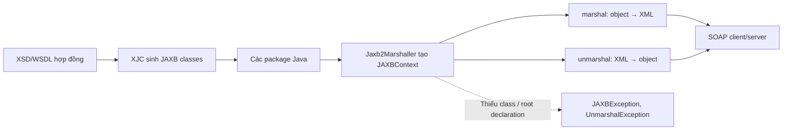
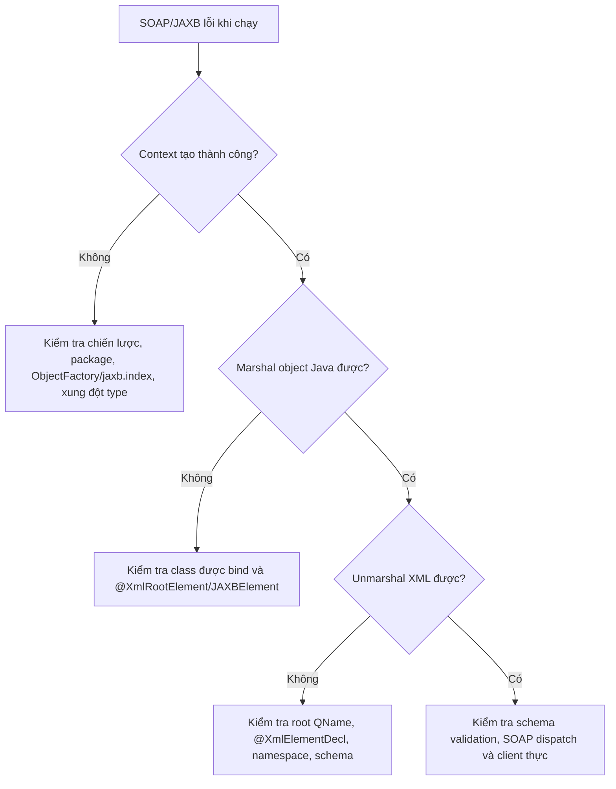

# Chọn phạm vi quét và tránh thiếu lớp trong JAXB context

## 1. Vì sao chọn phạm vi JAXB context là một quyết định quan trọng?

Trong dự án **Spring Web Services (Spring-WS)** theo hướng **contract-first**, XSD và WSDL định nghĩa chính xác những phần tử XML mà client và server được trao đổi. Công cụ sinh JAXB (thường gọi là XJC) biến mô hình XSD thành Java class, sau đó **Spring OXM** (*Object/XML Mapping*) hỗ trợ chuyển đổi giữa object Java và XML:

- **Marshalling:** object Java → XML.
- **Unmarshalling:** XML → object Java.

Để làm được điều đó, JAXB cần một **`JAXBContext`** chứa thông tin về những kiểu Java, root element và metadata ánh xạ liên quan. Trong Spring, `org.springframework.oxm.jaxb.Jaxb2Marshaller` xây dựng và sử dụng context này; cùng một bean có thể đóng vai trò `Marshaller` và `Unmarshaller`.

Một lỗi phổ biến là chọn phạm vi quét (*scan scope*) quá hẹp hoặc đăng ký thiếu lớp:

```text
jakarta.xml.bind.JAXBException:
  class org.example.orders.contract.v1.GetOrderRequestType
  nor any of its super class is known to this context
```

Hoặc XML đến được server nhưng không được nhận diện:

```text
jakarta.xml.bind.UnmarshalException:
  unexpected element (uri:"https://example.org/orders/v1",
                      local:"GetOrderRequest").
  Expected elements are ...
```

Hai lỗi trên có thể liên quan nhưng **không đồng nghĩa**: một lỗi là JAXB context chưa biết **Java class**; lỗi còn lại có thể do context chưa biết **global XML element** hoặc XML mang QName sai.

Trong một dịch vụ SOAP doanh nghiệp, chọn sai context không chỉ gây exception. Nó còn làm chậm khởi động, trộn phiên bản hợp đồng, sinh XML sai namespace, làm client không hiểu response hoặc khiến một cấu hình chạy ở local nhưng lỗi sau khi đóng gói/deploy. Bài này tập trung vào cách xác định phạm vi context đúng, kiểm thử đầy đủ và xử lý tình huống nhiều XSD/package.

### Mục tiêu học tập

Sau bài học, bạn có thể:

1. Giải thích chính xác vai trò của `JAXBContext`, `Jaxb2Marshaller`, `ObjectFactory`, `jaxb.index` và `package-info.java`.
2. Chọn hợp lý giữa `contextPath`, `classesToBeBound` và `packagesToScan`.
3. Tránh thiếu global element, kiểu dùng chung, subtype, enum hoặc package ngoài phạm vi quét.
4. Cấu hình Spring-WS SOAP client và kiểm chứng XML thực tế, kể cả `JAXBElement`.
5. Chẩn đoán lỗi `class is not known to this context`, `unexpected element`, `IllegalAnnotationsException` và xung đột giữa `javax`/`jakarta`.
6. Thiết kế kiểm thử tự động để phát hiện context sai trước khi phát hành.

**Ví dụ xuyên suốt:** một SOAP operation `GetOrder`. Request/response dùng namespace `https://example.org/orders/v1`; XSD tách kiểu nghiệp vụ đơn hàng và kiểu địa chỉ dùng chung, còn JAXB sinh Java model vào hai package tương ứng.

## 2. JAXB context biết những gì và không biết những gì?

### 2.1. Context là tập metadata XML binding

`JAXBContext` được khởi tạo từ tập **class** hoặc **package**. Nó phân tích annotation JAXB để nhận biết:

- Kiểu XML và ánh xạ field/property Java.
- Tên, namespace và cấu trúc phần tử.
- Enum, kiểu kế thừa và các kiểu được tham chiếu theo luật JAXB.
- Khai báo global element qua `@XmlRootElement` hoặc `@XmlElementDecl` trong `ObjectFactory`.
- Adapter ánh xạ kiểu, chẳng hạn `@XmlJavaTypeAdapter`, khi được cấu hình phù hợp.

**Không phải cứ class tồn tại trong classpath thì JAXBContext tự biết class đó.** Tương tự, việc biết class `GetOrderRequestType` không tự bảo đảm context biết root element `{https://example.org/orders/v1}GetOrderRequest` nếu root được khai báo trong `ObjectFactory` mà factory chưa có trong context.



Một JAXB context được cấu hình đúng phải **biết đủ mô hình XML cần trao đổi** và không trộn các kiểu của hợp đồng không tương thích. Nó không nhất thiết phải chứa toàn bộ class trong ứng dụng.

### 2.2. Root element khác Java type

Giả sử XSD có kiểu đặt tên và global element riêng:

```xml
<xs:schema xmlns:xs="http://www.w3.org/2001/XMLSchema"
           xmlns:tns="https://example.org/orders/v1"
           targetNamespace="https://example.org/orders/v1"
           elementFormDefault="qualified">

  <xs:complexType name="GetOrderRequestType">
    <xs:sequence>
      <xs:element name="orderId" type="xs:string"/>
    </xs:sequence>
  </xs:complexType>

  <xs:element name="GetOrderRequest"
              type="tns:GetOrderRequestType"/>
</xs:schema>
```

Tùy cấu hình XJC, Java model có thể bao gồm:

```text
org.example.orders.contract.v1.GetOrderRequestType
org.example.orders.contract.v1.ObjectFactory
org.example.orders.contract.v1.package-info
```

`GetOrderRequestType` thể hiện **kiểu**; `ObjectFactory` có thể chứa method `createGetOrderRequest(...)` được chú thích `@XmlElementDecl`, thể hiện **global element** có QName `{https://example.org/orders/v1}GetOrderRequest`.

Ví dụ sử dụng wrapper do XJC sinh:

```java
GetOrderRequestType value = new GetOrderRequestType();
value.setOrderId("ORD-000123");

ObjectFactory factory = new ObjectFactory();
JAXBElement<GetOrderRequestType> root =
    factory.createGetOrderRequest(value);

ordersMarshaller.marshal(root, new StreamResult(System.out));
```

Kết quả hợp lệ có thể là:

```xml
<ord:GetOrderRequest xmlns:ord="https://example.org/orders/v1">
  <ord:orderId>ORD-000123</ord:orderId>
</ord:GetOrderRequest>
```

Nếu XJC sinh class mang `@XmlRootElement`, thường có thể marshal trực tiếp class đó. Nếu generator dùng `JAXBElement` thì cần wrapper thích hợp. **Không tự suy rằng mọi class JAXB đều có `@XmlRootElement`**.

### 2.3. `package-info.java` và namespace

Package JAXB sinh từ XSD có thể có:

```java
@jakarta.xml.bind.annotation.XmlSchema(
    namespace = "https://example.org/orders/v1",
    elementFormDefault =
        jakarta.xml.bind.annotation.XmlNsForm.QUALIFIED
)
package org.example.orders.contract.v1;
```

Annotation `@XmlSchema` giúp diễn đạt namespace mặc định của kiểu/phần tử thuộc package. Nhưng **`package-info.java` không thay cho `ObjectFactory` hoặc khai báo root element**. Nó cũng không khiến mọi class tùy ý trong package tự được đăng ký nếu context được xây từ tập class khác.

QName phụ thuộc **namespace URI + local name**, không phải cách viết prefix. Kiểm thử XML phải so sánh QName, không so sánh đúng một prefix `ord` hay `ns2` cụ thể.

## 3. Ba lựa chọn chính của `Jaxb2Marshaller`

Spring OXM cung cấp ba cách chọn phạm vi binding thông dụng:

1. `setContextPath(...)` — khai báo **package JAXB** có cơ chế bootstrap của JAXB.
2. `setClassesToBeBound(...)` — khai báo **tập Java class cụ thể**.
3. `setPackagesToScan(...)` — để Spring quét các **package** tìm class có annotation JAXB phù hợp.

Đây là **ba chiến lược thay thế nhau cho một bean**, không nên gọi cả ba setter rồi hy vọng kết quả là hợp của các phạm vi. `Jaxb2Marshaller` kiểm tra cấu hình chiến lược khi khởi tạo; việc trộn nhiều chiến lược có thể dẫn đến lỗi configuration.

| Tiêu chí | `contextPath` | `classesToBeBound` | `packagesToScan` |
|---|---|---|---|
| Đầu vào | Danh sách package theo quy ước JAXB | Danh sách `Class<?>` rõ ràng | Danh sách package để scan |
| Phù hợp | JAXB model do XJC sinh đầy đủ `ObjectFactory`/`jaxb.index` | Mô hình nhỏ hoặc muốn kiểm soát chính xác class | Nhiều class JAXB đã annotate, muốn giảm danh sách thủ công |
| Khả năng bao phủ | Theo package context JAXB có đăng ký thích hợp | Theo class tường minh và quan hệ JAXB có thể truy vết | Theo các class scanner tìm được trong phạm vi package |
| Phụ thuộc `ObjectFactory`/`jaxb.index` | Thường **cần** ít nhất một trong hai trong từng package context | Không cần `jaxb.index` nếu khai báo class trực tiếp; vẫn cần root declaration khi dùng `JAXBElement` | Scanner có thể tìm `@XmlRegistry`/`ObjectFactory` nếu class nằm trong vùng scan |
| Rủi ro | Sai package, package thiếu bootstrap, quên package dùng chung | Bỏ sót root declaration, subtype hoặc kiểu tham gia độc lập | Scan quá hẹp hoặc quá rộng, quét nhầm bản hợp đồng |
| Chi phí/độ rõ ràng | Khởi tạo theo JAXB provider | Tường minh, dễ review | Có chi phí classpath scan và phụ thuộc annotation/đóng gói |

**Khuyến nghị khởi đầu:** nếu XJC sinh đủ `ObjectFactory` trong các package của hợp đồng, `contextPath` là một lựa chọn trực tiếp, dễ đọc. Khi mô hình nhỏ và phải kiểm soát chặt class, dùng `classesToBeBound`. Khi JAXB model phân bố ở nhiều package có annotation rõ ràng và khó liệt kê, dùng `packagesToScan` với vùng quét đủ hẹp.

## 4. Lựa chọn 1: `contextPath` — dựa vào package JAXB

### 4.1. Một package do XJC sinh

Giả sử contract model được sinh tại `org.example.orders.contract.v1` và package có `ObjectFactory`.

```java
import org.springframework.context.annotation.Bean;
import org.springframework.context.annotation.Configuration;
import org.springframework.oxm.jaxb.Jaxb2Marshaller;

@Configuration
public class OrdersOxMConfig {

    @Bean
    public Jaxb2Marshaller ordersMarshaller() {
        Jaxb2Marshaller marshaller = new Jaxb2Marshaller();
        marshaller.setContextPath("org.example.orders.contract.v1");
        return marshaller;
    }
}
```

Khi tạo context theo `contextPath`, JAXB tìm cơ chế khai báo các lớp gắn với package, điển hình là **`ObjectFactory.class` hoặc `jaxb.index`** trong package tương ứng. Nếu đưa tên package Java bất kỳ chưa được chuẩn bị cho JAXB vào `contextPath`, bạn có thể gặp lỗi kiểu:

```text
jakarta.xml.bind.JAXBException:
  "org.example.orders.contract.v1" doesnt contain
  ObjectFactory.class or jaxb.index
```

Lời giải đúng là xác nhận **package sinh từ XSD** và cơ chế JAXB bootstrap có mặt trong output runtime, không phải cứ đổi sang tên package cha sẽ giải quyết được.

### 4.2. Khi dùng nhiều package JAXB

Giả sử một XSD đơn hàng sử dụng kiểu địa chỉ được định nghĩa trong schema dùng chung, XJC sinh:

```text
org.example.orders.contract.v1/
  ObjectFactory.class
  GetOrderRequestType.class
  GetOrderResponseType.class

org.example.shared.contract.v1/
  ObjectFactory.class
  AddressType.class
  CountryCodeType.class
```

Với cách bootstrap theo context path, dùng chuỗi **phân tách bởi dấu hai chấm** theo JAXB:

```java
marshaller.setContextPath(
    "org.example.orders.contract.v1" +
    ":org.example.shared.contract.v1"
);
```

Không dùng dấu chấm phẩy hoặc dấu phẩy để nối package trong `contextPath`. Dấu hai chấm dùng để phân cách các package JAXB context, **không liên quan** đến dấu `:` trong tên namespace URI.

Lưu ý quan trọng:

- Mỗi package tham gia `contextPath` cần đáp ứng quy ước bootstrap của JAXB provider.
- Context path không phải đường dẫn thư mục vật lý như `src/main/java/...`; nó là tên **Java package** có mặt trên runtime classpath.
- Package có tên giống namespace không mặc nhiên hợp lệ; cần kiểm tra package thực sự do XJC sinh.
- Nếu JAXB provider phát hiện xung đột khai báo XML type/element giữa hai package, tăng phạm vi quét **không** sửa được lỗi. Phải phân tích trùng định danh và chiến lược phân vùng context.

### 4.3. Khi nào `contextPath` không phù hợp?

Nếu mô hình JAXB tự viết chỉ có một class `@XmlRootElement` mà không có `ObjectFactory`/`jaxb.index`, việc dùng `setContextPath(...)` có thể không tạo được context theo cách JAXB yêu cầu. Khi đó, `setClassesToBeBound(MyRoot.class)` hoặc `setPackagesToScan(...)` thường đơn giản hơn.

Đừng tự tạo một file `jaxb.index` với danh sách class chưa được kiểm tra chỉ để tránh lỗi startup. Nếu thực sự dùng `jaxb.index`, mỗi dòng phải tham chiếu chính xác class thuộc package và tuân thủ định dạng JAXB; sau đó phải có test marshalling và unmarshalling.

## 5. Lựa chọn 2: `classesToBeBound` — kiểm soát tập class cụ thể

### 5.1. Cấu hình tường minh

Với một mô hình vừa phải, có thể truyền các class cần binding:

```java
@Bean
public Jaxb2Marshaller ordersMarshaller() {
    Jaxb2Marshaller marshaller = new Jaxb2Marshaller();
    marshaller.setClassesToBeBound(
        org.example.orders.contract.v1.ObjectFactory.class,
        org.example.orders.contract.v1.GetOrderRequestType.class,
        org.example.orders.contract.v1.GetOrderResponseType.class,
        org.example.shared.contract.v1.AddressType.class
    );
    return marshaller;
}
```

Đây là **phương án thay thế** đoạn cấu hình ở mục 4.1, không được đăng ký hai bean `ordersMarshaller` cùng tên. Spring chuyển danh sách class này tới cơ chế khởi tạo JAXB context; các kiểu được tham chiếu qua metadata JAXB có thể được suy ra theo quy tắc JAXB, nhưng **không nên giả định mọi lớp độc lập hoặc subtype đều tự được khám phá**.

Trong ví dụ:

- `ObjectFactory` của package orders đăng ký các global element declaration như `GetOrderRequest` nếu XJC sinh root qua `@XmlElementDecl`.
- `GetOrderRequestType` và `GetOrderResponseType` là các kiểu payload.
- `AddressType` được thêm rõ ràng khi cần kiểm soát kiểu dùng chung và tránh phụ thuộc vào suy luận gián tiếp.

Nếu shared package cũng có các global element mà client phải marshal/unmarshal **như root độc lập**, có thể phải đăng ký `org.example.shared.contract.v1.ObjectFactory.class` hoặc các root classes tương ứng. **Bổ sung cả loại Java type và root declaration được dùng thực tế**, thay vì chỉ nhìn vào các field của request.

### 5.2. Những lớp dễ bị bỏ sót

| Nhóm | Ví dụ | Triệu chứng khi thiếu |
|---|---|---|
| **Global element declaration** | `ObjectFactory` với `@XmlElementDecl` | XML root được nhận diện không đúng hoặc JAXBElement không được marshal |
| **Request/response root type** | `GetOrderRequestType`, `GetOrderResponseType` | `class ... is not known to this context` |
| **Kiểu dùng chung** | `AddressType`, `MoneyType` | Lỗi binding khi context cần sử dụng kiểu ngoài phạm vi |
| **Enum** | `OrderStatusType`, `CurrencyCodeType` | Giá trị không ánh xạ hoặc context thiếu thông tin enum khi dùng độc lập |
| **Subtype đa hình** | `DomesticAddressType`, `InternationalAddressType` | Lỗi `xsi:type` hoặc JAXB không nhận diện subtype |
| **Kiểu chỉ xuất hiện ở fault** | `BusinessFaultType` | Client không giải mã được fault detail theo hợp đồng |
| **Header XML có schema riêng** | `CorrelationHeaderType` | SOAP header được xử lý tùy biến nhưng thiếu binding type |

Không phải mọi kiểu trong bảng **chắc chắn** cần được liệt kê riêng: JAXB có thể tự phát hiện các kiểu được tham chiếu qua annotation. Bảng là danh sách các **điểm phải kiểm chứng**. Một type chỉ được sử dụng độc lập hoặc chỉ xuất hiện qua subtype runtime rất dễ bị bỏ sót khi chỉ chạy test happy path.

### 5.3. Trade-off khi cần mở rộng mô hình

Ưu điểm lớn nhất của `classesToBeBound` là **tính tường minh**: khi thêm một global root hoặc subtype, code review thấy ngay phạm vi thay đổi. Nhược điểm là phải cập nhật danh sách khi schema phát triển; nếu bỏ quên lớp mới, ứng dụng có thể khởi động nhưng một operation ít dùng sẽ lỗi khi nhận request.

Để giữ an toàn, hãy biến mọi global request/response/fault/header được công bố trong WSDL thành **test case marshalling và unmarshalling**, thay vì dựa vào cảm giác danh sách class đã đủ.

## 6. Lựa chọn 3: `packagesToScan` — tìm annotated JAXB classes

### 6.1. Cấu hình quét các package cụ thể

Nếu JAXB model nằm trong các package có annotation phù hợp:

```java
@Bean
public Jaxb2Marshaller ordersMarshaller() {
    Jaxb2Marshaller marshaller = new Jaxb2Marshaller();
    marshaller.setPackagesToScan(
        "org.example.orders.contract.v1",
        "org.example.shared.contract.v1"
    );
    return marshaller;
}
```

Spring-WS/Spring OXM sử dụng cơ chế quét classpath để tìm các kiểu có annotation JAXB. Scanner của `Jaxb2Marshaller` nhận diện những annotation có ý nghĩa cho binding như `@XmlRootElement`, `@XmlType`, `@XmlSeeAlso`, `@XmlEnum` và `@XmlRegistry` (tùy phiên bản Spring). Với class do XJC sinh, `ObjectFactory` thường được gắn `@XmlRegistry`.

Điều kiện quan trọng:

1. Các class **đã được biên dịch và nằm trên runtime classpath** khi scanner chạy.
2. Package cấu hình đúng package thật của generated model và vùng cần quét.
3. Generated classes sử dụng hệ annotation **`jakarta.xml.bind`** hoặc **`javax.xml.bind`** phù hợp với phiên bản Spring đang dùng.
4. Những global element được biểu diễn bằng `ObjectFactory`/`@XmlElementDecl` cũng nằm trong phạm vi và được scanner nhận diện.
5. Test thực tế xác minh mọi root QName và subtype cần dùng, kể cả khi context khởi tạo thành công.

**Không đánh đồng quét package với quét XML namespace.** Scanner đọc các Java class; nó không mở WSDL để tìm tất cả các operation rồi tự bổ sung loại thiếu.

### 6.2. Phạm vi quá hẹp

Ví dụ:

```java
marshaller.setPackagesToScan("org.example.orders.contract.v1");
```

Trong khi header hoặc fault DTO độc lập nằm ở `org.example.shared.contract.v1`. Nếu không có đường tham chiếu JAXB phù hợp từ các class đã quét, context có thể không biết kiểu này. Test GetOrder happy path vẫn thành công nhưng request có header mở rộng hoặc fault detail lại thất bại.

Cách xử lý: xác định **toàn bộ package sinh từ các XSD cấu thành hợp đồng**, sau đó thêm package thực sự cần dùng vào `packagesToScan` hoặc chọn chiến lược tường minh hơn. Kiểm thử bằng XML đại diện cho các tình huống từng bị thiếu.

### 6.3. Phạm vi quá rộng

Ví dụ không nên dùng khi repository chứa nhiều phiên bản hợp đồng:

```java
marshaller.setPackagesToScan("org.example");
```

Trong `org.example` có thể có:

```text
org.example.orders.contract.v1
org.example.orders.contract.v2
org.example.payments.contract.v1
org.example.audit.contract
org.example.rest.dto
```

Scan quá rộng làm context khởi tạo chậm, khó review và tăng nguy cơ **xung đột giữa các XML type hoặc element có cùng QName**. Các phiên bản khác nhau có thể dùng namespace khác nhau và chung tên Java, hoặc nguy hiểm hơn, giữ nguyên QName nhưng thay đổi nội dung không tương thích.

**Một thực hành an toàn:** quét hẹp theo *hợp đồng và phiên bản*; ví dụ chỉ `org.example.orders.contract.v1` và các package dùng chung thực sự cần. Không dùng `setPackagesToScan("org")` hoặc `setPackagesToScan("com")` như giải pháp vội cho lỗi thiếu class.

### 6.4. Khi nào nên dùng scanner?

`packagesToScan` hữu ích khi:

- Các class JAXB được viết hoặc sinh theo cấu trúc package rõ ràng nhưng không có một `contextPath` dễ dùng.
- Nhiều kiểu có annotation JAXB và việc liệt kê từng class sẽ quá dài.
- Có test bao phủ toàn bộ request/response/fault để bảo đảm phạm vi scanner đủ.

Nếu đối tác cung cấp một bộ generated XJC package ổn định có `ObjectFactory`, cấu hình `contextPath` thường rõ ràng hơn. Nếu cần quản trị chính xác từng kiểu, `classesToBeBound` phù hợp hơn.

## 7. Một mô hình nhiều XSD: chọn context ra sao?

Giả sử WSDL `OrdersService` nhập hai schema:

```text
orders.xsd       targetNamespace=https://example.org/orders/v1
common.xsd       targetNamespace=https://example.org/common/v1
```

XSD orders có `GetOrderRequest`, `GetOrderResponse` và tham chiếu `AddressType` của common. Kết quả sinh JAXB:

```text
org.example.orders.contract.v1/
  ObjectFactory.java
  GetOrderRequestType.java
  GetOrderResponseType.java
  OrderStatusType.java
  package-info.java

org.example.common.contract.v1/
  ObjectFactory.java
  AddressType.java
  CurrencyType.java
  package-info.java
```

Ở ví dụ này dùng package `org.example.common.contract.v1` (thay cho tên `shared` ở các ví dụ trước), vì tên package phụ thuộc cấu hình sinh mã. **Luôn xác nhận tên package trong output thực tế, đừng suy đoán từ namespace.**

### 7.1. Hai lựa chọn cấu hình đầy đủ, tương đương về mục tiêu

**Phương án A — theo context path:**

```java
Jaxb2Marshaller marshaller = new Jaxb2Marshaller();
marshaller.setContextPath(
    "org.example.orders.contract.v1" +
    ":org.example.common.contract.v1"
);
```

**Phương án B — theo package scanner:**

```java
Jaxb2Marshaller marshaller = new Jaxb2Marshaller();
marshaller.setPackagesToScan(
    "org.example.orders.contract.v1",
    "org.example.common.contract.v1"
);
```

Hai ví dụ là **hai lựa chọn riêng biệt**, không cấu hình cả hai trên cùng một object. Không thể kết luận chúng tạo ra cùng tập metadata trong mọi bộ JAXB classes: vì một phương án dùng **JAXB package bootstrap**, phương án còn lại dùng **Spring classpath scanning**. Cần so sánh kết quả bằng test.

### 7.2. Nếu mỗi operation sử dụng một schema version?

Ví dụ:

- `OrdersV1Client` dùng `orders-v1.wsdl` và package `org.example.orders.contract.v1`.
- `OrdersV2Client` dùng `orders-v2.wsdl` và package `org.example.orders.contract.v2`.

Nên xem xét **hai `Jaxb2Marshaller` bean khác nhau**, mỗi bean quản lý một phiên bản hợp đồng:

```java
@Bean("ordersV1Marshaller")
public Jaxb2Marshaller ordersV1Marshaller() {
    Jaxb2Marshaller m = new Jaxb2Marshaller();
    m.setContextPath("org.example.orders.contract.v1");
    return m;
}

@Bean("ordersV2Marshaller")
public Jaxb2Marshaller ordersV2Marshaller() {
    Jaxb2Marshaller m = new Jaxb2Marshaller();
    m.setContextPath("org.example.orders.contract.v2");
    return m;
}
```

Các `WebServiceTemplate` tương ứng phải inject đúng bean bằng tên/`@Qualifier` và dùng endpoint cùng version. Tách context giúp giảm nguy cơ dùng nhầm JAXB class hoặc XML QName giữa hai version, nhất là khi schema thay đổi phá vỡ hợp đồng.

Không dùng mỗi lần gọi một JAXBContext mới để «tránh va chạm». Khởi tạo context có thể tốn tài nguyên; Spring quản lý `Jaxb2Marshaller` dưới dạng **singleton bean** để tái sử dụng cấu hình và cache JAXBContext.

## 8. Kết nối `Jaxb2Marshaller` với SOAP client Spring-WS

### 8.1. Cấu hình `WebServiceTemplate`

Giả sử `ordersMarshaller` đã được đăng ký bằng **một** trong ba chiến lược ở trên:

```java
import org.springframework.context.annotation.Bean;
import org.springframework.context.annotation.Configuration;
import org.springframework.oxm.jaxb.Jaxb2Marshaller;
import org.springframework.ws.client.core.WebServiceTemplate;

@Configuration
public class OrdersSoapClientConfig {

    @Bean
    public WebServiceTemplate ordersWebServiceTemplate(
            Jaxb2Marshaller ordersMarshaller) {
        WebServiceTemplate template = new WebServiceTemplate();
        template.setMarshaller(ordersMarshaller);
        template.setUnmarshaller(ordersMarshaller);
        template.setDefaultUri("https://partner.example.org/ws/orders");
        return template;
    }
}
```

Endpoint URL là **cấu hình môi trường** và nên được externalize qua `@ConfigurationProperties` trong ứng dụng thật. Nó **không** phải JAXB `contextPath` hay XML namespace. Cấu hình timeout, TLS và SOAP version thuộc message sender/message factory, không được tự động giải quyết nhờ marshaller.

### 8.2. Gửi root qua `JAXBElement`

Với class từ XSD kiểu đặt tên/global element riêng:

```java
GetOrderRequestType request = new GetOrderRequestType();
request.setOrderId("ORD-000123");

ObjectFactory objectFactory = new ObjectFactory();
JAXBElement<GetOrderRequestType> payload =
    objectFactory.createGetOrderRequest(request);

Object result = ordersWebServiceTemplate.marshalSendAndReceive(
    payload,
    new SoapActionCallback("urn:example:orders:GetOrder")
);

GetOrderResponseType response;
if (result instanceof JAXBElement<?> element
        && element.getValue() instanceof GetOrderResponseType value) {
    response = value;
} else {
    throw new IllegalStateException(
        "Unexpected JAXB response type: " +
        (result == null ? "null" : result.getClass().getName()));
}
```

Đoạn này là ví dụ Java 17+ với `instanceof` pattern matching; giả định model XJC sinh `ObjectFactory#createGetOrderRequest(...)` và `JAXBElement` response. Khi class response có `@XmlRootElement`, unmarshal có thể trả trực tiếp `GetOrderResponseType`. Cần kiểm tra cả hai dạng **theo generated classes thực tế**, không coi ví dụ là kiểu trả về luôn đúng.

**Quan trọng:** `SoapActionCallback` dùng SOAP action từ WSDL binding; nó không đăng ký JAXB class và không sửa context. Nếu lỗi `class ... is not known to this context`, sửa phạm vi context/root declaration trước khi điều chỉnh SOAPAction.

### 8.3. Endpoint SOAP không mặc nhiên dùng cùng một bean OXM

Một Spring-WS `@Endpoint` dùng `@RequestPayload`/`@ResponsePayload` có thể được xử lý qua các method argument resolver/return value handler hỗ trợ JAXB, còn `WebServiceTemplate` sử dụng chính `Jaxb2Marshaller` đã cấu hình.

Vì vậy:

- **Tạo bean `Jaxb2Marshaller` cho SOAP client không có nghĩa mọi endpoint server tự động dùng bean đó.**
- Khi endpoint sử dụng JAXB annotations trực tiếp, kiểm tra handler/adapter thực tế được Spring-WS chọn.
- Nếu cần ép endpoint đi qua một OXM marshaller cụ thể, phải cấu hình adapter phù hợp (ví dụ cơ chế marshalling endpoint adapter trong phiên bản Spring-WS dự án) và kiểm thử dispatch.
- Có thể phát sinh tình trạng **client marshal thành công nhưng endpoint không unmarshal được** hoặc ngược lại do hai đường xử lý có context/binding khác nhau.

Kiểm thử đầy đủ phải gồm **client OXM trực tiếp**, **Spring-WS endpoint** và **wire-level SOAP integration**.

## 9. Chẩn đoán thiếu class, thiếu root hoặc sai namespace

Khi gặp lỗi, trước tiên phân biệt **tầng lỗi**:



### 9.1. Bảng lỗi thường gặp

| Thông báo/triệu chứng | Nguyên nhân khả dĩ | Cách xử lý |
|---|---|---|
| `class X nor any of its super class is known to this context` | Java class hoặc subclass runtime chưa nằm trong binding scope | Xác nhận class, `@XmlSeeAlso`/referenced types; bổ sung vào scope nếu cần |
| `doesnt contain ObjectFactory.class or jaxb.index` | `contextPath` trỏ package không có JAXB bootstrap | Xác nhận package sinh bởi XJC; chọn phương án class/scan nếu thích hợp |
| `unable to marshal type ... as an element because it is missing @XmlRootElement` | Chỉ có JAXB **type**, không có root element tương ứng khi marshal trực tiếp | Sử dụng `ObjectFactory` tạo `JAXBElement` hoặc root class có `@XmlRootElement` |
| `unexpected element (uri:"...", local:"...")` | Root QName khác schema hoặc global root declaration không có trong context | Kiểm tra XML namespace/local name, `ObjectFactory/@XmlElementDecl`, context |
| `IllegalAnnotationsException` | Annotation JAXB xung đột/không hợp lệ | Xem toàn bộ nguyên nhân con; sửa generated binding hoặc class model |
| Nhiều element/type trùng QName | Trộn hai schema/version không tương thích trong một context | Tách context, sửa mapping/namespace có kiểm soát |
| Chỉ lỗi trên server production | Class generated không nằm trong packaged JAR, profile hoặc scan scope khác | Kiểm tra build artifact và runtime classpath của môi trường |
| Chỉ lỗi trên Spring Boot mới | Trộn annotation `javax.xml.bind` với `jakarta.xml.bind` | Sinh lại model bằng XJC/runtime phù hợp BOM |
| XML ra có prefix `ns2` thay vì `ord` | JAXB chọn prefix khác nhưng cùng namespace URI | So sánh QName, không so sánh prefix bằng chuỗi cố định |
| XML thiếu optional field | Field Java null hoặc JAXB annotation/schema cho phép vắng mặt | Kiểm tra `minOccurs`/`nillable`/`JAXBElement` và ý nghĩa nghiệp vụ |
| Đổi context scope thì khởi động chậm | Quét quá nhiều package hoặc khởi tạo nhiều context | Thu hẹp scope, dùng singleton beans, đo startup và test |
| XML parse được nhưng sai XSD facets | JAXB unmarshal không tự validate schema trong mọi cấu hình | Bật schema validation riêng và kiểm thử XML negative cases |

### 9.2. Quy trình điều tra thực dụng

1. **Đọc WSDL/XSD nguồn chuẩn:** xác định QName của tất cả request, response, fault và header nghiệp vụ.
2. **Đọc output XJC:** xác định chính xác package, root class, `ObjectFactory`, `@XmlElementDecl`, `package-info` và các kiểu dùng chung.
3. **Xác định bean đang dùng:** client template nào inject marshaller nào; endpoint handler/adapter có dùng JAXB/oxm thế nào.
4. **Kiểm tra một chiến lược cấu hình:** `contextPath`, `classesToBeBound` hoặc `packagesToScan`; tránh trộn nhiều cách.
5. **Khởi tạo context trong test:** phát hiện lỗi package/bootstrap/annotation ngay khi startup.
6. **Marshal và unmarshal từng root:** bao gồm lỗi/fault/header khi có.
7. **Kiểm tra XML bằng XSD:** đánh giá QName, attribute, `xsi:nil`, thứ tự và enum.
8. **Test SOAP qua servlet/HTTP:** phân biệt OXM failure với SOAPAction, endpoint mapping, SOAP version hoặc TLS.

Tránh sửa annotation trong generated class chỉ để che một lỗi context; khi sinh lại XJC, thay đổi đó sẽ biến mất. Nếu cần customize, dùng binding file phù hợp và quản lý nó cùng hợp đồng.

## 10. Kiểm thử fail-fast: xây context trước khi chạy production

### 10.1. Khởi tạo `Jaxb2Marshaller` trong Spring context

Với cấu hình bean thông thường, `Jaxb2Marshaller` có vòng đời Spring khởi tạo JAXB context khi sẵn sàng, trừ khi bạn chọn lazy initialization. Nên ưu tiên kiểm tra ngay lúc startup để tránh một request ít gặp mới lộ lỗi.

Ví dụ test cấu hình:

```java
@SpringBootTest
class OrdersMarshallerContextTest {

    @Autowired
    private Jaxb2Marshaller ordersMarshaller;

    @Test
    void marshallerBeanIsAvailable() {
        assertNotNull(ordersMarshaller);
    }
}
```

Đây chỉ là **smoke test** bảo đảm context Spring tạo được bean; chưa chứng minh tất cả root JAXB hoạt động. Phải bổ sung test marshal/unmarshal thực.

### 10.2. Kiểm tra root QName khi marshal

Ví dụ kiểm tra rằng request tạo ra XML đúng namespace và local name:

```java
@Test
void requestMarshallingKeepsExpectedRootQName() throws Exception {
    GetOrderRequestType value = new GetOrderRequestType();
    value.setOrderId("ORD-000123");

    JAXBElement<GetOrderRequestType> root =
        new ObjectFactory().createGetOrderRequest(value);

    StringResult result = new StringResult();
    ordersMarshaller.marshal(root, result);

    DocumentBuilderFactory factory =
        DocumentBuilderFactory.newInstance();
    factory.setNamespaceAware(true);
    factory.setFeature(
        "http://apache.org/xml/features/disallow-doctype-decl", true);
    factory.setFeature(
        "http://xml.org/sax/features/external-general-entities", false);
    factory.setFeature(
        "http://xml.org/sax/features/external-parameter-entities", false);

    Document document = factory.newDocumentBuilder()
        .parse(new InputSource(new StringReader(result.toString())));

    assertEquals("GetOrderRequest",
                 document.getDocumentElement().getLocalName());
    assertEquals("https://example.org/orders/v1",
                 document.getDocumentElement().getNamespaceURI());
}
```

Ví dụ dùng JUnit 5, `javax.xml.parsers.DocumentBuilderFactory`, `org.w3c.dom.Document`, `org.xml.sax.InputSource`, `java.io.StringReader` và `org.springframework.xml.transform.StringResult`. **DOM parser phải được harden đầy đủ trong ứng dụng thật** (giới hạn DTD/external entity và truy cập tài nguyên ngoài); ví dụ thể hiện các cài đặt cơ bản, không phải cấu hình an toàn toàn diện cho mọi parser/provider.

Không assert XML có đúng prefix `ord`: JAXB có thể chọn `ns2` mà QName vẫn đúng. Kiểm tra bằng DOM/XPath namespace-aware hoặc XMLUnit theo cấu trúc.

### 10.3. Test unmarshalling với XML chuẩn từ hợp đồng

```java
@Test
void responseUnmarshallingRecognizesGlobalElement() {
    String xml = """
        <ord:GetOrderResponse
          xmlns:ord="https://example.org/orders/v1">
          <ord:orderId>ORD-000123</ord:orderId>
          <ord:status>CONFIRMED</ord:status>
        </ord:GetOrderResponse>
        """;

    Object result = ordersMarshaller.unmarshal(
        new StreamSource(new StringReader(xml)));

    assertNotNull(result);
    // Kiểm tra cả lớp trả về (JAXBElement hoặc root class),
    // QName và các field đúng với schema/XJC thực tế.
}
```

Đây là **khung test** cần hoàn thiện theo WSDL/XSD được dùng. Nếu response class có `@XmlRootElement`, kết quả có thể là class đó; nếu global element khai báo qua `ObjectFactory`, kết quả thường là `JAXBElement<GetOrderResponseType>`. Mục tiêu là xác minh **đúng root XML và dữ liệu**, không chỉ `result != null`.

### 10.4. Test cả tập root và subtype

Bộ test nên có ít nhất:

| Dữ liệu kiểm thử | Điều cần chứng minh |
|---|---|
| `GetOrderRequest` | Context nhận global request element; marshal đúng QName |
| `GetOrderResponse` | Context đọc response, enum và field theo XSD |
| Fault detail nghiệp vụ | Kiểu lỗi dùng riêng cũng được bind |
| SOAP Header có kiểu JAXB | Các element header nằm trong scope nếu ứng dụng sử dụng JAXB cho header |
| Kiểu dùng chung từ XSD khác | Không thiếu class/package ngoài đơn hàng |
| Subtype với `xsi:type` | Runtime biết subtype được phép |
| Request sai namespace | Bị phát hiện, không âm thầm ánh xạ nhầm |
| Giá trị enum ngoài contract | Schema validation/client xử lý lỗi rõ ràng |
| Object thuộc version v2 gửi bằng marshaller v1 | Không được serialize thành thông điệp v1 sai hợp đồng |

Một test round-trip (Java → XML → Java) là cần thiết nhưng **chưa đủ**: cả hai chiều có thể cùng chia sẻ một sai lệch nếu dùng chung JAXB model. Cần lấy XML fixture từ hợp đồng hoặc client độc lập và kiểm tra bằng XSD.

## 11. Schema validation và an toàn XML sau khi context đã đúng

`JAXBContext` cung cấp metadata ánh xạ; **nó không đồng nghĩa với một schema validator đầy đủ**. Chẳng hạn, kiểu `xs:string` hạn chế bằng `xs:pattern` trong XSD có thể được JAXB biểu diễn bằng `String`, nhưng JAXB không nhất thiết kiểm tra pattern nếu không bật validation schema.

Với Spring OXM, có thể yêu cầu `Jaxb2Marshaller` sử dụng schema để validate khi marshal/unmarshal:

```java
@Bean
public Jaxb2Marshaller ordersMarshaller() {
    Jaxb2Marshaller marshaller = new Jaxb2Marshaller();
    marshaller.setContextPath(
        "org.example.orders.contract.v1" +
        ":org.example.common.contract.v1");

    marshaller.setSchema(
        new ClassPathResource("xsd/orders.xsd"));
    return marshaller;
}
```

Khi XSD dùng `xs:import`/`xs:include`, phải bảo đảm resource phụ thuộc giải quyết được theo cách đã kiểm soát. Một số hợp đồng cần đăng ký nhiều schema hoặc `LSResourceResolver` thích hợp. Cấu hình schema không sửa lỗi **Java class chưa thuộc context**; phải giải quyết scope trước rồi mới kiểm tra nội dung XML.

Khi triển khai endpoint Spring-WS, `PayloadValidatingInterceptor` là một lựa chọn để kiểm tra **SOAP payload** ở ranh giới server. Nó khác với schema validation của OXM marshaller; cần hiểu đường xử lý nào thực tế đang được dùng để tránh tưởng đã validate nhưng request lại đi qua một adapter khác.

### 11.1. Bảo vệ parser và giới hạn dữ liệu

SOAP là XML đến từ nguồn ngoài, vì vậy cần kiểm soát:

- DTD/external entities, XXE và truy cập tài nguyên ngoài.
- Kích thước XML, độ sâu lồng nhau, số lượng phần tử và tài nguyên xử lý.
- Schema import/include từ nơi không tin cậy hoặc mạng tùy ý.
- Logging payload chứa dữ liệu nhạy cảm, SOAP Security Header và chữ ký.

Spring OXM cung cấp các tùy chọn liên quan như `setSupportDtd(...)` và `setProcessExternalEntities(...)` trên `Jaxb2Marshaller`. Trong ứng dụng nhận XML không tin cậy, **không bật DTD/external entities** trừ khi có yêu cầu đã phân tích và biện pháp bảo vệ tương ứng. Một số XML `Source` do ứng dụng tự tạo có parser riêng, nên phải cấu hình an toàn **ngay ở nguồn tạo parser**, không chỉ ở JAXB marshaller.

Với yêu cầu WS-Security, chữ ký số, chứng chỉ X.509 hay mã hóa SOAP, hãy cấu hình các interceptor/bảo vệ chuyên biệt. JAXB context biết cách ánh xạ XML; nó **không xác thực danh tính người gửi** và không thay thế TLS/WS-Security.

## 12. Hiệu năng, đóng gói và bảo trì context

### 12.1. Khởi tạo context là công việc tốn chi phí

`JAXBContext` phân tích metadata class và tạo binding model. Việc khởi tạo lặp lại cho mỗi SOAP request có thể làm tăng CPU, latency và allocation. Trong Spring:

- Tạo `Jaxb2Marshaller` một lần dưới dạng **singleton bean** cho từng phạm vi hợp đồng cần dùng.
- Để bean/context được khởi tạo và kiểm tra lúc startup khi phù hợp.
- Tránh tạo `new Jaxb2Marshaller()` hay `JAXBContext.newInstance(...)` trong mỗi method xử lý request.
- Không chia sẻ trực tiếp một `jakarta.xml.bind.Marshaller` hoặc `Unmarshaller` stateful tùy ý giữa nhiều thread; `JAXBContext` được thiết kế để tái sử dụng, còn các instance marshaller/unmarshaller cần quản lý lifecycle và concurrency đúng. Spring OXM hỗ trợ mẫu sử dụng bean chung phù hợp.

Với nhiều WSDL/version, tách context theo ranh giới hợp đồng có thể tăng số context nhưng giúp tránh xung đột metadata. Cần cân bằng giữa tài nguyên startup và tính cô lập; đo bằng profiling khi hệ thống thực sự gặp vấn đề.

### 12.2. Kiểm tra generated classes có trong runtime artifact

Một lỗi phổ biến là **build IDE chạy được nhưng JAR/container thiếu lớp**. Chẳng hạn plugin XJC sinh class trong `target/generated-sources` hoặc `build/generated` nhưng chưa được thêm vào source set/compile path đúng cách.

Checklist:

1. XJC/plugin chạy trước compilation và sử dụng đúng phiên bản JAXB.
2. Generated classes được compile thành `.class` và đóng gói vào JAR hoặc dependency đúng.
3. `ObjectFactory.class`, `package-info.class` và các enum/type cần thiết đều có trong runtime classpath.
4. Nếu dùng `jaxb.index`, tài nguyên đó được đóng gói và có đường dẫn/định dạng đúng.
5. Không có hai artifact cùng đưa vào classpath hai phiên bản generated model không tương thích.
6. Spring Boot fat JAR/classloader và container image vẫn cho scanner tìm được annotation classes theo cách cấu hình; xác minh bằng smoke test trên artifact thật.

Không thêm một bước copy file thủ công không được quản lý vào deploy. Sửa cấu hình generator/build để tạo artifact có thể tái lập trên CI.

### 12.3. `javax.xml.bind` và `jakarta.xml.bind`

Spring Boot 3/Spring Framework 6 và Spring-WS 4 sử dụng hệ JAXB **`jakarta.xml.bind`**. Dự án cũ có thể sử dụng **`javax.xml.bind`**. Khi upgrade:

- Chọn XJC/generator sinh annotation phù hợp runtime mới.
- Đổi cả JAXB API, runtime provider và phần thư viện OXM/client/endpoint liên quan.
- Tránh trộn `@javax.xml.bind.annotation.XmlRootElement` với scanner dùng `jakarta.xml.bind.annotation.XmlRootElement`: annotation khác package là **hai loại khác nhau**.
- Thêm test context initialization + marshal/unmarshal sau upgrade.

Không vá lỗi bằng cách import đồng thời cả hai API rồi mong một `JAXBContext` hiểu mọi annotation. Phải chọn stack nhất quán.

## 13. Các quyết định nên ghi rõ trong thiết kế contract-first

Trước khi viết cấu hình JAXB, lập bảng đối chiếu:

| Quyết định | Cần ghi nhận |
|---|---|
| Phiên bản hợp đồng | WSDL/XSD version, namespace và tài liệu được phê duyệt |
| Phạm vi context | Những Java package và class JAXB liên quan |
| Chiến lược | `contextPath`, `classesToBeBound` hoặc `packagesToScan` |
| Cơ chế root | `@XmlRootElement` hay `@XmlElementDecl`/`JAXBElement` |
| Kiểu ngoài package | Shared XSD, fault, SOAP header, subtype |
| Cấu hình generator | XJC version, Java package mapping, binding files, `javax`/`jakarta` |
| Validation | XSD dùng ở OXM, Spring-WS interceptor hoặc cả hai theo đường thực thi |
| Cô lập phiên bản | Có cần nhiều `Jaxb2Marshaller` beans và client templates không |
| Bảo mật XML | Parser hardening, hạn chế external entities, schema resolution |
| Bằng chứng kiểm thử | Root QName, XML fixtures, negative cases, client liên thông |

### Lộ trình kiểm chứng theo từng mốc

```text
M0. Đọc WSDL/XSD và liệt kê các global XML elements
  ↓
M1. Sinh JAXB, xác nhận package + ObjectFactory + @XmlRootElement
  ↓
M2. Chọn một chiến lược JAXB context và tạo singleton marshaller
  ↓
M3. Test marshal/unmarshal từng request, response, fault, header
  ↓
M4. Schema validation với XML fixture độc lập
  ↓
M5. Kết nối WebServiceTemplate / Spring-WS endpoint
  ↓
M6. Test HTTP/SOAP thực, bảo mật và liên thông khác nền tảng
  ↓
M7. CI lưu snapshot WSDL/XSD và phát hiện thay đổi scope sai
```

Nếu một test ở M3 không nhận root element, quay lại M1/M2 thay vì sửa SOAP URL hoặc SOAPAction. Nếu M3 đạt nhưng M4 sai, kiểm tra **schema/contract**; nếu M4 đạt nhưng M5 sai, kiểm tra **endpoint adapter, SOAP binding và application wiring**.

## 14. Bài tập thực hành: từ thiếu class đến cấu hình đúng

Giả sử WSDL có `GetOrder`, JAXB model được sinh thành hai package:

```text
org.example.orders.contract.v1
org.example.common.contract.v1
```

`GetOrderResponseType` tham chiếu `AddressType` nằm ở package common. Hãy thực hiện:

1. **Khởi tạo bản sai có chủ đích:** cấu hình một `Jaxb2Marshaller` chỉ bằng `setClassesToBeBound(GetOrderRequestType.class)`. Thử marshal global root qua `ObjectFactory` và ghi nhận lỗi thực tế; lưu ý lỗi có thể xảy ra ở pha khởi tạo hoặc marshalling tùy các annotation được XJC sinh.
2. **Sửa bằng context path:** chọn hai package có `ObjectFactory` rồi cấu hình chuỗi `orders:common` theo tên package thực. Test marshal request và unmarshal response.
3. **Sửa bằng classesToBeBound:** dùng một bean **khác** với danh sách class/root factory cụ thể, kiểm tra cả fault/header nếu hợp đồng có.
4. **Sửa bằng packagesToScan:** giới hạn vào chính hai package; không quét toàn bộ application.
5. **Kiểm tra QName:** XML marshal phải có namespace `https://example.org/orders/v1` và local name `GetOrderRequest` bất kể prefix.
6. **Kiểm tra schema:** tạo response có status không hợp lệ hoặc thiếu phần tử bắt buộc và xác minh XSD validation từ chối.
7. **Kiểm tra subtype và XML root độc lập:** thêm test cho kiểu chỉ xuất hiện trong fault hoặc header, không chỉ GetOrder happy path.
8. **Kiểm tra đóng gói:** chạy test trên artifact tương tự production, đảm bảo generated model có trong classpath.
9. **Tách version:** tạo marshaller riêng cho `v2`, chứng minh code không dùng nhầm v1/v2.

### Câu hỏi tự kiểm tra

1. Vì sao `GetOrderRequestType.class` đã tồn tại trong classpath mà `JAXBContext` vẫn có thể báo «not known to this context»?
2. Khi nào cần `JAXBElement<GetOrderRequestType>` thay vì marshal trực tiếp request class?
3. Vì sao `contextPath` trỏ một package thiếu `ObjectFactory` và `jaxb.index` có thể không khởi tạo?
4. `packagesToScan` khác `contextPath` về cơ chế khám phá class như thế nào?
5. Khi XSD import một schema dùng chung, có nhất thiết mọi shared class đều phải được liệt kê thủ công không? Bạn sẽ xác minh cách JAXB nhận diện chúng bằng test nào?
6. Vì sao không nên quét `org.example` nếu ứng dụng có cả contract v1 và v2?
7. Vì sao XML có prefix `ns2` vẫn có thể đúng hợp đồng nếu QName đúng?
8. Tại sao context khởi tạo thành công không chứng minh mọi facet XSD đều được kiểm tra?
9. Vì sao một bean `Jaxb2Marshaller` dùng trong `WebServiceTemplate` không tự bảo đảm endpoint server dùng cùng context đó?

## 15. Definition of Done và tài liệu tham khảo

Trước khi bàn giao phần OXM/JAXB của một dịch vụ SOAP doanh nghiệp, xác nhận:

- [ ] XSD/WSDL và tập global request/response/fault/header được quản lý theo phiên bản rõ ràng.
- [ ] Generated JAXB model có đầy đủ `ObjectFactory`, `package-info`, classes và dependencies cần dùng.
- [ ] Mỗi `Jaxb2Marshaller` chọn **một** chiến lược xác định phạm vi; vùng quét đủ cho hợp đồng và không trộn version.
- [ ] Root element được xử lý đúng bằng `@XmlRootElement` hoặc `JAXBElement`/`ObjectFactory`.
- [ ] Test marshalling/unmarshalling bao phủ các root, kiểu dùng chung, enum, header/fault và subtype cần thiết.
- [ ] XML fixtures validate theo XSD; kiểm tra QName/namespace và cấu trúc, không phụ thuộc prefix.
- [ ] SOAP client và server endpoint được kiểm thử theo đường thực tế với cấu hình binding tương ứng.
- [ ] Runtime build chứa đủ generated classes, sử dụng một hệ `javax` hoặc `jakarta` nhất quán.
- [ ] XML parser được harden; không coi JAXB context là lớp xác thực hay bảo vệ WS-Security.
- [ ] CI phát hiện lỗi context, thay đổi schema/version và sai khác khi sinh mã.

### Tài liệu tham khảo

- [Spring Framework — Marshalling XML using O/X Mappers](https://docs.spring.io/spring-framework/reference/data-access/oxm.html): khái niệm OXM, marshaller và unmarshaller.
- [Spring Framework — `Jaxb2Marshaller` API](https://docs.spring.io/spring-framework/docs/current/javadoc-api/org/springframework/oxm/jaxb/Jaxb2Marshaller.html): các phương thức `setContextPath`, `setClassesToBeBound`, `setPackagesToScan`, schema validation và an toàn XML.
- [Jakarta XML Binding Specification](https://jakarta.ee/specifications/xml-binding/): `JAXBContext`, `JAXBElement`, `ObjectFactory` và các quy tắc ánh xạ XML Schema/Java.
- [Spring Web Services — Reference Documentation](https://docs.spring.io/spring-ws/docs/current/reference/html/): JAXB, SOAP client, endpoint, contract-first và validation.
- [W3C — XML Schema Part 1](https://www.w3.org/TR/xmlschema-1/) và [Part 2](https://www.w3.org/TR/xmlschema-2/): kiểu dữ liệu, global element, namespace và validation.
- [W3C — WSDL 1.1](https://www.w3.org/TR/wsdl.html): cách message/part tham chiếu XSD global elements trong hợp đồng SOAP.

**Điểm cần ghi nhớ:** `JAXBContext` phải chứa **đúng phạm vi kiểu Java và khai báo root XML của hợp đồng**, không chỉ một class tình cờ chạy được ở happy path. Chọn `contextPath`, `classesToBeBound` hay `packagesToScan` theo cấu trúc model thực tế, rồi dùng test QName, schema và SOAP integration để chứng minh mọi thông điệp đều được xử lý đúng.
