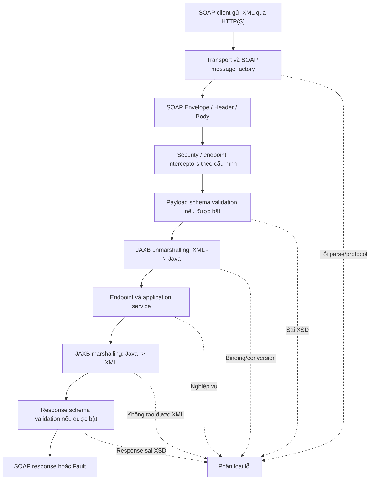

# Validation khi ánh xạ và phân loại lỗi chuyển đổi XML

Trong dịch vụ SOAP phát triển theo hướng **contract-first**, hệ thống nhận XML từ một ứng dụng khác, chuyển dữ liệu thành đối tượng Java để xử lý nghiệp vụ, rồi chuyển kết quả Java trở lại XML. Quá trình này gọi là **unmarshalling** và **marshalling**. Nếu không kiểm soát bước ánh xạ và validation, một request sai hợp đồng có thể lọt vào tầng nghiệp vụ; ngược lại, server có thể trả một response không đúng XSD khiến client của đối tác không đọc được.

Bài học thuộc chương **Marshalling và OXM** trong Spring Web Services (Spring-WS). Trọng tâm là **validation khi ánh xạ** và **phân loại lỗi chuyển đổi XML**: phân biệt lỗi cú pháp, lỗi SOAP, lỗi schema, lỗi JAXB/OXM, lỗi nghiệp vụ và lỗi bảo mật; cấu hình `Jaxb2Marshaller` và interceptor; thiết kế SOAP Fault; kiểm tra cả chiều request lẫn response. Những kiến thức này kết nối trực tiếp với XSD/WSDL, JAXB, SOAP endpoint/client, XML security, WS-Security và kiểm thử tương thích giữa các hệ thống doanh nghiệp.

## 1. Marshalling, unmarshalling và validation là các công việc khác nhau

**Marshalling** chuyển một mô hình Java (ví dụ `SubmitOrderResponse`) thành tài liệu hoặc phần tử XML. **Unmarshalling** đọc XML và tạo mô hình Java (ví dụ `SubmitOrderRequest`). **OXM** (*Object/XML Mapping*) là nhóm cơ chế trừu tượng giúp hai chiều chuyển đổi trên, với Spring OXM cung cấp các interface `Marshaller`, `Unmarshaller` và implementation `Jaxb2Marshaller`.

Validation là việc đánh giá dữ liệu theo tập quy tắc. Có ít nhất bốn nhóm:

| Lớp kiểm tra | Điều được kiểm tra | Lỗi điển hình |
| --- | --- | --- |
| **Well-formed XML** | XML có đúng cú pháp, đóng/mở thẻ và khai báo namespace | Thiếu thẻ đóng, ký tự `&` không escape |
| **SOAP structure/protocol** | Có Envelope/Body đúng SOAP version và cấu trúc giao thức | Sai namespace Envelope, Body không hợp lệ |
| **XSD/schema validation** | Payload có đúng QName, thứ tự, trường bắt buộc, kiểu dữ liệu và ràng buộc schema | Thiếu `orderId`, `amount` âm, enum không hợp lệ |
| **Business validation** | Dữ liệu đúng hình dạng có thỏa quy tắc nghiệp vụ và trạng thái hệ thống? | Đơn hàng không tồn tại, thanh toán vượt hạn mức |

Ngoài ra, dịch vụ có thể yêu cầu **security validation**: TLS, xác thực token, chữ ký XML, timestamp, chứng chỉ, quyền thao tác. Một XML hợp lệ theo XSD không tự động vượt qua WS-Security, cũng như một chữ ký hợp lệ không chứng minh dữ liệu hợp lệ về kiểu hoặc nghiệp vụ.

Ví dụ `<ord:amount>-10</ord:amount>` là XML đúng cú pháp; JAXB có thể đọc được giá trị `BigDecimal(-10)`; nhưng XSD đặt `minExclusive=0` phải từ chối nó. Một số lỗi kiểu dữ liệu có thể xuất hiện ngay lúc JAXB chuyển giá trị, nhưng **không được xem khả năng unmarshal thành công là bằng chứng đã validate đầy đủ theo XSD**.

## 2. Các vị trí xảy ra lỗi trong luồng Spring-WS

Với endpoint Spring-WS sử dụng JAXB, luồng xử lý điển hình như sau:



Sơ đồ là mô hình khái niệm: **thứ tự thực tế phụ thuộc vào interceptor, endpoint adapter và cấu hình bảo mật**. Chẳng hạn, một `PayloadValidatingInterceptor` dùng để kiểm tra request có thể chạy trước khi endpoint method được gọi; một marshaller gắn `Schema` cũng có thể báo lỗi trong lúc unmarshal/marshal. SOAP message có cấu trúc hỏng có thể thất bại ngay khi message factory đọc stream, trước khi XML payload đến được JAXB.

Trong contract-first:

1. **XSD** định nghĩa payload được phép.
2. **WSDL** dùng các phần tử XSD trong message/operation và công bố SOAP binding.
3. **JAXB/XJC** sinh kiểu Java và thông tin ánh xạ theo XSD.
4. **Spring-WS** xử lý SOAP transport, chọn endpoint, chuyển đổi payload và phản hồi.
5. **Validation và error mapping** giữ cho message trên wire tuân thủ hợp đồng, đồng thời cung cấp lỗi có thể hiểu được cho đối tác.

## 3. XSD mẫu: các ràng buộc mà JAXB đơn thuần có thể bỏ sót

Giả sử SOAP service nhận yêu cầu gửi đơn hàng. Hợp đồng dùng namespace `https://example.com/orders/v1` và quy định:

- `orderId` theo mẫu `ORD-` và bốn chữ số.
- `amount` là số thập phân **lớn hơn 0**.
- `currency` chỉ được nhận `VND` hoặc `USD`.
- `customerNote` có thể vắng mặt; nếu xuất hiện thì là chuỗi ký tự, không cho phép `xsi:nil`.

Tệp `orders.xsd` có thể được thiết kế:

```xml
<?xml version="1.0" encoding="UTF-8"?>
<xs:schema xmlns:xs="http://www.w3.org/2001/XMLSchema"
           xmlns:ord="https://example.com/orders/v1"
           targetNamespace="https://example.com/orders/v1"
           elementFormDefault="qualified">

    <xs:simpleType name="OrderIdType">
        <xs:restriction base="xs:string">
            <xs:pattern value="ORD-[0-9]{4}"/>
        </xs:restriction>
    </xs:simpleType>

    <xs:simpleType name="PositiveAmount">
        <xs:restriction base="xs:decimal">
            <xs:minExclusive value="0"/>
        </xs:restriction>
    </xs:simpleType>

    <xs:simpleType name="CurrencyCode">
        <xs:restriction base="xs:string">
            <xs:enumeration value="VND"/>
            <xs:enumeration value="USD"/>
        </xs:restriction>
    </xs:simpleType>

    <xs:element name="SubmitOrderRequest">
        <xs:complexType>
            <xs:sequence>
                <xs:element name="orderId" type="ord:OrderIdType"/>
                <xs:element name="amount" type="ord:PositiveAmount"/>
                <xs:element name="currency" type="ord:CurrencyCode"/>
                <xs:element name="customerNote"
                            type="xs:string" minOccurs="0"/>
            </xs:sequence>
        </xs:complexType>
    </xs:element>

    <xs:element name="SubmitOrderResponse">
        <xs:complexType>
            <xs:sequence>
                <xs:element name="confirmationId" type="xs:string"/>
                <xs:element name="accepted" type="xs:boolean"/>
            </xs:sequence>
        </xs:complexType>
    </xs:element>
</xs:schema>
```

XML request hợp lệ:

```xml
<ord:SubmitOrderRequest xmlns:ord="https://example.com/orders/v1">
    <ord:orderId>ORD-0027</ord:orderId>
    <ord:amount>125.50</ord:amount>
    <ord:currency>USD</ord:currency>
</ord:SubmitOrderRequest>
```

Các biến thể sau **không hợp lệ theo XSD**, dù nhiều trường hợp vẫn well-formed:

| Dữ liệu | Ràng buộc vi phạm |
| --- | --- |
| `<ord:orderId>27</ord:orderId>` | Không khớp `xs:pattern` |
| `<ord:amount>-1</ord:amount>` | Vi phạm `xs:minExclusive` |
| `<ord:amount>abc</ord:amount>` | Không phải lexical value hợp lệ của `xs:decimal` |
| `<ord:currency>EUR</ord:currency>` | Ngoài `xs:enumeration` |
| Bỏ `ord:currency` | `minOccurs` mặc định là 1 |
| Đặt `ord:currency` trước `ord:amount` | Không đúng `xs:sequence` |
| `<ord:customerNote xsi:nil="true"/>` | `nillable` mặc định là `false` |
| Dùng `<other:amount>` thay `<ord:amount>` | QName/namespace không khớp |

Ví dụ này giúp tách **lỗi schema** ra khỏi **lỗi ánh xạ**: với `amount=-1`, JAXB hoàn toàn có thể chuyển thành `BigDecimal` trước khi biết giá trị vi phạm `minExclusive`; với `amount=abc`, một trình unmarshalling có thể phát ra lỗi chuyển kiểu ngay cả khi chưa có schema validation. Vì vậy loại exception phát sinh không nhất thiết đồng nhất với bản chất lỗi dữ liệu.

## 4. Validation ở chiều unmarshal và marshal

Một ứng dụng có thể kiểm tra ở hai chiều:

**Inbound — XML → Java**

1. Đọc HTTP và SOAP Envelope.
2. Phân tích XML an toàn.
3. Kiểm tra payload theo XSD.
4. Unmarshal thành request object.
5. Kiểm tra điều kiện nghiệp vụ và gọi service.

**Outbound — Java → XML**

1. Application service tạo response object.
2. Marshal thành XML với JAXB.
3. Kiểm tra XML response theo XSD.
4. Đóng gói SOAP response và gửi về client.

Hai điểm kiểm tra không nhất thiết bắt buộc phải dùng **cùng một cơ chế**. Ví dụ, một nhóm cấu hình schema validation trực tiếp trên JAXB, nhóm khác dùng `PayloadValidatingInterceptor` của Spring-WS. Có thể phối hợp cả hai, nhưng cần xác định rõ mục đích để tránh validation lặp lại tốn chi phí mà không tăng tính an toàn.

| Câu hỏi | Request validation | Response validation |
| --- | --- | --- |
| Ai kiểm soát nguồn dữ liệu? | Client bên ngoài, mức tin cậy thấp hơn | Code server và kết quả nghiệp vụ |
| Mục tiêu chính | Ngăn dữ liệu sai hợp đồng vào service | Tránh gửi dữ liệu sai hợp đồng cho đối tác |
| Lỗi thường gặp | Thiếu field, sai kiểu, sai namespace | Thiếu field bắt buộc, enum chưa đồng bộ, giá trị null không hợp lệ |
| Cách xử lý đối ngoại | Fault phản ánh request không hợp lệ | Fault server hoặc lỗi nội bộ được kiểm soát |
| Mức độ ưu tiên | Rất cao ở biên API | Cao khi xuất bản contract có nhiều client |

**Lưu ý về default và nil:** XSD có thể dùng `minOccurs=0`, `default` và `nillable`. Khi một phần tử vắng mặt, schema validator không tự tạo phần tử thiếu chỉ vì có `default` của element. JAXB mapping cũng có thể gộp hai trạng thái `absent` và `xsi:nil` vào cùng giá trị Java `null`, tùy binding. Nếu nghiệp vụ cần phân biệt, phải thiết kế mô hình và kiểm thử kết quả unmarshalling thực tế.

## 5. Cấu hình `Jaxb2Marshaller` với schema validation

Trong Spring OXM, `Jaxb2Marshaller` là adapter của JAXB. Nó có thể biết các class theo `contextPath`, danh sách `classesToBeBound` hoặc cấu hình khác được hỗ trợ. Để yêu cầu JAXB kiểm tra theo XSD khi chuyển đổi, cung cấp **schema resource** phù hợp.

Ví dụ Spring configuration (giả sử đã có JAXB classes sinh từ `orders.xsd` trong package `com.acme.orders.ws`):

```java
import org.springframework.context.annotation.Bean;
import org.springframework.context.annotation.Configuration;
import org.springframework.core.io.ClassPathResource;
import org.springframework.oxm.jaxb.Jaxb2Marshaller;

@Configuration
public class OrdersOxmConfiguration {

    @Bean
    public Jaxb2Marshaller ordersMarshaller() {
        Jaxb2Marshaller marshaller = new Jaxb2Marshaller();
        marshaller.setContextPath("com.acme.orders.ws");

        // Cho phép JAXB kiểm tra nội dung theo XSD
        // khi unmarshal/marshal thông qua marshaller này.
        marshaller.setSchema(
                new ClassPathResource("xsd/orders.xsd"));

        return marshaller;
    }
}
```

Đặt tệp schema trong `src/main/resources/xsd/orders.xsd` để nó được đóng gói vào classpath. `ClassPathResource` giúp Spring sử dụng tài nguyên ngay cả khi chạy từ JAR; không nên tự đổi sang `resource.getFile()` nếu ứng dụng có thể chạy trong executable JAR.

**Điều kiện quan trọng:** Ví dụ này chỉ thể hiện cấu hình bean. Để có hiệu lực, SOAP client hoặc endpoint adapter phải **thực sự sử dụng** bean `ordersMarshaller`. Nếu một đường xử lý khác tạo `JAXBContext` hoặc `Unmarshaller` riêng mà không gắn schema, luồng đó có thể không validate.

### Khi XSD có `xs:include` hoặc `xs:import`

Nếu `orders.xsd` tham chiếu `common-types.xsd`, việc nạp schema phải giải quyết được đường dẫn và namespace. Giữ cấu trúc tài nguyên tương đối đúng hoặc cấu hình `LSResourceResolver`/XML Catalog phù hợp. `Jaxb2Marshaller` cung cấp cơ chế cấu hình schema resource và resource resolver tùy phiên bản thư viện; cần kiểm tra đường dẫn import trong **artifact đã đóng gói**, không chỉ trong IDE.

Không nên cung cấp một danh sách XSD bất kỳ vào `setSchemas(...)` chỉ để “chữa” lỗi tham chiếu. Nếu một XSD đã import schema khác và các schema được nạp lặp hoặc có định nghĩa trùng, kết quả có thể còn phức tạp hơn. Hãy biên dịch schema entrypoint độc lập, sau đó cấu hình marshaller theo đúng đồ thị XSD.

### Validation event handler của JAXB

JAXB có cơ chế `ValidationEventHandler` để quyết định dừng hay tiếp tục khi phát hiện sự kiện validation. Ví dụ lựa chọn chính sách **dừng với lỗi** (mã ý tưởng dành cho Jakarta JAXB):

```java
import jakarta.xml.bind.ValidationEvent;
import jakarta.xml.bind.ValidationEventHandler;

ValidationEventHandler strictHandler = event -> {
    // Có thể ghi log mức cảnh báo với dữ liệu đã được lọc.
    if (event.getSeverity() == ValidationEvent.WARNING) {
        return true;
    }
    // ERROR hoặc FATAL_ERROR: dừng quá trình chuyển đổi.
    return false;
};

marshaller.setValidationEventHandler(strictHandler);
```

Trong code trên, `marshaller` là `Jaxb2Marshaller` ở ví dụ Spring config; cả đoạn được đặt trong ngữ cảnh cấu hình bean tương ứng. Đây là **chính sách minh họa**: một số cảnh báo vẫn có thể đòi hỏi từ chối theo yêu cầu nghiệp vụ. Tuyệt đối không cài handler luôn trả `true` chỉ để “bỏ qua lỗi XSD”, vì đối tượng Java tạo ra có thể không phù hợp với hợp đồng.

Một event handler không thay thế schema validation. Muốn kiểm tra `minExclusive`, `pattern`, `xs:sequence` và enum theo XSD, marshaller/unmarshaller phải được gắn schema hoặc phải có một bước validator độc lập.

## 6. Kiểm tra payload bằng Spring-WS interceptor

Spring-WS hỗ trợ `PayloadValidatingInterceptor` để kiểm tra payload của SOAP message theo XSD. Đây là lớp kiểm tra theo **message boundary** và không phụ thuộc vào việc endpoint sau đó ánh xạ payload bằng JAXB hay xử lý `Source` thủ công.

Ví dụ cấu hình:

```java
import org.springframework.context.annotation.Bean;
import org.springframework.context.annotation.Configuration;
import org.springframework.core.io.ClassPathResource;
import org.springframework.xml.xsd.SimpleXsdSchema;
import org.springframework.xml.xsd.XsdSchema;
import org.springframework.ws.soap.server.endpoint.interceptor.PayloadValidatingInterceptor;

@Configuration
public class OrdersValidationBeans {

    @Bean
    public XsdSchema ordersSchema() {
        return new SimpleXsdSchema(
                new ClassPathResource("xsd/orders.xsd"));
    }

    @Bean
    public PayloadValidatingInterceptor payloadValidator(
            XsdSchema ordersSchema) {
        PayloadValidatingInterceptor validator =
                new PayloadValidatingInterceptor();
        validator.setXsdSchema(ordersSchema);
        validator.setValidateRequest(true);
        validator.setValidateResponse(true);
        return validator;
    }
}
```

Để interceptor chạy trên message flow, cần **đăng ký** nó trong cấu hình endpoint interceptors của Spring-WS, thường thông qua `WsConfigurer#addInterceptors`:

```java
import java.util.List;
import org.springframework.context.annotation.Configuration;
import org.springframework.ws.config.annotation.EnableWs;
import org.springframework.ws.config.annotation.WsConfigurer;
import org.springframework.ws.server.EndpointInterceptor;
import org.springframework.ws.soap.server.endpoint.interceptor.PayloadValidatingInterceptor;

@EnableWs
@Configuration
public class OrdersWsConfig implements WsConfigurer {
    private final PayloadValidatingInterceptor validator;

    public OrdersWsConfig(PayloadValidatingInterceptor validator) {
        this.validator = validator;
    }

    @Override
    public void addInterceptors(List<EndpointInterceptor> interceptors) {
        interceptors.add(validator);
    }
}
```

Với cấu hình phù hợp, request sai XSD có thể bị chặn **trước** endpoint nghiệp vụ. Response validation giúp phát hiện lỗi khi server vô ý tạo XML không khớp contract. Cần kiểm thử cách interceptor tạo SOAP Fault và mức độ log theo phiên bản Spring-WS đang sử dụng.

### Chọn kiểm tra ở đâu?

| Cách làm | Điểm mạnh | Điều cần lưu ý |
| --- | --- | --- |
| JAXB được gắn `Schema` | Chặn lỗi trong đường marshal/unmarshal đi qua JAXB | Không bao phủ những đường xử lý XML khác không dùng bean này |
| `PayloadValidatingInterceptor` | Bao phủ SOAP payload tại biên endpoint; độc lập binding Java | Phải đăng ký interceptor và quản lý XSD đúng |
| JAXP `SchemaFactory` + `Validator` riêng | Kiểm tra contract và XML mẫu độc lập, hữu ích cho CI | Cần cung cấp base URI và chính sách parser an toàn |
| Bean Validation trên Java object | Kiểm tra ràng buộc nghiệp vụ/app như `@NotNull`, `@Positive` | Không thay thế QName, thứ tự element hoặc `xsi:nil` của XSD |

Đối với dịch vụ có dữ liệu đầu vào từ bên ngoài, **validation theo XSD tại biên** giúp đảm bảo hợp đồng độc lập với việc JAXB mapping thay đổi. Có thể thêm kiểm tra tại marshaller để phát hiện lỗi trong các đường chuyển đổi khác hoặc ở client. Nhưng nếu cấu hình cả hai, nên quan sát hiệu năng và thiết kế lỗi để tránh ghi log trùng hoặc chuyển đổi một lỗi validation thành hai SOAP Fault khác nhau.

## 7. Phân loại lỗi XML bằng nguyên nhân thay vì tên exception duy nhất

Một exception như `UnmarshallingFailureException` chỉ cho biết **bước unmarshal đã thất bại**. Nguyên nhân sâu hơn có thể là XML malformed, QName sai, kiểu dữ liệu không chuyển được hoặc XSD validation. Vì vậy nên ghi nhận cả **vị trí trong pipeline** và **root cause**.

| Nhóm lỗi | Nơi thường phát hiện | Dấu hiệu / exception có thể gặp | Cách xử lý |
| --- | --- | --- | --- |
| **Transport/HTTP** | HTTP client/server, TLS, proxy | Timeout, kết nối bị từ chối, TLS handshake fail | Xử lý theo tầng kết nối, không mặc định biến thành SOAP Fault |
| **XML cú pháp** | XML parser/SOAP message factory | `SAXParseException`, XMLStreamException hoặc exception parser khác | Từ chối thông điệp không đọc được; tránh chạy nghiệp vụ |
| **SOAP protocol** | SOAP message factory/dispatcher | Namespace Envelope sai, Body không hợp lệ, version mismatch | Phân loại lỗi SOAP/protocol, trả Fault khi có thể |
| **Schema compilation** | Nạp XSD, `SchemaFactory`, khởi tạo marshaller | Import không tìm thấy, QName kiểu sai, XSD không hợp lệ | Lỗi cấu hình/triển khai, phát hiện khi startup/CI |
| **Instance XSD validation** | Validator, JAXB đã gắn schema, interceptor | Thiếu field, sai `xs:sequence`, `minExclusive`, enum | Client/request fault cho request sai; server error cho response sai |
| **Unmarshal/mapping** | JAXB → Spring OXM | `UnmarshallingFailureException`, JAXB `UnmarshalException` | Kiểm tra event/cause, binding và QName; không đoán là lỗi người dùng |
| **Marshal/mapping** | Java → JAXB → XML | `MarshallingFailureException`, JAXB `MarshalException` | Kiểm tra response model, root element, `JAXBElement`, annotation |
| **Java object validation** | Bean Validation/application service | `ConstraintViolationException` hoặc lỗi domain | Phân biệt lỗi nghiệp vụ với lỗi contract |
| **Security** | TLS/WS-Security interceptor | Chữ ký sai, chứng chỉ không tin cậy, timestamp hết hạn | Xử lý theo security policy, tránh lộ thông tin nhạy cảm |
| **Response contract** | Outbound validator | Java response thiếu field khi marshal, XML sai XSD | Sửa server; không gán lỗi cho request hợp lệ |

**Không bảo đảm một lỗi tương ứng đúng một loại exception.** Spring OXM có hệ thống exception chuyển đổi lỗi JAXB thành `XmlMappingException` và các subclass như `UnmarshallingFailureException`/`MarshallingFailureException`, nhưng lỗi XML có thể đã được phát hiện trước ở SOAP parser. Các phiên bản thư viện và adapter có thể phát sinh hoặc bọc lỗi theo cách khác.

### Tại sao phải đi theo chuỗi nguyên nhân?

Giả sử log có:

```text
org.springframework.oxm.UnmarshallingFailureException:
    JAXB unmarshalling exception
Caused by: jakarta.xml.bind.UnmarshalException
Caused by: org.xml.sax.SAXParseException:
    cvc-minExclusive-valid: Value '-10' is not facet-valid
```

Ví dụ log được **minh họa**, không phải chuỗi bắt buộc ở mọi JAXB implementation. Nếu chỉ bắt `UnmarshallingFailureException`, người lập trình có thể quy kết sai là lỗi annotation JAXB; trong khi `SAXParseException` phía dưới chỉ ra dữ liệu vi phạm schema.

Hãy lưu thông tin đủ để điều tra:

1. **Operation và QName payload** (namespace URI + local name), không chỉ Java class.
2. **Bước thất bại**: parse SOAP, validate, unmarshal, nghiệp vụ, marshal, validate response.
3. **Tên exception và root cause**, thông báo đã được lọc nội dung nhạy cảm.
4. **Vị trí XML** (line/column nếu parser cung cấp) và đường dẫn trường nếu có.
5. **Version hợp đồng/schema** đang dùng và correlation ID của request.

Không log toàn bộ SOAP Body chứa dữ liệu cá nhân, token, chữ ký hoặc thông tin thanh toán chỉ vì cần tìm lỗi chuyển đổi XML.

## 8. Những lỗi chuyển đổi JAXB thường gặp

### 8.1. Root element không đúng hoặc thiếu annotation

Nếu schema có global element `SubmitOrderRequest` nhưng code marshal một object không có `@XmlRootElement` phù hợp, JAXB có thể không biết QName của root. Khi đó cần sử dụng factory method/JAXBElement được sinh bởi XJC khi binding yêu cầu:

```java
// Ví dụ minh họa, API chính xác phụ thuộc model JAXB được sinh.
SubmitOrderRequest request = new SubmitOrderRequest();
request.setOrderId("ORD-0027");
request.setAmount(new java.math.BigDecimal("125.50"));

// Khi ObjectFactory có phương thức tương ứng:
ObjectFactory factory = new ObjectFactory();
JAXBElement<SubmitOrderRequest> root =
        factory.createSubmitOrderRequest(request);
```

Đoạn code là **trường hợp minh họa có `ObjectFactory` trả `JAXBElement`**. Với global element có anonymous complex type, XJC có thể sinh class mang `@XmlRootElement` và cho phép marshal trực tiếp; với một global element tham chiếu named complex type, `JAXBElement` thường cần được cân nhắc. Hãy kiểm tra lớp/annotation thực tế, không sửa XSD chỉ để chữa lỗi marshal root.

### 8.2. Không khớp namespace hoặc tên phần tử

```xml
<!-- Sai namespace nghiệp vụ, dù local name giống hệt -->
<ord:SubmitOrderRequest
    xmlns:ord="https://example.com/orders/v2">
    ...
</ord:SubmitOrderRequest>
```

Nếu endpoint đang dùng `@PayloadRoot(namespace="https://example.com/orders/v1", localPart="SubmitOrderRequest")`, payload ở `v2` có thể không được chọn đúng handler **trước cả bước JAXB**. Một số trường hợp khác có thể đi đến unmarshal nhưng tạo lỗi tên phần tử không mong đợi. Cần kiểm tra QName trong SOAP Body, WSDL/XSD đang công bố và schema tương ứng của client.

### 8.3. Chuỗi không chuyển được sang kiểu Java

Trong XML, nội dung phần tử là chuỗi ký tự; JAXB phải ánh xạ `xs:decimal` sang kiểu Java như `BigDecimal`. Giá trị `abc` không phải số thập phân hợp lệ. Tùy cách JAXB runtime xử lý validation events, unmarshal có thể báo exception hoặc không tạo được giá trị như mong muốn. Cần kiểm tra cả XSD và đối tượng sau khi chuyển đổi nếu cho phép tiếp tục xử lý event.

### 8.4. Missing vs nil vs empty

Một trường `minOccurs="0"` có thể **vắng mặt**; `nillable="true"` có thể được gửi `xsi:nil="true"`; với `xs:string`, phần tử rỗng có thể là chuỗi `""`. JAXB có thể ánh xạ các trạng thái này khác nhau tùy code generation và `JAXBElement`.

Một `String` Java bằng `null` **không luôn nói được** client đã bỏ trường hay gửi nil. Nếu nghiệp vụ cập nhật cần phân biệt “giữ nguyên” và “xóa”, schema/binding phải có khả năng bảo toàn thông tin hiện diện. Validation không thể khôi phục một trạng thái đã bị mất trong quá trình ánh xạ.

## 9. SOAP Fault: phân loại lỗi đúng giúp đối tác xử lý đúng

Không nên trả tất cả lỗi chuyển đổi XML thành cùng một thông báo “Internal Server Error”. Dịch vụ nên công bố quy ước fault phù hợp với SOAP version và tính chất lỗi:

| Tình huống | Định hướng Fault | Lý do |
| --- | --- | --- |
| Request SOAP có cấu trúc/syntax sai | Fault lỗi phía sender/client nếu còn khả năng tạo SOAP response | Client cần sửa message |
| Request sai XSD | SOAP 1.1 `Client`, SOAP 1.2 `Sender` theo chính sách | Request không đúng contract |
| Dữ liệu XML hợp lệ nhưng vi phạm nghiệp vụ | Business fault được định nghĩa rõ trong XSD/WSDL khi cần | Client có thể xử lý theo mã nghiệp vụ |
| Server response không thể marshal hoặc sai XSD | SOAP 1.1 `Server`, SOAP 1.2 `Receiver` hoặc lỗi server | Vấn đề nằm ở triển khai server |
| WS-Security validation thất bại | Fault/challenge theo chính sách bảo mật và profile tích hợp | Tránh lộ chi tiết chữ ký/khóa |
| Mất kết nối hoặc timeout trước khi có SOAP response | Lỗi HTTP/transport; có thể không có SOAP Fault | Không thể bảo đảm server đã tạo XML response |

Ví dụ SOAP 1.1 Fault cho request vi phạm schema:

```xml
<soap:Envelope
    xmlns:soap="http://schemas.xmlsoap.org/soap/envelope/"
    xmlns:err="https://example.com/orders/faults/v1">
    <soap:Body>
        <soap:Fault>
            <faultcode>soap:Client</faultcode>
            <faultstring>Request không hợp lệ theo hợp đồng XML</faultstring>
            <detail>
                <err:ValidationFault>
                    <err:code>INVALID_AMOUNT</err:code>
                    <err:field>amount</err:field>
                </err:ValidationFault>
            </detail>
        </soap:Fault>
    </soap:Body>
</soap:Envelope>
```

`err:ValidationFault` là **phần tử minh họa**, cần được khai báo trong XSD và, khi hợp đồng yêu cầu, được thể hiện qua `wsdl:fault` tương ứng. SOAP 1.2 có cấu trúc Fault khác với `Code`, `Reason` và `Detail`; không được dùng cùng fragment SOAP 1.1 cho SOAP 1.2 chỉ bằng cách đổi namespace Envelope.

Trong Spring-WS, có thể dùng `EndpointExceptionResolver`, `SoapFaultMappingExceptionResolver` hoặc `SoapFaultAnnotationExceptionResolver` tùy chính sách và phiên bản. **Không bắt mọi exception rồi quy hết thành Client Fault**: lỗi marshal response, schema chưa được nạp hoặc lỗi lập trình phía server cần được phân loại như lỗi server.

Một lỗi request XSD do `PayloadValidatingInterceptor` phát hiện thường được xử lý trước endpoint; cơ chế sinh Fault cụ thể phụ thuộc cấu hình interceptor/endpoint. Nếu dùng nhiều lớp validation, phải kiểm thử đúng Fault được trả ra thay vì mặc định exception nào cũng được xử lý bởi cùng exception resolver.

## 10. Thiết kế phân loại lỗi trong code

Ở tầng ứng dụng, nên tách **lỗi hợp đồng** khỏi **lỗi nghiệp vụ** bằng loại exception hoặc error code có ý nghĩa:

```java
public final class InvalidOrderException extends RuntimeException {
    private final String code;

    public InvalidOrderException(String code, String message) {
        super(message);
        this.code = code;
    }

    public String getCode() {
        return code;
    }
}
```

Trong service, giả sử `SubmitOrderRequest` đã qua schema validation:

```java
public SubmitOrderResponse submitOrder(SubmitOrderRequest request) {
    // Validation nghiệp vụ mà XSD không biểu diễn được.
    if (!customerService.isActive(request.getOrderId())) {
        throw new InvalidOrderException(
                "ORDER_NOT_ALLOWED",
                "Đơn hàng không đủ điều kiện xử lý");
    }

    return orderService.submit(request);
}
```

Hai đoạn là **mã khái niệm**, giả định có `customerService`, `orderService` và lớp JAXB tương ứng. Cách kiểm tra thực tế phải dùng đúng đối tượng/định danh nghiệp vụ của ứng dụng.

Với lỗi phát sinh tại OXM, cần giữ nguyên ngữ cảnh để chuyển thành Fault phù hợp. Một bước phân loại mức khái niệm:

```text
nếu chưa tạo/đọc được SOAP Envelope:
    phân loại lỗi parser/protocol; trả SOAP Fault nếu transport hỗ trợ
nếu payload sai XSD:
    request -> Client/Sender fault; response -> Server/Receiver fault
nếu JAXB thất bại:
    xem root cause, QName, schema và chiều chuyển đổi
    không kết luận mọi JAXB exception là lỗi của client
nếu nghiệp vụ từ chối:
    trả business fault theo hợp đồng
nếu WS-Security từ chối:
    xử lý fault/challenge theo policy bảo mật
nếu network đứt:
    báo lỗi transport; trạng thái xử lý server có thể chưa xác định
```

Đây là sơ đồ quyết định, **không phải code bắt exception để áp dụng một cách máy móc**. Việc trả một Fault được công bố trong WSDL hay một Fault giao thức phụ thuộc hợp đồng, SOAP binding và framework đang sử dụng.

### Thông điệp lỗi dành cho client và log server phải khác nhau

Client nên nhận mã lỗi ổn định, thông báo đủ để sửa request và, nếu được phép, tên trường gây lỗi. Server có thể ghi thêm stack trace, nguyên nhân gốc và phiên bản schema cho mục đích điều tra. Không gửi class name, đường dẫn filesystem, nội dung keystore, private key, stack trace hoặc payload chứa dữ liệu nhạy cảm trong `faultstring`/`detail`.

## 11. Kiểm tra schema ở tầng thấp bằng JAXP để tách lỗi

Khi cần chẩn đoán lỗi XSD độc lập với Spring-WS và JAXB, có thể dùng `SchemaFactory` và `Validator` của JAXP. Đây là cách phân biệt:

- **Schema compile thất bại:** tệp XSD sai cấu trúc, import/include hỏng, kiểu không tìm thấy.
- **Schema compile thành công nhưng XML validation thất bại:** instance không tuân thủ XSD.
- **Cả hai thành công nhưng JAXB hỏng:** nhiều khả năng có vấn đề về binding, JAXBContext, annotation hoặc khác biệt triển khai.

Ví dụ Java nhận XSD và XML ở dạng tệp local đã được tin cậy:

```java
import java.io.File;
import javax.xml.XMLConstants;
import javax.xml.transform.stream.StreamSource;
import javax.xml.validation.Schema;
import javax.xml.validation.SchemaFactory;
import javax.xml.validation.Validator;
import org.xml.sax.SAXParseException;

public final class ValidateOrderXml {
    public static void main(String[] args) throws Exception {
        if (args.length != 2) {
            throw new IllegalArgumentException(
                    "Usage: ValidateOrderXml <orders.xsd> <order.xml>");
        }

        File xsdFile = new File(args[0]);
        File xmlFile = new File(args[1]);
        if (!xsdFile.isFile() || !xmlFile.isFile()) {
            throw new IllegalArgumentException("Missing XSD or XML file");
        }

        SchemaFactory factory = SchemaFactory.newInstance(
                XMLConstants.W3C_XML_SCHEMA_NS_URI);
        factory.setFeature(XMLConstants.FEATURE_SECURE_PROCESSING, true);
        factory.setProperty(XMLConstants.ACCESS_EXTERNAL_DTD, "");
        // Chỉ cho phép schema import local đã kiểm soát.
        factory.setProperty(XMLConstants.ACCESS_EXTERNAL_SCHEMA, "file");

        try {
            Schema schema = factory.newSchema(xsdFile);
            System.out.println("Schema compilation: PASS");

            Validator validator = schema.newValidator();
            validator.setProperty(XMLConstants.ACCESS_EXTERNAL_DTD, "");
            validator.setProperty(XMLConstants.ACCESS_EXTERNAL_SCHEMA, "file");
            validator.validate(new StreamSource(xmlFile));
            System.out.println("Instance validation: PASS");
        } catch (SAXParseException ex) {
            System.err.printf("XML/XSD error at %s:%d:%d%n",
                    ex.getSystemId(),
                    ex.getLineNumber(),
                    ex.getColumnNumber());
            System.err.println(ex.getMessage());
            throw ex;
        }
    }
}
```

Các lệnh tham khảo để học viên tự chạy:

```text
javac ValidateOrderXml.java
java ValidateOrderXml orders.xsd request.xml
```

Chương trình minh họa **chưa được thực thi trong bài viết**. Trong dự án có XSD nhiều tệp, đường dẫn import cần được giải quyết tương đối với base URI của `orders.xsd` hoặc qua một resolver/catalog được cấu hình. JAXP mặc định trong nhiều JDK hỗ trợ XSD 1.0; XSD 1.1 với `xs:assert` cần processor chuyên dụng hỗ trợ phiên bản đó.

Đặc biệt, `javax.xml.validation` và `javax.xml.XMLConstants` là **JAXP trong Java SE**, không đồng nghĩa ứng dụng phải dùng JAXB `javax.xml.bind`. Một dự án Jakarta XML Binding 4 vẫn có thể dùng các class JAXP chuẩn trong Java SE để kiểm tra XSD.

## 12. Bảo mật XML trong quá trình ánh xạ

Khi xử lý SOAP từ client không hoàn toàn tin cậy, validation chỉ giải quyết một phần vấn đề. XML parser và resource resolver có thể gặp rủi ro từ external entities (XXE), external DTD/schema, tài nguyên cực lớn hoặc độ phức tạp quá cao. Cần thiết kế các lớp bảo vệ:

1. **Giới hạn nguồn schema:** dùng bản XSD được quản lý phiên bản; hạn chế truy cập mạng khi compile schema trong môi trường runtime.
2. **Cấu hình parser an toàn:** bật secure processing khi phù hợp; chặn các external entity/DTD ngoài ý muốn; giới hạn tài nguyên theo parser/framework.
3. **Không tin schemaLocation do client cung cấp:** schema dùng để validate phải do server kiểm soát, không tùy ý GET URL trong SOAP payload.
4. **Giới hạn kích thước và thời gian:** HTTP body limit, request timeout, số lượng phần tử/kích thước dữ liệu, xử lý XML phức tạp.
5. **Xác thực và toàn vẹn thông điệp:** HTTPS/TLS bảo vệ kênh; WS-Security có thể bảo vệ nội dung SOAP với chữ ký, mã hóa và token; không thay thế XSD validation.
6. **Kiểm tra đúng dữ liệu đã xác minh chữ ký:** khi có XML Signature, tránh chọn một node để xác thực nhưng xử lý một node khác do cấu trúc SOAP bị thao túng; cần tuân thủ chính sách WS-Security và bảo vệ khỏi XML signature wrapping.

Không nên tự parse SOAP Body bằng regex hoặc nối chuỗi để sửa XML không hợp lệ rồi đưa tiếp cho JAXB. Cách này có thể làm sai QName, phá chữ ký XML hoặc khiến dữ liệu sau validation khác dữ liệu ứng dụng thực sự xử lý.

## 13. Kiểm thử request và response ở cả ba lớp

Một bài kiểm thử có thể chia làm **unit schema**, **unit JAXB/OXM** và **Spring-WS message test**.

**Tầng 1 — XSD độc lập:** với một XML fragment hoặc instance hoàn chỉnh, dùng schema compiler/validator để xác định dữ liệu có hợp lệ không, không phụ thuộc JAXB. Tách các ca well-formed XML và schema-valid XML.

**Tầng 2 — JAXB/OXM:** dùng `Jaxb2Marshaller` cấu hình đúng schema, marshal/unmarshal XML mẫu và kiểm tra giá trị Java, QName, enum, `BigDecimal`, absent/nil và root element. Kiểm tra cả lỗi marshal response sai.

**Tầng 3 — Spring-WS:** dùng `MockWebServiceClient` để kiểm thử endpoint/interceptor/response và `MockWebServiceServer` để kiểm thử client. Gửi payload trong SOAP message qua adapter thực tế; xác minh Fault code, detail và việc nghiệp vụ không chạy khi request không hợp lệ.

### Ma trận kiểm thử minh họa

| Ca | Đầu vào / tình huống | Kỳ vọng |
| --- | --- | --- |
| V01 | Request hợp lệ như phần 3 | XSD PASS, unmarshal PASS, nghiệp vụ được gọi |
| V02 | Thiếu thẻ đóng `</ord:amount>` | XML parser từ chối |
| V03 | Envelope SOAP 1.2 gửi vào endpoint chỉ hỗ trợ SOAP 1.1 | Lỗi giao thức/version phù hợp |
| V04 | `orderId=ORD-27` | XSD FAIL vì pattern |
| V05 | `amount=-10` | XSD FAIL vì `minExclusive` |
| V06 | `amount=abc` | Kiểu XML không hợp lệ; validation/conversion báo lỗi |
| V07 | `currency=EUR` | XSD FAIL vì enum |
| V08 | Bỏ `currency` | XSD FAIL vì trường bắt buộc |
| V09 | Đổi `currency` và `amount` trái thứ tự | XSD FAIL vì sequence |
| V10 | `customerNote` vắng mặt | Hợp lệ do `minOccurs=0` |
| V11 | `customerNote xsi:nil=true` | XSD FAIL vì không nillable |
| V12 | Root payload đúng local name nhưng sai namespace | Không khớp contract/endpoint mapping |
| V13 | XSD import bị mất khi đóng gói | Lỗi schema compilation/configuration |
| V14 | Java response thiếu `confirmationId` | Response validation FAIL nếu tạo XML thiếu field |
| V15 | Marshal object không có root mapping phù hợp | Lỗi JAXB marshalling hoặc cần `JAXBElement` |
| V16 | Request đúng XSD, đơn hàng không đủ điều kiện | Business fault, không ghi nhầm là lỗi XML |
| V17 | SOAP body đúng XSD nhưng chữ ký WS-Security sai | Security validation từ chối |
| V18 | Response hợp lệ được marshal rồi unmarshal lại | Round-trip giữ đúng giá trị, QName và kiểu dữ liệu |
| V19 | Unmarshaller có validation event handler luôn trả true | Test phải phát hiện nguy cơ dữ liệu không hợp lệ vẫn được chấp nhận |
| V20 | Client gọi sai URL/TLS trust | Lỗi transport; không kỳ vọng SOAP Fault từ endpoint |

Trong các ca V04–V11, hãy dùng **SOAP request đầy đủ**, giữ `orderId` và các field bắt buộc khác hợp lệ trừ thuộc tính đang kiểm tra. Đối với V14, để phát hiện lỗi trước khi response ra ngoài, cần bật response validation trên marshaller/interceptor phù hợp. Với V18, cần so XML theo namespace-aware comparison, tránh coi đổi prefix `ord` thành `ns2` là sai hợp đồng khi URI và local name không đổi.

### Cần khẳng định điều gì trong test?

Không chỉ kiểm tra một exception được ném ra. Một test tốt cần xác minh:

- Lỗi được phát hiện ở **đúng lớp**, ví dụ schema validation chứ không phải NullPointerException trong service.
- Với request sai, **logic nghiệp vụ không được thực thi** nếu validator được đặt trước endpoint.
- Với response sai, không gửi một SOAP success trông hợp lệ nhưng phá contract.
- SOAP Fault có **code/detail ổn định** theo hợp đồng, không rò rỉ chi tiết nội bộ.
- Thay đổi phiên bản JAXB/Spring-WS không làm mất schema validation hoặc đổi không kiểm soát thông điệp trên wire.

## 14. Kịch bản chẩn đoán: nhận sai lỗi “JAXB conversion failed”

Giả sử đối tác gửi:

```xml
<ord:SubmitOrderRequest xmlns:ord="https://example.com/orders/v1">
    <ord:orderId>ORD-0027</ord:orderId>
    <ord:amount>-10</ord:amount>
    <ord:currency>USD</ord:currency>
</ord:SubmitOrderRequest>
```

Server log báo “JAXB unmarshalling exception”, nhưng căn nguyên là `amount=-10` vi phạm `minExclusive=0`.

Quy trình điều tra:

1. **Kiểm tra XML well-formed:** thẻ và namespace đã đúng; không có lỗi cú pháp.
2. **Xác định schema/version:** request có QName `{https://example.com/orders/v1}SubmitOrderRequest`, phải đối chiếu đúng XSD mà server dùng.
3. **Validate độc lập:** với `orders.xsd`, trường `amount` không đạt điều kiện dương; đây là lỗi schema của request.
4. **Kiểm tra cấu hình OXM:** marshaller có gắn schema không? Endpoint có được bảo vệ bởi interceptor không? Validation event handler có cho phép tiếp tục khi `ERROR` không?
5. **Phân loại Fault:** với SOAP 1.1, theo chính sách service, phản hồi lỗi client/schema (ví dụ `soap:Client`) và mã `INVALID_AMOUNT`, không lộ nội dung nội bộ.
6. **Kiểm thử hồi quy:** gửi lại `amount=10` để xác nhận đường unmarshal và nghiệp vụ hoạt động; gửi `amount=abc` để bảo đảm lỗi kiểu cũng bị chặn.

Sau khi sửa lỗi này, nếu vẫn nhận “JAXB conversion failed” với response `SubmitOrderResponse`, hãy chuyển hướng chẩn đoán sang **outbound marshalling**: class JAXB thiếu `@XmlRootElement`, response Java thiếu dữ liệu bắt buộc, object factory không đúng hay schema response không phù hợp. Không có lý do quy mọi lỗi JAXB ở server cho phía client.

## 15. Checklist trước khi công bố dịch vụ SOAP

1. **XSD/WSDL và JAXB model cùng phiên bản**, gồm namespace, tên phần tử, enum, thứ tự và cấu trúc response.
2. **Phân biệt được XML well-formed, SOAP protocol, XSD-valid và business-valid** trong tài liệu cũng như log.
3. **Marshaller/unmarshaller thực sự dùng schema** nếu lựa chọn validation ở tầng JAXB, đồng thời kiểm soát `ValidationEventHandler`.
4. **Interceptor đã được đăng ký** nếu dùng `PayloadValidatingInterceptor`, kiểm tra cả request và response theo nhu cầu.
5. **Schema import/include có thể phân giải sau đóng gói**; không phụ thuộc đường dẫn tuyệt đối trên máy cá nhân.
6. **Cấu hình parser an toàn**, có giới hạn external entity/DTD/schema và resource consumption phù hợp.
7. **Root JAXB, `ObjectFactory` và `JAXBElement` được xử lý đúng**, tránh lỗi marshal/unmarshal do QName.
8. **Exception được phân loại theo root cause và chiều xử lý**, không dựa vào một tên exception duy nhất.
9. **SOAP Fault có ngữ nghĩa rõ**, lỗi request khác lỗi response/server; fault detail công bố qua contract khi cần.
10. **Không log/echo dữ liệu nhạy cảm** trong SOAP body, Fault hay exception khi xử lý XML và WS-Security.
11. **Có test XML sai XSD và business fault tách biệt**, xác minh endpoint không chạy khi validator chặn request.
12. **Có test client và server tương thích**, gồm SOAP version, WSDL/XSD, chứng chỉ, chính sách WS-Security và những trường hợp dữ liệu biên.

**Kết luận:** Một `Jaxb2Marshaller` chuyển đổi XML thành công không đồng nghĩa payload đã hợp lệ theo XSD hoặc nghiệp vụ. Trong Spring-WS, cần đặt schema validation ở điểm kiểm soát phù hợp, phân biệt rõ lỗi parser, SOAP, schema, JAXB, nghiệp vụ và bảo mật, đồng thời xử lý Fault tương ứng với nguồn gốc lỗi. Khi cả hai chiều marshal/unmarshal được kiểm thử cùng hợp đồng XSD/WSDL, dịch vụ SOAP contract-first sẽ ổn định và dễ tích hợp hơn.
