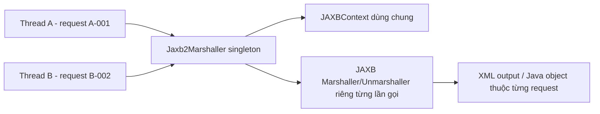

# Vòng đời bộ ánh xạ, sử dụng đồng thời và các phụ thuộc có trạng thái

Trong **Spring Web Services (Spring-WS)**, cùng một bộ ánh xạ Java ↔ XML có thể phục vụ hàng trăm lời gọi SOAP từ nhiều luồng xử lý. Một yêu cầu gửi `SubmitOrderRequest` phải được marshal thành đúng QName và cấu trúc XSD; phản hồi `SubmitOrderResponse` cần được unmarshal về kiểu Java tương ứng. Nếu quản lý sai vòng đời của bộ ánh xạ, hệ thống có thể chạy đúng khi thử một request nhưng phát sinh lỗi ngẫu nhiên, lẫn dữ liệu giữa hai khách hàng hoặc giảm hiệu năng khi có nhiều request đồng thời.

Bài học thuộc chương **Marshalling và OXM** của module **SPRING_WEB_SERVICES**, đặt trong bối cảnh phát triển SOAP **contract-first**: định nghĩa XSD/WSDL, sinh mã JAXB, cấu hình `Jaxb2Marshaller`, xây dựng `@Endpoint` và `WebServiceTemplate`, xử lý SOAP Fault, interceptor, XML security và WS-Security. Trọng tâm là **vòng đời** và **trạng thái**: thành phần nào nên dùng chung, thành phần nào phải tạo riêng cho từng thao tác, và điều gì xảy ra nếu một phụ thuộc được dùng chung nhưng lại giữ dữ liệu của request trước đó.

> Quy tắc nền tảng: có thể **dùng chung metadata JAXB được khởi tạo ổn định**, nhưng không tùy tiện dùng chung các đối tượng JAXB `Marshaller`, `Unmarshaller` và những helper giữ trạng thái của từng request.

## 1. Mục tiêu học tập

Sau bài này, bạn có thể:

- Phân biệt `JAXBContext`, `jakarta.xml.bind.Marshaller`, `jakarta.xml.bind.Unmarshaller` với interface `org.springframework.oxm.Marshaller` và `Jaxb2Marshaller` của Spring OXM.
- Thiết kế vòng đời bean cấu hình một lần rồi tái sử dụng, đồng thời cô lập trạng thái XML của mỗi request.
- Giải thích vì sao JAXB `Marshaller`/`Unmarshaller` không an toàn để nhiều thread gọi đồng thời trên cùng một instance.
- Nhận biết nguy cơ từ `XmlAdapter`, `ValidationEventHandler`, `Marshaller.Listener`, interceptor, callback, cache và đối tượng nghiệp vụ có trạng thái.
- Cấu hình Spring-WS endpoint/client để gửi đúng SOAP payload theo QName từ XSD/WSDL mà không lưu request vào field dùng chung.
- Phân biệt tính an toàn luồng của mapper với tính an toàn luồng của dữ liệu đầu vào, kết nối transport và phụ thuộc nghiệp vụ.
- Tạo kiểm thử đồng thời, kiểm thử lỗi schema và tình huống timeout/retry để phát hiện lẫn trạng thái.

## 2. Phác họa vòng đời ánh xạ trong một lượt SOAP

Sơ đồ tổng quát từ SOAP đến object Java:

```mermaid
sequenceDiagram
    participant C as SOAP client
    participant T as WebServiceTemplate
    participant M as Spring OXM / JAXB
    participant S as SOAP endpoint
    C->>T: submit(request Java)
    T->>M: marshal(request)
    Note over M: JAXBContext dùng chung; JAXB Marshaller riêng lượt gọi
    M-->>T: XML payload
    T->>S: SOAP Envelope + payload
    S->>S: unmarshal/validate và xử lý nghiệp vụ
    S-->>T: SOAP response hoặc Fault
    T->>M: unmarshal(response)
    Note over M: JAXB Unmarshaller riêng lượt gọi
    M-->>T: response Java
    T-->>C: kết quả hoặc exception
```

**Lưu ý:** sơ đồ mô tả các lớp chức năng, không khẳng định Spring-WS luôn gọi chính xác một `Jaxb2Marshaller` ở cả hai phía. Server và client có thể dùng bean khác nhau hoặc các endpoint adapter riêng. Điểm cần hiểu là mỗi lời gọi SOAP cần dữ liệu và trạng thái xử lý riêng, trong khi metadata/contract thường được tải và dùng lại.

Trong hệ Spring:

| Thành phần | Phạm vi điển hình | Có thể dùng chung? | Nguy cơ cần kiểm soát |
|---|---|---|---|
| XSD/WSDL đã phê duyệt | Theo phiên bản contract | Có, dữ liệu chỉ đọc | Đổi schema đang chạy mà không đồng bộ client. |
| `JAXBContext` | Theo tập lớp JAXB/package | Có, được thiết kế để chia sẻ | Khởi tạo nhiều lần làm tăng chi phí; đổi tập class không được tự phản ánh. |
| JAXB `Marshaller` | Theo thao tác marshal | **Không chia sẻ đồng thời** | Thay properties/listener/schema trên instance. |
| JAXB `Unmarshaller` | Theo thao tác unmarshal | **Không chia sẻ đồng thời** | Adapter, event handler, validation và dữ liệu đầu vào. |
| Spring `Jaxb2Marshaller` | Bean cấu hình lâu dài | Thường có, sau khi cấu hình xong | Helper được cấu hình có thể mang trạng thái dùng chung. |
| `WebServiceTemplate` | Bean client lâu dài | Có thể tái sử dụng sau cấu hình | Mutable interceptor, sender, callback tự viết. |
| `@Endpoint` và service | Spring singleton theo mặc định | Có nếu stateless hoặc đồng bộ đúng | Field lưu request/response hiện tại. |
| SOAP payload / request DTO | Một lần gọi | Không chia sẻ để chỉnh sửa đồng thời | Lẫn dữ liệu hoặc thay đổi trong lúc marshal. |
| `Schema` của JAXP | Theo XSD biên dịch | Có thể tái sử dụng | Nguồn schema/import, schema version. |
| JAXP `Validator` | Một lần kiểm tra | Không chia sẻ đồng thời | Error handler và trạng thái validation. |

Bảng trên là định hướng thiết kế. Tính an toàn thực tế phụ thuộc cả **implementation**, cách cấu hình và việc ứng dụng có thay đổi object sau khi khởi tạo hay không.

## 3. Phân biệt hai bộ API mang tên Marshaller

Trong Java/Spring có hai khái niệm rất dễ nhầm:

**JAXB API:**

```java
jakarta.xml.bind.JAXBContext
jakarta.xml.bind.Marshaller
jakarta.xml.bind.Unmarshaller
```

**Spring OXM API:**

```java
org.springframework.oxm.Marshaller
org.springframework.oxm.Unmarshaller
org.springframework.oxm.jaxb.Jaxb2Marshaller
```

`Jaxb2Marshaller` triển khai các interface OXM của Spring và **sử dụng JAXB bên dưới**. Một bean `Jaxb2Marshaller` có thể được Spring quản lý dạng singleton, nhưng điều đó không có nghĩa ứng dụng nên tạo một singleton `jakarta.xml.bind.Marshaller` rồi gọi chung trên mọi thread.

Bảng so sánh:

| Khía cạnh | `JAXBContext` | JAXB `Marshaller`/`Unmarshaller` | Spring `Jaxb2Marshaller` |
|---|---|---|---|
| Vai trò | Lưu metadata ánh xạ JAXB. | Xử lý một quá trình chuyển đổi XML/object. | Adapter Spring OXM dựa trên JAXB. |
| Khởi tạo | Tương đối tốn kém; thường cache/chia sẻ. | Tạo từ context. | Được Spring quản lý như bean. |
| Thread safety | Có thể chia sẻ giữa thread. | Không bảo đảm an toàn khi dùng đồng thời. | Cơ chế phổ biến tạo instance JAXB xử lý riêng mỗi lời gọi. |
| Cấu hình | Package/class binding. | Encoding, schema, listeners, adapters, event handlers. | Context path/classes, schema, properties và các tùy chọn chuyển đổi. |
| Lỗi thường gặp | Context path/namespace sai hoặc thiếu runtime. | Race condition, state leak nếu share một instance. | Chia sẻ collaborator mutable hoặc sửa bean lúc đang phục vụ. |

Giả định trong các ví dụ Java là stack **Spring Boot 3 / Spring-WS 4 / JAXB Jakarta**. Các kiểu `javax.xml.namespace.QName` và `javax.xml.validation.Schema` vẫn thuộc JDK, trong khi JAXB dùng `jakarta.xml.bind.*`. Với stack cũ dùng `javax.xml.bind.*`, thay import theo đúng bộ thư viện và phiên bản đang triển khai.

## 4. Vòng đời `JAXBContext`: khởi tạo một lần, dùng nhiều lần

`JAXBContext` lưu các thông tin để JAXB biết kiểu Java ánh xạ với XML element và XML type nào. Nó thường là phần tạo tốn kém vì phải xét annotation, `ObjectFactory`, tên QName và các package/class.

Ví dụ cách dùng hợp lý ngoài Spring:

```java
import jakarta.xml.bind.JAXBContext;
import jakarta.xml.bind.JAXBException;
import jakarta.xml.bind.Marshaller;
import jakarta.xml.bind.Unmarshaller;

public final class OrderXmlCodec {

    // Khởi tạo context một lần cho tập lớp contract đã biết.
    private final JAXBContext context;

    public OrderXmlCodec() throws JAXBException {
        this.context = JAXBContext.newInstance(
            "org.example.orders.contract"
        );
    }

    public Marshaller newMarshaller() throws JAXBException {
        return context.createMarshaller();
    }

    public Unmarshaller newUnmarshaller() throws JAXBException {
        return context.createUnmarshaller();
    }
}
```

Package `org.example.orders.contract` phải tồn tại và có metadata JAXB phù hợp, ví dụ `ObjectFactory` hoặc `jaxb.index`, cùng JAXB runtime trong classpath. Nếu sinh mã từ XSD ở nhiều package, context phải nhận biết các phần tử/kiểu thực sự cần ánh xạ.

Mỗi lần `newMarshaller()` hay `newUnmarshaller()` sẽ tạo một đối tượng xử lý riêng; **context được dùng lại**. Có thể dùng `JAXBContext.newInstance(Class<?>...)` khi muốn khởi tạo bằng tập lớp thay vì context path.

### Chi phí khởi tạo và cache

Một lỗi hiệu năng điển hình:

```java
public String encodeOrder(SubmitOrderRequest request) throws Exception {
    // Kém hiệu quả: xây lại JAXBContext cho từng request.
    JAXBContext context =
        JAXBContext.newInstance(SubmitOrderRequest.class);
    Marshaller marshaller = context.createMarshaller();

    java.io.StringWriter out = new java.io.StringWriter();
    marshaller.marshal(request, out);
    return out.toString();
}
```

Đoạn trên có thể tạo đúng XML nhưng tốn công phân tích metadata trong mọi lượt gọi. Với dịch vụ throughput lớn, chi phí này tăng đáng kể. Cách hợp lý là **dùng chung context**, nhưng vẫn tạo marshaller theo mỗi lượt.

Nếu cache nhiều context theo tenant/schema version, cần thiết kế khóa cache rõ ràng, giới hạn bộ nhớ và chính sách loại bỏ. Không để cache chứa data request hoặc chọn sai context giữa hai namespace/version.

## 5. JAXB `Marshaller` và `Unmarshaller`: không chia sẻ giữa thread

JAXB `Marshaller` có cấu hình và trạng thái xử lý như encoding, schema, adapters, listener, event handler hoặc attachment marshaller. `Unmarshaller` cũng giữ các cấu hình và collaborator tương tự. Hai loại đối tượng **không có cam kết an toàn luồng** để nhiều thread sử dụng đồng thời.

Ví dụ **không an toàn**:

```java
public final class UnsafeCodec {
    private final jakarta.xml.bind.Marshaller sharedMarshaller;

    public UnsafeCodec(jakarta.xml.bind.JAXBContext context)
            throws jakarta.xml.bind.JAXBException {
        this.sharedMarshaller = context.createMarshaller();
    }

    public String marshal(Object value) throws Exception {
        java.io.StringWriter out = new java.io.StringWriter();
        // Nhiều thread đồng thời dùng cùng một Marshaller.
        sharedMarshaller.marshal(value, out);
        return out.toString();
    }
}
```

Rủi ro không chỉ là lỗi exception: thông tin trạng thái đang xử lý có thể xung đột. Không có cơ sở để giả định `Marshaller` không thay đổi trạng thái nội bộ vì method `marshal` trông như thao tác đọc.

Cách an toàn hơn:

```java
import jakarta.xml.bind.JAXBContext;
import jakarta.xml.bind.JAXBException;
import jakarta.xml.bind.Marshaller;

public final class OrderXmlWriter {
    private final JAXBContext context;

    public OrderXmlWriter(JAXBContext context) {
        this.context = context;
    }

    public String marshal(Object value) throws JAXBException {
        // Mỗi lời gọi có Marshaller riêng.
        Marshaller marshaller = context.createMarshaller();
        marshaller.setProperty(
            Marshaller.JAXB_FORMATTED_OUTPUT, Boolean.FALSE
        );

        java.io.StringWriter out = new java.io.StringWriter();
        marshaller.marshal(value, out);
        return out.toString();
    }
}
```

`StringWriter` là biến cục bộ, chỉ thuộc một lời gọi. Khi cần tùy biến per-request, đặt property trên **marshaller được tạo riêng** thay vì đổi cấu hình của một instance dùng chung.

Đối với unmarshal cũng tương tự:

```java
public Object unmarshal(
        JAXBContext context,
        javax.xml.transform.Source xmlSource) throws Exception {

    var unmarshaller = context.createUnmarshaller();
    return unmarshaller.unmarshal(xmlSource);
}
```

Đây là nguyên tắc thiết kế, chưa thay thế cấu hình XML parser an toàn khi tiếp nhận dữ liệu không tin cậy.

### Có nên bọc `synchronized` quanh một marshaller chung?

Đồng bộ hóa toàn bộ lần marshal có thể ngăn **sử dụng đồng thời**, nhưng tạo nút thắt cổ chai và phải bảo đảm mọi lời gọi đều đi qua cùng khóa. Nó cũng không xử lý triệt để trường hợp code khác đổi adapter, schema hoặc listener sai vòng đời.

Với hệ thống SOAP cần concurrency, mặc định nên tạo JAXB Marshaller/Unmarshaller riêng từ context dùng chung. Pool đối tượng hoặc `ThreadLocal` chỉ nên được cân nhắc sau khi đo hiệu năng và có cơ chế **reset đầy đủ trạng thái** giữa các lần sử dụng.

## 6. Vòng đời bean `Jaxb2Marshaller` trong Spring OXM

Trong Spring, cấu hình điển hình:

```java
import org.springframework.context.annotation.Bean;
import org.springframework.context.annotation.Configuration;
import org.springframework.oxm.jaxb.Jaxb2Marshaller;

@Configuration
public class OrderXmlConfiguration {

    @Bean
    public Jaxb2Marshaller orderMarshaller() {
        Jaxb2Marshaller marshaller = new Jaxb2Marshaller();
        marshaller.setContextPath("org.example.orders.contract");
        return marshaller;
    }
}
```

Spring quản lý bean theo scope mặc định **singleton**: một cấu hình OXM được dùng lại trong ứng dụng. `Jaxb2Marshaller` quản lý JAXB context và trong những phiên bản Spring hiện đại sẽ tạo JAXB `Marshaller`/`Unmarshaller` cho mỗi thao tác, sau đó áp dụng các cấu hình đã định nghĩa.

Điều đó cho phép một bean OXM phục vụ nhiều request đồng thời **nếu mọi cấu hình và collaborator dùng chung đều phù hợp concurrency**. Không được suy luận rằng mọi thành phần nằm trong một `Jaxb2Marshaller` đương nhiên thread-safe.

### Khởi tạo và đóng vòng đời

- **Khi tạo bean:** đặt context path hoặc classes, namespace/schema và các thuộc tính cần thiết.
- **Khi Spring khởi tạo:** cấu hình được kiểm tra và JAXB context được chuẩn bị theo chế độ khởi tạo của phiên bản/cấu hình (có thể có tùy chọn lazy initialization).
- **Khi chạy:** nhiều thread gọi `marshal`/`unmarshal` trên bean đã cấu hình; code không thay đổi cấu hình bean giữa các lượt.
- **Khi dừng ứng dụng:** Spring hủy context/bean theo vòng đời ứng dụng; các writer, reader, stream hoặc network resource tạo riêng cần được đóng theo nơi sở hữu của chúng.

Không nên tạo `new Jaxb2Marshaller()` rồi cấu hình lại trong từng request nếu bean có thể được quản lý sẵn bởi Spring. Khi cần nhiều contract (ví dụ `order/v1` và `order/v2`), tạo **hai bean cố định** hoặc một cấu trúc chọn bean theo phiên bản với logic rõ ràng.

### Không thay đổi bean OXM sau khi ứng dụng bắt đầu phục vụ

Ví dụ phản mẫu:

```java
public String processForTenant(String tenant, Object request) {
    // Sai thiết kế: thay contextPath của mapper dùng chung.
    sharedJaxb2Marshaller.setContextPath(
        "org.example." + tenant + ".contract"
    );

    // Thread khác có thể đang sử dụng mapper cùng lúc.
    // ...
    return "unsafe";
}
```

Thay context path, schema, adapters, marshaller properties hoặc listener trên một bean đang có request đồng thời có thể tạo kết quả không nhất quán hoặc phá vỡ trạng thái đã khởi tạo. Tenant và contract version cần được chọn **trước khi gọi**, không bằng cách tái cấu hình bean singleton trong thời gian thực.

Cấu trúc an toàn hơn là map bất biến `version → mapper` sau startup, với từng mapper có tập class/schema riêng:

```java
public final class ContractMapperRegistry {
    private final java.util.Map<String, Jaxb2Marshaller> byVersion;

    public ContractMapperRegistry(
            java.util.Map<String, Jaxb2Marshaller> mappers) {
        this.byVersion = java.util.Map.copyOf(mappers);
    }

    public Jaxb2Marshaller getRequired(String version) {
        Jaxb2Marshaller mapper = byVersion.get(version);
        if (mapper == null) {
            throw new IllegalArgumentException(
                "Unsupported contract version: " + version);
        }
        return mapper;
    }
}
```

Đây là minh họa: tên khóa và mapping thực tế cần tuân theo QName, WSDL version và bean names. `Map.copyOf` chỉ làm bất biến cấu trúc map, **không tự biến nội bộ các mapper thành immutable**. Chúng vẫn phải được cấu hình xong trước khi cung cấp cho request handler.

## 7. Ranh giới dùng chung khi ứng dụng chạy nhiều request

Giả sử hai client gửi đồng thời:

```xml
<ord:SubmitOrderRequest
    xmlns:ord="https://example.org/contracts/order/v1">
    <ord:requestId>A-001</ord:requestId>
</ord:SubmitOrderRequest>
```

```xml
<ord:SubmitOrderRequest
    xmlns:ord="https://example.org/contracts/order/v1">
    <ord:requestId>B-002</ord:requestId>
</ord:SubmitOrderRequest>
```

Trong ví dụ này, payload được rút gọn để minh họa sự độc lập về dữ liệu, không khẳng định nó hợp lệ với một XSD cụ thể nếu XSD yêu cầu thêm các trường khác.



**Không chia sẻ dữ liệu từng request giữa các thread**, kể cả khi dùng chung mapper. Một instance `SubmitOrderRequest` không nên bị thread A sửa trường `requestId` trong lúc thread B marshal nó. JAXB bean có thể an toàn nhưng object đầu vào vẫn không an toàn khi có concurrent mutation.

Các biến nên đặt trong method hoặc đối tượng riêng cho request:

- Request/response DTO JAXB.
- `StringWriter`, `StringReader`, `Source`/`Result`, `InputStream`/`OutputStream` phục vụ XML.
- `JAXBElement<T>` mang QName của payload.
- `WebServiceMessageCallback` chứa thông tin đặc thù của một request.
- Correlation ID, idempotency key, SOAP header values và thông tin chứng thực của lượt xử lý.

Một bean singleton có thể phụ thuộc vào các service singleton, nhưng mọi service cũng cần được thiết kế stateless hoặc đồng bộ đúng, thay vì chỉ tin rằng Spring đã quản lý bean thì tự nhiên an toàn luồng.

## 8. Những phụ thuộc có trạng thái dễ bị bỏ sót

Ngay cả khi `Jaxb2Marshaller` tạo JAXB Marshaller mới cho mỗi lời gọi, một số thành phần tùy biến được truyền vào có thể **vẫn là cùng một instance** và mang trạng thái mutable. Đây là nguồn lỗi khó đoán vì stack trace thường chỉ ra XML binding chứ không rõ biến nào đã bị chia sẻ.

| Loại phụ thuộc | Ví dụ trạng thái | Nguy cơ khi dùng chung |
|---|---|---|
| `XmlAdapter` | `SimpleDateFormat`, buffer, trường lưu giá trị vừa chuyển đổi | Sai ngày tháng, dữ liệu request này lẫn request khác. |
| `ValidationEventHandler` | `List<ValidationEvent>` tích lũy lỗi | Báo lỗi chéo; list bị ghi đồng thời. |
| `Marshaller.Listener` / `Unmarshaller.Listener` | `currentRequestId`, counters mutable | Callback A ghi đè thông tin của B. |
| `AttachmentMarshaller` / `AttachmentUnmarshaller` | Stream, attachment ID, MIME context | Gắn nhầm file/attachment giữa request. |
| Spring-WS `ClientInterceptor` | Field lưu SOAP message/header hiện tại | Lẫn token và correlation ID. |
| Error handler / SOAP Fault resolver tùy biến | Tham chiếu đến exception gần nhất | Phát Fault detail của request khác. |
| Cache tùy biến | `HashMap` ghi đồng thời không có đồng bộ | Race condition, giá trị lỗi hoặc cấu trúc dữ liệu hỏng. |
| ThreadLocal | Đối tượng request giữ lại sau request | Rò dữ liệu trong thread pool và tích lũy bộ nhớ. |

### 8.1. `XmlAdapter` và đối tượng format không an toàn

Ví dụ adapter **không phù hợp để dùng chung**:

```java
import jakarta.xml.bind.annotation.adapters.XmlAdapter;
import java.text.SimpleDateFormat;
import java.util.Date;

public final class UnsafeDateAdapter
        extends XmlAdapter<String, Date> {

    private final SimpleDateFormat format =
        new SimpleDateFormat("yyyy-MM-dd");

    @Override
    public Date unmarshal(String value) throws Exception {
        return format.parse(value);
    }

    @Override
    public String marshal(Date value) {
        return format.format(value);
    }
}
```

`SimpleDateFormat` có trạng thái nội bộ mutable và không an toàn khi nhiều thread cùng sử dụng. Nếu cùng một adapter instance được đăng ký cho các lời gọi JAXB, việc truy cập đồng thời có thể làm sai kết quả.

Có thể tránh vấn đề bằng API thời gian Java hiện đại, immutable và thread-safe:

```java
import jakarta.xml.bind.annotation.adapters.XmlAdapter;
import java.time.LocalDate;
import java.time.format.DateTimeFormatter;

public final class LocalDateAdapter
        extends XmlAdapter<String, LocalDate> {

    private static final DateTimeFormatter ISO =
        DateTimeFormatter.ISO_LOCAL_DATE;

    @Override
    public LocalDate unmarshal(String value) {
        return value == null ? null : LocalDate.parse(value, ISO);
    }

    @Override
    public String marshal(LocalDate value) {
        return value == null ? null : ISO.format(value);
    }
}
```

`DateTimeFormatter.ISO_LOCAL_DATE` dùng chung an toàn; adapter ở đây không lưu dữ liệu từng request. Khi XSD có timezone hoặc lexical rules cụ thể, cần chọn kiểu và format đúng hợp đồng, không tự đổi sang `LocalDate` nếu contract yêu cầu timestamp có offset.

**Cần kiểm tra phạm vi instance thực tế:** JAXB có thể tạo adapter riêng theo mapping, còn Spring OXM có thể nhận adapter instance được cấu hình qua `setAdapters(...)`. Không nên dựa vào việc implementation ngẫu nhiên tạo riêng adapter để bỏ qua phân tích thread safety.

### 8.2. Event handler và listener

Phản mẫu:

```java
public final class UnsafeValidationHandler
        implements jakarta.xml.bind.ValidationEventHandler {

    private final java.util.List<String> errors =
        new java.util.ArrayList<>();

    @Override
    public boolean handleEvent(
            jakarta.xml.bind.ValidationEvent event) {
        errors.add(event.getMessage());
        return false; // Yêu cầu dừng khi gặp sự kiện.
    }

    public java.util.List<String> getErrors() {
        return errors;
    }
}
```

Nếu cùng instance `UnsafeValidationHandler` được gắn cho nhiều unmarshaller, list `errors` lưu lại lỗi cũ và nhiều thread ghi đồng thời vào `ArrayList`. Cách đúng là tạo handler riêng cho mỗi lần unmarshal, hoặc viết handler **stateless** chỉ log/đẩy sự kiện vào hệ thống an toàn đồng thời và có correlation ID rõ ràng.

Khi cần trả danh sách lỗi validation cho một request, tốt nhất thu thập trong một object **request-local**, ví dụ biến cục bộ được gắn vào `Unmarshaller` do chính request tạo. Không giữ `lastError` trong singleton.

### 8.3. Interceptor, callback và token

Một interceptor Spring-WS thường là bean dùng chung. Nó có thể đọc SOAP Header để kiểm tra hoặc gắn thông tin, nhưng không nên giữ `currentToken`, `lastMessage` hay `currentTenant` trong instance field rồi dùng lại ở request kế tiếp.

Với SOAP client, tạo callback mang dữ liệu riêng cho từng lần gọi:

```java
String requestId = "REQ-1001";

webServiceTemplate.marshalSendAndReceive(
    endpointUri,
    request,
    message -> {
        // message thuộc chính lần gửi này.
        // Viết SOAP Header / SOAPAction theo hợp đồng
        // bằng dữ liệu cục bộ requestId.
    }
);
```

Đây là phác thảo điểm mở rộng; mã production cần thao tác header qua API SOAP phù hợp và tránh viết raw XML không được kiểm soát. `requestId` có thể được capture như dữ liệu không thay đổi. Không đặt nó vào field mutable của bean singleton chỉ để interceptor “nhìn thấy” giá trị.

Khi dùng **WS-Security**, việc xác minh chữ ký, timestamp, UsernameToken và chứng chỉ phụ thuộc cấu hình interceptor, keystore/truststore và crypto provider. Đảm bảo callback handler có cơ chế lấy thông tin danh tính phù hợp từng request và không lưu plaintext password/token trong trạng thái dùng chung.

## 9. Validation với schema và trạng thái của JAXP

Một hệ Spring-WS contract-first thường cần kiểm tra XSD để ngăn request sai cấu trúc trước khi xử lý nghiệp vụ.

Giữa các lớp có sự khác biệt:

- `SchemaFactory` được dùng để **biên dịch XSD thành `Schema`** và không nên được chia sẻ tùy tiện nếu có thread đồng thời thao tác cấu hình/tạo schema.
- `Schema` đã tạo từ XSD là đối tượng có thể dùng chung giữa các thread.
- `Validator` được tạo bởi `Schema.newValidator()`, có trạng thái dùng trong quá trình validation và **không được chia sẻ đồng thời**.
- `ValidatorHandler` cũng không nên được dùng chung giữa nhiều lượt xử lý đồng thời.

Ví dụ JAXP:

```java
import javax.xml.XMLConstants;
import javax.xml.validation.Schema;
import javax.xml.validation.SchemaFactory;
import javax.xml.validation.Validator;

public final class OrderSchemaValidator {

    private final Schema schema;

    public OrderSchemaValidator(java.io.File xsd)
            throws Exception {

        SchemaFactory factory = SchemaFactory.newInstance(
            XMLConstants.W3C_XML_SCHEMA_NS_URI
        );
        factory.setFeature(
            XMLConstants.FEATURE_SECURE_PROCESSING, true
        );
        factory.setProperty(
            XMLConstants.ACCESS_EXTERNAL_DTD, ""
        );
        factory.setProperty(
            XMLConstants.ACCESS_EXTERNAL_SCHEMA, ""
        );
        this.schema = factory.newSchema(xsd);
    }

    public void validate(javax.xml.transform.Source payload)
            throws Exception {
        Validator validator = schema.newValidator();
        validator.setProperty(
            XMLConstants.ACCESS_EXTERNAL_DTD, ""
        );
        validator.setProperty(
            XMLConstants.ACCESS_EXTERNAL_SCHEMA, ""
        );
        validator.validate(payload);
    }
}
```

Mỗi lần `validate` tạo một `Validator` riêng từ `Schema` dùng chung. Với XSD có `xs:import` hoặc `xs:include`, cấu hình chặn external schema access đòi hỏi tài nguyên cục bộ hoặc resolver tin cậy; không nới quyền truy cập mạng tùy tiện để tránh lỗi khởi tạo.

Cấu hình trên tập trung vào JAXP; **SOAP parser, SAAJ, StAX/SAX/DOM** và message size limits còn cần được xử lý an toàn ở các code path tương ứng. Schema validation không thay thế kiểm tra WS-Security hoặc phân quyền nghiệp vụ.

### Trong `Jaxb2Marshaller`

Spring OXM có thể được cấu hình XSD để validate khi marshal/unmarshal theo cơ chế của nó:

```java
@Bean
public Jaxb2Marshaller orderMarshaller() {
    Jaxb2Marshaller m = new Jaxb2Marshaller();
    m.setContextPath("org.example.orders.contract");
    m.setSchema(
        new org.springframework.core.io.ClassPathResource(
            "xsd/order-v1.xsd"
        )
    );
    return m;
}
```

Cần đảm bảo file XSD chính xác với contract đang sử dụng và được đóng gói trong classpath. Khi schema có imports, phải cấu hình resolver, đường dẫn và quyền đọc tài nguyên thích hợp.

Đối với server Spring-WS, có thể dùng `PayloadValidatingInterceptor` độc lập để validate payload request/response. Nếu cả mapper và interceptor đều validate, cần quyết định rõ việc nào là bắt buộc, tránh chạy kiểm tra lặp không cần thiết hoặc tạo Fault khác nhau cho cùng một lỗi. Đặc biệt cần test đường lỗi SOAP Fault, vì failure ở bước unmarshal có thể xảy ra trước endpoint.

## 10. Spring Web Services: bean dùng chung, dữ liệu request riêng

Giả sử hệ thống có XSD `order-v1.xsd` với root `SubmitOrderRequest`/`SubmitOrderResponse`. Cấu hình bean OXM cho một contract có thể dùng cho cả client và server:

```java
import org.springframework.context.annotation.Bean;
import org.springframework.context.annotation.Configuration;
import org.springframework.oxm.jaxb.Jaxb2Marshaller;
import org.springframework.ws.client.core.WebServiceTemplate;

@Configuration
public class SoapClientConfiguration {

    @Bean
    public Jaxb2Marshaller orderMarshaller() {
        Jaxb2Marshaller m = new Jaxb2Marshaller();
        m.setContextPath("org.example.orders.contract");
        return m;
    }

    @Bean
    public WebServiceTemplate ordersTemplate(
            Jaxb2Marshaller orderMarshaller) {

        WebServiceTemplate template =
            new WebServiceTemplate();
        template.setDefaultUri(
            "https://partner.example.org/ws/orders"
        );
        template.setMarshaller(orderMarshaller);
        template.setUnmarshaller(orderMarshaller);
        return template;
    }
}
```

Spring `WebServiceTemplate` được thiết kế để sử dụng lại sau khi cấu hình hoàn chỉnh. Khi nhiều thread gọi cùng template, từng lần gọi vẫn phải có request object, callback và trạng thái riêng. Nếu cấu hình message sender, interceptors hoặc default URI đang được **thay đổi trong lúc phục vụ**, việc dùng chung có thể không còn an toàn.

### Phản mẫu trong `@Endpoint`

Spring `@Endpoint` thường là singleton. Đừng lưu request vừa nhận vào field:

```java
@Endpoint
public class UnsafeOrderEndpoint {

    private SubmitOrderRequest lastRequest;

    @PayloadRoot(
        namespace = "https://example.org/contracts/order/v1",
        localPart = "SubmitOrderRequest"
    )
    @ResponsePayload
    public SubmitOrderResponse submit(
            @RequestPayload SubmitOrderRequest request) {

        this.lastRequest = request; // Sai: field dùng chung!
        return orderService.submit(this.lastRequest);
    }
}
```

Giữa hai dòng trên, thread khác có thể ghi đè `lastRequest`. Tệ hơn, nếu request mang dữ liệu khách hàng nhạy cảm, field còn kéo dài vòng đời của dữ liệu đó sau khi lượt xử lý đã kết thúc.

Cách an toàn:

```java
@Endpoint
public class OrderEndpoint {

    private final OrderService orderService;

    public OrderEndpoint(OrderService orderService) {
        this.orderService = orderService;
    }

    @PayloadRoot(
        namespace = "https://example.org/contracts/order/v1",
        localPart = "SubmitOrderRequest"
    )
    @ResponsePayload
    public SubmitOrderResponse submit(
            @RequestPayload SubmitOrderRequest request) {

        // Dữ liệu request chỉ được dùng trong lượt này.
        return orderService.submit(request);
    }
}
```

Các lớp JAXB, `OrderService` và import endpoint annotation được lược bớt để minh họa trạng thái. `OrderService` vẫn phải bảo đảm an toàn đồng thời ở nghiệp vụ, giao dịch và repository; endpoint stateless không tự động làm toàn bộ hệ thống thread-safe.

Khi cần mã tương quan cho SOAP Fault hoặc log, truyền `requestId` qua method parameter, object context thuộc request, hoặc cơ chế context của framework có cleanup rõ ràng. Không để field `currentRequestId` trong singleton.

## 11. Những phụ thuộc ngoài JAXB cũng có thể giữ trạng thái

Một request SOAP đi qua nhiều lớp:

```text
HTTP/TLS transport
    ↓
SOAP message factory / parser
    ↓
WS-Security interceptor, headers
    ↓
Endpoint mapping, schema validation
    ↓
JAXB unmarshalling
    ↓
Business service / transaction
    ↓
JAXB marshalling
    ↓
SOAP response / Fault
```

Nếu một tầng giữ trạng thái dùng chung không đúng, kết quả sai có thể xuất hiện ở tầng khác:

- **HTTP connection pooling:** connection pool phải hỗ trợ concurrent use đúng theo thư viện; không chia sẻ một response body/input stream giữa request khác.
- **WS-Security:** crypto configuration, truststore và policy có thể là cấu hình dùng chung, nhưng token, nonce, timestamp và chữ ký của từng thông điệp phải gắn đúng request.
- **SOAP attachments/MTOM:** stream và attachment identifier phải thuộc vòng đời của thông điệp, không lưu chung trong một field singleton.
- **Interceptor:** đọc/viết SOAP Header trên chính `MessageContext` của lời gọi; tránh cache trực tiếp mutable message.
- **SOAP Fault resolver:** không giữ exception cuối cùng trong field; tạo Fault detail riêng từ lỗi hiện tại.
- **Database transaction:** không giữ một persistence context/transaction mutable trong field service singleton; sử dụng abstraction quản lý vòng đời request/transaction.
- **Retry:** dùng idempotency key ổn định của cùng yêu cầu; không tái sử dụng một mutable request object đã bị chỉnh sửa bởi thread khác.
- **Monitoring:** counters có thể dùng cơ chế atomic/metric registry, còn dữ liệu request riêng phải có tagging/correlation đúng.

### Vấn đề `ThreadLocal` trong thread pool

`ThreadLocal` cô lập giá trị giữa **các thread**, không mặc nhiên cô lập giữa **các request kế tiếp trên cùng thread**. Application server dùng thread pool nên một thread có thể phục vụ nhiều khách hàng lần lượt.

Nếu dùng `ThreadLocal` cho correlation context, phải luôn cleanup ở cuối lượt xử lý, kể cả khi có SOAP Fault hoặc exception:

```java
try {
    requestContext.set(correlationId);
    processSoapRequest();
} finally {
    requestContext.remove();
}
```

Đây là ví dụ khái niệm khi `requestContext` là `ThreadLocal<String>`. Với lời gọi bất đồng bộ, ThreadLocal không tự truyền an toàn sang thread khác; nên dùng context API được framework hỗ trợ hoặc truyền dữ liệu rõ ràng. Không đặt password, token hoặc thông tin nhạy cảm vào ThreadLocal một cách tùy tiện.

## 12. Bảo mật XML khi có nhiều lời gọi đồng thời

An toàn đồng thời chỉ giải quyết **sử dụng chung bộ nhớ**; không giải quyết XML độc hại. Một dịch vụ có mapper đúng vòng đời vẫn có thể gặp vấn đề nếu parser cho phép entity expansion quá mức hoặc tải DTD từ mạng.

Những điểm cần kết hợp:

1. **Sử dụng schema tin cậy** do dịch vụ quản lý, không tự tải `xsi:schemaLocation` từ request rồi tin rằng đó là contract.
2. **Vô hiệu hoặc giới hạn external entities/DTD** theo parser implementation và nhu cầu tích hợp.
3. **Đặt giới hạn** độ lớn SOAP Body, độ sâu XML, số phần tử và attachment theo gateway/message factory/transport.
4. **Không giữ XML input/output nhạy cảm trong singleton cache**; nếu cần audit, xử lý che dữ liệu cá nhân và credential.
5. **Kiểm tra chữ ký SOAP và timestamp** theo WS-Security trước khi tin dữ liệu nghiệp vụ, với cấu hình phù hợp SOAP binding.
6. **Kiểm tra TLS/chứng chỉ** ở transport; lỗi TLS có thể xảy ra trước khi XML/Unmarshaller được tạo.
7. **Kiểm soát response Fault**: không dùng chung Fault detail mutable hay lộ stack trace trong body trả đối tác.

Bài này không thay cho thiết kế chính sách WS-Security. Điểm kết nối với OXM là một payload JAXB **đúng schema** chưa chắc đã **được xác thực**, và một request được xác thực vẫn cần **xử lý dữ liệu và trạng thái đúng theo từng lượt**.

## 13. Kiểm thử đồng thời mapper và kiểm thử hợp đồng

Test concurrency không thể chứng minh mọi tình huống production, nhưng có thể phát hiện việc chia sẻ nhầm instance JAXB hoặc collaborator có trạng thái.

### 13.1. Test nhiều lượt marshal trên một bean OXM

Ví dụ JUnit 5 dưới đây giả sử `SubmitOrderRequest` là lớp JAXB đã sinh từ XSD và có setter `setRequestId(...)`. Bộ test dùng một bean `Jaxb2Marshaller` cấu hình sẵn, nhưng tạo object và writer riêng cho từng tác vụ:

```java
import java.io.StringWriter;
import java.util.ArrayList;
import java.util.List;
import java.util.concurrent.Callable;
import java.util.concurrent.CountDownLatch;
import java.util.concurrent.ExecutorService;
import java.util.concurrent.Executors;
import java.util.concurrent.Future;
import javax.xml.transform.stream.StreamResult;

import org.junit.jupiter.api.Test;
import org.springframework.oxm.jaxb.Jaxb2Marshaller;

import static org.junit.jupiter.api.Assertions.assertTrue;

class ConcurrentMarshallingTest {

    private final Jaxb2Marshaller mapper = createMapper();

    private static Jaxb2Marshaller createMapper() {
        Jaxb2Marshaller m = new Jaxb2Marshaller();
        m.setContextPath("org.example.orders.contract");
        try {
            m.afterPropertiesSet();
        } catch (Exception e) {
            throw new IllegalStateException(e);
        }
        return m;
    }

    @Test
    void concurrentlyMarshalsIndependentRequests() throws Exception {
        int count = 24;
        ExecutorService executor = Executors.newFixedThreadPool(8);
        CountDownLatch start = new CountDownLatch(1);
        List<Callable<String>> jobs = new ArrayList<>();

        for (int i = 0; i < count; i++) {
            final String id = "REQ-" + i;
            jobs.add(() -> {
                start.await();
                SubmitOrderRequest request =
                    new SubmitOrderRequest();
                request.setRequestId(id);

                // Điền các field bắt buộc khác theo XSD thực tế.

                StringWriter writer = new StringWriter();
                mapper.marshal(request, new StreamResult(writer));
                return writer.toString();
            });
        }

        try {
            List<Future<String>> futures = new ArrayList<>();
            for (Callable<String> job : jobs) {
                futures.add(executor.submit(job));
            }

            start.countDown();
            for (int i = 0; i < count; i++) {
                String xml = futures.get(i).get();
                assertTrue(xml.contains("REQ-" + i));
            }
        } finally {
            executor.shutdownNow();
        }
    }
}
```

Test trên minh họa **cách tổ chức** (một mapper dùng chung, object/writer theo request). Muốn dùng làm test hợp đồng thực tế, hãy tạo **đầy đủ dữ liệu hợp lệ theo XSD**, phân giải XML bằng parser namespace-aware và assert QName/gía trị `requestId` đúng thay vì chỉ tìm substring. Cũng cần bảo đảm context path JAXB và schema của dự án đã được thiết lập.

Một test đầy đủ phải kiểm cả **không có ID của request khác** trong XML đầu ra, nhất là khi adapter hay listener có trạng thái. Nếu chỉ assert `xml.contains(expectedId)`, lỗi “lẫn thêm ID” có thể bị bỏ qua.

### 13.2. Kiểm thử với các trạng thái lỗi khác nhau

Nên kết hợp các tác vụ sau trong cùng đợt:

| Nhóm | Đầu vào mỗi lời gọi | Kỳ vọng |
|---|---|---|
| A | Payload hợp lệ với `requestId` riêng | XML có QName và ID đúng, không lẫn request khác. |
| B | Payload thiếu trường XSD bắt buộc | Validation theo schema từ chối đúng yêu cầu. |
| C | XML sai namespace URI | Endpoint/unmarshaller không nhận như contract cũ. |
| D | Lỗi WS-Security | Chỉ request sai token/chữ ký bị từ chối; không làm nhiễm request hợp lệ. |
| E | SOAP Fault nghiệp vụ | Fault detail chứa đúng mã và correlation ID của yêu cầu. |
| F | Timeout và retry | Không tạo đơn trùng nếu contract có idempotency. |
| G | MTOM/attachment | Nội dung file/attachment gắn đúng thông điệp và stream được đóng. |

Concurrency test là một loại xác minh bổ sung. Nó không thay thế kiểm tra cấu trúc SOAP message, XSD, WSDL, chính sách bảo mật hoặc thử nghiệm qua network transport thật.

### 13.3. Test direct JAXB khi cần xác định nguyên nhân

Nếu nghi ngờ mapper OXM, có thể kiểm tra direct JAXB để cô lập lớp nào đang giữ trạng thái:

```java
JAXBContext context =
    JAXBContext.newInstance(SubmitOrderRequest.class);

Marshaller marshallerA = context.createMarshaller();
Marshaller marshallerB = context.createMarshaller();

// Hai marshaller độc lập có thể sử dụng cùng context.
// Các object và output stream cũng phải độc lập.
```

Nếu direct JAXB an toàn nhưng ứng dụng Spring-WS vẫn lẫn dữ liệu, cần kiểm tra interceptor, callback, listener/adapter, service nghiệp vụ và transport. Nếu direct JAXB cùng một `Marshaller` chia sẻ bị lỗi, đó là dấu hiệu rõ ràng của vấn đề sử dụng không đúng vòng đời.

## 14. Hiệu năng: lựa chọn tối ưu sau khi đo

Các cách dùng JAXB khác nhau có chi phí và độ phức tạp khác nhau:

| Cách triển khai | Ưu điểm | Hạn chế |
|---|---|---|
| Tạo `JAXBContext` cho mỗi lần marshal | Đơn giản về phạm vi object | Tốn chi phí tạo metadata nhiều lần. |
| Dùng chung `JAXBContext`, tạo `Marshaller` riêng mỗi lần | Cân bằng an toàn và hiệu năng, dễ lập luận | Có chi phí tạo Marshaller/Unmarshaller trên mỗi lời gọi. |
| Dùng bean `Jaxb2Marshaller` đã cấu hình | Dễ tích hợp Spring-WS và Spring OXM | Phải kiểm tra collaborator mutable và version. |
| Pool `Marshaller`/`Unmarshaller` | Có thể giảm chi phí tạo object trong một số workload | Cần reset toàn bộ properties, adapters, handlers, buffers; nguy cơ state leak. |
| `ThreadLocal<Marshaller>` | Giảm khởi tạo theo thread | Thread pool giữ state lâu, khó cleanup, tăng memory; không mặc định đáng dùng. |

Một số nguyên tắc:

- **Đừng tối ưu bằng việc chia sẻ trực tiếp một JAXB Marshaller mutable** mà không có cơ chế bảo đảm thread safety.
- Đo throughput và latency với **payload thật**, schema validation, SOAP Header, WS-Security/MTOM và số thread dự kiến.
- So sánh profile CPU/heap trước và sau thay đổi, không kết luận “JAXB chậm” chỉ dựa trên một lần chạy.
- Hạn chế biến SOAP/XML thành chuỗi chỉ để log rồi parse lại nếu không cần; stream/transform đúng API có thể giảm allocation.
- Nếu dùng pool, mỗi object phải được trả pool trong `finally` và reset trạng thái, đặc biệt khi ngoại lệ phát sinh giữa chừng.

Với nhiều dịch vụ doanh nghiệp, cache `JAXBContext` và dùng bean `Jaxb2Marshaller` cấu hình một lần là điểm khởi đầu phù hợp. Các kỹ thuật nâng cao nên dựa trên số liệu đo và kết quả test concurrency.

## 15. Ma trận lỗi và cách chẩn đoán

| Triệu chứng | Nguyên nhân khả dĩ | Kiểm tra đầu tiên |
|---|---|---|
| Thỉnh thoảng XML request A chứa ID của B | DTO, buffer, adapter hoặc listener được dùng chung sai cách. | Kiểm tra instance field trong endpoint/interceptor và object truyền vào mapper. |
| Lỗi JAXB chỉ xuất hiện khi nhiều thread | Chia sẻ `Marshaller`/`Unmarshaller` trực tiếp. | Tạo instance JAXB riêng từng lời gọi từ context dùng chung. |
| Độ trễ cao ngay cả khi payload nhỏ | Tạo lại `JAXBContext` trên mỗi request. | Profile initialization, chuyển context sang lifecycle lâu dài. |
| Validation báo lỗi cũ của request trước | Handler ghi lỗi trong list dùng chung. | Dùng event handler per invocation hoặc stateless. |
| XML sai namespace ở một số tenant | Đổi `contextPath`/schema trên mapper singleton lúc chạy. | Tách mapper theo contract/namespace version. |
| SOAP client báo `unexpected element` | JAXB mapping sai QName hoặc schema khác WSDL. | So namespace URI/local name, `@XmlRootElement`/`@XmlElementDecl`. |
| Mất attachment hoặc gắn nhầm file | Attachment callback/stream dùng chung. | Rà soát ownership và cleanup theo message. |
| Chỉ một số request bị lỗi SOAP Header | Interceptor giữ token/correlation ID trong field. | Dùng `MessageContext` và dữ liệu request-local. |
| Memory leak sau tải cao | ThreadLocal không remove, cache giữ DTO/XML, stream không đóng. | Heap dump, thread pool và cache policy. |
| SOAP Fault chi tiết không đúng request | Resolver giữ last exception/last fault detail. | Tạo Fault details từ exception hiện tại; test song song. |
| XML bị chặn vì external entities | Cấu hình XML security thiếu hoặc schema import không tin cậy. | Kiểm tra parser, resolver, `ACCESS_EXTERNAL_*` và schema location. |
| Timeout rồi tạo hai giao dịch | Retry dùng ID mới hoặc service không idempotent. | Request ID ổn định, dedup và transaction boundary. |

Một quy trình gỡ lỗi thực tế:

1. Ghi **QName của SOAP Body**, correlation ID và version contract.
2. Xác định thời điểm lỗi: trước unmarshal, khi validator chạy, sau service nghiệp vụ, hay khi marshal response.
3. Kiểm tra nơi lưu dữ liệu hiện tại: local variable hay field của singleton.
4. Phân biệt object dùng chung theo thiết kế với state bị chia sẻ vô tình; rà soát listeners/adapters/handlers.
5. Chạy lại bằng hai request với ID khác nhau gửi đồng thời, rồi xác nhận dữ liệu không bị trộn.
6. Test XML theo schema và SOAP Fault riêng; đừng chỉ đếm HTTP 200/500.
7. Chỉ sửa tối ưu hiệu năng sau khi đã đảm bảo đúng hợp đồng và an toàn dữ liệu.

## 16. Bài thực hành: phát hiện và sửa phụ thuộc có trạng thái

Hãy xem đoạn mã (giả sử các lớp contract/JAXB đã tồn tại):

```java
@Component
public class OrderClient {

    private final JAXBContext context;
    private final StringWriter sharedWriter = new StringWriter();

    public OrderClient() throws JAXBException {
        this.context =
            JAXBContext.newInstance(SubmitOrderRequest.class);
    }

    public String xml(SubmitOrderRequest request)
            throws JAXBException {
        Marshaller m = context.createMarshaller();
        m.marshal(request, sharedWriter);
        return sharedWriter.toString();
    }
}
```

**Câu hỏi:**

1. Thành phần nào được dùng chung **đúng mục đích**?
2. Thành phần nào có nguy cơ lẫn dữ liệu giữa các lượt gọi?
3. Tạo `Marshaller` trong method đã đủ đảm bảo thread safety của toàn bộ method chưa?
4. Làm sao sửa để hai request đồng thời đều nhận XML độc lập?
5. Nếu thêm một `XmlAdapter` có `SimpleDateFormat` instance field được dùng chung, còn vấn đề nào cần sửa?
6. Nếu service có `@Endpoint` singleton giữ field `currentRequest` thì cần điều chỉnh ra sao?

**Lời giải tham khảo:**

- `JAXBContext` dùng chung là hợp lý.
- `sharedWriter` là mutable, được giữ trong singleton và không reset an toàn. Hai lời gọi có thể chồng nội dung hoặc tiếp tục append dữ liệu cũ.
- Marshaller riêng **chưa đủ** nếu output writer hoặc input request object bị dùng chung/sửa đồng thời.
- Đưa writer vào trong method:

```java
public String xml(SubmitOrderRequest request)
        throws JAXBException {
    Marshaller marshaller = context.createMarshaller();
    java.io.StringWriter writer = new java.io.StringWriter();
    marshaller.marshal(request, writer);
    return writer.toString();
}
```

- Thay adapter bằng logic stateless/immutable hoặc tạo adapter riêng cho mỗi invocation.
- Đưa `currentRequest` thành method parameter/local, không lưu vào singleton.

### Thử thách thêm: chỉnh lỗi không thể thấy qua test tuần tự

Giả sử `ValidationEventHandler` có trường `List<String> errors`. Khi chạy test 1 rồi test 2 tuần tự, developer gọi `errors.clear()` trước mỗi lần. Cách này vẫn có thể sai nếu hai thread chạy đồng thời: thread A có thể đang ghi lỗi, thread B đã clear list, khiến cả hai mất/chia sẻ dữ liệu.

Thiết kế đúng hơn là **mỗi thao tác có vùng chứa lỗi riêng**, hoặc không giữ error list trong handler dùng chung. Đừng dùng cách “clear state trước request” như một cơ chế thay thế request isolation trong hệ thống nhiều thread.

## 17. Tổng kết

Trong marshalling và OXM của Spring Web Services, **vòng đời mapper** quyết định cả hiệu năng lẫn tính đúng đắn. `JAXBContext` đại diện metadata có thể chia sẻ; JAXB `Marshaller` và `Unmarshaller` là đối tượng xử lý có trạng thái, không nên dùng chung đồng thời. `Jaxb2Marshaller` của Spring OXM thường là bean singleton được cấu hình một lần và tạo các đối tượng JAXB xử lý riêng cho từng lần gọi.

An toàn đồng thời chỉ thực sự đạt được khi các phụ thuộc phía sau cũng được quản lý đúng: `XmlAdapter`, listener, validation handler, SOAP interceptor, callback, stream, DTO, schema validator, WS-Security context và business service. Với cách làm **contract-first**, luôn đối chiếu QName/XSD/WSDL và kiểm thử SOAP response/Fault thực tế, đặc biệt ở tình huống nhiều request, lỗi schema, timeout và retry. Một mapper dùng chung đúng cách giúp giảm chi phí, còn dữ liệu thuộc từng request phải luôn được cô lập.
