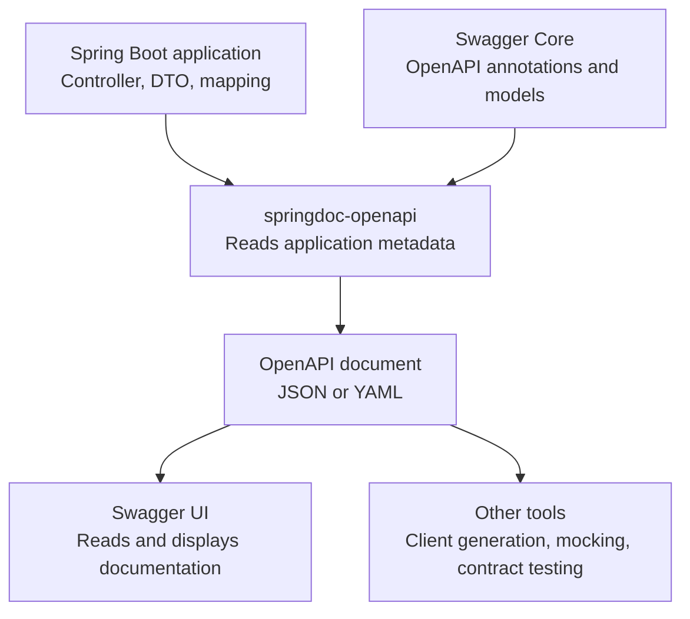

# Distinguishing OpenAPI Specification, Springdoc, Swagger Core, and Swagger UI

When building APIs with Spring Boot, the names OpenAPI, Springdoc, Swagger Core, and Swagger UI often appear together. They are closely related but handle different parts of the job. Calling everything "Swagger" makes it easy to confuse the API contract specification standard, the library that generates documentation from the application, and the interface used to read or try calling the API.

This lesson puts all four concepts into their proper places in the workflow of using **springdoc-openapi**: extracting information from Spring Boot controllers and DTOs, generating documentation conforming to the OpenAPI standard, and then displaying that documentation in Swagger UI.

## 1. Why Distinguish the Components?

An API has an implementation side and a contract side. The implementation includes controllers, services, DTOs, validation rules, and error handling. The contract describes what external applications can use: which endpoints exist, which HTTP methods they use, what parameters they require, how requests and responses are structured, which status codes can be returned, and what security mechanisms apply.

If integrators only read source code, they have to trace through multiple layers to understand how to call the API. If documentation is written only manually, it can drift from actual behavior when controllers or DTOs change. An automated documentation workflow collects information from the Spring Boot application, represents it in a standard format, and provides a convenient interface for developers.

| Component | Nature | Primary Responsibility |
|---|---|---|
| **OpenAPI Specification (OAS)** | Specification and document format | Defines how HTTP API contracts are represented in JSON or YAML |
| **springdoc-openapi** | Spring integration library | Reads the Spring application structure and generates OpenAPI documentation |
| **Swagger Core** | Java library suite | Provides models, annotations, and tools for processing OpenAPI documents |
| **Swagger UI** | Web UI application | Reads an OpenAPI document and renders APIs for browsing and interactive testing |

You can remember them using four questions:

- **OpenAPI:** According to what rules must an API document be represented?
- **Springdoc:** How do we extract information from a Spring Boot application to generate that document?
- **Swagger Core:** Which Java models and annotations support describing and processing OpenAPI documents?
- **Swagger UI:** How can humans view and test APIs from the generated document?

## 2. OpenAPI Specification: An API Contract in a Common Standard

**OpenAPI Specification**, commonly abbreviated as **OAS**, is a programming-language- and framework-independent specification. It defines the structure of a document describing an HTTP API. An OpenAPI document can be written in YAML or JSON and read by various tools without needing to know whether the API is implemented with Spring Boot, ASP.NET, Express, or another technology.

An OpenAPI document typically contains these information sections:

- **openapi:** the version of the OpenAPI specification the document conforms to.
- **info:** API title, version, and description.
- **servers:** server addresses that clients can call.
- **paths:** paths and HTTP operations such as GET, POST, PUT, and DELETE.
- **components:** reusable structures such as schemas, responses, parameters, and security schemes.
- **security:** security requirements applied to the entire document or individual operations.

A condensed example of an OpenAPI document:

```yaml
openapi: 3.0.3
info:
  title: Product API
  version: 1.0.0
  description: Product management API
servers:
  - url: https://api.example.com
paths:
  /api/products/{id}:
    get:
      summary: Get product information
      parameters:
        - name: id
          in: path
          required: true
          schema:
            type: integer
      responses:
        '200':
          description: Product found
          content:
            application/json:
              schema:
                $ref: '#/components/schemas/Product'
        '404':
          description: Product not found
components:
  schemas:
    Product:
      type: object
      properties:
        id:
          type: integer
          example: 42
        name:
          type: string
          example: Mechanical keyboard
```

The example shows that the document describes the contract clients need to know: call GET /api/products/{id}, pass id in the URL, and expect either a success or error response. The Product schema indicates the structure of the returned data. The document does not contain the database query logic or controller implementation code.

OpenAPI is a **description standard**, not a Spring library and not a web UI. Many tools can consume the same OpenAPI document to generate client SDKs, spin up mock servers, run contract tests, generate documentation, or support testing.

## 3. springdoc-openapi: Connecting Spring Boot Applications to OpenAPI

**springdoc-openapi** is a library built for the Spring ecosystem. It integrates with Spring Boot applications to detect endpoints declared via Spring MVC or Spring WebFlux, read information from data types and annotations, and construct a document following the OpenAPI model.

Instead of writing all YAML by hand, you can declare controllers and DTOs as usual. Springdoc gathers information provided by the framework and annotations and outputs an OpenAPI document. When clearer descriptions are needed, developers add annotations for operations, parameters, schemas, responses, or security.

### 3.1. Adding the Dependency

For a Spring Boot 3 application using Spring MVC, you can use the following Maven starter:

```xml
<dependency>
    <groupId>org.springdoc</groupId>
    <artifactId>springdoc-openapi-starter-webmvc-ui</artifactId>
    <version>${springdoc.version}</version>
</dependency>
```

Replace **${springdoc.version}** with the springdoc version compatible with your project's Spring Boot version. The springdoc 2.x line targets Spring Boot 3; Spring Boot 2 projects use the springdoc 1.x line and its corresponding artifact names. For Spring WebFlux applications, choose the appropriate WebFlux starter instead of the WebMVC starter.

The webmvc-ui starter bundles both document generation and Swagger UI. If the project only needs to export the document without the accompanying Swagger UI interface, choose the corresponding API-docs starter.

### 3.2. Common Documentation Endpoints

Once the application starts, the common default endpoints are:

| Address | Content |
|---|---|
| /v3/api-docs | OpenAPI document in JSON format |
| /v3/api-docs.yaml | OpenAPI document in YAML format |
| /swagger-ui.html | Swagger UI entry point; typically redirects to the Swagger UI interface |

These addresses can be customized through configuration. For example:

```properties
springdoc.api-docs.path=/api-docs
springdoc.swagger-ui.path=/docs
```

When the configuration above is applied, the JSON document endpoint moves to /api-docs and the UI path moves to /docs. Path changes must be accounted for in reverse proxy, gateway, and deployment documentation.

### 3.3. Where Does Springdoc Get Its Information?

Springdoc combines multiple information sources:

1. **Spring mappings:** @RequestMapping, @GetMapping, @PostMapping, and similar mappings provide paths, HTTP methods, and mapping metadata.
2. **Method parameters:** @PathVariable, @RequestParam, @RequestHeader, and @RequestBody help identify input data.
3. **Java data types:** DTOs, records, primitives, collections, and nested structures provide information to build schemas.
4. **Descriptive annotations:** OpenAPI annotations allow adding descriptions, examples, responses, API groups, and security requirements.
5. **OpenAPI configuration:** the application can declare general metadata, servers, security schemes, and documentation groups.

Springdoc cannot accurately infer every business rule solely from method signatures. For instance, a ProductResponse return type does not fully state when the API returns 404, which fields are required by business rules, or what permissions the caller needs. Such details must be documented explicitly and verified against actual behavior.

## 4. Swagger Core: Models and Annotations for OpenAPI in Java

**Swagger Core** is a Java library suite in the Swagger ecosystem that provides components to represent and process API documents. For OpenAPI 3, the library provides Java models for document structures and annotations in the **io.swagger.v3.oas.annotations** package.

In applications using springdoc, developers commonly encounter annotations such as:

| Annotation | Purpose |
|---|---|
| @Tag | Groups related operations |
| @Operation | Describes an API operation |
| @Parameter | Describes an input parameter |
| @ApiResponse, @ApiResponses | Describes possible returned responses |
| @Schema | Adds metadata for a schema or data property |
| @SecurityScheme | Declares a security mechanism in the document |
| @SecurityRequirement | Attaches a security requirement to an API or document |
| @OpenAPIDefinition | Declares global metadata for the document |

These annotations help describe the contract closely to the API author's intent. Springdoc reads the corresponding metadata and includes it in the generated OpenAPI document.

Point to distinguish: Swagger Core is not another name for the OpenAPI Specification. The specification defines the rules and format of the document; Swagger Core is a Java implementation for working with documents and annotations according to that specification. Springdoc integrates the relevant components to serve Spring applications.

In new projects using OpenAPI 3, be careful to use annotations from the io.swagger.v3.oas.annotations package. Legacy Swagger 2 annotations, such as those in the io.swagger.annotations package, belong to an older API generation and should not be mixed indiscriminately with OpenAPI 3 configurations.

## 5. Swagger UI: Interface for Reading and Testing APIs

**Swagger UI** is a web UI application capable of reading an OpenAPI document and rendering it as an interactive list of APIs. The interface typically allows users to:

- Browse APIs by tag, path, and HTTP method.
- Read descriptions of operations, parameters, request bodies, responses, and schemas.
- View sample JSON structures.
- Enter parameter values or request bodies.
- Send requests directly to the server using the **Try it out** feature.
- Perform authentication steps according to declared and UI-supported security schemes.

Swagger UI consumes the OpenAPI document. It does not scan Spring Boot controllers and does not generate the API contract itself. If the OpenAPI document is missing a response or describes a data type incorrectly, Swagger UI will display that missing or incorrect information.

The **Try it out** feature also needs to be understood correctly. It sends HTTP requests to the server address configured in the document or selected by the user. Therefore, requests only succeed when the server is reachable, the path is correct, and CORS and authentication are properly configured. Seeing the Try it out button does not mean the API has been thoroughly tested or that the server automatically allows anyone to access it.

## 6. Putting All Four Components in One Flow

In a Spring Boot application using springdoc, the flow of generating and displaying documentation can be visualized as follows:



Each component contributes a part:

1. Controllers and DTOs represent the API implemented in the application.
2. Annotations and configurations provide additional descriptions for what cannot be fully inferred from source code.
3. Springdoc gathers the information and generates the OpenAPI document.
4. The OpenAPI document can be read directly or rendered by Swagger UI.
5. Other tools can also consume the same document independently of Swagger UI.

Thus, OpenAPI is the output contract format; springdoc handles Spring integration; Swagger Core provides the Java models and annotations; Swagger UI is one way to present the output.

## 7. Example: Describing an Endpoint with Springdoc and OpenAPI Annotations

Suppose an application has an endpoint to fetch product information by ID. The returned DTO looks like this:

```java
import io.swagger.v3.oas.annotations.media.Schema;

@Schema(description = "Product information")
public record ProductResponse(
    @Schema(description = "Product ID", example = "42")
    Long id,

    @Schema(description = "Product name", example = "Mechanical keyboard")
    String name
) {
}
```

The controller can be declared as:

```java
import io.swagger.v3.oas.annotations.Operation;
import io.swagger.v3.oas.annotations.Parameter;
import io.swagger.v3.oas.annotations.tags.Tag;
import io.swagger.v3.oas.annotations.responses.ApiResponse;
import io.swagger.v3.oas.annotations.responses.ApiResponses;
import org.springframework.web.bind.annotation.GetMapping;
import org.springframework.web.bind.annotation.PathVariable;
import org.springframework.web.bind.annotation.RequestMapping;
import org.springframework.web.bind.annotation.RestController;

@RestController
@RequestMapping("/api/products")
@Tag(name = "Products", description = "Product management API")
public class ProductController {

    @GetMapping("/{id}")
    @Operation(
        summary = "Get product information",
        description = "Find a product by product ID."
    )
    @ApiResponses({
        @ApiResponse(responseCode = "200", description = "Product found"),
        @ApiResponse(responseCode = "404", description = "Product not found")
    })
    public ProductResponse getById(
        @Parameter(description = "Product ID", example = "42")
        @PathVariable Long id
    ) {
        // Business logic is omitted in this example.
        return new ProductResponse(id, "Mechanical keyboard");
    }
}
```

In this example:

- @RestController, @RequestMapping, and @GetMapping are Spring annotations defining the endpoint and HTTP method.
- @Tag, @Operation, @ApiResponse, and @Parameter are OpenAPI descriptive annotations providing information for the documentation.
- @Schema describes the DTO structure and example values.
- Springdoc combines the metadata above to generate the corresponding operation in the OpenAPI document.

The code omits business logic to focus on documentation metadata. In a real application, the 200 and 404 responses must match how the controller or exception handler actually responds. If the API also returns 400, 401, 403, or 500, document those cases when they are part of the public contract.

## 8. Declaring Global Metadata and Splitting Documentation into Groups

### 8.1. Global Metadata

You can use @OpenAPIDefinition to declare general information for the document:

```java
import io.swagger.v3.oas.annotations.OpenAPIDefinition;
import io.swagger.v3.oas.annotations.info.Info;
import io.swagger.v3.oas.annotations.info.Contact;

@OpenAPIDefinition(
    info = @Info(
        title = "Product API",
        version = "1.0.0",
        description = "Product management API",
        contact = @Contact(
            name = "API Team",
            email = "api-team@example.com"
        )
    )
)
public class OpenApiConfiguration {
}
```

This is metadata used to identify the document. It does not alter the application version on its own, nor does it enforce API access policies.

### 8.2. Splitting Documentation into Groups

An application may expose multiple API groups, such as a public group and an internal group. Springdoc supports creating groups with GroupedOpenApi:

```java
import org.springdoc.core.models.GroupedOpenApi;
import org.springframework.context.annotation.Bean;
import org.springframework.context.annotation.Configuration;

@Configuration
public class OpenApiGroupConfiguration {

    @Bean
    GroupedOpenApi publicApi() {
        return GroupedOpenApi.builder()
            .group("public")
            .pathsToMatch("/api/public/**")
            .build();
    }

    @Bean
    GroupedOpenApi adminApi() {
        return GroupedOpenApi.builder()
            .group("admin")
            .pathsToMatch("/api/admin/**")
            .build();
    }
}
```

With the group configuration above, each group's documentation can be accessed via paths of the form /v3/api-docs/{group}, such as /v3/api-docs/public and /v3/api-docs/admin. Import packages and configuration APIs must match the springdoc version in use.

Splitting into groups helps readers focus on the relevant API scope. However, hiding an endpoint from a documentation group does not replace access control at the application or gateway layer.

## 9. Common Misconceptions

| Misconception | Accurate Understanding |
|---|---|
| "OpenAPI and Swagger UI are the same thing." | OpenAPI is the specification/document; Swagger UI is the interface that reads that document. |
| "Installing Swagger UI automatically documents the API." | Swagger UI needs an OpenAPI document to display. In Spring Boot, springdoc usually generates this document. |
| "Springdoc is the OpenAPI standard." | Springdoc is a Spring integration library that generates documents conforming to the OpenAPI standard. |
| "Swagger Core is a framework that replaces Springdoc." | Swagger Core provides Java models and annotations; springdoc handles specialized integration with Spring Boot. |
| "Adding annotations means the API is already secured." | Security annotations describe requirements in the documentation; Spring Security configuration or actual protection mechanisms must still be implemented separately. |
| "Auto-generated documentation is always accurate." | Documentation depends on inferable metadata and descriptions supplied by developers; it must be checked against API behavior. |
| "Hiding an API from Swagger UI is secure enough." | Hiding from documentation only affects API discoverability, not whether requests can reach the endpoint. |

Another common mistake is overly sparse response documentation. For example, a method returns ProductResponse but the documentation only lists a 200 response, even though the application also returns 404 when a product is not found. Consumers of the documentation will have an incomplete understanding of how to handle outcomes. Document status codes, schemas, and error conditions consistent with the actual contract.

## 10. Inspecting the Generated Documentation

After starting the application, you can inspect the output in this order:

1. Open /v3/api-docs and confirm the server returns valid JSON.
2. Locate the /api/products/{id} path under paths and check the get operation, parameters, and responses.
3. Check the ProductResponse schema under components.schemas if the schema is referenced or reused.
4. Open /v3/api-docs.yaml to verify YAML output.
5. Open /swagger-ui.html, locate the Products group, and test a request with suitable data in an allowed environment.

Example using curl to retrieve the JSON document:

```bash
curl -i http://localhost:8080/v3/api-docs
```

When inspecting, distinguish three types of outcomes:

- **Documentation is not generated:** check dependencies, configuration, startup logs, and the API-docs endpoint.
- **Documentation exists but has missing or wrong information:** check Spring mappings, data types, annotations, and OpenAPI configuration.
- **Swagger UI does not render or cannot call the API:** check the UI path, the document URL the UI is loading, server URLs, permissions, and network settings.

Do not look only at Swagger UI and conclude the contract is right. The JSON/YAML document is the output that must be inspected directly, especially when used as input for client generation, contract testing, or integration with other systems.

## 11. Role of OpenAPI Documentation in the API Lifecycle

An OpenAPI document has value beyond the Swagger UI page. When managed as part of the API contract, it can support:

- **Cross-team collaboration:** frontend, backend, mobile, and integration partners reference a single format.
- **Client code generation:** tools can use schemas and operations to generate API client classes.
- **Mocking and parallel development:** client teams can work against the documentation or a mock server before the backend is finished.
- **Contract testing:** compare actual requests/responses against what the documentation publishes.
- **Version management:** review changes to endpoints, schemas, and responses to assess impact on existing clients.
- **Documentation distribution:** export JSON/YAML for archiving, publishing, or feeding into CI/CD pipelines.

Automated documentation reduces repetitive work, but does not replace contract change management. When changing field names, data types, status codes, or security requirements, the development team still needs to evaluate backward compatibility and update the API version per system policy.

## 12. Key Takeaways

- **OpenAPI Specification** defines how to describe HTTP API contracts.
- **springdoc-openapi** integrates with Spring Boot to collect application metadata and generate OpenAPI documents.
- **Swagger Core** provides Java models and annotations to support describing and processing OpenAPI documents.
- **Swagger UI** reads OpenAPI documents and presents them as an interactive interface for browsing and testing APIs.

In a Spring Boot project, you typically write controllers and DTOs, add OpenAPI annotations where clearer descriptions are needed, use springdoc to generate JSON/YAML, and then use Swagger UI or other tools to consume the documentation. Understanding each component's role makes project configuration easier, places error handling at the right layer, and keeps the API contract aligned with actual behavior.
